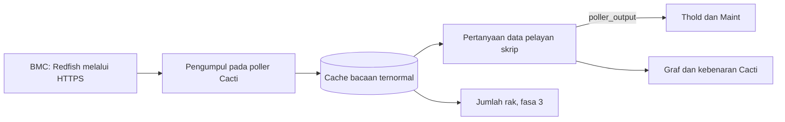

<!-- Source: README.md; SHA256: 7b4e83a58a1adc844cb0615ef30e95476cba2851f96bb454d2a816fb2774724d -->

<!-- translations:start -->
[English](../../../README.md) | [简体中文](../zh-CN/README.md) | [हिन्दी](../hi-IN/README.md) | [Español (España)](../es-ES/README.md) | [Español (Latinoamérica)](../es-419/README.md) | [العربية (السعودية)](../ar-SA/README.md) | [Afrikaans](../af-ZA/README.md) | [አማርኛ](../am-ET/README.md) | [العربية (مصر)](../ar-EG/README.md) | [العربية (المغرب)](../ar-MA/README.md) | [বাংলা](../bn-BD/README.md) | [Bosanski](../bs-BA/README.md) | [Deutsch](../de-DE/README.md) | [فارسی](../fa-IR/README.md) | [Filipino](../fil-PH/README.md) | [Français](../fr-FR/README.md) | [Français (Maroc)](../fr-MA/README.md) | [Français (Sénégal)](../fr-SN/README.md) | [Hausa](../ha-NG/README.md) | [עברית](../he-IL/README.md) | [Hrvatski](../hr-HR/README.md) | [Bahasa Indonesia](../id-ID/README.md) | [Igbo](../ig-NG/README.md) | [Italiano](../it-IT/README.md) | [日本語](../ja-JP/README.md) | [한국어](../ko-KR/README.md) | [Malagasy](../mg-MG/README.md) | [मराठी](../mr-IN/README.md) | [Bahasa Melayu](README.md) | [Nederlands](../nl-NL/README.md) | [Polski](../pl-PL/README.md) | [Português (Brasil)](../pt-BR/README.md) | [Русский](../ru-RU/README.md) | [Kinyarwanda](../rw-RW/README.md) | [Soomaali](../so-SO/README.md) | [Српски](../sr-RS/README.md) | [Svenska](../sv-SE/README.md) | [Kiswahili](../sw-KE/README.md) | [தமிழ்](../ta-IN/README.md) | [తెలుగు](../te-IN/README.md) | [ไทย](../th-TH/README.md) | [Türkçe](../tr-TR/README.md) | [Українська](../uk-UA/README.md) | [اردو](../ur-PK/README.md) | [Tiếng Việt](../vi-VN/README.md) | [isiXhosa](../xh-ZA/README.md) | [Yorùbá](../yo-NG/README.md) | [繁體中文](../zh-TW/README.md) | [isiZulu](../zu-ZA/README.md)
<!-- translations:end -->

# plugin_redfish

Pemalam Cacti 1.2 yang membawa penggunaan kuasa pelayan, suhu masuk, keadaan kipas, dan kesihatan bekalan kuasa daripada pengawal pengurusan papan induk (BMC) ke dalam Cacti sebagai peranti, sumber data, dan graf biasa, menggunakan Redfish dengan pilihan sandaran IPMI. Thold dan Maint kemudian memberi amaran dan menyekatnya, dan fasa seterusnya menambah jumlah kuasa peringkat rak.

> **Status: dalam pembangunan, belum ada keluaran lagi (0.1.0-dev).** Pencapaian 2 (asas) dan 3 (objek Cacti dan pemakluman) telah digabungkan pada `main`. Pemalam ini tidak bersekutu dengan projek Cacti. Ia dipasang pada Cacti 1.2.31 di bawah PHP 8.2 atau lebih baharu, mendaftarkan BMC dan kelayakan, membaca kuasa, suhu, kipas, dan kesihatan bekalan kuasa daripada setiap BMC melalui Redfish ke dalam cachenya sendiri, dan menunjukkan kesihatan pengumpulan. Ia menambah peranti Cacti, graf per ahli dan ringkasan, serta sokongan Thold dan Maint melalui sumber data biasa. CI telah menguji BMC palsu yang dibina daripada lekapan tulisan tangan dan pelayan tiruan DMTF Redfish; tiada BMC sebenar atau kumpulan perintis yang telah disahkan. Reka bentuk dan penyelidikan terdapat dalam [docs/PLAN.md](../../PLAN.md), [docs/research/](../../research), dan [docs/decisions/](../../decisions).

### Perkara yang disediakan oleh pencapaian 2

- Pasang, naik taraf, nyahdayakan, dan nyahpasang melalui API pemalam Cacti, dengan jadual dikekalkan semasa nyahpasang melainkan tetapan tersebut dikosongkan. Pada PHP yang lebih lama daripada 8.2, pemalam enggan dipasang atau didayakan dan menyatakan sebabnya.
- Realm "Redfish View" (halaman kesihatan), "Redfish Operator" (halaman operasi), dan "Redfish Admin" (halaman BMC dan kelayakan), serta tetapan di bawah Configuration > Settings > Redfish.
- Pendaftaran BMC dengan import CSV dan eksport JSON. Fail import tidak boleh mengandungi kata laluan; kelayakan dirujuk mengikut nama.
- Kelayakan disimpan secara disulitkan dengan AES-256-GCM. Kuncinya ialah fail di luar pangkalan data, `/etc/cacti/redfish-vault.key` secara lalai, yang mengandungi 64 aksara perenambelasan (`openssl rand -hex 32`) atau tepat 32 bait rawak, dimiliki oleh pengguna poller, tidak boleh dibaca oleh pengguna lain, dalam direktori yang hanya boleh ditulis oleh pengguna poller atau root. Kunci sebanyak 32 aksara boleh cetak ditolak sebagai frasa laluan. **Sandarkan fail kunci bersama pangkalan data**; tanpanya setiap kata laluan yang disimpan mesti dimasukkan semula.
- Pengesahan TLS dihidupkan secara lalai, dengan himpunan CA per BMC atau pin SHA-256 SPKI. Pilihan keluar tidak disahkan per BMC yang dilog kekal pada halaman kesihatan sebagai amaran.
- Klien Redfish baca sahaja: `GET` serta log masuk dan log keluar sesi sahaja, disemak terhadap senarai yang dibenarkan sebelum sebarang permintaan dihantar.
- Pengumpul yang dimulakan daripada `poller_bottom` untuk BMC pada poller utama, dengan pajakan dan tarikh akhir per BMC, pengunduran, dan pembersihan selepas ranap satu sesi yang direkodkan oleh pemalam. Pengumpul jauh belum disokong lagi; ia memerlukan pilihan eksplisit tentang cara pengumpul mencapai pangkalan data dan kunci (fasa 4).
- Rekod dan kelayakan BMC mengikut kebenaran peranti Cacti: seorang Redfish Admin hanya melihat, menukar, dan mengikat BMC pada peranti yang boleh dilihatnya, dan hanya kelayakan yang tidak digunakan oleh mana-mana BMC pada peranti tersembunyi.

### Perkara yang ditambah oleh pencapaian 3

- Templat yang dihantar sebagai XML templat Cacti dalam `templates/` dan diimport dengan pengimport Cacti sendiri semasa pemasangan dan naik taraf, dipadankan mengikut cincangan, supaya import mengemas kini objek pemalam dan tidak menambah apa-apa dua kali. Tiga fail pertanyaan data disalin ke `<cacti>/resource/script_server/` dengan cincangan yang direkodkan; pemalam tidak pernah menggantikan fail di sana yang tidak ditulisnya, dan halaman kesihatan memberi amaran kepada pentadbir apabila templat atau fail pertanyaan tiada di tempatnya. **Reinstall the Redfish Templates** pada halaman BMC mengimportnya semula; ia memerlukan kebenaran Import Templates Cacti.
- **Create Device** atau **Add Graphs** pada setiap BMC ([ADR 0015](../../decisions/0015-attach-to-the-server-device-or-create-one-per-bmc.md)). BMC yang dipetakan ke peranti pelayan sedia ada mendapat pertanyaan data dan grafnya pada peranti tersebut. BMC yang tidak dipetakan mendapat peranti baharu daripada templat peranti "Redfish BMC", dengan semakan ketersediaan dimatikan dan nama hos di bawah `.invalid`, supaya Cacti tidak pernah menghubungi BMC dan tidak pernah menunjukkan alamatnya. Walau apa pun, pentadbir mengesahkan pelan yang menyenaraikan perkara yang akan ditambah terlebih dahulu. Kedua-duanya memerlukan kebenaran pengurusan peranti Cacti serta Redfish Admin; peranti baharu yang tidak dapat dilihat oleh penciptanya akan dialih keluar semula.
- Tiga pertanyaan data pelayan skrip, "Redfish Fans", "Redfish Temperatures", dan "Redfish Power Supplies", diindeks mengikut kunci ahli BMC, dengan satu graf bagi setiap ahli: kelajuan kipas dalam peratus atau RPM (mana-mana unit yang dilaporkan oleh BMC), suhu, serta watt input dan output bekalan kuasa, masing-masing dengan kod kesihatannya.
- Input "Redfish Node Summary" dengan kuasa, suhu masuk, suhu tertinggi, kipas dan bekalan yang tidak OK, kesihatan nod, dan usia bacaan baik terakhir, dilukis pada empat graf: kuasa, suhu, kesihatan komponen, dan usia data. Ambang Thold pada sumber data ini memberi amaran, dan Maint menyekatnya, tanpa sebarang perubahan pada kedua-dua pemalam tersebut.
- Pelayan skrip hanya menjawab daripada cache pemalam dan tidak pernah menghubungi BMC. Nilai yang hilang, lapuk, daripada unit lain, atau daripada ahli yang telah tiada ialah `U`, jadi graf menunjukkan jurang, tidak pernah sifar; `age` sentiasa mempunyai nilai, jadi ambang padanya mengesan BMC yang berhenti menjawab.
- Pautan graf daripada setiap graf Redfish ke graf Redfish peranti, ditunjukkan hanya kepada pengguna yang dibenarkan Cacti melihat peranti tersebut.

**Apabila ahli BMC berubah** (kipas diganti, kemas kini perisian tegar menamakan semula penderia), pilih **Add Graphs** sekali lagi. Kipas atau bekalan kuasa yang sebelum ini wujud dan kini tiada atau hilang dikira dalam `fans_bad` atau `psus_bad` sehingga anda berbuat demikian, jadi kipas yang dicabut memberi amaran; slot yang tidak pernah diisi tidak dikira. Add Graphs menerima ahli yang dilaporkan oleh BMC sekarang, dan Cacti mengindeks semula pertanyaan tersebut; ahli yang telah tiada mengekalkan sumber data dan grafnya, yang membaca `U` mulai saat itu, dan ahli baharu mendapat graf. Padamkan graf ahli yang telah tiada secara manual setelah sejarahnya tidak lagi diperlukan.

Memadamkan peranti akan menyahpeta BMCnya dan mengekalkan BMC serta cachenya. Memadamkan BMC, atau menyahpasang pemalam, mengekalkan peranti dan grafnya.

## Peranan akses

| Realm | Akses |
| --- | --- |
| Redfish View | Halaman pemantauan sedia ada. |
| Redfish Operator | Pemantauan serta halaman Operasi dan pengakuan triaj peribadi. |
| Redfish Admin | Akses Operator serta konfigurasi sedia ada dan tindakan pentadbiran. |

Selepas menyalin fail naik taraf, buka halaman Plugins sebagai pentadbir untuk mendaftarkan
realm baharu. Tetapkan realm Operator secara eksplisit di bawah **Configuration > Users** atau kumpulan pengguna.
Naik taraf mengekalkan ID realm View dan Admin serta pemberian sedia ada. Akses Admin
mewarisi akses Operator, dan akses Operator mewarisi akses View pada setiap permintaan;
ini tidak menambah pemberian tersimpan kepada pengguna atau kumpulan. Tetapan pemalam juga memerlukan
akses Redfish Admin sebagai tambahan kepada kebenaran Settings Cacti.

Kebenaran peranti Cacti masih mengehadkan baris dan tindakan yang tersedia kepada setiap pengguna; objek yang tidak dipetakan memerlukan pentadbir. Operator boleh melepaskan tahanan pengumpulan pada BMC yang dibenarkan untuk larian berjadual seterusnya.
Kelayakan, konfigurasi, pemetaan, pemadaman dan perubahan pentadbiran lain
kekal dalam halaman pentadbiran. Pengakuan hanya bertahan dalam sesi
pengguna semasa, untuk paling lama satu jam dan hanya sementara pemerhatian yang sama kekal
segar. Pemerhatian baharu atau berubah membatalkannya. Ia tidak pernah menandakan pengukuran
yang gagal sebagai sihat atau menyekat amaran.

## Mengapa

Setiap pelayan mempunyai BMC yang melaporkan keadaan kuasa dan terma secara bebas daripada sistem pengendalian, jadi ia terus menjawab apabila OS tergendala. Data ini digunakan untuk penjejakan kapasiti dan kos, amaran awal kipas atau bekalan kuasa yang gagal, dan, dalam pengkomputeran berprestasi tinggi, keputusan pengehadan kuasa. Pemalam ini tidak khusus untuk HPC.

Cacti meliputi sebahagian daripada perkara ini hari ini:

- **Pakej SNMP vendor.** Cawangan 1.2.x menyertakan templat Dell iDRAC dan HPE iLO yang memerlukan ejen SNMP dan khusus untuk vendor; penyelidikan pencapaian 1 mendapati bahawa kedua-duanya tidak melaporkan penggunaan kuasa dalam watt ([docs/research/overlap.md](../../research/overlap.md)).
- **Jenis kelayakan tanpa pengumpul.** plugin_credentials mentakrifkan kelayakan "IPMI / Redfish (BMC)" tetapi tidak membaca mana-mana BMC.
- **Tiada paparan peringkat rak.** Teras Cacti tidak mempunyai objek rak; peranti mempunyai medan `location` teks bebas.

Pemalam ini meninjau BMC di luar jalur daripada kitaran tinjauan Cacti, menyimpan bacaan ternormal dalam cache, dan mendedahkannya melalui pertanyaan data pelayan skrip dan sumber data ringkasan. Ia menggunakan semula penggrafan, kebenaran, Thold, dan Maint Cacti, dan tidak mengubah keadaan BMC. Sokongan pengumpul data jauh dirancang untuk fasa 4; pengumpulan semasa berjalan pada poller utama sahaja.

## Skop yang dirancang

| Fasa | Skop | Pencapaian |
|---|---|---|
| 0, penyelidikan | Matriks vendor, pengesahan kelakuan huluan pada BMC langsung, kos peninjauan, percubaan pertanyaan data | [M1](https://github.com/somethingwithproof/plugin_redfish/milestone/1) |
| 1, pemerhatian | Pendaftaran BMC, kelayakan, TLS, pengumpul Redfish, bacaan ternormal, peranti, graf per indeks, pemakluman Thold, sekatan Maint, halaman kesihatan | [M2](https://github.com/somethingwithproof/plugin_redfish/milestone/2), [M3](https://github.com/somethingwithproof/plugin_redfish/milestone/3), [M4](https://github.com/somethingwithproof/plugin_redfish/milestone/4) |
| 2, ipmi | Sandaran IPMI untuk BMC tanpa Redfish yang boleh digunakan, dimatikan secara lalai | [M5](https://github.com/somethingwithproof/plugin_redfish/milestone/5) |
| 3, rak | Pendaftaran rak, jumlah kuasa rak dengan liputan, ruang kepala bajet | [M6](https://github.com/somethingwithproof/plugin_redfish/milestone/6) |
| 4, jauh | Pengumpul data jauh Cacti untuk rangkaian BMC terpencil | [M7](https://github.com/somethingwithproof/plugin_redfish/milestone/7) |

Di luar skop: menetapkan had kuasa atau sebarang konfigurasi BMC lain, kawalan kuasa, kemas kini perisian tegar, akses konsol, enjin pemakluman milik pemalam, dan integrasi penjadual.

## Sasaran keserasian

| Komponen | Sasaran |
|---|---|
| Cacti | 1.2.31 atau lebih baharu, tiada tampalan teras |
| Pangkalan data | MariaDB 10.2 atau MySQL 5.7 atau lebih baharu: satu BMC per peranti dipegang oleh kunci unik pada lajur terjana |
| PHP | 8.2 atau lebih baharu; `setup.php` kekal boleh dihuraikan pada 8.0 supaya masa jalan yang tidak disokong mendapat penolakan dan bukannya UI Cacti yang rosak |
| BMC | Dell iDRAC, HPE iLO, Lenovo XCC, dan OpenBMC, mengikut julat perisian tegar; lihat [matriks vendor](../../research/vendor-matrix.md) |
| Redfish | Sumber subsistem dan penderia baharu dahulu, `Power` dan `Thermal` yang ditamatkan sebagai sandaran |
| Thold, Maint | Tiada perubahan diperlukan |

## Reka bentuk

- [docs/PLAN.md](../../PLAN.md) ialah pelan penuh: seni bina, fakta huluan yang menjadi sandarannya (dengan sumber dan andaian yang masih perlu disahkan), model pengukuran, sempadan keselamatan, aritmetik prestasi, pengujian, dan risiko.
- [docs/decisions/](../../decisions) menyimpan rekod keputusan seni bina untuk pilihan yang telah dibuat.
- [docs/REQUIREMENTS.md](../../REQUIREMENTS.md) memetakan setiap ID keperluan kepada isunya.

## Keselamatan

Kelayakan BMC mengawal pengurusan luar jalur pelayan. Reka bentuk ini menjauhkannya daripada baris perintah, log, dan halaman, mengesahkan TLS secara lalai, menjalankan sebarang perintah luaran daripada tatasusunan argumen dengan subperintah yang dibenarkan, dan menggunakan akaun BMC baca sahaja. Lihat [docs/PLAN.md](../../PLAN.md#security) dan [SECURITY.md](../../../SECURITY.md).

## Panduan pengendali

Lihat [docs/operator-guide.md](../../operator-guide.md) untuk prasyarat pemasangan, persediaan peti besi dan TLS, pendaftaran BMC, penciptaan graf, selang amaran, sandaran, dan pengendalian kegagalan. Panduan ini tidak mengisytiharkan barisan perisian tegar vendor sebenar disokong sehingga tangkapan yang disunting daripada perisian tegar tersebut lulus suit ujian.

## Cara kerja dijejaki

- **Pencapaian** mengikut pencapaian pelan. Setiap satunya mempunyai isu epik yang menyenaraikan sub-isu dan bukti keluarannya.
- **Isu** ditaipkan mengikut label: `type: requirement`, `type: research`, `type: decision`, `type: epic`. Isu keperluan menyatakan keperluan bernombor yang boleh diuji (`REQ-AREA-NNN`) dan kriteria penerimaan.
- **Label** juga membawa `area:`, `phase:`, `priority:`, dan `status:`. Lihat [CONTRIBUTING.md](../../../CONTRIBUTING.md#labels).
- [Papan projek](https://github.com/users/somethingwithproof/projects/12) menunjukkan semua isu merentas pencapaian.

## Menyumbang

Baca [CONTRIBUTING.md](../../../CONTRIBUTING.md). Komit memerlukan tandatangan DCO. Perbincangan reka bentuk berlaku pada isu; keputusan terbuka membawa label `type: decision`. Bukti daripada BMC sebenar ialah sumbangan yang paling berguna sekarang; sunting alamat, nombor siri, dan kelayakan sebelum menyiarkan sebarang tangkapan.

## Lesen

GNU General Public License v2.0, lesen yang sama seperti Cacti dan pemalamnya. Lihat [LICENSE](../../../LICENSE).
