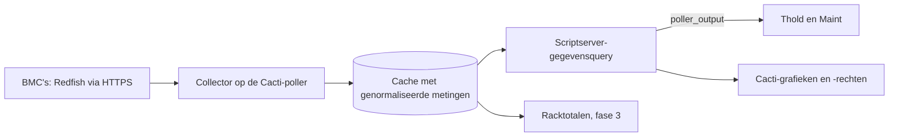

<!-- Source: README.md; SHA256: 7b4e83a58a1adc844cb0615ef30e95476cba2851f96bb454d2a816fb2774724d -->

<!-- translations:start -->
[English](../../../README.md) | [简体中文](../zh-CN/README.md) | [हिन्दी](../hi-IN/README.md) | [Español (España)](../es-ES/README.md) | [Español (Latinoamérica)](../es-419/README.md) | [العربية (السعودية)](../ar-SA/README.md) | [Afrikaans](../af-ZA/README.md) | [አማርኛ](../am-ET/README.md) | [العربية (مصر)](../ar-EG/README.md) | [العربية (المغرب)](../ar-MA/README.md) | [বাংলা](../bn-BD/README.md) | [Bosanski](../bs-BA/README.md) | [Deutsch](../de-DE/README.md) | [فارسی](../fa-IR/README.md) | [Filipino](../fil-PH/README.md) | [Français](../fr-FR/README.md) | [Français (Maroc)](../fr-MA/README.md) | [Français (Sénégal)](../fr-SN/README.md) | [Hausa](../ha-NG/README.md) | [עברית](../he-IL/README.md) | [Hrvatski](../hr-HR/README.md) | [Bahasa Indonesia](../id-ID/README.md) | [Igbo](../ig-NG/README.md) | [Italiano](../it-IT/README.md) | [日本語](../ja-JP/README.md) | [한국어](../ko-KR/README.md) | [Malagasy](../mg-MG/README.md) | [मराठी](../mr-IN/README.md) | [Bahasa Melayu](../ms-MY/README.md) | [Nederlands](README.md) | [Polski](../pl-PL/README.md) | [Português (Brasil)](../pt-BR/README.md) | [Русский](../ru-RU/README.md) | [Kinyarwanda](../rw-RW/README.md) | [Soomaali](../so-SO/README.md) | [Српски](../sr-RS/README.md) | [Svenska](../sv-SE/README.md) | [Kiswahili](../sw-KE/README.md) | [தமிழ்](../ta-IN/README.md) | [తెలుగు](../te-IN/README.md) | [ไทย](../th-TH/README.md) | [Türkçe](../tr-TR/README.md) | [Українська](../uk-UA/README.md) | [اردو](../ur-PK/README.md) | [Tiếng Việt](../vi-VN/README.md) | [isiXhosa](../xh-ZA/README.md) | [Yorùbá](../yo-NG/README.md) | [繁體中文](../zh-TW/README.md) | [isiZulu](../zu-ZA/README.md)
<!-- translations:end -->

# plugin_redfish

Een Cacti 1.2-plugin die het stroomverbruik van servers, de inlaattemperatuur, de ventilatorstatus en de gezondheid van voedingen vanaf baseboard management controllers (BMC's) naar Cacti brengt als gewone apparaten, gegevensbronnen en grafieken, via Redfish met een optionele IPMI-terugvaloptie. Thold en Maint kunnen hier vervolgens meldingen voor genereren en onderdrukken, en een latere fase voegt vermogenstotalen op rackniveau toe.

> **Status: in ontwikkeling, nog geen release (0.1.0-dev).** Mijlpalen 2 (basis) en 3 (Cacti-objecten en alarmering) zijn samengevoegd op `main`. Deze plugin is niet gelieerd aan het Cacti-project. De plugin kan worden geïnstalleerd op Cacti 1.2.31 onder PHP 8.2 of hoger, registreert BMC's en inloggegevens, leest vermogen, temperaturen, ventilatoren en voedingsgezondheid van elke BMC uit via Redfish naar een eigen cache, en toont de verzamelstatus. Hij voegt Cacti-apparaten, grafieken per onderdeel en samenvattingsgrafieken, en ondersteuning voor Thold en Maint toe via gewone gegevensbronnen. CI heeft een gesimuleerde BMC getest die is opgebouwd uit handgeschreven fixtures en de DMTF Redfish-mockupserver; er is nog geen echte BMC of pilotomgeving gekwalificeerd. Het ontwerp en onderzoek staan in [docs/PLAN.md](../../PLAN.md), [docs/research/](../../research) en [docs/decisions/](../../decisions).

### Wat mijlpaal 2 levert

- Installeren, bijwerken, uitschakelen en verwijderen via de plugin-API van Cacti, waarbij tabellen bij verwijdering behouden blijven tenzij de instelling wordt uitgevinkt. Op PHP ouder dan 8.2 weigert de plugin te installeren of in te schakelen en geeft hij aan waarom.
- Rechtenniveaus (realms) "Redfish View" (statuspagina), "Redfish Operator" (beheerpagina voor operaties) en "Redfish Admin" (pagina's voor BMC's en inloggegevens), en instellingen onder Configuration > Settings > Redfish.
- Een BMC-register met CSV-import en JSON-export. Importbestanden mogen geen wachtwoorden bevatten; naar inloggegevens wordt verwezen op naam.
- Inloggegevens worden versleuteld opgeslagen met AES-256-GCM. De sleutel is een bestand buiten de database, standaard `/etc/cacti/redfish-vault.key`, met daarin 64 hexadecimale tekens (`openssl rand -hex 32`) of precies 32 willekeurige bytes, eigendom van de poller-gebruiker, niet leesbaar voor andere gebruikers, in een map waarin alleen de poller-gebruiker of root mag schrijven. Een sleutel van 32 afdrukbare tekens wordt geweigerd als wachtwoordzin. **Maak samen met de database een back-up van het sleutelbestand**; zonder dit bestand moet elk opgeslagen wachtwoord opnieuw worden ingevoerd.
- TLS-verificatie staat standaard aan, met een CA-bundel of SPKI SHA-256-pin per BMC. Een gelogde uitzondering voor ongeverifieerde TLS per BMC blijft als waarschuwing op de statuspagina staan.
- Een alleen-lezen Redfish-client: uitsluitend `GET` plus het aan- en afmelden van sessies, gecontroleerd aan de hand van een acceptatielijst voordat er een verzoek wordt verzonden.
- Een collector die vanuit `poller_bottom` wordt gestart voor BMC's op de hoofdpoller, met leases en deadlines per BMC, backoff en opschoning na een crash van de ene sessie die de plugin heeft vastgelegd. Externe collectors worden nog niet ondersteund; daarvoor is een expliciete keuze nodig voor hoe de collector de database en de sleutel bereikt (fase 4).
- BMC-records en inloggegevens volgen de apparaatrechten van Cacti: een Redfish Admin ziet, wijzigt en koppelt alleen BMC's op apparaten die deze mag zien, en alleen inloggegevens die door geen enkele BMC op een verborgen apparaat worden gebruikt.

### Wat mijlpaal 3 toevoegt

- Sjablonen die als Cacti-sjabloon-XML worden meegeleverd in `templates/` en bij installatie en upgrade worden geïmporteerd met Cacti's eigen importprogramma, gekoppeld op basis van een hash, zodat een import de objecten van de plugin bijwerkt en niets dubbel toevoegt. De drie gegevensquerybestanden worden gekopieerd naar `<cacti>/resource/script_server/` met een vastgelegde hash; de plugin vervangt daar nooit een bestand dat hij niet zelf heeft geschreven, en de statuspagina waarschuwt beheerders wanneer de sjablonen of een querybestand ontbreken. **Reinstall the Redfish Templates** op de pagina BMCs importeert ze opnieuw; hiervoor is het Cacti-recht Import Templates vereist.
- **Create Device** of **Add Graphs** bij elke BMC ([ADR 0015](../../decisions/0015-attach-to-the-server-device-or-create-one-per-bmc.md)). Een BMC die is gekoppeld aan een bestaand apparaat van een server krijgt zijn gegevensquery's en grafieken op dat apparaat. Een niet-gekoppelde BMC krijgt een nieuw apparaat op basis van het apparaatsjabloon "Redfish BMC", met beschikbaarheidscontroles uitgeschakeld en een hostnaam onder `.invalid`, zodat Cacti nooit contact opneemt met de BMC en het adres nooit toont. In beide gevallen bevestigt een beheerder eerst een plan waarin staat wat er wordt toegevoegd. Voor beide acties zijn zowel Cacti's recht voor apparaatbeheer als Redfish Admin vereist; een nieuw apparaat dat de aanmaker niet zou kunnen zien, wordt weer verwijderd.
- Drie scriptserver-gegevensquery's, "Redfish Fans", "Redfish Temperatures" en "Redfish Power Supplies", geïndexeerd op de onderdeelsleutel van de BMC, met een grafiek per onderdeel: ventilatorsnelheid in procenten of RPM (afhankelijk van de eenheid die de BMC rapporteert), temperatuur en het ingaande en uitgaande vermogen van de voeding in watt, telkens met de bijbehorende statuscode.
- Een invoer "Redfish Node Summary" met vermogen, inlaattemperatuur, hoogste temperatuur, aantal ventilatoren en voedingen dat niet OK is, knooppuntstatus en de ouderdom van de laatst geslaagde meting, weergegeven in vier grafieken: vermogen, temperaturen, componentgezondheid en gegevensouderdom. Thold-drempels op deze gegevensbronnen geven meldingen en Maint onderdrukt ze, zonder wijzigingen aan een van beide plugins.
- De scriptserver antwoordt uitsluitend vanuit de cache van de plugin en neemt nooit contact op met een BMC. Een waarde die ontbreekt, verouderd is, een andere eenheid heeft of afkomstig is van een verdwenen onderdeel is `U`, zodat grafieken een onderbreking tonen en nooit nul; `age` heeft altijd een waarde, zodat een drempelwaarde hierop een BMC detecteert die niet meer reageert.
- Een grafiekkoppeling van elke Redfish-grafiek naar de Redfish-grafieken van het apparaat, alleen zichtbaar voor gebruikers aan wie Cacti toestaat het apparaat te bekijken.

**Wanneer de onderdelen van een BMC veranderen** (een vervangen ventilator, een firmware-update die sensoren hernoemt), kiest u opnieuw **Add Graphs**. Een ventilator of voeding die aanwezig was en nu ontbreekt of verdwenen is, telt mee in `fans_bad` of `psus_bad` totdat u dat doet, zodat een verwijderde ventilator een melding veroorzaakt; een slot dat nooit gevuld was telt niet mee. Add Graphs accepteert de onderdelen die de BMC nu rapporteert en Cacti indexeert de query's opnieuw; een verdwenen onderdeel behoudt zijn gegevensbron en grafiek, die vanaf dat moment `U` weergeven, en een nieuw onderdeel krijgt een grafiek. Verwijder de grafieken van verdwenen onderdelen handmatig zodra hun historie niet meer nodig is.

Het verwijderen van een apparaat ontkoppelt de bijbehorende BMC en behoudt de BMC en zijn cache. Het verwijderen van een BMC, of het verwijderen van de plugin, behoudt het bijbehorende apparaat en de grafieken.

## Toegangsrollen

| Rechtenniveau | Toegang |
| --- | --- |
| Redfish View | Bestaande monitoringpagina's. |
| Redfish Operator | Monitoring plus de pagina Operations en persoonlijke triagebevestigingen. |
| Redfish Admin | Operator-toegang plus de bestaande configuratie- en beheeracties. |

Open na het kopiëren van de upgradebestanden als beheerder de pagina Plugins om het nieuwe rechtenniveau te registreren. Wijs het niveau Operator expliciet toe onder **Configuration > Users** of gebruikersgroepen. Bij upgrades blijven de bestaande realm-ID's en toekenningen voor View en Admin behouden. Admin-toegang erft bij elk verzoek Operator-toegang, en Operator-toegang erft View-toegang; dit voegt geen opgeslagen toekenningen toe aan gebruikers of groepen. Voor plugin-instellingen is naast het Cacti-recht Settings ook Redfish Admin-toegang vereist.

Apparaatrechten in Cacti blijven de rijen en acties beperken die voor elke gebruiker beschikbaar zijn; voor niet-gekoppelde objecten is een beheerder vereist. Operators kunnen een verzamelblokkade op een toegestane BMC vrijgeven voor de volgende geplande uitvoering. Inloggegevens, configuratie, koppeling, verwijdering en andere beheerwijzigingen blijven op de beheerpagina's. Bevestigingen gelden alleen binnen de huidige gebruikerssessie, maximaal één uur en alleen zolang dezelfde waarneming actueel blijft. Nieuwe of gewijzigde waarnemingen maken ze ongeldig. Ze markeren een mislukte meting nooit als gezond en onderdrukken geen meldingen.

## Waarom

Elke server heeft een BMC die het stroomverbruik en de thermische status onafhankelijk van het besturingssysteem rapporteert, en dus blijft antwoorden wanneer het besturingssysteem niet actief is. De gegevens dienen voor capaciteits- en kostenbeheer, vroegtijdige waarschuwing bij een defecte ventilator of voeding en, in high-performance computing, beslissingen over vermogensbegrenzing. De plugin is niet specifiek voor HPC.

Cacti dekt een deel hiervan al af:

- **SNMP-pakketten van leveranciers.** De 1.2.x-tak levert Dell iDRAC- en HPE iLO-sjablonen mee die een SNMP-agent vereisen en leverancierspecifiek zijn; uit onderzoek in mijlpaal 1 bleek dat geen van beide het stroomverbruik in watt rapporteert ([docs/research/overlap.md](../../research/overlap.md)).
- **Een inloggegevenstype zonder collector.** plugin_credentials definieert een "IPMI / Redfish (BMC)"-inloggegeven, maar leest geen enkele BMC uit.
- **Geen overzicht op rackniveau.** Cacti Core heeft geen rackobject; een apparaat heeft alleen een vrij tekstveld `location`.

De plugin bevraagt BMC's out-of-band ten opzichte van Cacti's pollcyclus, slaat genormaliseerde metingen op in een cache en stelt deze beschikbaar via een scriptserver-gegevensquery en samenvattende gegevensbronnen. Hij hergebruikt Cacti's grafieken, rechten, Thold en Maint en wijzigt de status van de BMC niet. Ondersteuning voor externe gegevenscollectors staat gepland voor fase 4; de huidige gegevensverzameling draait uitsluitend op de hoofdpoller.

## Geplande reikwijdte

| Fase | Reikwijdte | Mijlpalen |
|---|---|---|
| 0, onderzoek | Leveranciersmatrix, bevestiging van upstream-gedrag op live BMC's, pollkosten, data-query-spike | [M1](https://github.com/somethingwithproof/plugin_redfish/milestone/1) |
| 1, observeren | BMC-register, inloggegevens, TLS, Redfish-collector, genormaliseerde metingen, apparaten, grafieken per index, Thold-alarmering, Maint-onderdrukking, statuspagina | [M2](https://github.com/somethingwithproof/plugin_redfish/milestone/2), [M3](https://github.com/somethingwithproof/plugin_redfish/milestone/3), [M4](https://github.com/somethingwithproof/plugin_redfish/milestone/4) |
| 2, ipmi | IPMI-terugvaloptie voor BMC's zonder bruikbare Redfish, standaard uitgeschakeld | [M5](https://github.com/somethingwithproof/plugin_redfish/milestone/5) |
| 3, racks | Rackregister, rack-vermogenstotalen met dekking, budgetruimte | [M6](https://github.com/somethingwithproof/plugin_redfish/milestone/6) |
| 4, extern | Externe Cacti-gegevenscollectors voor geïsoleerde BMC-netwerken | [M7](https://github.com/somethingwithproof/plugin_redfish/milestone/7) |

Buiten de reikwijdte: het instellen van vermogenslimieten of enige andere BMC-configuratie, stroombeheer, firmware-updates, consoletoegang, een eigen alarmeringsengine in de plugin en plannerintegratie.

## Compatibiliteitsdoelen

| Component | Doel |
|---|---|
| Cacti | 1.2.31 of hoger, geen core-patches |
| Database | MariaDB 10.2 of MySQL 5.7 of hoger: één BMC per apparaat wordt afgedwongen door een unieke sleutel op een gegenereerde kolom |
| PHP | 8.2 of hoger; `setup.php` blijft parsebaar op 8.0 zodat een niet-ondersteunde runtime een weigering krijgt in plaats van een kapotte Cacti-UI |
| BMC's | Dell iDRAC, HPE iLO, Lenovo XCC en OpenBMC, per firmwarebereik; zie [de leveranciersmatrix](../../research/vendor-matrix.md) |
| Redfish | Nieuwe subsysteem- en sensorresources eerst, verouderde `Power` en `Thermal` als terugvaloptie |
| Thold, Maint | Geen wijzigingen vereist |

## Ontwerp

- [docs/PLAN.md](../../PLAN.md) is het volledige plan: architectuur, upstream-feiten waarop het steunt (met bronnen en nog te bevestigen aannames), meetmodel, beveiligingsgrenzen, prestatieberekeningen, testen en risico's.
- [docs/decisions/](../../decisions) bevat Architecture Decision Records voor reeds gemaakte keuzes.
- [docs/REQUIREMENTS.md](../../REQUIREMENTS.md) koppelt elk vereiste-ID aan het bijbehorende issue.

## Beveiliging

BMC-inloggegevens geven toegang tot het out-of-band-beheer van servers. Het ontwerp houdt ze buiten opdrachtregels, logboeken en pagina's, verifieert standaard TLS, voert eventuele externe opdrachten uit via een argumentenarray met subopdrachten uit een acceptatielijst en gebruikt alleen-lezen BMC-accounts. Zie [docs/PLAN.md](../../PLAN.md#security) en [SECURITY.md](../../../SECURITY.md).

## Beheerdershandleiding

Zie [docs/operator-guide.md](../../operator-guide.md) voor installatievereisten, kluis- en TLS-configuratie, BMC-registratie, het aanmaken van grafieken, meldingsintervallen, back-ups en foutafhandeling. De handleiding verklaart een echte firmwarelijn van een leverancier pas als ondersteund zodra een geanonimiseerde opname van die firmware de testsuite doorstaat.

## Hoe werk wordt bijgehouden

- **Mijlpalen** volgen de mijlpalen van het plan. Elke mijlpaal heeft een epic-issue met de bijbehorende sub-issues en het opleverbewijs.
- **Issues** krijgen een type via een label: `type: requirement`, `type: research`, `type: decision`, `type: epic`. Vereiste-issues vermelden genummerde, testbare vereisten (`REQ-AREA-NNN`) en acceptatiecriteria.
- **Labels** bevatten ook `area:`, `phase:`, `priority:` en `status:`. Zie [CONTRIBUTING.md](../../../CONTRIBUTING.md#labels).
- Het [projectbord](https://github.com/users/somethingwithproof/projects/12) toont alle issues over de mijlpalen heen.

## Bijdragen

Lees [CONTRIBUTING.md](../../../CONTRIBUTING.md). Commits vereisen een DCO sign-off. Ontwerpdiscussies vinden plaats in issues; openstaande beslissingen hebben het label `type: decision`. Bewijsmateriaal van echte BMC's is momenteel de nuttigste bijdrage; verwijder adressen, serienummers en inloggegevens voordat u een opname plaatst.

## Licentie

GNU General Public License v2.0, dezelfde licentie als Cacti en de bijbehorende plugins. Zie [LICENSE](../../../LICENSE).
