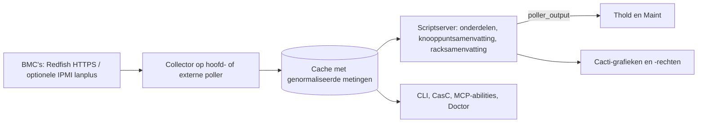

<!-- Source: README.md; SHA256: cf31b9f80d6c00020bbe08e80951d4de1c910793911d040ae7a66b54e8a2eaf0 -->

<!-- translations:start -->
[English](../../../README.md) | [简体中文](../zh-CN/README.md) | [हिन्दी](../hi-IN/README.md) | [Español (España)](../es-ES/README.md) | [Español (Latinoamérica)](../es-419/README.md) | [العربية (السعودية)](../ar-SA/README.md) | [Afrikaans](../af-ZA/README.md) | [አማርኛ](../am-ET/README.md) | [العربية (مصر)](../ar-EG/README.md) | [العربية (المغرب)](../ar-MA/README.md) | [বাংলা](../bn-BD/README.md) | [Bosanski](../bs-BA/README.md) | [Deutsch](../de-DE/README.md) | [فارسی](../fa-IR/README.md) | [Filipino](../fil-PH/README.md) | [Français](../fr-FR/README.md) | [Français (Maroc)](../fr-MA/README.md) | [Français (Sénégal)](../fr-SN/README.md) | [Hausa](../ha-NG/README.md) | [עברית](../he-IL/README.md) | [Hrvatski](../hr-HR/README.md) | [Bahasa Indonesia](../id-ID/README.md) | [Igbo](../ig-NG/README.md) | [Italiano](../it-IT/README.md) | [日本語](../ja-JP/README.md) | [한국어](../ko-KR/README.md) | [Malagasy](../mg-MG/README.md) | [मराठी](../mr-IN/README.md) | [Bahasa Melayu](../ms-MY/README.md) | [Nederlands](README.md) | [Polski](../pl-PL/README.md) | [Português (Brasil)](../pt-BR/README.md) | [Русский](../ru-RU/README.md) | [Kinyarwanda](../rw-RW/README.md) | [Soomaali](../so-SO/README.md) | [Српски](../sr-RS/README.md) | [Svenska](../sv-SE/README.md) | [Kiswahili](../sw-KE/README.md) | [தமிழ்](../ta-IN/README.md) | [తెలుగు](../te-IN/README.md) | [ไทย](../th-TH/README.md) | [Türkçe](../tr-TR/README.md) | [Українська](../uk-UA/README.md) | [اردو](../ur-PK/README.md) | [Tiếng Việt](../vi-VN/README.md) | [isiXhosa](../xh-ZA/README.md) | [Yorùbá](../yo-NG/README.md) | [繁體中文](../zh-TW/README.md) | [isiZulu](../zu-ZA/README.md)
<!-- translations:end -->

# plugin_redfish

Een Cacti 1.2-plugin die het stroomverbruik van servers, de inlaattemperatuur, de ventilatorstatus en de gezondheid van voedingen vanaf baseboard management controllers (BMC's) naar Cacti brengt als gewone apparaten, gegevensbronnen en grafieken, via Redfish met een optionele alleen-lezen IPMI-terugvaloptie en vermogenstotalen op rackniveau. Thold en Maint genereren meldingen en onderdrukken ze via standaard Cacti-gegevensbronnen.

> **Status: in ontwikkeling, nog geen release (`0.1.0-dev`).** Deze plugin is niet gelieerd aan het Cacti-project. Hij wordt geïnstalleerd op Cacti 1.2.31 of hoger onder PHP 8.2 of hoger en implementeert de Redfish-collector, een versleutelde inloggegevenskluis, het inrichten van Cacti-apparaten en -grafieken, een optionele alleen-lezen IPMI-terugvaloptie, rack-vermogenstotalen, weergave van Cacti Maint-onderhoudsvensters, replicatie en agent-endpoints voor externe gegevenscollectors, een CasC-provider en beheerders-CLI, MCP-abilities en Doctor-diagnosecontroles. CI test fixtures, de DMTF Redfish Mockup Server (subsystem-, legacy-only- en HPE iLO Gen11-mockups) en Thold v1.8.2 met Maint v1.3; er is nog geen echte fysieke BMC of pilotomgeving gekwalificeerd. Het ontwerp en onderzoek staan in [docs/PLAN.md](../../PLAN.md), [docs/research/](../../research/) en [docs/decisions/](../../decisions/).

## Geïmplementeerde mogelijkheden

### Kerncollector, kluis en Cacti-objecten

- **Levenscyclus en schema.** Installeert, werkt bij, schakelt uit en verwijdert via de plugin-API van Cacti (`Schema::VERSION = 3`, 12 tabellen). Tabellen blijven behouden bij verwijdering, tenzij *Keep Plugin Tables on Uninstall* wordt uitgevinkt. Startbestanden zijn parsebaar onder PHP 8.0 en weigeren PHP onder 8.2 of een ontbrekende `ext-openssl` met een expliciete foutmelding.
- **Register en rechten.** Rechtenniveaus (realms) *Redfish View* (`redfish_health.php`), *Redfish Operator* (`redfish_operator.php`) en *Redfish Admin* (`redfish_bmcs.php`, `redfish_credentials.php`), plus instellingen onder **Configuration > Settings > Redfish**. Het BMC-register ondersteunt CSV-import (inloggegevens op naam aangegeven; wachtwoorden in importbestanden worden geweigerd) en JSON-export. BMC-records en inloggegevens volgen de apparaatrechten van Cacti.
- **Versleutelde inloggegevenskluis.** Wachtwoorden worden versleuteld met AES-256-GCM opgeslagen in `plugin_redfish_secret`. De sleutel staat buiten de database (standaard `/etc/cacti/redfish-vault.key`) als 64 hexadecimale tekens (`openssl rand -hex 32`) of 32 ruwe bytes, in eigendom van de poller-gebruiker, niet leesbaar voor andere gebruikers en in een map waarin alleen root of die gebruiker mag schrijven. Een wachtwoordzin van 32 afdrukbare tekens wordt geweigerd. **Maak samen met de database een back-up van het sleutelbestand**; zonder dit bestand moeten opgeslagen wachtwoorden opnieuw worden ingevoerd.
- **TLS en alleen-lezen Redfish-client.** TLS-verificatie is standaard ingeschakeld via de CA-opslag van het systeem, een CA-bundel per BMC of een SPKI SHA-256-pin; een uitzondering voor ongeverifieerde TLS per BMC blijft zichtbaar als gezondheidswaarschuwing en als waarschuwing bij de Doctor-controle. De client staat alleen `GET` toe plus Redfish-sessielogin (`POST`) en -uitloggen (`DELETE`), met een optionele Basic-terugvaloptie per BMC wanneer sessies niet beschikbaar zijn. Discovery geeft de voorkeur aan nieuwe Redfish-subsysteem- en sensorresources en valt terug op verouderde `Power`- en `Thermal`-resources.
- **Uitvoering van de collector.** `poller_redfish.php` start vanuit `poller_bottom`, draait één hoofdproces per poller via het procesregister van Cacti met configureerbare werkprocessen (`redfish_workers`), verkrijgt leases per BMC, handhaaft een tijdsbudget (`redfish_collector_budget`), past exponentiële backoff toe en ruimt na een crash de eigen voorgaande sessie van de plugin op.
- **Sjablonen, apparaten en grafieken.** Importeert `templates/redfish-templates.xml` op basis van hash en kopieert drie scriptserver-gegevensquery-XML-bestanden (`redfish_fans.xml`, `redfish_temperatures.xml`, `redfish_psus.xml`) naar `<cacti>/resource/script_server/` zonder door de gebruiker gewijzigde bestanden te overschrijven. **Create Device** en **Add Graphs** vereisen bevestiging van een inrichtingsplan, koppelen query's aan een gekoppeld serverapparaat of maken een apparaat "Redfish BMC" onder `.invalid` aan met beschikbaarheidscontroles uitgeschakeld, en koppelen elke Redfish-grafiek terug naar de Redfish-grafieken van het apparaat via `graph_buttons`.
- **Alleen-cache scriptserverinvoer.** `scripts/ss_redfish_members.php` levert ventilator-, temperatuur- en PSU-metingen per onderdeel, en `scripts/ss_redfish_summary.php` levert metrische gegevens voor "Redfish Node Summary" (vermogen, inlaat- en maximumtemperatuur, aantallen defecte ventilatoren en PSU's, knooppuntgezondheid en ouderdom van de laatst geslaagde meting). Scriptserveraanroepen lezen uitsluitend uit de lokale cache en nemen nooit contact op met een BMC. Ontbrekende, verouderde of van verdwenen onderdelen afkomstige metingen geven `U` terug (nooit `0`), terwijl `age` altijd een waarde rapporteert zodat drempelwaarden stille BMC's detecteren.

**Wanneer de onderdelen van een BMC veranderen** (zoals een vervangen ventilator of een firmware-update die sensoren hernoemt), voert u opnieuw **Add Graphs** uit. Een eerder aanwezige ventilator of voeding die afwezig raakt, telt mee in `fans_bad` of `psus_bad` totdat dit is geaccepteerd; een slot dat nooit bezet was, telt niet mee. Verdwenen onderdelen behouden hun bestaande gegevensbronnen en grafieken, die vanaf dat moment `U` weergeven totdat ze handmatig worden verwijderd. Het verwijderen van een Cacti-apparaat ontkoppelt de bijbehorende BMC en verwijdert de rack-toewijzing, terwijl de BMC en cache behouden blijven; het verwijderen van een BMC of het verwijderen van de plugin behoudt de Cacti-apparaten en grafieken.

### Optionele IPMI-terugvaloptie

- **Opt-in per BMC.** Standaard uitgeschakeld (`protocols` is standaard `redfish`; het inschakelen van de IPMI-terugvaloptie stelt `redfish,ipmi` in).
- **Afgebakende terugvaltrigger.** Draait alleen wanneer Redfish-verzameling mislukt met een daarvoor in aanmerking komende foutklasse; wordt nooit geactiveerd bij `AuthRejected`, `CredentialUnavailable`, `AddressRefused`, `OperationRefused` of `Deadline`.
- **Veilige uitvoering.** Roept `ipmitool` over `-I lanplus` aan via array-vorm `proc_open()` zonder shell, met een begrensde wall-clock-time-out en een uitvoerlimiet van 256 KiB. Wachtwoorden worden aangeleverd via `IPMITOOL_PASSWORD` (`-E`) of een tijdelijk bestand met modus 0600 (`-f`) dat in `finally` wordt verwijderd, nooit via CLI-argv.
- **Acceptatielijst van alleen-lezen opdrachten.** Alleen vijf alleen-lezen subopdrachten zijn toegestaan: `dcmi power reading`, `sdr type Temperature`, `sdr type Fan`, `sdr type Power Supply` en `chassis status`. Opdrachten die wijzigingen aanbrengen worden geweigerd.
- **Genormaliseerde uitvoer en beveiligingswaarschuwing.** `IpmiNormalizer` zet metingen om naar hetzelfde `Observation`/`Member`/`Reading`-model en geeft `U` terug voor ontbrekende of niet-parseerbare sensoren. Het inschakelen van de IPMI-terugvaloptie geeft een waarschuwing op de gezondheidspagina en in de Doctor-controle `redfish.bmc_security`, waarmee beheerders eraan worden herinnerd UDP 623 te beperken tot een beheer-VLAN.

### Rack-vermogenstotalen

- **Rackregister.** Schemaversie 3 voegt `plugin_redfish_rack` toe (unieke `(site_id, name)`, optionele `power_budget_watts`, `min_coverage_pct` standaard op `80` en notities) en `plugin_redfish_rack_member` (maximaal één rack-toewijzing per `host_id`, optionele `bmc_id` en `unit_position`, automatisch verwijderd wanneer een Cacti-apparaat wordt verwijderd).
- **Door dekking bewaakte totalen.** `RackPowerSummary` telt actuele `power_watts`-metingen van leden uit de lokale cache op en berekent budgetbenutting en beschikbare ruimte (headroom). Wanneer de dekking van rapporterende leden onder `min_coverage_pct` zakt, geven `power_watts`, `utilization_pct` en `headroom_watts` `U` terug zodat collectorstoringen nooit als een daling van het rackvermogen worden weergegeven.
- **Thold-klare scriptserverinvoer.** `scripts/ss_redfish_rack.php` (`ss_redfish_rack(<rack_id>)`) geeft `power_watts`, `power_budget_watts`, `utilization_pct`, `headroom_watts`, `members_total`, `members_reporting` en `coverage_pct` uitsluitend uit de lokale cache terug.

### Integratie met Cacti Maint

- Thold-drempels op Redfish-gegevensbronnen geven meldingen en Cacti Maint onderdrukt deze zonder wijzigingen aan een van beide plugins.
- `MaintWindow` controleert actieve Maint-schema's voor elke gekoppelde Cacti-host (eenmalige `mtype=1` en terugkerende `mtype=2` schema's, plus `plugin_maint_check_cacti_host()` indien geladen) en markeert actief onderhoud op de pagina Redfish Health (`[MAINT]`), in de uitvoer van `cli/redfish.php health` en in de ability `redfish-get-health`.

### Externe gegevenscollectors

- `INFO` declareert `remote_collect:1`. BMC's accepteren elke `poller_id >= 1`, en `poller_redfish.php --poller=N` verzamelt alleen ingeschakelde BMC's die aan die poller zijn toegewezen.
- **`replicate_out`-hook.** Repliceert via `replicate_out_table()` alleen niet-geheime configuratietabellen die zijn afgebakend tot de externe doelpoller: `plugin_redfish_bmc`, `plugin_redfish_credential`-metadata (zonder cijfertekst), `plugin_redfish_rack` en `plugin_redfish_rack_member`. `plugin_redfish_secret` wordt niet gerepliceerd en sleutelbestanden van de kluis blijven strikt lokaal op elke poller.
- **`remote_agent`-hook.** Biedt de alleen-lezen acties `redfish_health` en `redfish_discovery` die uitsluitend numerieke parameters `poller_id` en `bmc_id` accepteren. Onverwachte parameters worden geweigerd en er worden nul inloggegevens of geheimen geretourneerd.

### Ecosysteem-hooks (CasC, MCP-abilities en Doctor)

- **CasC-provider (`casc_register_providers`).** Registreert de `redfish`-provider (schemaversie `1`) met YAML- en XML-export in pure PHP, parsing (waarbij XXE wordt geweigerd), validatie, diff-planning en toepassing. Inloggegevens verschijnen alleen als kluisverwijzingen (`vault:redfish:<name>`); onbewerkte geheime sleutels (`pass`, `secret`, `token`, `private_key`, `vault_key`, `auth_token`) worden geweigerd. Toepassen vereist een exacte SHA-256 `PLAN_HASH`.
- **MCP / Abilities API (`abilities_register`).** Registreert drie alleen-lezen abilities die worden afgeschermd door het rechtenniveau Redfish View (`redfish_health.php`) en Cacti-apparaatrechten, zonder inloggegevens terug te geven:
  - `redfish-list-bmcs` (optionele `poller_id`)
  - `redfish-get-rack-power` (optionele `rack_id`)
  - `redfish-get-health` (optionele `bmc_id`)
- **Doctor-controles (`doctor_register_checks`).** Registreert vijf lokale, alleen-lezen diagnosecontroles die nooit contact opnemen met een BMC of sleutelmateriaal teruggeven:
  - `redfish.schema`: actualiteit van de schemaversie
  - `redfish.vault_key`: leesbaarheid en rechten van de kluissleutel
  - `redfish.collector_runs`: budget en actualiteit van de poller-collector
  - `redfish.bmc_security`: ingeschakelde BMC's met ongeverifieerde TLS of IPMI-terugvaloptie
  - `redfish.rack_power`: naleving van het rack-vermogensbudget en minimale dekkingsgrens

## CLI

Uitvoeren vanuit de hoofdmap van Cacti met PHP 8.2 of hoger:

```sh
# Operator and CasC CLI (reads --file=PATH or stdin for validate, plan, and apply)
php plugins/redfish/cli/redfish.php export --format=yaml|xml
php plugins/redfish/cli/redfish.php validate [--file=PATH] [--format=yaml|xml]
php plugins/redfish/cli/redfish.php plan [--file=PATH] [--format=yaml|xml]
php plugins/redfish/cli/redfish.php apply [--file=PATH] [--format=yaml|xml] --confirm=<PLAN_HASH>
php plugins/redfish/cli/redfish.php health --format=text|json

# Collector entry point (normally started by poller_bottom)
php plugins/redfish/poller_redfish.php [--poller=N] [--force] [--debug]

# Rack power summary script server entry point
php plugins/redfish/scripts/ss_redfish_rack.php <rack_id>
```

## Toegangsrollen

| Rechtenniveau | Toegang |
| --- | --- |
| Redfish View | Bestaande monitoringpagina's. |
| Redfish Operator | Monitoring plus de pagina Operations en persoonlijke triagebevestigingen. |
| Redfish Admin | Operator-toegang plus de bestaande configuratie- en beheeracties. |

Open na het kopiëren van upgradebestanden als beheerder de pagina Plugins om de rechtenniveaus te registreren. Wijs het niveau Operator expliciet toe onder **Configuration > Users** of gebruikersgroepen. Bij upgrades blijven de bestaande realm-ID's en toekenningen voor View en Admin behouden. Admin-toegang erft bij elk verzoek Operator-toegang, en Operator-toegang erft View-toegang; dit voegt geen opgeslagen toekenningen toe aan gebruikers of groepen. Voor plugin-instellingen is naast het Cacti-recht Settings ook Redfish Admin-toegang vereist.

Apparaatrechten in Cacti beperken de rijen en acties die voor elke gebruiker beschikbaar zijn; voor niet-gekoppelde objecten is een beheerder vereist. Operators kunnen een verzamelblokkade op een toegestane BMC vrijgeven voor de volgende geplande uitvoering. Inloggegevens, configuratie, koppeling, verwijdering en andere beheerwijzigingen blijven op de beheerpagina's. Bevestigingen gelden alleen binnen de huidige gebruikerssessie, maximaal één uur en alleen zolang dezelfde waarneming actueel blijft. Nieuwe of gewijzigde waarnemingen maken ze ongeldig. Ze markeren een mislukte meting nooit als gezond en onderdrukken geen meldingen.

## Waarom

Elke server heeft een BMC die het stroomverbruik en de thermische status onafhankelijk van het besturingssysteem rapporteert, en dus blijft antwoorden wanneer het OS niet actief is. De gegevens dienen voor capaciteits- en kostenbeheer, vroegtijdige waarschuwing bij een defecte ventilator of voeding en, in high-performance computing, beslissingen over vermogensbegrenzing. De plugin is niet specifiek voor HPC.

Cacti dekt een deel hiervan al af:

- **SNMP-pakketten van leveranciers.** De 1.2.x-tak levert Dell iDRAC- en HPE iLO-sjablonen mee die een SNMP-agent vereisen en leverancierspecifiek zijn; uit onderzoek in mijlpaal 1 bleek dat geen van beide het stroomverbruik in watt rapporteert ([docs/research/overlap.md](../../research/overlap.md)).
- **Een inloggegevenstype zonder collector.** plugin_credentials definieert een "IPMI / Redfish (BMC)"-inloggegeven, maar leest geen enkele BMC uit.
- **Geen overzicht op rackniveau.** Cacti Core heeft geen rackobject; een apparaat heeft een vrij tekstveld `location`.

De plugin bevraagt BMC's out-of-band ten opzichte van Cacti's pollcyclus op de hoofdpoller of externe gegevenscollectors, slaat genormaliseerde metingen op in een cache en stelt deze beschikbaar via scriptserver-gegevensquery's, knooppuntsamenvattingen en rack-vermogenssamenvattingen. Hij hergebruikt Cacti's grafieken, rechten, Thold en Maint en wijzigt de status van de BMC niet.

## Reikwijdte en status

| Fase | Reikwijdte | Mijlpalen | Status |
|---|---|---|---|
| 0, onderzoek | Leveranciersmatrix, bevestiging van upstream-gedrag op live BMC's, pollkosten, data-query-spike | [M1](https://github.com/somethingwithproof/plugin_redfish/milestone/1) | Gereed, wacht op echte BMC-firmware-opnamen |
| 1, observeren | BMC-register, inloggegevens, TLS, Redfish-collector, genormaliseerde metingen, apparaten, grafieken per index, Thold-alarmering, Maint-integratie, statuspagina | [M2](https://github.com/somethingwithproof/plugin_redfish/milestone/2), [M3](https://github.com/somethingwithproof/plugin_redfish/milestone/3), [M4](https://github.com/somethingwithproof/plugin_redfish/milestone/4) | Geïmplementeerd; kwalificatie van M4-pilotomgeving in behandeling |
| 2, ipmi | Alleen-lezen IPMI (`lanplus`) terugvaloptie via `ipmitool`, standaard uitgeschakeld | [M5](https://github.com/somethingwithproof/plugin_redfish/milestone/5) | Geïmplementeerd |
| 3, racks | Rackregister, rack-vermogenstotalen met minimale dekkingsgrens, budgetruimte, `ss_redfish_rack.php` | [M6](https://github.com/somethingwithproof/plugin_redfish/milestone/6) | Geïmplementeerd |
| 4, extern en ecosysteem | Externe gegevenscollectors (`replicate_out`, `remote_agent`), CasC-provider en CLI, MCP-abilities, Doctor-controles | [M7](https://github.com/somethingwithproof/plugin_redfish/milestone/7) | Geïmplementeerd |

Buiten de reikwijdte: het instellen van vermogenslimieten of enige andere BMC-configuratie, stroombeheer, firmware-updates, consoletoegang, een eigen alarmeringsengine in de plugin en plannerintegratie.

## Compatibiliteitsdoelen

| Component | Doel |
|---|---|
| Cacti | 1.2.31 of hoger, geen core-patches |
| Database | MariaDB 10.2 of MySQL 5.7 of hoger: één BMC per apparaat wordt afgedwongen door een unieke sleutel op een gegenereerde kolom |
| PHP | 8.2 of hoger; startbestanden blijven parsebaar op 8.0 zodat een niet-ondersteunde runtime een weigering krijgt in plaats van een kapotte Cacti-UI |
| PHP-extensies | `ext-openssl` (vereist door Cacti 1.2.31); geen `ext-curl` en geen Composer-runtime-afhankelijkheden |
| Optionele hulpmiddelen | `ipmitool` op pollers die BMC's verzamelen waarvoor IPMI-terugval is ingeschakeld |
| BMC's | Dell iDRAC, HPE iLO, Lenovo XCC en OpenBMC, per firmwarebereik; zie [de leveranciersmatrix](../../research/vendor-matrix.md) |
| Redfish | Nieuwe subsysteem- en sensorresources eerst, verouderde `Power` en `Thermal` als terugvaloptie |
| Thold, Maint | Geen wijzigingen vereist (CI test Thold v1.8.2 en Maint v1.3) |

## Ontwerp

- [docs/PLAN.md](../../PLAN.md) is het volledige plan: architectuur, upstream-feiten waarop het steunt, meetmodel, beveiligingsgrenzen, prestatieberekeningen, testen en risico's.
- [docs/decisions/](../../decisions/) bevat Architecture Decision Records voor reeds gemaakte keuzes.
- [docs/REQUIREMENTS.md](../../REQUIREMENTS.md) koppelt elk vereiste-ID aan het bijbehorende issue.



## Beveiliging

BMC-inloggegevens geven toegang tot het out-of-band-beheer van servers. Het ontwerp houdt geheimen buiten opdrachtregels, logboeken, CasC-exports, payloads van externe agents, MCP-antwoorden en webpagina's; versleutelt opgeslagen wachtwoorden met AES-256-GCM via een lokaal kluissleutelbestand per poller; verifieert standaard TLS; voert `ipmitool` uit via een expliciete argumentenarray met alleen-lezen subopdrachten op de acceptatielijst; en gebruikt alleen-lezen BMC-accounts. Zie [docs/PLAN.md](../../PLAN.md#security) en [SECURITY.md](../../../SECURITY.md).

## Beheerdershandleiding

Zie [docs/operator-guide.md](../../operator-guide.md) voor installatievereisten, kluis- en TLS-configuratie, BMC-registratie, het aanmaken van grafieken, meldingsintervallen, back-ups en foutafhandeling. De handleiding verklaart een echte firmwarelijn van een leverancier pas als ondersteund zodra een geanonimiseerde opname van die firmware de testsuite doorstaat.

## Ontwikkeling en testen

CI (`.github/workflows/plugin-ci-workflow.yml`) lint startbestanden op PHP 8.0, draait Pest-unit- (`phpunit.xml`) en levenscyclusintegratiesuites (`phpunit-integration.xml`) en PHPStan niveau 9 over PHP 8.2 tot en met 8.5 tegen Cacti `release/1.2.31` en `1.2.x`, verifieert de weigering op PHP 8.1, test de DMTF Redfish Mockup Server (subsystem-, legacy-only- en HPE iLO Gen11-mockups) en Thold v1.8.2 / Maint v1.3 end-to-end, en controleert gettext-catalogi, workflows en REUSE-licenties.

Lokale controles vóór het pushen:

```sh
sh tests/lint-workflows.sh
sh locales/build_gettext.sh --check
CACTI_PATH=/path/to/cacti phpstan analyse -c phpstan.neon --no-progress
```

Draai Pest met `--configuration=phpunit.xml` voor unit- en bronregeltests, of `--configuration=phpunit-integration.xml` met `CACTI_PATH` en `REDFISH_TEST_DATABASE=disposable` tegen een wegwerpbare Cacti-database voor levenscyclusintegratietests.

## Hoe werk wordt bijgehouden

- **Mijlpalen** volgen de mijlpalen van het plan. Elke mijlpaal heeft een epic-issue met de bijbehorende sub-issues en het opleverbewijs.
- **Issues** krijgen een type via een label: `type: requirement`, `type: research`, `type: decision`, `type: epic`. Vereiste-issues vermelden genummerde, testbare vereisten (`REQ-AREA-NNN`) en acceptatiecriteria.
- **Labels** bevatten ook `area:`, `phase:`, `priority:` en `status:`. Zie [CONTRIBUTING.md](../../../CONTRIBUTING.md#labels).
- Het [projectbord](https://github.com/users/somethingwithproof/projects/12) toont alle issues over de mijlpalen heen.

## Bijdragen

Lees [CONTRIBUTING.md](../../../CONTRIBUTING.md). Commits vereisen een DCO sign-off. Ontwerpdiscussies vinden plaats in issues; openstaande beslissingen hebben het label `type: decision`. Bewijsmateriaal van echte BMC's is momenteel de nuttigste bijdrage; verwijder adressen, serienummers en inloggegevens voordat u een opname plaatst.

## Licentie

GNU General Public License v2.0, dezelfde licentie als Cacti en de bijbehorende plugins. Zie [LICENSE](../../../LICENSE).
