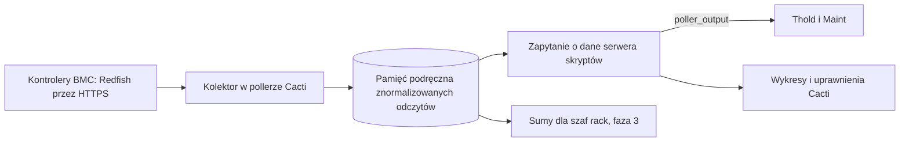

<!-- Source: README.md; SHA256: 7b4e83a58a1adc844cb0615ef30e95476cba2851f96bb454d2a816fb2774724d -->

<!-- translations:start -->
[English](../../../README.md) | [简体中文](../zh-CN/README.md) | [हिन्दी](../hi-IN/README.md) | [Español (España)](../es-ES/README.md) | [Español (Latinoamérica)](../es-419/README.md) | [العربية (السعودية)](../ar-SA/README.md) | [Afrikaans](../af-ZA/README.md) | [አማርኛ](../am-ET/README.md) | [العربية (مصر)](../ar-EG/README.md) | [العربية (المغرب)](../ar-MA/README.md) | [বাংলা](../bn-BD/README.md) | [Bosanski](../bs-BA/README.md) | [Deutsch](../de-DE/README.md) | [فارسی](../fa-IR/README.md) | [Filipino](../fil-PH/README.md) | [Français](../fr-FR/README.md) | [Français (Maroc)](../fr-MA/README.md) | [Français (Sénégal)](../fr-SN/README.md) | [Hausa](../ha-NG/README.md) | [עברית](../he-IL/README.md) | [Hrvatski](../hr-HR/README.md) | [Bahasa Indonesia](../id-ID/README.md) | [Igbo](../ig-NG/README.md) | [Italiano](../it-IT/README.md) | [日本語](../ja-JP/README.md) | [한국어](../ko-KR/README.md) | [Malagasy](../mg-MG/README.md) | [मराठी](../mr-IN/README.md) | [Bahasa Melayu](../ms-MY/README.md) | [Nederlands](../nl-NL/README.md) | [Polski](README.md) | [Português (Brasil)](../pt-BR/README.md) | [Русский](../ru-RU/README.md) | [Kinyarwanda](../rw-RW/README.md) | [Soomaali](../so-SO/README.md) | [Српски](../sr-RS/README.md) | [Svenska](../sv-SE/README.md) | [Kiswahili](../sw-KE/README.md) | [தமிழ்](../ta-IN/README.md) | [తెలుగు](../te-IN/README.md) | [ไทย](../th-TH/README.md) | [Türkçe](../tr-TR/README.md) | [Українська](../uk-UA/README.md) | [اردو](../ur-PK/README.md) | [Tiếng Việt](../vi-VN/README.md) | [isiXhosa](../xh-ZA/README.md) | [Yorùbá](../yo-NG/README.md) | [繁體中文](../zh-TW/README.md) | [isiZulu](../zu-ZA/README.md)
<!-- translations:end -->

# plugin_redfish

Wtyczka dla Cacti 1.2, która przenosi pobór mocy serwerów, temperaturę powietrza dolotowego, stan wentylatorów oraz kondycję zasilaczy z kontrolerów zarządzania płytą główną (BMC) do Cacti jako zwykłe urządzenia, źródła danych i wykresy, z wykorzystaniem protokołu Redfish oraz opcjonalnego mechanizmu awaryjnego IPMI. Rozszerzenia Thold i Maint mogą następnie generować na ich podstawie alerty i je wyciszać, a późniejsza faza doda sumowanie poboru mocy na poziomie szaf rack.

> **Status: w fazie rozwoju, brak jeszcze wydania (0.1.0-dev).** Kamienie milowe 2 (podstawy) oraz 3 (obiekty Cacti i alertowanie) zostały scalone z gałęzią `main`. Ta wtyczka nie jest powiązana z projektem Cacti. Instaluje się w Cacti 1.2.31 pod PHP 8.2 lub nowszym, rejestruje kontrolery BMC i poświadczenia, odczytuje z każdego BMC przez Redfish pobór mocy, temperatury, wentylatory i stan zasilaczy do własnej pamięci podręcznej oraz prezentuje kondycję zbierania danych. Dodaje urządzenia Cacti, wykresy dla poszczególnych podzespołów i wykresy zbiorcze, a także obsługę Thold i Maint poprzez zwykłe źródła danych. W ramach CI przetestowano symulowany kontroler BMC zbudowany z ręcznie przygotowanych danych testowych oraz serwer makiety DMTF Redfish; żaden rzeczywisty kontroler BMC ani flota pilotażowa nie zostały jeszcze zakwalifikowane. Projekt i wyniki badań znajdują się w [docs/PLAN.md](../../PLAN.md), [docs/research/](../../research) oraz [docs/decisions/](../../decisions).

### Co dostarcza kamień milowy 2

- Instalację, aktualizację, wyłączanie i odinstalowywanie poprzez API wtyczek Cacti, z zachowaniem tabel podczas odinstalowania, chyba że odpowiednie ustawienie zostanie wyczyszczone. W wersji PHP starszej niż 8.2 wtyczka odmawia instalacji lub włączenia i podaje przyczynę.
- Role uprawnień „Redfish View” (strona kondycji), „Redfish Operator” (strona operacji) i „Redfish Admin” (strony kontrolerów BMC i poświadczeń) oraz ustawienia w Configuration > Settings > Redfish.
- Rejestr kontrolerów BMC z importem CSV i eksportem JSON. Pliki importu nie mogą zawierać haseł; odwołania do poświadczeń odbywają się po nazwie.
- Poświadczenia przechowywane w postaci zaszyfrowanej algorytmem AES-256-GCM. Klucz znajduje się w pliku poza bazą danych, domyślnie `/etc/cacti/redfish-vault.key`, zawierającym 64 znaki szesnastkowe (`openssl rand -hex 32`) lub dokładnie 32 losowe bajty, którego właścicielem jest użytkownik pollera, bez uprawnień odczytu dla innych użytkowników, w katalogu zapisywalnym wyłącznie przez użytkownika pollera lub użytkownika root. Klucz złożony z 32 znaków drukowalnych jest odrzucany jako hasło. **Wykonuj kopię zapasową pliku klucza razem z bazą danych**; bez niego każde zapisane hasło trzeba będzie wprowadzić ponownie.
- Domyślnie włączoną weryfikację TLS, z możliwością przypisania pakietu CA lub przypięcia odcisku SPKI SHA-256 dla konkretnego BMC. Zarejestrowana rezygnacja z weryfikacji dla wybranego BMC pozostaje widoczna na stronie kondycji jako ostrzeżenie.
- Klienta Redfish działającego wyłącznie w trybie odczytu: dozwolone jest wyłącznie `GET` oraz logowanie i wylogowanie sesji, weryfikowane na podstawie listy dozwolonych operacji przed wysłaniem jakiegokolwiek żądania.
- Kolektor uruchamiany z `poller_bottom` dla kontrolerów BMC na głównym pollerze, z dzierżawami i limitami czasu dla każdego BMC, mechanizmem wycofywania (backoff) oraz czyszczeniem po awarii jedynej sesji zarejestrowanej przez wtyczkę. Zdalne kolektory nie są jeszcze obsługiwane; wymagają jawnego wyboru sposobu, w jaki kolektor uzyskuje dostęp do bazy danych i klucza (faza 4).
- Rekordy BMC i poświadczenia podlegają uprawnieniom urządzeń w Cacti: użytkownik z rolą Redfish Admin widzi, modyfikuje i wiąże wyłącznie kontrolery BMC na urządzeniach, które ma prawo widzieć, oraz wyłącznie te poświadczenia, których nie używa żaden kontroler BMC na ukrytym urządzeniu.

### Co dodaje kamień milowy 3

- Szablony dostarczane jako pliki XML szablonów Cacti w katalogu `templates/` i importowane za pomocą wbudowanego importera Cacti podczas instalacji oraz aktualizacji, dopasowywane po skrócie, dzięki czemu import aktualizuje obiekty wtyczki i niczego nie duplikuje. Trzy pliki zapytań o dane są kopiowane do `<cacti>/resource/script_server/` z zapisanym skrótem; wtyczka nigdy nie nadpisuje tam pliku, którego sama nie zapisała, a strona kondycji ostrzega administratorów, gdy szablony lub plik zapytania nie znajdują się na swoim miejscu. Przycisk **Reinstall the Redfish Templates** na stronie BMC importuje je ponownie; wymaga to uprawnienia Import Templates w Cacti.
- Akcje **Create Device** lub **Add Graphs** dla każdego BMC ([ADR 0015](../../decisions/0015-attach-to-the-server-device-or-create-one-per-bmc.md)). Kontroler BMC powiązany z istniejącym urządzeniem serwera otrzymuje swoje zapytania o dane i wykresy na tym urządzeniu. Niepowiązany kontroler BMC otrzymuje nowe urządzenie z szablonu urządzenia „Redfish BMC”, z wyłączonym sprawdzaniem dostępności i nazwą hosta w domenie `.invalid`, dzięki czemu Cacti nigdy nie łączy się z BMC i nigdy nie ujawnia jego adresu. W obu przypadkach administrator najpierw zatwierdza plan zawierający listę elementów do dodania. Obie akcje wymagają uprawnienia zarządzania urządzeniami w Cacti, a także roli Redfish Admin; nowe urządzenie, którego twórca nie mógłby zobaczyć, jest usuwane z powrotem.
- Trzy zapytania o dane serwera skryptów: „Redfish Fans”, „Redfish Temperatures” oraz „Redfish Power Supplies”, indeksowane kluczem elementu z BMC, z osobnym wykresem dla każdego elementu: prędkość wentylatora w procentach lub RPM (zależnie od jednostki raportowanej przez BMC), temperatura oraz moc wejściowa i wyjściowa zasilacza w watach, każdy wraz z kodem kondycji.
- Wejście danych „Redfish Node Summary” obejmujące pobór mocy, temperaturę powietrza dolotowego, najwyższą temperaturę, liczbę wentylatorów i zasilaczy w stanie innym niż OK, kondycję węzła oraz wiek ostatniego poprawnego odczytu, rysowane na czterech wykresach: poboru mocy, temperatur, kondycji podzespołów oraz wieku danych. Progi Thold na tych źródłach danych generują alerty, a Maint je wycisza, bez żadnych zmian w obu wtyczkach.
- Serwer skryptów odpowiada wyłącznie na podstawie pamięci podręcznej wtyczki i nigdy nie kontaktuje się z BMC. Wartość brakująca, nieaktualna, w innej jednostce lub pochodząca z nieistniejącego już elementu przyjmuje wartość `U`, dzięki czemu na wykresach widać przerwę, a nigdy zero; wartość `age` ma zawsze określoną wartość, więc próg ustawiony na niej wykrywa BMC, który przestał odpowiadać.
- Odnośnik z każdego wykresu Redfish do wykresów Redfish danego urządzenia, widoczny wyłącznie dla użytkowników, którym Cacti pozwala widzieć to urządzenie.

**Gdy zmienią się podzespoły BMC** (wymiana wentylatora, aktualizacja oprogramowania układowego zmieniająca nazwy czujników), wybierz ponownie **Add Graphs**. Wentylator lub zasilacz, który był obecny, a teraz jest nieobecny lub usunięty, wlicza się do `fans_bad` lub `psus_bad` aż do wykonania tej czynności, dzięki czemu wyjęcie wentylatora wyzwala alert; gniazdo, które nigdy nie było obsadzone, nie jest wliczane. Add Graphs akceptuje podzespoły aktualnie raportowane przez BMC, a Cacti ponownie indeksuje zapytania; element, który zniknął, zachowuje swoje źródło danych i wykres, które od tej pory odczytują `U`, natomiast nowy element otrzymuje własny wykres. Wykresy nieistniejących już elementów należy usunąć ręcznie, gdy ich historia nie będzie już potrzebna.

Usunięcie urządzenia odpina powiązany z nim kontroler BMC, zachowując sam rekord BMC oraz jego pamięć podręczną. Usunięcie kontrolera BMC lub odinstalowanie wtyczki zachowuje jego urządzenie oraz wykresy.

## Role dostępu

| Realm | Dostęp |
| --- | --- |
| Redfish View | Dotychczasowe strony monitorowania. |
| Redfish Operator | Monitorowanie oraz strona operacji i osobiste potwierdzenia w ramach triażu. |
| Redfish Admin | Dostęp Operatora oraz dotychczasowa konfiguracja i akcje administracyjne. |

Po skopiowaniu plików aktualizacji otwórz stronę Plugins jako administrator, aby zarejestrować
nową rolę (realm). Przypisz rolę Operator jawnie w sekcji **Configuration > Users** lub w grupach użytkowników.
Aktualizacje zachowują dotychczasowe identyfikatory i nadania ról View oraz Admin. Dostęp Admin
dziedziczy dostęp Operator, a dostęp Operator dziedziczy dostęp View przy każdym żądaniu;
nie dodaje to zapisanych nadań do użytkowników ani grup. Ustawienia wtyczki wymagają również
dostępu Redfish Admin oprócz uprawnienia Settings w Cacti.

Uprawnienia urządzeń w Cacti nadal ograniczają wiersze i akcje dostępne dla każdego użytkownika; niepowiązane obiekty wymagają uprawnień administratora. Operatorzy mogą zwolnić wstrzymanie zbierania danych na dozwolonym BMC na czas kolejnego zaplanowanego uruchomienia.
Poświadczenia, konfiguracja, mapowanie, usuwanie oraz pozostałe zmiany administracyjne
pozostają na stronach administracyjnych. Potwierdzenia obowiązują wyłącznie w bieżącej
sesji użytkownika, maksymalnie przez jedną godzinę i tylko dopóki ta sama obserwacja pozostaje
aktualna. Nowe lub zmienione obserwacje je unieważniają. Nigdy nie oznaczają błędnego
pomiaru jako zdrowego ani nie wyciszają alertów.

## Dlaczego

Każdy serwer posiada kontroler BMC raportujący pobór mocy i stan termiczny niezależnie od systemu operacyjnego, dzięki czemu odpowiada również wtedy, gdy system operacyjny nie działa. Dane te służą do planowania pojemności i śledzenia kosztów, wczesnego ostrzegania o awarii wentylatora lub zasilacza, a w obliczeniach wysokiej wydajności także do podejmowania decyzji o ograniczaniu poboru mocy (power-capping). Wtyczka nie jest ograniczona do środowisk HPC.

Obecnie Cacti pokrywa tylko część tych potrzeb:

- **Pakiety SNMP producentów.** Gałąź 1.2.x dostarcza szablony Dell iDRAC i HPE iLO wymagające agenta SNMP i specyficzne dla producenta; badania z kamienia milowego 1 wykazały, że żaden z nich nie raportuje poboru mocy w watach ([docs/research/overlap.md](../../research/overlap.md)).
- **Typ poświadczeń bez kolektora.** plugin_credentials definiuje poświadczenie „IPMI / Redfish (BMC)”, lecz nie odczytuje żadnego BMC.
- **Brak widoku na poziomie szafy rack.** Rdzeń Cacti nie posiada obiektu szafy rack; urządzenie ma jedynie pole tekstowe `location`.

Wtyczka odpytuje kontrolery BMC poza pasmem względem cyklu pollera Cacti, zapisuje w pamięci podręcznej znormalizowane odczyty i udostępnia je przez zapytanie o dane serwera skryptów oraz zbiorcze źródła danych. Wykorzystuje mechanizmy wykresów, uprawnień, Thold i Maint z Cacti oraz nie zmienia stanu BMC. Obsługa zdalnych kolektorów danych jest planowana w fazie 4; obecne zbieranie danych działa wyłącznie na głównym pollerze.

## Planowany zakres

| Faza | Zakres | Kamienie milowe |
|---|---|---|
| 0, badania | Macierz producentów, potwierdzenie zachowania w kodzie głównym na żywych BMC, koszt odpytywania, prototyp zapytania o dane | [M1](https://github.com/somethingwithproof/plugin_redfish/milestone/1) |
| 1, obserwacja | Rejestr BMC, poświadczenia, TLS, kolektor Redfish, znormalizowane odczyty, urządzenia, wykresy per indeks, alertowanie Thold, wyciszanie Maint, strona kondycji | [M2](https://github.com/somethingwithproof/plugin_redfish/milestone/2), [M3](https://github.com/somethingwithproof/plugin_redfish/milestone/3), [M4](https://github.com/somethingwithproof/plugin_redfish/milestone/4) |
| 2, ipmi | Awaryjny mechanizm IPMI dla BMC bez użytecznego Redfish, domyślnie wyłączony | [M5](https://github.com/somethingwithproof/plugin_redfish/milestone/5) |
| 3, szafy | Rejestr szaf rack, sumy mocy szaf wraz z pokryciem, zapas budżetu mocy | [M6](https://github.com/somethingwithproof/plugin_redfish/milestone/6) |
| 4, zdalne | Zdalne kolektory danych Cacti dla odizolowanych sieci BMC | [M7](https://github.com/somethingwithproof/plugin_redfish/milestone/7) |

Poza zakresem: ustawianie limitów mocy ani żadnej innej konfiguracji BMC, sterowanie zasilaniem, aktualizacja oprogramowania układowego, dostęp do konsoli, własny silnik alertowania wtyczki oraz integracja z harmonogramem.

## Docelowa zgodność

| Składnik | Cel |
|---|---|
| Cacti | 1.2.31 lub nowszy, bez poprawek rdzenia |
| Baza danych | MariaDB 10.2 lub MySQL 5.7 albo nowszy: relacja jednego BMC na urządzenie jest wymuszana kluczem unikatowym na kolumnie generowanej |
| PHP | 8.2 lub nowszy; `setup.php` pozostaje możliwy do analizy składniowej w wersji 8.0, aby nieobsługiwane środowisko otrzymało odmowę zamiast uszkodzonego interfejsu Cacti |
| Kontrolery BMC | Dell iDRAC, HPE iLO, Lenovo XCC oraz OpenBMC, według zakresu wersji oprogramowania układowego; zobacz [macierz dostawców](../../research/vendor-matrix.md) |
| Redfish | W pierwszej kolejności nowe zasoby podsystemów i czujników, przestarzałe `Power` i `Thermal` jako mechanizm awaryjny |
| Thold, Maint | Nie wymagają żadnych zmian |

## Projekt

- [docs/PLAN.md](../../PLAN.md) zawiera pełny plan: architekturę, fakty z kodu głównego, na których opiera się projekt (wraz ze źródłami i założeniami wymagającymi potwierdzenia), model pomiarów, granice bezpieczeństwa, rachunek wydajności, testowanie i ryzyka.
- [docs/decisions/](../../decisions) zawiera rekordy decyzji architektonicznych (ADR) dla już dokonanych wyborów.
- [docs/REQUIREMENTS.md](../../REQUIREMENTS.md) mapuje każdy identyfikator wymagania na odpowiadające mu zgłoszenie.

## Bezpieczeństwo

Poświadczenia BMC zapewniają kontrolę nad pozapasmowym zarządzaniem serwerami. Projekt utrzymuje je poza wierszami poleceń, dziennikami i stronami, domyślnie weryfikuje TLS, uruchamia każde polecenie zewnętrzne z tablicy argumentów z listą dozwolonych podpoleceń oraz korzysta z kont BMC wyłącznie do odczytu. Zobacz [docs/PLAN.md](../../PLAN.md#security) i [SECURITY.md](../../../SECURITY.md).

## Przewodnik operatora

Zobacz [docs/operator-guide.md](../../operator-guide.md), aby poznać wymagania instalacyjne, konfigurację magazynu kluczy i TLS, rejestrację BMC, tworzenie wykresów, interwały alertów, kopie zapasowe oraz obsługę awarii. Przewodnik nie uznaje żadnej rzeczywistej linii oprogramowania układowego producenta za wspieraną, dopóki zanonimizowane przechwycenie z tego oprogramowania nie przejdzie zestawu testów.

## Śledzenie prac

- **Kamienie milowe** odpowiadają kamieniom milowym z planu. Każdy z nich ma nadrzędne zgłoszenie typu epic z listą podzadań oraz dowodów ukończenia.
- **Zgłoszenia** są klasyfikowane etykietami: `type: requirement`, `type: research`, `type: decision`, `type: epic`. Zgłoszenia wymagań określają numerowane, testowalne wymagania (`REQ-AREA-NNN`) oraz kryteria akceptacji.
- **Etykiety** zawierają również prefiksy `area:`, `phase:`, `priority:` oraz `status:`. Zobacz [CONTRIBUTING.md](../../../CONTRIBUTING.md#labels).
- [Tablica projektu](https://github.com/users/somethingwithproof/projects/12) prezentuje wszystkie zgłoszenia w podziale na kamienie milowe.

## Wkład w projekt

Przeczytaj [CONTRIBUTING.md](../../../CONTRIBUTING.md). Commity wymagają podpisu DCO (sign-off). Dyskusje projektowe toczą się w zgłoszeniach; otwarte decyzje noszą etykietę `type: decision`. Najbardziej przydatnym wkładem są obecnie dane z rzeczywistych kontrolerów BMC; przed opublikowaniem jakiegokolwiek przechwycenia należy zanonimizować adresy, numery seryjne i poświadczenia.

## Licencja

GNU General Public License v2.0, ta sama licencja co w przypadku Cacti i jego wtyczek. Zobacz [LICENSE](../../../LICENSE).
