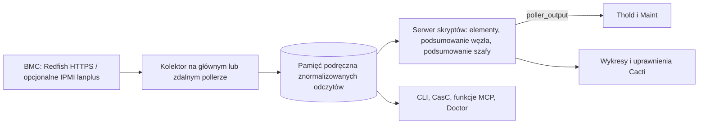

<!-- Source: README.md; SHA256: 6972a6c9ac754cd60e63c5caf971451ea8fe6e279eef757d886e1a168d3eef01 -->

<!-- translations:start -->
[English](../../../README.md) | [简体中文](../zh-CN/README.md) | [हिन्दी](../hi-IN/README.md) | [Español (España)](../es-ES/README.md) | [Español (Latinoamérica)](../es-419/README.md) | [العربية (السعودية)](../ar-SA/README.md) | [Afrikaans](../af-ZA/README.md) | [አማርኛ](../am-ET/README.md) | [العربية (مصر)](../ar-EG/README.md) | [العربية (المغرب)](../ar-MA/README.md) | [বাংলা](../bn-BD/README.md) | [Bosanski](../bs-BA/README.md) | [Deutsch](../de-DE/README.md) | [فارسی](../fa-IR/README.md) | [Filipino](../fil-PH/README.md) | [Français](../fr-FR/README.md) | [Français (Maroc)](../fr-MA/README.md) | [Français (Sénégal)](../fr-SN/README.md) | [Hausa](../ha-NG/README.md) | [עברית](../he-IL/README.md) | [Hrvatski](../hr-HR/README.md) | [Bahasa Indonesia](../id-ID/README.md) | [Igbo](../ig-NG/README.md) | [Italiano](../it-IT/README.md) | [日本語](../ja-JP/README.md) | [한국어](../ko-KR/README.md) | [Malagasy](../mg-MG/README.md) | [मराठी](../mr-IN/README.md) | [Bahasa Melayu](../ms-MY/README.md) | [Nederlands](../nl-NL/README.md) | [Polski](README.md) | [Português (Brasil)](../pt-BR/README.md) | [Русский](../ru-RU/README.md) | [Kinyarwanda](../rw-RW/README.md) | [Soomaali](../so-SO/README.md) | [Српски](../sr-RS/README.md) | [Svenska](../sv-SE/README.md) | [Kiswahili](../sw-KE/README.md) | [தமிழ்](../ta-IN/README.md) | [తెలుగు](../te-IN/README.md) | [ไทย](../th-TH/README.md) | [Türkçe](../tr-TR/README.md) | [Українська](../uk-UA/README.md) | [اردو](../ur-PK/README.md) | [Tiếng Việt](../vi-VN/README.md) | [isiXhosa](../xh-ZA/README.md) | [Yorùbá](../yo-NG/README.md) | [繁體中文](../zh-TW/README.md) | [isiZulu](../zu-ZA/README.md)
<!-- translations:end -->

# plugin_redfish

Wtyczka dla Cacti 1.2, która przenosi pobór mocy serwerów, temperaturę powietrza dolotowego, stan wentylatorów oraz kondycję zasilaczy z kontrolerów zarządzania płytą główną (BMC) do Cacti jako zwykłe urządzenia, źródła danych i wykresy, z wykorzystaniem protokołu Redfish oraz opcjonalnego mechanizmu awaryjnego IPMI w trybie tylko do odczytu i sumowania poboru mocy na poziomie szaf rack. Rozszerzenia Thold i Maint generują na ich podstawie alerty i je wyciszają za pośrednictwem standardowych źródeł danych Cacti.

> **Status: w fazie rozwoju, brak jeszcze wydania (`0.1.0-dev`).** Ta wtyczka nie jest powiązana z projektem Cacti. Instaluje się w Cacti 1.2.31 lub nowszym pod PHP 8.2 lub nowszym i implementuje kolektor Redfish, zaszyfrowany magazyn poświadczeń, obsługę tworzenia urządzeń i wykresów w Cacti, opcjonalny mechanizm awaryjny IPMI tylko do odczytu, sumowanie poboru mocy szaf rack, wyświetlanie okien konserwacyjnych Cacti Maint, replikację oraz punkty końcowe agenta dla zdalnych kolektorów danych, dostawcę CasC i CLI operatora, funkcje (abilities) MCP oraz testy diagnostyczne Doctor. CI testuje dane testowe, serwer DMTF Redfish Mockup Server (makiety subsystem, legacy-only oraz HPE iLO Gen11) oraz Thold v1.8.2 z Maint v1.3; żaden rzeczywisty fizyczny kontroler BMC ani flota pilotażowa nie zostały jeszcze zakwalifikowane. Projekt i wyniki badań znajdują się w [docs/PLAN.md](../../PLAN.md), [docs/research/](../../research/) oraz [docs/decisions/](../../decisions/).

## Zaimplementowane możliwości

### Podstawowy kolektor, magazyn poświadczeń i obiekty Cacti

- **Cykl życia i schemat bazy danych.** Instalacja, aktualizacja, wyłączanie i odinstalowywanie poprzez API wtyczek Cacti (`Schema::VERSION = 3`, 12 tabel). Tabele są zachowywane podczas odinstalowania, chyba że opcja *Keep Plugin Tables on Uninstall* zostanie odznaczona. Punkty wejścia są analizowane składniowo w PHP 8.0 i odrzucają PHP poniżej 8.2 lub brak rozszerzenia `ext-openssl` za pomocą wyraźnego komunikatu o błędzie.
- **Rejestr i uprawnienia.** Role uprawnień (realms) *Redfish View* (`redfish_health.php`), *Redfish Operator* (`redfish_operator.php`) oraz *Redfish Admin* (`redfish_bmcs.php`, `redfish_credentials.php`), a także ustawienia w **Configuration > Settings > Redfish**. Rejestr BMC obsługuje import CSV (odwołania do poświadczeń odbywają się po nazwie; hasła w plikach importu są odrzucane) oraz eksport JSON. Rekordy BMC i poświadczenia podlegają uprawnieniom urządzeń w Cacti.
- **Zaszyfrowany magazyn poświadczeń.** Hasła są przechowywane w postaci zaszyfrowanej algorytmem AES-256-GCM w tabeli `plugin_redfish_secret`. Klucz znajduje się poza bazą danych (domyślnie `/etc/cacti/redfish-vault.key`) jako 64 znaki szesnastkowe (`openssl rand -hex 32`) lub 32 surowe bajty, jest własnością użytkownika pollera, nie jest czytelny dla innych użytkowników i znajduje się w katalogu zapisywalnym wyłącznie dla użytkownika root lub tego użytkownika. Hasło złożone z 32 znaków drukowalnych jest odrzucane. **Wykonuj kopię zapasową pliku klucza razem z bazą danych**; bez niego zapisane hasła trzeba będzie wprowadzić ponownie.
- **TLS i klient Redfish tylko do odczytu.** Weryfikacja TLS jest domyślnie włączona przy użyciu systemowego magazynu CA, pakietu CA przypisanego do konkretnego BMC lub przypięcia odcisku SPKI SHA-256; rezygnacja z weryfikacji dla wybranego BMC pozostaje widoczna jako ostrzeżenie o kondycji oraz ostrzeżenie w teście Doctor. Klient zezwala wyłącznie na żądania `GET` oraz logowanie (`POST`) i wylogowanie (`DELETE`) sesji Redfish, z opcjonalnym mechanizmem awaryjnym uwierzytelniania Basic dla konkretnego BMC, gdy sesje są niedostępne. Wykrywanie preferuje nowe zasoby podsystemów i czujników Redfish, a w razie potrzeby przechodzi na przestarzałe zasoby `Power` i `Thermal`.
- **Wykonywanie kolektora.** `poller_redfish.php` uruchamia się z `poller_bottom`, uruchamia jeden proces główny na poller przez rejestr procesów Cacti z konfigurowalną liczbą procesów roboczych (`redfish_workers`), uzyskuje dzierżawy dla poszczególnych BMC, egzekwuje budżet czasu (`redfish_collector_budget`), stosuje wykładnicze wycofywanie (backoff) i czyści własną poprzednią sesję wtyczki po awarii.
- **Szablony, urządzenia i wykresy.** Importuje `templates/redfish-templates.xml` po skrócie i kopiuje trzy pliki XML zapytań o dane serwera skryptów (`redfish_fans.xml`, `redfish_temperatures.xml`, `redfish_psus.xml`) do `<cacti>/resource/script_server/` bez nadpisywania plików zmodyfikowanych przez użytkownika. Akcje **Create Device** i **Add Graphs** wymagają potwierdzenia planu wdrożenia, dołączają zapytania do zmapowanego urządzenia serwera lub tworzą urządzenie „Redfish BMC” w domenie `.invalid` z wyłączonym sprawdzaniem dostępności oraz łączą każdy wykres Redfish z powrotem z wykresami Redfish urządzenia za pośrednictwem `graph_buttons`.
- **Dane wejściowe serwera skryptów oparte wyłącznie na pamięci podręcznej.** `scripts/ss_redfish_members.php` udostępnia odczyty wentylatorów, temperatur i zasilaczy dla poszczególnych elementów, a `scripts/ss_redfish_summary.php` udostępnia metryki „Redfish Node Summary” (pobór mocy, temperaturę powietrza dolotowego i maksymalną, liczbę niesprawnych wentylatorów i zasilaczy, kondycję węzła oraz wiek ostatniego poprawnego odczytu). Wywołania serwera skryptów czytają wyłącznie z lokalnej pamięci podręcznej i nigdy nie kontaktują się z BMC. Brakujące, nieaktualne lub pochodzące z usuniętych elementów odczyty zwracają `U` (nigdy `0`), natomiast `age` zawsze raportuje wartość, dzięki czemu progi wykrywają nieodpowiadające kontrolery BMC.

**Gdy zmienią się podzespoły BMC** (np. wymiana wentylatora lub aktualizacja oprogramowania układowego zmieniająca nazwy czujników), uruchom ponownie **Add Graphs**. Wentylator lub zasilacz, który wcześniej istniał, a stał się nieobecny, wlicza się do `fans_bad` lub `psus_bad` do czasu zatwierdzenia zmiany; gniazdo, które nigdy nie było obsadzone, nie jest wliczane. Usunięte elementy zachowują swoje istniejące źródła danych i wykresy, które odtąd odczytują `U`, dopóki nie zostaną ręcznie usunięte. Usunięcie urządzenia Cacti odpina jego kontroler BMC i usuwa przypisanie do szafy rack, zachowując sam rekord BMC oraz pamięć podręczną; usunięcie BMC lub odinstalowanie wtyczki zachowuje urządzenia i wykresy Cacti.

### Opcjonalny mechanizm awaryjny IPMI

- **Wybór dla konkretnego BMC.** Domyślnie wyłączony (`protocols` ma wartość domyślną `redfish`; włączenie mechanizmu awaryjnego IPMI ustawia `redfish,ipmi`).
- **Zawężony wyzwalacz awaryjny.** Uruchamia się wyłącznie wtedy, gdy zbieranie danych przez Redfish zawiedzie z kwalifikującą się klasą błędu; nigdy nie uruchamia się przy `AuthRejected`, `CredentialUnavailable`, `AddressRefused`, `OperationRefused` ani `Deadline`.
- **Bezpieczne wykonanie.** Wywołuje `ipmitool` przez `-I lanplus` za pomocą `proc_open()` w formie tablicy bez powłoki, z ograniczonym czasem rzeczywistym wykonania i limitem wyjścia 256 KiB. Hasła są przekazywane przez `IPMITOOL_PASSWORD` (`-E`) lub plik tymczasowy o uprawnieniach 0600 (`-f`) usuwany w bloku `finally`, nigdy w argumentach CLI argv.
- **Lista dozwolonych poleceń tylko do odczytu.** Dozwolonych jest wyłącznie pięć podpoleceń tylko do odczytu: `dcmi power reading`, `sdr type Temperature`, `sdr type Fan`, `sdr type Power Supply` oraz `chassis status`. Polecenia modyfikujące stan są odrzucane.
- **Znormalizowane wyjście i ostrzeżenie o stanie bezpieczeństwa.** `IpmiNormalizer` mapuje odczyty na ten sam model `Observation`/`Member`/`Reading`, zwracając `U` dla brakujących lub nieczytelnych czujników. Włączenie mechanizmu awaryjnego IPMI generuje ostrzeżenie na stronie kondycji oraz w teście Doctor `redfish.bmc_security`, przypominając operatorom o ograniczeniu portu UDP 623 do sieci VLAN zarządzania.

### Sumowanie poboru mocy szaf rack

- **Rejestr szaf rack.** Schemat w wersji 3 dodaje `plugin_redfish_rack` (unikatowe `(site_id, name)`, opcjonalne `power_budget_watts`, `min_coverage_pct` o wartości domyślnej `80` oraz notatki) i `plugin_redfish_rack_member` (najwyżej jedno przypisanie do szafy rack na `host_id`, opcjonalne `bmc_id` oraz `unit_position`, usuwane automatycznie po usunięciu urządzenia Cacti).
- **Sumy chronione progiem pokrycia.** `RackPowerSummary` sumuje aktualne odczyty `power_watts` członków z lokalnej pamięci podręcznej oraz wylicza wykorzystanie budżetu i zapas mocy. Gdy pokrycie raportujących członków spadnie poniżej `min_coverage_pct`, wartości `power_watts`, `utilization_pct` i `headroom_watts` zwracają `U`, aby awarie kolektora nigdy nie wyglądały jak spadek poboru mocy szafy rack.
- **Dane wejściowe serwera skryptów gotowe dla Thold.** `scripts/ss_redfish_rack.php` (`ss_redfish_rack(<rack_id>)`) zwraca `power_watts`, `power_budget_watts`, `utilization_pct`, `headroom_watts`, `members_total`, `members_reporting` oraz `coverage_pct` wyłącznie z lokalnej pamięci podręcznej.

### Integracja z Cacti Maint

- Progi Thold na źródłach danych Redfish wyzwalają alerty, a Cacti Maint wycisza je bez żadnych zmian w żadnej z wtyczek.
- `MaintWindow` sprawdza aktywne harmonogramy Maint dla każdego zmapowanego hosta Cacti (jednorazowe `mtype=1` i cykliczne `mtype=2` harmonogramy oraz `plugin_maint_check_cacti_host()`, jeśli moduł jest załadowany) i oznacza trwającą konserwację na stronie Redfish Health (`[MAINT]`), w wynikach `cli/redfish.php health` oraz w funkcji `redfish-get-health`.

### Zdalne kolektory danych

- `INFO` deklaruje `remote_collect:1`. Kontrolery BMC akceptują dowolny `poller_id >= 1`, a polecenie `poller_redfish.php --poller=N` zbiera dane wyłącznie z włączonych BMC przypisanych do tego pollera.
- **Hook `replicate_out`.** Replikuje za pośrednictwem `replicate_out_table()` wyłącznie niepoufne tabele konfiguracyjne przypisane do docelowego pollera zdalnego: `plugin_redfish_bmc`, metadane `plugin_redfish_credential` (bez szyfrogramu), `plugin_redfish_rack` oraz `plugin_redfish_rack_member`. Tabela `plugin_redfish_secret` nie jest replikowana, a pliki klucza magazynu pozostają ściśle lokalne na każdym pollerze.
- **Hook `remote_agent`.** Udostępnia akcje tylko do odczytu `redfish_health` i `redfish_discovery`, przyjmujące wyłącznie numeryczne parametry `poller_id` i `bmc_id`. Nieoczekiwane parametry są odrzucane, a żadne poświadczenia ani tajne dane nie są zwracane.

### Hooki ekosystemu (CasC, funkcje MCP i Doctor)

- **Dostawca CasC (`casc_register_providers`).** Rejestruje dostawcę `redfish` (schemat w wersji `1`) z czysto PHP-owym eksportem YAML i XML, parsowaniem (z odrzucaniem XXE), walidacją, planowaniem różnic oraz stosowaniem zmian. Poświadczenia występują wyłącznie jako odwołania do magazynu (`vault:redfish:<name>`); surowe klucze poufne (`pass`, `secret`, `token`, `private_key`, `vault_key`, `auth_token`) są odrzucane. Zastosowanie zmian wymaga dokładnego skrótu SHA-256 `PLAN_HASH`.
- **MCP / Abilities API (`abilities_register`).** Rejestruje trzy funkcje tylko do odczytu chronione uprawnieniem Redfish View (`redfish_health.php`) oraz uprawnieniami urządzeń w Cacti, nie zwracając żadnych poświadczeń:
  - `redfish-list-bmcs` (opcjonalny `poller_id`)
  - `redfish-get-rack-power` (opcjonalny `rack_id`)
  - `redfish-get-health` (opcjonalny `bmc_id`)
- **Testy Doctor (`doctor_register_checks`).** Rejestruje pięć lokalnych testów diagnostycznych tylko do odczytu, które nigdy nie kontaktują się z BMC ani nie zwracają materiału klucza:
  - `redfish.schema`: aktualność wersji schematu
  - `redfish.vault_key`: czytelność i uprawnienia pliku klucza magazynu
  - `redfish.collector_runs`: budżet czasu i świeżość uruchomień kolektora pollera
  - `redfish.bmc_security`: włączone BMC z niezweryfikowanym TLS lub mechanizmem awaryjnym IPMI
  - `redfish.rack_power`: zgodność z budżetem mocy szafy rack i minimalny próg pokrycia

## CLI

Uruchamiaj z katalogu głównego Cacti pod PHP 8.2 lub nowszym:

```sh
# Operator and CasC CLI (reads --file=PATH or stdin for validate, plan, and apply)
php plugins/redfish/cli/redfish.php export --format=yaml|xml
php plugins/redfish/cli/redfish.php validate [--file=PATH] [--format=yaml|xml]
php plugins/redfish/cli/redfish.php plan [--file=PATH] [--format=yaml|xml]
php plugins/redfish/cli/redfish.php apply [--file=PATH] [--format=yaml|xml] --confirm=<PLAN_HASH>
php plugins/redfish/cli/redfish.php health --format=text|json

# Collector entry point (normally started by poller_bottom)
php plugins/redfish/poller_redfish.php [--poller=N] [--force] [--debug]

# Rack power summary script server entry point
php plugins/redfish/scripts/ss_redfish_rack.php <rack_id>
```

## Role dostępu

| Realm | Dostęp |
| --- | --- |
| Redfish View | Dotychczasowe strony monitorowania. |
| Redfish Operator | Monitorowanie oraz strona Operations i osobiste potwierdzenia w ramach triażu. |
| Redfish Admin | Dostęp Operatora oraz dotychczasowa konfiguracja i akcje administracyjne. |

Po skopiowaniu plików aktualizacji otwórz stronę Plugins jako administrator, aby zarejestrować role uprawnień. Przypisz rolę Operator jawnie w sekcji **Configuration > Users** lub w grupach użytkowników. Aktualizacje zachowują dotychczasowe identyfikatory i nadania ról View oraz Admin. Dostęp Admin dziedziczy dostęp Operator, a dostęp Operator dziedziczy dostęp View przy każdym żądaniu; nie dodaje to zapisanych nadań do użytkowników ani grup. Ustawienia wtyczki wymagają również dostępu Redfish Admin oprócz uprawnienia Settings w Cacti.

Uprawnienia urządzeń w Cacti ograniczają wiersze i akcje dostępne dla każdego użytkownika; niepowiązane obiekty wymagają uprawnień administratora. Operatorzy mogą zwolnić wstrzymanie zbierania danych na dozwolonym BMC na czas kolejnego zaplanowanego uruchomienia. Poświadczenia, konfiguracja, mapowanie, usuwanie oraz pozostałe zmiany administracyjne pozostają na stronach administracyjnych. Potwierdzenia obowiązują wyłącznie w bieżącej sesji użytkownika, maksymalnie przez jedną godzinę i tylko dopóki ta sama obserwacja pozostaje aktualna. Nowe lub zmienione obserwacje je unieważniają. Nigdy nie oznaczają błędnego pomiaru jako zdrowego ani nie wyciszają alertów.

## Dlaczego

Każdy serwer posiada kontroler BMC raportujący pobór mocy i stan termiczny niezależnie od systemu operacyjnego, dzięki czemu odpowiada również wtedy, gdy system operacyjny nie działa. Dane te służą do planowania pojemności i śledzenia kosztów, wczesnego ostrzegania o awarii wentylatora lub zasilacza, a w obliczeniach wysokiej wydajności także do podejmowania decyzji o ograniczaniu poboru mocy (power-capping). Wtyczka nie jest ograniczona do środowisk HPC.

Obecnie Cacti pokrywa tylko część tych potrzeb:

- **Pakiety SNMP producentów.** Gałąź 1.2.x dostarcza szablony Dell iDRAC i HPE iLO wymagające agenta SNMP i specyficzne dla producenta; badania z kamienia milowego 1 wykazały, że żaden z nich nie raportuje poboru mocy w watach ([docs/research/overlap.md](../../research/overlap.md)).
- **Typ poświadczeń bez kolektora.** plugin_credentials definiuje poświadczenie „IPMI / Redfish (BMC)”, lecz nie odczytuje żadnego BMC.
- **Brak widoku na poziomie szafy rack.** Rdzeń Cacti nie posiada obiektu szafy rack; urządzenie ma pole tekstowe `location` o dowolnym formacie.

Wtyczka odpytuje kontrolery BMC poza pasmem względem cyklu pollera Cacti na głównym pollerze lub na zdalnych kolektorach danych, zapisuje w pamięci podręcznej znormalizowane odczyty i udostępnia je przez zapytania o dane serwera skryptów, podsumowania węzłów oraz podsumowania poboru mocy szaf rack. Wykorzystuje mechanizmy wykresów, uprawnień, Thold i Maint z Cacti oraz nie zmienia stanu BMC.

## Zakres i status

| Faza | Zakres | Kamienie milowe | Status |
|---|---|---|---|
| 0, badania | Macierz producentów, potwierdzenie zachowania w kodzie głównym na żywych BMC, koszt odpytywania, prototyp zapytania o dane | [M1](https://github.com/somethingwithproof/plugin_redfish/milestone/1) | Zakończono, oczekiwanie na przechwycenia oprogramowania układowego z rzeczywistych BMC |
| 1, obserwacja | Rejestr BMC, poświadczenia, TLS, kolektor Redfish, znormalizowane odczyty, urządzenia, wykresy per indeks, alertowanie Thold, integracja z Maint, strona kondycji | [M2](https://github.com/somethingwithproof/plugin_redfish/milestone/2), [M3](https://github.com/somethingwithproof/plugin_redfish/milestone/3), [M4](https://github.com/somethingwithproof/plugin_redfish/milestone/4) | Zaimplementowano; kwalifikacja floty pilotażowej M4 w toku |
| 2, ipmi | Mechanizm awaryjny IPMI (`lanplus`) tylko do odczytu przez `ipmitool`, domyślnie wyłączony | [M5](https://github.com/somethingwithproof/plugin_redfish/milestone/5) | Zaimplementowano |
| 3, szafy | Rejestr szaf rack, sumy mocy szaf z progiem pokrycia, zapas budżetu mocy, `ss_redfish_rack.php` | [M6](https://github.com/somethingwithproof/plugin_redfish/milestone/6) | Zaimplementowano |
| 4, zdalne i ekosystem | Zdalne kolektory danych (`replicate_out`, `remote_agent`), dostawca CasC i CLI, funkcje MCP, testy Doctor | [M7](https://github.com/somethingwithproof/plugin_redfish/milestone/7) | Zaimplementowano |

Poza zakresem: ustawianie limitów mocy ani żadnej innej konfiguracji BMC, sterowanie zasilaniem, aktualizacja oprogramowania układowego, dostęp do konsoli, własny silnik alertowania wtyczki oraz integracja z harmonogramem.

## Docelowa zgodność

| Składnik | Cel |
|---|---|
| Cacti | 1.2.31 lub nowszy, bez poprawek rdzenia |
| Baza danych | MariaDB 10.2 lub MySQL 5.7 albo nowszy: relacja jednego BMC na urządzenie jest wymuszana kluczem unikatowym na kolumnie generowanej |
| PHP | 8.2 lub nowszy; punkty wejścia pozostają możliwe do analizy składniowej w wersji 8.0, aby nieobsługiwane środowisko otrzymało odmowę zamiast uszkodzonego interfejsu Cacti |
| Rozszerzenia PHP | `ext-openssl` (wymagane przez Cacti 1.2.31); brak `ext-curl` i brak zależności uruchomieniowych Composer |
| Opcjonalne narzędzia | `ipmitool` na pollerach zbierających dane z BMC z włączonym mechanizmem awaryjnym IPMI |
| Kontrolery BMC | Dell iDRAC, HPE iLO, Lenovo XCC oraz OpenBMC, według zakresu wersji oprogramowania układowego; zobacz [macierz dostawców](../../research/vendor-matrix.md) |
| Redfish | W pierwszej kolejności nowe zasoby podsystemów i czujników, przestarzałe `Power` i `Thermal` jako mechanizm awaryjny |
| Thold, Maint | Nie wymagają żadnych zmian (CI testuje Thold v1.8.2 oraz Maint v1.3) |

## Projekt

- [docs/PLAN.md](../../PLAN.md) zawiera pełny plan: architekturę, fakty z kodu głównego, na których opiera się projekt, model pomiarów, granice bezpieczeństwa, rachunek wydajności, testowanie i ryzyka.
- [docs/decisions/](../../decisions/) zawiera rekordy decyzji architektonicznych dla już dokonanych wyborów.
- [docs/REQUIREMENTS.md](../../REQUIREMENTS.md) mapuje każdy identyfikator wymagania na odpowiadające mu zgłoszenie.



## Bezpieczeństwo

Poświadczenia BMC zapewniają kontrolę nad pozapasmowym zarządzaniem serwerami. Projekt utrzymuje tajne dane poza wierszami poleceń, dziennikami, eksportami CasC, ładunkami zdalnego agenta, odpowiedziami MCP i stronami WWW; szyfruje zapisane hasła algorytmem AES-256-GCM z użyciem lokalnego pliku klucza magazynu na każdym pollerze; domyślnie weryfikuje TLS; uruchamia `ipmitool` z jawnej tablicy argumentów z dozwolonymi podpoleceniami tylko do odczytu; oraz korzysta z kont BMC wyłącznie do odczytu. Zobacz [docs/PLAN.md](../../PLAN.md#security) i [SECURITY.md](../../../SECURITY.md).

## Przewodnik operatora

Zobacz [docs/operator-guide.md](../../operator-guide.md), aby poznać wymagania instalacyjne, konfigurację magazynu kluczy i TLS, rejestrację BMC, tworzenie wykresów, interwały alertów, kopie zapasowe oraz obsługę awarii. Przewodnik nie uznaje żadnej rzeczywistej linii oprogramowania układowego producenta za wspieraną, dopóki zanonimizowane przechwycenie z tego oprogramowania nie przejdzie zestawu testów.

## Rozwój i testowanie

CI ([.github/workflows/plugin-ci-workflow.yml](../../../.github/workflows/plugin-ci-workflow.yml)) sprawdza poprawność składniową punktów wejścia w PHP 8.0, uruchamia zestawy testów jednostkowych Pest (`phpunit.xml`) oraz integracyjnych cyklu życia (`phpunit-integration.xml`), a także analizę PHPStan na poziomie 9 dla PHP od 8.2 do 8.5 względem Cacti `release/1.2.31` i `1.2.x`, weryfikuje odmowę uruchomienia na PHP 8.1, testuje kompleksowo serwer DMTF Redfish Mockup Server (makiety subsystem, legacy-only oraz HPE iLO Gen11) i Thold v1.8.2 / Maint v1.3, oraz kontroluje katalogi gettext, przepływy pracy i licencjonowanie REUSE.

Lokalne sprawdzenia przed wysłaniem zmian:

```sh
sh tests/lint-workflows.sh
sh locales/build_gettext.sh --check
CACTI_PATH=/path/to/cacti phpstan analyse -c phpstan.neon --no-progress
```

Uruchamiaj Pest z flagą `--configuration=phpunit.xml` dla testów jednostkowych i reguł kodu źródłowego, lub z `--configuration=phpunit-integration.xml` oraz zmiennymi `CACTI_PATH` i `REDFISH_TEST_DATABASE=disposable` na jednorazowej bazie danych Cacti dla testów integracyjnych cyklu życia.

## Śledzenie prac

- **Kamienie milowe** odpowiadają kamieniom milowym z planu. Każdy z nich ma nadrzędne zgłoszenie typu epic z listą podzadań oraz dowodów ukończenia.
- **Zgłoszenia** są klasyfikowane etykietami: `type: requirement`, `type: research`, `type: decision`, `type: epic`. Zgłoszenia wymagań określają numerowane, testowalne wymagania (`REQ-AREA-NNN`) oraz kryteria akceptacji.
- **Etykiety** zawierają również prefiksy `area:`, `phase:`, `priority:` oraz `status:`. Zobacz [CONTRIBUTING.md](../../../CONTRIBUTING.md#labels).
- [Tablica projektu](https://github.com/users/somethingwithproof/projects/12) prezentuje wszystkie zgłoszenia w podziale na kamienie milowe.

## Wkład w projekt

Przeczytaj [CONTRIBUTING.md](../../../CONTRIBUTING.md). Commity wymagają podpisu DCO (sign-off). Dyskusje projektowe toczą się w zgłoszeniach; otwarte decyzje noszą etykietę `type: decision`. Najbardziej przydatnym wkładem są obecnie dane z rzeczywistych kontrolerów BMC; przed opublikowaniem jakiegokolwiek przechwycenia należy zanonimizować adresy, numery seryjne i poświadczenia.

## Licencja

GNU General Public License v2.0, ta sama licencja co w przypadku Cacti i jego wtyczek. Zobacz [LICENSE](../../../LICENSE).
