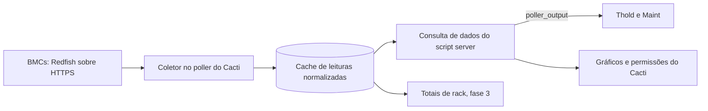

<!-- Source: README.md; SHA256: 7b4e83a58a1adc844cb0615ef30e95476cba2851f96bb454d2a816fb2774724d -->

<!-- translations:start -->
[English](../../../README.md) | [简体中文](../zh-CN/README.md) | [हिन्दी](../hi-IN/README.md) | [Español (España)](../es-ES/README.md) | [Español (Latinoamérica)](../es-419/README.md) | [العربية (السعودية)](../ar-SA/README.md) | [Afrikaans](../af-ZA/README.md) | [አማርኛ](../am-ET/README.md) | [العربية (مصر)](../ar-EG/README.md) | [العربية (المغرب)](../ar-MA/README.md) | [বাংলা](../bn-BD/README.md) | [Bosanski](../bs-BA/README.md) | [Deutsch](../de-DE/README.md) | [فارسی](../fa-IR/README.md) | [Filipino](../fil-PH/README.md) | [Français](../fr-FR/README.md) | [Français (Maroc)](../fr-MA/README.md) | [Français (Sénégal)](../fr-SN/README.md) | [Hausa](../ha-NG/README.md) | [עברית](../he-IL/README.md) | [Hrvatski](../hr-HR/README.md) | [Bahasa Indonesia](../id-ID/README.md) | [Igbo](../ig-NG/README.md) | [Italiano](../it-IT/README.md) | [日本語](../ja-JP/README.md) | [한국어](../ko-KR/README.md) | [Malagasy](../mg-MG/README.md) | [मराठी](../mr-IN/README.md) | [Bahasa Melayu](../ms-MY/README.md) | [Nederlands](../nl-NL/README.md) | [Polski](../pl-PL/README.md) | [Português (Brasil)](README.md) | [Русский](../ru-RU/README.md) | [Kinyarwanda](../rw-RW/README.md) | [Soomaali](../so-SO/README.md) | [Српски](../sr-RS/README.md) | [Svenska](../sv-SE/README.md) | [Kiswahili](../sw-KE/README.md) | [தமிழ்](../ta-IN/README.md) | [తెలుగు](../te-IN/README.md) | [ไทย](../th-TH/README.md) | [Türkçe](../tr-TR/README.md) | [Українська](../uk-UA/README.md) | [اردو](../ur-PK/README.md) | [Tiếng Việt](../vi-VN/README.md) | [isiXhosa](../xh-ZA/README.md) | [Yorùbá](../yo-NG/README.md) | [繁體中文](../zh-TW/README.md) | [isiZulu](../zu-ZA/README.md)
<!-- translations:end -->

# plugin_redfish

Um plugin para Cacti 1.2 que traz o consumo de energia de servidores, a temperatura de entrada, o estado das ventoinhas e a saúde das fontes de alimentação dos controladores de gerenciamento de placa-mãe (BMCs) para o Cacti como dispositivos, fontes de dados e gráficos comuns, usando Redfish com fallback opcional para IPMI. O Thold e o Maint passam então a alertar e suprimir esses alertas, e uma fase posterior adiciona totais de energia por rack.

> **Status: em desenvolvimento, ainda sem versão lançada (0.1.0-dev).** Os marcos 2 (base) e 3 (objetos do Cacti e alertas) estão integrados em `main`. Este plugin não é afiliado ao projeto Cacti. Ele é instalado no Cacti 1.2.31 com PHP 8.2 ou posterior, registra BMCs e credenciais, lê energia, temperaturas, ventoinhas e saúde das fontes de alimentação de cada BMC via Redfish para seu próprio cache e exibe a saúde da coleta. Ele adiciona dispositivos do Cacti, gráficos por membro e de resumo, além de suporte ao Thold e ao Maint por meio de fontes de dados comuns. A CI testou um BMC simulado construído a partir de fixtures escritos manualmente e do servidor mockup Redfish da DMTF; nenhum BMC real nem frota piloto foram homologados ainda. O design e a pesquisa estão em [docs/PLAN.md](../../PLAN.md), [docs/research/](../../research) e [docs/decisions/](../../decisions).

### O que o marco 2 entrega

- Instalação, atualização, desativação e desinstalação por meio da API de plugins do Cacti, mantendo as tabelas na desinstalação, a menos que a configuração seja desmarcada. Em versões do PHP anteriores à 8.2, o plugin recusa a instalação ou ativação e informa o motivo.
- Realms "Redfish View" (página de saúde), "Redfish Operator" (página de operações) e "Redfish Admin" (páginas de BMCs e credenciais), além de configurações em Configuration > Settings > Redfish.
- Um registro de BMCs com importação CSV e exportação JSON. Os arquivos de importação não devem conter senhas; as credenciais são referenciadas pelo nome.
- Credenciais armazenadas criptografadas com AES-256-GCM. A chave é um arquivo fora do banco de dados, `/etc/cacti/redfish-vault.key` por padrão, contendo 64 caracteres hexadecimais (`openssl rand -hex 32`) ou exatamente 32 bytes aleatórios, de propriedade do usuário do poller, sem permissão de leitura para outros usuários, em um diretório onde apenas o usuário do poller ou root podem gravar. Uma chave de 32 caracteres imprimíveis é recusada como senha. **Faça backup do arquivo de chave junto com o banco de dados**; sem ele, todas as senhas armazenadas precisarão ser inseridas novamente.
- Verificação TLS ativada por padrão, com um pacote CA por BMC ou fixação (pin) SHA-256 de SPKI. Uma opção registrada de desativação da verificação por BMC permanece na página de saúde como um aviso.
- Um cliente Redfish somente leitura: apenas `GET` além de login e logout de sessão, validados contra uma lista de permissões antes que qualquer requisição seja enviada.
- Um coletor iniciado a partir de `poller_bottom` para BMCs no poller principal, com concessões (leases) e prazos por BMC, backoff e limpeza após falha da única sessão registrada pelo plugin. Coletores remotos ainda não são suportados; eles exigem uma definição explícita de como o coletor acessará o banco de dados e a chave (fase 4).
- Registros de BMCs e credenciais seguem as permissões de dispositivos do Cacti: um Redfish Admin visualiza, altera e vincula apenas BMCs em dispositivos que pode ver, e apenas credenciais que não sejam usadas por nenhum BMC em um dispositivo oculto.

### O que o marco 3 adiciona

- Templates distribuídos como XML de template do Cacti em `templates/` e importados com o próprio importador do Cacti na instalação e atualização, correspondidos por hash, de modo que uma importação atualiza os objetos do plugin e não adiciona nada em duplicidade. Os três arquivos de consulta de dados (data query) são copiados para `<cacti>/resource/script_server/` com um hash registrado; o plugin nunca substitui um arquivo lá que não tenha sido gravado por ele, e a página de saúde avisa os administradores quando os templates ou algum arquivo de consulta não estiverem no lugar. **Reinstall the Redfish Templates** na página de BMCs os importa novamente; isso exige a permissão Import Templates do Cacti.
- **Create Device** ou **Add Graphs** em cada BMC ([ADR 0015](../../decisions/0015-attach-to-the-server-device-or-create-one-per-bmc.md)). Um BMC mapeado para o dispositivo existente de um servidor recebe suas consultas de dados e gráficos nesse dispositivo. Um BMC não mapeado recebe um novo dispositivo a partir do template de dispositivo "Redfish BMC", com verificações de disponibilidade desativadas e um nome de host sob `.invalid`, para que o Cacti nunca contate o BMC nem exiba seu endereço. Em ambos os casos, um administrador confirma primeiro um plano listando o que será adicionado. Ambas as ações exigem a permissão de gerenciamento de dispositivos do Cacti, além de Redfish Admin; um novo dispositivo que o criador não possa visualizar é removido novamente.
- Três consultas de dados do script server, "Redfish Fans", "Redfish Temperatures" e "Redfish Power Supplies", indexadas pela chave do membro do BMC, com um gráfico por membro: velocidade da ventoinha em porcentagem ou RPM (conforme a unidade relatada pelo BMC), temperatura e watts de entrada e saída da fonte de alimentação, cada um com seu código de saúde.
- Uma entrada "Redfish Node Summary" com energia, temperatura de entrada, temperatura máxima, ventoinhas e fontes que não estão OK, saúde do nó e idade da última leitura válida, exibida em quatro gráficos: energia, temperaturas, saúde dos componentes e idade dos dados. Limiares do Thold nessas fontes de dados geram alertas e o Maint os suprime, sem necessidade de alterações em nenhum dos dois plugins.
- O script server responde apenas a partir do cache do plugin e nunca contata um BMC. Um valor ausente, obsoleto, de outra unidade ou de um membro que desapareceu é `U`, de modo que os gráficos mostram uma lacuna, nunca zero; `age` sempre possui um valor, então um limiar sobre ele detecta um BMC que parou de responder.
- Um link de gráfico em cada gráfico Redfish para os gráficos Redfish do dispositivo, exibido apenas aos usuários aos quais o Cacti permite visualizar o dispositivo.

**Quando os membros de um BMC mudarem** (uma ventoinha substituída, uma atualização de firmware renomeando sensores), escolha **Add Graphs** novamente. Uma ventoinha ou fonte de alimentação que estava presente e agora está ausente ou desapareceu conta em `fans_bad` ou `psus_bad` até que você faça isso, de modo que uma ventoinha removida gera alerta; um slot que nunca foi preenchido não conta. Add Graphs aceita os membros que o BMC relata agora e o Cacti indexa as consultas novamente; um membro que desapareceu mantém sua fonte de dados e gráfico, que passam a ler `U` a partir de então, e um novo membro ganha um gráfico. Exclua manualmente os gráficos dos membros que desapareceram quando o histórico deles não for mais necessário.

Excluir um dispositivo desfaz o mapeamento do seu BMC e mantém o BMC e seu cache. Excluir um BMC ou desinstalar o plugin mantém seu dispositivo e gráficos.

## Papéis de acesso

| Realm | Acesso |
| --- | --- |
| Redfish View | Páginas de monitoramento existentes. |
| Redfish Operator | Monitoramento mais a página Operations e reconhecimentos pessoais de triagem. |
| Redfish Admin | Acesso de Operator mais a configuração existente e ações administrativas. |

Após copiar os arquivos de atualização, abra a página Plugins como administrador para registrar
o novo realm. Atribua o realm Operator explicitamente em **Configuration > Users** ou grupos de usuários.
As atualizações mantêm os IDs e concessões existentes dos realms View e Admin. O acesso Admin
herda o acesso Operator, e o acesso Operator herda o acesso View em cada requisição;
isso não adiciona concessões armazenadas a usuários ou grupos. As configurações do plugin também exigem
acesso Redfish Admin além da permissão Settings do Cacti.

As permissões de dispositivos do Cacti ainda limitam as linhas e ações disponíveis para cada usuário; objetos não mapeados exigem um administrador. Os operadores podem liberar uma retenção de coleta em um BMC permitido para a próxima execução agendada.
Credenciais, configuração, mapeamento, exclusão e outras alterações administrativas
permanecem nas páginas administrativas. Os reconhecimentos duram apenas na sessão atual
do usuário, por no máximo uma hora e somente enquanto a mesma observação permanecer
recente. Observações novas ou alteradas os invalidam. Eles nunca marcam uma medição com falha
como saudável nem suprimem alertas.

## Por quê

Todo servidor possui um BMC que relata o estado térmico e de energia independentemente do sistema operacional, portanto ele continua respondendo quando o SO está inativo. Os dados servem para acompanhamento de capacidade e custos, alerta antecipado de falha em ventoinha ou fonte de alimentação e, em computação de alto desempenho, decisões de limitação de energia (power-capping). O plugin não é específico para HPC.

O Cacti cobre parte disso hoje:

- **Pacotes SNMP de fornecedores.** O branch 1.2.x inclui templates Dell iDRAC e HPE iLO que precisam de um agente SNMP e são específicos de cada fornecedor; a pesquisa do marco 1 constatou que nenhum deles relata o consumo de energia em watts ([docs/research/overlap.md](../../research/overlap.md)).
- **Um tipo de credencial sem coletor.** O plugin_credentials define uma credencial "IPMI / Redfish (BMC)", mas não lê nenhum BMC.
- **Nenhuma visão em nível de rack.** O núcleo do Cacti não possui objeto de rack; um dispositivo tem um campo de texto livre `location`.

O plugin consulta os BMCs fora de banda em relação ao ciclo de polling do Cacti, armazena leituras normalizadas em cache e as expõe por meio de uma consulta de dados do script server e fontes de dados de resumo. Ele reutiliza os gráficos, permissões, Thold e Maint do Cacti e não altera o estado do BMC. O suporte a coletores de dados remotos está planejado para a fase 4; a coleta atual é executada apenas no poller principal.

## Escopo planejado

| Fase | Escopo | Marcos |
|---|---|---|
| 0, pesquisa | Matriz de fornecedores, confirmação do comportamento upstream em BMCs reais, custo de polling, spike de consulta de dados | [M1](https://github.com/somethingwithproof/plugin_redfish/milestone/1) |
| 1, observar | Registro de BMCs, credenciais, TLS, coletor Redfish, leituras normalizadas, dispositivos, gráficos por índice, alertas Thold, supressão Maint, página de saúde | [M2](https://github.com/somethingwithproof/plugin_redfish/milestone/2), [M3](https://github.com/somethingwithproof/plugin_redfish/milestone/3), [M4](https://github.com/somethingwithproof/plugin_redfish/milestone/4) |
| 2, ipmi | Fallback IPMI para BMCs sem Redfish utilizável, desativado por padrão | [M5](https://github.com/somethingwithproof/plugin_redfish/milestone/5) |
| 3, racks | Registro de racks, totais de energia por rack com cobertura, margem de orçamento | [M6](https://github.com/somethingwithproof/plugin_redfish/milestone/6) |
| 4, remoto | Coletores de dados remotos do Cacti para redes de BMCs isoladas | [M7](https://github.com/somethingwithproof/plugin_redfish/milestone/7) |

Fora de escopo: definição de limites de energia ou qualquer outra configuração de BMC, controle de energia, atualização de firmware, acesso a console, mecanismo de alertas próprio do plugin e integração com agendador.

## Metas de compatibilidade

| Componente | Alvo |
|---|---|
| Cacti | 1.2.31 ou posterior, sem patches no núcleo |
| Banco de dados | MariaDB 10.2 ou MySQL 5.7 ou posterior: um BMC por dispositivo é garantido por uma chave única em uma coluna gerada |
| PHP | 8.2 ou posterior; `setup.php` permanece analisável no 8.0 para que um runtime sem suporte receba uma recusa em vez de uma interface do Cacti quebrada |
| BMCs | Dell iDRAC, HPE iLO, Lenovo XCC e OpenBMC, por faixa de firmware; veja [a matriz de fornecedores](../../research/vendor-matrix.md) |
| Redfish | Novos recursos de subsistema e sensor primeiro, `Power` e `Thermal` obsoletos como fallback |
| Thold, Maint | Nenhuma alteração necessária |

## Design

- [docs/PLAN.md](../../PLAN.md) é o plano completo: arquitetura, fatos upstream dos quais depende (com fontes e suposições ainda a confirmar), modelo de medição, limites de segurança, aritmética de desempenho, testes e riscos.
- [docs/decisions/](../../decisions) armazena os registros de decisão de arquitetura para escolhas já tomadas.
- [docs/REQUIREMENTS.md](../../REQUIREMENTS.md) mapeia cada ID de requisito para sua issue.

## Segurança

As credenciais de BMC controlam o gerenciamento fora de banda dos servidores. O design as mantém fora de linhas de comando, logs e páginas, verifica TLS por padrão, executa qualquer comando externo a partir de um array de argumentos com subcomandos em lista de permissões e usa contas BMC somente leitura. Veja [docs/PLAN.md](../../PLAN.md#security) e [SECURITY.md](../../../SECURITY.md).

## Guia do operador

Veja [docs/operator-guide.md](../../operator-guide.md) para pré-requisitos de instalação, configuração do cofre e TLS, registro de BMCs, criação de gráficos, intervalos de alerta, backup e tratamento de falhas. O guia não declara nenhuma linha real de firmware de fornecedor como suportada até que uma captura anonimizada desse firmware passe na suíte de testes.

## Como o trabalho é acompanhado

- **Marcos (Milestones)** seguem os marcos do plano. Cada um tem uma issue épica listando suas sub-issues e evidências de saída.
- **Issues** são tipadas por rótulo: `type: requirement`, `type: research`, `type: decision`, `type: epic`. Issues de requisitos declaram requisitos numerados e testáveis (`REQ-AREA-NNN`) e critérios de aceitação.
- **Rótulos** também carregam `area:`, `phase:`, `priority:` e `status:`. Veja [CONTRIBUTING.md](../../../CONTRIBUTING.md#labels).
- O [quadro do projeto](https://github.com/users/somethingwithproof/projects/12) mostra todas as issues entre os marcos.

## Contribuição

Leia [CONTRIBUTING.md](../../../CONTRIBUTING.md). Os commits precisam de uma assinatura DCO (sign-off). A discussão de design acontece nas issues; decisões em aberto levam o rótulo `type: decision`. Evidências de BMCs reais são a contribuição mais útil no momento; remova endereços, números de série e credenciais antes de publicar qualquer captura.

## Licença

GNU General Public License v2.0, a mesma licença do Cacti e de seus plugins. Veja [LICENSE](../../../LICENSE).
