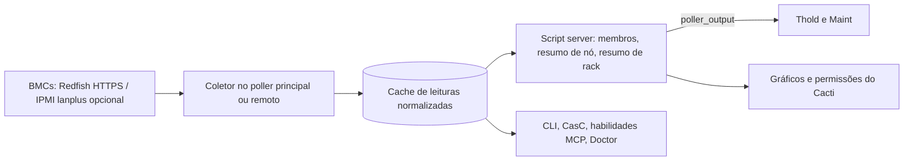

<!-- Source: README.md; SHA256: 6972a6c9ac754cd60e63c5caf971451ea8fe6e279eef757d886e1a168d3eef01 -->

<!-- translations:start -->
[English](../../../README.md) | [简体中文](../zh-CN/README.md) | [हिन्दी](../hi-IN/README.md) | [Español (España)](../es-ES/README.md) | [Español (Latinoamérica)](../es-419/README.md) | [العربية (السعودية)](../ar-SA/README.md) | [Afrikaans](../af-ZA/README.md) | [አማርኛ](../am-ET/README.md) | [العربية (مصر)](../ar-EG/README.md) | [العربية (المغرب)](../ar-MA/README.md) | [বাংলা](../bn-BD/README.md) | [Bosanski](../bs-BA/README.md) | [Deutsch](../de-DE/README.md) | [فارسی](../fa-IR/README.md) | [Filipino](../fil-PH/README.md) | [Français](../fr-FR/README.md) | [Français (Maroc)](../fr-MA/README.md) | [Français (Sénégal)](../fr-SN/README.md) | [Hausa](../ha-NG/README.md) | [עברית](../he-IL/README.md) | [Hrvatski](../hr-HR/README.md) | [Bahasa Indonesia](../id-ID/README.md) | [Igbo](../ig-NG/README.md) | [Italiano](../it-IT/README.md) | [日本語](../ja-JP/README.md) | [한국어](../ko-KR/README.md) | [Malagasy](../mg-MG/README.md) | [मराठी](../mr-IN/README.md) | [Bahasa Melayu](../ms-MY/README.md) | [Nederlands](../nl-NL/README.md) | [Polski](../pl-PL/README.md) | [Português (Brasil)](README.md) | [Русский](../ru-RU/README.md) | [Kinyarwanda](../rw-RW/README.md) | [Soomaali](../so-SO/README.md) | [Српски](../sr-RS/README.md) | [Svenska](../sv-SE/README.md) | [Kiswahili](../sw-KE/README.md) | [தமிழ்](../ta-IN/README.md) | [తెలుగు](../te-IN/README.md) | [ไทย](../th-TH/README.md) | [Türkçe](../tr-TR/README.md) | [Українська](../uk-UA/README.md) | [اردو](../ur-PK/README.md) | [Tiếng Việt](../vi-VN/README.md) | [isiXhosa](../xh-ZA/README.md) | [Yorùbá](../yo-NG/README.md) | [繁體中文](../zh-TW/README.md) | [isiZulu](../zu-ZA/README.md)
<!-- translations:end -->

# plugin_redfish

Um plugin para Cacti 1.2 que traz o consumo de energia de servidores, a temperatura de entrada, o estado das ventoinhas e a saúde das fontes de alimentação dos controladores de gerenciamento de placa-mãe (BMCs) para o Cacti como dispositivos, fontes de dados e gráficos comuns, usando Redfish com fallback opcional somente leitura para IPMI e agregação de energia em nível de rack. O Thold e o Maint geram alertas e os suprimem por meio de fontes de dados padrão do Cacti.

> **Status: em desenvolvimento, ainda sem versão lançada (`0.1.0-dev`).** Este plugin não é afiliado ao projeto Cacti. Ele é instalado no Cacti 1.2.31 ou posterior sob PHP 8.2 ou posterior e implementa o coletor Redfish, cofre de credenciais criptografado, provisionamento de dispositivos e gráficos no Cacti, fallback opcional somente leitura para IPMI, agregação de energia de racks, exibição de janelas de manutenção do Cacti Maint, replicação para coletores de dados remotos e endpoints de agente, provedor CasC e CLI para operadores, habilidades (abilities) MCP e verificações de diagnóstico Doctor. A CI testa fixtures, o DMTF Redfish Mockup Server (mockups de subsistema, somente legado e HPE iLO Gen11) e o Thold v1.8.2 com Maint v1.3; nenhum BMC físico real nem frota piloto foram homologados ainda. O design e a pesquisa estão em [docs/PLAN.md](../../PLAN.md), [docs/research/](../../research/) e [docs/decisions/](../../decisions/).

## Capacidades implementadas

### Coletor principal, cofre e objetos do Cacti

- **Ciclo de vida e esquema.** Instala, atualiza, desativa e desinstala por meio da API de plugins do Cacti (`Schema::VERSION = 3`, 12 tabelas). As tabelas são mantidas na desinstalação, a menos que a opção *Keep Plugin Tables on Uninstall* seja desmarcada. Os pontos de entrada são analisáveis no PHP 8.0 e recusam PHP abaixo do 8.2 ou ausência de `ext-openssl` com uma mensagem de erro explícita.
- **Registro e permissões.** Realms *Redfish View* (`redfish_health.php`), *Redfish Operator* (`redfish_operator.php`) e *Redfish Admin* (`redfish_bmcs.php`, `redfish_credentials.php`), além de configurações em **Configuration > Settings > Redfish**. O registro de BMCs oferece suporte a importação CSV (credenciais referenciadas pelo nome; senhas em arquivos de importação são recusadas) e exportação JSON. Registros de BMCs e credenciais seguem as permissões de dispositivos do Cacti.
- **Cofre de credenciais criptografado.** As senhas são armazenadas criptografadas com AES-256-GCM em `plugin_redfish_secret`. A chave fica fora do banco de dados (`/etc/cacti/redfish-vault.key` por padrão) como 64 caracteres hexadecimais (`openssl rand -hex 32`) ou 32 bytes brutos, de propriedade do usuário do poller, ilegível para outros usuários e em um diretório gravável apenas pelo root ou por esse usuário. Uma frase secreta de 32 caracteres imprimíveis é recusada. **Faça backup do arquivo de chave junto com o banco de dados**; sem ele, as senhas armazenadas precisam ser inseridas novamente.
- **TLS e cliente Redfish somente leitura.** A verificação TLS é habilitada por padrão usando o repositório de CAs do sistema, um pacote CA por BMC ou uma fixação (pin) SHA-256 de SPKI; a opção de desativação sem verificação por BMC permanece visível como um aviso de saúde e um aviso na verificação Doctor. O cliente permite apenas `GET` além de login (`POST`) e logout (`DELETE`) de sessão Redfish, com fallback opcional para Basic por BMC quando sessões não estiverem disponíveis. A descoberta prioriza os novos recursos de subsistema e sensor do Redfish e recorre aos recursos obsoletos `Power` e `Thermal`.
- **Execução do coletor.** `poller_redfish.php` é iniciado a partir de `poller_bottom`, executa um processo mestre por poller via registro de processos do Cacti com processos de trabalho configuráveis (`redfish_workers`), adquire concessões (leases) por BMC, aplica um orçamento de tempo (`redfish_collector_budget`), aplica backoff exponencial e limpa a sessão anterior do próprio plugin após uma falha.
- **Templates, dispositivos e gráficos.** Importa `templates/redfish-templates.xml` por hash e copia três arquivos XML de consulta de dados do script server (`redfish_fans.xml`, `redfish_temperatures.xml`, `redfish_psus.xml`) para `<cacti>/resource/script_server/` sem sobrescrever arquivos modificados pelo usuário. **Create Device** e **Add Graphs** exigem confirmação de um plano de provisionamento, anexam consultas a um dispositivo de servidor mapeado ou criam um dispositivo "Redfish BMC" sob `.invalid` com verificações de disponibilidade desativadas e vinculam cada gráfico Redfish aos gráficos Redfish do dispositivo por meio de `graph_buttons`.
- **Entradas de script server somente em cache.** `scripts/ss_redfish_members.php` fornece leituras de ventoinhas, temperaturas e PSUs por membro, e `scripts/ss_redfish_summary.php` fornece métricas de "Redfish Node Summary" (energia, temperatura de entrada e máxima, contagens de ventoinhas e PSUs com defeito, saúde do nó e idade da última leitura válida). Chamadas do script server leem apenas o cache local e nunca contatam um BMC. Leituras ausentes, obsoletas ou de membros que desapareceram retornam `U` (nunca `0`), enquanto `age` sempre relata um valor para que os limiares detectem BMCs silenciosos.

**Quando os membros de um BMC mudarem** (como uma ventoinha substituída ou uma atualização de firmware que renomeia sensores), execute **Add Graphs** novamente. Uma ventoinha ou fonte de alimentação que estava presente e se tornou ausente conta em `fans_bad` ou `psus_bad` até ser aceita; um slot que nunca foi preenchido não conta. Membros que desapareceram mantêm suas fontes de dados e gráficos existentes, que passam a ler `U` a partir de então até serem excluídos manualmente. Excluir um dispositivo do Cacti desfaz o mapeamento do seu BMC e remove sua atribuição de rack, mantendo o BMC e o cache; excluir um BMC ou desinstalar o plugin mantém os dispositivos e gráficos do Cacti.

### Fallback opcional para IPMI

- **Opcional por BMC.** Desativado por padrão (`protocols` tem como padrão `redfish`; habilitar o fallback para IPMI define `redfish,ipmi`).
- **Gatilho de fallback com escopo limitado.** Executado somente quando a coleta Redfish falha com uma classe de falha elegível; nunca é acionado em `AuthRejected`, `CredentialUnavailable`, `AddressRefused`, `OperationRefused` ou `Deadline`.
- **Execução segura.** Invoca `ipmitool` via `-I lanplus` por meio de `proc_open()` em formato de array sem shell, com tempo limite de relógio limitado e limite de saída de 256 KiB. As senhas são fornecidas via `IPMITOOL_PASSWORD` (`-E`) ou um arquivo temporário com modo 0600 (`-f`) excluído em `finally`, nunca em argv da CLI.
- **Lista de permissões de comandos somente leitura.** Apenas cinco subcomandos somente leitura são permitidos: `dcmi power reading`, `sdr type Temperature`, `sdr type Fan`, `sdr type Power Supply` e `chassis status`. Comandos que alteram estado são recusados.
- **Saída normalizada e aviso de postura.** `IpmiNormalizer` mapeia leituras para o mesmo modelo `Observation`/`Member`/`Reading`, emitindo `U` para sensores ausentes ou não analisáveis. Habilitar o fallback para IPMI gera um aviso na página de saúde e na verificação Doctor `redfish.bmc_security`, lembrando os operadores de restringir a porta UDP 623 a uma VLAN de gerenciamento.

### Agregação de energia por rack

- **Registro de racks.** A versão 3 do esquema adiciona `plugin_redfish_rack` (`(site_id, name)` único, `power_budget_watts` opcional, `min_coverage_pct` com padrão `80` e notas) e `plugin_redfish_rack_member` (no máximo uma atribuição de rack por `host_id`, `bmc_id` e `unit_position` opcionais, removida automaticamente quando um dispositivo do Cacti é excluído).
- **Totais protegidos por cobertura.** `RackPowerSummary` soma leituras recentes de `power_watts` dos membros a partir do cache local e calcula a utilização do orçamento e a margem disponível (headroom). Quando a cobertura de membros relatando cai abaixo de `min_coverage_pct`, `power_watts`, `utilization_pct` e `headroom_watts` retornam `U` para que falhas do coletor nunca apareçam como queda na energia do rack.
- **Entrada de script server pronta para Thold.** `scripts/ss_redfish_rack.php` (`ss_redfish_rack(<rack_id>)`) retorna `power_watts`, `power_budget_watts`, `utilization_pct`, `headroom_watts`, `members_total`, `members_reporting` e `coverage_pct` apenas a partir do cache local.

### Integração com Cacti Maint

- Limiares do Thold em fontes de dados Redfish geram alertas e o Cacti Maint os suprime sem alterações em nenhum dos dois plugins.
- `MaintWindow` verifica agendamentos ativos do Maint para cada host Cacti mapeado (agendamentos únicos `mtype=1` e recorrentes `mtype=2`, além de `plugin_maint_check_cacti_host()` quando carregado) e marca a manutenção ativa na página Redfish Health (`[MAINT]`), na saída de `cli/redfish.php health` e na habilidade `redfish-get-health`.

### Coletores de dados remotos

- `INFO` declara `remote_collect:1`. Os BMCs aceitam qualquer `poller_id >= 1`, e `poller_redfish.php --poller=N` coleta apenas BMCs habilitados atribuídos a esse poller.
- **Hook `replicate_out`.** Replica via `replicate_out_table()` apenas tabelas de configuração não secretas no escopo do poller remoto de destino: `plugin_redfish_bmc`, metadados de `plugin_redfish_credential` (sem texto cifrado), `plugin_redfish_rack` e `plugin_redfish_rack_member`. `plugin_redfish_secret` não é replicado, e os arquivos de chave do cofre permanecem estritamente locais em cada poller.
- **Hook `remote_agent`.** Expõe ações somente leitura `redfish_health` e `redfish_discovery` aceitando apenas parâmetros numéricos `poller_id` e `bmc_id`. Parâmetros inesperados são recusados e zero credenciais ou segredos são retornados.

### Hooks de ecossistema (CasC, habilidades MCP e Doctor)

- **Provedor CasC (`casc_register_providers`).** Registra o provedor `redfish` (esquema versão `1`) com exportação YAML e XML em PHP puro, análise (com XXE recusado), validação, planejamento de diff e aplicação. Credenciais aparecem apenas como referências de cofre (`vault:redfish:<name>`); chaves secretas brutas (`pass`, `secret`, `token`, `private_key`, `vault_key`, `auth_token`) são rejeitadas. A aplicação exige um `PLAN_HASH` SHA-256 exato.
- **MCP / Abilities API (`abilities_register`).** Registra três habilidades somente leitura protegidas pelo realm Redfish View (`redfish_health.php`) e pelas permissões de dispositivos do Cacti, retornando zero credenciais:
  - `redfish-list-bmcs` (`poller_id` opcional)
  - `redfish-get-rack-power` (`rack_id` opcional)
  - `redfish-get-health` (`bmc_id` opcional)
- **Verificações Doctor (`doctor_register_checks`).** Registra cinco verificações de diagnóstico locais somente leitura que nunca contatam um BMC nem retornam material de chave:
  - `redfish.schema`: atualização da versão do esquema
  - `redfish.vault_key`: legibilidade e permissões da chave do cofre
  - `redfish.collector_runs`: orçamento e atualidade do coletor do poller
  - `redfish.bmc_security`: BMCs habilitados com TLS não verificado ou fallback para IPMI
  - `redfish.rack_power`: conformidade com o orçamento de energia do rack e piso de cobertura

## CLI

Execute a partir do diretório raiz do Cacti com PHP 8.2 ou posterior:

```sh
# Operator and CasC CLI (reads --file=PATH or stdin for validate, plan, and apply)
php plugins/redfish/cli/redfish.php export --format=yaml|xml
php plugins/redfish/cli/redfish.php validate [--file=PATH] [--format=yaml|xml]
php plugins/redfish/cli/redfish.php plan [--file=PATH] [--format=yaml|xml]
php plugins/redfish/cli/redfish.php apply [--file=PATH] [--format=yaml|xml] --confirm=<PLAN_HASH>
php plugins/redfish/cli/redfish.php health --format=text|json

# Collector entry point (normally started by poller_bottom)
php plugins/redfish/poller_redfish.php [--poller=N] [--force] [--debug]

# Rack power summary script server entry point
php plugins/redfish/scripts/ss_redfish_rack.php <rack_id>
```

## Papéis de acesso

| Realm | Acesso |
| --- | --- |
| Redfish View | Páginas de monitoramento existentes. |
| Redfish Operator | Monitoramento mais a página Operations e reconhecimentos pessoais de triagem. |
| Redfish Admin | Acesso de Operator mais a configuração existente e ações administrativas. |

Após copiar os arquivos de atualização, abra a página Plugins como administrador para registrar os realms. Atribua o realm Operator explicitamente em **Configuration > Users** ou grupos de usuários. As atualizações mantêm os IDs e concessões existentes dos realms View e Admin. O acesso Admin herda o acesso Operator, e o acesso Operator herda o acesso View em cada requisição; isso não adiciona concessões armazenadas a usuários ou grupos. As configurações do plugin também exigem acesso Redfish Admin além da permissão Settings do Cacti.

As permissões de dispositivos do Cacti limitam as linhas e ações disponíveis para cada usuário; objetos não mapeados exigem um administrador. Os operadores podem liberar uma retenção de coleta em um BMC permitido para a próxima execução agendada. Credenciais, configuração, mapeamento, exclusão e outras alterações administrativas permanecem nas páginas administrativas. Os reconhecimentos duram apenas na sessão atual do usuário, por no máximo uma hora e somente enquanto a mesma observação permanecer recente. Observações novas ou alteradas os invalidam. Eles nunca marcam uma medição com falha como saudável nem suprimem alertas.

## Por quê

Todo servidor possui um BMC que relata o estado térmico e de energia independentemente do sistema operacional, portanto ele continua respondendo quando o SO está inativo. Os dados servem para acompanhamento de capacidade e custos, alerta antecipado de falha em ventoinha ou fonte de alimentação e, em computação de alto desempenho, decisões de limitação de energia (power-capping). O plugin não é específico para HPC.

O Cacti cobre parte disso hoje:

- **Pacotes SNMP de fornecedores.** O branch 1.2.x inclui templates Dell iDRAC e HPE iLO que precisam de um agente SNMP e são específicos de cada fornecedor; a pesquisa do marco 1 constatou que nenhum deles relata o consumo de energia em watts ([docs/research/overlap.md](../../research/overlap.md)).
- **Um tipo de credencial sem coletor.** O plugin_credentials define uma credencial "IPMI / Redfish (BMC)", mas não lê nenhum BMC.
- **Nenhuma visão em nível de rack.** O núcleo do Cacti não possui objeto de rack; um dispositivo tem um campo de texto livre `location`.

O plugin consulta os BMCs fora de banda em relação ao ciclo de polling do Cacti no poller principal ou em coletores de dados remotos, armazena leituras normalizadas em cache e as expõe por meio de consultas de dados do script server, resumos de nó e resumos de energia de rack. Ele reutiliza os gráficos, permissões, Thold e Maint do Cacti e não altera o estado do BMC.

## Escopo e status

| Fase | Escopo | Marcos | Status |
|---|---|---|---|
| 0, pesquisa | Matriz de fornecedores, confirmação do comportamento upstream em BMCs reais, custo de polling, spike de consulta de dados | [M1](https://github.com/somethingwithproof/plugin_redfish/milestone/1) | Concluído, aguardando capturas de firmware de BMCs reais |
| 1, observar | Registro de BMCs, credenciais, TLS, coletor Redfish, leituras normalizadas, dispositivos, gráficos por índice, alertas Thold, integração Maint, página de saúde | [M2](https://github.com/somethingwithproof/plugin_redfish/milestone/2), [M3](https://github.com/somethingwithproof/plugin_redfish/milestone/3), [M4](https://github.com/somethingwithproof/plugin_redfish/milestone/4) | Implementado; homologação de frota piloto M4 pendente |
| 2, ipmi | Fallback IPMI (`lanplus`) somente leitura via `ipmitool`, desativado por padrão | [M5](https://github.com/somethingwithproof/plugin_redfish/milestone/5) | Implementado |
| 3, racks | Registro de racks, totais de energia por rack com piso de cobertura, margem de orçamento, `ss_redfish_rack.php` | [M6](https://github.com/somethingwithproof/plugin_redfish/milestone/6) | Implementado |
| 4, remoto e ecossistema | Coletores de dados remotos (`replicate_out`, `remote_agent`), provedor CasC e CLI, habilidades MCP, verificações Doctor | [M7](https://github.com/somethingwithproof/plugin_redfish/milestone/7) | Implementado |

Fora de escopo: definição de limites de energia ou qualquer outra configuração de BMC, controle de energia, atualização de firmware, acesso a console, mecanismo de alertas próprio do plugin e integração com agendador.

## Metas de compatibilidade

| Componente | Alvo |
|---|---|
| Cacti | 1.2.31 ou posterior, sem patches no núcleo |
| Banco de dados | MariaDB 10.2 ou MySQL 5.7 ou posterior: um BMC por dispositivo é garantido por uma chave única em uma coluna gerada |
| PHP | 8.2 ou posterior; pontos de entrada permanecem analisáveis no 8.0 para que um runtime sem suporte receba uma recusa em vez de uma interface do Cacti quebrada |
| Extensões PHP | `ext-openssl` (exigida pelo Cacti 1.2.31); sem `ext-curl` e sem dependências de tempo de execução do Composer |
| Ferramentas opcionais | `ipmitool` em pollers que coletam BMCs com fallback IPMI habilitado |
| BMCs | Dell iDRAC, HPE iLO, Lenovo XCC e OpenBMC, por faixa de firmware; veja [a matriz de fornecedores](../../research/vendor-matrix.md) |
| Redfish | Novos recursos de subsistema e sensor primeiro, `Power` e `Thermal` obsoletos como fallback |
| Thold, Maint | Nenhuma alteração necessária (a CI exercita Thold v1.8.2 e Maint v1.3) |

## Design

- [docs/PLAN.md](../../PLAN.md) é o plano completo: arquitetura, fatos upstream dos quais depende, modelo de medição, limites de segurança, aritmética de desempenho, testes e riscos.
- [docs/decisions/](../../decisions/) armazena os registros de decisão de arquitetura para escolhas já tomadas.
- [docs/REQUIREMENTS.md](../../REQUIREMENTS.md) mapeia cada ID de requisito para sua issue.



## Segurança

As credenciais de BMC controlam o gerenciamento fora de banda dos servidores. O design mantém os segredos fora de linhas de comando, logs, exportações CasC, payloads de agente remoto, respostas MCP e páginas web; criptografa senhas armazenadas com AES-256-GCM usando um arquivo de chave de cofre local por poller; verifica TLS por padrão; executa `ipmitool` a partir de um array explícito de argumentos com subcomandos somente leitura em lista de permissões; e usa contas BMC somente leitura. Veja [docs/PLAN.md](../../PLAN.md#security) e [SECURITY.md](../../../SECURITY.md).

## Guia do operador

Veja [docs/operator-guide.md](../../operator-guide.md) para pré-requisitos de instalação, configuração do cofre e TLS, registro de BMCs, criação de gráficos, intervalos de alerta, backup e tratamento de falhas. O guia não declara nenhuma linha real de firmware de fornecedor como suportada até que uma captura anonimizada desse firmware passe na suíte de testes.

## Desenvolvimento e testes

A CI ([.github/workflows/plugin-ci-workflow.yml](../../../.github/workflows/plugin-ci-workflow.yml)) valida a sintaxe dos pontos de entrada no PHP 8.0, executa as suítes Pest de unidade (`phpunit.xml`) e de integração de ciclo de vida (`phpunit-integration.xml`) e o PHPStan nível 9 no PHP 8.2 a 8.5 contra Cacti `release/1.2.31` e `1.2.x`, verifica a recusa no PHP 8.1, exercita de ponta a ponta o DMTF Redfish Mockup Server (mockups de subsistema, somente legado e HPE iLO Gen11) e Thold v1.8.2 / Maint v1.3, e verifica catálogos gettext, workflows e licenciamento REUSE.

Verificações locais antes de enviar (push):

```sh
sh tests/lint-workflows.sh
sh locales/build_gettext.sh --check
CACTI_PATH=/path/to/cacti phpstan analyse -c phpstan.neon --no-progress
```

Execute o Pest com `--configuration=phpunit.xml` para testes de unidade e regras de código-fonte, ou `--configuration=phpunit-integration.xml` com `CACTI_PATH` e `REDFISH_TEST_DATABASE=disposable` contra um banco de dados Cacti descartável para testes de integração de ciclo de vida.

## Como o trabalho é acompanhado

- **Marcos (Milestones)** seguem os marcos do plano. Cada um tem uma issue épica listando suas sub-issues e evidências de saída.
- **Issues** são tipadas por rótulo: `type: requirement`, `type: research`, `type: decision`, `type: epic`. Issues de requisitos declaram requisitos numerados e testáveis (`REQ-AREA-NNN`) e critérios de aceitação.
- **Rótulos** também carregam `area:`, `phase:`, `priority:` e `status:`. Veja [CONTRIBUTING.md](../../../CONTRIBUTING.md#labels).
- O [quadro do projeto](https://github.com/users/somethingwithproof/projects/12) mostra todas as issues entre os marcos.

## Contribuição

Leia [CONTRIBUTING.md](../../../CONTRIBUTING.md). Os commits precisam de uma assinatura DCO (sign-off). A discussão de design acontece nas issues; decisões em aberto levam o rótulo `type: decision`. Evidências de BMCs reais são a contribuição mais útil no momento; remova endereços, números de série e credenciais antes de publicar qualquer captura.

## Licença

GNU General Public License v2.0, a mesma licença do Cacti e de seus plugins. Veja [LICENSE](../../../LICENSE).
