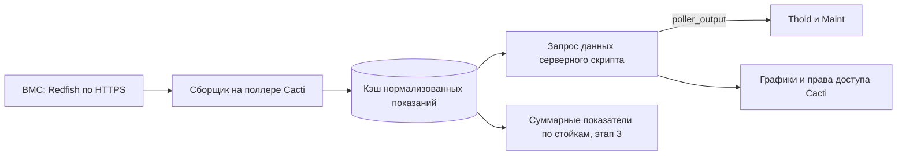

<!-- Source: README.md; SHA256: 7b4e83a58a1adc844cb0615ef30e95476cba2851f96bb454d2a816fb2774724d -->

<!-- translations:start -->
[English](../../../README.md) | [简体中文](../zh-CN/README.md) | [हिन्दी](../hi-IN/README.md) | [Español (España)](../es-ES/README.md) | [Español (Latinoamérica)](../es-419/README.md) | [العربية (السعودية)](../ar-SA/README.md) | [Afrikaans](../af-ZA/README.md) | [አማርኛ](../am-ET/README.md) | [العربية (مصر)](../ar-EG/README.md) | [العربية (المغرب)](../ar-MA/README.md) | [বাংলা](../bn-BD/README.md) | [Deutsch](../de-DE/README.md) | [فارسی](../fa-IR/README.md) | [Filipino](../fil-PH/README.md) | [Français](../fr-FR/README.md) | [Français (Maroc)](../fr-MA/README.md) | [Français (Sénégal)](../fr-SN/README.md) | [Hausa](../ha-NG/README.md) | [עברית](../he-IL/README.md) | [Bahasa Indonesia](../id-ID/README.md) | [Igbo](../ig-NG/README.md) | [Italiano](../it-IT/README.md) | [日本語](../ja-JP/README.md) | [한국어](../ko-KR/README.md) | [Malagasy](../mg-MG/README.md) | [मराठी](../mr-IN/README.md) | [Bahasa Melayu](../ms-MY/README.md) | [Nederlands](../nl-NL/README.md) | [Polski](../pl-PL/README.md) | [Português (Brasil)](../pt-BR/README.md) | [Русский](README.md) | [Kinyarwanda](../rw-RW/README.md) | [Soomaali](../so-SO/README.md) | [Svenska](../sv-SE/README.md) | [Kiswahili](../sw-KE/README.md) | [தமிழ்](../ta-IN/README.md) | [తెలుగు](../te-IN/README.md) | [ไทย](../th-TH/README.md) | [Türkçe](../tr-TR/README.md) | [Українська](../uk-UA/README.md) | [اردو](../ur-PK/README.md) | [Tiếng Việt](../vi-VN/README.md) | [isiXhosa](../xh-ZA/README.md) | [Yorùbá](../yo-NG/README.md) | [繁體中文](../zh-TW/README.md) | [isiZulu](../zu-ZA/README.md)
<!-- translations:end -->

# plugin_redfish

Плагин для Cacti 1.2, который переносит данные о потребляемой мощности серверов, температуре на входе, состоянии вентиляторов и исправности блоков питания с контроллеров управления основной платой (BMC) в Cacti в виде обычных устройств, источников данных и графиков, используя Redfish и опциональный резервный механизм IPMI. Затем Thold и Maint выполняют оповещение и подавление оповещений по этим данным, а на последующем этапе добавляются суммарные показатели мощности на уровне стойки.

> **Статус: в разработке, релизов пока нет (0.1.0-dev).** Этапы 2 (базовая основа) и 3 (объекты Cacti и оповещения) влиты в ветку `main`. Этот плагин не связан с проектом Cacti. Он устанавливается на Cacti 1.2.31 под PHP 8.2 или новее, регистрирует BMC и учётные данные, считывает мощность, температуры, состояние вентиляторов и блоков питания с каждого BMC по Redfish в собственный кэш и отображает состояние сбора данных. Он добавляет устройства Cacti, графики по отдельным компонентам и сводные графики, а также поддержку Thold и Maint через обычные источники данных. В CI тестирование проводилось на фиктивном BMC, собранном из написанных вручную фикстур, и на тестовом сервере DMTF Redfish mockup server; ни один реальный BMC или пилотный парк серверов квалификацию не проходили. Проектная документация и результаты исследований находятся в [docs/PLAN.md](../../PLAN.md), [docs/research/](../../research) и [docs/decisions/](../../decisions).

### Что входит в этап 2

- Установка, обновление, отключение и удаление через API плагинов Cacti, при этом таблицы сохраняются при удалении, если соответствующая настройка не сброшена. На версиях PHP старше 8.2 плагин отказывается устанавливаться или включаться и сообщает причину.
- Области прав «Redfish View» (страница состояния), «Redfish Operator» (страница операций) и «Redfish Admin» (страницы BMC и учётных данных), а также настройки в разделе Configuration > Settings > Redfish.
- Реестр BMC с импортом CSV и экспортом JSON. Файлы импорта не должны содержать пароли; учётные данные указываются по имени.
- Учётные данные хранятся в зашифрованном виде с использованием AES-256-GCM. Ключ представляет собой файл вне базы данных, по умолчанию `/etc/cacti/redfish-vault.key`, содержащий 64 шестнадцатеричных символа (`openssl rand -hex 32`) или ровно 32 случайных байта; владельцем файла должен быть пользователь поллера, файл не должен быть доступен для чтения другим пользователям и должен находиться в каталоге, куда может записывать только пользователь поллера или root. Ключ из 32 печатных символов отклоняется как парольная фраза. **Создавайте резервную копию файла ключа вместе с базой данных**; без него каждый сохранённый пароль придётся вводить заново.
- Проверка TLS включена по умолчанию, с возможностью указать пакет доверенных ЦС (CA bundle) или пиннинг SPKI SHA-256 для каждого BMC. Зарегистрированный отказ от проверки для конкретного BMC остаётся в виде предупреждения на странице состояния.
- Клиент Redfish только для чтения: разрешены исключительно запросы `GET`, а также вход в сессию и выход из неё, что проверяется по списку разрешённых операций перед отправкой любого запроса.
- Сборщик, запускаемый из `poller_bottom` для BMC на основном поллере, с индивидуальными арендами и крайними сроками для каждого BMC, задержкой повторных попыток и очисткой после сбоя единственной сессии, записанной плагином. Удалённые сборщики пока не поддерживаются; для них требуется явный выбор способа доступа сборщика к базе данных и ключу (этап 4).
- Записи BMC и учётные данные подчиняются правам доступа к устройствам в Cacti: администратор Redfish Admin видит, изменяет и привязывает только BMC на тех устройствах, которые ему разрешено просматривать, и только те учётные данные, которые не используются ни одним BMC на скрытом устройстве.

### Что добавляет этап 3

- Шаблоны поставляются в виде XML-шаблонов Cacti в каталоге `templates/` и импортируются штатным импортёром Cacti при установке и обновлении с сопоставлением по хэшу, благодаря чему импорт обновляет объекты плагина и ничего не дублирует. Три файла запросов данных копируются в `<cacti>/resource/script_server/` с записью их хэша; плагин никогда не заменяет файл в этом каталоге, если не он его записал, а страница состояния предупреждает администраторов, если шаблоны или файл запроса отсутствуют на месте. Действие **Reinstall the Redfish Templates** на странице BMC импортирует их повторно; для этого требуется право Cacti на импорт шаблонов (Import Templates).
- **Create Device** или **Add Graphs** для каждого BMC ([ADR 0015](../../decisions/0015-attach-to-the-server-device-or-create-one-per-bmc.md)). BMC, сопоставленный с существующим устройством сервера, получает свои запросы данных и графики на этом устройстве. Несопоставленный BMC получает новое устройство из шаблона устройства «Redfish BMC» с отключёнными проверками доступности и именем хоста в домене `.invalid`, чтобы Cacti никогда не обращался к BMC напрямую и не отображал его адрес. В обоих случаях администратор сначала подтверждает план с перечнем добавляемых объектов. Для обоих действий требуются как права Cacti на управление устройствами, так и роль Redfish Admin; новое устройство, которое создатель не может видеть, немедленно удаляется.
- Три запроса данных серверного скрипта: «Redfish Fans», «Redfish Temperatures» и «Redfish Power Supplies», индексируемые по ключу компонента BMC, с отдельным графиком на каждый компонент: скорость вентилятора в процентах или об/мин (в зависимости от единиц, передаваемых BMC), температура, а также входная и выходная мощность блока питания в ваттах — каждый с кодом состояния.
- Источник данных «Redfish Node Summary» с показателями мощности, температуры на входе, максимальной температуры, количества неисправных вентиляторов и блоков питания, общего состояния узла и возраста последнего успешного чтения, отображаемый на четырёх графиках: мощность, температуры, состояние компонентов и актуальность данных. Пороговые значения Thold на этих источниках данных вызывают оповещения, а Maint подавляет их без каких-либо изменений в обоих плагинах.
- Серверный скрипт отвечает исключительно из кэша плагина и никогда не обращается к BMC. Значение, которое отсутствует, устарело, имеет другую единицу измерения или относится к исчезнувшему компоненту, возвращается как `U`, поэтому на графиках отображается разрыв, а не ноль; показатель `age` всегда имеет значение, поэтому порог по нему позволяет выявить BMC, переставший отвечать.
- Ссылка с каждого графика Redfish на графики Redfish соответствующего устройства, отображаемая только пользователям, которым Cacti разрешает видеть это устройство.

**Когда состав компонентов BMC меняется** (заменён вентилятор, обновление прошивки переименовало датчики), снова выберите **Add Graphs**. Вентилятор или блок питания, который ранее присутствовал, а теперь отсутствует или исчез, учитывается в `fans_bad` или `psus_bad` до тех пор, пока вы не выполните это действие, чтобы извлечённый вентилятор вызвал оповещение; слот, который никогда не был заполнен, не учитывается. Add Graphs принимает компоненты, о которых BMC сообщает сейчас, и Cacti повторно индексирует запросы; исчезнувший компонент сохраняет свой источник данных и график, которые с этого момента считывают `U`, а новый компонент получает график. Графики исчезнувших компонентов удаляются вручную, когда их история больше не нужна.

Удаление устройства отменяет привязку его BMC, сохраняя сам BMC и его кэш. Удаление BMC или удаление плагина сохраняет его устройство и графики.

## Роли доступа

| Область прав (Realm) | Доступ |
| --- | --- |
| Redfish View | Существующие страницы мониторинга. |
| Redfish Operator | Мониторинг, а также страница Operations и персональные подтверждения при первичном разборе инцидентов. |
| Redfish Admin | Доступ оператора, а также существующие настройки и административные действия. |

После копирования файлов обновления откройте страницу Plugins от имени администратора, чтобы зарегистрировать новую область прав. Назначьте область Operator явно в разделе **Configuration > Users** или в группах пользователей. Обновления сохраняют существующие идентификаторы областей View и Admin и выданные им права. Доступ Admin наследует доступ Operator, а доступ Operator наследует доступ View при каждом запросе; это не добавляет сохранённых разрешений пользователям или группам. Для доступа к настройкам плагина также требуется роль Redfish Admin в дополнение к праву Cacti Settings.

Права доступа к устройствам Cacti по-прежнему ограничивают строки и действия, доступные каждому пользователю; для работы с непривязанными объектами требуются права администратора. Операторы могут снять блокировку сбора данных для разрешённого BMC на время следующего планового запуска. Учётные данные, конфигурация, сопоставление, удаление и другие административные изменения остаются на административных страницах. Подтверждения действуют только в текущей сессии пользователя не более одного часа и только пока то же наблюдение остаётся актуальным. Новые или изменившиеся наблюдения делают их недействительными. Они никогда не помечают сбойное измерение как исправное и не подавляют оповещения.

## Зачем это нужно

На каждом сервере есть BMC, который сообщает о состоянии питания и температуры независимо от операционной системы, поэтому он продолжает отвечать, даже когда ОС не работает. Эти данные используются для учёта мощностей и затрат, раннего предупреждения о выходе из строя вентилятора или блока питания, а в высокопроизводительных вычислениях — для принятия решений об ограничении энергопотребления. Плагин не привязан исключительно к HPC.

Сегодня Cacti покрывает лишь часть этих задач:

- **Пакеты SNMP от производителей.** В ветке 1.2.x поставляются шаблоны Dell iDRAC и HPE iLO, которым требуется агент SNMP и которые привязаны к конкретному производителю; исследование на этапе 1 показало, что ни один из них не сообщает потребляемую мощность в ваттах ([docs/research/overlap.md](../../research/overlap.md)).
- **Тип учётных данных без сборщика.** Плагин plugin_credentials определяет учётные данные типа «IPMI / Redfish (BMC)», но не опрашивает ни один BMC.
- **Нет представления на уровне стойки.** В ядре Cacti отсутствует объект стойки; у устройства есть только текстовое поле `location` произвольного формата.

Плагин опрашивает BMC вне полосы основного цикла опроса Cacti, кэширует нормализованные показания и предоставляет их через запрос данных серверного скрипта и сводные источники данных. Он повторно использует графики, права доступа, Thold и Maint из Cacti и не изменяет состояние BMC. Поддержка удалённых сборщиков данных запланирована на этап 4; в текущей версии сбор выполняется только на основном поллере.

## Планируемый охват

| Этап | Область работ | Вехи |
|---|---|---|
| 0, исследование | Матрица производителей, проверка поведения апстрима на реальных BMC, стоимость опроса, прототип запроса данных | [M1](https://github.com/somethingwithproof/plugin_redfish/milestone/1) |
| 1, наблюдение | Реестр BMC, учётные данные, TLS, сборщик Redfish, нормализованные показания, устройства, графики по индексам, оповещения Thold, подавление Maint, страница состояния | [M2](https://github.com/somethingwithproof/plugin_redfish/milestone/2), [M3](https://github.com/somethingwithproof/plugin_redfish/milestone/3), [M4](https://github.com/somethingwithproof/plugin_redfish/milestone/4) |
| 2, ipmi | Резервный опрос по IPMI для BMC без пригодного Redfish, по умолчанию выключен | [M5](https://github.com/somethingwithproof/plugin_redfish/milestone/5) |
| 3, стойки | Реестр стоек, суммарная мощность по стойкам с показателем покрытия, запас по бюджету мощности | [M6](https://github.com/somethingwithproof/plugin_redfish/milestone/6) |
| 4, удалённый сбор | Удалённые сборщики данных Cacti для изолированных сетей BMC | [M7](https://github.com/somethingwithproof/plugin_redfish/milestone/7) |

Вне области охвата: настройка ограничений мощности или любой другой конфигурации BMC, управление питанием, обновление прошивки, доступ к консоли, собственная подсистема оповещений в плагине и интеграция с планировщиком.

## Целевые требования совместимости

| Компонент | Целевое требование |
|---|---|
| Cacti | 1.2.31 или новее, без патчей ядра |
| База данных | MariaDB 10.2 или MySQL 5.7 или новее: ограничение «один BMC на устройство» обеспечивается уникальным ключом по вычисляемому столбцу |
| PHP | 8.2 или новее; файл `setup.php` остаётся синтаксически корректным для PHP 8.0, чтобы неподдерживаемая среда получала отказ вместо поломки интерфейса Cacti |
| BMC | Dell iDRAC, HPE iLO, Lenovo XCC и OpenBMC в зависимости от диапазона версий прошивки; см. [матрицу производителей](../../research/vendor-matrix.md) |
| Redfish | В первую очередь новые ресурсы подсистем и датчиков, устаревшие ресурсы `Power` и `Thermal` в качестве резервного варианта |
| Thold, Maint | Изменения не требуются |

## Проектирование

- [docs/PLAN.md](../../PLAN.md) — это полный план: архитектура, факты из апстрима, на которые он опирается (с источниками и предположениями, которые ещё предстоит подтвердить), модель измерений, границы безопасности, расчёты производительности, тестирование и риски.
- [docs/decisions/](../../decisions) содержит записи об архитектурных решениях для уже принятых вариантов.
- [docs/REQUIREMENTS.md](../../REQUIREMENTS.md) сопоставляет каждый идентификатор требования с соответствующей задачей.

## Безопасность

Учётные данные BMC управляют внеполосным администрированием серверов. Архитектура исключает их попадание в командные строки, журналы и веб-страницы, проверяет TLS по умолчанию, запускает любые внешние команды через массив аргументов со списком разрешённых подкоманд и использует учётные записи BMC только для чтения. См. [docs/PLAN.md](../../PLAN.md#security) и [SECURITY.md](../../../SECURITY.md).

## Руководство оператора

См. [docs/operator-guide.md](../../operator-guide.md) для ознакомления с предварительными требованиями к установке, настройкой хранилища ключей и TLS, регистрацией BMC, созданием графиков, интервалами оповещений, резервным копированием и обработкой сбоев. Руководство не объявляет ни одну реальную линейку прошивок производителей поддерживаемой до тех пор, пока обезличенный дамп с этой прошивки не пройдёт набор тестов.

## Как организовано отслеживание работы

- **Вехи** соответствуют этапам плана. Для каждой из них создана эпик-задача со списком подзадач и критериями приёмки.
- **Задачи** типизированы метками: `type: requirement`, `type: research`, `type: decision`, `type: epic`. Задачи-требования содержат пронумерованные, проверяемые требования (`REQ-AREA-NNN`) и критерии приёмки.
- **Метки** также содержат префиксы `area:`, `phase:`, `priority:` и `status:`. См. [CONTRIBUTING.md](../../../CONTRIBUTING.md#labels).
- На [доске проекта](https://github.com/users/somethingwithproof/projects/12) показаны все задачи по всем вехам.

## Участие в разработке

Прочитайте [CONTRIBUTING.md](../../../CONTRIBUTING.md). Для коммитов требуется подпись DCO. Обсуждение проектных решений ведётся в задачах; открытые решения помечены меткой `type: decision`. Сейчас наиболее ценным вкладом являются данные с реальных BMC; перед публикацией любого дампа удаляйте адреса, серийные номера и учётные данные.

## Лицензия

GNU General Public License v2.0 — та же лицензия, что и у Cacti и его плагинов. См. [LICENSE](../../../LICENSE).
