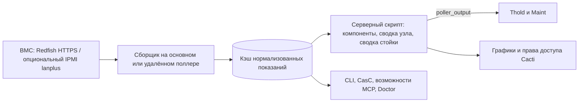

<!-- Source: README.md; SHA256: 6972a6c9ac754cd60e63c5caf971451ea8fe6e279eef757d886e1a168d3eef01 -->

<!-- translations:start -->
[English](../../../README.md) | [简体中文](../zh-CN/README.md) | [हिन्दी](../hi-IN/README.md) | [Español (España)](../es-ES/README.md) | [Español (Latinoamérica)](../es-419/README.md) | [العربية (السعودية)](../ar-SA/README.md) | [Afrikaans](../af-ZA/README.md) | [አማርኛ](../am-ET/README.md) | [العربية (مصر)](../ar-EG/README.md) | [العربية (المغرب)](../ar-MA/README.md) | [বাংলা](../bn-BD/README.md) | [Bosanski](../bs-BA/README.md) | [Deutsch](../de-DE/README.md) | [فارسی](../fa-IR/README.md) | [Filipino](../fil-PH/README.md) | [Français](../fr-FR/README.md) | [Français (Maroc)](../fr-MA/README.md) | [Français (Sénégal)](../fr-SN/README.md) | [Hausa](../ha-NG/README.md) | [עברית](../he-IL/README.md) | [Hrvatski](../hr-HR/README.md) | [Bahasa Indonesia](../id-ID/README.md) | [Igbo](../ig-NG/README.md) | [Italiano](../it-IT/README.md) | [日本語](../ja-JP/README.md) | [한국어](../ko-KR/README.md) | [Malagasy](../mg-MG/README.md) | [मराठी](../mr-IN/README.md) | [Bahasa Melayu](../ms-MY/README.md) | [Nederlands](../nl-NL/README.md) | [Polski](../pl-PL/README.md) | [Português (Brasil)](../pt-BR/README.md) | [Русский](README.md) | [Kinyarwanda](../rw-RW/README.md) | [Soomaali](../so-SO/README.md) | [Српски](../sr-RS/README.md) | [Svenska](../sv-SE/README.md) | [Kiswahili](../sw-KE/README.md) | [தமிழ்](../ta-IN/README.md) | [తెలుగు](../te-IN/README.md) | [ไทย](../th-TH/README.md) | [Türkçe](../tr-TR/README.md) | [Українська](../uk-UA/README.md) | [اردو](../ur-PK/README.md) | [Tiếng Việt](../vi-VN/README.md) | [isiXhosa](../xh-ZA/README.md) | [Yorùbá](../yo-NG/README.md) | [繁體中文](../zh-TW/README.md) | [isiZulu](../zu-ZA/README.md)
<!-- translations:end -->

# plugin_redfish

Плагин для Cacti 1.2, который переносит данные о потребляемой мощности серверов, температуре на входе, состоянии вентиляторов и исправности блоков питания с контроллеров управления основной платой (BMC) в Cacti в виде обычных устройств, источников данных и графиков, используя Redfish с опциональным резервным механизмом IPMI только для чтения и агрегацией мощности на уровне стойки. Thold и Maint выполняют оповещение и подавление оповещений через стандартные источники данных Cacti.

> **Статус: в разработке, релизов пока нет (`0.1.0-dev`).** Этот плагин не связан с проектом Cacti. Он устанавливается на Cacti 1.2.31 или новее под PHP 8.2 или новее и реализует сборщик Redfish, зашифрованное хранилище учётных данных, подготовку устройств и графиков Cacti, опциональный резервный механизм IPMI только для чтения, суммирование мощности по стойкам, отображение окон обслуживания Cacti Maint, репликацию и конечные точки агента для удалённых сборщиков данных, провайдер CasC и операторский CLI, возможности (abilities) MCP, а также диагностические проверки Doctor. CI проверяет тестовые фикстуры, DMTF Redfish Mockup Server (макеты subsystem, legacy-only и HPE iLO Gen11) и Thold v1.8.2 с Maint v1.3; ни один реальный физический BMC или пилотный парк серверов пока не сертифицированы. Проектная документация и результаты исследований находятся в [docs/PLAN.md](../../PLAN.md), [docs/research/](../../research/) и [docs/decisions/](../../decisions/).

## Реализованные возможности

### Базовый сборщик, хранилище и объекты Cacti

- **Жизненный цикл и схема.** Устанавливается, обновляется, отключается и удаляется через API плагинов Cacti (`Schema::VERSION = 3`, 12 таблиц). Таблицы сохраняются при удалении, если только не снят флажок *Keep Plugin Tables on Uninstall*. Точки входа синтаксически разбираются на PHP 8.0 и отклоняют PHP ниже 8.2 или отсутствие `ext-openssl` с явным сообщением об ошибке.
- **Реестр и права доступа.** Области прав *Redfish View* (`redfish_health.php`), *Redfish Operator* (`redfish_operator.php`) и *Redfish Admin* (`redfish_bmcs.php`, `redfish_credentials.php`), а также настройки в **Configuration > Settings > Redfish**. Реестр BMC поддерживает импорт CSV (учётные данные указываются по имени; пароли в файлах импорта отклоняются) и экспорт JSON. Записи BMC и учётные данные подчиняются правам доступа к устройствам Cacti.
- **Зашифрованное хранилище учётных данных.** Пароли хранятся зашифрованными с помощью AES-256-GCM в `plugin_redfish_secret`. Ключ хранится вне базы данных (по умолчанию `/etc/cacti/redfish-vault.key`) в виде 64 шестнадцатеричных символов (`openssl rand -hex 32`) или 32 необработанных байтов, принадлежит пользователю поллера, недоступен для чтения другим пользователям и находится в каталоге, доступном для записи только пользователю root или этому пользователю. Парольная фраза из 32 печатных символов отклоняется. **Создавайте резервную копию файла ключа вместе с базой данных**; без него сохранённые пароли придётся вводить заново.
- **TLS и клиент Redfish только для чтения.** Проверка TLS включена по умолчанию с использованием системного хранилища ЦС, пакета ЦС для конкретного BMC или привязки SPKI SHA-256; отказ от проверки для конкретного BMC остаётся видимым как предупреждение о состоянии и предупреждение проверки Doctor. Клиент разрешает только запросы `GET`, а также вход (`POST`) и выход (`DELETE`) из сессии Redfish, с опциональным резервным механизмом Basic для конкретного BMC при недоступности сессий. Обнаружение предпочитает новые ресурсы подсистем и датчиков Redfish и при необходимости переключается на устаревшие ресурсы `Power` и `Thermal`.
- **Выполнение сборщика.** `poller_redfish.php` запускается из `poller_bottom`, запускает один главный процесс на поллер через реестр процессов Cacti с настраиваемым числом рабочих процессов (`redfish_workers`), получает аренды для каждого BMC, соблюдает бюджет времени (`redfish_collector_budget`), применяет экспоненциальную задержку повторных попыток и очищает собственную предыдущую сессию плагина после сбоя.
- **Шаблоны, устройства и графики.** Импортирует `templates/redfish-templates.xml` по хэшу и копирует три XML-файла запросов данных серверного скрипта (`redfish_fans.xml`, `redfish_temperatures.xml`, `redfish_psus.xml`) в `<cacti>/resource/script_server/` без перезаписи файлов, изменённых пользователем. **Create Device** и **Add Graphs** требуют подтверждения плана подготовки, привязывают запросы к сопоставленному устройству сервера или создают устройство «Redfish BMC» в домене `.invalid` с отключёнными проверками доступности, а также связывают каждый график Redfish со списком графиков Redfish устройства через `graph_buttons`.
- **Входные данные серверного скрипта только из кэша.** `scripts/ss_redfish_members.php` предоставляет показания вентиляторов, температур и блоков питания по каждому компоненту, а `scripts/ss_redfish_summary.php` предоставляет метрики «Redfish Node Summary» (мощность, температура на входе и максимальная температура, количество неисправных вентиляторов и блоков питания, состояние узла и возраст последнего успешного чтения). Вызовы серверного скрипта читают только локальный кэш и никогда не обращаются к BMC. Отсутствующие, устаревшие или относящиеся к исчезнувшим компонентам показания возвращают `U` (никогда `0`), тогда как `age` всегда сообщает значение, чтобы пороговые значения выявляли переставшие отвечать BMC.

**Когда состав компонентов BMC меняется** (например, замена вентилятора или обновление прошивки, переименовывающее датчики), снова запустите **Add Graphs**. Ранее присутствовавший вентилятор или блок питания, ставший отсутствующим, учитывается в `fans_bad` или `psus_bad` до принятия изменений; слот, который никогда не был заполнен, не учитывается. Исчезнувшие компоненты сохраняют существующие источники данных и графики, которые с этого момента считывают `U` до удаления вручную. Удаление устройства Cacti отменяет привязку его BMC и удаляет привязку к стойке, сохраняя сам BMC и кэш; удаление BMC или удаление плагина сохраняет устройства и графики Cacti.

### Опциональный резервный механизм IPMI

- **Включается отдельно для каждого BMC.** По умолчанию выключен (`protocols` по умолчанию имеет значение `redfish`; включение резервного механизма IPMI устанавливает `redfish,ipmi`).
- **Ограниченный триггер резервного перехода.** Запускается только тогда, когда сбор данных Redfish завершается неудачей с допустимым классом ошибки; никогда не срабатывает при `AuthRejected`, `CredentialUnavailable`, `AddressRefused`, `OperationRefused` или `Deadline`.
- **Безопасное выполнение.** Вызывает `ipmitool` через `-I lanplus` с помощью `proc_open()` в форме массива без оболочки, с ограниченным тайм-аутом реального времени и лимитом вывода 256 КиБ. Пароли передаются через `IPMITOOL_PASSWORD` (`-E`) или временный файл с правами 0600 (`-f`), удаляемый в `finally`, и никогда через аргументы CLI argv.
- **Список разрешённых команд только для чтения.** Разрешены только пять подкоманд только для чтения: `dcmi power reading`, `sdr type Temperature`, `sdr type Fan`, `sdr type Power Supply` и `chassis status`. Изменяющие состояние команды отклоняются.
- **Нормализованный вывод и предупреждение о состоянии безопасности.** `IpmiNormalizer` преобразует показания в ту же модель `Observation`/`Member`/`Reading`, выдавая `U` для отсутствующих или нераспознанных датчиков. Включение резервного механизма IPMI вызывает предупреждение на странице состояния и в проверке Doctor `redfish.bmc_security`, напоминая операторам ограничить UDP 623 управляющей VLAN.

### Суммирование мощности по стойкам

- **Реестр стоек.** Схема версии 3 добавляет `plugin_redfish_rack` (уникальная пара `(site_id, name)`, опциональный `power_budget_watts`, `min_coverage_pct` со значением по умолчанию `80` и примечания) и `plugin_redfish_rack_member` (не более одного назначения в стойку на `host_id`, опциональные `bmc_id` и `unit_position`, автоматически удаляется при удалении устройства Cacti).
- **Суммы с защитой по покрытию.** `RackPowerSummary` суммирует свежие показания `power_watts` участников из локального кэша и вычисляет использование бюджета и доступный запас (headroom). Когда покрытие отчитывающихся участников падает ниже `min_coverage_pct`, `power_watts`, `utilization_pct` и `headroom_watts` возвращают `U`, чтобы сбои сборщика никогда не выглядели как падение мощности стойки.
- **Готовый для Thold ввод серверного скрипта.** `scripts/ss_redfish_rack.php` (`ss_redfish_rack(<rack_id>)`) возвращает `power_watts`, `power_budget_watts`, `utilization_pct`, `headroom_watts`, `members_total`, `members_reporting` и `coverage_pct` исключительно из локального кэша.

### Интеграция с Cacti Maint

- Пороговые значения Thold на источниках данных Redfish формируют оповещения, а Cacti Maint подавляет их без каких-либо изменений в обоих плагинах.
- `MaintWindow` проверяет активные расписания Maint для каждого сопоставленного хоста Cacti (разовые расписания `mtype=1` и повторяющиеся `mtype=2`, а также `plugin_maint_check_cacti_host()` при загрузке модуля) и отмечает активное обслуживание на странице Redfish Health (`[MAINT]`), в выводе `cli/redfish.php health` и в возможности `redfish-get-health`.

### Удалённые сборщики данных

- `INFO` объявляет `remote_collect:1`. BMC принимают любой `poller_id >= 1`, а `poller_redfish.php --poller=N` собирает данные только с включённых BMC, назначенных этому поллеру.
- **Хук `replicate_out`.** Реплицирует через `replicate_out_table()` только несекретные таблицы конфигурации в области видимости целевого удалённого поллера: `plugin_redfish_bmc`, метаданные `plugin_redfish_credential` (без шифротекста), `plugin_redfish_rack` и `plugin_redfish_rack_member`. `plugin_redfish_secret` не реплицируется, а файлы ключей хранилища остаются строго локальными на каждом поллере.
- **Хук `remote_agent`.** Предоставляет действия только для чтения `redfish_health` и `redfish_discovery`, принимающие только числовые параметры `poller_id` и `bmc_id`. Неожиданные параметры отклоняются, и никакие учётные данные или секреты не возвращаются.

### Хуки экосистемы (CasC, возможности MCP и Doctor)

- **Провайдер CasC (`casc_register_providers`).** Регистрирует провайдер `redfish` (версия схемы `1`) с экспортом YAML и XML на чистом PHP, разбором (с отклонением XXE), валидацией, планированием diff и применением. Учётные данные представлены только в виде ссылок на хранилище (`vault:redfish:<name>`); открытые секретные ключи (`pass`, `secret`, `token`, `private_key`, `vault_key`, `auth_token`) отклоняются. Для применения требуется точный SHA-256 `PLAN_HASH`.
- **MCP / Abilities API (`abilities_register`).** Регистрирует три возможности только для чтения, ограниченные областью прав Redfish View (`redfish_health.php`) и правами доступа к устройствам Cacti, возвращающие ноль учётных данных:
  - `redfish-list-bmcs` (опциональный `poller_id`)
  - `redfish-get-rack-power` (опциональный `rack_id`)
  - `redfish-get-health` (опциональный `bmc_id`)
- **Проверки Doctor (`doctor_register_checks`).** Регистрирует пять локальных диагностических проверок только для чтения, которые никогда не связываются с BMC и не возвращают ключевой материал:
  - `redfish.schema`: актуальность версии схемы
  - `redfish.vault_key`: читаемость и права доступа файла ключа хранилища
  - `redfish.collector_runs`: бюджет и свежесть запусков сборщика поллера
  - `redfish.bmc_security`: включённые BMC с непроверенным TLS или резервным механизмом IPMI
  - `redfish.rack_power`: соблюдение бюджета мощности стойки и нижнего порога покрытия

## CLI

Запускайте из корневого каталога Cacti с PHP 8.2 или новее:

```sh
# Operator and CasC CLI (reads --file=PATH or stdin for validate, plan, and apply)
php plugins/redfish/cli/redfish.php export --format=yaml|xml
php plugins/redfish/cli/redfish.php validate [--file=PATH] [--format=yaml|xml]
php plugins/redfish/cli/redfish.php plan [--file=PATH] [--format=yaml|xml]
php plugins/redfish/cli/redfish.php apply [--file=PATH] [--format=yaml|xml] --confirm=<PLAN_HASH>
php plugins/redfish/cli/redfish.php health --format=text|json

# Collector entry point (normally started by poller_bottom)
php plugins/redfish/poller_redfish.php [--poller=N] [--force] [--debug]

# Rack power summary script server entry point
php plugins/redfish/scripts/ss_redfish_rack.php <rack_id>
```

## Роли доступа

| Область прав (Realm) | Доступ |
| --- | --- |
| Redfish View | Существующие страницы мониторинга. |
| Redfish Operator | Мониторинг, а также страница Operations и персональные подтверждения при первичном разборе инцидентов. |
| Redfish Admin | Доступ оператора, а также существующие настройки и административные действия. |

После копирования файлов обновления откройте страницу Plugins от имени администратора, чтобы зарегистрировать области прав. Назначьте область Operator явно в разделе **Configuration > Users** или в группах пользователей. Обновления сохраняют существующие идентификаторы областей View и Admin и выданные им права. Доступ Admin наследует доступ Operator, а доступ Operator наследует доступ View при каждом запросе; это не добавляет сохранённых разрешений пользователям или группам. Для доступа к настройкам плагина также требуется роль Redfish Admin в дополнение к праву Cacti Settings.

Права доступа к устройствам Cacti ограничивают строки и действия, доступные каждому пользователю; для работы с непривязанными объектами требуются права администратора. Операторы могут снять блокировку сбора данных для разрешённого BMC на время следующего планового запуска. Учётные данные, конфигурация, сопоставление, удаление и другие административные изменения остаются на административных страницах. Подтверждения действуют только в текущей сессии пользователя не более одного часа и только пока то же наблюдение остаётся актуальным. Новые или изменившиеся наблюдения делают их недействительными. Они никогда не помечают сбойное измерение как исправное и не подавляют оповещения.

## Зачем это нужно

На каждом сервере есть BMC, который сообщает о состоянии питания и температуры независимо от операционной системы, поэтому он продолжает отвечать, даже когда ОС не работает. Эти данные используются для учёта мощностей и затрат, раннего предупреждения о выходе из строя вентилятора или блока питания, а в высокопроизводительных вычислениях (HPC) для принятия решений об ограничении энергопотребления. Плагин не привязан исключительно к HPC.

Сегодня Cacti покрывает лишь часть этих задач:

- **Пакеты SNMP от производителей.** В ветке 1.2.x поставляются шаблоны Dell iDRAC и HPE iLO, которым требуется агент SNMP и которые привязаны к конкретному производителю; исследование на этапе 1 показало, что ни один из них не сообщает потребляемую мощность в ваттах ([docs/research/overlap.md](../../research/overlap.md)).
- **Тип учётных данных без сборщика.** Плагин plugin_credentials определяет учётные данные типа «IPMI / Redfish (BMC)», но не опрашивает ни один BMC.
- **Нет представления на уровне стойки.** В ядре Cacti отсутствует объект стойки; у устройства есть текстовое поле `location` произвольного формата.

Плагин опрашивает BMC вне полосы основного цикла опроса Cacti на основном поллере или удалённых сборщиках данных, кэширует нормализованные показания и предоставляет их через запросы данных серверного скрипта, сводки по узлам и сводки мощности по стойкам. Он повторно использует графики, права доступа, Thold и Maint из Cacti и не изменяет состояние BMC.

## Охват и статус

| Этап | Область работ | Вехи | Статус |
|---|---|---|---|
| 0, исследование | Матрица производителей, проверка поведения апстрима на реальных BMC, стоимость опроса, прототип запроса данных | [M1](https://github.com/somethingwithproof/plugin_redfish/milestone/1) | Выполнено, ожидаются дампы прошивок реальных BMC |
| 1, наблюдение | Реестр BMC, учётные данные, TLS, сборщик Redfish, нормализованные показания, устройства, графики по индексам, оповещения Thold, интеграция с Maint, страница состояния | [M2](https://github.com/somethingwithproof/plugin_redfish/milestone/2), [M3](https://github.com/somethingwithproof/plugin_redfish/milestone/3), [M4](https://github.com/somethingwithproof/plugin_redfish/milestone/4) | Реализовано; квалификация пилотного парка M4 ожидается |
| 2, ipmi | Резервный опрос по IPMI (`lanplus`) только для чтения через `ipmitool`, по умолчанию выключен | [M5](https://github.com/somethingwithproof/plugin_redfish/milestone/5) | Реализовано |
| 3, стойки | Реестр стоек, суммарная мощность по стойкам с порогом покрытия, запас по бюджету мощности, `ss_redfish_rack.php` | [M6](https://github.com/somethingwithproof/plugin_redfish/milestone/6) | Реализовано |
| 4, удалённый сбор и экосистема | Удалённые сборщики данных (`replicate_out`, `remote_agent`), провайдер CasC и CLI, возможности MCP, проверки Doctor | [M7](https://github.com/somethingwithproof/plugin_redfish/milestone/7) | Реализовано |

Вне области охвата: настройка ограничений мощности или любой другой конфигурации BMC, управление питанием, обновление прошивки, доступ к консоли, собственная подсистема оповещений в плагине и интеграция с планировщиком.

## Целевые требования совместимости

| Компонент | Целевое требование |
|---|---|
| Cacti | 1.2.31 или новее, без патчей ядра |
| База данных | MariaDB 10.2 или MySQL 5.7 или новее: ограничение «один BMC на устройство» обеспечивается уникальным ключом по вычисляемому столбцу |
| PHP | 8.2 или новее; точки входа остаются синтаксически корректными для PHP 8.0, чтобы неподдерживаемая среда получала отказ вместо поломки интерфейса Cacti |
| Расширения PHP | `ext-openssl` (требуется для Cacti 1.2.31); без `ext-curl` и без зависимостей времени выполнения Composer |
| Опциональные инструменты | `ipmitool` на поллерах, собирающих данные с BMC с включённым резервным механизмом IPMI |
| BMC | Dell iDRAC, HPE iLO, Lenovo XCC и OpenBMC в зависимости от диапазона версий прошивки; см. [матрицу производителей](../../research/vendor-matrix.md) |
| Redfish | В первую очередь новые ресурсы подсистем и датчиков, устаревшие ресурсы `Power` и `Thermal` в качестве резервного варианта |
| Thold, Maint | Изменения не требуются (в CI проверяются Thold v1.8.2 и Maint v1.3) |

## Проектирование

- [docs/PLAN.md](../../PLAN.md) содержит полный план: архитектура, факты из апстрима, на которые он опирается, модель измерений, границы безопасности, расчёты производительности, тестирование и риски.
- [docs/decisions/](../../decisions/) содержит записи об архитектурных решениях для уже принятых вариантов.
- [docs/REQUIREMENTS.md](../../REQUIREMENTS.md) сопоставляет каждый идентификатор требования с соответствующей задачей.



## Безопасность

Учётные данные BMC управляют внеполосным администрированием серверов. Архитектура исключает попадание секретов в командные строки, журналы, экспорты CasC, полезные нагрузки удалённого агента, ответы MCP и веб-страницы; шифрует сохранённые пароли с помощью AES-256-GCM с использованием локального файла ключа хранилища на каждом поллере; по умолчанию проверяет TLS; запускает `ipmitool` из явного массива аргументов с разрешёнными подкомандами только для чтения; и использует учётные записи BMC только для чтения. См. [docs/PLAN.md](../../PLAN.md#security) и [SECURITY.md](../../../SECURITY.md).

## Руководство оператора

См. [docs/operator-guide.md](../../operator-guide.md) для ознакомления с предварительными требованиями к установке, настройкой хранилища ключей и TLS, регистрацией BMC, созданием графиков, интервалами оповещений, резервным копированием и обработкой сбоев. Руководство не объявляет ни одну реальную линейку прошивок производителей поддерживаемой до тех пор, пока обезличенный дамп с этой прошивки не пройдёт набор тестов.

## Разработка и тестирование

CI ([.github/workflows/plugin-ci-workflow.yml](../../../.github/workflows/plugin-ci-workflow.yml)) проверяет синтаксис точек входа на PHP 8.0, запускает наборы модульных (`phpunit.xml`) и интеграционных тестов жизненного цикла (`phpunit-integration.xml`) на Pest и PHPStan уровня 9 на PHP 8.2–8.5 против Cacti `release/1.2.31` и `1.2.x`, проверяет отказ на PHP 8.1, тестирует сквозным образом DMTF Redfish Mockup Server (макеты subsystem, legacy-only и HPE iLO Gen11) и Thold v1.8.2 / Maint v1.3, а также проверяет каталоги gettext, рабочие процессы и лицензирование REUSE.

Локальные проверки перед отправкой изменений:

```sh
sh tests/lint-workflows.sh
sh locales/build_gettext.sh --check
CACTI_PATH=/path/to/cacti phpstan analyse -c phpstan.neon --no-progress
```

Запускайте Pest с `--configuration=phpunit.xml` для модульных тестов и тестов правил исходного кода или с `--configuration=phpunit-integration.xml` с переменными `CACTI_PATH` и `REDFISH_TEST_DATABASE=disposable` на одноразовой базе данных Cacti для интеграционных тестов жизненного цикла.

## Как организовано отслеживание работы

- **Вехи** соответствуют этапам плана. Для каждой из них создана эпик-задача со списком подзадач и критериями приёмки.
- **Задачи** типизированы метками: `type: requirement`, `type: research`, `type: decision`, `type: epic`. Задачи-требования содержат пронумерованные, проверяемые требования (`REQ-AREA-NNN`) и критерии приёмки.
- **Метки** также содержат префиксы `area:`, `phase:`, `priority:` и `status:`. См. [CONTRIBUTING.md](../../../CONTRIBUTING.md#labels).
- На [доске проекта](https://github.com/users/somethingwithproof/projects/12) показаны все задачи по всем вехам.

## Участие в разработке

Прочитайте [CONTRIBUTING.md](../../../CONTRIBUTING.md). Для коммитов требуется подпись DCO. Обсуждение проектных решений ведётся в задачах; открытые решения помечены меткой `type: decision`. Сейчас наиболее ценным вкладом являются данные с реальных BMC; перед публикацией любого дампа удаляйте адреса, серийные номера и учётные данные.

## Лицензия

GNU General Public License v2.0, та же лицензия, что и у Cacti и его плагинов. См. [LICENSE](../../../LICENSE).
