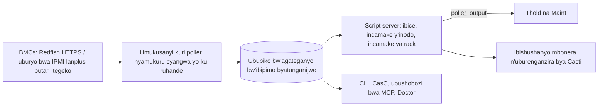

<!-- Source: README.md; SHA256: cf31b9f80d6c00020bbe08e80951d4de1c910793911d040ae7a66b54e8a2eaf0 -->

<!-- translations:start -->
[English](../../../README.md) | [简体中文](../zh-CN/README.md) | [हिन्दी](../hi-IN/README.md) | [Español (España)](../es-ES/README.md) | [Español (Latinoamérica)](../es-419/README.md) | [العربية (السعودية)](../ar-SA/README.md) | [Afrikaans](../af-ZA/README.md) | [አማርኛ](../am-ET/README.md) | [العربية (مصر)](../ar-EG/README.md) | [العربية (المغرب)](../ar-MA/README.md) | [বাংলা](../bn-BD/README.md) | [Bosanski](../bs-BA/README.md) | [Deutsch](../de-DE/README.md) | [فارسی](../fa-IR/README.md) | [Filipino](../fil-PH/README.md) | [Français](../fr-FR/README.md) | [Français (Maroc)](../fr-MA/README.md) | [Français (Sénégal)](../fr-SN/README.md) | [Hausa](../ha-NG/README.md) | [עברית](../he-IL/README.md) | [Hrvatski](../hr-HR/README.md) | [Bahasa Indonesia](../id-ID/README.md) | [Igbo](../ig-NG/README.md) | [Italiano](../it-IT/README.md) | [日本語](../ja-JP/README.md) | [한국어](../ko-KR/README.md) | [Malagasy](../mg-MG/README.md) | [मराठी](../mr-IN/README.md) | [Bahasa Melayu](../ms-MY/README.md) | [Nederlands](../nl-NL/README.md) | [Polski](../pl-PL/README.md) | [Português (Brasil)](../pt-BR/README.md) | [Русский](../ru-RU/README.md) | [Kinyarwanda](README.md) | [Soomaali](../so-SO/README.md) | [Српски](../sr-RS/README.md) | [Svenska](../sv-SE/README.md) | [Kiswahili](../sw-KE/README.md) | [தமிழ்](../ta-IN/README.md) | [తెలుగు](../te-IN/README.md) | [ไทย](../th-TH/README.md) | [Türkçe](../tr-TR/README.md) | [Українська](../uk-UA/README.md) | [اردو](../ur-PK/README.md) | [Tiếng Việt](../vi-VN/README.md) | [isiXhosa](../xh-ZA/README.md) | [Yorùbá](../yo-NG/README.md) | [繁體中文](../zh-TW/README.md) | [isiZulu](../zu-ZA/README.md)
<!-- translations:end -->

# plugin_redfish

Umugereka wa Cacti 1.2 uzana ikoreshwa ry'amashanyarazi ya seriveri, ubushyuhe bwinjira, imiterere y'imiyaga ikonjesha (fans), n'ubuzima bw'ibikoresho bitanga amashanyarazi (power supplies) bivuye muri kontorore zicunga ibikoresho bya seriveri (BMCs) bikajya muri Cacti nk'ibikoresho bisanzwe, amasoko y'amakuru, n'ibishushanyo mbonera, hakoreshejwe Redfish hamwe n'uburyo bwa IPMI bwo kwitabaza bwo gusoma gusa igihe bikenewe n'igiteranyo cy'amashanyarazi ku rwego rwa rack. Thold na Maint bitanga impuruza kandi bikazihagarika by'agateganyo binyuze ku masoko y'amakuru asanzwe ya Cacti.

> **Imiterere: iri mu ikorwa, nta verisiyo irasohoka (`0.1.0-dev`).** Uyu mugereka ntufitanye isano n'umushinga wa Cacti. Ushyirwa kuri Cacti 1.2.31 cyangwa izisumbuyeho ikoresha PHP 8.2 cyangwa izisumbuyeho kandi ugashyira mu bikorwa umukusanyi wa Redfish, ububiko bw'ibyangombwa byo kwinjira bishyizwe mu ibanga, gutegura ibikoresho n'ibishushanyo mbonera bya Cacti, uburyo bwa IPMI bwo kwitabaza bwo gusoma gusa, igiteranyo cy'amashanyarazi ya rack, kwerekana igihe cyo kubungabunga cya Cacti Maint, ikoporora n'imirongo y'umukozi ku bakusanyi b'amakuru bo ku ruhande, umutangabikorwa wa CasC na CLI y'umukozi w'ibikorwa, ubushobozi (abilities) bwa MCP, n'igenzura ryo gusuzuma ibibazo rya Doctor. CI igerageza ibikoresho by'igerageza, DMTF Redfish Mockup Server (ibishushanyo bya subsystem, legacy-only, na HPE iLO Gen11), na Thold v1.8.2 hamwe na Maint v1.3; nta BMC nyayo y'ibikoresho cyangwa itsinda ry'igerageza riremezwa. Igishushanyo n'ubushakashatsi biboneka muri [docs/PLAN.md](../../PLAN.md), [docs/research/](../../research/), no muri [docs/decisions/](../../decisions/).

## Ubushobozi bwashyizwe mu bikorwa

### Umukusanyi w'ibanze, ububiko bw'ibanga, n'ibikoresho bya Cacti

- **Imikorere y'ubuzima n'imiterere y'ububiko (schema).** Ishyirwamo, ivugururwa, ihagarikwa, kandi igakurwamo binyuze kuri API y'imigereka ya Cacti (`Schema::VERSION = 3`, imbonerahamwe 12). Imbonerahamwe zigumaho mu gihe cyo gukuramo keretse igihe *Keep Plugin Tables on Uninstall* yakuweho. Imirongo y'itangiriro isomwa kuri PHP 8.0 kandi ikanga PHP iri munsi ya 8.2 cyangwa kubura kwa `ext-openssl` hamwe n'ubutumwa bw'ikosa bweruye.
- **Igitabo cy'iyandikisha n'uburenganzira.** Inzego z'uburenganzira *Redfish View* (`redfish_health.php`), *Redfish Operator* (`redfish_operator.php`), na *Redfish Admin* (`redfish_bmcs.php`, `redfish_credentials.php`), hamwe n'igenamiterere munsi ya **Configuration > Settings > Redfish**. Igitabo cy'iyandikisha rya BMC gishyigikira kwinjiza muri CSV (ibyangombwa byo kwinjira bishingira ku izina; amagambo y'ibanga ari muri dosiye zinjizwa arangwa) no gusohora muri JSON. Amakuru ya BMC n'ibyangombwa byo kwinjira bikurikiza uburenganzira bw'ibikoresho bya Cacti.
- **Ububiko bw'ibyangombwa byo kwinjira bishyizwe mu ibanga.** Amagambo y'ibanga abikwa ashyizwe mu ibanga hakoreshejwe AES-256-GCM muri `plugin_redfish_secret`. Urufunguzo ruba hanze y'ububiko bw'amakuru (`/etc/cacti/redfish-vault.key` nk'uko bisanzwe) nk'inyuguti n'imibare 64 za hexadecimal (`openssl rand -hex 32`) cyangwa byte 32 z'ibanga ritononekara, rufitwe n'umukoresha wa poller, rudashobora gusomwa n'abandi bakoresha, mu bubiko umukoresha wa root cyangwa uwo mukoresha wenyine bashobora kwandikamo. Ijambo ry'ibanga ry'inyuguti 32 zisanzwe zandikwa rirangwa. **Bika kopi y'iyi dosiye y'urufunguzo hamwe n'ububiko bw'amakuru**; utayifite, amagambo y'ibanga abitswe agomba kongera kwinjizwa.
- **TLS n'umukiriya wa Redfish usoma gusa.** Igenzura rya TLS rirahora ryaka nk'uko bisanzwe hakoreshejwe ububiko bwa CA bwa sisitemu, CA bundle kuri buri BMC, cyangwa gufata SPKI SHA-256; guhitamo kutagenzura TLS kuri buri BMC biguma bigaragara nk'umuburo w'ubuzima n'umuburo w'igenzura rya Doctor. Umukiriya wemera gusa `GET` hamwe no kwinjira (`POST`) no gusohoka (`DELETE`) muri sesiyo ya Redfish, hamwe n'uburyo bwa Basic kuri buri BMC nk'uburyo bwo kwitabaza igihe sesiyo zitaboneka. Ishakisha rihitamo mbere ibikoresho bishya bya subsystem na sensor bya Redfish kandi rikisunga ibikoresho bishaje bya `Power` na `Thermal` nk'uburyo bwo kwitabaza.
- **Imikorere y'umukusanyi.** `poller_redfish.php` itangizwa na `poller_bottom`, igakoresha igikorwa nyamukuru kimwe kuri buri poller binyuze mu gitabo cy'ibikorwa cya Cacti hamwe n'ibikorwa by'abakozi bishobora gutegurwa (`redfish_workers`), ikabona uburenganzira bw'igihe gito kuri buri BMC, ikubahiriza ingengo y'igihe (`redfish_collector_budget`), igakoresha gutegereza kwiyongera buhoro buhoro, kandi igasukura sesiyo ya mbere y'umugereka ubwawo nyuma y'ihagarara ritunguranye.
- **Inyandikorugero, ibikoresho, n'ibishushanyo mbonera.** Yinjiza `templates/redfish-templates.xml` hakurikijwe hash kandi igakoporora dosiye eshatu za XML z'ibibazo by'amakuru bya script server (`redfish_fans.xml`, `redfish_temperatures.xml`, `redfish_psus.xml`) muri `<cacti>/resource/script_server/` itandukanyije n'izindi kugira ngo itasimbuza dosiye zahinduwe n'umukoresha. **Create Device** na **Add Graphs** bisaba kwemeza gahunda yo gutegura, bigahuza ibibazo ku gikoresho cya seriveri cyahujwe cyangwa bigakora igikoresho cya "Redfish BMC" munsi ya `.invalid` igenzura ry'iboneka rifunze, kandi bigahuza buri gishushanyo mbonera cya Redfish bisubiza ku bishushanyo mbonera bya Redfish by'icyo gikoresho binyuze kuri `graph_buttons`.
- **Ibyinjizwa bya script server bishingiye ku bubiko bw'agateganyo gusa.** `scripts/ss_redfish_members.php` itanga ibipimo by'imiyaga ikonjesha, ubushyuhe, na PSU kuri buri gice, naho `scripts/ss_redfish_summary.php` igatanga ibipimo bya "Redfish Node Summary" (amashanyarazi, ubushyuhe bwinjira n'ubwo hejuru cyane, umubare w'imiyaga ikonjesha na PSU bitameze neza, ubuzima bw'inodo, n'igihe gishize kuva ku isoma ryiza rya nyuma). Guhamagara script server gusoma ububiko bw'agateganyo bwo mu gikoresho gusa kandi ntikuvugana na BMC na rimwe. Ibipimo bibuze, bishaje, cyangwa by'ibice byavuyeho bitanga `U` (ntibitanga `0` na rimwe), mu gihe `age` yo ihora itanga agaciro kugira ngo ibipimo ntarengwa bifate za BMC zahagaze gusubiza.

**Iyo ibice bya BMC bihindutse** (nk'umuyaga ikonjesha wasimbuwe cyangwa ivugurura rya firmware rihindura amazina y'ibyuma bifata ibipimo), ongera ukoreshe **Add Graphs**. Umuyaga ikonjesha cyangwa igitanga amashanyarazi cyari gihari none kikaba kidahari bibarirwa muri `fans_bad` cyangwa `psus_bad` kugeza byemewe; umwanya utigeze ushyirwamo ikintu ntubarwa. Ibice byavuyeho bigumana amasoko y'amakuru n'ibishushanyo mbonera byabyo bisanzwe, bisoma `U` guhera icyo gihe kugeza bisibwe n'intoki. Gusiba igikoresho cya Cacti bikuraho ihuzwa rya BMC yacyo kandi bigakuraho umwanya wacyo muri rack ariko bikagumishaho BMC n'ububiko bw'agateganyo; gusiba BMC cyangwa gukuramo umugereka bigumishaho ibikoresho n'ibishushanyo mbonera bya Cacti.

### Uburyo bwa IPMI bwo kwitabaza butari itegeko

- **Guhitamo kuri buri BMC.** Bufunze nk'uko bisanzwe (`protocols` ihitamo `redfish` nk'uko bisanzwe; gukoresha uburyo bwa IPMI bishyiraho `redfish,ipmi`).
- **Imikorere y'uburyo bwo kwitabaza ifite imipaka.** Ikora gusa igihe ikusanyamakuru rya Redfish rinaniranywe n'ubwoko bw'ikosa ryemewe; ntikora na rimwe kuri `AuthRejected`, `CredentialUnavailable`, `AddressRefused`, `OperationRefused`, cyangwa `Deadline`.
- **Imikorere ifite umutekano.** Ihamagara `ipmitool` kuri `-I lanplus` binyuze kuri `proc_open()` mu buryo bw'urutonde nta shell, hamwe n'igihe ntarengwa gihamye n'umupaka wo gusohora wa 256 KiB. Amagambo y'ibanga atangwa binyuze kuri `IPMITOOL_PASSWORD` (`-E`) cyangwa dosiye y'agateganyo ya mode-0600 (`-f`) isibwa muri `finally`, ntikoreshwa na rimwe kuri CLI argv.
- **Urutonde rw'amabwiriza yo gusoma gusa yemewe.** Amabwiriza mato atanu yo gusoma gusa ni yo yemewe: `dcmi power reading`, `sdr type Temperature`, `sdr type Fan`, `sdr type Power Supply`, na `chassis status`. Amabwiriza ahindura imiterere arangwa.
- **Ibisohoka bitunganijwe n'umuburo w'umutekano.** `IpmiNormalizer` ishyira ibipimo mu buryo bumwe bwa `Observation`/`Member`/`Reading`, igasohora `U` ku byuma bifata ibipimo bibuze cyangwa bidashobora gusomwa. Gukoresha uburyo bwa IPMI bitera umuburo ku rupapuro rw'ubuzima no mu igenzura rya Doctor `redfish.bmc_security` wibutsa abakozi kugarukira UDP 623 kuri VLAN yo gucunga.

### Igiteranyo cy'amashanyarazi ya rack

- **Igitabo cy'iyandikisha rya rack.** Imiterere ya verisiyo ya 3 yongeramo `plugin_redfish_rack` (`(site_id, name)` idasanzwe, `power_budget_watts` itari itegeko, `min_coverage_pct` igira `80` nk'uko bisanzwe, n'inyandiko) hamwe na `plugin_redfish_rack_member` (umwanya wa rack utarenze umwe kuri buri `host_id`, `bmc_id` na `unit_position` bitari itegeko, ikurwaho mu buryo bwikora iyo igikoresho cya Cacti gisibwe).
- **Ibiteranyo birinzwe n'igipimo cy'ibyahuje.** `RackPowerSummary` iteranya ibipimo bishya bya `power_watts` by'ibice biva mu bubiko bw'agateganyo bwo mu gikoresho kandi ikabara ikoreshwa ry'ingengo n'umwanya usigaye. Iyo igipimo cy'ibice bitanga amakuru kigiye munsi ya `min_coverage_pct`, `power_watts`, `utilization_pct`, na `headroom_watts` bisubiza `U` kugira ngo kunanirwa k'umukusanyi kutagaragara na rimwe nk'igabanuka ry'amashanyarazi ya rack.
- **Icyinjizwa cya script server giteguwe ku bwa Thold.** `scripts/ss_redfish_rack.php` (`ss_redfish_rack(<rack_id>)`) isubiza `power_watts`, `power_budget_watts`, `utilization_pct`, `headroom_watts`, `members_total`, `members_reporting`, na `coverage_pct` biva mu bubiko bw'agateganyo bwo mu gikoresho gusa.

### Guhuza na Cacti Maint

- Ibipimo ntarengwa bya Thold ku masoko y'amakuru ya Redfish bitanga impuruza kandi Cacti Maint ikazihagarika nta mpinduka zikozwe ku mugereka n'umwe muri iyo yombi.
- `MaintWindow` igenzura gahunda za Maint zikora kuri buri host ya Cacti yahujwe (gahunda z'inshuro imwe `mtype=1` n'izigaruka `mtype=2`, hamwe na `plugin_maint_check_cacti_host()` iyo yashyizweho) kandi ikerekana igihe cyo kubungabunga gikora ku rupapuro rwa Redfish Health (`[MAINT]`), mu bisohoka bya `cli/redfish.php health`, no mu bushobozi bwa `redfish-get-health`.

### Abakusanyi b'amakuru bo ku ruhande

- `INFO` itangaza `remote_collect:1`. Za BMC zemera `poller_id >= 1` iyo ari yo yose, kandi `poller_redfish.php --poller=N` ikusanya gusa za BMC zifunguye zahawe iyo poller.
- **Umugereko wa `replicate_out`.** Ikoporora binyuze kuri `replicate_out_table()` imbonerahamwe z'igenamiterere zitarimo amabanga zireba iyo poller yo ku ruhande gusa: `plugin_redfish_bmc`, metadata ya `plugin_redfish_credential` (nta magambo yahishwe), `plugin_redfish_rack`, na `plugin_redfish_rack_member`. `plugin_redfish_secret` ntikopororwa, kandi dosiye z'imfunguzo z'ububiko bw'ibanga ziguma kuri buri poller mu buryo budakuka.
- **Umugereko wa `remote_agent`.** Itanga ibikorwa byo gusoma gusa `redfish_health` na `redfish_discovery` byemera gusa ibipimo by'imibare `poller_id` na `bmc_id`. Ibipimo bitateganyijwe birangwa kandi nta byangombwa byo kwinjira cyangwa amabanga asubizwa.

### Imigereko y'urusobe rw'ibikorwa (CasC, ubushobozi bwa MCP, na Doctor)

- **Umutangabikorwa wa CasC (`casc_register_providers`).** Yandika umutangabikorwa `redfish` (verisiyo y'imiterere `1`) hamwe no gusohora muri YAML na XML ya PHP gusa, gusesengura (yanga XXE), kwemeza, gutegura itandukaniro (diff), no gushyira mu bikorwa. Ibyangombwa byo kwinjira bigaragara gusa nk'ibyerekezo by'ububiko bw'ibanga (`vault:redfish:<name>`); imfunguzo z'ibanga zidatunganyijwe (`pass`, `secret`, `token`, `private_key`, `vault_key`, `auth_token`) zirangwa. Gushyira mu bikorwa bisaba `PLAN_HASH` ya SHA-256 nyayo.
- **MCP / Abilities API (`abilities_register`).** Yandika ubushobozi butatu bwo gusoma gusa buyobowe n'urwego rwa Redfish View (`redfish_health.php`) n'uburenganzira bw'ibikoresho bya Cacti, budasubiza ibyangombwa byo kwinjira na rimwe:
  - `redfish-list-bmcs` (`poller_id` itari itegeko)
  - `redfish-get-rack-power` (`rack_id` itari itegeko)
  - `redfish-get-health` (`bmc_id` itari itegeko)
- **Igenzura rya Doctor (`doctor_register_checks`).** Yandika igenzura ryo gusuzuma ibibazo ritanu ryo mu gikoresho ryo gusoma gusa ritavugana na BMC cyangwa ngo risubize ibikoresho by'urufunguzo:
  - `redfish.schema`: ukuri kw'igihe kwa verisiyo y'imiterere
  - `redfish.vault_key`: ubushobozi bwo gusoma n'uburenganzira bw'urufunguzo rw'ububiko bw'ibanga
  - `redfish.collector_runs`: ingengo n'uburyo bushya bw'ikoreshwa ry'umukusanyi wa poller
  - `redfish.bmc_security`: za BMC zifunguye zifite TLS itagenzuwe cyangwa uburyo bwa IPMI
  - `redfish.rack_power`: iyubahirizwa ry'ingengo y'amashanyarazi ya rack n'umupaka wo hasi w'ibyahuje

## CLI

Koresha uhereye mu bubiko fatizo bwa Cacti ukoresheje PHP 8.2 cyangwa izisumbuyeho:

```sh
# Operator and CasC CLI (reads --file=PATH or stdin for validate, plan, and apply)
php plugins/redfish/cli/redfish.php export --format=yaml|xml
php plugins/redfish/cli/redfish.php validate [--file=PATH] [--format=yaml|xml]
php plugins/redfish/cli/redfish.php plan [--file=PATH] [--format=yaml|xml]
php plugins/redfish/cli/redfish.php apply [--file=PATH] [--format=yaml|xml] --confirm=<PLAN_HASH>
php plugins/redfish/cli/redfish.php health --format=text|json

# Collector entry point (normally started by poller_bottom)
php plugins/redfish/poller_redfish.php [--poller=N] [--force] [--debug]

# Rack power summary script server entry point
php plugins/redfish/scripts/ss_redfish_rack.php <rack_id>
```

## Inzego z'uburenganzira

| Urwego | Uburenganzira |
| --- | --- |
| Redfish View | Impapuro zo gukurikirana zisanzwe. |
| Redfish Operator | Gukurikirana hiyongereyeho urupapuro rwa Operations n'ibyemezo byihariye byo kumenya ikibazo (triage). |
| Redfish Admin | Uburenganzira bwa Operator hiyongereyeho igenamiterere risanzwe n'ibikorwa by'ubuyobozi. |

Nyuma yo gukoporora dosiye z'ivugurura, fungura urupapuro rwa Plugins nk'umuyobozi kugira ngo wandike inzego. Tanga uburenganzira bw'urwego rwa Operator mu buryo bweruye munsi ya **Configuration > Users** cyangwa amatsinda y'abakoresha. Amavugurura agumana nimero za ID n'uburenganzira byari bisanzwe bya View na Admin. Uburenganzira bwa Admin buragwa ubwa Operator, naho ubwa Operator bukaragwa ubwa View kuri buri busabe; ibi ntibyongera uburenganzira bubitswe ku bakoresha cyangwa amatsinda. Igenamiterere ry'umugereka rinasaba uburenganzira bwa Redfish Admin hiyongereyeho uburenganzira bwa Cacti bwa Settings.

Uburenganzira bw'ibikoresho bya Cacti bugena imirongo n'ibikorwa biboneka kuri buri mukoresha; ibikoresho bitarahujwe bisaba umuyobozi. Abafite urwego rwa Operator bashobora kurekura ihagarikwa ry'ikusanyamakuru kuri BMC yemerewe ku gikorwa gikurikiraho cyateganyijwe. Ibyangombwa byo kwinjira, igenamiterere, guhuza, gusiba n'izindi mpinduka z'ubuyobozi biguma mu mpapuro z'ubuyobozi. Kwemeza ko ikibazo cyabonywe bimara gusa muri sesiyo y'umukoresha iriho ubu, mu gihe kitarenze isaha imwe kandi gusa mu gihe iryo suzuma rimwe rigifite amakuru mashya. Amasuzuma mashya cyangwa yahindutse ahita abitesha agaciro. Ntibishobora na rimwe kwerekana igipimo cyananiranye nk'aho kimeze neza cyangwa ngo bihagarike impuruza.

## Impamvu

Buri seriveri ifite BMC itanga amakuru y'imikoreshereze y'amashanyarazi n'ubushyuhe mu buryo bwigenga butandukanye na sisitemu y'imikorere (OS), bityo ikomeza gusubiza n'iyo OS yaba yahagaze. Amakuru akoreshwa mu gukurikirana ubushobozi n'ikiguzi, kuburira kare igihe umuyaga ikonjesha cyangwa igitanga amashanyarazi byapfuye, ndetse no mu bikorwa byo kubara kwa vuba cyane (HPC), mu byemezo byo kugabanya ikigero cy'amashanyarazi. Uyu mugereka ntabwo ugirirwa HPC gusa.

Cacti igira igice cy'ibi ikora ubu:

- **Paki za SNMP z'abakora ibikoresho.** Ishami rya 1.2.x ritanga inyandikorugero za Dell iDRAC na HPE iLO zisaba umukozi wa SNMP kandi zikagenerwa ubwoko bwihariye bw'igikoresho; ubushakashatsi bw'icyiciro cya 1 bwagaragaje ko nta n'imwe muri zo itanga ingano y'amashanyarazi akoreshwa muri watts ([docs/research/overlap.md](../../research/overlap.md)).
- **Ubwoko bw'ibyangombwa byo kwinjira budafite umukusanyi.** plugin_credentials isobanura icyangombwa cya "IPMI / Redfish (BMC)" ariko ntacyo isoma kuri BMC.
- **Nta mbonerahamwe ku rwego rwa rack.** Cacti y'ibanze nta kintu cya rack igira; igikoresho kigira umwanya wa `location` wandikwamo amagambo ayo ari yo yose.

Umugereka ukusanya amakuru kuri za BMC hanze y'igikorwa cy'ikusanya rya Cacti kuri poller nyamukuru cyangwa abakusanyi b'amakuru bo ku ruhande, ukabika by'agateganyo ibipimo byatunganijwe, kandi ukabigaragaza binyuze ku bibazo by'amakuru bya script server, incamake y'inodo, n'incamake y'amashanyarazi ya rack. Ukoresha nanone uburyo bwa Cacti bwo gushushanya, uburenganzira, Thold, na Maint, kandi ntuhindura imiterere ya BMC.

## Imipaka n'imiterere

| Icyiciro | Ibikubiyemo | Ibyiciro by'ishyirwa mu bikorwa | Imiterere |
|---|---|---|---|
| 0, ubushakashatsi | Imbonerahamwe y'abakora ibikoresho, kwemeza imikorere y'amavuko kuri za BMC nyazo, ikiguzi cy'ikusanyamakuru, igerageza ry'ikibazo cy'amakuru | [M1](https://github.com/somethingwithproof/plugin_redfish/milestone/1) | Byararangiye, hategerejwe ibyafashwe kuri firmware ya BMC nyayo |
| 1, kwitegereza | Igitabo cy'iyandikisha rya BMC, ibyangombwa byo kwinjira, TLS, umukusanyi wa Redfish, ibipimo byatunganijwe, ibikoresho, ibishushanyo mbonera kuri buri ndekisi, impuruza za Thold, guhuza na Maint, urupapuro rw'ubuzima | [M2](https://github.com/somethingwithproof/plugin_redfish/milestone/2), [M3](https://github.com/somethingwithproof/plugin_redfish/milestone/3), [M4](https://github.com/somethingwithproof/plugin_redfish/milestone/4) | Byashyizwe mu bikorwa; kwemeza itsinda ry'igerageza rya M4 birategereje |
| 2, ipmi | Uburyo bwa IPMI (`lanplus`) bwo gusoma gusa binyuze kuri `ipmitool`, bufunze nk'uko bisanzwe | [M5](https://github.com/somethingwithproof/plugin_redfish/milestone/5) | Byashyizwe mu bikorwa |
| 3, racks | Igitabo cy'iyandikisha rya rack, igiteranyo cy'amashanyarazi ya rack hamwe n'umupaka wo hasi w'ibyahuje, umwanya usigaye w'ingengo, `ss_redfish_rack.php` | [M6](https://github.com/somethingwithproof/plugin_redfish/milestone/6) | Byashyizwe mu bikorwa |
| 4, kure n'urusobe rw'ibikorwa | Abakusanyi b'amakuru bo ku ruhande (`replicate_out`, `remote_agent`), umutangabikorwa wa CasC na CLI, ubushobozi bwa MCP, igenzura rya Doctor | [M7](https://github.com/somethingwithproof/plugin_redfish/milestone/7) | Byashyizwe mu bikorwa |

Ibitari mu nshingano: gushyiraho imipaka y'amashanyarazi cyangwa irindi genamiterere iryo ari ryo ryose rya BMC, kugenzura amashanyarazi, kuvugurura firmware, kwinjira kuri console, moteri y'impuruza yihariye y'umugereka, no guhuza na gahunda ya scheduler.

## Ibikoresho bihuzwa

| Igice | Igipimo gisabwa |
|---|---|
| Cacti | 1.2.31 cyangwa izisumbuyeho, nta mpinduka ku shingiro rya Cacti |
| Ububiko bw'amakuru | MariaDB 10.2 cyangwa MySQL 5.7 cyangwa izisumbuyeho: BMC imwe kuri buri gikoresho igenzurwa n'urufunguzo rwihariye ku mbonerahamwe ibyarwa (generated column) |
| PHP | 8.2 cyangwa izisumbuyeho; imirongo y'itangiriro ikomeza gusomwa kuri 8.0 kugira ngo sisitemu itemewe ihabwe ubutumwa bwo kwanga aho kwangiza imigaragarire ya Cacti |
| Imigereka ya PHP | `ext-openssl` (isabwa na Cacti 1.2.31); nta `ext-curl` kandi nta bishingirwaho bya Composer mu gihe cyo gukora |
| Ibikoresho bitari itegeko | `ipmitool` kuri pollers zikusanya za BMC zifite uburyo bwa IPMI bwafunguwe |
| BMCs | Dell iDRAC, HPE iLO, Lenovo XCC, na OpenBMC, hakurikijwe urutonde rwa firmware; reba [imbonerahamwe y'abakora ibikoresho](../../research/vendor-matrix.md) |
| Redfish | Ibikoresho bishya bya subsystem na sensor mbere, `Power` na `Thermal` bishaje nk'uburyo bwo kwitabaza |
| Thold, Maint | Nta mpinduka zisabwa (CI igerageza Thold v1.8.2 na Maint v1.3) |

## Igishushanyo

- [docs/PLAN.md](../../PLAN.md) ni gahunda irambuye: imyubakire, amakuru y'ibanze yishingikirijeho, uburyo bw'ipima, imipaka y'umutekano, imibare y'imikorere, igerageza, n'ibyago.
- [docs/decisions/](../../decisions/) ibitse inyandiko z'ibyemezo by'imyubakire ku mahitamo yamaze gufatwa.
- [docs/REQUIREMENTS.md](../../REQUIREMENTS.md) ihuza buri nomero ya ID y'ibisabwa n'ikibazo cyayo.



## Umutekano

Ibyangombwa byo kwinjira bya BMC bigenzura imicungire yo hanze y'ibikoresho bya za seriveri. Igishushanyo kibikura amabanga mu mirongo y'amabwiriza, mu nyandiko z'ibikorwa (logs), mu bisohoka bya CasC, mu makuru y'umukozi wo ku ruhande, mu bisubizo bya MCP, no mu mpapuro za web; gishyira mu ibanga amagambo y'ibanga abitswe hakoreshejwe AES-256-GCM hifashishijwe dosiye y'urufunguzo rw'ububiko bw'ibanga rwo mu gikoresho kuri buri poller; kigenzura TLS nk'uko bisanzwe; gikoresha `ipmitool` bivuye ku rutonde rweruye rw'ibipimo hamwe n'amabwiriza mato yo gusoma gusa yemewe; kandi gikoresha konti za BMC zo gusoma gusa. Reba [docs/PLAN.md](../../PLAN.md#security) na [SECURITY.md](../../../SECURITY.md).

## Imfashanyigisho y'umukoresha w'ibikorwa

Reba [docs/operator-guide.md](../../operator-guide.md) ku bijyanye n'ibisabwa mbere yo gushyiramo, gutegura ububiko bw'ibanga na TLS, kwandika BMC, gukora ibishushanyo mbonera, igihe cy'impuruza, kubika kopi z'amakuru, no gukemura amakosa. Iyi mfashanyigisho ntiyemeza ko umurongo wa firmware y'umukora ibikoresho runaka wemewe kugeza igihe amakuru yakuweho ibanga avuye kuri iyo firmware atsinze igerageza.

## Iterambere n'igerageza

CI (`.github/workflows/plugin-ci-workflow.yml`) isuzuma imirongo y'itangiriro kuri PHP 8.0, igakora itsinda ry'igerageza ry'ibice rya Pest (`phpunit.xml`) n'iry'ihuza ry'ubuzima bw'igikoresho (`phpunit-integration.xml`) na PHPStan urwego rwa 9 kuri PHP 8.2 kugeza kuri 8.5 ku bya Cacti `release/1.2.31` na `1.2.x`, ikemeza kwanga kuri PHP 8.1, ikagerageza mu buryo bwuzuye DMTF Redfish Mockup Server (ibishushanyo bya subsystem, legacy-only, na HPE iLO Gen11) na Thold v1.8.2 / Maint v1.3, kandi ikagenzura ibitabo bya gettext, workflows, n'uruhushya rwa REUSE.

Igenzura ryo mu gikoresho mbere yo kohereza (push):

```sh
sh tests/lint-workflows.sh
sh locales/build_gettext.sh --check
CACTI_PATH=/path/to/cacti phpstan analyse -c phpstan.neon --no-progress
```

Koresha Pest hamwe na `--configuration=phpunit.xml` ku bigerageza ibice n'amategeko y'inkomoko, cyangwa `--configuration=phpunit-integration.xml` hamwe na `CACTI_PATH` na `REDFISH_TEST_DATABASE=disposable` ku bubiko bw'amakuru bwa Cacti bwo kugeragezaho busibwa nyuma ku bigerageza ihuza ry'ubuzima bw'igikoresho.

## Uko imirimo ikurikiranwa

- **Ibyiciro by'ishyirwa mu bikorwa (Milestones)** bikurikira ibyiciro bya gahunda. Buri kimwe gifite ikibazo kinini (epic) cyerekana ibibazo bito bikigize n'ibimenyetso byo kurangiza.
- **Ibibazo (Issues)** bigabanywa hakurikijwe ibirango (labels): `type: requirement`, `type: research`, `type: decision`, `type: epic`. Ibibazo by'ibisabwa bigaragaza ibisabwa bifite nimero kandi bishobora kugeragezwa (`REQ-AREA-NNN`) hamwe n'ibipimo byo kubyemeza.
- **Ibirango (Labels)** kandi bigira `area:`, `phase:`, `priority:`, na `status:`. Reba [CONTRIBUTING.md](../../../CONTRIBUTING.md#labels).
- [Imbonerahamwe y'umushinga](https://github.com/users/somethingwithproof/projects/12) yerekana ibibazo byose mu byiciro byose.

## Gutanga umusanzu

Soma [CONTRIBUTING.md](../../../CONTRIBUTING.md). Ibikorwa byoherezwa (commits) bisaba umukono wa DCO. Ibiganiro ku gishushanyo bibera ku bibazo (issues); ibyemezo bitarafatwa bigira ikirango cya `type: decision`. Ibimenyetso biturutse ku ma BMC nyayo ni wo musanzu w'ingenzi cyane ubu; kuraho aderesi, nimero ziranga ibikoresho (serial numbers), n'ibyangombwa byo kwinjira mbere yo gutangaza amakuru ayo ari yo yose yafashwe.

## Uruhushya

GNU General Public License v2.0, uruhushya rumwe n'urwa Cacti n'imigereka yayo. Reba [LICENSE](../../../LICENSE).
