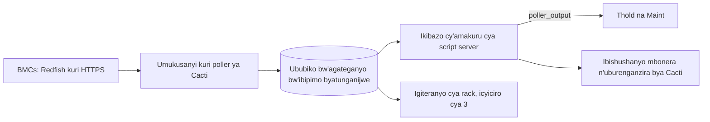

<!-- Source: README.md; SHA256: 7b4e83a58a1adc844cb0615ef30e95476cba2851f96bb454d2a816fb2774724d -->

<!-- translations:start -->
[English](../../../README.md) | [简体中文](../zh-CN/README.md) | [हिन्दी](../hi-IN/README.md) | [Español (España)](../es-ES/README.md) | [Español (Latinoamérica)](../es-419/README.md) | [العربية (السعودية)](../ar-SA/README.md) | [Afrikaans](../af-ZA/README.md) | [አማርኛ](../am-ET/README.md) | [العربية (مصر)](../ar-EG/README.md) | [العربية (المغرب)](../ar-MA/README.md) | [বাংলা](../bn-BD/README.md) | [Deutsch](../de-DE/README.md) | [فارسی](../fa-IR/README.md) | [Filipino](../fil-PH/README.md) | [Français](../fr-FR/README.md) | [Français (Maroc)](../fr-MA/README.md) | [Français (Sénégal)](../fr-SN/README.md) | [Hausa](../ha-NG/README.md) | [עברית](../he-IL/README.md) | [Bahasa Indonesia](../id-ID/README.md) | [Igbo](../ig-NG/README.md) | [Italiano](../it-IT/README.md) | [日本語](../ja-JP/README.md) | [한국어](../ko-KR/README.md) | [Malagasy](../mg-MG/README.md) | [मराठी](../mr-IN/README.md) | [Bahasa Melayu](../ms-MY/README.md) | [Nederlands](../nl-NL/README.md) | [Polski](../pl-PL/README.md) | [Português (Brasil)](../pt-BR/README.md) | [Русский](../ru-RU/README.md) | [Kinyarwanda](README.md) | [Soomaali](../so-SO/README.md) | [Svenska](../sv-SE/README.md) | [Kiswahili](../sw-KE/README.md) | [தமிழ்](../ta-IN/README.md) | [తెలుగు](../te-IN/README.md) | [ไทย](../th-TH/README.md) | [Türkçe](../tr-TR/README.md) | [Українська](../uk-UA/README.md) | [اردو](../ur-PK/README.md) | [Tiếng Việt](../vi-VN/README.md) | [isiXhosa](../xh-ZA/README.md) | [Yorùbá](../yo-NG/README.md) | [繁體中文](../zh-TW/README.md) | [isiZulu](../zu-ZA/README.md)
<!-- translations:end -->

# plugin_redfish

Umugereka wa Cacti 1.2 uzana ikoreshwa ry'amashanyarazi ya seriveri, ubushyuhe bwinjira, imiterere y'imiyaga ikonjesha (fans), n'ubuzima bw'ibikoresho bitanga amashanyarazi (power supplies) bivuye muri kontorore zicunga ibikoresho bya seriveri (BMCs) bikajya muri Cacti nk'ibikoresho bisanzwe, amasoko y'amakuru, n'ibishushanyo mbonera, hakoreshejwe Redfish hamwe n'uburyo bwa IPMI bwo kwitabaza igihe bikenewe. Hanyuma Thold na Maint bitanga impuruza kandi bikazihagarika by'agateganyo, naho icyiciro kizakurikiraho kikazongeramo igiteranyo cy'amashanyarazi ku rwego rwa rack.

> **Imiterere: iri mu ikorwa, nta verisiyo irasohoka (0.1.0-dev).** Ibyiciro bya 2 (ishyirwaho ry'ibanze) na 3 (ibikoresho bya Cacti n'impuruza) byahujwe kuri `main`. Uyu mugereka ntufitanye isano n'umushinga wa Cacti. Ushyirwa kuri Cacti 1.2.31 ikoresha PHP 8.2 cyangwa izisumbuyeho, ukandika BMCs n'ibyangombwa byo kwinjira, ugasoma amashanyarazi, ubushyuhe, imiyaga ikonjesha, n'ubuzima bw'ibitanga amashanyarazi kuri buri BMC ukoresheje Redfish ubishyira mu bubiko bw'agateganyo bwawo, kandi ukerekana ubuzima bw'ikusanyamakuru. Wongeramo ibikoresho bya Cacti, ibishushanyo mbonera bya buri gice n'iby'incamake, hamwe n'ubufasha bwa Thold na Maint binyuze mu masoko y'amakuru asanzwe. CI yagerageje BMC y'igikoresho cy'ikinyoma cyubatswe ku makuru yanditswe n'intoki hamwe na seriveri y'icyitegererezo ya DMTF Redfish; nta BMC nyayo cyangwa itsinda ry'igerageza riremezwa. Igishushanyo n'ubushakashatsi biboneka muri [docs/PLAN.md](../../PLAN.md), [docs/research/](../../research), no muri [docs/decisions/](../../decisions).

### Ibyo icyiciro cya 2 gitanga

- Gushyiramo, kuvugurura, guhagarika, no gukuramo binyuze kuri API y'imigereka ya Cacti, imbonerahamwe zikagumaho mu gihe cyo gukuramo keretse igihe igenamiterere ryo kuzigumishaho ryakuweho. Kuri PHP iri munsi ya 8.2, umugereka wanga gushyirwamo cyangwa kwemezwa kandi ukagaragaza impamvu.
- Inzego z'uburenganzira "Redfish View" (urupapuro rw'ubuzima), "Redfish Operator" (urupapuro rw'ibikorwa), na "Redfish Admin" (impapuro za BMCs n'ibyangombwa byo kwinjira), hamwe n'igenamiterere munsi ya Configuration > Settings > Redfish.
- Igitabo cy'iyandikisha rya BMC gifite uburyo bwo kwinjiza muri CSV no gusohora muri JSON. Dosiye zinjizwa ntizigomba kuba zirimo amagambo y'ibanga; ibyangombwa byo kwinjira bishingira ku izina.
- Ibyangombwa byo kwinjira bibikwa bishyizwe mu ibanga hakoreshejwe AES-256-GCM. Urufunguzo ni dosiye iri hanze y'ububiko bw'amakuru, `/etc/cacti/redfish-vault.key` nk'uko bisanzwe, rufite inyuguti n'imibare 64 za hexadecimal (`openssl rand -hex 32`) cyangwa byte 32 z'ukuri zidasobanutse, rufitwe n'umukoresha wa poller, rudashobora gusomwa n'abandi bakoresha, mu bubiko umukoresha wa poller cyangwa root wenyine bashobora kwandikamo. Urufunguzo rw'inyuguti 32 zisanzwe zandikwa rwanzwe nk'ijambo ry'ibanga. **Bika kopi y'iyi dosiye y'urufunguzo hamwe n'ububiko bw'amakuru**; utayifite, buri jambo ry'ibanga ribitswe rigomba kongera kwinjizwa bundi bushya.
- Igenzura rya TLS rirahora ryaka nk'uko bisanzwe, hamwe na CA bundle kuri buri BMC cyangwa gufata SPKI SHA-256. Guhitamo kutagenzura TLS kuri buri BMC byandikwa mu makuru y'ibikorwa kandi biguma ku rupapuro rw'ubuzima nk'umuburo.
- Umukiriya wa Redfish usoma gusa: `GET` hamwe no kwinjira no gusohoka muri sesiyo gusa, bigenzurwa ku rutonde rw'ibyemewe mbere y'uko ubusabe ubwo ari bwo bwose bwoherezwa.
- Umukusanyi utangizwa na `poller_bottom` ku ma BMC ari kuri poller nyamukuru, hamwe n'igihe ntarengwa n'uburenganzira bwo gukora kuri buri BMC, gutegereza igihe bibaye ngombwa (backoff), no gusukura nyuma y'ihagarara ritunguranye rya sesiyo imwe umugereka wanditse. Abakusanyi bo ku ruhande (remote collectors) ntibaremerwa; bakeneye ihitamo ryeruye ry'uburyo umukusanyi agera ku bubiko bw'amakuru n'urufunguzo (icyiciro cya 4).
- Amakuru ya BMC n'ibyangombwa byo kwinjira bikurikiza uburenganzira bw'ibikoresho bya Cacti: Redfish Admin areba, ahindura, kandi agahuza gusa ama BMC ari ku bikoresho yemerewe kureba, ndetse n'ibyangombwa byo kwinjira bidakoreshwa na BMC n'imwe iri ku gikoresho gihishwe.

### Ibyo icyiciro cya 3 cyongeraho

- Inyandikorugero (templates) zitangwa nka XML y'inyandikorugero ya Cacti muri `templates/` kandi zikinjizwa n'uburyo bw'iyinjiza bwa Cacti ubwayo mu gihe cyo gushyiramo no kuvugurura, zihujwe na hash, bityo iyinjiza rikavugurura ibikoresho by'umugereka kandi ntiryongere ikintu kabiri. Dosiye eshatu z'ibibazo by'amakuru zikopororwa muri `<cacti>/resource/script_server/` hamwe na hash yanditswe; umugereka ntiwigera usimbuza dosiye iriho utanditse, kandi urupapuro rw'ubuzima ruburira abayobozi igihe inyandikorugero cyangwa dosiye y'ikibazo itari mu mwanya wayo. **Reinstall the Redfish Templates** ku rupapuro rwa BMCs irazinjiza bundi bushya; ikenera uburenganzira bwa Cacti bwo kwinjiza inyandikorugero (Import Templates).
- **Create Device** cyangwa **Add Graphs** kuri buri BMC ([ADR 0015](../../decisions/0015-attach-to-the-server-device-or-create-one-per-bmc.md)). BMC yahujwe n'igikoresho gisanzwe cya seriveri ibona ibibazo byayo by'amakuru n'ibishushanyo mbonera kuri icyo gikoresho. BMC itarahujwe ibona igikoresho gishya giturutse ku nyandikorugero y'igikoresho "Redfish BMC", igenzura ry'iboneka rifunze kandi ifite izina rya host munsi ya `.invalid`, bityo Cacti ntiyigere ivugana na BMC kandi ntiyigere yerekana aderesi yayo. Mu buryo ubwo ari bwo bwose umuyobozi abanza kwemeza gahunda igaragaza ibizongerwamo. Byombi bikenera uburenganzira bwa Cacti bwo gucunga ibikoresho ndetse na Redfish Admin; igikoresho gishya uwagikoze adashobora kureba gikurwaho nanone.
- Ibibazo bitatu by'amakuru bya script server, "Redfish Fans", "Redfish Temperatures", na "Redfish Power Supplies", bifite indekisi ishingiye ku rufunguzo rwa buri gice cya BMC, hamwe n'igishushanyo mbonera kuri buri gice: umuvuduko w'umuyaga ikonjesha ku ijanisha cyangwa RPM (urugero urwo ari rwo rwose BMC itanga), ubushyuhe, n'amashanyarazi yinjira n'asohoka mu ma watts ku bitanga amashanyarazi, buri kimwe gifite kode y'ubuzima bwacyo.
- Icyinjiza cya "Redfish Node Summary" gifite amashanyarazi, ubushyuhe bwinjira, ubushyuhe buri hejuru kurusha ubundi, imiyaga ikonjesha n'ibitanga amashanyarazi bitameze neza, ubuzima bw'inodo (node), n'igihe gishize kuva ku isoma ryiza rya nyuma, bishushanyijwe ku bishushanyo mbonera bine: amashanyarazi, ubushyuhe, ubuzima bw'ibice, n'igihe amakuru amaze. Ibipimo ntarengwa bya Thold kuri aya masoko y'amakuru bitanga impuruza, kandi Maint ikazihagarika by'agateganyo, nta mpinduka zikozwe ku mugereka n'umwe muri iyo yombi.
- Script server isubiza ivuye mu bubiko bw'agateganyo bw'umugereka gusa kandi ntiyigera ivugana na BMC. Agaciro kabuze, kashaje, gafite urundi rugero, cyangwa kavuye ku gice kitakiriho kaba `U`, kugira ngo ibishushanyo mbonera byerekane icyuho, atari zeru; `age` ihora ifite agaciro, bityo igipimo ntarengwa kuri yo kigafata BMC yahagaze gusubiza.
- Umurongo uhuza kuva kuri buri gishushanyo mbonera cya Redfish ujya ku bishushanyo mbonera bya Redfish by'igikoresho, werekanwa gusa ku bakoresha Cacti yemerera kureba icyo gikoresho.

**Iyo ibice bya BMC bihindutse** (umuyaga ikonjesha uhinduwe, ivugurura rya firmware rihindura amazina y'ibyuma bifata ibipimo), hitamo **Add Graphs** nanone. Umuyaga ikonjesha cyangwa igitanga amashanyarazi cyari gihari none kikaba kidahari cyangwa cyaravuyeho bibarirwa muri `fans_bad` cyangwa `psus_bad` kugeza ubikoze, bityo umuyaga ikonjesha wakuwemo utanga impuruza; umwanya utigeze ushyirwamo ikintu ntubarwa. Add Graphs yemera ibice BMC itanga ubu, kandi Cacti yongera gukora indekisi y'ibibazo; igice cyavuyeho kigumana isoko ry'amakuru n'igishushanyo mbonera byacyo, bisoma `U` guhera icyo gihe, naho igice gishya kikabona igishushanyo mbonera. Siba n'intoki ibishushanyo mbonera by'ibice byavuyeho igihe amateka yabyo atakiri ngombwa.

Gusiba igikoresho bikuraho ihuzwa rya BMC yacyo ariko bikagumishaho iyo BMC n'ububiko bwayo bw'agateganyo. Gusiba BMC, cyangwa gukuramo umugereka, bigumishaho igikoresho n'ibishushanyo mbonera byacyo.

## Inzego z'uburenganzira

| Urwego | Uburenganzira |
| --- | --- |
| Redfish View | Impapuro zo gukurikirana zisanzwe. |
| Redfish Operator | Gukurikirana hiyongereyeho urupapuro rwa Operations n'ibyemezo byihariye byo kumenya ikibazo (triage). |
| Redfish Admin | Uburenganzira bwa Operator hiyongereyeho igenamiterere risanzwe n'ibikorwa by'ubuyobozi. |

Nyuma yo gukoporora dosiye z'ivugurura, fungura urupapuro rwa Plugins nk'umuyobozi kugira ngo wandike
urwego rushya. Tanga uburenganzira bw'urwego rwa Operator mu buryo bweruye munsi ya **Configuration > Users** cyangwa amatsinda y'abakoresha.
Amavugurura agumana nimero za ID n'uburenganzira byari bisanzwe bya View na Admin. Uburenganzira bwa Admin
buragwa ubwa Operator, naho ubwa Operator bukaragwa ubwa View kuri buri busabe;
ibi ntibyongera uburenganzira bubitswe ku bakoresha cyangwa amatsinda. Igenamiterere ry'umugereka ryo rinasaba
uburenganzira bwa Redfish Admin hiyongereyeho uburenganzira bwa Cacti bwa Settings.

Uburenganzira bw'ibikoresho bya Cacti bukomeza kugena imirongo n'ibikorwa biboneka kuri buri mukoresha; ibikoresho bitarahujwe bisaba umuyobozi. Abafite urwego rwa Operator bashobora kurekura ihagarikwa ry'ikusanyamakuru kuri BMC yemerewe ku gikorwa gikurikiraho cyateganyijwe.
Ibyangombwa byo kwinjira, igenamiterere, guhuza, gusiba n'izindi mpinduka z'ubuyobozi
biguma mu mpapuro z'ubuyobozi. Kwemeza ko ikibazo cyabonywe bimara gusa muri sesiyo y'umukoresha iriho
ubu, mu gihe kitarenze isaha imwe kandi gusa mu gihe iryo suzuma rimwe rigifite amakuru mashya.
Amasuzuma mashya cyangwa yahindutse ahita abitesha agaciro. Ntibishobora na rimwe kwerekana igipimo
cyananiranye nk'aho kimeze neza cyangwa ngo bihagarike impuruza.

## Impamvu

Buri seriveri ifite BMC itanga amakuru y'imikoreshereze y'amashanyarazi n'ubushyuhe mu buryo bwigenga butandukanye na sisitemu y'imikorere (OS), bityo ikomeza gusubiza n'iyo OS yaba yahagaze. Amakuru akoreshwa mu gukurikirana ubushobozi n'ikiguzi, kuburira kare igihe umuyaga ikonjesha cyangwa igitanga amashanyarazi byapfuye, ndetse no mu bikorwa byo kubara kwa vuba cyane (HPC), mu byemezo byo kugabanya ikigero cy'amashanyarazi. Uyu mugereka ntabwo ugirirwa HPC gusa.

Cacti igira igice cy'ibi ikora ubu:

- **Paki za SNMP z'abakora ibikoresho.** Ishami rya 1.2.x ritanga inyandikorugero za Dell iDRAC na HPE iLO zisaba umukozi wa SNMP kandi zikagenerwa ubwoko bwihariye bw'igikoresho; ubushakashatsi bw'icyiciro cya 1 bwagaragaje ko nta n'imwe muri zo itanga ingano y'amashanyarazi akoreshwa muri watts ([docs/research/overlap.md](../../research/overlap.md)).
- **Ubwoko bw'ibyangombwa byo kwinjira budafite umukusanyi.** plugin_credentials isobanura icyangombwa cya "IPMI / Redfish (BMC)" ariko ntacyo isoma kuri BMC.
- **Nta mbonerahamwe ku rwego rwa rack.** Cacti y'ibanze nta kintu cya rack igira; igikoresho kigira umwanya wa `location` wandikwamo amagambo ayo ari yo yose.

Umugereka ukusanya amakuru kuri za BMC hanze y'igikorwa cy'ikusanya rya Cacti, ukabika by'agateganyo ibipimo byatunganijwe, kandi ukabigaragaza binyuze ku kibazo cy'amakuru cya script server n'amasoko y'amakuru y'incamake. Ukoresha nanone uburyo bwa Cacti bwo gushushanya, uburenganzira, Thold, na Maint, kandi ntuhindura imiterere ya BMC. Ubufasha bw'abakusanyi b'amakuru bo ku ruhande buteganyijwe mu cyiciro cya 4; ikusanyamakuru ry'ubu rikorwa kuri poller nyamukuru gusa.

## Ibiteganyijwe kugerwaho

| Icyiciro | Ibikubiyemo | Ibyiciro by'ishyirwa mu bikorwa |
|---|---|---|
| 0, ubushakashatsi | Imbonerahamwe y'abakora ibikoresho, kwemeza imikorere y'amavuko kuri za BMC nyazo, ikiguzi cy'ikusanyamakuru, igerageza ry'ikibazo cy'amakuru | [M1](https://github.com/somethingwithproof/plugin_redfish/milestone/1) |
| 1, kwitegereza | Igitabo cy'iyandikisha rya BMC, ibyangombwa byo kwinjira, TLS, umukusanyi wa Redfish, ibipimo byatunganijwe, ibikoresho, ibishushanyo mbonera kuri buri ndekisi, impuruza za Thold, ihagarika ry'agateganyo rya Maint, urupapuro rw'ubuzima | [M2](https://github.com/somethingwithproof/plugin_redfish/milestone/2), [M3](https://github.com/somethingwithproof/plugin_redfish/milestone/3), [M4](https://github.com/somethingwithproof/plugin_redfish/milestone/4) |
| 2, ipmi | Uburyo bwa IPMI bwo kwitabaza ku ma BMC adafite Redfish ikoreshwa, bufunze nk'uko bisanzwe | [M5](https://github.com/somethingwithproof/plugin_redfish/milestone/5) |
| 3, racks | Igitabo cy'iyandikisha rya rack, igiteranyo cy'amashanyarazi ya rack hamwe n'igipimo cy'ibyahuje, umwanya usigaye w'ingengo | [M6](https://github.com/somethingwithproof/plugin_redfish/milestone/6) |
| 4, kure | Abakusanyi b'amakuru bo ku ruhande ba Cacti ku miyoboro ya BMC yitaruye | [M7](https://github.com/somethingwithproof/plugin_redfish/milestone/7) |

Ibitari mu nshingano: gushyiraho imipaka y'amashanyarazi cyangwa irindi genamiterere iryo ari ryo ryose rya BMC, kugenzura amashanyarazi, kuvugurura firmware, kwinjira kuri console, moteri y'impuruza yihariye y'umugereka, no guhuza na gahunda ya scheduler.

## Ibikoresho bihuzwa

| Igice | Igipimo gisabwa |
|---|---|
| Cacti | 1.2.31 cyangwa izisumbuyeho, nta mpinduka ku shingiro rya Cacti |
| Ububiko bw'amakuru | MariaDB 10.2 cyangwa MySQL 5.7 cyangwa izisumbuyeho: BMC imwe kuri buri gikoresho igenzurwa n'urufunguzo rwihariye ku mbonerahamwe ibyarwa (generated column) |
| PHP | 8.2 cyangwa izisumbuyeho; `setup.php` ikomeza gusomwa kuri 8.0 kugira ngo sisitemu itemewe ihabwe ubutumwa bwo kwanga aho kwangiza imigaragarire ya Cacti |
| BMCs | Dell iDRAC, HPE iLO, Lenovo XCC, na OpenBMC, hakurikijwe urutonde rwa firmware; reba [imbonerahamwe y'abakora ibikoresho](../../research/vendor-matrix.md) |
| Redfish | Ibikoresho bishya bya subsystem na sensor mbere, `Power` na `Thermal` bishaje nk'uburyo bwo kwitabaza |
| Thold, Maint | Nta mpinduka zisabwa |

## Igishushanyo

- [docs/PLAN.md](../../PLAN.md) ni gahunda irambuye: imyubakire, amakuru y'ibanze yishingikirijeho (hamwe n'amasoko n'ibikekwa bigomba kwemezwa), uburyo bw'ipima, imipaka y'umutekano, imibare y'imikorere, igerageza, n'ibyago.
- [docs/decisions/](../../decisions) ibitse inyandiko z'ibyemezo by'imyubakire ku mahitamo yamaze gufatwa.
- [docs/REQUIREMENTS.md](../../REQUIREMENTS.md) ihuza buri nomero ya ID y'ibisabwa n'ikibazo cyayo.

## Umutekano

Ibyangombwa byo kwinjira bya BMC bigenzura imicungire yo hanze y'ibikoresho bya za seriveri. Igishushanyo kibikura mu mirongo y'amabwiriza, mu nyandiko z'ibikorwa (logs), no mu mpapuro, kigenzura TLS nk'uko bisanzwe, gikoresha amabwiriza yo hanze ayo ari yo yose kivuye ku rutonde rw'ingingo zemewe gusa, kandi gikoresha konti za BMC zo gusoma gusa. Reba [docs/PLAN.md](../../PLAN.md#security) na [SECURITY.md](../../../SECURITY.md).

## Imfashanyigisho y'umukoresha w'ibikorwa

Reba [docs/operator-guide.md](../../operator-guide.md) ku bijyanye n'ibisabwa mbere yo gushyiramo, gutegura ububiko bw'ibanga na TLS, kwandika BMC, gukora ibishushanyo mbonera, igihe cy'impuruza, kubika kopi z'amakuru, no gukemura amakosa. Iyi mfashanyigisho ntiyemeza ko umurongo wa firmware y'umukora ibikoresho runaka wemewe kugeza igihe amakuru yakuweho ibanga avuye kuri iyo firmware atsinze igerageza.

## Uko imirimo ikurikiranwa

- **Ibyiciro by'ishyirwa mu bikorwa (Milestones)** bikurikira ibyiciro bya gahunda. Buri kimwe gifite ikibazo kinini (epic) cyerekana ibibazo bito bikigize n'ibimenyetso byo kurangiza.
- **Ibibazo (Issues)** bigabanywa hakurikijwe ibirango (labels): `type: requirement`, `type: research`, `type: decision`, `type: epic`. Ibibazo by'ibisabwa bigaragaza ibisabwa bifite nimero kandi bishobora kugeragezwa (`REQ-AREA-NNN`) hamwe n'ibipimo byo kubyemeza.
- **Ibirango (Labels)** kandi bigira `area:`, `phase:`, `priority:`, na `status:`. Reba [CONTRIBUTING.md](../../../CONTRIBUTING.md#labels).
- [Imbonerahamwe y'umushinga](https://github.com/users/somethingwithproof/projects/12) yerekana ibibazo byose mu byiciro byose.

## Gutanga umusanzu

Soma [CONTRIBUTING.md](../../../CONTRIBUTING.md). Ibikorwa byoherezwa (commits) bisaba umukono wa DCO. Ibiganiro ku gishushanyo bibera ku bibazo (issues); ibyemezo bitarafatwa bigira ikirango cya `type: decision`. Ibimenyetso biturutse ku ma BMC nyayo ni wo musanzu w'ingenzi cyane ubu; kuraho aderesi, nimero ziranga ibikoresho (serial numbers), n'ibyangombwa byo kwinjira mbere yo gutangaza amakuru ayo ari yo yose yafashwe.

## Uruhushya

GNU General Public License v2.0, uruhushya rumwe n'urwa Cacti n'imigereka yayo. Reba [LICENSE](../../../LICENSE).
