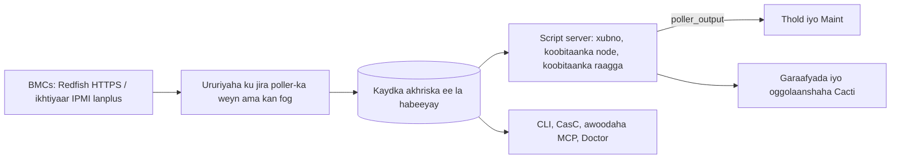

<!-- Source: README.md; SHA256: cf31b9f80d6c00020bbe08e80951d4de1c910793911d040ae7a66b54e8a2eaf0 -->

<!-- translations:start -->
[English](../../../README.md) | [简体中文](../zh-CN/README.md) | [हिन्दी](../hi-IN/README.md) | [Español (España)](../es-ES/README.md) | [Español (Latinoamérica)](../es-419/README.md) | [العربية (السعودية)](../ar-SA/README.md) | [Afrikaans](../af-ZA/README.md) | [አማርኛ](../am-ET/README.md) | [العربية (مصر)](../ar-EG/README.md) | [العربية (المغرب)](../ar-MA/README.md) | [বাংলা](../bn-BD/README.md) | [Bosanski](../bs-BA/README.md) | [Deutsch](../de-DE/README.md) | [فارسی](../fa-IR/README.md) | [Filipino](../fil-PH/README.md) | [Français](../fr-FR/README.md) | [Français (Maroc)](../fr-MA/README.md) | [Français (Sénégal)](../fr-SN/README.md) | [Hausa](../ha-NG/README.md) | [עברית](../he-IL/README.md) | [Hrvatski](../hr-HR/README.md) | [Bahasa Indonesia](../id-ID/README.md) | [Igbo](../ig-NG/README.md) | [Italiano](../it-IT/README.md) | [日本語](../ja-JP/README.md) | [한국어](../ko-KR/README.md) | [Malagasy](../mg-MG/README.md) | [मराठी](../mr-IN/README.md) | [Bahasa Melayu](../ms-MY/README.md) | [Nederlands](../nl-NL/README.md) | [Polski](../pl-PL/README.md) | [Português (Brasil)](../pt-BR/README.md) | [Русский](../ru-RU/README.md) | [Kinyarwanda](../rw-RW/README.md) | [Soomaali](README.md) | [Српски](../sr-RS/README.md) | [Svenska](../sv-SE/README.md) | [Kiswahili](../sw-KE/README.md) | [தமிழ்](../ta-IN/README.md) | [తెలుగు](../te-IN/README.md) | [ไทย](../th-TH/README.md) | [Türkçe](../tr-TR/README.md) | [Українська](../uk-UA/README.md) | [اردو](../ur-PK/README.md) | [Tiếng Việt](../vi-VN/README.md) | [isiXhosa](../xh-ZA/README.md) | [Yorùbá](../yo-NG/README.md) | [繁體中文](../zh-TW/README.md) | [isiZulu](../zu-ZA/README.md)
<!-- translations:end -->

# plugin_redfish

Kordhin Cacti 1.2 ah oo ka keenta isticmaalka korontada serfarka, heerkulka soo-galka, xaaladda marwaxadda, iyo caafimaadka sahayda korontada ee koontaroolayaasha maareynta salka (BMCs) una soo gudbisa Cacti iyagoo ah aalado caadi ah, ilo xogeed, iyo garaafyo, iyadoo la adeegsanayo Redfish oo leh ikhtiyaar dib-u-noqosho ah oo akhris-keliya oo IPMI ah iyo isku-darka korontada ee heerka raagga (rack-level). Thold iyo Maint waxay ka digaan oo ay xakameeyaan iyagoo adeegsanaya ilaha xogta ee caadiga ah ee Cacti.

> **Xaaladda: waa la horumarinayaa, weli lama sii deyn (`0.1.0-dev`).** Kordhintani kuma xirna mashruuca Cacti. Waxay ku rakibantaa Cacti 1.2.31 ama ka dambeeya iyadoo la adeegsanayo PHP 8.2 ama ka dambeeya, waxayna hirgelisaa ururiyaha Redfish, kaydka sirta ah ee aqoonsiga gelitaanka, diyaarinta aaladda iyo garaafka ee Cacti, ikhtiyaar dib-u-noqosho ah oo akhris-keliya oo IPMI ah, isku-darka korontada raagga, muujinta daaqadda dayactirka ee Cacti Maint, koobiyeynta ururiyaha xogta fogfog iyo meelaha dhammaadka wakiilka, bixiyaha CasC iyo CLI-ga hawlwadeenka, awoodaha (abilities) MCP, iyo hubinta baaritaanka ee Doctor. CI waxay tijaabisaa qalabyada tijaabada, DMTF Redfish Mockup Server (jilitaannada subsystem, legacy-only, iyo HPE iLO Gen11), iyo Thold v1.8.2 oo la socota Maint v1.3; wax BMC jireed ah oo dhab ah ama raxan tijaabo ah weli lama aqoonsan. Naqshadaynta iyo cilmi-baarista waxay ku jiraan [docs/PLAN.md](../../PLAN.md), [docs/research/](../../research/), iyo [docs/decisions/](../../decisions/).

## Awoodaha la hirgeliyay

### Ururiyaha udub-dhexaadka ah, kaydka sirta ah, iyo walxaha Cacti

- **Wareegga nolosha iyo qaab-dhismeedka (schema).** Waxaa lagu rakibaa, lagu cusboonaysiiyaa, lagu damiyaa, lagana saaraa iyadoo loo marayo API-ga kordhinta ee Cacti (`Schema::VERSION = 3`, 12 miis). Miisaska waa la hayaa marka la saarayo haddii aan la nadiifin *Keep Plugin Tables on Uninstall*. Meelaha laga galo waxaa lagu falanqayn karaa PHP 8.0 waxayna ku diidaan PHP ka hooseeya 8.2 ama maqnaanshaha `ext-openssl` fariin qalad ah oo cad.
- **Diiwaanka iyo oggolaanshaha.** Aagagga rukhsadda *Redfish View* (`redfish_health.php`), *Redfish Operator* (`redfish_operator.php`), iyo *Redfish Admin* (`redfish_bmcs.php`, `redfish_credentials.php`), iyo dejinta hoos timaadda **Configuration > Settings > Redfish**. Diiwaanka BMC wuxuu taageeraa soo-dejinta CSV (aqoonsiyada gelitaanka waxaa lagu tixraacaa magac; ereyada sirta ah ee ku jira faylasha soo-dejinta waa la diidaa) iyo dhoofinta JSON. Diiwaanada BMC iyo aqoonsiyada gelitaanka waxay raacaan oggolaanshaha aaladda Cacti.
- **Kaydka sirta ah ee aqoonsiga gelitaanka.** Ereyada sirta ah waxaa lagu kaydiyaa iyadoo lagu qariyay AES-256-GCM gudaha `plugin_redfish_secret`. Furehu wuxuu ku nool yahay meel ka baxsan xogta kaydka (`/etc/cacti/redfish-vault.key` si caadi ah) isagoo ah 64 xaraf oo hexadecimal ah (`openssl rand -hex 32`) ama 32 byte oo cayriin ah, oo uu leeyahay isticmaalaha poller-ka, aanay akhrin karin isticmaalayaasha kale, kuna jira gal ay qori karaan oo keliya root ama isticmaalahaas. Weedh-sir ah oo ka kooban 32 xaraf oo la daabici karo waa la diidaa. **Ka samee nuqul kayd ah faylka furaha iyadoo lala kaydinayo xogta kaydka**; la'aantiis, ereyada sirta ah ee la kaydiyay waa in mar kale la geliyaa.
- **TLS iyo macmiilka Redfish ee akhris-keliya.** Xaqiijinta TLS way shidan tahay si caadi ah iyadoo la adeegsanayo kaydka CA ee nidaamka, xirmo CA ah oo u gaar ah BMC kasta, ama biin SPKI SHA-256 ah; ka-baxidda aan la xaqiijin ee BMC kasta waxay sii muuqataa iyadoo ah digniin caafimaad iyo digniin hubinta Doctor ah. Macmiilku wuxuu oggol yahay oo keliya `GET` iyo gelitaanka (`POST`) iyo ka-bixidda (`DELETE`) fadhiga Redfish, iyadoo leh dib-u-noqosho Basic ah oo ikhtiyaar u ah BMC kasta marka fadhiyadu aysan diyaar ahayn. Baaritaanku wuxuu doorbidaa nidaam-hoosaadka cusub ee Redfish iyo ilaha dareemayaasha wuxuuna u noqdaa ilaha duugowday ee `Power` iyo `Thermal` sidii dib-u-noqosho.
- **Fulinta ururiyaha.** `poller_redfish.php` wuxuu ka bilaabmaa `poller_bottom`, wuxuu wadaa hal hannaan oo hoggaamiye ah poller kasta iyadoo loo marayo diiwaanka hannaanka Cacti oo leh hannaan shaqaale oo la habayn karo (`redfish_workers`), wuxuu helaa waqti-xaddidan oo BMC kasta ah, wuxuu dhaqan geliyaa miisaaniyadda waqtiga (`redfish_collector_budget`), wuxuu adeegsadaa dib-u-dhigis sii kordheysa, wuxuuna nadiifiyaa fadhigii hore ee kordhinta lafteeda ka dib burbur.
- **Qaababka, aaladaha, iyo garaafyada.** Wuxuu ku soo dejiyaa `templates/redfish-templates.xml` iyadoo la eegayo hash wuxuuna koobiyeeyaa saddex fayl oo XML ah oo weydiinta xogta script server ah (`redfish_fans.xml`, `redfish_temperatures.xml`, `redfish_psus.xml`) gudaha `<cacti>/resource/script_server/` iyadoo aan la beddelin faylasha uu isticmaaluhu wax ka beddelay. **Create Device** iyo **Add Graphs** waxay u baahan yihiin xaqiijinta qorshe diyaarin, waxay ku xiraan weydiimaha aaladda serfarka ee ku xiran ama waxay abuuraan aalad "Redfish BMC" ah oo hoos timaadda `.invalid` iyadoo hubinta helitaanku dansan tahay, waxayna ku xiraan garaaf kasta oo Redfish ah dib ugu noqoshada garaafyada Redfish ee aaladda iyadoo loo marayo `graph_buttons`.
- **Gelinta script server ee kaydka-keliya.** `scripts/ss_redfish_members.php` waxay bixisaa akhrisyada marwaxadda, heerkulka, iyo PSU ee xubin kasta, `scripts/ss_redfish_summary.php` waxayna bixisaa cabbirrada "Redfish Node Summary" (korontada, heerkulka soo-galka iyo kan ugu sarreeya, tirada marwaxadaha iyo PSU-yada xumaaday, caafimaadka node-ka, iyo da'da akhriskii ugu dambeeyay ee wanaagsanaa). Wicitaannada script server-ku waxay akhriyaan oo keliya kaydka maxalliga ah weligoodna lama xiriiraan BMC. Akhrisyada maqan, duugowday, ama ka yimid xubnaha tagay waxay soo celiyaan `U` (weligood `0`), halka `age` uu mar walba soo sheego qiimo si xadadka digniintu u ogaadaan BMCs aan jawaabayn.

**Marka xubnaha BMC ay isbeddelaan** (sida marwaxad la beddelay ama cusboonaysiin firmware ah oo magacyo cusub siinaysa dareemayaasha), orod **Add Graphs** mar kale. Marwaxad ama sahay koronto oo horay u jirtay oo noqota mid maqan waxaa lagu tiriyaa `fans_bad` ama `psus_bad` ilaa la aqbalo; boos aan weligiis la buuxin lama tiriyo. Xubnaha tagay waxay haystaan ilahooda xogta iyo garaafyada jira, kuwaas oo akhriya `U` wixii intaa ka dambeeya ilaa gacanta lagu tirtiro. Tirtiridda aalad Cacti ah waxay ka saartaa xiriirka BMC-geeda waxayna saartaa meelaynta raaggeeda iyadoo haysa BMC-ga iyo kaydka; tirtiridda BMC ama ka-saaridda kordhinta waxay haysaa aaladaha iyo garaafyada Cacti.

### Dib-u-noqoshada IPMI ee ikhtiyaarka ah

- **Ikhtiyaar u gaar ah BMC kasta.** Si caadi ah u dansan (`protocols` si caadi ah waa `redfish`; shididda dib-u-noqoshada IPMI waxay dejisaa `redfish,ipmi`).
- **Kicinta dib-u-noqoshada ee xaddidan.** Waxay shaqaysaa oo keliya marka ururinta Redfish ku guuldarraysato nooc fashil ah oo u qalma; weligeed kama kiciso `AuthRejected`, `CredentialUnavailable`, `AddressRefused`, `OperationRefused`, ama `Deadline`.
- **Fulinta ammaan ah.** Waxay ku wacdaa `ipmitool` iyadoo la adeegsanayo `-I lanplus` iyadoo loo marayo qaabka taxanaha `proc_open()` oo aan lahayn shell, waqti-dhammaad saacad xaddidan leh, iyo xad wax-soo-saar ah oo 256 KiB ah. Ereyada sirta ah waxaa lagu bixiyaa `IPMITOOL_PASSWORD` (`-E`) ama fayl ku-meel-gaar ah oo leh qaab-0600 (`-f`) oo lagu tirtiro `finally`, weligeedna laguma bixiyo CLI argv.
- **Liiska oggolaanshaha amarka akhris-keliya.** Shantan amar-hoosaad ee akhris-keliya oo keliya ayaa la oggol yahay: `dcmi power reading`, `sdr type Temperature`, `sdr type Fan`, `sdr type Power Supply`, iyo `chassis status`. Amarrada wax beddela waa la diidaa.
- **Wax-soo-saarka la habeeyay iyo digniinta amniga.** `IpmiNormalizer` waxay u qaabaysaa akhrisyada isla qaabka `Observation`/`Member`/`Reading`, iyadoo soo saaraysa `U` dareemayaasha maqan ama aan la falanqayn karin. Shididda dib-u-noqoshada IPMI waxay dhalisaa digniin ku taal bogga caafimaadka iyo hubinta Doctor ee `redfish.bmc_security` iyadoo xusuusinaysa hawlwadeennada inay ku xaddidaan UDP 623 VLAN maamul.

### Isku-darka korontada raagga

- **Diiwaanka raagga.** Qaab-dhismeedka nooca 3aad wuxuu ku daraa `plugin_redfish_rack` (`(site_id, name)` gaar ah, `power_budget_watts` ikhtiyaar ah, `min_coverage_pct` oo si caadi ah u ah `80`, iyo qoraallo) iyo `plugin_redfish_rack_member` (ugu badnaan hal meelayn raag ah `host_id` kasta, `bmc_id` iyo `unit_position` ikhtiyaar ah, oo si toos ah looga saaro marka aalad Cacti ah la tirtiro).
- **Wadarta lagu ilaaliyay daboolista.** `RackPowerSummary` waxay isku dartaa akhrisyada cusub ee `power_watts` ee xubnaha ee ka yimid kaydka maxalliga ah waxayna xisaabisaa isticmaalka miisaaniyadda iyo bannaan-u-helidda (headroom). Marka daboolista xubnaha warbixinaya ay ka hoos marto `min_coverage_pct`, `power_watts`, `utilization_pct`, iyo `headroom_watts` waxay soo celiyaan `U` si fashilka ururiyuhu uusan weligiis ugu muuqan hoos u dhac ku yimid korontada raagga.
- **Gelinta script server ee diyaar u ah Thold.** `scripts/ss_redfish_rack.php` (`ss_redfish_rack(<rack_id>)`) waxay ka soo celisaa `power_watts`, `power_budget_watts`, `utilization_pct`, `headroom_watts`, `members_total`, `members_reporting`, iyo `coverage_pct` kaydka maxalliga ah oo keliya.

### Is-dhexgalka Cacti Maint

- Xadadka digniinta ee Thold ee ilaha xogta Redfish way digaan Cacti Maint-na wuu xakameeyaa iyadoo aan wax isbeddel ah lagu samayn labada kordhinba.
- `MaintWindow` waxay hubisaa jadwallada firfircoon ee Maint ee martigeliye kasta oo Cacti ah oo ku xiran (jadwallada hal-mar ah `mtype=1` iyo kuwa soo noqnoqda `mtype=2`, iyo `plugin_maint_check_cacti_host()` marka la raro) waxayna ku calaamadaysaa dayactirka firfircoon bogga Redfish Health (`[MAINT]`), wax-soo-saarka `cli/redfish.php health`, iyo awoodda `redfish-get-health`.

### Ururiyayaasha xogta ee fogfog

- `INFO` waxay caddeysaa `remote_collect:1`. BMCs waxay aqbalaan `poller_id >= 1` kasta, `poller_redfish.php --poller=N` wuxuuna soo ururiyaa oo keliya BMCs shidan ee loo xilsaaray poller-kaas.
- **Qabsatada `replicate_out`.** Waxay ku koobiyeysaa iyadoo loo marayo `replicate_out_table()` oo keliya miisaska qaabeynta ee aan sirta ahayn ee ku xaddidan poller-ka fog ee la bartilmaameedsaday: `plugin_redfish_bmc`, xogta `plugin_redfish_credential` (iyadoon qoraal la qariyay lahayn), `plugin_redfish_rack`, iyo `plugin_redfish_rack_member`. `plugin_redfish_secret` lama koobiyeeyo, faylasha furaha kaydkuna waxay si adag ugu sii jiraan maxalli poller kasta.
- **Qabsatada `remote_agent`.** Waxay soo bandhigtaa tallaabooyinka akhris-keliya ee `redfish_health` iyo `redfish_discovery` oo aqbala oo keliya halbeegyada tirada ah ee `poller_id` iyo `bmc_id`. Halbeegyada aan la filayn waa la diidaa wax aqoonsi gelitaan ah ama sir ahna lama soo celiyo.

### Qabsatooyinka nidaamka deegaanka (CasC, awoodaha MCP, iyo Doctor)

- **Bixiyaha CasC (`casc_register_providers`).** Wuxuu diiwaangeliyaa bixiyaha `redfish` (nooca qaab-dhismeedka `1`) oo leh dhoofinta YAML iyo XML ee PHP saafi ah, falanqayn (oo XXE la diido), xaqiijin, qorshaynta kala duwanaanshaha, iyo fulin. Aqoonsiyada gelitaanka waxay u muuqdaan oo keliya tixraacyo kayd (`vault:redfish:<name>`); furayaasha sirta ah ee cayriin (`pass`, `secret`, `token`, `private_key`, `vault_key`, `auth_token`) waa la diidaa. Fulin waxay u baahan tahay `PLAN_HASH` SHA-256 oo sax ah.
- **MCP / Abilities API (`abilities_register`).** Waxay diiwaangelisaa saddex awoodood oo akhris-keliya oo ay xakamayso aagga rukhsadda Redfish View (`redfish_health.php`) iyo oggolaanshaha aaladda Cacti, iyadoo aan soo celin wax aqoonsi gelitaan ah:
  - `redfish-list-bmcs` (`poller_id` ikhtiyaar ah)
  - `redfish-get-rack-power` (`rack_id` ikhtiyaar ah)
  - `redfish-get-health` (`bmc_id` ikhtiyaar ah)
- **Hubinta Doctor (`doctor_register_checks`).** Waxay diiwaangelisaa shan hubin baaritaan oo maxalli ah oo akhris-keliya kuwaas oo aan weligood la xiriirin BMC ama soo celin wax agab fure ah:
  - `redfish.schema`: casriyeynta nooca qaab-dhismeedka
  - `redfish.vault_key`: akhrinta iyo oggolaanshaha furaha kaydka
  - `redfish.collector_runs`: miisaaniyadda iyo cusboonaanta ururiyaha poller-ka
  - `redfish.bmc_security`: BMCs shidan ee leh TLS aan la xaqiijin ama dib-u-noqosho IPMI
  - `redfish.rack_power`: u hoggaansanaanta miisaaniyadda korontada raagga iyo dabaqa daboolista

## CLI

Ka socodsii galka xididka Cacti adigoo adeegsanaya PHP 8.2 ama ka dambeeya:

```sh
# Operator and CasC CLI (reads --file=PATH or stdin for validate, plan, and apply)
php plugins/redfish/cli/redfish.php export --format=yaml|xml
php plugins/redfish/cli/redfish.php validate [--file=PATH] [--format=yaml|xml]
php plugins/redfish/cli/redfish.php plan [--file=PATH] [--format=yaml|xml]
php plugins/redfish/cli/redfish.php apply [--file=PATH] [--format=yaml|xml] --confirm=<PLAN_HASH>
php plugins/redfish/cli/redfish.php health --format=text|json

# Collector entry point (normally started by poller_bottom)
php plugins/redfish/poller_redfish.php [--poller=N] [--force] [--debug]

# Rack power summary script server entry point
php plugins/redfish/scripts/ss_redfish_rack.php <rack_id>
```

## Doorka gelitaanka

| Aagga rukhsadda | Gelitaanka |
| --- | --- |
| Redfish View | Boggaga kormeerka ee jira. |
| Redfish Operator | Kormeerka oo lagu daray bogga Hawlgallada iyo qirashada kala-soocidda shakhsi ahaaneed. |
| Redfish Admin | Gelitaanka Operator oo lagu daray qaabeynta jirta iyo tallaabooyinka maamulka. |

Ka dib marka la koobiyeeyo faylasha cusboonaysiinta, fur bogga Plugins adigoo ah maamule si aad u diiwaangeliso aagagga rukhsadda. Si cad ugu meel-mari aagga rukhsadda Operator hoos timaadda **Configuration > Users** ama kooxaha isticmaalayaasha. Cusboonaysiintu waxay haystaan aqoonsiyada iyo deeqaha aagagga rukhsadda View iyo Admin ee jira. Gelitaanka Admin wuxuu dhaxlaa gelitaanka Operator, gelitaanka Operator-na wuxuu dhaxlaa gelitaanka View codsi kasta; tani kuma darto deeqo la kaydiyay isticmaalayaasha ama kooxaha. Dejinta kordhintu waxay sidoo kale u baahan tahay gelitaanka Redfish Admin iyadoo lagu daray oggolaanshaha Settings ee Cacti.

Oggolaanshaha aaladda Cacti waxay xaddidaan safafka iyo tallaabooyinka u furan isticmaale kasta; walxaha aan ku xirnayn waxay u baahan yihiin maamule. Hawlwadeennadu waxay sii dayn karaan hakinta ururinta ee BMC la oggol yahay si loogu daro orodka xiga ee qorshaysan. Aqoonsiyada gelitaanka, qaabeynta, ku-xiridda, tirtiridda iyo isbeddellada kale ee maamulka waxay ku sii jiraan boggaga maamulka. Qirashooyinku waxay shaqeeyaan oo keliya fadhiga isticmaalaha hadda jira, ugu badnaan hal saac oo keliya inta isla indho-indheyntaasi ay sii cusub tahay. Indho-indheyn cusub ama isbeddeshay ayaa burisa iyaga. Weligood cabbir fashilmay uma calaamadeeyaan mid caafimaad qaba mana xakameeyaan digniinaha.

## Sababta

Serfar kasta wuxuu leeyahay BMC ka warbixisa xaaladda korontada iyo kulaylka si ka madax-bannaan nidaamka hawlgalka, sidaas darteed way sii waddaa jawaabista marka OS-gu dansan yahay. Xogtu waxay u adeegtaa dabagalka awoodda iyo kharashka, digniinta hore ee marwaxad ama sahay koronto oo fashilantay, iyo, xisaabinta waxqabadka sare, go'aannada xaddidaadda korontada. Kordhintu gaar uma aha HPC.

Cacti waxay maanta dabooshaa qayb ka mid ah tan:

- **Xirmooyinka SNMP ee iibiyaha.** Laanta 1.2.x waxay soo dirtaa qaababka Dell iDRAC iyo HPE iLO kuwaas oo u baahan wakiil SNMP ah oo u gaar ah iibiyaha; cilmi-baarista wejiga 1 waxay ogaatay in midkoodna uusan soo sheegin isticmaalka korontada ee watts ([docs/research/overlap.md](../../research/overlap.md)).
- **Nooc aqoonsi gelitaan ah oo aan ururiye lahayn.** plugin_credentials wuxuu qeexaa aqoonsi gelitaan oo ah "IPMI / Redfish (BMC)" laakiin ma akhriyo wax BMC ah.
- **Ma jiro muuqaal heerka raagga ah.** Xudunta Cacti ma laha shay raag ah; aaladdu waxay leedahay meel qoraal xor ah oo `location` ah.

Kordhintu waxay ka soo ururisaa BMCs meel ka baxsan wareegga ururinta ee Cacti ee poller-ka weyn ama ururiyayaasha xogta ee fogfog, waxay kaydisaa akhrisyada la habeeyay, waxayna ku soo bandhigtaa iyadoo loo marayo weydiimaha xogta ee script server, koobitaanka node-ka, iyo koobitaanka korontada raagga. Waxay dib u adeegsataa garaaf-samaynta Cacti, oggolaanshaha, Thold, iyo Maint, mana beddesho xaaladda BMC.

## Baaxadda iyo xaaladda

| Weji | Baaxad | Horumarin | Xaalad |
|---|---|---|---|
| 0, cilmi-baaris | Shaxda iibiyeyaasha, xaqiijinta hab-dhaqanka sare ee BMCs nool, kharashka ururinta, tijaabada weydiinta xogta | [M1](https://github.com/somethingwithproof/plugin_redfish/milestone/1) | Dhammaatay, waxaa la sugayaa qabashooyinka firmware-ka BMC dhabta ah |
| 1, indho-indheyn | Diiwaanka BMC, aqoonsiyada gelitaanka, TLS, ururiyaha Redfish, akhrisyada la habeeyay, aaladaha, garaafyada tusmo-kasta, digniinta Thold, is-dhexgalka Maint, bogga caafimaadka | [M2](https://github.com/somethingwithproof/plugin_redfish/milestone/2), [M3](https://github.com/somethingwithproof/plugin_redfish/milestone/3), [M4](https://github.com/somethingwithproof/plugin_redfish/milestone/4) | La hirgeliyay; aqoonsiga raxanta tijaabada ee M4 ayaa dhiman |
| 2, ipmi | Dib-u-noqoshada IPMI (`lanplus`) ee akhris-keliya iyadoo la adeegsanayo `ipmitool`, si caadi ah u dansan | [M5](https://github.com/somethingwithproof/plugin_redfish/milestone/5) | La hirgeliyay |
| 3, raagagga | Diiwaanka raagga, wadarta korontada raagga oo leh dabaqa daboolista, bannaan-u-helidda miisaaniyadda, `ss_redfish_rack.php` | [M6](https://github.com/somethingwithproof/plugin_redfish/milestone/6) | La hirgeliyay |
| 4, fog iyo nidaamka deegaanka | Ururiyayaasha xogta ee fogfog (`replicate_out`, `remote_agent`), bixiyaha CasC iyo CLI, awoodaha MCP, hubinta Doctor | [M7](https://github.com/somethingwithproof/plugin_redfish/milestone/7) | La hirgeliyay |

Waxyaabaha ka baxsan baaxadda: dejinta xadka korontada ama qaabeyn kasta oo kale oo BMC ah, xakamaynta korontada, cusboonaysiinta firmware-ka, gelitaanka console-ka, matoor digniin ah oo kordhintu leedahay, iyo is-dhexgalka jadwalka.

## Bartilmaameedyada iswaafajinta

| Qayb | Bartilmaameed |
|---|---|
| Cacti | 1.2.31 ama ka dambeeya, iyadoo aan wax balastaro xudunta ah lahayn |
| Xogta kaydka | MariaDB 10.2 ama MySQL 5.7 ama ka dambeeya: hal BMC aalad kasta waxaa lagu hayaa fure gaar ah oo ku jira tiir la soo saaray |
| PHP | 8.2 ama ka dambeeya; meelaha laga galo waxay sii ahaadaan kuwo lagu falanqayn karo 8.0 si deegaan aan la taageerin uu u helo diidmo halkii uu ka heli lahaa UI Cacti ah oo jabay |
| Kordhinta PHP | `ext-openssl` (waxaa u baahan Cacti 1.2.31); ma jiro `ext-curl` mana jiraan ku-tiirsanaanta waqtiga orodka ee Composer |
| Qalabyada ikhtiyaarka ah | `ipmitool` ee ku jira pollers-ka ururiya BMCs leh dib-u-noqoshada IPMI oo shidan |
| BMCs | Dell iDRAC, HPE iLO, Lenovo XCC, iyo OpenBMC, iyadoo loo eegayo kala-duwanaanshaha firmware-ka; eeg [shaxda iibiyeyaasha](../../research/vendor-matrix.md) |
| Redfish | Nidaam-hoosaad cusub iyo ilaha dareemayaasha marka hore, `Power` iyo `Thermal` ee duugowday sidii dib-u-noqosho |
| Thold, Maint | Looma baahna wax isbeddel ah (CI waxay tijaabisaa Thold v1.8.2 iyo Maint v1.3) |

## Naqshadaynta

- [docs/PLAN.md](../../PLAN.md) waa qorshaha oo dhammaystiran: qaab-dhismeedka, xaqiiqooyinka sare ee uu ku tiirsan yahay, qaabka cabbirka, xuduudaha amniga, xisaabta waxqabadka, tijaabinta, iyo khataraha.
- [docs/decisions/](../../decisions/) waxay haysaa diiwaanada go'aannada qaab-dhismeedka ee doorashooyinka horay loo sameeyay.
- [docs/REQUIREMENTS.md](../../REQUIREMENTS.md) waxay ku jaangoysaa aqoonsi shuruud kasta arrinteeda.



## Amniga

Aqoonsiyada gelitaanka BMC waxay xakameeyaan maareynta ka baxsan xirmada ee serfarrada. Naqshadayntu waxay ka fogeysaa siraha khadadka taliska, diiwaanada, dhoofinta CasC, xogta wakiilka fog, jawaabaha MCP, iyo boggaga webka; waxay ku qarisaa ereyada sirta ah ee la kaydiyay AES-256-GCM iyadoo la adeegsanayo faylka furaha kaydka maxalliga ah ee poller kasta; waxay xaqiijisaa TLS si caadi ah; waxay ka socodsiisaa `ipmitool` taxane dood ah oo cad oo leh amar-hoosaadyo akhris-keliya oo ku jira liiska oggolaanshaha; waxayna adeegsataa koontooyin BMC ah oo akhris-keliya. Eeg [docs/PLAN.md](../../PLAN.md#security) iyo [SECURITY.md](../../../SECURITY.md).

## Hagaha hawlwadeenka

Eeg [docs/operator-guide.md](../../operator-guide.md) shuruudaha rakibidda, dejinta kaydka iyo TLS, diiwaangelinta BMC, abuurista garaafka, xilliyada digniinta, nuqulka kaydka, iyo maaraynta fashilka. Haguhu kuma dhawaaqo in khad firmware iibiye dhab ah la taageeray ilaa qabasho xogteeda gaarka ah laga saaray oo ka timid firmware-kaas ay ka gudubto taxanaha tijaabada.

## Horumarinta iyo tijaabinta

CI (`.github/workflows/plugin-ci-workflow.yml`) waxay hubisaa qaab-qoraalka meelaha laga galo ee PHP 8.0, waxay socodsiisaa taxanayaasha unugga Pest (`phpunit.xml`) iyo is-dhexgalka wareegga nolosha (`phpunit-integration.xml`) iyo PHPStan heerka 9 ee PHP 8.2 ilaa 8.5 iyadoo la barbardhigayo Cacti `release/1.2.31` iyo `1.2.x`, waxay xaqiijisaa diidmada PHP 8.1, waxay si dhammaystiran u tijaabisaa DMTF Redfish Mockup Server (jilitaannada subsystem, legacy-only, iyo HPE iLO Gen11) iyo Thold v1.8.2 / Maint v1.3, waxayna hubisaa buugaagta gettext, socodka shaqada, iyo shatiga REUSE.

Hubinta maxalliga ah ka hor inta aan la dirin:

```sh
sh tests/lint-workflows.sh
sh locales/build_gettext.sh --check
CACTI_PATH=/path/to/cacti phpstan analyse -c phpstan.neon --no-progress
```

Ku socodsii Pest `--configuration=phpunit.xml` tijaabooyinka unugga iyo xeerarka isha, ama `--configuration=phpunit-integration.xml` oo leh `CACTI_PATH` iyo `REDFISH_TEST_DATABASE=disposable` oo ku wajahan xog kayd Cacti ah oo la tuuri karo tijaabooyinka is-dhexgalka wareegga nolosha.

## Sida shaqada loola socdo

- **Horumarinta** waxay raacaan horumarinta qorshaha. Mid kasta wuxuu leeyahay arrin weyn oo taxaysa arrimaha hoose iyo caddaynta ka-bixidda.
- **Arrimaha** waxaa lagu kala saaraa sumadda: `type: requirement`, `type: research`, `type: decision`, `type: epic`. Arrimaha shuruudaha waxay sheegaan shuruudo tiro leh oo la tijaabin karo (`REQ-AREA-NNN`) iyo shuruudaha aqbalidda.
- **Sumadaha** sidoo kale waxay xambaarsan yihiin `area:`, `phase:`, `priority:`, iyo `status:`. Eeg [CONTRIBUTING.md](../../../CONTRIBUTING.md#labels).
- [Guddiga mashruuca](https://github.com/users/somethingwithproof/projects/12) wuxuu muujinayaa dhammaan arrimaha ee horumarinta oo dhan.

## Ka qaybqaadashada

Akhri [CONTRIBUTING.md](../../../CONTRIBUTING.md). Ballanqaadyada waxay u baahan yihiin saxiixa DCO. Doodda naqshadaynta waxay ka dhacdaa arrimaha; go'aannada furan waxay wataan sumadda `type: decision`. Caddaynta ka timaadda BMCs dhabta ah waa wax ku biirinta ugu waxtarka badan hadda; ka saar cinwaanada, lambarada taxanaha ah, iyo aqoonsiyada gelitaanka ka hor intaadan soo dhejin wax qabasho ah.

## Shatiga

GNU General Public License v2.0, waa isla shatiga ay leeyihiin Cacti iyo kordhinteedu. Eeg [LICENSE](../../../LICENSE).
