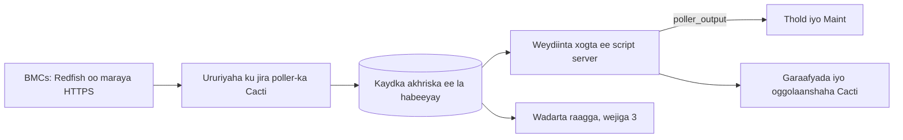

<!-- Source: README.md; SHA256: 7b4e83a58a1adc844cb0615ef30e95476cba2851f96bb454d2a816fb2774724d -->

<!-- translations:start -->
[English](../../../README.md) | [简体中文](../zh-CN/README.md) | [हिन्दी](../hi-IN/README.md) | [Español (España)](../es-ES/README.md) | [Español (Latinoamérica)](../es-419/README.md) | [العربية (السعودية)](../ar-SA/README.md) | [Afrikaans](../af-ZA/README.md) | [አማርኛ](../am-ET/README.md) | [العربية (مصر)](../ar-EG/README.md) | [العربية (المغرب)](../ar-MA/README.md) | [বাংলা](../bn-BD/README.md) | [Bosanski](../bs-BA/README.md) | [Deutsch](../de-DE/README.md) | [فارسی](../fa-IR/README.md) | [Filipino](../fil-PH/README.md) | [Français](../fr-FR/README.md) | [Français (Maroc)](../fr-MA/README.md) | [Français (Sénégal)](../fr-SN/README.md) | [Hausa](../ha-NG/README.md) | [עברית](../he-IL/README.md) | [Hrvatski](../hr-HR/README.md) | [Bahasa Indonesia](../id-ID/README.md) | [Igbo](../ig-NG/README.md) | [Italiano](../it-IT/README.md) | [日本語](../ja-JP/README.md) | [한국어](../ko-KR/README.md) | [Malagasy](../mg-MG/README.md) | [मराठी](../mr-IN/README.md) | [Bahasa Melayu](../ms-MY/README.md) | [Nederlands](../nl-NL/README.md) | [Polski](../pl-PL/README.md) | [Português (Brasil)](../pt-BR/README.md) | [Русский](../ru-RU/README.md) | [Kinyarwanda](../rw-RW/README.md) | [Soomaali](README.md) | [Српски](../sr-RS/README.md) | [Svenska](../sv-SE/README.md) | [Kiswahili](../sw-KE/README.md) | [தமிழ்](../ta-IN/README.md) | [తెలుగు](../te-IN/README.md) | [ไทย](../th-TH/README.md) | [Türkçe](../tr-TR/README.md) | [Українська](../uk-UA/README.md) | [اردو](../ur-PK/README.md) | [Tiếng Việt](../vi-VN/README.md) | [isiXhosa](../xh-ZA/README.md) | [Yorùbá](../yo-NG/README.md) | [繁體中文](../zh-TW/README.md) | [isiZulu](../zu-ZA/README.md)
<!-- translations:end -->

# plugin_redfish

Kordhin Cacti 1.2 ah oo ka keenta isticmaalka korontada serfarka, heerkulka soo-galka, xaaladda marwaxadda, iyo caafimaadka sahayda korontada ee koontaroolayaasha maareynta salka (BMCs) una soo gudbisa Cacti iyagoo ah aalado caadi ah, ilo xogeed, iyo garaafyo, iyadoo la adeegsanayo Redfish oo leh ikhtiyaar dib-u-noqosho ah oo IPMI ah. Thold iyo Maint ayaa markaa ka dib ka diga oo xakameeya iyaga, weji dambe ayaana ku daraya wadarta korontada ee heerka raagga (rack-level).

> **Xaaladda: waa la horumarinayaa, weli lama sii deyn (0.1.0-dev).** Wejiyada 2 (aasaaska) iyo 3 (walxaha Cacti iyo digniinta) waxaa lagu biiriyay `main`. Kordhintani kuma xirna mashruuca Cacti. Waxay ku rakibantaa Cacti 1.2.31 iyadoo la adeegsanayo PHP 8.2 ama ka dambeeya, waxay diiwaangelisaa BMCs iyo aqoonsiyada gelitaanka, waxay ka akhrisaa korontada, heerkullada, marwaxadaha, iyo caafimaadka sahayda korontada BMC kasta iyadoo maraysa Redfish kuna kaydisaa kaydkeeda ku-meel-gaarka ah, waxayna muujisaa caafimaadka ururinta. Waxay ku dartaa aaladaha Cacti, garaafyada xubin-kasta iyo kuwa kooban, iyo taageerada Thold iyo Maint iyadoo loo marayo ilaha xogta caadiga ah. CI waxay tijaabisay BMC been-abuur ah oo laga dhisay qalabyo gacan-ku-qoran iyo server-ka jilitaanka ee DMTF Redfish; wax BMC dhab ah ama raxan tijaabo ah weli lama aqoonsan. Naqshadaynta iyo cilmi-baarista waxay ku jiraan [docs/PLAN.md](../../PLAN.md), [docs/research/](../../research), iyo [docs/decisions/](../../decisions).

### Waxa wejiga 2 soo saarayo

- Ku rakib, cusboonaysii, dami, oo ka saar iyadoo loo marayo API-ga kordhinta ee Cacti, iyadoo miisaska la hayo marka la saaro haddii aan goobta laga tirtirin. PHP ka duugowday 8.2 kordhintu way diiddaa inay rakibto ama shiddo waxayna sheegtaa sababta.
- Aagagga rukhsadda "Redfish View" (bogga caafimaadka), "Redfish Operator" (bogga hawlgallada), iyo "Redfish Admin" (boggaga BMCs iyo aqoonsiyada gelitaanka), iyo dejinta hoos timaadda Configuration > Settings > Redfish.
- Diiwaanka BMC oo leh soo-dejinta CSV iyo dhoofinta JSON. Faylasha soo-dejinta waa inaysan ku jirin ereyo sir ah; aqoonsiyada gelitaanka waxaa lagu tixraacaa magac.
- Aqoonsiyada gelitaanka waxaa lagu kaydiyaa iyadoo la qariyay iyadoo la adeegsanayo AES-256-GCM. Furehu waa fayl ka baxsan xogta kaydka, `/etc/cacti/redfish-vault.key` si caadi ah, oo haya 64 xaraf oo hexadecimal ah (`openssl rand -hex 32`) ama si sax ah 32 byte oo aan kala sooc lahayn, oo uu leeyahay isticmaalaha poller-ka, aanay akhrin karin isticmaalayaasha kale, kuna jira gal ay qori karaan oo keliya isticmaalaha poller-ka ama root. Furaha ka kooban 32 xaraf oo la daabici karo waa la diidaa sidii weedh-sir. **Ka samee nuqul kayd ah faylka furaha iyadoo lala kaydinayo xogta kaydka**; la'aantiis erey kasta oo sir ah oo la kaydiyay waa in mar kale la geliyaa.
- Xaqiijinta TLS way shidan tahay si caadi ah, iyadoo leh xirmo CA ah ama biin SPKI SHA-256 ah oo u gaar ah BMC kasta. Ka-baxidda aan la xaqiijin ee BMC kasta oo la diiwaangeliyay waxay ku sii jirtaa bogga caafimaadka iyadoo digniin ah.
- Macmiil Redfish ah oo akhris-keliya: `GET` iyo oo keliya gelitaanka iyo ka-bixidda fadhiga, oo laga hubiyay liiska oggolaanshaha ka hor inta aan codsi kasta la dirin.
- Ururiye ka bilaabma `poller_bottom` oo loogu talagalay BMCs ku jira poller-ka weyn, oo leh waqti-xaddidan iyo waqtiyada kama dambaysta ah ee BMC kasta, dib-u-dhigis sii kordheysa, iyo nadiifin ka dib burburka hal fadhi oo kordhintu diiwaangelisay. Ururiyayaasha fogfog weli lama taageero; waxay u baahan yihiin doorasho cad oo ku saabsan sida ururiyuhu u gaaro xogta kaydka iyo furaha (wejiga 4).
- Diiwaanada BMC iyo aqoonsiyada gelitaanka waxay raacaan oggolaanshaha aaladda Cacti: Maamulaha Redfish wuxuu arkaa, beddelaa, oo ku xiraa oo keliya BMCs ku jira aaladaha loo oggol yahay inuu arko, iyo oo keliya aqoonsiyada gelitaanka aanay isticmaalin BMC ku jirta aalad qarsoon.

### Waxa wejiga 3 ku darayo

- Qaababka waxaa loo soo diraa iyagoo ah XML qaab Cacti ah gudaha `templates/` waxaana lagu soo dejiyaa soo-dejiyaha Cacti laftiisa marka la rakibo iyo marka la cusboonaysiiyo, iyadoo lagu jaangooyo hash, si soo-dejintu u cusboonaysiiso walxaha kordhinta oo aan waxba laba jeer loogu darin. Saddexda fayl ee weydiinta xogta waxaa loo koobiyeeyaa `<cacti>/resource/script_server/` iyadoo leh hash la diiwaangeliyay; kordhintu weligeed ma beddesho fayl halkaas yaalla oo aysan iyadu qorin, bogga caafimaadkuna wuxuu u digaa maamulayaasha marka qaababka ama faylka weydiintu aysan meeshooda oollin. **Reinstall the Redfish Templates** ee bogga BMCs ayaa mar kale soo dejisa; waxay u baahan tahay oggolaanshaha Import Templates ee Cacti.
- **Create Device** ama **Add Graphs** ee BMC kasta ([ADR 0015](../../decisions/0015-attach-to-the-server-device-or-create-one-per-bmc.md)). BMC ku xiran aaladda jirta ee serfarku waxay heshaa weydiimaheeda xogta iyo garaafyadeeda aaladdaas. BMC aan ku xirnayn waxay ka heshaa aalad cusub qaabka aaladda "Redfish BMC", iyadoo hubinta helitaanku dansan tahay oo magaca martigeliyuhu ka hooseeyo `.invalid`, si Cacti uusan weligiis ula xiriirin BMC-ga una muujin cinwaankiisa. Si kastaba ha ahaatee, maamuluhu wuxuu marka hore xaqiijiyaa qorshe taxaya waxa lagu dari doono. Labaduba waxay u baahan yihiin oggolaanshaha maaraynta aaladda ee Cacti iyo sidoo kale Redfish Admin; aalad cusub oo qofkii abuuray uusan arki karin mar kale waa la saaraa.
- Saddex weydiin oo xogeed oo script server ah, "Redfish Fans", "Redfish Temperatures", iyo "Redfish Power Supplies", oo lagu tusmeeyay furaha xubinta ee BMC-ga, iyadoo leh garaaf xubin kasta: xawaaraha marwaxadda oo boqolkiiba ah ama RPM (halbeegga kasta oo BMC-gu soo sheego), heerkulka, iyo wax-soo-saarka iyo wax-gelinta watts ee sahayda korontada, mid kastaana uu leeyahay koodhka caafimaadkiisa.
- Gelinta "Redfish Node Summary" oo leh korontada, heerkulka soo-galka, heerkulka ugu sarreeya, marwaxadaha iyo sahayda aan OK ahayn, caafimaadka node-ka, iyo da'da akhriskii ugu dambeeyay ee wanaagsanaa, oo lagu sawiray afar garaaf: korontada, heerkullada, caafimaadka qaybaha, iyo da'da xogta. Xadadka digniinta ee Thold ee ilahan xogta way digaan, Maint-na wuu xakameeyaa, iyadoo aan wax isbeddel ah lagu samayn labada kordhinba.
- Script server-ku wuxuu ka jawaabaa oo keliya kaydka ku-meel-gaarka ah ee kordhinta weligiisna lama xiriiro BMC. Qiimo maqan, duugowday, halbeeg kale leh, ama ka yimid xubin tagtay waa `U`, si garaafyadu u muujiyaan farqi, oo aysan weligood eber noqon; `age` mar walba wuxuu leeyahay qiimo, si xadka digniinta ee saaran uu u qabto BMC joojiyay jawaabista.
- Xiriir garaaf oo ka yimaada garaaf kasta oo Redfish ah kuna socda garaafyada Redfish ee aaladda, oo loo muujiyo oo keliya isticmaalayaasha Cacti u oggolaado inay arkaan aaladda.

**Marka xubnaha BMC ay isbeddelaan** (marwaxad la beddelay, cusboonaysiin firmware ah oo magacyo cusub siinaysa dareemayaasha), dooro **Add Graphs** mar kale. Marwaxad ama sahay koronto oo jirtay oo hadda maqan ama tagtay waxaa lagu tiriyaa `fans_bad` ama `psus_bad` ilaa aad sidaas samayso, si marwaxad la soo saaray ay u digto; boos aan weligiis la buuxin ma digo. Add Graphs waxay aqbashaa xubnaha uu BMC-gu hadda soo sheego, Cacti-na wuxuu mar kale tusmeeyaa weydiimaha; xubin tagtay waxay haysataa isha xogteeda iyo garaafkeeda, kuwaas oo akhriya `U` laga bilaabo markaas, xubin cusubina waxay heshaa garaaf. Ku tirtir gacanta garaafyada xubnaha tagay marka taariikhdooda aan loo baahnayn mar dambe.

Tirtiridda aalad waxay ka saartaa xiriirka BMC-geeda waxayna haysaa BMC-ga iyo kaydkiisa ku-meel-gaarka ah. Tirtiridda BMC, ama ka-saaridda kordhinta, waxay haysaa aaladdeeda iyo garaafyadeeda.

## Doorka gelitaanka

| Aagga rukhsadda | Gelitaanka |
| --- | --- |
| Redfish View | Boggaga kormeerka ee jira. |
| Redfish Operator | Kormeerka oo lagu daray bogga Hawlgallada iyo qirashada kala-soocidda shakhsi ahaaneed. |
| Redfish Admin | Gelitaanka Operator oo lagu daray qaabeynta jirta iyo tallaabooyinka maamulka. |

Ka dib marka la koobiyeeyo faylasha cusboonaysiinta, fur bogga Plugins adigoo ah maamule si aad u diiwaangeliso
aagga rukhsadda cusub. Si cad ugu meel-mari aagga rukhsadda Operator hoos timaadda **Configuration > Users** ama kooxaha isticmaalayaasha.
Cusboonaysiintu waxay haystaan aqoonsiyada iyo deeqaha aagagga rukhsadda View iyo Admin ee jira. Gelitaanka Admin wuxuu
dhaxlaa gelitaanka Operator, gelitaanka Operator-na wuxuu dhaxlaa gelitaanka View codsi kasta;
tani kuma darto deeqo la kaydiyay isticmaalayaasha ama kooxaha. Dejinta kordhintu waxay sidoo kale u baahan tahay
gelitaanka Redfish Admin iyadoo lagu daray oggolaanshaha Settings ee Cacti.

Oggolaanshaha aaladda Cacti weli waxay xaddidaan safafka iyo tallaabooyinka u furan isticmaale kasta; walxaha aan ku xirnayn waxay u baahan yihiin maamule. Hawlwadeennadu waxay sii dayn karaan hakinta ururinta ee BMC la oggol yahay si loogu daro orodka xiga ee qorshaysan.
Aqoonsiyada gelitaanka, qaabeynta, ku-xiridda, tirtiridda iyo isbeddellada kale ee maamulka
waxay ku sii jiraan boggaga maamulka. Qirashooyinku waxay shaqeeyaan oo keliya fadhiga
isticmaalaha hadda jira, ugu badnaan hal saac oo keliya inta isla indho-indheyntaasi ay sii
cusub tahay. Indho-indheyn cusub ama isbeddeshay ayaa burisa iyaga. Weligood cabbir fashilmay
uma calaamadeeyaan mid caafimaad qaba mana xakameeyaan digniinaha.

## Sababta

Serfar kasta wuxuu leeyahay BMC ka warbixisa xaaladda korontada iyo kulaylka si ka madax-bannaan nidaamka hawlgalka, sidaas darteed way sii waddaa jawaabista marka OS-gu dansan yahay. Xogtu waxay u adeegtaa dabagalka awoodda iyo kharashka, digniinta hore ee marwaxad ama sahay koronto oo fashilantay, iyo, xisaabinta waxqabadka sare, go'aannada xaddidaadda korontada. Kordhintu gaar uma aha HPC.

Cacti waxay maanta dabooshaa qayb ka mid ah tan:

- **Xirmooyinka SNMP ee iibiyaha.** Laanta 1.2.x waxay soo dirtaa qaababka Dell iDRAC iyo HPE iLO kuwaas oo u baahan wakiil SNMP ah oo u gaar ah iibiyaha; cilmi-baarista wejiga 1 waxay ogaatay in midkoodna uusan soo sheegin isticmaalka korontada ee watts ([docs/research/overlap.md](../../research/overlap.md)).
- **Nooc aqoonsi gelitaan ah oo aan ururiye lahayn.** plugin_credentials wuxuu qeexaa aqoonsi gelitaan oo ah "IPMI / Redfish (BMC)" laakiin ma akhriyo wax BMC ah.
- **Ma jiro muuqaal heerka raagga ah.** Xudunta Cacti ma laha shay raag ah; aaladdu waxay leedahay meel qoraal xor ah oo `location` ah.

Kordhintu waxay ka soo ururisaa BMCs meel ka baxsan wareegga ururinta ee Cacti, waxay kaydisaa akhrisyada la habeeyay, waxayna ku soo bandhigtaa iyadoo loo marayo weydiin xogeed oo script server ah iyo ilo xogeed oo kooban. Waxay dib u adeegsataa garaaf-samaynta Cacti, oggolaanshaha, Thold, iyo Maint, mana beddesho xaaladda BMC. Taageerada ururiyaha xogta ee fogfog waxaa loo qorsheeyay wejiga 4; ururinta hadda waxay ku socotaa poller-ka weyn oo keliya.

## Baaxadda la qorsheeyay

| Weji | Baaxad | Horumarin |
|---|---|---|
| 0, cilmi-baaris | Shaxda iibiyeyaasha, xaqiijinta hab-dhaqanka sare ee BMCs nool, kharashka ururinta, tijaabada weydiinta xogta | [M1](https://github.com/somethingwithproof/plugin_redfish/milestone/1) |
| 1, indho-indheyn | Diiwaanka BMC, aqoonsiyada gelitaanka, TLS, ururiyaha Redfish, akhrisyada la habeeyay, aaladaha, garaafyada tusmo-kasta, digniinta Thold, xakamaynta Maint, bogga caafimaadka | [M2](https://github.com/somethingwithproof/plugin_redfish/milestone/2), [M3](https://github.com/somethingwithproof/plugin_redfish/milestone/3), [M4](https://github.com/somethingwithproof/plugin_redfish/milestone/4) |
| 2, ipmi | Dib-u-noqoshada IPMI ee BMCs aan lahayn Redfish la isticmaali karo, si caadi ah u dansan | [M5](https://github.com/somethingwithproof/plugin_redfish/milestone/5) |
| 3, raagagga | Diiwaanka raagga, wadarta korontada raagga oo leh daboolis, bannaan-u-helidda miisaaniyadda | [M6](https://github.com/somethingwithproof/plugin_redfish/milestone/6) |
| 4, fog | Ururiyayaasha xogta fogfog ee Cacti ee shabakadaha BMC ee go'doonsan | [M7](https://github.com/somethingwithproof/plugin_redfish/milestone/7) |

Waxyaabaha ka baxsan baaxadda: dejinta xadka korontada ama qaabeyn kasta oo kale oo BMC ah, xakamaynta korontada, cusboonaysiinta firmware-ka, gelitaanka console-ka, matoor digniin ah oo kordhintu leedahay, iyo is-dhexgalka jadwalka.

## Bartilmaameedyada iswaafajinta

| Qayb | Bartilmaameed |
|---|---|
| Cacti | 1.2.31 ama ka dambeeya, iyadoo aan wax balastaro xudunta ah lahayn |
| Xogta kaydka | MariaDB 10.2 ama MySQL 5.7 ama ka dambeeya: hal BMC aalad kasta waxaa lagu hayaa fure gaar ah oo ku jira tiir la soo saaray |
| PHP | 8.2 ama ka dambeeya; `setup.php` wuxuu sii ahaadaa mid lagu falanqayn karo 8.0 si deegaan aan la taageerin uu u helo diidmo halkii uu ka heli lahaa UI Cacti ah oo jabay |
| BMCs | Dell iDRAC, HPE iLO, Lenovo XCC, iyo OpenBMC, iyadoo loo eegayo kala-duwanaanshaha firmware-ka; eeg [shaxda iibiyeyaasha](../../research/vendor-matrix.md) |
| Redfish | Nidaam-hoosaad cusub iyo ilaha dareemayaasha marka hore, `Power` iyo `Thermal` ee duugowday sidii dib-u-noqosho |
| Thold, Maint | Looma baahna wax isbeddel ah |

## Naqshadaynta

- [docs/PLAN.md](../../PLAN.md) waa qorshaha oo dhammaystiran: qaab-dhismeedka, xaqiiqooyinka sare ee uu ku tiirsan yahay (oo wata ilo iyo malo-awaal weli la xaqiijinayo), qaabka cabbirka, xuduudaha amniga, xisaabta waxqabadka, tijaabinta, iyo khataraha.
- [docs/decisions/](../../decisions) waxay haysaa diiwaanada go'aannada qaab-dhismeedka ee doorashooyinka horay loo sameeyay.
- [docs/REQUIREMENTS.md](../../REQUIREMENTS.md) waxay ku jaangoysaa aqoonsi shuruud kasta arrinteeda.

## Amniga

Aqoonsiyada gelitaanka BMC waxay xakameeyaan maareynta ka baxsan xirmada ee serfarrada. Naqshadayntu waxay ka fogeysaa khadadka taliska, diiwaanada, iyo boggaga, waxay xaqiijisaa TLS si caadi ah, waxay ku socodsiisaa amar kasta oo dibadda ah taxane dood ah oo leh amar-hoosaadyo ku jira liiska oggolaanshaha, waxayna adeegsataa koontooyin BMC ah oo akhris-keliya. Eeg [docs/PLAN.md](../../PLAN.md#security) iyo [SECURITY.md](../../../SECURITY.md).

## Hagaha hawlwadeenka

Eeg [docs/operator-guide.md](../../operator-guide.md) shuruudaha rakibidda, dejinta kaydka iyo TLS, diiwaangelinta BMC, abuurista garaafka, xilliyada digniinta, nuqulka kaydka, iyo maaraynta fashilka. Haguhu kuma dhawaaqo in khad firmware iibiye dhab ah la taageeray ilaa qabasho xogteeda gaarka ah laga saaray oo ka timid firmware-kaas ay ka gudubto taxanaha tijaabada.

## Sida shaqada loola socdo

- **Horumarinta** waxay raacaan horumarinta qorshaha. Mid kasta wuxuu leeyahay arrin weyn oo taxaysa arrimaha hoose iyo caddaynta ka-bixidda.
- **Arrimaha** waxaa lagu kala saaraa sumadda: `type: requirement`, `type: research`, `type: decision`, `type: epic`. Arrimaha shuruudaha waxay sheegaan shuruudo tiro leh oo la tijaabin karo (`REQ-AREA-NNN`) iyo shuruudaha aqbalidda.
- **Sumadaha** sidoo kale waxay xambaarsan yihiin `area:`, `phase:`, `priority:`, iyo `status:`. Eeg [CONTRIBUTING.md](../../../CONTRIBUTING.md#labels).
- [Guddiga mashruuca](https://github.com/users/somethingwithproof/projects/12) wuxuu muujinayaa dhammaan arrimaha ee horumarinta oo dhan.

## Ka qaybqaadashada

Akhri [CONTRIBUTING.md](../../../CONTRIBUTING.md). Ballanqaadyada waxay u baahan yihiin saxiixa DCO. Doodda naqshadaynta waxay ka dhacdaa arrimaha; go'aannada furan waxay wataan sumadda `type: decision`. Caddaynta ka timaadda BMCs dhabta ah waa wax ku biirinta ugu waxtarka badan hadda; ka saar cinwaanada, lambarada taxanaha ah, iyo aqoonsiyada gelitaanka ka hor intaadan soo dhejin wax qabasho ah.

## Shatiga

GNU General Public License v2.0, waa isla shatiga ay leeyihiin Cacti iyo kordhinteedu. Eeg [LICENSE](../../../LICENSE).
