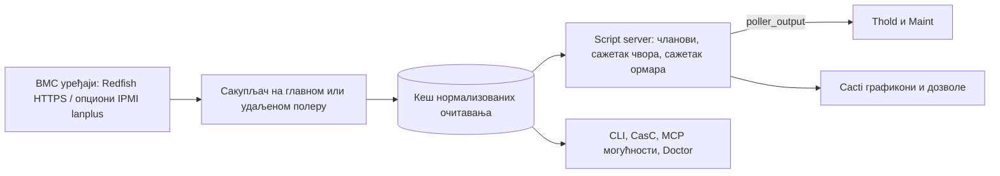

<!-- Source: README.md; SHA256: 6972a6c9ac754cd60e63c5caf971451ea8fe6e279eef757d886e1a168d3eef01 -->

<!-- translations:start -->
[English](../../../README.md) | [简体中文](../zh-CN/README.md) | [हिन्दी](../hi-IN/README.md) | [Español (España)](../es-ES/README.md) | [Español (Latinoamérica)](../es-419/README.md) | [العربية (السعودية)](../ar-SA/README.md) | [Afrikaans](../af-ZA/README.md) | [አማርኛ](../am-ET/README.md) | [العربية (مصر)](../ar-EG/README.md) | [العربية (المغرب)](../ar-MA/README.md) | [বাংলা](../bn-BD/README.md) | [Bosanski](../bs-BA/README.md) | [Deutsch](../de-DE/README.md) | [فارسی](../fa-IR/README.md) | [Filipino](../fil-PH/README.md) | [Français](../fr-FR/README.md) | [Français (Maroc)](../fr-MA/README.md) | [Français (Sénégal)](../fr-SN/README.md) | [Hausa](../ha-NG/README.md) | [עברית](../he-IL/README.md) | [Hrvatski](../hr-HR/README.md) | [Bahasa Indonesia](../id-ID/README.md) | [Igbo](../ig-NG/README.md) | [Italiano](../it-IT/README.md) | [日本語](../ja-JP/README.md) | [한국어](../ko-KR/README.md) | [Malagasy](../mg-MG/README.md) | [मराठी](../mr-IN/README.md) | [Bahasa Melayu](../ms-MY/README.md) | [Nederlands](../nl-NL/README.md) | [Polski](../pl-PL/README.md) | [Português (Brasil)](../pt-BR/README.md) | [Русский](../ru-RU/README.md) | [Kinyarwanda](../rw-RW/README.md) | [Soomaali](../so-SO/README.md) | [Српски](README.md) | [Svenska](../sv-SE/README.md) | [Kiswahili](../sw-KE/README.md) | [தமிழ்](../ta-IN/README.md) | [తెలుగు](../te-IN/README.md) | [ไทย](../th-TH/README.md) | [Türkçe](../tr-TR/README.md) | [Українська](../uk-UA/README.md) | [اردو](../ur-PK/README.md) | [Tiếng Việt](../vi-VN/README.md) | [isiXhosa](../xh-ZA/README.md) | [Yorùbá](../yo-NG/README.md) | [繁體中文](../zh-TW/README.md) | [isiZulu](../zu-ZA/README.md)
<!-- translations:end -->

# plugin_redfish

Cacti 1.2 додатак који доноси потрошњу електричне енергије сервера, улазну температуру, стање вентилатора и исправност напајања са контролера за управљање матичном плочом (BMC) у Cacti као обичне уређаје, изворе података и графиконе, користећи Redfish са опционом IPMI резервом само за читање и збирним прорачунима снаге на нивоу ормара (rack). Thold и Maint шаљу упозорења и потискују их преко стандардних Cacti извора података.

> **Статус: у развоју, још без објављеног издања (`0.1.0-dev`).** Овај додатак није повезан са пројектом Cacti. Инсталира се на Cacti 1.2.31 или новији под PHP-ом 8.2 или новијим и имплементира Redfish сакупљач, шифровани трезор акредитива, обезбеђивање Cacti уређаја и графикона, опциону IPMI резерву само за читање, збирни прорачун снаге ормара, приказ прозора одржавања Cacti Maint, репликацију и агентске крајње тачке за удаљене сакупљаче података, CasC провајдера и оператерски CLI, MCP могућности (abilities) и Doctor дијагностичке провере. CI тестира фикстуре, DMTF Redfish Mockup Server (моделе subsystem, legacy-only и HPE iLO Gen11) и Thold v1.8.2 са Maint v1.3; ниједан физички BMC нити пилот-флота још нису квалификовани. Дизајн и истраживање налазе се у [docs/PLAN.md](../../PLAN.md), [docs/research/](../../research/) и [docs/decisions/](../../decisions/).

## Имплементиране могућности

### Основни сакупљач, трезор и Cacti објекти

- **Животни циклус и шема.** Инсталира се, надограђује, онемогућава и деинсталира преко Cacti API-ја за додатке (`Schema::VERSION = 3`, 12 табела). Табеле се чувају при деинсталацији осим ако се не опозове избор *Keep Plugin Tables on Uninstall*. Улазне тачке се парсирају на PHP 8.0 и одбијају PHP испод 8.2 или недостатак `ext-openssl` уз изричиту поруку о грешци.
- **Регистар и дозволе.** Подручја овлашћења *Redfish View* (`redfish_health.php`), *Redfish Operator* (`redfish_operator.php`) и *Redfish Admin* (`redfish_bmcs.php`, `redfish_credentials.php`), као и подешавања под **Configuration > Settings > Redfish**. Регистар BMC уређаја подржава CSV увоз (акредитиви се наводе по називу; лозинке у датотекама за увоз се одбијају) и JSON извоз. Записи BMC уређаја и акредитиви прате Cacti дозволе за уређаје.
- **Шифровани трезор акредитива.** Лозинке се чувају шифроване помоћу AES-256-GCM у `plugin_redfish_secret`. Кључ се налази изван базе података (подразумевано `/etc/cacti/redfish-vault.key`) као 64 хексадецимална знака (`openssl rand -hex 32`) или 32 сирова бајта, у власништву полер корисника, нечитљив другим корисницима, у директоријуму у који могу да пишу само root или тај корисник. Приступна фраза од 32 штампана знака се одбија. **Направите резервну копију датотеке кључа заједно са базом података**; без ње сачуване лозинке морају поново да се унесу.
- **TLS и Redfish клијент само за читање.** TLS провера је подразумевано укључена помоћу системског CA складишта, CA пакета по BMC-у или SPKI SHA-256 качења; искључење провере по поједином BMC-у остаје видљиво као упозорење о стању и упозорење Doctor провере. Клијент дозвољава само `GET` уз пријаву (`POST`) и одјаву (`DELETE`) Redfish сесије, са опционом Basic резервом по BMC-у када сесије нису доступне. Откривање даје предност новим Redfish ресурсима подсистема и сензора и прелази на застареле ресурсе `Power` и `Thermal` као резерву.
- **Извршавање сакупљача.** `poller_redfish.php` се покреће из `poller_bottom`, покреће један главни процес по полеру преко Cacti регистра процеса са подесивим радним процесима (`redfish_workers`), преузима закупе по BMC-у, примењује временски буџет (`redfish_collector_budget`), примењује експоненцијално одлагање и чисти претходну сесију самог додатка након пада.
- **Шаблони, уређаји и графикони.** Увози `templates/redfish-templates.xml` по хешу и копира три XML датотеке упита података серверског скрипта (`redfish_fans.xml`, `redfish_temperatures.xml`, `redfish_psus.xml`) у `<cacti>/resource/script_server/` без преписивања датотека које је изменио корисник. **Create Device** и **Add Graphs** захтевају потврду плана обезбеђивања, придружују упите мапираном уређају сервера или креирају уређај "Redfish BMC" под `.invalid` са искљученим проверама доступности и повезују сваки Redfish графикон назад са Redfish графиконима тог уређаја преко `graph_buttons`.
- **Улази серверског скрипта само из кеша.** `scripts/ss_redfish_members.php` испоручује очитавања вентилатора, температура и напајања по члану, а `scripts/ss_redfish_summary.php` испоручује метрике "Redfish Node Summary" (снага, улазна и максимална температура, број неисправних вентилатора и напајања, здравље чвора и старост последњег доброг очитавања). Позиви серверског скрипта читају искључиво локални кеш и никада не контактирају BMC. Недостајућа, застарела или очитавања уклоњених чланова враћају `U` (никада `0`), док `age` увек пријављује вредност како би прагови открили BMC уређаје који не одговарају.

**Када се чланови BMC-а промене** (као што је замењен вентилатор или ажурирање фирмвера које преименује сензоре), поново покрените **Add Graphs**. Вентилатор или напајање које је раније било присутно и постане одсутно рачуна се у `fans_bad` или `psus_bad` док се промена не прихвати; лежиште које никада није било попуњено не рачуна се. Уклоњени чланови задржавају своје постојеће изворе података и графиконе, који отада очитавају `U` док се ручно не обришу. Брисање Cacti уређаја уклања мапирање његовог BMC-а и уклања његову доделу ормару, чувајући BMC и кеш; брисање BMC-а или деинсталација додатка чува Cacti уређаје и графиконе.

### Опциона IPMI резерва

- **Опционо по BMC-у.** Подразумевано искључена (`protocols` подразумевано има вредност `redfish`; укључивање IPMI резерве поставља `redfish,ipmi`).
- **Ограничени окидач резерве.** Покреће се само када Redfish прикупљање не успе са квалификованом класом грешке; никада се не активира за `AuthRejected`, `CredentialUnavailable`, `AddressRefused`, `OperationRefused` или `Deadline`.
- **Безбедно извршавање.** Позива `ipmitool` преко `-I lanplus` помоћу `proc_open()` у облику низа без љуске, са ограниченим временским роком стварног времена и ограничењем излаза од 256 KiB. Лозинке се достављају путем `IPMITOOL_PASSWORD` (`-E`) или привремене датотеке са режимом 0600 (`-f`) која се брише у `finally`, никада на CLI argv.
- **Дозвољена листа команди само за читање.** Дозвољено је само пет подкоманди само за читање: `dcmi power reading`, `sdr type Temperature`, `sdr type Fan`, `sdr type Power Supply` и `chassis status`. Команде које мењају стање се одбијају.
- **Нормализовани излаз и упозорење о безбедносном ставу.** `IpmiNormalizer` мапира очитавања у исти модел `Observation`/`Member`/`Reading`, емитујући `U` за недостајуће или нечитљиве сензоре. Укључивање IPMI резерве подиже упозорење на страници стања и у Doctor провери `redfish.bmc_security`, подсећајући оператере да ограниче UDP 623 на управљачки VLAN.

### Збирни прорачун снаге ормара

- **Регистар ормара.** Верзија 3 шеме додаје `plugin_redfish_rack` (јединствени `(site_id, name)`, опциони `power_budget_watts`, `min_coverage_pct` са подразумеваном вредношћу `80` и белешке) и `plugin_redfish_rack_member` (највише једна додела ормару по `host_id`, опциони `bmc_id` и `unit_position`, аутоматски се уклања када се Cacti уређај обрише).
- **Збирови заштићени покривеношћу.** `RackPowerSummary` сабира свежа очитавања `power_watts` чланова из локалног кеша и израчунава искоришћеност буџета и расположиву резерву. Када покривеност чланова који извештавају падне испод `min_coverage_pct`, `power_watts`, `utilization_pct` и `headroom_watts` враћају `U` тако да кварови сакупљача никада не изгледају као пад снаге ормара.
- **Улаз серверског скрипта спреман за Thold.** `scripts/ss_redfish_rack.php` (`ss_redfish_rack(<rack_id>)`) враћа `power_watts`, `power_budget_watts`, `utilization_pct`, `headroom_watts`, `members_total`, `members_reporting` и `coverage_pct` искључиво из локалног кеша.

### Интеграција са Cacti Maint

- Thold прагови на Redfish изворима података шаљу упозорења, а Cacti Maint их потискује без икаквих измена у било ком од та два додатка.
- `MaintWindow` проверава активне Maint распореде за сваки мапирани Cacti хост (једнократне `mtype=1` и понављајуће `mtype=2` распореде, као и `plugin_maint_check_cacti_host()` када је учитан) и означава активно одржавање на страници Redfish Health (`[MAINT]`), у излазу `cli/redfish.php health` и у могућности `redfish-get-health`.

### Удаљени сакупљачи података

- `INFO` декларише `remote_collect:1`. BMC уређаји прихватају било који `poller_id >= 1`, а `poller_redfish.php --poller=N` прикупља само укључене BMC уређаје додељене том полеру.
- **Закачка `replicate_out`.** Преко `replicate_out_table()` реплицира само нетајне конфигурационе табеле у оквиру циљног удаљеног полера: `plugin_redfish_bmc`, метаподатке `plugin_redfish_credential` (без шифрата), `plugin_redfish_rack` и `plugin_redfish_rack_member`. `plugin_redfish_secret` се не реплицира, а датотеке кључева трезора остају строго локалне на сваком полеру.
- **Закачка `remote_agent`.** Излаже радње само за читање `redfish_health` и `redfish_discovery` које прихватају само нумеричке параметре `poller_id` и `bmc_id`. Неочекивани параметри се одбијају и враћа се нула акредитива или тајни.

### Закачке екосистема (CasC, MCP могућности и Doctor)

- **CasC провајдер (`casc_register_providers`).** Региструје `redfish` провајдера (верзија шеме `1`) са YAML и XML извозом у чистом PHP-у, парсирањем (уз одбијање XXE), валидацијом, планирањем разлика и применом. Акредитиви се појављују само као референце трезора (`vault:redfish:<name>`); сирови тајни кључеви (`pass`, `secret`, `token`, `private_key`, `vault_key`, `auth_token`) се одбијају. За примену је потребан тачан SHA-256 `PLAN_HASH`.
- **MCP / Abilities API (`abilities_register`).** Региструје три могућности само за читање ограничене подручјем Redfish View (`redfish_health.php`) и Cacti дозволама за уређаје, не враћајући ниједан акредитив:
  - `redfish-list-bmcs` (опциони `poller_id`)
  - `redfish-get-rack-power` (опциони `rack_id`)
  - `redfish-get-health` (опциони `bmc_id`)
- **Doctor провере (`doctor_register_checks`).** Региструје пет локалних дијагностичких провера само за читање које никада не контактирају BMC нити враћају материјал кључа:
  - `redfish.schema`: ажурност верзије шеме
  - `redfish.vault_key`: читљивост и дозволе кључа трезора
  - `redfish.collector_runs`: буџет и свежина сакупљача полера
  - `redfish.bmc_security`: укључени BMC уређаји са непровереним TLS-ом или IPMI резервом
  - `redfish.rack_power`: усклађеност са буџетом снаге ормара и минимални праг покривености

## CLI

Покрените из основног директоријума Cacti-ја са PHP-ом 8.2 или новијим:

```sh
# Operator and CasC CLI (reads --file=PATH or stdin for validate, plan, and apply)
php plugins/redfish/cli/redfish.php export --format=yaml|xml
php plugins/redfish/cli/redfish.php validate [--file=PATH] [--format=yaml|xml]
php plugins/redfish/cli/redfish.php plan [--file=PATH] [--format=yaml|xml]
php plugins/redfish/cli/redfish.php apply [--file=PATH] [--format=yaml|xml] --confirm=<PLAN_HASH>
php plugins/redfish/cli/redfish.php health --format=text|json

# Collector entry point (normally started by poller_bottom)
php plugins/redfish/poller_redfish.php [--poller=N] [--force] [--debug]

# Rack power summary script server entry point
php plugins/redfish/scripts/ss_redfish_rack.php <rack_id>
```

## Улоге приступа

| Подручје (Realm) | Приступ |
| --- | --- |
| Redfish View | Постојеће странице за надзор. |
| Redfish Operator | Надзор плус страница Operations и личне потврде увида за тријажу. |
| Redfish Admin | Приступ оператера плус постојеће конфигурационе и административне радње. |

Након копирања датотека надоградње отворите страницу Plugins као администратор да региструјете подручја овлашћења. Изричито доделите подручје Operator под **Configuration > Users** или корисничким групама. Надоградње задржавају постојеће ID ознаке подручја View и Admin и њихове доделе. Приступ Admin при сваком захтеву наслеђује приступ Operator, а приступ Operator наслеђује приступ View; тиме се корисницима ни групама не додају сачуване доделе. Подешавања додатка захтевају и Redfish Admin приступ поред Cacti дозволе Settings.

Cacti дозволе за уређаје ограничавају редове и радње доступне сваком кориснику; немапирани објекти захтевају администратора. Оператери могу да уклоне блокаду прикупљања на дозвољеном BMC-у за следеће заказано покретање. Акредитиви, конфигурација, мапирање, брисање и остале административне измене остају на административним страницама. Потврде увида важе само у тренутној корисничкој сесији, највише један сат и само док исто запажање остане свеже. Нова или измењена запажања их поништавају. Никада не означавају неуспело мерење исправним нити потискују аларме.

## Зашто

Сваки сервер има BMC који извештава о енергетском и термалном стању независно од оперативног система, па наставља да одговара и када оперативни систем падне. Подаци служе за праћење капацитета и трошкова, рано упозорење на отказ вентилатора или напајања и, у рачунарству високих перформанси (HPC), за одлуке о ограничавању потрошње енергије. Додатак није ограничен на HPC.

Cacti данас покрива део тога:

- **Произвођачки SNMP пакети.** Грана 1.2.x испоручује шаблоне за Dell iDRAC и HPE iLO који захтевају SNMP агента и специфични су за произвођача; истраживање у прекретници 1 показало је да ниједан не пријављује потрошњу енергије у ватима ([docs/research/overlap.md](../../research/overlap.md)).
- **Тип акредитива без сакупљача.** plugin_credentials дефинише акредитив "IPMI / Redfish (BMC)", али не очитава ниједан BMC.
- **Без приказа на нивоу ормара.** Језгро Cacti-ја нема објекат ормара (rack); уређај има поље слободног текста `location`.

Додатак очитава BMC уређаје изван основног Cacti циклуса испитивања на главном полеру или удаљеним сакупљачима података, кешира нормализована очитавања и излаже их кроз script server упите података, сажетке чвора и сажетке снаге ормара. Поново користи Cacti графиконе, дозволе, Thold и Maint, и не мења стање BMC-а.

## Обим и статус

| Фаза | Обим | Прекретнице | Статус |
|---|---|---|---|
| 0, истраживање | Матрица произвођача, потврда узводног понашања на живим BMC уређајима, цена испитивања, прототип упита података | [M1](https://github.com/somethingwithproof/plugin_redfish/milestone/1) | Завршено, чекају се снимци фирмвера са стварних BMC уређаја |
| 1, посматрање | Регистар BMC уређаја, акредитиви, TLS, Redfish сакупљач, нормализована очитавања, уређаји, графикони по индексу, Thold алармирање, интеграција са Maint, страница стања | [M2](https://github.com/somethingwithproof/plugin_redfish/milestone/2), [M3](https://github.com/somethingwithproof/plugin_redfish/milestone/3), [M4](https://github.com/somethingwithproof/plugin_redfish/milestone/4) | Имплементирано; квалификација M4 пилот-флоте на чекању |
| 2, ipmi | IPMI резерва (`lanplus`) само за читање преко `ipmitool`, подразумевано искључена | [M5](https://github.com/somethingwithproof/plugin_redfish/milestone/5) | Имплементирано |
| 3, ормари | Регистар ормара, укупна потрошња енергије ормара са прагом покривености, расположива резерва буџета, `ss_redfish_rack.php` | [M6](https://github.com/somethingwithproof/plugin_redfish/milestone/6) | Имплементирано |
| 4, удаљени и екосистем | Удаљени сакупљачи података (`replicate_out`, `remote_agent`), CasC провајдер и CLI, MCP могућности, Doctor провере | [M7](https://github.com/somethingwithproof/plugin_redfish/milestone/7) | Имплементирано |

Изван обима: постављање ограничења снаге или било каква друга конфигурација BMC-а, управљање напајањем, ажурирање фирмвера, приступ конзоли, сопствени систем за алармирање у додатку и интеграција са распоређивачем.

## Циљеви компатибилности

| Компонента | Циљ |
|---|---|
| Cacti | 1.2.31 или новији, без измена језгра |
| База података | MariaDB 10.2 или MySQL 5.7 или новији: један BMC по уређају обезбеђен је јединственим кључем на генерисаној колони |
| PHP | 8.2 или новији; улазне тачке остају исправне за парсирање на верзији 8.0 тако да неподржано окружење добије одбијање уместо поквареног Cacti интерфејса |
| PHP екстензије | `ext-openssl` (захтева Cacti 1.2.31); без `ext-curl` и без Composer зависности у времену извршавања |
| Опциони алати | `ipmitool` на полерима који прикупљају BMC уређаје са укљученом IPMI резервом |
| BMC уређаји | Dell iDRAC, HPE iLO, Lenovo XCC и OpenBMC, према опсегу фирмвера; погледајте [матрицу произвођача](../../research/vendor-matrix.md) |
| Redfish | Прво нови подсистемски и сензорски ресурси, застарели `Power` и `Thermal` као резерва |
| Thold, Maint | Нису потребне измене (CI тестира Thold v1.8.2 и Maint v1.3) |

## Дизајн

- [docs/PLAN.md](../../PLAN.md) је потпуни план: архитектура, узводне чињенице на које се ослања, модел мерења, безбедносне границе, прорачун перформанси, тестирање и ризици.
- [docs/decisions/](../../decisions/) садржи записе архитектонских одлука за већ донете изборе.
- [docs/REQUIREMENTS.md](../../REQUIREMENTS.md) повезује сваки ID захтева са његовим задатком.



## Безбедност

BMC акредитиви контролишу изванпојасно управљање серверима. Дизајн држи тајне изван командних линија, дневника, CasC извоза, података удаљеног агента, MCP одговора и веб страница; шифрује сачуване лозинке помоћу AES-256-GCM користећи локалну датотеку кључа трезора по полеру; подразумевано проверава TLS; извршава `ipmitool` из изричитог низа аргумената са дозвољеним подкомандама само за читање; и користи BMC налоге само за читање. Погледајте [docs/PLAN.md](../../PLAN.md#security) и [SECURITY.md](../../../SECURITY.md).

## Водич за оператере

Погледајте [docs/operator-guide.md](../../operator-guide.md) за предуслове инсталације, подешавање трезора и TLS-а, регистрацију BMC уређаја, креирање графикона, интервале упозорења, резервне копије и поступање при грешкама. Водич не проглашава ниједну стварну линију фирмвера произвођача подржаном док редиговани снимак тог фирмвера не прође скуп тестова.

## Развој и тестирање

CI ([.github/workflows/plugin-ci-workflow.yml](../../../.github/workflows/plugin-ci-workflow.yml)) проверава синтаксу улазних тачака на PHP 8.0, покреће Pest јединичне (`phpunit.xml`) и интеграционе тестове животног циклуса (`phpunit-integration.xml`), као и PHPStan ниво 9 на PHP 8.2 до 8.5 против Cacti `release/1.2.31` и `1.2.x`, потврђује одбијање на PHP 8.1, темељно испитује DMTF Redfish Mockup Server (моделе subsystem, legacy-only и HPE iLO Gen11) и Thold v1.8.2 / Maint v1.3, и проверава gettext каталоге, токове рада и REUSE лиценцирање.

Локалне провере пре слања:

```sh
sh tests/lint-workflows.sh
sh locales/build_gettext.sh --check
CACTI_PATH=/path/to/cacti phpstan analyse -c phpstan.neon --no-progress
```

Покрените Pest са `--configuration=phpunit.xml` за јединичне тестове и тестове правила изворног кода, или `--configuration=phpunit-integration.xml` са `CACTI_PATH` и `REDFISH_TEST_DATABASE=disposable` на привременој Cacti бази података за интеграционе тестове животног циклуса.

## Како се прати рад

- **Прекретнице (Milestones)** прате прекретнице плана. Свака има кровни задатак (epic issue) са списком подзадатака и доказа о завршетку.
- **Задачи (Issues)** разврстани су ознакама: `type: requirement`, `type: research`, `type: decision`, `type: epic`. Задаци захтева наводе нумерисане, тестабилне захтеве (`REQ-AREA-NNN`) и критеријуме прихватања.
- **Ознаке (Labels)** такође носе `area:`, `phase:`, `priority:` и `status:`. Погледајте [CONTRIBUTING.md](../../../CONTRIBUTING.md#labels).
- [Табла пројекта](https://github.com/users/somethingwithproof/projects/12) приказује све задатке кроз прекретнице.

## Доприношење

Прочитајте [CONTRIBUTING.md](../../../CONTRIBUTING.md). Комитови захтевају DCO потпис (sign-off). Расправе о дизајну воде се у задацима; отворене одлуке носе ознаку `type: decision`. Докази са стварних BMC уређаја тренутно су најкориснији допринос; уклоните адресе, серијске бројеве и акредитиве пре објаве било каквог снимка.

## Лиценца

GNU General Public License v2.0, иста лиценца као Cacti и његови додаци. Погледајте [LICENSE](../../../LICENSE).
