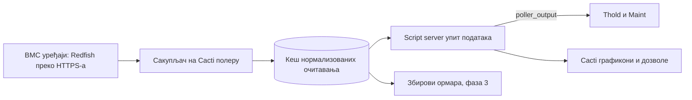

<!-- Source: README.md; SHA256: 7b4e83a58a1adc844cb0615ef30e95476cba2851f96bb454d2a816fb2774724d -->

<!-- translations:start -->
[English](../../../README.md) | [简体中文](../zh-CN/README.md) | [हिन्दी](../hi-IN/README.md) | [Español (España)](../es-ES/README.md) | [Español (Latinoamérica)](../es-419/README.md) | [العربية (السعودية)](../ar-SA/README.md) | [Afrikaans](../af-ZA/README.md) | [አማርኛ](../am-ET/README.md) | [العربية (مصر)](../ar-EG/README.md) | [العربية (المغرب)](../ar-MA/README.md) | [বাংলা](../bn-BD/README.md) | [Bosanski](../bs-BA/README.md) | [Deutsch](../de-DE/README.md) | [فارسی](../fa-IR/README.md) | [Filipino](../fil-PH/README.md) | [Français](../fr-FR/README.md) | [Français (Maroc)](../fr-MA/README.md) | [Français (Sénégal)](../fr-SN/README.md) | [Hausa](../ha-NG/README.md) | [עברית](../he-IL/README.md) | [Hrvatski](../hr-HR/README.md) | [Bahasa Indonesia](../id-ID/README.md) | [Igbo](../ig-NG/README.md) | [Italiano](../it-IT/README.md) | [日本語](../ja-JP/README.md) | [한국어](../ko-KR/README.md) | [Malagasy](../mg-MG/README.md) | [मराठी](../mr-IN/README.md) | [Bahasa Melayu](../ms-MY/README.md) | [Nederlands](../nl-NL/README.md) | [Polski](../pl-PL/README.md) | [Português (Brasil)](../pt-BR/README.md) | [Русский](../ru-RU/README.md) | [Kinyarwanda](../rw-RW/README.md) | [Soomaali](../so-SO/README.md) | [Српски](README.md) | [Svenska](../sv-SE/README.md) | [Kiswahili](../sw-KE/README.md) | [தமிழ்](../ta-IN/README.md) | [తెలుగు](../te-IN/README.md) | [ไทย](../th-TH/README.md) | [Türkçe](../tr-TR/README.md) | [Українська](../uk-UA/README.md) | [اردو](../ur-PK/README.md) | [Tiếng Việt](../vi-VN/README.md) | [isiXhosa](../xh-ZA/README.md) | [Yorùbá](../yo-NG/README.md) | [繁體中文](../zh-TW/README.md) | [isiZulu](../zu-ZA/README.md)
<!-- translations:end -->

# plugin_redfish

Cacti 1.2 додатак који доноси потрошњу електричне енергије сервера, улазну температуру, стање вентилатора и исправност напајања са контролера за управљање матичном плочом (BMC) у Cacti као обичне уређаје, изворе података и графиконе, користећи Redfish уз опциону IPMI резерву. Thold и Maint затим шаљу упозорења и потискују их, а каснија фаза додаје укупну потрошњу електричне енергије на нивоу ормара (rack).

> **Статус: у развоју, још без објављеног издања (0.1.0-dev).** Прекретнице 2 (основа) и 3 (Cacti објекти и алармирање) спојене су на грану `main`. Овај додатак није повезан са пројектом Cacti. Инсталира се на Cacti 1.2.31 под PHP-ом 8.2 или новијим, региструје BMC уређаје и акредитиве, очитава снагу, температуре, вентилаторе и стање напајања са сваког BMC-а путем протокола Redfish у сопствени кеш и приказује стање прикупљања. Додаје Cacti уређаје, графиконе по члановима и збирне графиконе, као и подршку за Thold и Maint преко обичних извора података. CI је испитао лажни BMC направљен од ручно писаних тестних података и DMTF Redfish mockup сервер; ниједан стварни BMC нити пилот-флота још нису квалификовани. Дизајн и истраживање налазе се у [docs/PLAN.md](../../PLAN.md), [docs/research/](../../research) и [docs/decisions/](../../decisions).

### Шта доноси прекретница 2

- Инсталација, надоградња, онемогућавање и деинсталација преко Cacti API-ја за додатке, при чему се табеле чувају при деинсталацији осим ако подешавање није искључено. На PHP-у старијем од 8.2 додатак одбија инсталацију или укључивање и наводи разлог.
- Подручја овлашћења (Realms) "Redfish View" (страница стања), "Redfish Operator" (страница операција) и "Redfish Admin" (странице за BMC уређаје и акредитиве), као и подешавања под Configuration > Settings > Redfish.
- Регистар BMC уређаја са CSV увозом и JSON извозом. Датотеке за увоз не смеју да садрже лозинке; акредитиви се наводе по називу.
- Акредитиви сачувани шифровано помоћу AES-256-GCM. Кључ је датотека изван базе података, подразумевано `/etc/cacti/redfish-vault.key`, која садржи 64 хексадецимална знака (`openssl rand -hex 32`) или тачно 32 насумична бајта, у власништву полер корисника, нечитљива другим корисницима, у директоријуму у који могу да пишу само полер корисник или root. Кључ од 32 штампана знака одбија се као приступна фраза. **Направите резервну копију датотеке кључа заједно са базом података**; без ње свака сачувана лозинка мора поново да се унесе.
- TLS провера је подразумевано укључена, уз CA пакет или SPKI SHA-256 качење по BMC-у. Забележено искључење провере за поједини BMC остаје приказано на страници стања као упозорење.
- Redfish клијент само за читање: искључиво `GET` уз пријаву и одјаву сесије, проверено према списку дозвољених радњи пре слања сваког захтева.
- Сакупљач покренут из `poller_bottom` за BMC уређаје на главном полеру, са закупима и роковима по BMC-у, одлагањем и чишћењем једине сесије коју је додатак забележио након пада. Удаљени сакупљачи још нису подржани; захтевају изричит избор начина на који сакупљач приступа бази података и кључу (фаза 4).
- Записи BMC уређаја и акредитиви прате Cacti дозволе за уређаје: Redfish Admin види, мења и повезује само BMC уређаје на уређајима које сме да види, и само акредитиве које не користи ниједан BMC на скривеном уређају.

### Шта додаје прекретница 3

- Шаблони испоручени као Cacti XML шаблони у `templates/` и увезени сопственим Cacti увозником при инсталацији и надоградњи, усклађени по хешу, тако да увоз ажурира објекте додатка и ништа не додаје двапут. Три датотеке упита података копирају се у `<cacti>/resource/script_server/` са забележеним хешом; додатак тамо никада не замењује датотеку коју сам није записао, а страница стања упозорава администраторе када шаблони или датотека упита недостају. Опција **Reinstall the Redfish Templates** на страници BMC уређаја поново их увози; потребна је Cacti дозвола Import Templates.
- **Create Device** или **Add Graphs** на сваком BMC-у ([ADR 0015](../../decisions/0015-attach-to-the-server-device-or-create-one-per-bmc.md)). BMC мапиран на постојећи уређај сервера добија своје упите података и графиконе на том уређају. Немапирани BMC добија нови уређај из шаблона уређаја "Redfish BMC", са искљученим проверама доступности и именом хоста под `.invalid`, тако да Cacti никада не контактира BMC и никада не приказује његову адресу. У оба случаја администратор најпре потврђује план који наводи шта ће бити додато. Обе радње захтевају Cacti дозволу за управљање уређајима уз Redfish Admin; нови уређај који креатор не би могао да види поново се уклања.
- Три script server упита података, "Redfish Fans", "Redfish Temperatures" и "Redfish Power Supplies", индексирана кључем члана BMC-а, са по једним графиконом по члану: брзина вентилатора у процентима или RPM-у (коју год јединицу BMC пријави), температура и улазна и излазна снага напајања у ватима, сваки са својим кодом стања исправности.
- Улаз "Redfish Node Summary" са снагом, улазном температуром, највишом температуром, неисправним вентилаторима и напајањима, стањем чвора и старошћу последњег доброг очитавања, приказан на четири графикона: снага, температуре, исправност компоненти и старост података. Thold прагови на овим изворима података шаљу упозорења, а Maint их потискује без икаквих измена у било ком од та два додатка.
- Script server одговара искључиво из кеша додатка и никада не контактира BMC. Вредност која недостаје, застарела је, има другу јединицу или потиче од уклоњеног члана износи `U`, па графикони приказују прекид, никада нулу; `age` увек има вредност, па праг на њој открива BMC који је престао да одговара.
- Веза са сваког Redfish графикона ка Redfish графиконима тог уређаја, приказана само корисницима којима Cacti дозвољава преглед уређаја.

**Када се чланови BMC-а промене** (замењен вентилатор, ажурирање фирмвера које преименује сензоре), поново изаберите **Add Graphs**. Вентилатор или напајање које је било присутно, а сада недостаје или је уклоњено, рачуна се у `fans_bad` или `psus_bad` док то не урадите, тако да извађени вентилатор активира аларм; лежиште које никада није било попуњено не рачуна се. Add Graphs прихвата чланове које BMC тренутно пријављује, а Cacti поново индексира упите; уклоњени члан задржава свој извор података и графикон који отада очитавају `U`, док нови члан добија графикон. Ручно обришите графиконе уклоњених чланова када њихова историја више не буде потребна.

Брисање уређаја уклања мапирање његовог BMC-а и чува BMC заједно са његовим кешом. Брисање BMC-а или деинсталација додатка чува његов уређај и графиконе.

## Улоге приступа

| Подручје (Realm) | Приступ |
| --- | --- |
| Redfish View | Постојеће странице за надзор. |
| Redfish Operator | Надзор плус страница операција и личне потврде увида за тријажу. |
| Redfish Admin | Приступ оператера плус постојеће конфигурационе и административне радње. |

Након копирања датотека надоградње отворите страницу Plugins као администратор да региструјете ново подручје овлашћења. Изричито доделите подручје Operator под **Configuration > Users** или корисничким групама. Надоградње задржавају постојеће ID ознаке подручја View и Admin и њихове доделе. Приступ Admin при сваком захтеву наслеђује приступ Operator, а приступ Operator наслеђује приступ View; тиме се корисницима ни групама не додају сачуване доделе. Подешавања додатка захтевају и Redfish Admin приступ поред Cacti дозволе за подешавања.

Cacti дозволе за уређаје и даље ограничавају редове и радње доступне сваком кориснику; немапирани објекти захтевају администратора. Оператери могу да уклоне блокаду прикупљања на дозвољеном BMC-у за следеће заказано покретање. Акредитиви, конфигурација, мапирање, брисање и остале административне измене остају на административним страницама. Потврде увида важе само у тренутној корисничкој сесији, највише један сат и само док исто запажање остане свеже. Нова или измењена запажања их поништавају. Никада не означавају неуспело мерење исправним нити потискују аларме.

## Зашто

Сваки сервер има BMC који извештава о енергетском и термалном стању независно од оперативног система, па наставља да одговара и када оперативни систем падне. Подаци служе за праћење капацитета и трошкова, рано упозорење на отказ вентилатора или напајања и, у рачунарству високих перформанси (HPC), за одлуке о ограничавању потрошње енергије. Додатак није ограничен на HPC.

Cacti данас покрива део тога:

- **Произвођачки SNMP пакети.** Грана 1.2.x испоручује шаблоне за Dell iDRAC и HPE iLO који захтевају SNMP агента и специфични су за произвођача; истраживање у прекретници 1 показало је да ниједан не пријављује потрошњу енергије у ватима ([docs/research/overlap.md](../../research/overlap.md)).
- **Тип акредитива без сакупљача.** plugin_credentials дефинише акредитив "IPMI / Redfish (BMC)", али не очитава ниједан BMC.
- **Без приказа на нивоу ормара.** Језгро Cacti-ја нема објекат ормара (rack); уређај има само поље слободног текста `location`.

Додатак очитава BMC уређаје изван основног Cacti циклуса испитивања, кешира нормализована очитавања и излаже их кроз script server упит података и збирне изворе података. Поново користи Cacti графиконе, дозволе, Thold и Maint, и не мења стање BMC-а. Подршка за удаљене сакупљаче података планирана је за фазу 4; тренутно прикупљање ради само на главном полеру.

## Планирани обим

| Фаза | Обим | Прекретнице |
|---|---|---|
| 0, истраживање | Матрица произвођача, потврда понашања на живим BMC уређајима, цена испитивања, прототип упита података | [M1](https://github.com/somethingwithproof/plugin_redfish/milestone/1) |
| 1, посматрање | Регистар BMC уређаја, акредитиви, TLS, Redfish сакупљач, нормализована очитавања, уређаји, графикони по индексу, Thold алармирање, Maint потискивање, страница стања | [M2](https://github.com/somethingwithproof/plugin_redfish/milestone/2), [M3](https://github.com/somethingwithproof/plugin_redfish/milestone/3), [M4](https://github.com/somethingwithproof/plugin_redfish/milestone/4) |
| 2, ipmi | IPMI резерва за BMC уређаје без употребљивог Redfish-а, подразумевано искључена | [M5](https://github.com/somethingwithproof/plugin_redfish/milestone/5) |
| 3, ормари | Регистар ормара, укупна потрошња енергије ормара са покривеношћу, расположива резерва буџета | [M6](https://github.com/somethingwithproof/plugin_redfish/milestone/6) |
| 4, удаљени | Cacti удаљени сакупљачи података за изоловане BMC мреже | [M7](https://github.com/somethingwithproof/plugin_redfish/milestone/7) |

Изван обима: постављање ограничења снаге или било каква друга конфигурација BMC-а, управљање напајањем, ажурирање фирмвера, приступ конзоли, сопствени систем за алармирање у додатку и интеграција са распоређивачем.

## Циљеви компатибилности

| Компонента | Циљ |
|---|---|
| Cacti | 1.2.31 или новији, без измена језгра |
| База података | MariaDB 10.2 или MySQL 5.7 или новији: један BMC по уређају обезбеђен је јединственим кључем на генерисаној колони |
| PHP | 8.2 или новији; `setup.php` остаје исправан за парсирање на верзији 8.0 тако да неподржано окружење добије одбијање уместо поквареног Cacti интерфејса |
| BMC уређаји | Dell iDRAC, HPE iLO, Lenovo XCC и OpenBMC, према опсегу фирмвера; погледајте [матрицу произвођача](../../research/vendor-matrix.md) |
| Redfish | Прво нови подсистемски и сензорски ресурси, застарели `Power` и `Thermal` као резерва |
| Thold, Maint | Нису потребне измене |

## Дизајн

- [docs/PLAN.md](../../PLAN.md) је потпуни план: архитектура, узводне чињенице на које се ослања (са изворима и претпоставкама које још треба потврдити), модел мерења, безбедносне границе, прорачун перформанси, тестирање и ризици.
- [docs/decisions/](../../decisions) садржи записе архитектонских одлука за већ донете изборе.
- [docs/REQUIREMENTS.md](../../REQUIREMENTS.md) повезује сваки ID захтева са његовим задатком (issue).

## Безбедност

BMC акредитиви контролишу изванпојасно управљање серверима. Дизајн их држи изван командних линија, дневника и страница, подразумевано проверава TLS, извршава сваку спољну команду из низа аргумената са дозвољеним подкомандама и користи BMC налоге само за читање. Погледајте [docs/PLAN.md](../../PLAN.md#security) и [SECURITY.md](../../../SECURITY.md).

## Водич за оператере

Погледајте [docs/operator-guide.md](../../operator-guide.md) за предуслове инсталације, подешавање трезора и TLS-а, регистрацију BMC уређаја, креирање графикона, интервале упозорења, резервне копије и поступање при грешкама. Водич не проглашава ниједну стварну линију фирмвера произвођача подржаном док редиговани снимак тог фирмвера не прође скуп тестова.

## Како се прати рад

- **Прекретнице (Milestones)** прате прекретнице плана. Свака има кровни задатак (epic issue) са списком подзадатака и доказа о завршетку.
- **Задаци (Issues)** разврстани су ознакама: `type: requirement`, `type: research`, `type: decision`, `type: epic`. Задаци захтева наводе нумерисане, тестабилне захтеве (`REQ-AREA-NNN`) и критеријуме прихватања.
- **Ознаке (Labels)** такође носе `area:`, `phase:`, `priority:` и `status:`. Погледајте [CONTRIBUTING.md](../../../CONTRIBUTING.md#labels).
- [Табла пројекта](https://github.com/users/somethingwithproof/projects/12) приказује све задатке кроз прекретнице.

## Доприношење

Прочитајте [CONTRIBUTING.md](../../../CONTRIBUTING.md). Комитови захтевају DCO потпис (sign-off). Расправе о дизајну воде се у задацима; отворене одлуке носе ознаку `type: decision`. Докази са стварних BMC уређаја тренутно су најкориснији допринос; уклоните адресе, серијске бројеве и акредитиве пре објаве било каквог снимка.

## Лиценца

GNU General Public License v2.0, иста лиценца као Cacti и његови додаци. Погледајте [LICENSE](../../../LICENSE).
