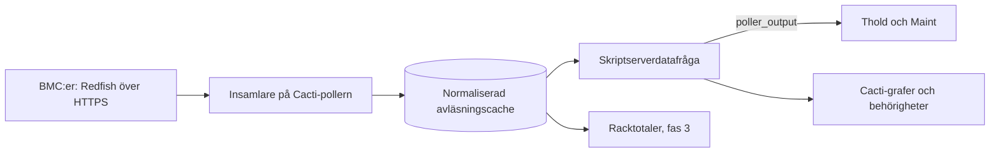

<!-- Source: README.md; SHA256: 7b4e83a58a1adc844cb0615ef30e95476cba2851f96bb454d2a816fb2774724d -->

<!-- translations:start -->
[English](../../../README.md) | [简体中文](../zh-CN/README.md) | [हिन्दी](../hi-IN/README.md) | [Español (España)](../es-ES/README.md) | [Español (Latinoamérica)](../es-419/README.md) | [العربية (السعودية)](../ar-SA/README.md) | [Afrikaans](../af-ZA/README.md) | [አማርኛ](../am-ET/README.md) | [العربية (مصر)](../ar-EG/README.md) | [العربية (المغرب)](../ar-MA/README.md) | [বাংলা](../bn-BD/README.md) | [Bosanski](../bs-BA/README.md) | [Deutsch](../de-DE/README.md) | [فارسی](../fa-IR/README.md) | [Filipino](../fil-PH/README.md) | [Français](../fr-FR/README.md) | [Français (Maroc)](../fr-MA/README.md) | [Français (Sénégal)](../fr-SN/README.md) | [Hausa](../ha-NG/README.md) | [עברית](../he-IL/README.md) | [Hrvatski](../hr-HR/README.md) | [Bahasa Indonesia](../id-ID/README.md) | [Igbo](../ig-NG/README.md) | [Italiano](../it-IT/README.md) | [日本語](../ja-JP/README.md) | [한국어](../ko-KR/README.md) | [Malagasy](../mg-MG/README.md) | [मराठी](../mr-IN/README.md) | [Bahasa Melayu](../ms-MY/README.md) | [Nederlands](../nl-NL/README.md) | [Polski](../pl-PL/README.md) | [Português (Brasil)](../pt-BR/README.md) | [Русский](../ru-RU/README.md) | [Kinyarwanda](../rw-RW/README.md) | [Soomaali](../so-SO/README.md) | [Српски](../sr-RS/README.md) | [Svenska](README.md) | [Kiswahili](../sw-KE/README.md) | [தமிழ்](../ta-IN/README.md) | [తెలుగు](../te-IN/README.md) | [ไทย](../th-TH/README.md) | [Türkçe](../tr-TR/README.md) | [Українська](../uk-UA/README.md) | [اردو](../ur-PK/README.md) | [Tiếng Việt](../vi-VN/README.md) | [isiXhosa](../xh-ZA/README.md) | [Yorùbá](../yo-NG/README.md) | [繁體中文](../zh-TW/README.md) | [isiZulu](../zu-ZA/README.md)
<!-- translations:end -->

# plugin_redfish

Ett insticksprogram för Cacti 1.2 som för in servrars effektförbrukning, inloppstemperatur, fläktstatus och nätaggregatshälsa från baseboard management controllers (BMC:er) till Cacti som vanliga enheter, datakällor och grafer, med Redfish och valfri IPMI-reservlösning. Thold och Maint larmar sedan på och dämpar dem, och en senare fas lägger till effektsummor på racknivå.

> **Status: under utveckling, ingen utgåva ännu (0.1.0-dev).** Milstolparna 2 (grund) och 3 (Cacti-objekt och larm) är sammanslagna på `main`. Detta insticksprogram är inte kopplat till Cacti-projektet. Det installeras på Cacti 1.2.31 under PHP 8.2 eller senare, registrerar BMC:er och autentiseringsuppgifter, läser effekt, temperaturer, fläktar och nätaggregatshälsa från varje BMC över Redfish till sin egen cache och visar insamlingshälsa. Det lägger till Cacti-enheter, grafer per medlem samt sammanfattningsgrafer, och stöd för Thold och Maint genom vanliga datakällor. CI har testat en simulerad BMC byggd av handskrivna testfixturer och DMTF:s Redfish-mockupserver; ingen riktig BMC eller pilotflotta har kvalificerats. Design och efterforskning finns i [docs/PLAN.md](../../PLAN.md), [docs/research/](../../research) och [docs/decisions/](../../decisions).

### Vad milstolpe 2 levererar

- Installation, uppgradering, inaktivering och avinstallation via Cactis API för insticksprogram, där tabeller behålls vid avinstallation om inte inställningen rensas. På PHP äldre än 8.2 vägrar insticksprogrammet att installera eller aktivera och anger varför.
- Behörighetsområdena "Redfish View" (hälsosida), "Redfish Operator" (driftssida) och "Redfish Admin" (sidor för BMC:er och autentiseringsuppgifter), samt inställningar under Configuration > Settings > Redfish.
- Ett BMC-register med CSV-import och JSON-export. Importfiler får inte innehålla lösenord; autentiseringsuppgifter refereras med namn.
- Autentiseringsuppgifter lagras krypterade med AES-256-GCM. Nyckeln är en fil utanför databasen, som standard `/etc/cacti/redfish-vault.key`, som innehåller 64 hexadecimala tecken (`openssl rand -hex 32`) eller exakt 32 slumpmässiga byte, ägd av poller-användaren, inte läsbar av andra användare, i en katalog som endast poller-användaren eller root kan skriva till. En nyckel på 32 skrivbara tecken nekas som lösenfras. **Säkerhetskopiera nyckelfilen tillsammans med databasen**; utan den måste varje lagrat lösenord anges på nytt.
- TLS-verifiering aktiverad som standard, med ett CA-paket eller en SPKI SHA-256-pin per BMC. Ett loggat, per-BMC-undantag utan verifiering ligger kvar på hälsosidan som en varning.
- En skrivskyddad Redfish-klient: endast `GET` samt inloggning och utloggning för sessionen, kontrollerat mot en tillåten lista innan någon begäran skickas.
- En insamlare som startas från `poller_bottom` för BMC:er på huvudpollern, med lån och tidsgränser per BMC, backoff och rensning efter en krasch av den enda session som insticksprogrammet registrerade. Fjärrinsamlare stöds inte ännu; de kräver ett explicit val av hur insamlaren når databasen och nyckeln (fas 4).
- BMC-poster och autentiseringsuppgifter följer Cactis enhetsbehörigheter: en Redfish Admin ser, ändrar och binder endast BMC:er på enheter som denne får se, och endast autentiseringsuppgifter som ingen BMC på en dold enhet använder.

### Vad milstolpe 3 lägger till

- Mallar levererade som Cacti-mall-XML i `templates/` och importerade med Cactis egen importör vid installation och uppgradering, matchade via hash, så att en import uppdaterar insticksprogrammets objekt och inte lägger till något dubbelt. De tre datafrågefilerna kopieras till `<cacti>/resource/script_server/` med en registrerad hash; insticksprogrammet ersätter aldrig en fil där som det inte självt skrivit, och hälsosidan varnar administratörer när mallarna eller en frågefil inte är på plats. **Reinstall the Redfish Templates** på BMC-sidan importerar dem igen; det kräver Cactis behörighet Import Templates.
- **Create Device** eller **Add Graphs** på varje BMC ([ADR 0015](../../decisions/0015-attach-to-the-server-device-or-create-one-per-bmc.md)). En BMC som är mappad till en servers befintliga enhet får sina datafrågor och grafer på den enheten. En omappad BMC får en ny enhet från enhetsmallen "Redfish BMC", med tillgänglighetskontroller avstängda och ett värdnamn under `.invalid`, så att Cacti aldrig kontaktar BMC:n och aldrig visar dess adress. Oavsett vilket bekräftar en administratör först en plan som listar vad som kommer att läggas till. Båda kräver Cactis behörighet för enhetshantering såväl som Redfish Admin; en ny enhet som skaparen inte kan se tas bort igen.
- Tre skriptserverdatafrågor, "Redfish Fans", "Redfish Temperatures" och "Redfish Power Supplies", indexerade med BMC:ns medlemsnyckel, med en graf per medlem: fläkthastighet i procent eller RPM (vilken enhet BMC:n än rapporterar), temperatur samt ineffekt och uteffekt för nätaggregat i watt, var och en med sin hälsokod.
- En inmatningsmetod "Redfish Node Summary" med effekt, inloppstemperatur, högsta temperatur, fläktar och nätaggregat som inte är OK, nodhälsa samt ålder på den senaste giltiga avläsningen, ritad i fyra grafer: effekt, temperaturer, komponenthälsa och dataålder. Thold-tröskelvärden på dessa datakällor larmar och Maint dämpar dem, utan ändringar i något av insticksprogrammen.
- Skriptservern svarar endast från insticksprogrammets cache och kontaktar aldrig en BMC. Ett värde som saknas, är föråldrat, har en annan enhet eller kommer från en medlem som försvunnit är `U`, så grafer visar en lucka, aldrig noll; `age` har alltid ett värde, så ett tröskelvärde på det fångar upp en BMC som slutat svara.
- En graflänk från varje Redfish-graf till enhetens Redfish-grafer, som endast visas för användare som Cacti låter se enheten.

**När en BMC:s medlemmar ändras** (en fläkt byts ut, en firmware-uppdatering döper om sensorer), välj **Add Graphs** igen. En fläkt eller ett nätaggregat som fanns och nu är frånvarande eller borta räknas i `fans_bad` eller `psus_bad` tills du gör det, så att en utdragen fläkt larmar; en kortplats som aldrig var bestyckad gör det inte. Add Graphs accepterar de medlemmar som BMC:n rapporterar nu, och Cacti indexerar frågorna igen; en medlem som är borta behåller sin datakälla och graf, vilka läser `U` från och med då, och en ny medlem får en graf. Ta bort graferna för medlemmar som är borta för hand när deras historik inte längre behövs.

Att ta bort en enhet avmappar dess BMC och behåller BMC:n och dess cache. Att ta bort en BMC, eller avinstallera insticksprogrammet, behåller dess enhet och grafer.

## Åtkomstroller

| Behörighetsområde | Åtkomst |
| --- | --- |
| Redfish View | Befintliga övervakningssidor. |
| Redfish Operator | Övervakning plus driftssidan (Operations) och personliga triage-kvitteringar. |
| Redfish Admin | Operatörsåtkomst plus befintliga konfigurations- och administrationsåtgärder. |

Efter att ha kopierat uppgraderingsfiler, öppna sidan Plugins som administratör för att registrera
det nya behörighetsområdet. Tilldela behörighetsområdet Operator explicit under **Configuration > Users** eller användargrupper.
Uppgraderingar behåller de befintliga behörighetsområdenas ID:n och tilldelningar för View och Admin. Admin-åtkomst
ärver Operator-åtkomst, och Operator-åtkomst ärver View-åtkomst vid varje begäran;
detta lägger inte till lagrade behörigheter hos användare eller grupper. Insticksprogrammets inställningar kräver även
Redfish Admin-åtkomst utöver Cactis behörighet Settings.

Cactis enhetsbehörigheter begränsar fortfarande vilka rader och åtgärder som är tillgängliga för varje användare; omappade objekt kräver en administratör. Operatörer kan släppa en insamlingsspärr på en tillåten BMC inför nästa schemalagda körning.
Autentiseringsuppgifter, konfiguration, mappning, borttagning och andra administrativa ändringar
finns kvar på administrationssidorna. Kvitteringar gäller endast i den aktuella
användarens session, i högst en timme och endast medan samma observation förblir
färsk. Nya eller ändrade observationer ogiltigförklarar dem. De markerar aldrig en misslyckad
mätning som frisk och dämpar aldrig larm.

## Varför

Varje server har en BMC som rapporterar effekt- och temperaturstatus oberoende av operativsystemet, så den fortsätter svara när operativsystemet är nere. Datan används för kapacitets- och kostnadsuppföljning, tidig varning om en trasig fläkt eller ett trasigt nätaggregat och, inom högpresterande beräkningar (HPC), beslut om effektbegränsning. Insticksprogrammet är inte specifikt för HPC.

Cacti täcker en del av detta i dag:

- **Leverantörsspecifika SNMP-paket.** Grenen 1.2.x levererar mallar för Dell iDRAC och HPE iLO som kräver en SNMP-agent och är leverantörsspecifika; efterforskning i milstolpe 1 visade att ingen av dem rapporterar effektförbrukning i watt ([docs/research/overlap.md](../../research/overlap.md)).
- **En typ av autentiseringsuppgift utan insamlare.** plugin_credentials definierar autentiseringsuppgiften "IPMI / Redfish (BMC)" men läser ingen BMC.
- **Ingen vy på racknivå.** Cacti core har inget rackobjekt; en enhet har ett fritextfält `location`.

Insticksprogrammet pollar BMC:er out-of-band från Cactis pollcykel, cachar normaliserade avläsningar och exponerar dem genom en skriptserverdatafråga och sammanfattande datakällor. Det återanvänder Cactis grafritning, behörigheter, Thold och Maint, och ändrar inte BMC-tillståndet. Stöd för fjärrdatainsamlare planeras för fas 4; nuvarande insamling körs endast på huvudpollern.

## Planerad omfattning

| Fas | Omfattning | Milstolpar |
|---|---|---|
| 0, efterforskning | Leverantörsmatris, bekräftelse av uppströmsbeteende på verkliga BMC:er, pollkostnad, datafråge-spike | [M1](https://github.com/somethingwithproof/plugin_redfish/milestone/1) |
| 1, observera | BMC-register, autentiseringsuppgifter, TLS, Redfish-insamlare, normaliserade avläsningar, enheter, grafer per index, Thold-larm, Maint-dämpning, hälsosida | [M2](https://github.com/somethingwithproof/plugin_redfish/milestone/2), [M3](https://github.com/somethingwithproof/plugin_redfish/milestone/3), [M4](https://github.com/somethingwithproof/plugin_redfish/milestone/4) |
| 2, ipmi | IPMI-reservlösning för BMC:er utan användbar Redfish, avstängd som standard | [M5](https://github.com/somethingwithproof/plugin_redfish/milestone/5) |
| 3, rack | Rackregister, rackeffektsummor med täckning, budgetmarginal | [M6](https://github.com/somethingwithproof/plugin_redfish/milestone/6) |
| 4, fjärr | Cactis fjärrdatainsamlare för isolerade BMC-nätverk | [M7](https://github.com/somethingwithproof/plugin_redfish/milestone/7) |

Utanför omfattningen: att ställa in effektbegränsningar eller någon annan BMC-konfiguration, strömstyrning, firmware-uppdateringar, konsolåtkomst, en egen larmmotor i insticksprogrammet samt schemaläggarintegrering.

## Kompatibilitetsmål

| Komponent | Mål |
|---|---|
| Cacti | 1.2.31 eller senare, inga kärnpatchar |
| Databas | MariaDB 10.2 eller MySQL 5.7 eller senare: en BMC per enhet upprätthålls av en unik nyckel på en genererad kolumn |
| PHP | 8.2 eller senare; `setup.php` förblir tolkningsbar på 8.0 så att en körtidsmiljö som inte stöds får ett avslag i stället för ett trasigt Cacti-gränssnitt |
| BMC:er | Dell iDRAC, HPE iLO, Lenovo XCC och OpenBMC, per firmware-intervall; se [leverantörsmatrisen](../../research/vendor-matrix.md) |
| Redfish | Nya delsystem- och sensorresurser först, föråldrade `Power` och `Thermal` som reservlösning |
| Thold, Maint | Inga ändringar krävs |

## Design

- [docs/PLAN.md](../../PLAN.md) är den fullständiga planen: arkitektur, uppströmsfakta den bygger på (med källor och antaganden som återstår att bekräfta), mätmodell, säkerhetsgränser, prestandaaritmetik, testning och risker.
- [docs/decisions/](../../decisions) innehåller arkitekturbeslut för val som redan gjorts.
- [docs/REQUIREMENTS.md](../../REQUIREMENTS.md) kopplar varje krav-ID till sitt ärende.

## Säkerhet

BMC-autentiseringsuppgifter styr out-of-band-hantering av servrar. Designen håller dem borta från kommandorader, loggar och sidor, verifierar TLS som standard, kör alla externa kommandon från en argumentarray med tillåtna underkommandon och använder skrivskyddade BMC-konton. Se [docs/PLAN.md](../../PLAN.md#security) och [SECURITY.md](../../../SECURITY.md).

## Driftshandbok

Se [docs/operator-guide.md](../../operator-guide.md) för installationsförutsättningar, konfiguration av valv och TLS, BMC-registrering, grafskapande, larmintervall, säkerhetskopiering och felhantering. Handboken deklarerar inte att en verklig leverantörs firmware-linje stöds förrän en maskerad inspelning från den firmwaren passerar testsviten.

## Hur arbetet spåras

- **Milstolpar** följer planens milstolpar. Varje milstolpe har ett epic-ärende som listar dess underärenden och slutbevis.
- **Ärenden** typas med etikett: `type: requirement`, `type: research`, `type: decision`, `type: epic`. Kravärenden anger numrerade, testbara krav (`REQ-AREA-NNN`) och acceptanskriterier.
- **Etiketter** har även `area:`, `phase:`, `priority:` och `status:`. Se [CONTRIBUTING.md](../../../CONTRIBUTING.md#labels).
- [Projekttavlan](https://github.com/users/somethingwithproof/projects/12) visar alla ärenden över milstolparna.

## Bidra

Läs [CONTRIBUTING.md](../../../CONTRIBUTING.md). Commits behöver en DCO-signering. Designdiskussioner sker i ärenden; öppna beslut har etiketten `type: decision`. Bevis från riktiga BMC:er är det mest användbara bidraget just nu; maskera adresser, serienummer och autentiseringsuppgifter innan någon inspelning publiceras.

## Licens

GNU General Public License v2.0, samma licens som Cacti och dess insticksprogram. Se [LICENSE](../../../LICENSE).
