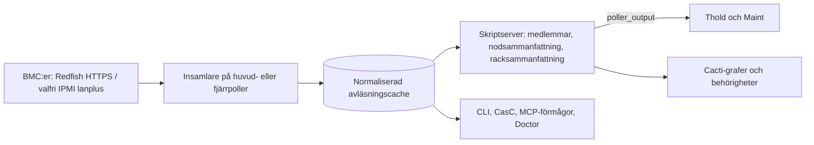

<!-- Source: README.md; SHA256: cf31b9f80d6c00020bbe08e80951d4de1c910793911d040ae7a66b54e8a2eaf0 -->

<!-- translations:start -->
[English](../../../README.md) | [简体中文](../zh-CN/README.md) | [हिन्दी](../hi-IN/README.md) | [Español (España)](../es-ES/README.md) | [Español (Latinoamérica)](../es-419/README.md) | [العربية (السعودية)](../ar-SA/README.md) | [Afrikaans](../af-ZA/README.md) | [አማርኛ](../am-ET/README.md) | [العربية (مصر)](../ar-EG/README.md) | [العربية (المغرب)](../ar-MA/README.md) | [বাংলা](../bn-BD/README.md) | [Bosanski](../bs-BA/README.md) | [Deutsch](../de-DE/README.md) | [فارسی](../fa-IR/README.md) | [Filipino](../fil-PH/README.md) | [Français](../fr-FR/README.md) | [Français (Maroc)](../fr-MA/README.md) | [Français (Sénégal)](../fr-SN/README.md) | [Hausa](../ha-NG/README.md) | [עברית](../he-IL/README.md) | [Hrvatski](../hr-HR/README.md) | [Bahasa Indonesia](../id-ID/README.md) | [Igbo](../ig-NG/README.md) | [Italiano](../it-IT/README.md) | [日本語](../ja-JP/README.md) | [한국어](../ko-KR/README.md) | [Malagasy](../mg-MG/README.md) | [मराठी](../mr-IN/README.md) | [Bahasa Melayu](../ms-MY/README.md) | [Nederlands](../nl-NL/README.md) | [Polski](../pl-PL/README.md) | [Português (Brasil)](../pt-BR/README.md) | [Русский](../ru-RU/README.md) | [Kinyarwanda](../rw-RW/README.md) | [Soomaali](../so-SO/README.md) | [Српски](../sr-RS/README.md) | [Svenska](README.md) | [Kiswahili](../sw-KE/README.md) | [தமிழ்](../ta-IN/README.md) | [తెలుగు](../te-IN/README.md) | [ไทย](../th-TH/README.md) | [Türkçe](../tr-TR/README.md) | [Українська](../uk-UA/README.md) | [اردو](../ur-PK/README.md) | [Tiếng Việt](../vi-VN/README.md) | [isiXhosa](../xh-ZA/README.md) | [Yorùbá](../yo-NG/README.md) | [繁體中文](../zh-TW/README.md) | [isiZulu](../zu-ZA/README.md)
<!-- translations:end -->

# plugin_redfish

Ett insticksprogram för Cacti 1.2 som för in servrars effektförbrukning, inloppstemperatur, fläktstatus och nätaggregatshälsa från baseboard management controllers (BMC:er) till Cacti som vanliga enheter, datakällor och grafer, med Redfish och en valfri skrivskyddad IPMI-reservlösning samt effektsummor på racknivå. Thold och Maint larmar på och dämpar dem genom vanliga Cacti-datakällor.

> **Status: under utveckling, ingen utgåva ännu (`0.1.0-dev`).** Detta insticksprogram är inte kopplat till Cacti-projektet. Det installeras på Cacti 1.2.31 eller senare under PHP 8.2 eller senare och implementerar Redfish-insamlaren, krypterat valv för autentiseringsuppgifter, provisionering av Cacti-enheter och grafer, valfri skrivskyddad IPMI-reservlösning, rackeffektsummering, visning av underhållsfönster för Cacti Maint, replikering av fjärrdatainsamlare och agent-slutpunkter, CasC-leverantör och operatörs-CLI, MCP-förmågor (abilities) samt Doctor-diagnostikkontroller. CI testar testfixturer, DMTF Redfish Mockup Server (mockup-modeller för subsystem, legacy-only och HPE iLO Gen11) samt Thold v1.8.2 med Maint v1.3; ingen riktig fysisk BMC eller pilotflotta har kvalificerats ännu. Design och efterforskning finns i [docs/PLAN.md](../../PLAN.md), [docs/research/](../../research/) och [docs/decisions/](../../decisions/).

## Implementerade funktioner

### Kärninsamlare, valv och Cacti-objekt

- **Livscykel och schema.** Installeras, uppgraderas, inaktiveras och avinstalleras via Cactis API för insticksprogram (`Schema::VERSION = 3`, 12 tabeller). Tabeller behålls vid avinstallation om inte *Keep Plugin Tables on Uninstall* avmarkeras. Startpunkter kan tolkas på PHP 8.0 och avvisar PHP under 8.2 eller avsaknad av `ext-openssl` med ett tydligt felmeddelande.
- **Register och behörigheter.** Behörighetsområdena *Redfish View* (`redfish_health.php`), *Redfish Operator* (`redfish_operator.php`) och *Redfish Admin* (`redfish_bmcs.php`, `redfish_credentials.php`), samt inställningar under **Configuration > Settings > Redfish**. BMC-registret stöder CSV-import (autentiseringsuppgifter refereras med namn; lösenord i importfiler avvisas) och JSON-export. BMC-poster och autentiseringsuppgifter följer Cactis enhetsbehörigheter.
- **Krypterat valv för autentiseringsuppgifter.** Lösenord lagras krypterade med AES-256-GCM i `plugin_redfish_secret`. Nyckeln ligger utanför databasen (`/etc/cacti/redfish-vault.key` som standard) som 64 hexadecimala tecken (`openssl rand -hex 32`) eller 32 råa byte, ägd av poller-användaren, oläsbar av andra användare och i en katalog som endast root eller den användaren kan skriva till. En lösenfras på 32 skrivbara tecken avvisas. **Säkerhetskopiera nyckelfilen tillsammans med databasen**; utan den måste lagrade lösenord anges på nytt.
- **TLS och skrivskyddad Redfish-klient.** TLS-verifiering är aktiverad som standard med systemets CA-arkiv, ett CA-paket per BMC eller en SPKI SHA-256-pin; ett per-BMC-undantag utan verifiering förblir synligt som en hälsovarning och en varning i Doctor-kontrollen. Klienten tillåter endast `GET` samt Redfish-sessionsinloggning (`POST`) och -utloggning (`DELETE`), med valfri Basic-reservlösning per BMC när sessioner inte är tillgängliga. Upptäckt föredrar nya Redfish-resurser för delsystem och sensorer och faller tillbaka på föråldrade `Power`- och `Thermal`-resurser.
- **Exekvering av insamlare.** `poller_redfish.php` startar från `poller_bottom`, kör en huvudprocess per poller via Cactis processregister med konfigurerbara arbetsprocesser (`redfish_workers`), erhåller lån per BMC, upprätthåller en tidsbudget (`redfish_collector_budget`), tillämpar exponentiell backoff och rensar upp insticksprogrammets egen föregående session efter en krasch.
- **Mallar, enheter och grafer.** Importerar `templates/redfish-templates.xml` via hash och kopierar tre XML-datafrågefiler för skriptservern (`redfish_fans.xml`, `redfish_temperatures.xml`, `redfish_psus.xml`) till `<cacti>/resource/script_server/` utan att skriva över användarmodifierade filer. **Create Device** och **Add Graphs** kräver bekräftelse av en provisioneringsplan, kopplar frågor till en mappad serverenhet eller skapar en "Redfish BMC"-enhet under `.invalid` med tillgänglighetskontroller avstängda, och länkar varje Redfish-graf tillbaka till enhetens Redfish-grafer via `graph_buttons`.
- **Endast cache-baserade skriptserverinmatningar.** `scripts/ss_redfish_members.php` levererar fläkt-, temperatur- och PSU-avläsningar per medlem, och `scripts/ss_redfish_summary.php` levererar mätvärden för "Redfish Node Summary" (effekt, inlopps- och maxtemperatur, antal felaktiga fläktar och PSU:er, nodhälsa samt ålder på senaste giltiga avläsning). Skriptserveranrop läser endast den lokala cachen och kontaktar aldrig en BMC. Saknade, föråldrade eller från bortgångna medlemmar kommande avläsningar returnerar `U` (aldrig `0`), medan `age` alltid rapporterar ett värde så att tröskelvärden upptäcker tysta BMC:er.

**När en BMC:s medlemmar ändras** (till exempel en utbytt fläkt eller en firmware-uppdatering som döper om sensorer), kör **Add Graphs** igen. En tidigare närvarande fläkt eller ett nätaggregat som blir frånvarande räknas i `fans_bad` eller `psus_bad` tills detta accepteras; en kortplats som aldrig varit bestyckad räknas inte. Medlemmar som är borta behåller sina befintliga datakällor och grafer, vilka läser `U` därefter tills de tas bort manuellt. Att ta bort en Cacti-enhet avmappar dess BMC och tar bort dess racktilldelning samtidigt som BMC:n och cachen behålls; att ta bort en BMC eller avinstallera insticksprogrammet behåller Cacti-enheterna och graferna.

### Valfri IPMI-reservlösning

- **Valbart per BMC.** Avstängd som standard (`protocols` har standardvärdet `redfish`; att aktivera IPMI-reservlösning sätter `redfish,ipmi`).
- **Avgränsad utlösare för reservlösning.** Körs endast när Redfish-insamling misslyckas med en berättigad felklass; utlöses aldrig vid `AuthRejected`, `CredentialUnavailable`, `AddressRefused`, `OperationRefused` eller `Deadline`.
- **Säker exekvering.** Anropar `ipmitool` över `-I lanplus` via array-baserad `proc_open()` utan skal, med begränsad väggklockstimeout och en utdatagräns på 256 KiB. Lösenord tillhandahålls via `IPMITOOL_PASSWORD` (`-E`) eller en temporär fil med läge 0600 (`-f`) som tas bort i `finally`, aldrig på CLI-argv.
- **Tillåten lista över skrivskyddade kommandon.** Endast fem skrivskyddade underkommandon är tillåtna: `dcmi power reading`, `sdr type Temperature`, `sdr type Fan`, `sdr type Power Supply` och `chassis status`. Ändrande kommandon avvisas.
- **Normaliserad utdata och säkerhetsvarning.** `IpmiNormalizer` mappar avläsningar till samma `Observation`/`Member`/`Reading`-modell och ger `U` för saknade eller otolkbara sensorer. Att aktivera IPMI-reservlösningen ger en varning på hälsosidan och i Doctor-kontrollen `redfish.bmc_security` som påminner operatörer om att begränsa UDP 623 till ett administrations-VLAN.

### Rackeffektsummering

- **Rackregister.** Schemaversion 3 lägger till `plugin_redfish_rack` (unik `(site_id, name)`, valfri `power_budget_watts`, `min_coverage_pct` med standardvärdet `80` och anteckningar) samt `plugin_redfish_rack_member` (högst en racktilldelning per `host_id`, valfri `bmc_id` och `unit_position`, som tas bort automatiskt när en Cacti-enhet tas bort).
- **Täckningsskyddade summor.** `RackPowerSummary` summerar färska `power_watts`-avläsningar från medlemmar i den lokala cachen och beräknar budgetutnyttjande och marginal (headroom). När täckningen av rapporterande medlemmar sjunker under `min_coverage_pct` returnerar `power_watts`, `utilization_pct` och `headroom_watts` värdet `U` så att insamlarfel aldrig ser ut som en minskning av rackeffekten.
- **Thold-redo skriptserverinmatning.** `scripts/ss_redfish_rack.php` (`ss_redfish_rack(<rack_id>)`) returnerar `power_watts`, `power_budget_watts`, `utilization_pct`, `headroom_watts`, `members_total`, `members_reporting` och `coverage_pct` enbart från den lokala cachen.

### Integrering med Cacti Maint

- Thold-tröskelvärden på Redfish-datakällor larmar och Cacti Maint dämpar dem utan några ändringar i något av insticksprogrammen.
- `MaintWindow` kontrollerar aktiva Maint-scheman för varje mappad Cacti-värd (engångsscheman `mtype=1` och återkommande scheman `mtype=2`, samt `plugin_maint_check_cacti_host()` när den är inläst) och markerar aktivt underhåll på sidan Redfish Health (`[MAINT]`), i utdatan från `cli/redfish.php health` och i förmågan `redfish-get-health`.

### Fjärrdatainsamlare

- `INFO` deklarerar `remote_collect:1`. BMC:er accepterar valfritt `poller_id >= 1`, och `poller_redfish.php --poller=N` samlar endast in aktiverade BMC:er som tilldelats den pollern.
- **`replicate_out`-hook.** Replikerar via `replicate_out_table()` endast icke-hemliga konfigurationstabeller begränsade till mål-fjärrpollern: `plugin_redfish_bmc`, metadata i `plugin_redfish_credential` (utan chiffertext), `plugin_redfish_rack` och `plugin_redfish_rack_member`. `plugin_redfish_secret` replikeras inte och valvnyckelfiler förblir strikt lokala på varje poller.
- **`remote_agent`-hook.** Exponerar de skrivskyddade åtgärderna `redfish_health` och `redfish_discovery` som endast accepterar numeriska parametrar `poller_id` och `bmc_id`. Oväntade parametrar avvisas och noll autentiseringsuppgifter eller hemligheter returneras.

### Ekosystem-hooks (CasC, MCP-förmågor och Doctor)

- **CasC-leverantör (`casc_register_providers`).** Registrerar `redfish`-leverantören (schemaversion `1`) med export av YAML och XML i ren PHP, tolkning (med XXE avvisad), validering, diff-planering och tillämpning. Autentiseringsuppgifter visas endast som valvhänvisningar (`vault:redfish:<name>`); råa hemliga nycklar (`pass`, `secret`, `token`, `private_key`, `vault_key`, `auth_token`) avvisas. Tillämpning kräver en exakt SHA-256 `PLAN_HASH`.
- **MCP / Abilities API (`abilities_register`).** Registrerar tre skrivskyddade förmågor skyddade av behörighetsområdet Redfish View (`redfish_health.php`) och Cactis enhetsbehörigheter, som returnerar noll autentiseringsuppgifter:
  - `redfish-list-bmcs` (valfri `poller_id`)
  - `redfish-get-rack-power` (valfri `rack_id`)
  - `redfish-get-health` (valfri `bmc_id`)
- **Doctor-kontroller (`doctor_register_checks`).** Registrerar fem lokala, skrivskyddade diagnostikkontroller som aldrig kontaktar en BMC eller returnerar nyckelmaterial:
  - `redfish.schema`: schemaversionens aktualitet
  - `redfish.vault_key`: valvnyckelns läsbarhet och behörigheter
  - `redfish.collector_runs`: poller-insamlarens budget och aktualitet
  - `redfish.bmc_security`: aktiverade BMC:er med overifierad TLS eller IPMI-reservlösning
  - `redfish.rack_power`: efterlevnad av rackets effektbudget och nedre täckningsgräns

## CLI

Kör från Cactis rotkatalog med PHP 8.2 eller senare:

```sh
# Operator and CasC CLI (reads --file=PATH or stdin for validate, plan, and apply)
php plugins/redfish/cli/redfish.php export --format=yaml|xml
php plugins/redfish/cli/redfish.php validate [--file=PATH] [--format=yaml|xml]
php plugins/redfish/cli/redfish.php plan [--file=PATH] [--format=yaml|xml]
php plugins/redfish/cli/redfish.php apply [--file=PATH] [--format=yaml|xml] --confirm=<PLAN_HASH>
php plugins/redfish/cli/redfish.php health --format=text|json

# Collector entry point (normally started by poller_bottom)
php plugins/redfish/poller_redfish.php [--poller=N] [--force] [--debug]

# Rack power summary script server entry point
php plugins/redfish/scripts/ss_redfish_rack.php <rack_id>
```

## Åtkomstroller

| Behörighetsområde | Åtkomst |
| --- | --- |
| Redfish View | Befintliga övervakningssidor. |
| Redfish Operator | Övervakning plus driftssidan (Operations) och personliga triage-kvitteringar. |
| Redfish Admin | Operatörsåtkomst plus befintliga konfigurations- och administrationsåtgärder. |

Efter att ha kopierat uppgraderingsfiler, öppna sidan Plugins som administratör för att registrera behörighetsområdena. Tilldela behörighetsområdet Operator explicit under **Configuration > Users** eller användargrupper. Uppgraderingar behåller de befintliga behörighetsområdenas ID:n och tilldelningar för View och Admin. Admin-åtkomst ärver Operator-åtkomst, och Operator-åtkomst ärver View-åtkomst vid varje begäran; detta lägger inte till lagrade behörigheter hos användare eller grupper. Insticksprogrammets inställningar kräver även Redfish Admin-åtkomst utöver Cactis behörighet Settings.

Cactis enhetsbehörigheter begränsar vilka rader och åtgärder som är tillgängliga för varje användare; omappade objekt kräver en administratör. Operatörer kan släppa en insamlingsspärr på en tillåten BMC inför nästa schemalagda körning. Autentiseringsuppgifter, konfiguration, mappning, borttagning och andra administrativa ändringar finns kvar på administrationssidorna. Kvitteringar gäller endast i den aktuella användarens session, i högst en timme och endast medan samma observation förblir färsk. Nya eller ändrade observationer ogiltigförklarar dem. De markerar aldrig en misslyckad mätning som frisk och dämpar aldrig larm.

## Varför

Varje server har en BMC som rapporterar effekt- och temperaturstatus oberoende av operativsystemet, så den fortsätter svara när operativsystemet är nere. Datan används för kapacitets- och kostnadsuppföljning, tidig varning om en trasig fläkt eller ett trasigt nätaggregat och, inom högpresterande beräkningar (HPC), beslut om effektbegränsning. Insticksprogrammet är inte specifikt för HPC.

Cacti täcker en del av detta i dag:

- **Leverantörsspecifika SNMP-paket.** Grenen 1.2.x levererar mallar för Dell iDRAC och HPE iLO som kräver en SNMP-agent och är leverantörsspecifika; efterforskning i milstolpe 1 visade att ingen av dem rapporterar effektförbrukning i watt ([docs/research/overlap.md](../../research/overlap.md)).
- **En typ av autentiseringsuppgift utan insamlare.** plugin_credentials definierar autentiseringsuppgiften "IPMI / Redfish (BMC)" men läser ingen BMC.
- **Ingen vy på racknivå.** Cacti core har inget rackobjekt; en enhet har ett fritextfält `location`.

Insticksprogrammet pollar BMC:er out-of-band från Cactis pollcykel på huvudpollern eller fjärrdatainsamlare, cachar normaliserade avläsningar och exponerar dem genom skriptserverdatafrågor, nodsammanfattningar och rackeffektsammanfattningar. Det återanvänder Cactis grafritning, behörigheter, Thold och Maint, och ändrar inte BMC-tillståndet.

## Omfattning och status

| Fas | Omfattning | Milstolpar | Status |
|---|---|---|---|
| 0, efterforskning | Leverantörsmatris, bekräftelse av uppströmsbeteende på verkliga BMC:er, pollkostnad, datafråge-spike | [M1](https://github.com/somethingwithproof/plugin_redfish/milestone/1) | Klar, väntar på firmware-inspelningar från riktiga BMC:er |
| 1, observera | BMC-register, autentiseringsuppgifter, TLS, Redfish-insamlare, normaliserade avläsningar, enheter, grafer per index, Thold-larm, Maint-integrering, hälsosida | [M2](https://github.com/somethingwithproof/plugin_redfish/milestone/2), [M3](https://github.com/somethingwithproof/plugin_redfish/milestone/3), [M4](https://github.com/somethingwithproof/plugin_redfish/milestone/4) | Implementerad; M4-kvalificering av pilotflotta väntar |
| 2, ipmi | Skrivskyddad IPMI-reservlösning (`lanplus`) via `ipmitool`, avstängd som standard | [M5](https://github.com/somethingwithproof/plugin_redfish/milestone/5) | Implementerad |
| 3, rack | Rackregister, rackeffektsummor med nedre täckningsgräns, budgetmarginal, `ss_redfish_rack.php` | [M6](https://github.com/somethingwithproof/plugin_redfish/milestone/6) | Implementerad |
| 4, fjärr och ekosystem | Fjärrdatainsamlare (`replicate_out`, `remote_agent`), CasC-leverantör och CLI, MCP-förmågor, Doctor-kontroller | [M7](https://github.com/somethingwithproof/plugin_redfish/milestone/7) | Implementerad |

Utanför omfattningen: att ställa in effektbegränsningar eller någon annan BMC-konfiguration, strömstyrning, firmware-uppdateringar, konsolåtkomst, en egen larmmotor i insticksprogrammet samt schemaläggarintegrering.

## Kompatibilitetsmål

| Komponent | Mål |
|---|---|
| Cacti | 1.2.31 eller senare, inga kärnpatchar |
| Databas | MariaDB 10.2 eller MySQL 5.7 eller senare: en BMC per enhet upprätthålls av en unik nyckel på en genererad kolumn |
| PHP | 8.2 eller senare; startpunkter förblir tolkningsbara på 8.0 så att en körtidsmiljö som inte stöds får ett avslag i stället för ett trasigt Cacti-gränssnitt |
| PHP-tillägg | `ext-openssl` (krävs av Cacti 1.2.31); inget `ext-curl` och inga körtidsberoenden från Composer |
| Valfria verktyg | `ipmitool` på pollers som samlar in BMC:er med IPMI-reservlösning aktiverad |
| BMC:er | Dell iDRAC, HPE iLO, Lenovo XCC och OpenBMC, per firmware-intervall; se [leverantörsmatrisen](../../research/vendor-matrix.md) |
| Redfish | Nya delsystem- och sensorresurser först, föråldrade `Power` och `Thermal` som reservlösning |
| Thold, Maint | Inga ändringar krävs (CI testar Thold v1.8.2 och Maint v1.3) |

## Design

- [docs/PLAN.md](../../PLAN.md) är den fullständiga planen: arkitektur, uppströmsfakta den bygger på, mätmodell, säkerhetsgränser, prestandaaritmetik, testning och risker.
- [docs/decisions/](../../decisions/) innehåller arkitekturbeslut för val som redan gjorts.
- [docs/REQUIREMENTS.md](../../REQUIREMENTS.md) kopplar varje krav-ID till sitt ärende.



## Säkerhet

BMC-autentiseringsuppgifter styr out-of-band-hantering av servrar. Designen håller hemligheter borta från kommandorader, loggar, CasC-exporter, fjärragent-nyttolaster, MCP-svar och webbsidor; krypterar lagrade lösenord med AES-256-GCM med en lokal valvnyckelfil per poller; verifierar TLS som standard; kör `ipmitool` från en explicit argumentarray med tillåtna skrivskyddade underkommandon; och använder skrivskyddade BMC-konton. Se [docs/PLAN.md](../../PLAN.md#security) och [SECURITY.md](../../../SECURITY.md).

## Driftshandbok

Se [docs/operator-guide.md](../../operator-guide.md) för installationsförutsättningar, konfiguration av valv och TLS, BMC-registrering, grafskapande, larmintervall, säkerhetskopiering och felhantering. Handboken deklarerar inte att en verklig leverantörs firmware-linje stöds förrän en maskerad inspelning från den firmwaren passerar testsviten.

## Utveckling och testning

CI (`.github/workflows/plugin-ci-workflow.yml`) kontrollerar syntax på startpunkter i PHP 8.0, kör Pest-enhetstestsviten (`phpunit.xml`) och livscykelintegrationssviten (`phpunit-integration.xml`) samt PHPStan nivå 9 över PHP 8.2 till 8.5 mot Cacti `release/1.2.31` och `1.2.x`, verifierar avslag på PHP 8.1, testar DMTF Redfish Mockup Server (mockup-modeller för subsystem, legacy-only och HPE iLO Gen11) samt Thold v1.8.2 / Maint v1.3 från början till slut, och kontrollerar gettext-kataloger, arbetsflöden samt REUSE-licensiering.

Lokala kontroller före push:

```sh
sh tests/lint-workflows.sh
sh locales/build_gettext.sh --check
CACTI_PATH=/path/to/cacti phpstan analyse -c phpstan.neon --no-progress
```

Kör Pest med `--configuration=phpunit.xml` för enhets- och källregels-tester, eller `--configuration=phpunit-integration.xml` med `CACTI_PATH` och `REDFISH_TEST_DATABASE=disposable` mot en engångsdatabas för Cacti för livscykelintegrationstester.

## Hur arbetet spåras

- **Milstolpar** följer planens milstolpar. Varje milstolpe har ett epic-ärende som listar dess underärenden och slutbevis.
- **Ärenden** typas med etikett: `type: requirement`, `type: research`, `type: decision`, `type: epic`. Kravärenden anger numrerade, testbara krav (`REQ-AREA-NNN`) och acceptanskriterier.
- **Etiketter** har även `area:`, `phase:`, `priority:` och `status:`. Se [CONTRIBUTING.md](../../../CONTRIBUTING.md#labels).
- [Projekttavlan](https://github.com/users/somethingwithproof/projects/12) visar alla ärenden över milstolparna.

## Bidra

Läs [CONTRIBUTING.md](../../../CONTRIBUTING.md). Commits behöver en DCO-signering. Designdiskussioner sker i ärenden; öppna beslut har etiketten `type: decision`. Bevis från riktiga BMC:er är det mest användbara bidraget just nu; maskera adresser, serienummer och autentiseringsuppgifter innan någon inspelning publiceras.

## Licens

GNU General Public License v2.0, samma licens som Cacti och dess insticksprogram. Se [LICENSE](../../../LICENSE).
