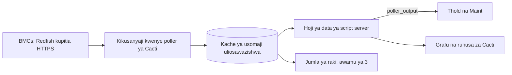

<!-- Source: README.md; SHA256: 7b4e83a58a1adc844cb0615ef30e95476cba2851f96bb454d2a816fb2774724d -->

<!-- translations:start -->
[English](../../../README.md) | [简体中文](../zh-CN/README.md) | [हिन्दी](../hi-IN/README.md) | [Español (España)](../es-ES/README.md) | [Español (Latinoamérica)](../es-419/README.md) | [العربية (السعودية)](../ar-SA/README.md) | [Afrikaans](../af-ZA/README.md) | [አማርኛ](../am-ET/README.md) | [العربية (مصر)](../ar-EG/README.md) | [العربية (المغرب)](../ar-MA/README.md) | [বাংলা](../bn-BD/README.md) | [Deutsch](../de-DE/README.md) | [فارسی](../fa-IR/README.md) | [Filipino](../fil-PH/README.md) | [Français](../fr-FR/README.md) | [Français (Maroc)](../fr-MA/README.md) | [Français (Sénégal)](../fr-SN/README.md) | [Hausa](../ha-NG/README.md) | [עברית](../he-IL/README.md) | [Bahasa Indonesia](../id-ID/README.md) | [Igbo](../ig-NG/README.md) | [Italiano](../it-IT/README.md) | [日本語](../ja-JP/README.md) | [한국어](../ko-KR/README.md) | [Malagasy](../mg-MG/README.md) | [मराठी](../mr-IN/README.md) | [Bahasa Melayu](../ms-MY/README.md) | [Nederlands](../nl-NL/README.md) | [Polski](../pl-PL/README.md) | [Português (Brasil)](../pt-BR/README.md) | [Русский](../ru-RU/README.md) | [Kinyarwanda](../rw-RW/README.md) | [Soomaali](../so-SO/README.md) | [Svenska](../sv-SE/README.md) | [Kiswahili](README.md) | [தமிழ்](../ta-IN/README.md) | [తెలుగు](../te-IN/README.md) | [ไทย](../th-TH/README.md) | [Türkçe](../tr-TR/README.md) | [Українська](../uk-UA/README.md) | [اردو](../ur-PK/README.md) | [Tiếng Việt](../vi-VN/README.md) | [isiXhosa](../xh-ZA/README.md) | [Yorùbá](../yo-NG/README.md) | [繁體中文](../zh-TW/README.md) | [isiZulu](../zu-ZA/README.md)
<!-- translations:end -->

# plugin_redfish

Programu-jalizi ya Cacti 1.2 inayowaleta Cacti matumizi ya nishati ya seva, halijoto ya hewa inayoingia, hali ya feni, na afya ya usambazaji wa nishati kutoka kwa vidhibiti vya usimamizi wa ubao mama (BMCs) kama vifaa vya kawaida, vyanzo vya data, na grafu, kwa kutumia Redfish pamoja na mbadala wa hiari wa IPMI. Kisha Thold na Maint hutoa arifa na kuzizuia, na awamu ya baadaye huongeza jumla ya nishati katika kiwango cha raki.

> **Hali: bado inatengenezwa, hakuna toleo bado (0.1.0-dev).** Hatua kuu ya 2 (msingi) na ya 3 (vipengele vya Cacti na utoaji wa arifa) zimeunganishwa kwenye `main`. Programu-jalizi hii haihusiani na mradi wa Cacti. Husakinishwa kwenye Cacti 1.2.31 chini ya PHP 8.2 au toleo jipya zaidi, husajili BMCs na vitambulisho vya kuingia, husoma nishati, halijoto, feni, na afya ya usambazaji wa nishati kutoka kwa kila BMC kupitia Redfish hadi kwenye kache yake yenyewe, na kuonyesha afya ya ukusanyaji. Huongeza vifaa vya Cacti, grafu za kila mshiriki na za muhtasari, na usaidizi wa Thold na Maint kupitia vyanzo vya kawaida vya data. CI imejaribu BMC bandia iliyojengwa kutokana na vielelezo vilivyoandikwa kwa mkono na seva ya mfano ya DMTF Redfish; hakuna BMC halisi au kundi la majaribio lililothibitishwa bado. Muundo na utafiti viko katika [docs/PLAN.md](../../PLAN.md), [docs/research/](../../research), na [docs/decisions/](../../decisions).

### Kile ambacho hatua kuu ya 2 inaleta

- Usakinishaji, uboreshaji, uzimaji, na uondoaji kupitia API ya programu-jalizi ya Cacti, huku majedwali yakihifadhiwa wakati wa uondoaji isipokuwa mpangilio huo ukifutwa. Kwenye PHP iliyo chini ya 8.2 programu-jalizi hukataa kusakinishwa au kuwashwa na kueleza sababu.
- Maeneo ya ruhusa (Realms) "Redfish View" (ukurasa wa afya), "Redfish Operator" (ukurasa wa uendeshaji), na "Redfish Admin" (kurasa za BMCs na vitambulisho), na mipangilio chini ya Configuration > Settings > Redfish.
- Rejesta ya BMC yenye uingizaji wa CSV na utoaji wa JSON. Faili za kuingiza hazipaswi kuwa na nywila; vitambulisho hurejelewa kwa jina.
- Vitambulisho huhifadhiwa vikiwa vimesimbwa kwa njia fiche kwa AES-256-GCM. Ufunguo ni faili iliyo nje ya hifadhidata, `/etc/cacti/redfish-vault.key` kwa chaguo-msingi, yenye herufi 64 za heksadesimali (`openssl rand -hex 32`) au baiti 32 kamili za nasibu, inayomilikiwa na mtumiaji wa poller, isiyosomeka na watumiaji wengine, katika saraka ambayo ni mtumiaji wa poller au root pekee wanaweza kuandika. Ufunguo wa herufi 32 zinazoweza kuchapishwa hukataliwa kama kaulisiri. **Hifadhi nakala rudufu ya faili ya ufunguo pamoja na hifadhidata**; bila hiyo kila nywila iliyohifadhiwa lazima iingizwe tena.
- Uthibitishaji wa TLS umewashwa kwa chaguo-msingi, ukiwa na kifurushi cha CA cha kila BMC au pini ya SPKI SHA-256. Uamuzi wa kutothibitisha kwa kila BMC uliorekodiwa hubaki kwenye ukurasa wa afya kama onyo.
- Kiteja cha Redfish cha kusoma pekee: `GET` pamoja na kuingia na kutoka kwenye kipindi pekee, vikikaguliwa dhidi ya orodha ya ruhusa kabla ya ombi lolote kutumwa.
- Kikusanyaji kinachoanzishwa kutoka `poller_bottom` kwa ajili ya BMCs zilizo kwenye poller kuu, kikiwa na mikataba ya muda na makataa kwa kila BMC, uahirishaji wa marudio (backoff), na usafishaji baada ya mkwamo wa kipindi kimoja ambacho programu-jalizi ilirekodi. Wakusanyaji wa mbali bado hawaauniwi; wanahitaji uamuzi dhahiri wa jinsi kikusanyaji kinavyofikia hifadhidata na ufunguo (awamu ya 4).
- Rekodi za BMC na vitambulisho hufuata ruhusa za vifaa vya Cacti: Redfish Admin huona, hubadilisha, na huunganisha BMCs pekee kwenye vifaa anavyoweza kuviona, na vitambulisho pekee ambavyo havitumiwi na BMC yoyote iliyo kwenye kifaa kilichofichwa.

### Kile ambacho hatua kuu ya 3 inaongeza

- Violezo vinavyosafirishwa kama XML ya violezo vya Cacti katika `templates/` na kuingizwa kwa kiingizaji cha Cacti chenyewe wakati wa usakinishaji na uboreshaji, vikilinganishwa kwa hashi, ili uingizaji usasishe vipengee vya programu-jalizi na usiongeze chochote mara mbili. Faili tatu za hoji za data hunakiliwa hadi `<cacti>/resource/script_server/` zikiwa na hashi iliyorekodiwa; programu-jalizi haibadilishi kamwe faili iliyoko hapo ambayo haikuiandika, na ukurasa wa afya huwaonya wasimamizi wakati violezo au faili ya hoji haipo mahali pake. **Reinstall the Redfish Templates** kwenye ukurasa wa BMCs huviingiza tena; inahitaji ruhusa ya Import Templates ya Cacti.
- **Create Device** au **Add Graphs** kwenye kila BMC ([ADR 0015](../../decisions/0015-attach-to-the-server-device-or-create-one-per-bmc.md)). BMC iliyounganishwa na kifaa kilichopo cha seva hupata hoji zake za data na grafu kwenye kifaa hicho. BMC isiyounganishwa hupata kifaa kipya kutoka kwa kiolezo cha kifaa cha "Redfish BMC", ukaguzi wa upatikanaji ukiwa umezimwa na jina la mwenyeji likiwa chini ya `.invalid`, ili Cacti isiwahi kuwasiliana na BMC na isiwahi kuonyesha anwani yake. Kwa njia yoyote ile msimamizi huthibitisha kwanza mpango unaoorodhesha kitakachoongezwa. Zote mbili zinahitaji ruhusa ya usimamizi wa vifaa ya Cacti pamoja na Redfish Admin; kifaa kipya ambacho muundaji hakuweza kukiona huondolewa tena.
- Hoji tatu za data za script server, "Redfish Fans", "Redfish Temperatures", na "Redfish Power Supplies", zilizowekewa faharasa kwa ufunguo wa mshiriki wa BMC, zikiwa na grafu kwa kila mshiriki: kasi ya feni kwa asilimia au RPM (kizio chochote ambacho BMC inaripoti), halijoto, na wati za kuingia na kutoka za usambazaji wa nishati, kila moja ikiwa na msimbo wake wa afya.
- Kiingizo cha "Redfish Node Summary" chenye nishati, halijoto ya hewa inayoingia, halijoto ya juu zaidi, feni na vifaa vya usambazaji wa nishati ambavyo si OK, afya ya nodi, na umri wa usomaji mzuri wa mwisho, vikichorwa kwenye grafu nne: nishati, halijoto, afya ya vipengele, na umri wa data. Vizingiti vya Thold kwenye vyanzo hivi vya data hutoa arifa, na Maint huvizuia, bila mabadiliko yoyote kwa programu-jalizi yoyote kati ya hizo mbili.
- Script server hujibu tu kutoka kwa kache ya programu-jalizi na haiwasiliani kamwe na BMC. Thamani iliyokosekana, iliyopitwa na wakati, ya kizio kingine, au kutoka kwa mshiriki aliyeondoka ni `U`, ili grafu zionyeshe pengo, kamwe si sifuri; `age` huwa na thamani kila wakati, ili kizingiti juu yake kibaini BMC iliyoacha kujibu.
- Kiungo cha grafu kutoka kila grafu ya Redfish hadi kwenye grafu za Redfish za kifaa, kinachoonyeshwa tu kwa watumiaji ambao Cacti inawaruhusu kukiona kifaa hicho.

**Wakati washiriki wa BMC wanapobadilika** (feni ikibadilishwa, sasisho la firmware likibadilisha majina ya vihisi), chagua **Add Graphs** tena. Feni au kifaa cha usambazaji wa nishati kilichokuwepo na sasa hakipo au kimeondoka huhesabiwa katika `fans_bad` au `psus_bad` hadi utakapofanya hivyo, ili feni iliyochomolewa itoe arifa; nafasi ambayo haikuwahi kujazwa haihesabiwi. Add Graphs hukubali washiriki ambao BMC inaripoti sasa, na Cacti huwekea hoji faharasa tena; mshiriki aliyeondoka huhifadhi chanzo chake cha data na grafu yake, ambavyo husoma `U` kuanzia hapo, na mshiriki mpya hupata grafu. Futa grafu za washiriki walioondoka kwa mkono pindi historia yao isipohitajika tena.

Kufuta kifaa huondoa muunganisho wa BMC yake na huhifadhi BMC pamoja na kache yake. Kufuta BMC, au kuondoa programu-jalizi, huhifadhi kifaa chake na grafu zake.

## Majukumu ya ufikiaji

| Eneo la Ruhusa | Ufikiaji |
| --- | --- |
| Redfish View | Kurasa zilizopo za ufuatiliaji. |
| Redfish Operator | Ufuatiliaji pamoja na ukurasa wa Uendeshaji (Operations) na uthibitishaji wa kibinafsi wa uchunguzi wa awali. |
| Redfish Admin | Ufikiaji wa Operator pamoja na usanidi uliopo na hatua za kiutawala. |

Baada ya kunakili faili za uboreshaji, fungua ukurasa wa Plugins kama msimamizi ili kusajili
eneo jipya la ruhusa. Gawa eneo la ruhusa la Operator kwa uwazi chini ya **Configuration > Users** au vikundi vya watumiaji.
Maboresho huhifadhi vitambulisho na ruhusa zilizopo za maeneo ya View na Admin. Ufikiaji wa Admin
hurithi ufikiaji wa Operator, na ufikiaji wa Operator hurithi ufikiaji wa View kwa kila ombi;
hii haiongezi ruhusa zilizohifadhiwa kwa watumiaji au vikundi. Mipangilio ya programu-jalizi pia huhitaji
ufikiaji wa Redfish Admin pamoja na ruhusa ya Settings ya Cacti.

Ruhusa za vifaa vya Cacti bado hupunguza safu mlalo na hatua zinazopatikana kwa kila mtumiaji; vipengee visivyounganishwa vinahitaji msimamizi. Waendeshaji (Operators) wanaweza kuachilia kizuizi cha ukusanyaji kwenye BMC inayoruhusiwa kwa mzunguko ujao uliopangwa.
Vitambulisho, usanidi, uunganishaji, ufutaji na mabadiliko mengine ya kiutawala
hubaki katika kurasa za kiutawala. Uthibitishaji hudumu katika kipindi cha sasa
cha mtumiaji pekee, kwa muda usiozidi saa moja na tu mradi uchunguzi huohuo ubaki
mpya. Uchunguzi mpya au uliobadilika huubatilisha. Haubadilishi kamwe kipimo kilichoshindwa
kuwa chenye afya wala kuzuia arifa.

## Kwa nini

Kila seva ina BMC inayoripoti hali ya nishati na joto bila kutegemea mfumo endeshi, kwa hivyo inaendelea kujibu hata mfumo endeshi ukiwa chini. Data hii hutumika kwa ufuatiliaji wa uwezo na gharama, onyo la mapema la feni au usambazaji wa nishati ulioharibika, na, katika kompyuta za utendaji wa juu (HPC), maamuzi ya kupunguza kiwango cha juu cha nishati. Programu-jalizi hii si mahususi kwa HPC pekee.

Cacti hushughulikia sehemu ya haya leo:

- **Vifurushi vya SNMP vya wauzaji.** Tawi la 1.2.x linakuja na violezo vya Dell iDRAC na HPE iLO vinavyohitaji wakala wa SNMP na ni mahususi kwa muuzaji; utafiti wa hatua kuu ya 1 uligundua kuwa hakuna hata kimoja kinachoripoti matumizi ya nishati kwa wati ([docs/research/overlap.md](../../research/overlap.md)).
- **Aina ya kitambulisho bila kikusanyaji.** plugin_credentials hufafanua kitambulisho cha "IPMI / Redfish (BMC)" lakini haisomi BMC yoyote.
- **Hakuna mwonekano wa kiwango cha raki.** Msingi wa Cacti hauna kipengee cha raki; kifaa kina sehemu ya maandishi huru ya `location`.

Programu-jalizi hukusanya data kutoka kwa BMCs nje ya mzunguko wa ukusanyaji wa Cacti, huhifadhi usomaji uliosawazishwa kwenye kache, na kuutoa kupitia hoji ya data ya script server na vyanzo vya data vya muhtasari. Hutumia tena uchoraji wa grafu, ruhusa, Thold, na Maint za Cacti, na haibadilishi hali ya BMC. Usaidizi wa kikusanyaji cha data cha mbali umepangwa kwa awamu ya 4; ukusanyaji wa sasa huendeshwa kwenye poller kuu pekee.

## Wigo uliopangwa

| Awamu | Wigo | Hatua kuu |
|---|---|---|
| 0, utafiti | Jedwali la wauzaji, uthibitishaji wa tabia ya mfumo wa juu kwenye BMCs halisi, gharama ya ukusanyaji, jaribio la hoji ya data | [M1](https://github.com/somethingwithproof/plugin_redfish/milestone/1) |
| 1, uchunguzi | Rejesta ya BMC, vitambulisho, TLS, kikusanyaji cha Redfish, usomaji uliosawazishwa, vifaa, grafu za kila faharasa, arifa za Thold, uzuiaji wa Maint, ukurasa wa afya | [M2](https://github.com/somethingwithproof/plugin_redfish/milestone/2), [M3](https://github.com/somethingwithproof/plugin_redfish/milestone/3), [M4](https://github.com/somethingwithproof/plugin_redfish/milestone/4) |
| 2, ipmi | Mbadala wa IPMI kwa BMCs zisizo na Redfish inayoweza kutumika, imezimwa kwa chaguo-msingi | [M5](https://github.com/somethingwithproof/plugin_redfish/milestone/5) |
| 3, raki | Rejesta ya raki, jumla ya nishati ya raki yenye ufunikaji, nafasi ya bajeti | [M6](https://github.com/somethingwithproof/plugin_redfish/milestone/6) |
| 4, mbali | Wakusanyaji wa data wa mbali wa Cacti kwa mitandao ya BMC iliyotengwa | [M7](https://github.com/somethingwithproof/plugin_redfish/milestone/7) |

Nje ya wigo: kuweka vikomo vya nishati au usanidi mwingine wowote wa BMC, udhibiti wa nishati, usasishaji wa firmware, ufikiaji wa kiweko (console), injini ya arifa inayomilikiwa na programu-jalizi, na muunganisho wa kipanga ratiba.

## Malengo ya uoanifu

| Kipengele | Lengo |
|---|---|
| Cacti | 1.2.31 au toleo jipya zaidi, hakuna viraka vya msingi |
| Hifadhidata | MariaDB 10.2 au MySQL 5.7 au toleo jipya zaidi: BMC moja kwa kila kifaa hushikiliwa na ufunguo wa kipekee kwenye safu wima iliyozalishwa |
| PHP | 8.2 au toleo jipya zaidi; `setup.php` hubaki ikichanganulika kwenye 8.0 ili mazingira yasiyoauniwa yapate kukataliwa badala ya kiolesura cha Cacti kilichovunjika |
| BMCs | Dell iDRAC, HPE iLO, Lenovo XCC, na OpenBMC, kulingana na anuwai ya firmware; tazama [jedwali la wauzaji](../../research/vendor-matrix.md) |
| Redfish | Rasilimali mpya za mfumo mdogo na vihisi kwanza, `Power` na `Thermal` zilizopitwa na wakati kama mbadala |
| Thold, Maint | Hakuna mabadiliko yanayohitajika |

## Muundo

- [docs/PLAN.md](../../PLAN.md) ni mpango kamili: usanifu, ukweli wa mfumo wa juu unaotegemewa (pamoja na vyanzo na dhana ambazo bado zinahitaji kuthibitishwa), kielelezo cha vipimo, mipaka ya usalama, hesabu za utendaji, majaribio, na hatari.
- [docs/decisions/](../../decisions) huhifadhi rekodi za maamuzi ya usanifu kwa chaguo ambazo tayari zimefanywa.
- [docs/REQUIREMENTS.md](../../REQUIREMENTS.md) huunganisha kila kitambulisho cha hitaji na suala lake.

## Usalama

Vitambulisho vya BMC hudhibiti usimamizi wa seva wa nje ya mkondo. Muundo huviweka nje ya mistari ya amri, kumbukumbu (logs), na kurasa, huthibitisha TLS kwa chaguo-msingi, huendesha amri yoyote ya nje kutoka kwa safu ya hoja (argument array) zenye amri ndogo zilizoidhinishwa, na hutumia akaunti za BMC za kusoma pekee. Tazama [docs/PLAN.md](../../PLAN.md#security) na [SECURITY.md](../../../SECURITY.md).

## Mwongozo wa mwendeshaji

Tazama [docs/operator-guide.md](../../operator-guide.md) kwa mahitaji ya awali ya usakinishaji, usanidi wa hifadhi ya siri na TLS, usajili wa BMC, uundaji wa grafu, vipindi vya arifa, nakala rudufu, na ushughulikiaji wa hitilafu. Mwongozo hautangazi laini halisi ya firmware ya muuzaji kuwa inaungwa mkono hadi nakala ya mawasiliano iliyofutwa taarifa nyeti kutoka kwa firmware hiyo ifaulu majaribio.

## Jinsi kazi inavyofuatiliwa

- **Hatua kuu (Milestones)** hufuata hatua kuu za mpango. Kila moja ina suala kuu (epic) linaloorodhesha masuala yake madogo na ushahidi wa kukamilika.
- **Masuala (Issues)** huainishwa kwa lebo: `type: requirement`, `type: research`, `type: decision`, `type: epic`. Masuala ya mahitaji hueleza mahitaji yaliyo na nambari na yanayoweza kujaribiwa (`REQ-AREA-NNN`) na vigezo vya kukubalika.
- **Lebo** pia hubeba `area:`, `phase:`, `priority:`, na `status:`. Tazama [CONTRIBUTING.md](../../../CONTRIBUTING.md#labels).
- [Ubao wa mradi](https://github.com/users/somethingwithproof/projects/12) huonyesha masuala yote katika hatua kuu zote.

## Kuchangia

Soma [CONTRIBUTING.md](../../../CONTRIBUTING.md). Mabadiliko yote (commits) yanahitaji saini ya DCO. Majadiliano ya muundo hufanyika kwenye masuala; maamuzi yaliyo wazi hubeba lebo ya `type: decision`. Ushahidi kutoka kwa BMCs halisi ndio mchango wenye manufaa zaidi sasa; futa anwani, nambari za mfululizo, na vitambulisho kabla ya kuchapisha rekodi yoyote ya mawasiliano.

## Leseni

GNU General Public License v2.0, leseni ileile ya Cacti na programu-jalizi zake. Tazama [LICENSE](../../../LICENSE).
