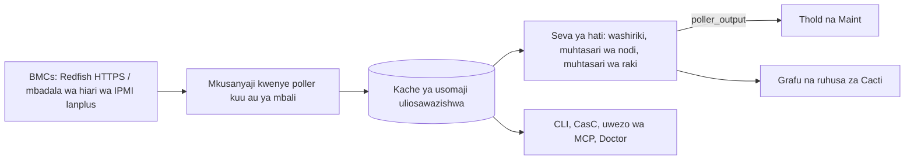

<!-- Source: README.md; SHA256: 6972a6c9ac754cd60e63c5caf971451ea8fe6e279eef757d886e1a168d3eef01 -->

<!-- translations:start -->
[English](../../../README.md) | [简体中文](../zh-CN/README.md) | [हिन्दी](../hi-IN/README.md) | [Español (España)](../es-ES/README.md) | [Español (Latinoamérica)](../es-419/README.md) | [العربية (السعودية)](../ar-SA/README.md) | [Afrikaans](../af-ZA/README.md) | [አማርኛ](../am-ET/README.md) | [العربية (مصر)](../ar-EG/README.md) | [العربية (المغرب)](../ar-MA/README.md) | [বাংলা](../bn-BD/README.md) | [Bosanski](../bs-BA/README.md) | [Deutsch](../de-DE/README.md) | [فارسی](../fa-IR/README.md) | [Filipino](../fil-PH/README.md) | [Français](../fr-FR/README.md) | [Français (Maroc)](../fr-MA/README.md) | [Français (Sénégal)](../fr-SN/README.md) | [Hausa](../ha-NG/README.md) | [עברית](../he-IL/README.md) | [Hrvatski](../hr-HR/README.md) | [Bahasa Indonesia](../id-ID/README.md) | [Igbo](../ig-NG/README.md) | [Italiano](../it-IT/README.md) | [日本語](../ja-JP/README.md) | [한국어](../ko-KR/README.md) | [Malagasy](../mg-MG/README.md) | [मराठी](../mr-IN/README.md) | [Bahasa Melayu](../ms-MY/README.md) | [Nederlands](../nl-NL/README.md) | [Polski](../pl-PL/README.md) | [Português (Brasil)](../pt-BR/README.md) | [Русский](../ru-RU/README.md) | [Kinyarwanda](../rw-RW/README.md) | [Soomaali](../so-SO/README.md) | [Српски](../sr-RS/README.md) | [Svenska](../sv-SE/README.md) | [Kiswahili](README.md) | [தமிழ்](../ta-IN/README.md) | [తెలుగు](../te-IN/README.md) | [ไทย](../th-TH/README.md) | [Türkçe](../tr-TR/README.md) | [Українська](../uk-UA/README.md) | [اردو](../ur-PK/README.md) | [Tiếng Việt](../vi-VN/README.md) | [isiXhosa](../xh-ZA/README.md) | [Yorùbá](../yo-NG/README.md) | [繁體中文](../zh-TW/README.md) | [isiZulu](../zu-ZA/README.md)
<!-- translations:end -->

# plugin_redfish

Programu-jalizi ya Cacti 1.2 inayowaleta Cacti matumizi ya nishati ya seva, halijoto ya hewa inayoingia, hali ya feni, na afya ya usambazaji wa nishati kutoka kwa vidhibiti vya usimamizi wa ubao mama (BMCs) kama vifaa vya kawaida, vyanzo vya data, na grafu, kwa kutumia Redfish pamoja na mbadala wa hiari wa kusoma tu wa IPMI na majumuisho ya nishati ya kiwango cha raki. Thold na Maint hutoa arifa na kuzizuia kupitia vyanzo vya kawaida vya data vya Cacti.

> **Hali: bado inatengenezwa, hakuna toleo bado (`0.1.0-dev`).** Programu-jalizi hii haihusiani na mradi wa Cacti. Husakinishwa kwenye Cacti 1.2.31 au toleo jipya zaidi chini ya PHP 8.2 au toleo jipya zaidi na hutekeleza mkusanyaji wa Redfish, hifadhi iliyosimbwa ya vitambulisho, utoaji wa vifaa na grafu za Cacti, mbadala wa hiari wa kusoma tu wa IPMI, ujumlishaji wa nishati ya raki, mwonekano wa dirisha la Maint la Cacti, urudufishaji wa wakusanyaji wa data wa mbali na miisho ya mawakala, mtoa huduma wa CasC na CLI ya mwendeshaji, uwezo wa MCP, na ukaguzi wa uchunguzi wa Doctor. CI hujaribu vielelezo vya majaribio, DMTF Redfish Mockup Server (mifano ya mfumo mdogo, mifano ya zamani pekee, na HPE iLO Gen11), na Thold v1.8.2 pamoja na Maint v1.3; hakuna BMC halisi au kundi la majaribio lililothibitishwa bado. Muundo na utafiti viko katika [docs/PLAN.md](../../PLAN.md), [docs/research/](../../research/), na [docs/decisions/](../../decisions/).

## Uwezo uliotekelezwa

### Mkusanyaji mkuu, hifadhi ya siri, na vipengee vya Cacti

- **Mzunguko wa maisha na muundo wa jedwali.** Husakinisha, husasisha, huzima, na huondoa kupitia API ya programu-jalizi ya Cacti (`Schema::VERSION = 3`, majedwali 12). Majedwali huhifadhiwa wakati wa kuondoa isipokuwa chaguo la *Keep Plugin Tables on Uninstall* liondolewe tiki. Faili za kuingia huchanganuliwa kwenye PHP 8.0 na kukataa PHP iliyo chini ya 8.2 au kukosekana kwa `ext-openssl` kwa ujumbe wa hitilafu ulio wazi.
- **Usajili na ruhusa.** Nyanja za *Redfish View* (`redfish_health.php`), *Redfish Operator* (`redfish_operator.php`), na *Redfish Admin* (`redfish_bmcs.php`, `redfish_credentials.php`), pamoja na mipangilio chini ya **Configuration > Settings > Redfish**. Usajili wa BMC unasaidia kuagiza kwa CSV (vitambulisho hutajwa kwa jina; nywila ndani ya faili za kuagiza hukataliwa) na kuhamisha kwa JSON. Rekodi za BMC na vitambulisho hufuata ruhusa za vifaa vya Cacti.
- **Hifadhi iliyosimbwa ya vitambulisho.** Nywila huhifadhiwa zikiwa zimesimbwa kwa AES-256-GCM katika `plugin_redfish_secret`. Ufunguo hukaa nje ya hifadhidata (`/etc/cacti/redfish-vault.key` kwa chaguo-msingi) kama vibambo 64 vya heksadesimali (`openssl rand -hex 32`) au baiti 32 ghafi, ukimilikiwa na mtumiaji wa poller, usiosomeka na watumiaji wengine, ndani ya saraka inayoweza kuandikwa tu na root au mtumiaji huyo. Kauli-siri ya vibambo 32 vinavyochapishwa hukataliwa. **Hifadhi nakala ya faili ya ufunguo pamoja na hifadhidata**; bila hiyo, nywila zilizohifadhiwa lazima ziingizwe tena.
- **TLS na mteja wa Redfish wa kusoma tu.** Uthibitishaji wa TLS umewashwa kwa chaguo-msingi kwa kutumia hifadhi ya CA ya mfumo, kifurushi cha CA kwa kila BMC, au pini ya SPKI SHA-256; kujiondoa kwa kutothibitisha kwa kila BMC hubaki kuonekana kama onyo la afya na onyo la ukaguzi wa Doctor. Mteja huruhusu `GET` pekee pamoja na kuingia kwa kipindi cha Redfish (`POST`) na kutoka (`DELETE`), na chaguo la hiari la mbadala wa Basic kwa kila BMC wakati vipindi havipatikani. Ugunduzi hupendelea rasilimali mpya za mfumo mdogo na vihisi vya Redfish na hurudi kwenye rasilimali zilizopitwa na wakati za `Power` na `Thermal`.
- **Utekelezaji wa mkusanyaji.** `poller_redfish.php` huanza kutoka `poller_bottom`, huendesha mchakato mmoja mkuu kwa kila poller kupitia usajili wa michakato wa Cacti ukiwa na michakato ya wafanyakazi inayoweza kusanidiwa (`redfish_workers`), hupata ukodishaji wa kila BMC, hutekeleza bajeti ya muda (`redfish_collector_budget`), hutumia kurudi nyuma kwa kipeo, na husafisha kipindi cha awali cha programu-jalizi yenyewe baada ya kuanguka.
- **Violezo, vifaa, na grafu.** Huagiza `templates/redfish-templates.xml` kwa hashi na kunakili faili tatu za XML za maswali ya data ya seva ya hati (`redfish_fans.xml`, `redfish_temperatures.xml`, `redfish_psus.xml`) kwenye `<cacti>/resource/script_server/` bila kufuta faili zilizorekebishwa na mtumiaji. **Create Device** na **Add Graphs** huhitaji uthibitisho wa mpango wa utoaji, huunganisha maswali kwenye kifaa cha seva kilichopangwa au huunda kifaa cha "Redfish BMC" chini ya `.invalid` kikiwa na ukaguzi wa upatikanaji umezimwa, na huunganisha kila grafu ya Redfish kurudi kwenye grafu za Redfish za kifaa kupitia `graph_buttons`.
- **Ingizo za seva ya hati za kache pekee.** `scripts/ss_redfish_members.php` hutoa usomaji wa feni, halijoto, na PSU kwa kila mshiriki, na `scripts/ss_redfish_summary.php` hutoa vipimo vya "Redfish Node Summary" (nishati, halijoto ya hewa inayoingia na ya juu zaidi, idadi ya feni na PSU mbovu, afya ya nodi, na umri wa usomaji mzuri wa mwisho). Miito ya seva ya hati husoma kache ya ndani pekee na kamwe haiwasiliani na BMC. Usomaji unaokosekana, uliopitwa na wakati, au wa mshiriki aliyeondoka hurudisha `U` (kamwe si `0`), huku `age` ikiripoti thamani kila wakati ili vizingiti vigundue BMC zilizo kimya.

**Washiriki wa BMC wanapobadilika** (kama vile feni iliyobadilishwa au sasisho la programu dhibiti linalobadilisha majina ya vihisi), endesha **Add Graphs** tena. Feni au usambazaji wa nishati uliokuwepo awali ambao haupo tena huhesabiwa katika `fans_bad` au `psus_bad` hadi uthibitishwe; nafasi ambayo haikuwahi kujazwa haihesabiwi. Washiriki walioondoka huhifadhi vyanzo vyao vya data na grafu zilizopo, ambazo husoma `U` baada ya hapo hadi zifutwe kwa mkono. Kufuta kifaa cha Cacti huondoa muunganisho wa BMC yake na kuondoa ugawaji wake wa raki huku kikihifadhi BMC na kache; kufuta BMC au kuondoa programu-jalizi huhifadhi vifaa na grafu za Cacti.

### Mbadala wa hiari wa IPMI

- **Hiari kwa kila BMC.** Umezimwa kwa chaguo-msingi (`protocols` huwa `redfish` kwa chaguo-msingi; kuwasha mbadala wa IPMI huweka `redfish,ipmi`).
- **Kichochezi cha mbadala chenye mipaka.** Huendeshwa tu wakati ukusanyaji wa Redfish unaposhindwa kwa aina ya kushindwa inayostahiki; kamwe hauanzishwi kwenye `AuthRejected`, `CredentialUnavailable`, `AddressRefused`, `OperationRefused`, au `Deadline`.
- **Utekelezaji salama.** Huita `ipmitool` kupitia `-I lanplus` kwa `proc_open()` ya muundo wa safu bila shell, kikomo cha muda halisi, na kikomo cha matokeo cha 256 KiB. Nywila hutolewa kupitia `IPMITOOL_PASSWORD` (`-E`) au faili ya muda ya mode-0600 (`-f`) inayofutwa katika `finally`, kamwe si kwenye hoja za CLI.
- **Orodha ya ruhusa ya amri za kusoma tu.** Amri ndogo tano za kusoma tu pekee ndizo zinaruhusiwa: `dcmi power reading`, `sdr type Temperature`, `sdr type Fan`, `sdr type Power Supply`, na `chassis status`. Amri zinazobadilisha hali hukataliwa.
- **Matokeo yaliyosawazishwa na onyo la usalama.** `IpmiNormalizer` hupanga usomaji katika muundo uleule wa `Observation`/`Member`/`Reading`, ikitoa `U` kwa vihisi vinavyokosekana au visivyoweza kuchanganuliwa. Kuwasha mbadala wa IPMI hutoa onyo kwenye ukurasa wa afya na katika ukaguzi wa Doctor wa `redfish.bmc_security` ikiwakumbusha waendeshaji kuzuia UDP 623 kwa VLAN ya usimamizi.

### Ujumlishaji wa nishati ya raki

- **Usajili wa raki.** Toleo la 3 la muundo huongeza `plugin_redfish_rack` (`(site_id, name)` ya kipekee, `power_budget_watts` ya hiari, `min_coverage_pct` yenye chaguo-msingi `80`, na maelezo) na `plugin_redfish_rack_member` (ugawaji usiozidi raki moja kwa kila `host_id`, `bmc_id` na `unit_position` za hiari, ambazo huondolewa kiotomatiki kifaa cha Cacti kinapofutwa).
- **Jumla zilizolindwa na kiwango cha uwakilishi.** `RackPowerSummary` hujumlisha usomaji mpya wa `power_watts` wa washiriki kutoka kwa kache ya ndani na kukokotoa matumizi ya bajeti na nafasi iliyosalia. Wakati uwakilishi wa washiriki wanaoripoti unashuka chini ya `min_coverage_pct`, `power_watts`, `utilization_pct`, na `headroom_watts` hurudisha `U` ili hitilafu za mkusanyaji kamwe zisionekane kama kushuka kwa nishati ya raki.
- **Ingizo la seva ya hati lililo tayari kwa Thold.** `scripts/ss_redfish_rack.php` (`ss_redfish_rack(<rack_id>)`) hurudisha `power_watts`, `power_budget_watts`, `utilization_pct`, `headroom_watts`, `members_total`, `members_reporting`, na `coverage_pct` kutoka kwa kache ya ndani pekee.

### Muunganisho wa Cacti Maint

- Vizingiti vya Thold kwenye vyanzo vya data vya Redfish hutoa arifa na Cacti Maint huvizuia bila mabadiliko yoyote kwa programu-jalizi yoyote kati ya hizo.
- `MaintWindow` hukagua ratiba zinazoendelea za Maint kwa kila seva ya Cacti iliyopangwa (ratiba za mara moja `mtype=1` na zinazojirudia `mtype=2`, pamoja na `plugin_maint_check_cacti_host()` inapopakiwa) na huweka alama ya matengenezo yanayoendelea kwenye ukurasa wa Redfish Health (`[MAINT]`), katika matokeo ya `cli/redfish.php health`, na katika uwezo wa `redfish-get-health`.

### Wakusanyaji wa data wa mbali

- `INFO` hutangaza `remote_collect:1`. BMCs hukubali `poller_id >= 1` yoyote, na `poller_redfish.php --poller=N` hukusanya tu BMCs zilizowashwa zilizopangiwa poller hiyo.
- **Ndoano ya `replicate_out`.** Hurudufisha majedwali ya usanidi yasiyo ya siri pekee yaliyofungwa kwa poller ya mbali lengwa kupitia `replicate_out_table()`: `plugin_redfish_bmc`, metadata ya `plugin_redfish_credential` (bila maandishi yaliyosimbwa), `plugin_redfish_rack`, na `plugin_redfish_rack_member`. `plugin_redfish_secret` hairudufishwi, na faili za ufunguo wa hifadhi hubaki ndani ya kila poller pekee.
- **Ndoano ya `remote_agent`.** Hutoa vitendo vya kusoma tu vya `redfish_health` na `redfish_discovery` vinavyokubali vigezo vya nambari vya `poller_id` na `bmc_id` pekee. Vigezo visivyotarajiwa hukataliwa na hakuna vitambulisho au siri zozote zinazorudishwa.

### Ndoano za mfumo ikolojia (CasC, uwezo wa MCP, na Doctor)

- **Mtoa huduma wa CasC (`casc_register_providers`).** Husajili mtoa huduma wa `redfish` (toleo la muundo `1`) ukiwa na uhamishaji wa YAML na XML wa PHP halisi, uchanganuzi (ukikataa XXE), uthibitishaji, upangaji wa tofauti, na utekelezaji. Vitambulisho huonekana kama marejeleo ya hifadhi pekee (`vault:redfish:<name>`); funguo za siri ghafi (`pass`, `secret`, `token`, `private_key`, `vault_key`, `auth_token`) hukataliwa. Utekelezaji huhitaji `PLAN_HASH` halisi ya SHA-256.
- **API ya MCP / Uwezo (`abilities_register`).** Husajili uwezo tatu za kusoma tu zinazodhibitiwa na nyanja ya Redfish View (`redfish_health.php`) na ruhusa za vifaa vya Cacti, zisizorudisha vitambulisho vyovyote:
  - `redfish-list-bmcs` (`poller_id` ya hiari)
  - `redfish-get-rack-power` (`rack_id` ya hiari)
  - `redfish-get-health` (`bmc_id` ya hiari)
- **Ukaguzi wa Doctor (`doctor_register_checks`).** Husajili ukaguzi tano wa uchunguzi wa ndani wa kusoma tu ambao kamwe hauwasiliani na BMC au kurudisha nyenzo za ufunguo:
  - `redfish.schema`: usasa wa toleo la muundo wa jedwali
  - `redfish.vault_key`: usomekaji na ruhusa za ufunguo wa hifadhi
  - `redfish.collector_runs`: bajeti na usasa wa mkusanyaji wa poller
  - `redfish.bmc_security`: BMCs zilizowashwa zenye TLS isiyothibitishwa au mbadala wa IPMI
  - `redfish.rack_power`: utiifu wa bajeti ya nishati ya raki na kiwango cha chini cha uwakilishi

## CLI

Endesha kutoka saraka kuu ya Cacti ukitumia PHP 8.2 au toleo jipya zaidi:

```sh
# Operator and CasC CLI (reads --file=PATH or stdin for validate, plan, and apply)
php plugins/redfish/cli/redfish.php export --format=yaml|xml
php plugins/redfish/cli/redfish.php validate [--file=PATH] [--format=yaml|xml]
php plugins/redfish/cli/redfish.php plan [--file=PATH] [--format=yaml|xml]
php plugins/redfish/cli/redfish.php apply [--file=PATH] [--format=yaml|xml] --confirm=<PLAN_HASH>
php plugins/redfish/cli/redfish.php health --format=text|json

# Collector entry point (normally started by poller_bottom)
php plugins/redfish/poller_redfish.php [--poller=N] [--force] [--debug]

# Rack power summary script server entry point
php plugins/redfish/scripts/ss_redfish_rack.php <rack_id>
```

## Majukumu ya ufikiaji

| Nyanja | Ufikiaji |
| --- | --- |
| Redfish View | Kurasa zilizopo za ufuatiliaji. |
| Redfish Operator | Ufuatiliaji pamoja na ukurasa wa Uendeshaji na uthibitisho wa awali wa kibinafsi wa kushughulikia matatizo. |
| Redfish Admin | Ufikiaji wa Operator pamoja na kurasa zilizopo za usanidi na vitendo vya kiutawala. |

Baada ya kunakili faili za sasisho, fungua ukurasa wa Plugins kama msimamizi ili kusajili nyanja. Weka nyanja ya Operator moja kwa moja chini ya **Configuration > Users** au vikundi vya watumiaji. Masasisho huhifadhi vitambulisho na vibali vilivyopo vya nyanja za View na Admin. Ufikiaji wa Admin hurithi ufikiaji wa Operator, na ufikiaji wa Operator hurithi ufikiaji wa View kwa kila ombi; hii haiongezi vibali vilivyohifadhiwa kwa watumiaji au vikundi. Mipangilio ya programu-jalizi pia huhitaji ufikiaji wa Redfish Admin pamoja na ruhusa ya Settings ya Cacti.

Ruhusa za vifaa vya Cacti huweka mipaka ya safu mlalo na vitendo vinavyopatikana kwa kila mtumiaji; vipengee visivyopangwa huhitaji msimamizi. Waendeshaji wanaweza kuachilia kizuizi cha ukusanyaji kwenye BMC inayoruhusiwa kwa mzunguko ujao uliopangwa. Vitambulisho, usanidi, upangaji, ufutaji, na mabadiliko mengine ya kiutawala hubaki katika kurasa za kiutawala. Uthibitisho wa utunzaji hudumu tu katika kipindi cha sasa cha mtumiaji, kwa muda usiozidi saa moja na tu wakati uchunguzi uleule unaposalia kuwa mpya. Uchunguzi mpya au uliobadilika hubatilisha uthibitisho huo. Kamwe hauweki kipimo kilichoshindwa kuwa chenye afya au kuzuia arifa.

## Kwa nini

Kila seva ina BMC inayoripoti hali ya nishati na joto bila kutegemea mfumo wa uendeshaji, hivyo huendelea kujibu mfumo wa uendeshaji unapokuwa chini. Data hiyo hutumika kwa ufuatiliaji wa uwezo na gharama, onyo la mapema la feni au usambazaji wa nishati ulioshindwa, na, katika kompyuta za utendaji wa juu, maamuzi ya kudhibiti kiwango cha nishati. Programu-jalizi hii si mahususi kwa HPC pekee.

Cacti inashughulikia sehemu ya hii leo:

- **Vifurushi vya SNMP vya wauzaji.** Tawi la 1.2.x linakuja na violezo vya Dell iDRAC na HPE iLO vinavyohitaji wakala wa SNMP na ni mahususi kwa muuzaji; utafiti wa hatua kuu ya 1 uligundua kuwa hakuna kimoja kinachoripoti matumizi ya nishati kwa wati ([docs/research/overlap.md](../../research/overlap.md)).
- **Aina ya kitambulisho bila mkusanyaji.** `plugin_credentials` hufafanua kitambulisho cha "IPMI / Redfish (BMC)" lakini haisomi BMC yoyote.
- **Hakuna mwonekano wa kiwango cha raki.** Msingi wa Cacti hauna kipengee cha raki; kifaa kina sehemu ya maandishi huru ya `location`.

Programu-jalizi hukusanya data za BMCs nje ya mzunguko wa ukusanyaji wa kawaida wa Cacti kwenye poller kuu au wakusanyaji wa data wa mbali, huhifadhi usomaji uliosawazishwa kwenye kache, na kuutoa kupitia maswali ya data ya seva ya hati, muhtasari wa nodi, na muhtasari wa nishati ya raki. Hutumia tena uchoraji wa grafu, ruhusa, Thold, na Maint za Cacti, na haibadilishi hali ya BMC.

## Wigo na hali

| Awamu | Wigo | Hatua kuu | Hali |
|---|---|---|---|
| 0, utafiti | Jedwali la wauzaji, uthibitishaji wa tabia ya mfumo wa juu kwenye BMC halisi, gharama ya ukusanyaji, jaribio la swali la data | [M1](https://github.com/somethingwithproof/plugin_redfish/milestone/1) | Imekamilika, inasubiri nakala halisi za programu dhibiti za BMC |
| 1, uchunguzi | Usajili wa BMC, vitambulisho, TLS, mkusanyaji wa Redfish, usomaji uliosawazishwa, vifaa, grafu za kila faharasa, arifa za Thold, muunganisho wa Maint, ukurasa wa afya | [M2](https://github.com/somethingwithproof/plugin_redfish/milestone/2), [M3](https://github.com/somethingwithproof/plugin_redfish/milestone/3), [M4](https://github.com/somethingwithproof/plugin_redfish/milestone/4) | Imetekelezwa; uthibitishaji wa kundi la majaribio la M4 unasubiri |
| 2, ipmi | Mbadala wa kusoma tu wa IPMI (`lanplus`) kupitia `ipmitool`, umezimwa kwa chaguo-msingi | [M5](https://github.com/somethingwithproof/plugin_redfish/milestone/5) | Imetekelezwa |
| 3, raki | Usajili wa raki, jumla ya nishati ya raki yenye kiwango cha chini cha uwakilishi, nafasi ya bajeti, `ss_redfish_rack.php` | [M6](https://github.com/somethingwithproof/plugin_redfish/milestone/6) | Imetekelezwa |
| 4, mbali na mfumo ikolojia | Wakusanyaji wa data wa mbali (`replicate_out`, `remote_agent`), mtoa huduma wa CasC na CLI, uwezo wa MCP, ukaguzi wa Doctor | [M7](https://github.com/somethingwithproof/plugin_redfish/milestone/7) | Imetekelezwa |

Nje ya wigo: kuweka vikomo vya nishati au usanidi mwingine wowote wa BMC, udhibiti wa nishati, sasisho la programu dhibiti, ufikiaji wa kiweko, injini ya arifa inayomilikiwa na programu-jalizi, na muunganisho wa kipanga ratiba.

## Malengo ya upatanifu

| Kipengele | Lengo |
|---|---|
| Cacti | 1.2.31 au toleo jipya zaidi, bila viraka vya msingi |
| Hifadhidata | MariaDB 10.2 au MySQL 5.7 au toleo jipya zaidi: BMC moja kwa kila kifaa hudhibitiwa na ufunguo wa kipekee kwenye safu wima iliyotengenezwa |
| PHP | 8.2 au toleo jipya zaidi; faili za kuingia hubaki zinazoweza kuchanganuliwa kwenye 8.0 ili mazingira yasiyotumika yapate katazo badala ya kiolesura cha Cacti kilichovunjika |
| Viendelezi vya PHP | `ext-openssl` (inahitajika na Cacti 1.2.31); hakuna `ext-curl` na hakuna vitegemezi vya wakati wa utekelezaji vya Composer |
| Zana za hiari | `ipmitool` kwenye poller zinazokusanya BMCs zenye mbadala wa IPMI uliowashwa |
| BMCs | Dell iDRAC, HPE iLO, Lenovo XCC, na OpenBMC, kulingana na masafa ya programu dhibiti; tazama [jedwali la wauzaji](../../research/vendor-matrix.md) |
| Redfish | Rasilimali mpya za mfumo mdogo na vihisi kwanza, `Power` na `Thermal` zilizopitwa na wakati kama mbadala |
| Thold, Maint | Hakuna mabadiliko yanayohitajika (CI hujaribu Thold v1.8.2 na Maint v1.3) |

## Muundo

- [docs/PLAN.md](../../PLAN.md) ni mpango kamili: usanifu, ukweli wa mfumo wa juu unaotegemewa, kielelezo cha upimaji, mipaka ya usalama, hesabu za utendaji, majaribio, na hatari.
- [docs/decisions/](../../decisions/) ina rekodi za maamuzi ya usanifu kwa chaguo ambazo tayari zimefanywa.
- [docs/REQUIREMENTS.md](../../REQUIREMENTS.md) inaunganisha kila kitambulisho cha sharti na suala lake.



## Usalama

Vitambulisho vya BMC hudhibiti usimamizi wa nje ya bendi wa seva. Muundo huweka siri nje ya mistari ya amri, kumbukumbu, uhamishaji wa CasC, mizigo ya wakala wa mbali, majibu ya MCP, na kurasa za wavuti; husimba nywila zilizohifadhiwa kwa AES-256-GCM kwa kutumia faili ya ufunguo wa hifadhi ya ndani kwa kila poller; huthibitisha TLS kwa chaguo-msingi; huendesha `ipmitool` kutoka kwa safu ya hoja iliyo wazi yenye amri ndogo za kusoma tu zilizoruhusiwa; na hutumia akaunti za BMC za kusoma tu. Tazama [docs/PLAN.md](../../PLAN.md#security) na [SECURITY.md](../../../SECURITY.md).

## Mwongozo wa mwendeshaji

Tazama [docs/operator-guide.md](../../operator-guide.md) kwa masharti ya awali ya usakinishaji, usanidi wa hifadhi ya siri na TLS, usajili wa BMC, uundaji wa grafu, vipindi vya arifa, hifadhi rudufu, na ushughulikiaji wa hitilafu. Mwongozo hautangazi laini halisi ya programu dhibiti ya muuzaji kuwa inaungwa mkono hadi nakala iliyohaririwa kuficha siri kutoka kwa programu dhibiti hiyo ipite majaribio.

## Uendelezaji na majaribio

CI ([.github/workflows/plugin-ci-workflow.yml](../../../.github/workflows/plugin-ci-workflow.yml)) hukagua sintaksia ya faili za kuingia kwenye PHP 8.0, huendesha majaribio ya Pest ya vitengo (`phpunit.xml`) na ya muunganisho wa mzunguko wa maisha (`phpunit-integration.xml`) pamoja na PHPStan kiwango cha 9 katika PHP 8.2 hadi 8.5 dhidi ya Cacti `release/1.2.31` na `1.2.x`, huthibitisha kukataliwa kwenye PHP 8.1, hujaribu DMTF Redfish Mockup Server (mifano ya mfumo mdogo, mifano ya zamani pekee, na HPE iLO Gen11) na Thold v1.8.2 / Maint v1.3 kuanzia mwanzo hadi mwisho, na hukagua katalogi za gettext, mitiririko ya kazi, na leseni za REUSE.

Ukaguzi wa ndani kabla ya kusukuma mabadiliko:

```sh
sh tests/lint-workflows.sh
sh locales/build_gettext.sh --check
CACTI_PATH=/path/to/cacti phpstan analyse -c phpstan.neon --no-progress
```

Endesha Pest ukitumia `--configuration=phpunit.xml` kwa majaribio ya vitengo na sheria za msimbo chanzo, au `--configuration=phpunit-integration.xml` pamoja na `CACTI_PATH` na `REDFISH_TEST_DATABASE=disposable` dhidi ya hifadhidata ya Cacti inayoweza kutupwa kwa majaribio ya muunganisho wa mzunguko wa maisha.

## Jinsi kazi inavyofuatiliwa

- **Hatua kuu** hufuata hatua kuu za mpango. Kila moja ina suala kuu linaloorodhesha masuala yake madogo na ushahidi wa kukamilika.
- **Masuala** yanaainishwa kwa lebo: `type: requirement`, `type: research`, `type: decision`, `type: epic`. Masuala ya masharti hueleza masharti yenye nambari yanayoweza kupimwa (`REQ-AREA-NNN`) na vigezo vya kukubalika.
- **Lebo** pia hubeba `area:`, `phase:`, `priority:`, na `status:`. Tazama [CONTRIBUTING.md](../../../CONTRIBUTING.md#labels).
- [Bodi ya mradi](https://github.com/users/somethingwithproof/projects/12) huonyesha masuala yote katika hatua kuu zote.

## Kuchangia

Soma [CONTRIBUTING.md](../../../CONTRIBUTING.md). Ahadi za mabadiliko (commits) zinahitaji saini ya DCO. Majadiliano ya muundo hufanyika kwenye masuala; maamuzi yaliyo wazi hubeba lebo ya `type: decision`. Ushahidi kutoka kwa BMCs halisi ndio mchango muhimu zaidi kwa sasa; futa anwani, nambari za mfululizo, na vitambulisho kabla ya kuchapisha nakala yoyote.

## Leseni

GNU General Public License v2.0, leseni ileile ya Cacti na programu-jalizi zake. Tazama [LICENSE](../../../LICENSE).
