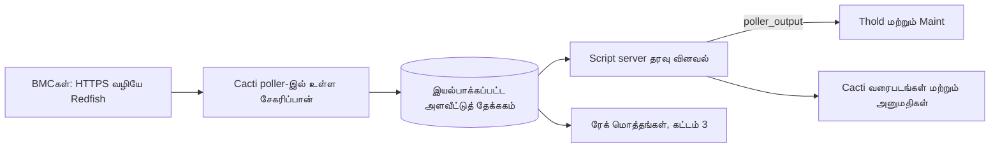

<!-- Source: README.md; SHA256: 7b4e83a58a1adc844cb0615ef30e95476cba2851f96bb454d2a816fb2774724d -->

<!-- translations:start -->
[English](../../../README.md) | [简体中文](../zh-CN/README.md) | [हिन्दी](../hi-IN/README.md) | [Español (España)](../es-ES/README.md) | [Español (Latinoamérica)](../es-419/README.md) | [العربية (السعودية)](../ar-SA/README.md) | [Afrikaans](../af-ZA/README.md) | [አማርኛ](../am-ET/README.md) | [العربية (مصر)](../ar-EG/README.md) | [العربية (المغرب)](../ar-MA/README.md) | [বাংলা](../bn-BD/README.md) | [Deutsch](../de-DE/README.md) | [فارسی](../fa-IR/README.md) | [Filipino](../fil-PH/README.md) | [Français](../fr-FR/README.md) | [Français (Maroc)](../fr-MA/README.md) | [Français (Sénégal)](../fr-SN/README.md) | [Hausa](../ha-NG/README.md) | [עברית](../he-IL/README.md) | [Bahasa Indonesia](../id-ID/README.md) | [Igbo](../ig-NG/README.md) | [Italiano](../it-IT/README.md) | [日本語](../ja-JP/README.md) | [한국어](../ko-KR/README.md) | [Malagasy](../mg-MG/README.md) | [मराठी](../mr-IN/README.md) | [Bahasa Melayu](../ms-MY/README.md) | [Nederlands](../nl-NL/README.md) | [Polski](../pl-PL/README.md) | [Português (Brasil)](../pt-BR/README.md) | [Русский](../ru-RU/README.md) | [Kinyarwanda](../rw-RW/README.md) | [Soomaali](../so-SO/README.md) | [Svenska](../sv-SE/README.md) | [Kiswahili](../sw-KE/README.md) | [தமிழ்](README.md) | [తెలుగు](../te-IN/README.md) | [ไทย](../th-TH/README.md) | [Türkçe](../tr-TR/README.md) | [Українська](../uk-UA/README.md) | [اردو](../ur-PK/README.md) | [Tiếng Việt](../vi-VN/README.md) | [isiXhosa](../xh-ZA/README.md) | [Yorùbá](../yo-NG/README.md) | [繁體中文](../zh-TW/README.md) | [isiZulu](../zu-ZA/README.md)
<!-- translations:end -->

# plugin_redfish

சர்வரின் மின் நுகர்வு, உள்வரும் வெப்பநிலை, விசிறியின் நிலை மற்றும் மின் வழங்கியின் ஆரோக்கியம் ஆகியவற்றை அடிப்படைப் பலகை மேலாண்மைக் கட்டுப்படுத்திகளிலிருந்து (BMCs) Cacti-க்குள் சாதாரண சாதனங்கள், தரவு மூலங்கள் மற்றும் வரைபடங்களாகக் கொண்டுவரும் Cacti 1.2 செருகுநிரல்; இதற்கு Redfish-உம் விருப்பத்தேர்வான IPMI மாற்று வழியும் பயன்படுத்தப்படுகின்றன. பின்னர் Thold எச்சரிக்கைகளை அனுப்பவும் Maint அவற்றை அடக்கவும் செய்கின்றன; அடுத்த கட்டத்தில் ரேக் அளவிலான மொத்த மின் நுகர்வு சேர்க்கப்படும்.

> **நிலை: உருவாக்கத்தில் உள்ளது, இன்னும் வெளியீடு இல்லை (0.1.0-dev).** மைல்கல் 2 (அடித்தளம்) மற்றும் மைல்கல் 3 (Cacti பொருள்கள் மற்றும் எச்சரிக்கை) ஆகியவை `main` கிளையில் இணைக்கப்பட்டுள்ளன. இந்தச் செருகுநிரல் Cacti திட்டத்துடன் தொடர்புடையது அல்ல. இது PHP 8.2 அல்லது அதற்குப் பிந்தைய பதிப்பில் Cacti 1.2.31-இல் நிறுவப்படுகிறது; BMC-களையும் சான்றுகளையும் பதிவு செய்கிறது; Redfish வழியாக ஒவ்வொரு BMC-யிலிருந்தும் மின்சாரம், வெப்பநிலை, விசிறிகள் மற்றும் மின் வழங்கி ஆரோக்கியம் ஆகியவற்றைத் தனது சொந்த தேக்ககத்தில் படித்து, சேகரிப்பு ஆரோக்கியத்தைக் காட்டுகிறது. இது சாதாரண தரவு மூலங்கள் வழியாக Cacti சாதனங்கள், உறுப்பு வாரியான மற்றும் சுருக்க வரைபடங்கள், மேலும் Thold மற்றும் Maint ஆதரவைச் சேர்க்கிறது. கையால் எழுதப்பட்ட நிலைப்பொருள்கள் மற்றும் DMTF Redfish மாதிரி சர்வரிலிருந்து உருவாக்கப்பட்ட போலி BMC-யில் CI சோதித்துள்ளது; உண்மையான BMC அல்லது முன்னோட்டத் தொகுதி எதுவும் இன்னும் தகுதிப்படுத்தப்படவில்லை. வடிவமைப்பும் ஆய்வும் [docs/PLAN.md](../../PLAN.md), [docs/research/](../../research), மற்றும் [docs/decisions/](../../decisions) ஆகியவற்றில் உள்ளன.

### மைல்கல் 2 வழங்குவது

- Cacti-இன் செருகுநிரல் API வழியாக நிறுவுதல், மேம்படுத்துதல், முடக்குதல் மற்றும் நீக்குதல்; அமைப்பு அழிக்கப்படாவிட்டால் நீக்கும்போதும் அட்டவணைகள் தக்கவைக்கப்படும். 8.2-ஐ விடப் பழைய PHP பதிப்பில் இந்தச் செருகுநிரல் நிறுவவோ இயக்கவோ மறுத்து அதற்கான காரணத்தையும் கூறும்.
- "Redfish View" (ஆரோக்கியப் பக்கம்), "Redfish Operator" (செயல்பாட்டுப் பக்கம்) மற்றும் "Redfish Admin" (BMC-கள் மற்றும் சான்றுகள் பக்கங்கள்) ஆகிய அணுகல் மண்டலங்களும், Configuration > Settings > Redfish கீழ் அமைப்புகளும் உள்ளன.
- CSV இறக்குமதி மற்றும் JSON ஏற்றுமதியுடன் கூடிய BMC பதிவேடு. இறக்குமதி கோப்புகளில் கடவுச்சொற்கள் இருக்கக் கூடாது; சான்றுகள் பெயரால் குறிப்பிடப்படுகின்றன.
- சான்றுகள் AES-256-GCM மூலம் மறையாக்கம் செய்யப்பட்டுச் சேமிக்கப்படுகின்றன. திறவுகோல் என்பது தரவுத்தளத்திற்கு வெளியே உள்ள ஒரு கோப்பாகும்; இயல்புநிலையாக `/etc/cacti/redfish-vault.key` ஆகும். இதில் 64 பதினறும எழுத்துகள் (`openssl rand -hex 32`) அல்லது சரியாக 32 சீரற்ற பைட்டுகள் இருக்க வேண்டும்; இது poller பயனருக்குச் சொந்தமானதாகவும், பிற பயனர்களால் படிக்க முடியாததாகவும், poller பயனர் அல்லது root மட்டுமே எழுதக்கூடிய கோப்பகத்திலும் இருக்க வேண்டும். 32 அச்சிடக்கூடிய எழுத்துகளைக் கொண்ட திறவுகோல் கடவுச்சொற்றொடராகக் கருதப்பட்டு நிராகரிக்கப்படும். **தரவுத்தளத்துடன் சேர்த்துத் திறவுகோல் கோப்பையும் காப்புப்பிரதி எடுக்கவும்**; அது இல்லாமல் சேமிக்கப்பட்ட ஒவ்வொரு கடவுச்சொல்லையும் மீண்டும் உள்ளிட வேண்டியிருக்கும்.
- இயல்புநிலையாக TLS சரிபார்ப்பு இயக்கத்தில் இருக்கும்; ஒவ்வொரு BMC-க்கும் தனிப்பட்ட CA தொகுப்பு அல்லது SPKI SHA-256 பின் பயன்படுத்தலாம். பதிவு செய்யப்பட்ட, BMC வாரியான சரிபார்ப்பற்ற விலக்கு ஆரோக்கியப் பக்கத்தில் எச்சரிக்கையாகத் தொடர்ந்து காட்டப்படும்.
- படிக்க மட்டுமேயான Redfish கிளையன்ட்: எந்தவொரு கோரிக்கையும் அனுப்பப்படுவதற்கு முன்பு அனுமதிப் பட்டியலுடன் சரிபார்க்கப்படும் `GET`, மேலும் அமர்வு உள்நுழைவு மற்றும் வெளியேறுதல் மட்டுமே அனுமதிக்கப்படும்.
- முதன்மை poller-இல் உள்ள BMC-களுக்காக `poller_bottom`-இலிருந்து தொடங்கப்படும் சேகரிப்பான்; இதில் BMC வாரியான குத்தகைகள், காலக்கெடுகள், பின்னடைவு மற்றும் செயலிழப்புக்குப் பிறகு செருகுநிரல் பதிவு செய்த அந்த ஒரு அமர்வைத் துப்புரவு செய்தல் ஆகியவை அடங்கும். தொலைநிலைச் சேகரிப்பான்கள் இன்னும் ஆதரிக்கப்படவில்லை; சேகரிப்பான் தரவுத்தளத்தையும் திறவுகோலையும் எவ்வாறு அணுகுகிறது என்பதற்கான தெளிவான தேர்வு அதற்குத் தேவை (கட்டம் 4).
- BMC பதிவுகளும் சான்றுகளும் Cacti சாதன அனுமதிகளைப் பின்பற்றுகின்றன: ஒரு Redfish Admin தாம் பார்க்க அனுமதிக்கப்பட்ட சாதனங்களில் உள்ள BMC-களை மட்டுமே பார்க்கவும் மாற்றவும் இணைக்கவும் முடியும்; மேலும் மறைக்கப்பட்ட சாதனத்தில் உள்ள எந்த BMC-யும் பயன்படுத்தாத சான்றுகளை மட்டுமே அணுக முடியும்.

### மைல்கல் 3 சேர்ப்பது

- வடிவமைப்புகள் `templates/` கோப்பகத்தில் Cacti வடிவமைப்பு XML-ஆக வழங்கப்பட்டு, நிறுவல் மற்றும் மேம்படுத்தலின் போது Cacti-இன் சொந்த இறக்குமதியாளர் மூலம் ஹாஷ் பொருத்தத்துடன் இறக்குமதி செய்யப்படுகின்றன; இதனால் இறக்குமதி செருகுநிரலின் பொருள்களைப் புதுப்பிக்கும் மற்றும் எதையும் இருமுறை சேர்க்காது. மூன்று தரவு வினவல் கோப்புகளும் பதிவு செய்யப்பட்ட ஹாஷுடன் `<cacti>/resource/script_server/` கோப்பகத்திற்கு நகலெடுக்கப்படுகின்றன; தான் எழுதாத கோப்பைச் செருகுநிரல் ஒருபோதும் மாற்றாது, மேலும் வடிவமைப்புகளோ வினவல் கோப்போ இடத்தில் இல்லாதபோது ஆரோக்கியப் பக்கம் நிர்வாகிகளுக்கு எச்சரிக்கை அளிக்கும். BMCs பக்கத்தில் உள்ள **Reinstall the Redfish Templates** அவற்றை மீண்டும் இறக்குமதி செய்கிறது; இதற்கு Cacti-இன் Import Templates அனுமதி தேவை.
- ஒவ்வொரு BMC-யிலும் **Create Device** அல்லது **Add Graphs** ([ADR 0015](../../decisions/0015-attach-to-the-server-device-or-create-one-per-bmc.md)). சர்வரின் ஏற்கனவே உள்ள சாதனத்துடன் இணைக்கப்பட்ட BMC, தனது தரவு வினவல்களையும் வரைபடங்களையும் அந்தச் சாதனத்தில் பெறும். இணைக்கப்படாத BMC, "Redfish BMC" சாதன வடிவமைப்பிலிருந்து புதிய சாதனத்தைப் பெறும்; இதில் இருப்புச் சரிபார்ப்புகள் முடக்கப்பட்டிருக்கும் மற்றும் `.invalid` கீழ் புரவலன் பெயர் இருக்கும், இதனால் Cacti ஒருபோதும் BMC-ஐத் தொடர்பு கொள்ளாது மற்றும் அதன் முகவரியைக் காட்டாது. எந்த வழியிலும், சேர்க்கப்படவுள்ளவற்றைப் பட்டியலிடும் திட்டத்தை நிர்வாகி முதலில் உறுதிப்படுத்த வேண்டும். இவ்விரண்டிற்கும் Redfish Admin அனுமதியுடன் Cacti-இன் சாதன மேலாண்மை அனுமதியும் தேவை; உருவாக்கியவரால் பார்க்க முடியாத புதிய சாதனம் மீண்டும் நீக்கப்படும்.
- "Redfish Fans", "Redfish Temperatures", மற்றும் "Redfish Power Supplies" ஆகிய மூன்று script server தரவு வினவல்கள் BMC-இன் உறுப்புத் திறவுகோலால் அட்டவணைப்படுத்தப்பட்டு, ஒவ்வொரு உறுப்புக்கும் ஒரு வரைபடத்துடன் கிடைக்கும்: விசிறி வேகம் சதவீதம் அல்லது RPM-இல் (BMC எந்த அலகில் அறிக்கையிடுகிறதோ அது), வெப்பநிலை, மற்றும் மின் வழங்கி உள்ளீடு மற்றும் வெளியீடு வாட்டுகள் — ஒவ்வொன்றும் அதன் ஆரோக்கியக் குறியீட்டுடன்.
- மின்சாரம், உள்வரும் வெப்பநிலை, அதிகபட்ச வெப்பநிலை, சரியில்லாத விசிறிகள் மற்றும் வழங்கிகள், கணு ஆரோக்கியம், மற்றும் கடைசியாக நல்ல முறையில் படித்த நேரத்தின் வயது ஆகியவற்றைக் கொண்ட "Redfish Node Summary" உள்ளீடு நான்கு வரைபடங்களில் வரையப்படுகிறது: மின்சாரம், வெப்பநிலை, கூறு ஆரோக்கியம், மற்றும் தரவு வயது. இந்தத் தரவு மூலங்களில் உள்ள Thold வரம்புகள் எச்சரிக்கை அளிக்கும், மற்றும் Maint அவற்றை அடக்கும்; இவற்றிற்காக அந்த இரு செருகுநிரல்களிலும் எந்த மாற்றமும் தேவையில்லை.
- script server செருகுநிரலின் தேக்ககத்திலிருந்து மட்டுமே பதிலளிக்கிறது; ஒருபோதும் BMC-ஐத் தொடர்பு கொள்ளாது. விடுபட்ட, பழையதான, வேறொரு அலகில் உள்ள, அல்லது இல்லாமல் போன உறுப்பிலிருந்து வரும் மதிப்பு `U` ஆகும்; இதனால் வரைபடங்கள் சுழியத்திற்குப் பதிலாக இடைவெளியைக் காட்டும். `age` எப்போதும் ஒரு மதிப்பைக் கொண்டிருக்கும், எனவே அதன் மீதான வரம்பு பதிலளிப்பதை நிறுத்திய BMC-ஐக் கண்டறியும்.
- ஒவ்வொரு Redfish வரைபடத்திலிருந்தும் அந்தச் சாதனத்தின் Redfish வரைபடங்களுக்கான இணைப்பு இருக்கும்; இது Cacti அந்தச் சாதனத்தைப் பார்க்க அனுமதிக்கும் பயனர்களுக்கு மட்டுமே காட்டப்படும்.

**ஒரு BMC-இன் உறுப்புகள் மாறும்போது** (விசிறி மாற்றப்பட்டால், நிலைபொருள் புதுப்பிப்பு உணரிகளின் பெயரை மாற்றினால்), மீண்டும் **Add Graphs** என்பதைத் தேர்ந்தெடுக்கவும். முன்பு இருந்து இப்போது இல்லாத அல்லது நீக்கப்பட்ட விசிறி அல்லது மின் வழங்கி, நீங்கள் இதைச் செய்யும் வரை `fans_bad` அல்லது `psus_bad`-இல் கணக்கிடப்படும்; இதனால் கழற்றப்பட்ட விசிறி எச்சரிக்கை அளிக்கும். ஒருபோதும் நிரப்பப்படாத இடம் கணக்கிடப்படாது. Add Graphs இப்போது BMC அறிக்கையிடும் உறுப்புகளை ஏற்றுக்கொள்கிறது, மேலும் Cacti வினவல்களை மீண்டும் அட்டவணைப்படுத்துகிறது; இல்லாமல் போன உறுப்பு தனது தரவு மூலத்தையும் வரைபடத்தையும் தக்கவைத்துக்கொண்டு இனி `U` எனப் படிக்கும், மேலும் புதிய உறுப்புக்குப் புதிய வரைபடம் கிடைக்கும். இல்லாமல் போன உறுப்புகளின் வரலாறு இனித் தேவையில்லை எனும்போது அவற்றின் வரைபடங்களைக் கைமுறையாக நீக்கவும்.

ஒரு சாதனத்தை நீக்குவது அதன் BMC-இன் இணைப்பை நீக்கும்; ஆனால் BMC-யையும் அதன் தேக்ககத்தையும் தக்கவைக்கும். ஒரு BMC-ஐ நீக்குவது அல்லது செருகுநிரலை நீக்குவது, அதன் சாதனத்தையும் வரைபடங்களையும் தக்கவைக்கும்.

## அணுகல் பாத்திரங்கள்

| மண்டலம் | அணுகல் |
| --- | --- |
| Redfish View | தற்போதுள்ள கண்காணிப்புப் பக்கங்கள். |
| Redfish Operator | கண்காணிப்புடன் செயல்பாடுகள் பக்கமும் தனிப்பட்ட முன்னுரிமை ஒப்புதல்களும். |
| Redfish Admin | Operator அணுகலுடன் தற்போதுள்ள கட்டமைப்பு மற்றும் நிர்வாகச் செயல்கள். |

மேம்படுத்தல் கோப்புகளை நகலெடுத்த பிறகு, புதிய மண்டலத்தைப் பதிவு செய்ய நிர்வாகியாக Plugins பக்கத்தைத் திறக்கவும். **Configuration > Users** அல்லது பயனர் குழுக்களின் கீழ் Operator மண்டலத்தை வெளிப்படையாக ஒதுக்கவும். மேம்படுத்தல்கள் தற்போதுள்ள View மற்றும் Admin மண்டல ID-களையும் அனுமதிகளையும் தக்கவைக்கின்றன. ஒவ்வொரு கோரிக்கையிலும் Admin அணுகல் Operator அணுகலையும், Operator அணுகல் View அணுகலையும் மரபுரிமையாகப் பெறுகிறது; இது பயனர்கள் அல்லது குழுக்களுக்குச் சேமிக்கப்பட்ட அனுமதிகளைச் சேர்க்காது. செருகுநிரல் அமைப்புகளுக்கும் Cacti-இன் Settings அனுமதியுடன் Redfish Admin அணுகல் தேவை.

Cacti சாதன அனுமதிகள் ஒவ்வொரு பயனருக்கும் கிடைக்கும் வரிசைகளையும் செயல்களையும் தொடர்ந்து கட்டுப்படுத்துகின்றன; இணைக்கப்படாத பொருள்களுக்கு நிர்வாகி தேவை. அடுத்த திட்டமிடப்பட்ட இயக்கத்திற்காக அனுமதிக்கப்பட்ட BMC-இல் உள்ள சேகரிப்புத் தடையை Operators விடுவிக்க முடியும். சான்றுகள், கட்டமைப்பு, இணைத்தல், நீக்குதல் மற்றும் பிற நிர்வாக மாற்றங்கள் நிர்வாகப் பக்கங்களிலேயே இருக்கும். ஒப்புதல்கள் தற்போதைய பயனரின் அமர்வில் மட்டுமே, அதிகபட்சம் ஒரு மணி நேரத்திற்கும், அதே கவனிப்புப் புதிதாக இருக்கும் வரை மட்டுமே நீடிக்கும். புதிய அல்லது மாறிய கவனிப்புகள் அவற்றைச் செல்லாததாக்கும். அவை ஒருபோதும் தோல்வியடைந்த அளவீட்டை ஆரோக்கியமானதாகக் குறிக்கவோ எச்சரிக்கைகளை அடக்கவோ செய்யாது.

## ஏன்

ஒவ்வொரு சர்வரிலும் இயக்க முறைமையிலிருந்து சுயாதீனமாக மின்சாரம் மற்றும் வெப்ப நிலையை அறிக்கையிடும் ஒரு BMC உள்ளது; எனவே OS செயலிழந்தாலும் அது தொடர்ந்து பதிலளிக்கிறது. இந்தத் தரவு திறன் மற்றும் செலவுக் கண்காணிப்பு, பழுதடைந்த விசிறி அல்லது மின் வழங்கிக்கான முன்கூட்டிய எச்சரிக்கை, மற்றும் உயர்-செயல்திறன் கணினியியலில் மின்சார உச்சவரம்பு முடிவுகளுக்குப் பயன்படுகிறது. இந்தச் செருகுநிரல் HPC-க்கு மட்டுமே உரியது அல்ல.

இன்று Cacti இதன் ஒரு பகுதியை உள்ளடக்குகிறது:

- **விற்பனையாளர் SNMP தொகுப்புகள்.** 1.2.x கிளை SNMP முகவர் தேவைப்படும் மற்றும் விற்பனையாளர் சார்ந்த Dell iDRAC மற்றும் HPE iLO வடிவமைப்புகளை வழங்குகிறது; மைல்கல் 1 ஆய்வில் இவை இரண்டும் வாட்டுகளில் மின் நுகர்வை அறிக்கையிடுவதில்லை என்பது கண்டறியப்பட்டது ([docs/research/overlap.md](../../research/overlap.md)).
- **சேகரிப்பான் இல்லாத ஒரு சான்று வகை.** plugin_credentials என்பது "IPMI / Redfish (BMC)" சான்றை வரையறுக்கிறது, ஆனால் எந்த BMC-ஐயும் படிப்பதில்லை.
- **ரேக்-நிலை பார்வை இல்லை.** Cacti மையத்தில் ரேக் பொருள் இல்லை; ஒரு சாதனத்தில் சுதந்திர-உரை `location` புலம் மட்டுமே உள்ளது.

இந்தச் செருகுநிரல் Cacti-இன் poll சுழற்சிக்கு வெளியே BMC-களைக் கண்காணித்து, இயல்பாக்கப்பட்ட அளவீடுகளைத் தேக்ககத்தில் சேமித்து, script server தரவு வினவல் மற்றும் சுருக்கத் தரவு மூலங்கள் வழியாக அவற்றை வெளிப்படுத்துகிறது. இது Cacti-இன் வரைபட உருவாக்கம், அனுமதிகள், Thold மற்றும் Maint ஆகியவற்றை மீண்டும் பயன்படுத்துகிறது மற்றும் BMC நிலையை மாற்றாது. தொலைநிலைத் தரவு சேகரிப்பான் ஆதரவு கட்டம் 4-இல் திட்டமிடப்பட்டுள்ளது; தற்போதைய சேகரிப்பு முதன்மை poller-இல் மட்டுமே இயங்குகிறது.

## திட்டமிடப்பட்ட நோக்கம்

| கட்டம் | நோக்கம் | மைல்கற்கள் |
|---|---|---|
| 0, ஆய்வு | விற்பனையாளர் அணி, நேரடி BMC-களில் மேல்நிலை நடத்தையை உறுதிப்படுத்தல், கண்காணிப்புச் செலவு, தரவு வினவல் சோதனை | [M1](https://github.com/somethingwithproof/plugin_redfish/milestone/1) |
| 1, கண்காணிப்பு | BMC பதிவேடு, சான்றுகள், TLS, Redfish சேகரிப்பான், இயல்பாக்கப்பட்ட அளவீடுகள், சாதனங்கள், அட்டவணை வாரியான வரைபடங்கள், Thold எச்சரிக்கை, Maint அடக்குதல், ஆரோக்கியப் பக்கம் | [M2](https://github.com/somethingwithproof/plugin_redfish/milestone/2), [M3](https://github.com/somethingwithproof/plugin_redfish/milestone/3), [M4](https://github.com/somethingwithproof/plugin_redfish/milestone/4) |
| 2, ipmi | பயன்படுத்தக்கூடிய Redfish இல்லாத BMC-களுக்கான IPMI மாற்று வழி, இயல்புநிலையாக முடக்கப்பட்டது | [M5](https://github.com/somethingwithproof/plugin_redfish/milestone/5) |
| 3, ரேக்குகள் | ரேக் பதிவேடு, உள்ளடக்கத்துடன் கூடிய ரேக் மொத்த மின்சாரம், பட்ஜெட் இடைவெளி | [M6](https://github.com/somethingwithproof/plugin_redfish/milestone/6) |
| 4, தொலைநிலை | தனிமைப்படுத்தப்பட்ட BMC பிணையங்களுக்கான Cacti தொலைநிலைத் தரவு சேகரிப்பான்கள் | [M7](https://github.com/somethingwithproof/plugin_redfish/milestone/7) |

நோக்கத்திற்கு அப்பாற்பட்டவை: மின் உச்சவரம்புகளை அமைத்தல் அல்லது வேறு எந்த BMC கட்டமைப்பும், மின் கட்டுப்பாடு, நிலைபொருள் புதுப்பிப்பு, கன்சோல் அணுகல், செருகுநிரலுக்குச் சொந்தமான எச்சரிக்கை இயந்திரம், மற்றும் அட்டவணைப்படுத்தி ஒருங்கிணைப்பு.

## இணக்கத்தன்மை இலக்குகள்

| கூறு | இலக்கு |
|---|---|
| Cacti | 1.2.31 அல்லது அதற்குப் பிந்தையது, மையத் திருத்தங்கள் தேவையில்லை |
| தரவுத்தளம் | MariaDB 10.2 அல்லது MySQL 5.7 அல்லது அதற்குப் பிந்தையது: உருவாக்கப்பட்ட நெடுவரிசையில் உள்ள தனித்துவத் திறவுகோல் மூலம் ஒரு சாதனத்திற்கு ஒரு BMC பராமரிக்கப்படுகிறது |
| PHP | 8.2 அல்லது அதற்குப் பிந்தையது; ஆதரிக்கப்படாத இயக்க நேரத்தில் Cacti UI உடைவதற்குப் பதிலாக மறுப்புச் செய்தி கிடைக்குமாறு `setup.php` 8.0-இலும் பாகுபடுத்தக்கூடியதாக இருக்கும் |
| BMCs | நிலைபொருள் வரம்பின் அடிப்படையில் Dell iDRAC, HPE iLO, Lenovo XCC, மற்றும் OpenBMC; [விற்பனையாளர் அணி](../../research/vendor-matrix.md) பார்க்கவும் |
| Redfish | முதலில் புதிய துணை அமைப்பு மற்றும் உணரி வளங்கள், மாற்று வழியாகப் பழமையான `Power` மற்றும் `Thermal` |
| Thold, Maint | எந்த மாற்றமும் தேவையில்லை |

## வடிவமைப்பு

- [docs/PLAN.md](../../PLAN.md) என்பது முழுத் திட்டமாகும்: கட்டமைப்பு, அது சார்ந்துள்ள மேல்நிலை உண்மைகள் (ஆதாரங்கள் மற்றும் இன்னும் உறுதிப்படுத்தப்பட வேண்டிய அனுமானங்களுடன்), அளவீட்டு மாதிரி, பாதுகாப்பு எல்லைகள், செயல்திறன் கணக்கீடுகள், சோதனை மற்றும் அபாயங்கள்.
- [docs/decisions/](../../decisions) ஏற்கனவே எடுக்கப்பட்ட தேர்வுகளுக்கான கட்டமைப்பு முடிவுப் பதிவுகளைக் கொண்டுள்ளது.
- [docs/REQUIREMENTS.md](../../REQUIREMENTS.md) ஒவ்வொரு தேவை ID-ஐயும் அதன் சிக்கலுடன் இணைக்கிறது.

## பாதுகாப்பு

BMC சான்றுகள் சர்வர்களின் அலைவரிசைக்கு வெளியேயான மேலாண்மையைக் கட்டுப்படுத்துகின்றன. இந்த வடிவமைப்பு அவற்றைக் கட்டளை வரிகள், பதிவுகள் மற்றும் பக்கங்களிலிருந்து விலக்கி வைக்கிறது, இயல்புநிலையாக TLS-ஐச் சரிபார்க்கிறது, அனுமதிப் பட்டியலிடப்பட்ட துணைக் கட்டளைகளுடன் கூடிய தருமதிப்பு அணியிலிருந்து எந்தவொரு வெளிப்புறக் கட்டளையையும் இயக்குகிறது, மற்றும் படிக்க மட்டுமேயான BMC கணக்குகளைப் பயன்படுத்துகிறது. [docs/PLAN.md](../../PLAN.md#security) மற்றும் [SECURITY.md](../../../SECURITY.md) பார்க்கவும்.

## இயக்குநர் வழிகாட்டி

நிறுவல் முன்நிபந்தனைகள், பெட்டகம் மற்றும் TLS அமைப்பு, BMC பதிவு, வரைபட உருவாக்கம், எச்சரிக்கை இடைவெளிகள், காப்புப்பிரதி மற்றும் தோல்வி கையாளுதல் ஆகியவற்றிற்கு [docs/operator-guide.md](../../operator-guide.md) பார்க்கவும். அந்த நிலைபொருளிலிருந்து திருத்தப்பட்ட பதிவு சோதனைத் தொகுப்பில் தேர்ச்சி பெறும் வரை, எந்தவொரு உண்மையான விற்பனையாளர் நிலைபொருள் வரிசையும் ஆதரிக்கப்படுவதாக இந்த வழிகாட்டி அறிவிக்காது.

## பணிகள் எவ்வாறு கண்காணிக்கப்படுகின்றன

- **மைல்கற்கள்** திட்டத்தின் மைல்கற்களைப் பின்பற்றுகின்றன. ஒவ்வொன்றிலும் அதன் துணைச் சிக்கல்களையும் வெளியேறுதல் சான்றுகளையும் பட்டியலிடும் ஒரு எபிக் சிக்கல் உள்ளது.
- **சிக்கல்கள்** அடையாளச் சீட்டுகளால் வகைப்படுத்தப்படுகின்றன: `type: requirement`, `type: research`, `type: decision`, `type: epic`. தேவைச் சிக்கல்கள் எண்ணிடப்பட்ட, சோதிக்கக்கூடிய தேவைகளையும் (`REQ-AREA-NNN`) ஏற்பு அளவுகோல்களையும் குறிப்பிடுகின்றன.
- **அடையாளச் சீட்டுகள்** `area:`, `phase:`, `priority:`, மற்றும் `status:` ஆகியவற்றையும் கொண்டுள்ளன. [CONTRIBUTING.md](../../../CONTRIBUTING.md#labels) பார்க்கவும்.
- மைல்கற்கள் முழுவதிலும் உள்ள அனைத்துச் சிக்கல்களையும் [திட்டப் பலகை](https://github.com/users/somethingwithproof/projects/12) காட்டுகிறது.

## பங்களித்தல்

[CONTRIBUTING.md](../../../CONTRIBUTING.md) படிக்கவும். கமிட்களுக்கு DCO ஒப்பம் தேவை. வடிவமைப்பு விவாதம் சிக்கல்களில் நடைபெறுகிறது; திறந்த முடிவுகள் `type: decision` அடையாளச் சீட்டைக் கொண்டுள்ளன. இப்போது உண்மையான BMC-களிலிருந்து கிடைக்கும் சான்றுகளே மிகவும் பயனுள்ள பங்களிப்பாகும்; எந்தவொரு பதிவையும் பதிவிடுவதற்கு முன்பு முகவரிகள், வரிசை எண்கள் மற்றும் சான்றுகளை மறைக்கவும்.

## உரிமம்

GNU General Public License v2.0, இது Cacti மற்றும் அதன் செருகுநிரல்களின் அதே உரிமமாகும். [LICENSE](../../../LICENSE) பார்க்கவும்.
