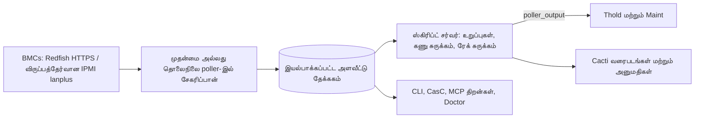

<!-- Source: README.md; SHA256: cf31b9f80d6c00020bbe08e80951d4de1c910793911d040ae7a66b54e8a2eaf0 -->

<!-- translations:start -->
[English](../../../README.md) | [简体中文](../zh-CN/README.md) | [हिन्दी](../hi-IN/README.md) | [Español (España)](../es-ES/README.md) | [Español (Latinoamérica)](../es-419/README.md) | [العربية (السعودية)](../ar-SA/README.md) | [Afrikaans](../af-ZA/README.md) | [አማርኛ](../am-ET/README.md) | [العربية (مصر)](../ar-EG/README.md) | [العربية (المغرب)](../ar-MA/README.md) | [বাংলা](../bn-BD/README.md) | [Bosanski](../bs-BA/README.md) | [Deutsch](../de-DE/README.md) | [فارسی](../fa-IR/README.md) | [Filipino](../fil-PH/README.md) | [Français](../fr-FR/README.md) | [Français (Maroc)](../fr-MA/README.md) | [Français (Sénégal)](../fr-SN/README.md) | [Hausa](../ha-NG/README.md) | [עברית](../he-IL/README.md) | [Hrvatski](../hr-HR/README.md) | [Bahasa Indonesia](../id-ID/README.md) | [Igbo](../ig-NG/README.md) | [Italiano](../it-IT/README.md) | [日本語](../ja-JP/README.md) | [한국어](../ko-KR/README.md) | [Malagasy](../mg-MG/README.md) | [मराठी](../mr-IN/README.md) | [Bahasa Melayu](../ms-MY/README.md) | [Nederlands](../nl-NL/README.md) | [Polski](../pl-PL/README.md) | [Português (Brasil)](../pt-BR/README.md) | [Русский](../ru-RU/README.md) | [Kinyarwanda](../rw-RW/README.md) | [Soomaali](../so-SO/README.md) | [Српски](../sr-RS/README.md) | [Svenska](../sv-SE/README.md) | [Kiswahili](../sw-KE/README.md) | [தமிழ்](README.md) | [తెలుగు](../te-IN/README.md) | [ไทย](../th-TH/README.md) | [Türkçe](../tr-TR/README.md) | [Українська](../uk-UA/README.md) | [اردو](../ur-PK/README.md) | [Tiếng Việt](../vi-VN/README.md) | [isiXhosa](../xh-ZA/README.md) | [Yorùbá](../yo-NG/README.md) | [繁體中文](../zh-TW/README.md) | [isiZulu](../zu-ZA/README.md)
<!-- translations:end -->

# plugin_redfish

சர்வரின் மின் நுகர்வு, உள்வரும் வெப்பநிலை, விசிறியின் நிலை மற்றும் மின் வழங்கியின் ஆரோக்கியம் ஆகியவற்றை அடிப்படைப் பலகை மேலாண்மைக் கட்டுப்படுத்திகளிலிருந்து (BMCs) Cacti-க்குள் சாதாரண சாதனங்கள், தரவு மூலங்கள் மற்றும் வரைபடங்களாகக் கொண்டுவரும் Cacti 1.2 செருகுநிரல்; இதற்கு Redfish-உம் விருப்பத்தேர்வான படிக்க-மட்டுமான IPMI மாற்று வழியும் ரேக்-நிலை மின் தொகுப்புகளும் பயன்படுத்தப்படுகின்றன. Thold மற்றும் Maint ஆகியவை நிலையான Cacti தரவு மூலங்கள் வழியாக எச்சரிக்கைகளை அனுப்பவும் அவற்றை அடக்கவும் செய்கின்றன.

> **நிலை: உருவாக்கத்தில் உள்ளது, இன்னும் வெளியீடு இல்லை (`0.1.0-dev`).** இந்தச் செருகுநிரல் Cacti திட்டத்துடன் தொடர்புடையது அல்ல. இது PHP 8.2 அல்லது அதற்குப் பிந்தைய பதிப்பில் Cacti 1.2.31 அல்லது அதற்குப் பிந்தைய பதிப்பில் நிறுவப்படுகிறது; மேலும் Redfish சேகரிப்பான், மறையாக்கப்பட்ட சான்று பெட்டகம் (credential vault), Cacti சாதனம் மற்றும் வரைபட வழங்கல், விருப்பத்தேர்வான படிக்க-மட்டுமான IPMI மாற்று வழி, ரேக் மின் தொகுப்பு, Cacti Maint சாளரக் காட்சி, தொலைநிலை தரவு சேகரிப்பான் பிரதியெடுப்பு மற்றும் முகவர் முனைகள், CasC வழங்குநர் மற்றும் இயக்குநர் CLI, MCP திறன்கள், மற்றும் Doctor கண்டறியும் சோதனைகள் ஆகியவற்றைச் செயல்படுத்துகிறது. CI சோதனைக் கட்டமைப்புகள், DMTF Redfish Mockup Server (துணை அமைப்பு, பழைய முறை மட்டும், மற்றும் HPE iLO Gen11 மாதிரிகள்), மற்றும் Maint v1.3 உடன் Thold v1.8.2 ஆகியவற்றைச் சோதிக்கிறது; நேரடி இயற்பியல் BMC அல்லது முன்னோட்டத் தொகுதி எதுவும் இன்னும் தகுதிப்படுத்தப்படவில்லை. வடிவமைப்பும் ஆய்வும் [docs/PLAN.md](../../PLAN.md), [docs/research/](../../research/), மற்றும் [docs/decisions/](../../decisions/) ஆகியவற்றில் உள்ளன.

## செயல்படுத்தப்பட்ட திறன்கள்

### மைய சேகரிப்பான், பெட்டகம், மற்றும் Cacti பொருள்கள்

- **வாழ்க்கைச் சுழற்சி மற்றும் தரவுத்தள அமைப்பு.** Cacti-யின் செருகுநிரல் API வழியாக நிறுவல், மேம்படுத்தல், முடக்கம் மற்றும் நீக்கம் நடைபெறுகிறது (`Schema::VERSION = 3`, 12 அட்டவணைகள்). *Keep Plugin Tables on Uninstall* தேர்வு நீக்கப்படாவிட்டால் நீக்கத்தின் போது அட்டவணைகள் தக்கவைக்கப்படும். நுழைவுப் புள்ளிகள் PHP 8.0-இல் பாகுபடுத்தப்படுகின்றன; மேலும் 8.2-க்குக் கீழான PHP அல்லது `ext-openssl` இல்லாதிருப்பதைத் தெளிவான பிழைச் செய்தியுடன் மறுக்கின்றன.
- **பதிவகம் மற்றும் அனுமதிகள்.** *Redfish View* (`redfish_health.php`), *Redfish Operator* (`redfish_operator.php`), மற்றும் *Redfish Admin* (`redfish_bmcs.php`, `redfish_credentials.php`) ஆகிய அதிகாரப் பகுதிகள், மேலும் **Configuration > Settings > Redfish** கீழ் உள்ள அமைப்புகள். BMC பதிவகம் CSV இறக்குமதி (சான்றுகள் பெயரால் குறிப்பிடப்படுகின்றன; இறக்குமதி கோப்புகளில் உள்ள கடவுச்சொற்கள் மறுக்கப்படும்) மற்றும் JSON ஏற்றுமதியை ஆதரிக்கிறது. BMC பதிவுகளும் சான்றுகளும் Cacti சாதன அனுமதிகளைப் பின்பற்றுகின்றன.
- **மறையாக்கப்பட்ட சான்று பெட்டகம்.** கடவுச்சொற்கள் `plugin_redfish_secret`-இல் AES-256-GCM மூலம் மறையாக்கப்பட்டு சேமிக்கப்படுகின்றன. திறவுகோல் தரவுத்தளத்திற்கு வெளியே (`/etc/cacti/redfish-vault.key` இயல்புநிலையாக) 64 அறுபதின்ம எழுத்துகளாக (`openssl rand -hex 32`) அல்லது 32 மூல பைட்டுகளாக உள்ளது; இது poller பயனருக்குச் சொந்தமானதாகவும், பிற பயனர்களால் படிக்க முடியாததாகவும், root அல்லது அந்தப் பயனரால் மட்டுமே எழுதக்கூடிய கோப்பகத்திலும் இருக்க வேண்டும். 32-எழுத்து அச்சிடக்கூடிய கடவுச்சொற்றொடர் மறுக்கப்படும். **தரவுத்தளத்துடன் திறவுகோல் கோப்பையும் காப்புப் பிரதி எடுக்கவும்**; அது இல்லாமல் சேமிக்கப்பட்ட கடவுச்சொற்களை மீண்டும் உள்ளிட வேண்டும்.
- **TLS மற்றும் படிக்க-மட்டுமான Redfish கிளையண்ட்.** கணினி CA சேமிப்பகம், ஒவ்வொரு BMC-க்குமான CA தொகுப்பு, அல்லது SPKI SHA-256 பின் ஆகியவற்றைப் பயன்படுத்தி TLS சரிபார்ப்பு இயல்புநிலையாக இயக்கப்பட்டுள்ளது; சரிபார்க்காத தனிப்பட்ட BMC விலக்கு ஆரோக்கிய எச்சரிக்கையாகவும் Doctor சோதனை எச்சரிக்கையாகவும் தெரியும். கிளையண்ட் `GET` மற்றும் Redfish அமர்வு உள்நுழைவு (`POST`), வெளியேற்றம் (`DELETE`) ஆகியவற்றை மட்டுமே அனுமதிக்கிறது; அமர்வுகள் கிடைக்காதபோது ஒவ்வொரு BMC-க்கும் விருப்பத்தேர்வான Basic மாற்று வழி உள்ளது. கண்டறிதல் புதிய Redfish துணை அமைப்பு மற்றும் உணரி வளங்களை முதலில் தேர்ந்தெடுத்து, பழமையான `Power` மற்றும் `Thermal` வளங்களை மாற்று வழியாகப் பயன்படுத்துகிறது.
- **சேகரிப்பான் இயக்கம்.** `poller_redfish.php` என்பது `poller_bottom`-இலிருந்து தொடங்கி, கட்டமைக்கக்கூடிய பணியாளர் செயல்முறைகளுடன் (`redfish_workers`) Cacti-யின் செயல்முறை பதிவகம் வழியாக ஒரு poller-க்கு ஒரு முதன்மை செயல்முறையை இயக்குகிறது, ஒவ்வொரு BMC-க்குமான குத்தகைகளைப் பெறுகிறது, நேர வரம்பை (`redfish_collector_budget`) செயல்படுத்துகிறது, அடுக்குக்குறி பின்வாங்கலைப் பயன்படுத்துகிறது, மேலும் செயலிழப்புக்குப் பிறகு செருகுநிரலின் முந்தைய அமர்வைச் சுத்தம் செய்கிறது.
- **வார்ப்புருக்கள், சாதனங்கள், மற்றும் வரைபடங்கள்.** ஹாஷ் அடிப்படையில் `templates/redfish-templates.xml`-ஐ இறக்குமதி செய்து, பயனர் மாற்றியமைத்த கோப்புகளை மேலெழுதாமல் `<cacti>/resource/script_server/`-க்குள் மூன்று ஸ்கிரிப்ட் சர்வர் தரவு வினவல் XML கோப்புகளை (`redfish_fans.xml`, `redfish_temperatures.xml`, `redfish_psus.xml`) நகலெடுக்கிறது. **Create Device** மற்றும் **Add Graphs** ஆகியவற்றிற்கு வழங்கல் திட்டத்தின் உறுதிப்படுத்தல் தேவை; இவை வினவல்களை ஒதுக்கப்பட்ட சர்வர் சாதனத்துடன் இணைக்கின்றன அல்லது கிடைக்கும் நிலைச் சரிபார்ப்புகள் முடக்கப்பட்ட `.invalid` கீழ் ஒரு "Redfish BMC" சாதனத்தை உருவாக்குகின்றன, மேலும் `graph_buttons` வழியாக ஒவ்வொரு Redfish வரைபடத்தையும் சாதனத்தின் Redfish வரைபடங்களுடன் மீண்டும் இணைக்கின்றன.
- **தேக்ககம்-மட்டுமான ஸ்கிரிப்ட் சர்வர் உள்ளீடுகள்.** `scripts/ss_redfish_members.php` ஒவ்வொரு உறுப்புக்குமான விசிறி, வெப்பநிலை மற்றும் PSU அளவீடுகளை வழங்குகிறது, மேலும் `scripts/ss_redfish_summary.php` "Redfish Node Summary" அளவீடுகளை (மின்சாரம், உள்வரும் மற்றும் அதிகபட்ச வெப்பநிலை, பழுதடைந்த விசிறி மற்றும் PSU எண்ணிக்கைகள், கணு ஆரோக்கியம், மற்றும் கடைசி நல்ல வாசிப்பின் வயது) வழங்குகிறது. ஸ்கிரிப்ட் சர்வர் அழைப்புகள் உள்ளூர் தேக்ககத்தை மட்டுமே படிக்கின்றன, ஒருபோதும் BMC-ஐத் தொடர்பு கொள்வதில்லை. விடுபட்ட, பழமையான, அல்லது நீக்கப்பட்ட உறுப்பினரின் அளவீடுகள் `U`-ஐத் திருப்பி அனுப்புகின்றன (ஒருபோதும் `0` அல்ல), அதே சமயம் அமைதியான BMC-களை வரம்புகள் கண்டறியும் வகையில் `age` எப்போதும் ஒரு மதிப்பைப் புகாரளிக்கிறது.

**ஒரு BMC-யின் உறுப்புகள் மாறும்போது** (மாற்றப்பட்ட விசிறி அல்லது உணரிகளின் பெயர்களை மாற்றும் நிலைப்பொருள் புதுப்பிப்பு போன்றவை), **Add Graphs**-ஐ மீண்டும் இயக்கவும். முன்பு இருந்த ஒரு விசிறி அல்லது மின் வழங்கி இல்லாமல் போனால், ஏற்கப்படும் வரை `fans_bad` அல்லது `psus_bad`-இல் கணக்கிடப்படும்; ஒருபோதும் பொருத்தப்படாத இடத்திற்கு இது கணக்கிடப்படாது. நீக்கப்பட்ட உறுப்புகள் தங்களின் தற்போதைய தரவு மூலங்களையும் வரைபடங்களையும் தக்கவைத்துக்கொள்கின்றன; அவை கையால் நீக்கப்படும் வரை அதன் பிறகு `U`-ஐக் காட்டும். Cacti சாதனத்தை நீக்குவது அதன் BMC இணைப்பைத் துண்டித்து ரேக் ஒதுக்கீட்டை நீக்கும், ஆனால் BMC மற்றும் தேக்ககத்தைத் தக்கவைக்கும்; BMC-ஐ நீக்குவது அல்லது செருகுநிரலை நீக்குவது Cacti சாதனங்களையும் வரைபடங்களையும் தக்கவைக்கும்.

### விருப்பத்தேர்வான IPMI மாற்று வழி

- **BMC வாரியான விருப்பத்தேர்வு.** இயல்புநிலையாக அணைக்கப்பட்டுள்ளது (`protocols` இயல்புநிலையாக `redfish` ஆகும்; IPMI மாற்று வழியை இயக்குவது `redfish,ipmi`-ஐ அமைக்கும்).
- **வரையறுக்கப்பட்ட மாற்று வழித் தூண்டி.** தகுதியான தோல்வி வகுப்புடன் Redfish சேகரிப்பு தோல்வியடையும் போது மட்டுமே இயங்கும்; `AuthRejected`, `CredentialUnavailable`, `AddressRefused`, `OperationRefused`, அல்லது `Deadline` ஆகியவற்றில் ஒருபோதும் தூண்டப்படாது.
- **பாதுகாப்பான இயக்கம்.** ஷெல் இல்லாமல் வரிசை-வடிவ `proc_open()` வழியாக `-I lanplus` மூலம் `ipmitool`-ஐ அழைக்கிறது, வரையறுக்கப்பட்ட நேர வரம்பும் 256 KiB வெளியீட்டு வரம்பும் கொண்டது. கடவுச்சொற்கள் `IPMITOOL_PASSWORD` (`-E`) அல்லது `finally`-இல் நீக்கப்படும் mode-0600 தற்காலிக கோப்பு (`-f`) வழியாக வழங்கப்படுகின்றன, ஒருபோதும் CLI argv-இல் அல்ல.
- **படிக்க-மட்டுமான கட்டளை அனுமதிப் பட்டியல்.** ஐந்து படிக்க-மட்டுமான துணைக்கட்டளைகள் மட்டுமே அனுமதிக்கப்படுகின்றன: `dcmi power reading`, `sdr type Temperature`, `sdr type Fan`, `sdr type Power Supply`, மற்றும் `chassis status`. மாற்றம் செய்யும் கட்டளைகள் மறுக்கப்படுகின்றன.
- **இயல்பாக்கப்பட்ட வெளியீடு மற்றும் நிலை எச்சரிக்கை.** `IpmiNormalizer` அளவீடுகளை அதே `Observation`/`Member`/`Reading` மாதிரியில் இணைத்து, விடுபட்ட அல்லது பாகுபடுத்த முடியாத உணரிகளுக்கு `U`-ஐ வெளியிடுகிறது. IPMI மாற்று வழியை இயக்குவது, UDP 623-ஐ மேலாண்மை VLAN-க்குக் கட்டுப்படுத்துமாறு இயக்குநர்களுக்கு நினைவூட்டி, ஆரோக்கியப் பக்கத்திலும் `redfish.bmc_security` Doctor சோதனையிலும் எச்சரிக்கையை எழுப்புகிறது.

### ரேக் மின் தொகுப்பு

- **ரேக் பதிவகம்.** பதிப்பு 3 அமைப்பு `plugin_redfish_rack` (தனித்துவமான `(site_id, name)`, விருப்பத்தேர்வான `power_budget_watts`, இயல்புநிலையாக `80` கொண்ட `min_coverage_pct`, மற்றும் குறிப்புகள்) மற்றும் `plugin_redfish_rack_member` (ஒவ்வொரு `host_id`-க்கும் அதிகபட்சம் ஒரு ரேக் ஒதுக்கீடு, விருப்பத்தேர்வான `bmc_id` மற்றும் `unit_position`, Cacti சாதனம் நீக்கப்படும்போது தானாக நீக்கப்படும்) ஆகியவற்றைச் சேர்க்கிறது.
- **உள்ளடக்க வரம்பு பாதுகாக்கப்பட்ட மொத்தங்கள்.** `RackPowerSummary` உள்ளூர் தேக்ககத்திலிருந்து புதிய உறுப்பினர் `power_watts` அளவீடுகளைக் கூட்டி, பட்ஜெட் பயன்பாட்டையும் மீதமுள்ள திறனையும் கணக்கிடுகிறது. அறிக்கையிடும் உறுப்பினர் உள்ளடக்கம் `min_coverage_pct`-க்குக் கீழே குறையும் போது, சேகரிப்பான் தோல்விகள் ஒருபோதும் ரேக் மின்சாரத்தில் சரிவாகத் தோன்றாதவாறு `power_watts`, `utilization_pct`, மற்றும் `headroom_watts` ஆகியவை `U`-ஐத் திருப்பி அனுப்புகின்றன.
- **Thold-க்குத் தயாரான ஸ்கிரிப்ட் சர்வர் உள்ளீடு.** `scripts/ss_redfish_rack.php` (`ss_redfish_rack(<rack_id>)`) உள்ளூர் தேக்ககத்திலிருந்து மட்டுமே `power_watts`, `power_budget_watts`, `utilization_pct`, `headroom_watts`, `members_total`, `members_reporting`, மற்றும் `coverage_pct` ஆகியவற்றைத் திருப்பி அனுப்புகிறது.

### Cacti Maint ஒருங்கிணைப்பு

- Redfish தரவு மூலங்களில் உள்ள Thold வரம்புகள் எச்சரிக்கை அனுப்பும் மற்றும் Cacti Maint எந்தச் செருகுநிரலிலும் மாற்றங்கள் இல்லாமல் அவற்றை அடக்கும்.
- `MaintWindow` ஒவ்வொரு இணைக்கப்பட்ட Cacti ஹோஸ்டுக்கும் செயலில் உள்ள Maint அட்டவணைகளைச் சரிபார்த்து (ஒருமுறை `mtype=1` மற்றும் தொடர் `mtype=2` அட்டவணைகள், மேலும் ஏற்றப்பட்டிருக்கும்போது `plugin_maint_check_cacti_host()`), Redfish Health பக்கத்தில் (`[MAINT]`), `cli/redfish.php health` வெளியீட்டில், மற்றும் `redfish-get-health` திறனில் செயலில் உள்ள பராமரிப்பைக் குறிக்கிறது.

### தொலைநிலை தரவு சேகரிப்பான்கள்

- `INFO` என்பது `remote_collect:1`-ஐ அறிவிக்கிறது. BMC-கள் எந்த `poller_id >= 1`-ஐயும் ஏற்கின்றன, மேலும் `poller_redfish.php --poller=N` அந்த poller-க்கு ஒதுக்கப்பட்ட இயக்கப்பட்ட BMC-களை மட்டுமே சேகரிக்கிறது.
- **`replicate_out` கொக்கி.** `replicate_out_table()` வழியாக இலக்கு தொலைநிலை poller-க்கு வரையறுக்கப்பட்ட ரகசியமற்ற கட்டமைப்பு அட்டவணைகளை மட்டுமே பிரதியெடுக்கிறது: `plugin_redfish_bmc`, `plugin_redfish_credential` மெட்டாடேட்டா (மறையாக்க உரை இல்லை), `plugin_redfish_rack`, மற்றும் `plugin_redfish_rack_member`. `plugin_redfish_secret` பிரதியெடுக்கப்படாது, மேலும் பெட்டகத் திறவுகோல் கோப்புகள் ஒவ்வொரு poller-லும் உள்ளூரிலேயே இருக்கும்.
- **`remote_agent` கொக்கி.** எண் வடிவிலான `poller_id` மற்றும் `bmc_id` அளவுருக்களை மட்டுமே ஏற்கும் படிக்க-மட்டுமான `redfish_health` மற்றும் `redfish_discovery` செயல்களை வெளிப்படுத்துகிறது. எதிர்பாராத அளவுருக்கள் மறுக்கப்படும் மற்றும் சான்றுகளோ ரகசியங்களோ திருப்பி அனுப்பப்படாது.

### சூழலமைப்பு கொக்கிகள் (CasC, MCP திறன்கள், மற்றும் Doctor)

- **CasC வழங்குநர் (`casc_register_providers`).** தூய-PHP YAML மற்றும் XML ஏற்றுமதி, பாகுபடுத்தல் (XXE மறுக்கப்பட்டது), சரிபார்ப்பு, வேறுபாடு திட்டமிடல் மற்றும் செயல்படுத்தலுடன் `redfish` வழங்குநரை (அமைப்புப் பதிப்பு `1`) பதிவு செய்கிறது. சான்றுகள் பெட்டகக் குறிப்புகளாக மட்டுமே தோன்றும் (`vault:redfish:<name>`); மூல ரகசியத் திறவுகோல்கள் (`pass`, `secret`, `token`, `private_key`, `vault_key`, `auth_token`) நிராகரிக்கப்படுகின்றன. செயல்படுத்த சரியான SHA-256 `PLAN_HASH` தேவை.
- **MCP / திறன்கள் API (`abilities_register`).** சான்றுகள் எதையும் திருப்பி அனுப்பாமல், Redfish View அதிகாரப் பகுதி (`redfish_health.php`) மற்றும் Cacti சாதன அனுமதிகளால் கட்டுப்படுத்தப்பட்ட மூன்று படிக்க-மட்டுமான திறன்களைப் பதிவு செய்கிறது:
  - `redfish-list-bmcs` (விருப்பத்தேர்வான `poller_id`)
  - `redfish-get-rack-power` (விருப்பத்தேர்வான `rack_id`)
  - `redfish-get-health` (விருப்பத்தேர்வான `bmc_id`)
- **Doctor சோதனைகள் (`doctor_register_checks`).** ஒருபோதும் BMC-ஐத் தொடர்பு கொள்ளாத அல்லது திறவுகோல் தகவலைத் திருப்பி அனுப்பாத ஐந்து உள்ளூர், படிக்க-மட்டுமான கண்டறியும் சோதனைகளைப் பதிவு செய்கிறது:
  - `redfish.schema`: தரவுத்தள அமைப்புப் பதிப்பின் நடப்பு நிலை
  - `redfish.vault_key`: பெட்டகத் திறவுகோல் படிக்கும் தன்மை மற்றும் அனுமதிகள்
  - `redfish.collector_runs`: poller சேகரிப்பான் நேர வரம்பு மற்றும் புதுமை
  - `redfish.bmc_security`: சரிபார்க்கப்படாத TLS அல்லது IPMI மாற்று வழியுடன் இயக்கப்பட்ட BMC-கள்
  - `redfish.rack_power`: ரேக் மின் பட்ஜெட் இணக்கம் மற்றும் உள்ளடக்க வரம்பு

## CLI

PHP 8.2 அல்லது அதற்குப் பிந்தைய பதிப்புடன் Cacti மூலக் கோப்பகத்திலிருந்து இயக்கவும்:

```sh
# Operator and CasC CLI (reads --file=PATH or stdin for validate, plan, and apply)
php plugins/redfish/cli/redfish.php export --format=yaml|xml
php plugins/redfish/cli/redfish.php validate [--file=PATH] [--format=yaml|xml]
php plugins/redfish/cli/redfish.php plan [--file=PATH] [--format=yaml|xml]
php plugins/redfish/cli/redfish.php apply [--file=PATH] [--format=yaml|xml] --confirm=<PLAN_HASH>
php plugins/redfish/cli/redfish.php health --format=text|json

# Collector entry point (normally started by poller_bottom)
php plugins/redfish/poller_redfish.php [--poller=N] [--force] [--debug]

# Rack power summary script server entry point
php plugins/redfish/scripts/ss_redfish_rack.php <rack_id>
```

## அணுகல் பாத்திரங்கள்

| அதிகாரப் பகுதி | அணுகல் |
| --- | --- |
| Redfish View | தற்போதைய கண்காணிப்புப் பக்கங்கள். |
| Redfish Operator | கண்காணிப்புடன் செயல்பாடுகள் பக்கம் மற்றும் தனிப்பட்ட சிக்கல் வகைப்படுத்தல் ஏற்புகள். |
| Redfish Admin | Operator அணுகலுடன் தற்போதைய கட்டமைப்பு மற்றும் நிர்வாகச் செயல்கள். |

மேம்படுத்தல் கோப்புகளை நகலெடுத்த பிறகு, அதிகாரப் பகுதிகளைப் பதிவு செய்ய நிர்வாகியாக Plugins பக்கத்தைத் திறக்கவும். **Configuration > Users** அல்லது பயனர் குழுக்களின் கீழ் Operator அதிகாரப் பகுதியைத் தெளிவாக ஒதுக்கவும். மேம்படுத்தல்கள் தற்போதைய View மற்றும் Admin அதிகாரப் பகுதி ID-களையும் அனுமதிகளையும் தக்கவைக்கும். ஒவ்வொரு கோரிக்கையிலும் Admin அணுகல் Operator அணுகலைப் பெறுகிறது, மற்றும் Operator அணுகல் View அணுகலைப் பெறுகிறது; இது பயனர்களுக்கோ குழுக்களுக்கோ சேமிக்கப்பட்ட அனுமதிகளைச் சேர்க்காது. Cacti-யின் Settings அனுமதியுடன் செருகுநிரல் அமைப்புகளுக்கு Redfish Admin அணுகலும் தேவை.

Cacti சாதன அனுமதிகள் ஒவ்வொரு பயனருக்கும் கிடைக்கும் வரிசைகளையும் செயல்களையும் வரம்பிடுகின்றன; ஒதுக்கப்படாத பொருள்களுக்கு நிர்வாகி தேவை. அடுத்த திட்டமிடப்பட்ட இயக்கத்திற்காக அனுமதிக்கப்பட்ட BMC-யில் உள்ள சேகரிப்புத் தடையை இயக்குநர்கள் விடுவிக்கலாம். சான்றுகள், கட்டமைப்பு, இணைத்தல், நீக்குதல் மற்றும் பிற நிர்வாக மாற்றங்கள் நிர்வாகப் பக்கங்களிலேயே இருக்கும். சிக்கல் ஏற்புகள் தற்போதைய பயனரின் அமர்வில் மட்டுமே, அதிகபட்சம் ஒரு மணி நேரத்திற்கு மற்றும் அதே கவனிப்பு புதியதாக இருக்கும் வரை மட்டுமே நீடிக்கும். புதிய அல்லது மாற்றப்பட்ட கவனிப்புகள் அவற்றைச் செல்லாததாக்கும். அவை ஒருபோதும் தோல்வியடைந்த அளவீட்டை ஆரோக்கியமானதாகக் குறிக்காது அல்லது எச்சரிக்கைகளை அடக்காது.

## ஏன் தேவை

ஒவ்வொரு சர்வரிலும் இயக்க முறைமையிலிருந்து சுயாதீனமாக மின்சாரம் மற்றும் வெப்ப நிலையைப் புகாரளிக்கும் BMC உள்ளது, எனவே OS செயலிழந்தாலும் அது தொடர்ந்து பதிலளிக்கிறது. இந்தத் தரவு திறன் மற்றும் செலவு கண்காணிப்பு, பழுதடைந்த விசிறி அல்லது மின் வழங்கி குறித்த முன்கூட்டிய எச்சரிக்கை, மற்றும் உயர்-செயல்திறன் கணினியியலில் மின்-வரம்பு முடிவுகளுக்கு உதவுகிறது. இந்தச் செருகுநிரல் HPC-க்கு மட்டுமே உரியது அல்ல.

இன்று Cacti இதன் ஒரு பகுதியை உள்ளடக்குகிறது:

- **விற்பனையாளர் SNMP தொகுப்புகள்.** 1.2.x கிளை SNMP முகவர் தேவைப்படும் மற்றும் விற்பனையாளர் சார்ந்த Dell iDRAC மற்றும் HPE iLO வார்ப்புருக்களை வழங்குகிறது; மைல்கல் 1 ஆய்வு அவை இரண்டும் வாட்களில் மின் நுகர்வைப் புகாரளிப்பதில்லை என்பதைக் கண்டறிந்தது ([docs/research/overlap.md](../../research/overlap.md)).
- **சேகரிப்பான் இல்லாத சான்று வகை.** `plugin_credentials` ஒரு "IPMI / Redfish (BMC)" சான்றை வரையறுக்கிறது, ஆனால் எந்த BMC-யையும் படிப்பதில்லை.
- **ரேக்-நிலை பார்வை இல்லை.** Cacti மையத்தில் ரேக் பொருள் இல்லை; ஒரு சாதனத்தில் கட்டற்ற உரை `location` புலம் மட்டுமே உள்ளது.

இந்தச் செருகுநிரல் முதன்மை poller அல்லது தொலைநிலை தரவு சேகரிப்பான்களில் Cacti-யின் சுழற்சிக்கு வெளியே BMC-களைக் கணக்கெடுத்து, இயல்பாக்கப்பட்ட அளவீடுகளைத் தேக்ககப்படுத்தி, ஸ்கிரிப்ட் சர்வர் தரவு வினவல்கள், கணு சுருக்கங்கள் மற்றும் ரேக் மின் சுருக்கங்கள் வழியாக அவற்றை வெளிப்படுத்துகிறது. இது Cacti-யின் வரைபடமாக்கல், அனுமதிகள், Thold மற்றும் Maint ஆகியவற்றை மீண்டும் பயன்படுத்துகிறது, மேலும் BMC நிலையை மாற்றுவதில்லை.

## நோக்கம் மற்றும் நிலை

| கட்டம் | நோக்கம் | மைல்கற்கள் | நிலை |
|---|---|---|---|
| 0, ஆய்வு | விற்பனையாளர் அணி, நேரடி BMC-களில் மேல்நிலை நடத்தையை உறுதிப்படுத்தல், வாக்கெடுப்புச் செலவு, தரவு வினவல் சோதனை | [M1](https://github.com/somethingwithproof/plugin_redfish/milestone/1) | முடிந்தது, உண்மையான BMC நிலைப்பொருள் பதிவுகளுக்காகக் காத்திருக்கிறது |
| 1, கண்காணிப்பு | BMC பதிவகம், சான்றுகள், TLS, Redfish சேகரிப்பான், இயல்பாக்கப்பட்ட அளவீடுகள், சாதனங்கள், அட்டவணை வாரியான வரைபடங்கள், Thold எச்சரிக்கை, Maint ஒருங்கிணைப்பு, ஆரோக்கியப் பக்கம் | [M2](https://github.com/somethingwithproof/plugin_redfish/milestone/2), [M3](https://github.com/somethingwithproof/plugin_redfish/milestone/3), [M4](https://github.com/somethingwithproof/plugin_redfish/milestone/4) | செயல்படுத்தப்பட்டது; M4 முன்னோட்டத் தொகுதி தகுதிப்படுத்தல் நிலுவையில் உள்ளது |
| 2, ipmi | `ipmitool` வழியாகப் படிக்க-மட்டுமான IPMI (`lanplus`) மாற்று வழி, இயல்புநிலையாக அணைக்கப்பட்டுள்ளது | [M5](https://github.com/somethingwithproof/plugin_redfish/milestone/5) | செயல்படுத்தப்பட்டது |
| 3, ரேக்குகள் | ரேக் பதிவகம், உள்ளடக்க வரம்புடன் ரேக் மின் மொத்தங்கள், பட்ஜெட் திறன், `ss_redfish_rack.php` | [M6](https://github.com/somethingwithproof/plugin_redfish/milestone/6) | செயல்படுத்தப்பட்டது |
| 4, தொலைநிலை மற்றும் சூழலமைப்பு | தொலைநிலை தரவு சேகரிப்பான்கள் (`replicate_out`, `remote_agent`), CasC வழங்குநர் மற்றும் CLI, MCP திறன்கள், Doctor சோதனைகள் | [M7](https://github.com/somethingwithproof/plugin_redfish/milestone/7) | செயல்படுத்தப்பட்டது |

நோக்கத்திற்கு அப்பாற்பட்டவை: மின் வரம்புகள் அல்லது வேறு எந்த BMC கட்டமைப்பையும் அமைத்தல், மின் கட்டுப்பாடு, நிலைப்பொருள் புதுப்பிப்பு, கன்சோல் அணுகல், செருகுநிரல்-சொந்த எச்சரிக்கை இயந்திரம், மற்றும் அட்டவணைப்படுத்தி ஒருங்கிணைப்பு.

## இணக்கத்தன்மை இலக்குகள்

| கூறு | இலக்கு |
|---|---|
| Cacti | 1.2.31 அல்லது அதற்குப் பிந்தையது, மையத் திருத்தங்கள் இல்லை |
| தரவுத்தளம் | MariaDB 10.2 அல்லது MySQL 5.7 அல்லது அதற்குப் பிந்தையது: உருவாக்கப்பட்ட நெடுவரிசையில் உள்ள தனித்துவமான திறவுகோலால் ஒரு சாதனத்திற்கு ஒரு BMC பராமரிக்கப்படுகிறது |
| PHP | 8.2 அல்லது அதற்குப் பிந்தையது; ஆதரிக்கப்படாத இயக்க நேரம் உடைந்த Cacti UI-க்குப் பதிலாக மறுப்பைப் பெறும் வகையில் நுழைவுப் புள்ளிகள் 8.0-இல் பாகுபடுத்தக்கூடியதாக இருக்கும் |
| PHP நீட்டிப்புகள் | `ext-openssl` (Cacti 1.2.31-க்குத் தேவை); `ext-curl` இல்லை மற்றும் Composer இயக்க நேரச் சார்புகள் இல்லை |
| விருப்பத்தேர்வான கருவிகள் | IPMI மாற்று வழி இயக்கப்பட்ட BMC-களைச் சேகரிக்கும் poller-களில் `ipmitool` |
| BMCs | நிலைப்பொருள் வரம்பின்படி Dell iDRAC, HPE iLO, Lenovo XCC, மற்றும் OpenBMC; [விற்பனையாளர் அணியைப்](../../research/vendor-matrix.md) பார்க்கவும் |
| Redfish | முதலில் புதிய துணை அமைப்பு மற்றும் உணரி வளங்கள், மாற்று வழியாகப் பழமையான `Power` மற்றும் `Thermal` |
| Thold, Maint | மாற்றங்கள் தேவையில்லை (CI Thold v1.8.2 மற்றும் Maint v1.3-ஐச் சோதிக்கிறது) |

## வடிவமைப்பு

- [docs/PLAN.md](../../PLAN.md) முழுத் திட்டமாகும்: கட்டமைப்பு, அது சார்ந்திருக்கும் மேல்நிலை உண்மைகள், அளவீட்டு மாதிரி, பாதுகாப்பு எல்லைகள், செயல்திறன் கணக்கீடு, சோதனை, மற்றும் அபாயங்கள்.
- [docs/decisions/](../../decisions/) ஏற்கனவே எடுக்கப்பட்ட தேர்வுகளுக்கான கட்டமைப்பு முடிவுப் பதிவுகளைக் கொண்டுள்ளது.
- [docs/REQUIREMENTS.md](../../REQUIREMENTS.md) ஒவ்வொரு தேவை ID-ஐயும் அதன் சிக்கலுடன் இணைக்கிறது.



## பாதுகாப்பு

BMC சான்றுகள் சர்வர்களின் அலைவரிசைக்கு வெளியிலான மேலாண்மையைக் கட்டுப்படுத்துகின்றன. வடிவமைப்பு ரகசியங்களை கட்டளை வரிகள், பதிவுகள், CasC ஏற்றுமதிகள், தொலைநிலை முகவர் தரவுகள், MCP பதில்கள், மற்றும் வலைப்பக்கங்களுக்கு வெளியே வைத்திருக்கிறது; ஒவ்வொரு poller-க்கும் உள்ளூர் பெட்டகத் திறவுகோல் கோப்பைப் பயன்படுத்தி சேமிக்கப்பட்ட கடவுச்சொற்களை AES-256-GCM மூலம் மறையாக்குகிறது; இயல்புநிலையாக TLS-ஐச் சரிபார்க்கிறது; அனுமதிக்கப்பட்ட படிக்க-மட்டுமான துணைக்கட்டளைகளுடன் வெளிப்படையான தருக்க வரிசையிலிருந்து `ipmitool`-ஐ இயக்குகிறது; மற்றும் படிக்க-மட்டுமான BMC கணக்குகளைப் பயன்படுத்துகிறது. [docs/PLAN.md](../../PLAN.md#security) மற்றும் [SECURITY.md](../../../SECURITY.md) ஆகியவற்றைப் பார்க்கவும்.

## இயக்குநர் வழிகாட்டி

நிறுவல் முன்நிபந்தனைகள், பெட்டகம் மற்றும் TLS அமைப்பு, BMC பதிவு, வரைபட உருவாக்கம், எச்சரிக்கை இடைவெளிகள், காப்புப் பிரதி, மற்றும் தோல்வி கையாளுதல் ஆகியவற்றிற்கு [docs/operator-guide.md](../../operator-guide.md)-ஐப் பார்க்கவும். அந்த நிலைப்பொருளிலிருந்து திருத்தப்பட்ட பதிவு சோதனைத் தொகுப்பில் தேர்ச்சி பெறும் வரை, ஒரு உண்மையான விற்பனையாளர் நிலைப்பொருள் வரிசை ஆதரிக்கப்படுவதாக வழிகாட்டி அறிவிக்காது.

## உருவாக்கம் மற்றும் சோதனை

CI (`.github/workflows/plugin-ci-workflow.yml`) PHP 8.0-இல் நுழைவுப் புள்ளிகளைச் சரிபார்க்கிறது, Cacti `release/1.2.31` மற்றும் `1.2.x`-க்கு எதிராக PHP 8.2 முதல் 8.5 வரை Pest அலகு (`phpunit.xml`) மற்றும் வாழ்க்கைச் சுழற்சி ஒருங்கிணைப்பு (`phpunit-integration.xml`) தொகுப்புகளையும் PHPStan நிலை 9-ஐயும் இயக்குகிறது, PHP 8.1-இல் மறுப்பைச் சரிபார்க்கிறது, DMTF Redfish Mockup Server (துணை அமைப்பு, பழைய முறை மட்டும், மற்றும் HPE iLO Gen11 மாதிரிகள்) மற்றும் Thold v1.8.2 / Maint v1.3 ஆகியவற்றை முழுமையாகச் சோதிக்கிறது, மேலும் gettext பட்டியல்கள், பணிப்பாய்வுகள் மற்றும் REUSE உரிமத்தைச் சரிபார்க்கிறது.

push செய்வதற்கு முன் உள்ளூர் சோதனைகள்:

```sh
sh tests/lint-workflows.sh
sh locales/build_gettext.sh --check
CACTI_PATH=/path/to/cacti phpstan analyse -c phpstan.neon --no-progress
```

அலகு மற்றும் மூல-விதி சோதனைகளுக்கு `--configuration=phpunit.xml` உடன், அல்லது வாழ்க்கைச் சுழற்சி ஒருங்கிணைப்பு சோதனைகளுக்குத் தூக்கி எறியக்கூடிய Cacti தரவுத்தளத்திற்கு எதிராக `CACTI_PATH` மற்றும் `REDFISH_TEST_DATABASE=disposable` உடன் `--configuration=phpunit-integration.xml` உடன் Pest-ஐ இயக்கவும்.

## பணிகள் எவ்வாறு கண்காணிக்கப்படுகின்றன

- **மைல்கற்கள்** திட்டத்தின் மைல்கற்களைப் பின்பற்றுகின்றன. ஒவ்வொன்றும் அதன் துணைச் சிக்கல்களையும் வெளியேறும் சான்றுகளையும் பட்டியலிடும் ஒரு epic சிக்கலைக் கொண்டுள்ளது.
- **சிக்கல்கள்** லேபிள் மூலம் வகைப்படுத்தப்படுகின்றன: `type: requirement`, `type: research`, `type: decision`, `type: epic`. தேவைச் சிக்கல்கள் எண்ணிடப்பட்ட, சோதிக்கக்கூடிய தேவைகள் (`REQ-AREA-NNN`) மற்றும் ஏற்பு அளவுகோல்களைக் குறிப்பிடுகின்றன.
- **லேபிள்கள்** `area:`, `phase:`, `priority:`, மற்றும் `status:` ஆகியவற்றையும் கொண்டுள்ளன. [CONTRIBUTING.md](../../../CONTRIBUTING.md#labels)-ஐப் பார்க்கவும்.
- [திட்டப் பலகை](https://github.com/users/somethingwithproof/projects/12) அனைத்து மைல்கற்களிலும் உள்ள அனைத்துச் சிக்கல்களையும் காட்டுகிறது.

## பங்களித்தல்

[CONTRIBUTING.md](../../../CONTRIBUTING.md)-ஐப் படிக்கவும். commit-களுக்கு DCO கையொப்பம் தேவை. வடிவமைப்பு விவாதம் சிக்கல்களில் நடைபெறுகிறது; திறந்த முடிவுகள் `type: decision` லேபிளைக் கொண்டிருக்கும். உண்மையான BMC-களிலிருந்து கிடைக்கும் சான்றுகளே இப்போது மிகவும் பயனுள்ள பங்களிப்பாகும்; எந்தவொரு பதிவையும் இடுகையிடுவதற்கு முன் முகவரிகள், வரிசை எண்கள் மற்றும் சான்றுகளை மறைக்கவும்.

## உரிமம்

GNU General Public License v2.0, Cacti மற்றும் அதன் செருகுநிரல்களின் அதே உரிமம். [LICENSE](../../../LICENSE)-ஐப் பார்க்கவும்.
