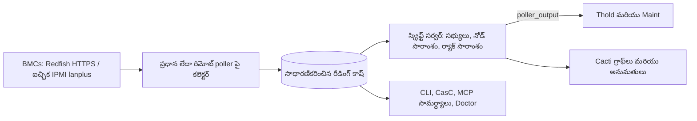

<!-- Source: README.md; SHA256: 6972a6c9ac754cd60e63c5caf971451ea8fe6e279eef757d886e1a168d3eef01 -->

<!-- translations:start -->
[English](../../../README.md) | [简体中文](../zh-CN/README.md) | [हिन्दी](../hi-IN/README.md) | [Español (España)](../es-ES/README.md) | [Español (Latinoamérica)](../es-419/README.md) | [العربية (السعودية)](../ar-SA/README.md) | [Afrikaans](../af-ZA/README.md) | [አማርኛ](../am-ET/README.md) | [العربية (مصر)](../ar-EG/README.md) | [العربية (المغرب)](../ar-MA/README.md) | [বাংলা](../bn-BD/README.md) | [Bosanski](../bs-BA/README.md) | [Deutsch](../de-DE/README.md) | [فارسی](../fa-IR/README.md) | [Filipino](../fil-PH/README.md) | [Français](../fr-FR/README.md) | [Français (Maroc)](../fr-MA/README.md) | [Français (Sénégal)](../fr-SN/README.md) | [Hausa](../ha-NG/README.md) | [עברית](../he-IL/README.md) | [Hrvatski](../hr-HR/README.md) | [Bahasa Indonesia](../id-ID/README.md) | [Igbo](../ig-NG/README.md) | [Italiano](../it-IT/README.md) | [日本語](../ja-JP/README.md) | [한국어](../ko-KR/README.md) | [Malagasy](../mg-MG/README.md) | [मराठी](../mr-IN/README.md) | [Bahasa Melayu](../ms-MY/README.md) | [Nederlands](../nl-NL/README.md) | [Polski](../pl-PL/README.md) | [Português (Brasil)](../pt-BR/README.md) | [Русский](../ru-RU/README.md) | [Kinyarwanda](../rw-RW/README.md) | [Soomaali](../so-SO/README.md) | [Српски](../sr-RS/README.md) | [Svenska](../sv-SE/README.md) | [Kiswahili](../sw-KE/README.md) | [தமிழ்](../ta-IN/README.md) | [తెలుగు](README.md) | [ไทย](../th-TH/README.md) | [Türkçe](../tr-TR/README.md) | [Українська](../uk-UA/README.md) | [اردو](../ur-PK/README.md) | [Tiếng Việt](../vi-VN/README.md) | [isiXhosa](../xh-ZA/README.md) | [Yorùbá](../yo-NG/README.md) | [繁體中文](../zh-TW/README.md) | [isiZulu](../zu-ZA/README.md)
<!-- translations:end -->

# plugin_redfish

బేస్‌బోర్డ్ మేనేజ్‌మెంట్ కంట్రోలర్‌ల (BMCs) నుండి సర్వర్ విద్యుత్ వినియోగం, ఇన్‌లెట్ ఉష్ణోగ్రత, ఫ్యాన్ స్థితి మరియు విద్యుత్ సరఫరా ఆరోగ్య స్థితిని Redfish ఉపయోగించి, ఐచ్ఛిక రీడ్-ఓన్లీ IPMI ఫాల్‌బ్యాక్ మరియు ర్యాక్-స్థాయి విద్యుత్ మొత్తాలతో సాధారణ పరికరాలు, డేటా సోర్స్‌లు మరియు గ్రాఫ్‌లుగా Cacti లోకి తీసుకువచ్చే Cacti 1.2 ప్లగిన్. Thold మరియు Maint ప్రామాణిక Cacti డేటా సోర్స్‌ల ద్వారా వాటిపై హెచ్చరికలను పంపుతాయి మరియు వాటిని నిరోధిస్తాయి.

> **స్థితి: అభివృద్ధిలో ఉంది, ఇంకా విడుదల లేదు (`0.1.0-dev`).** ఈ ప్లగిన్‌కు Cacti ప్రాజెక్ట్‌తో అనుబంధం లేదు. ఇది PHP 8.2 లేదా ఆ తర్వాతి వెర్షన్ కింద Cacti 1.2.31 లేదా ఆ తర్వాతి వెర్షన్‌పై ఇన్‌స్టాల్ అవుతుంది మరియు Redfish కలెక్టర్, ఎన్‌క్రిప్ట్ చేసిన క్రెడెన్షియల్ వాల్ట్, Cacti పరికరం మరియు గ్రాఫ్ ప్రొవిజనింగ్, ఐచ్ఛిక రీడ్-ఓన్లీ IPMI ఫాల్‌బ్యాక్, ర్యాక్ విద్యుత్ మొత్తం, Cacti Maint విండో ప్రదర్శన, రిమోట్ డేటా కలెక్టర్ ప్రతిరూపణ మరియు ఏజెంట్ ఎండ్‌పాయింట్లు, CasC ప్రొవైడర్ మరియు ఆపరేటర్ CLI, MCP సామర్థ్యాలు, మరియు Doctor రోగనిర్ధారణ తనిఖీలను అమలు చేస్తుంది. CI ఫిక్చర్‌లు, DMTF Redfish Mockup Server (సబ్‌సిస్టమ్, లెగసీ-మాత్రమే, మరియు HPE iLO Gen11 మాకప్‌లు), మరియు Maint v1.3 తో Thold v1.8.2 ను పరీక్షిస్తుంది; ఏ లైవ్ భౌతిక BMC గానీ లేదా పైలట్ ఫ్లీట్ గానీ ఇంకా అర్హత పొందలేదు. రూపకల్పన మరియు పరిశోధన [docs/PLAN.md](../../PLAN.md), [docs/research/](../../research/), మరియు [docs/decisions/](../../decisions/) లో ఉన్నాయి.

## అమలు చేయబడిన సామర్థ్యాలు

### ప్రధాన కలెక్టర్, వాల్ట్, మరియు Cacti ఆబ్జెక్ట్‌లు

- **జీవితచక్రం మరియు స్కీమా.** Cacti యొక్క ప్లగిన్ API ద్వారా ఇన్‌స్టాల్, అప్‌గ్రేడ్, డిసేబుల్ మరియు అన్‌ఇన్‌స్టాల్ అవుతుంది (`Schema::VERSION = 3`, 12 పట్టికలు). *Keep Plugin Tables on Uninstall* ఎంపికను తీసివేయకపోతే అన్‌ఇన్‌స్టాల్ చేసేటప్పుడు పట్టికలు ఉంచబడతాయి. ఎంట్రీ పాయింట్లు PHP 8.0 పై పార్స్ అవుతాయి మరియు 8.2 కంటే తక్కువ PHP లేదా `ext-openssl` లేకపోవడాన్ని స్పష్టమైన దోష సందేశంతో తిరస్కరిస్తాయి.
- **రిజిస్ట్రీ మరియు అనుమతులు.** *Redfish View* (`redfish_health.php`), *Redfish Operator* (`redfish_operator.php`), మరియు *Redfish Admin* (`redfish_bmcs.php`, `redfish_credentials.php`) విభాగాలు, అలాగే **Configuration > Settings > Redfish** కింద సెట్టింగ్‌లు. BMC రిజిస్ట్రీ CSV దిగుమతి (క్రెడెన్షియల్స్ పేరు ద్వారా సూచించబడతాయి; దిగుమతి ఫైళ్లలోని పాస్‌వర్డ్‌లు తిరస్కరించబడతాయి) మరియు JSON ఎగుమతికి మద్దతు ఇస్తుంది. BMC రికార్డులు మరియు క్రెడెన్షియల్స్ Cacti పరికర అనుమతులను అనుసరిస్తాయి.
- **ఎన్‌క్రిప్ట్ చేసిన క్రెడెన్షియల్ వాల్ట్.** పాస్‌వర్డ్‌లు `plugin_redfish_secret` లో AES-256-GCM తో ఎన్‌క్రిప్ట్ చేసి నిల్వ చేయబడతాయి. కీ డేటాబేస్ వెలుపల (డిఫాల్ట్‌గా `/etc/cacti/redfish-vault.key`) 64 హెక్సాడెసిమల్ అక్షరాలు (`openssl rand -hex 32`) లేదా 32 రా బైట్‌లుగా ఉంటుంది, ఇది poller వినియోగదారు యాజమాన్యంలో, ఇతర వినియోగదారులకు చదవడానికి వీలు లేకుండా, root లేదా ఆ వినియోగదారు మాత్రమే వ్రాయగల డైరెక్టరీలో ఉండాలి. 32-అక్షరాల ప్రింటబుల్ పాస్‌ఫ్రేజ్ తిరస్కరించబడుతుంది. **డేటాబేస్‌తో పాటు కీ ఫైల్‌ను బ్యాకప్ చేయండి**; అది లేకుండా, నిల్వ చేసిన పాస్‌వర్డ్‌లను మళ్లీ నమోదు చేయాల్సి ఉంటుంది.
- **TLS మరియు రీడ్-ఓన్లీ Redfish క్లయింట్.** సిస్టమ్ CA స్టోర్, ప్రతి BMC కి CA బండిల్, లేదా SPKI SHA-256 పిన్ ఉపయోగించి TLS ధృవీకరణ డిఫాల్ట్‌గా ప్రారంభించబడింది; ప్రతి BMC కి ధృవీకరించని మినహాయింపు ఆరోగ్య హెచ్చరికగా మరియు Doctor తనిఖీ హెచ్చరికగా కనిపిస్తుంది. క్లయింట్ కేవలం `GET` తో పాటు Redfish సెషన్ లాగిన్ (`POST`) మరియు లాగ్అవుట్ (`DELETE`) లను మాత్రమే అనుమతిస్తుంది; సెషన్‌లు అందుబాటులో లేనప్పుడు ప్రతి BMC కి ఐచ్ఛిక Basic ఫాల్‌బ్యాక్ ఉంటుంది. డిస్కవరీ ముందుగా కొత్త Redfish సబ్‌సిస్టమ్ మరియు సెన్సార్ వనరులను ఎంచుకుంటుంది మరియు వాడుకలో లేని `Power` మరియు `Thermal` వనరులకు ఫాల్‌బ్యాక్ అవుతుంది.
- **కలెక్టర్ అమలు.** `poller_redfish.php` అనేది `poller_bottom` నుండి ప్రారంభమవుతుంది, కాన్ఫిగర్ చేయగల వర్కర్ ప్రాసెస్‌లతో (`redfish_workers`) Cacti యొక్క ప్రాసెస్ రిజిస్ట్రీ ద్వారా ప్రతి poller కు ఒక మాస్టర్ ప్రాసెస్‌ను నడుపుతుంది, ప్రతి BMC కి లీజులను పొందుతుంది, సమయ బడ్జెట్‌ను (`redfish_collector_budget`) అమలు చేస్తుంది, ఎక్స్‌పోనెన్షియల్ బ్యాక్‌ఆఫ్‌ను వర్తింపజేస్తుంది మరియు క్రాష్ తర్వాత ప్లగిన్ యొక్క మునుపటి సెషన్‌ను శుభ్రం చేస్తుంది.
- **టెంప్లేట్లు, పరికరాలు, మరియు గ్రాఫ్‌లు.** హ్యాష్ ద్వారా `templates/redfish-templates.xml` ను దిగుమతి చేస్తుంది మరియు వినియోగదారు సవరించిన ఫైళ్లను ఓవర్‌రైట్ చేయకుండా మూడు స్క్రిప్ట్ సర్వర్ డేటా క్వెరీ XML ఫైళ్లను (`redfish_fans.xml`, `redfish_temperatures.xml`, `redfish_psus.xml`) `<cacti>/resource/script_server/` లోకి కాపీ చేస్తుంది. **Create Device** మరియు **Add Graphs** లకు ప్రొవిజనింగ్ ప్రణాళిక నిర్ధారణ అవసరం; ఇవి మ్యాప్ చేసిన సర్వర్ పరికరానికి క్వెరీలను జతచేస్తాయి లేదా అందుబాటు తనిఖీలు నిలిపివేయబడిన `.invalid` కింద "Redfish BMC" పరికరాన్ని సృష్టిస్తాయి, మరియు `graph_buttons` ద్వారా ప్రతి Redfish గ్రాఫ్‌ను పరికరంలోని Redfish గ్రాఫ్‌లకు తిరిగి లింక్ చేస్తాయి.
- **కాష్-మాత్రమే స్క్రిప్ట్ సర్వర్ ఇన్‌పుట్‌లు.** `scripts/ss_redfish_members.php` ప్రతి సభ్యుని ఫ్యాన్, ఉష్ణోగ్రత మరియు PSU రీడింగ్‌లను అందిస్తుంది, మరియు `scripts/ss_redfish_summary.php` "Redfish Node Summary" మెట్రిక్‌లను (విద్యుత్, ఇన్‌లెట్ మరియు గరిష్ట ఉష్ణోగ్రత, చెడిపోయిన ఫ్యాన్ మరియు PSU సంఖ్యలు, నోడ్ ఆరోగ్యం, మరియు చివరి మంచి రీడ్ వయస్సు) అందిస్తుంది. స్క్రిప్ట్ సర్వర్ కాల్‌లు స్థానిక కాష్‌ను మాత్రమే చదువుతాయి మరియు ఎప్పుడూ BMC ని సంప్రదించవు. తప్పిపోయిన, పాతదైన, లేదా తొలగించబడిన సభ్యుని రీడింగ్‌లు `U` ను తిరిగి ఇస్తాయి (ఎప్పుడూ `0` కాదు), అయితే నిశ్శబ్ద BMC లను థ్రెషోల్డ్‌లు గుర్తించేందుకు `age` ఎల్లప్పుడూ విలువను నివేదిస్తుంది.

**BMC సభ్యులు మారినప్పుడు** (మార్చబడిన ఫ్యాన్ లేదా సెన్సార్ల పేర్లను మార్చే ఫర్మ్‌వేర్ అప్‌డేట్ వంటివి), **Add Graphs** ను మళ్లీ నడపండి. గతంలో ఉన్న ఫ్యాన్ లేదా విద్యుత్ సరఫరా లేకపోతే, అంగీకరించే వరకు `fans_bad` లేదా `psus_bad` లో లెక్కించబడుతుంది; ఎప్పుడూ అమర్చని స్లాట్ లెక్కించబడదు. తొలగించబడిన సభ్యులు తమ ప్రస్తుత డేటా సోర్స్‌లను మరియు గ్రాఫ్‌లను ఉంచుకుంటాయి, చేతితో తొలగించే వరకు అవి ఆ తర్వాత `U` ని చదువుతాయి. Cacti పరికరాన్ని తొలగించడం వలన దాని BMC మ్యాపింగ్ మరియు ర్యాక్ కేటాయింపు తొలగించబడతాయి, కానీ BMC మరియు కాష్ అలాగే ఉంటాయి; BMC ని లేదా ప్లగిన్‌ను తొలగించడం వలన Cacti పరికరాలు మరియు గ్రాఫ్‌లు అలాగే ఉంటాయి.

### ఐచ్ఛిక IPMI ఫాల్‌బ్యాక్

- **ప్రతి BMC కి ఐచ్ఛికం.** డిఫాల్ట్‌గా ఆఫ్‌లో ఉంటుంది (`protocols` డిఫాల్ట్ `redfish`; IPMI ఫాల్‌బ్యాక్ ప్రారంభించడం వలన `redfish,ipmi` సెట్ అవుతుంది).
- **పరిమిత ఫాల్‌బ్యాక్ ట్రిగ్గర్.** అర్హత కలిగిన వైఫల్య తరగతితో Redfish సేకరణ విఫలమైనప్పుడు మాత్రమే నడుస్తుంది; `AuthRejected`, `CredentialUnavailable`, `AddressRefused`, `OperationRefused`, లేదా `Deadline` పై ఎప్పుడూ ట్రిగ్గర్ కాదు.
- **సురక్షిత అమలు.** షెల్ లేకుండా అరే-ఫారమ్ `proc_open()` ద్వారా `-I lanplus` పై `ipmitool` ను పిలుస్తుంది, పరిమిత వాల్-క్లాక్ టైమ్‌అవుట్ మరియు 256 KiB అవుట్‌పుట్ పరిమితితో ఉంటుంది. పాస్‌వర్డ్‌లు `IPMITOOL_PASSWORD` (`-E`) లేదా `finally` లో తొలగించబడే mode-0600 తాత్కాలిక ఫైల్ (`-f`) ద్వారా అందించబడతాయి, ఎప్పుడూ CLI argv లో కాదు.
- **రీడ్-ఓన్లీ కమాండ్ అనుమతి జాబితా.** కేవలం ఐదు రీడ్-ఓన్లీ సబ్‌కమాండ్‌లు మాత్రమే అనుమతించబడతాయి: `dcmi power reading`, `sdr type Temperature`, `sdr type Fan`, `sdr type Power Supply`, మరియు `chassis status`. మార్పులు చేసే కమాండ్‌లు తిరస్కరించబడతాయి.
- **సాధారణీకరించిన అవుట్‌పుట్ మరియు స్థితి హెచ్చరిక.** `IpmiNormalizer` రీడింగ్‌లను అదే `Observation`/`Member`/`Reading` మోడల్‌లోకి మ్యాప్ చేస్తుంది, తప్పిపోయిన లేదా పార్స్ చేయలేని సెన్సార్ల కోసం `U` ను ఇస్తుంది. IPMI ఫాల్‌బ్యాక్‌ను ప్రారంభించడం వలన ఆరోగ్య పేజీలో మరియు `redfish.bmc_security` Doctor తనిఖీలో UDP 623 ను మేనేజ్‌మెంట్ VLAN కు పరిమితం చేయాలని ఆపరేటర్లకు గుర్తుచేస్తూ హెచ్చరిక వస్తుంది.

### ర్యాక్ విద్యుత్ మొత్తం

- **ర్యాక్ రిజిస్ట్రీ.** స్కీమా వెర్షన్ 3 అనేది `plugin_redfish_rack` (ప్రత్యేక `(site_id, name)`, ఐచ్ఛిక `power_budget_watts`, డిఫాల్ట్ `80` గల `min_coverage_pct`, మరియు గమనికలు) మరియు `plugin_redfish_rack_member` (ప్రతి `host_id` కి గరిష్టంగా ఒక ర్యాక్ కేటాయింపు, ఐచ్ఛిక `bmc_id` మరియు `unit_position`, Cacti పరికరం తొలగించబడినప్పుడు స్వయంచాలకంగా తీసివేయబడుతుంది) ను జోడిస్తుంది.
- **కవరేజ్-రక్షిత మొత్తాలు.** `RackPowerSummary` స్థానిక కాష్ నుండి తాజా సభ్యుల `power_watts` రీడింగ్‌లను కూడి, బడ్జెట్ వినియోగం మరియు హెడ్‌రూమ్‌ను లెక్కిస్తుంది. నివేదించే సభ్యుల కవరేజ్ `min_coverage_pct` కంటే తగ్గినప్పుడు, కలెక్టర్ వైఫల్యాలు ఎప్పుడూ ర్యాక్ విద్యుత్‌లో తగ్గుదలగా కనిపించకుండా `power_watts`, `utilization_pct`, మరియు `headroom_watts` విలువలు `U` ను తిరిగి ఇస్తాయి.
- **Thold-సిద్ధంగా ఉన్న స్క్రిప్ట్ సర్వర్ ఇన్‌పుట్.** `scripts/ss_redfish_rack.php` (`ss_redfish_rack(<rack_id>)`) స్థానిక కాష్ నుండి మాత్రమే `power_watts`, `power_budget_watts`, `utilization_pct`, `headroom_watts`, `members_total`, `members_reporting`, మరియు `coverage_pct` లను తిరిగి ఇస్తుంది.

### Cacti Maint ఏకీకరణ

- Redfish డేటా సోర్స్‌లపై ఉన్న Thold థ్రెషోల్డ్‌లు హెచ్చరికలను పంపుతాయి మరియు ఏ ప్లగిన్‌లోనూ మార్పులు లేకుండా Cacti Maint వాటిని నిరోధిస్తుంది.
- `MaintWindow` ప్రతి మ్యాప్ చేయబడిన Cacti హోస్ట్ కోసం సక్రియ Maint షెడ్యూల్‌లను తనిఖీ చేస్తుంది (ఒకసారి `mtype=1` మరియు పునరావృత `mtype=2` షెడ్యూల్‌లు, అలాగే లోడ్ అయినప్పుడు `plugin_maint_check_cacti_host()`) మరియు Redfish Health పేజీలో (`[MAINT]`), `cli/redfish.php health` అవుట్‌పుట్‌లో, మరియు `redfish-get-health` సామర్థ్యంలో సక్రియ నిర్వహణను గుర్తిస్తుంది.

### రిమోట్ డేటా కలెక్టర్లు

- `INFO` అనేది `remote_collect:1` ను ప్రకటిస్తుంది. BMC లు ఏదైనా `poller_id >= 1` ను అంగీకరిస్తాయి, మరియు `poller_redfish.php --poller=N` ఆ poller కు కేటాయించిన ప్రారంభించబడిన BMC లను మాత్రమే సేకరిస్తుంది.
- **`replicate_out` హుక్.** `replicate_out_table()` ద్వారా లక్ష్య రిమోట్ poller కు పరిమితం చేయబడిన రహస్యేతర కాన్ఫిగరేషన్ పట్టికలను మాత్రమే ప్రతిరూపం చేస్తుంది: `plugin_redfish_bmc`, `plugin_redfish_credential` మెటాడేటా (సైఫర్‌టెక్స్ట్ లేదు), `plugin_redfish_rack`, మరియు `plugin_redfish_rack_member`. `plugin_redfish_secret` ప్రతిరూపం చేయబడదు, మరియు వాల్ట్ కీ ఫైళ్లు ప్రతి poller పై ఖచ్చితంగా స్థానికంగా ఉంటాయి.
- **`remote_agent` హుక్.** సంఖ్యా `poller_id` మరియు `bmc_id` పారామీటర్‌లను మాత్రమే అంగీకరించే రీడ్-ఓన్లీ `redfish_health` మరియు `redfish_discovery` చర్యలను అందిస్తుంది. ఊహించని పారామీటర్‌లు తిరస్కరించబడతాయి మరియు ఎటువంటి క్రెడెన్షియల్స్ లేదా రహస్యాలు తిరిగి ఇవ్వబడవు.

### పర్యావరణ వ్యవస్థ హుక్‌లు (CasC, MCP సామర్థ్యాలు, మరియు Doctor)

- **CasC ప్రొవైడర్ (`casc_register_providers`).** ప్యూర్-PHP YAML మరియు XML ఎగుమతి, పార్సింగ్ (XXE తిరస్కరించబడింది), ధృవీకరణ, డిఫ్ ప్లానింగ్ మరియు అప్లైతో `redfish` ప్రొవైడర్‌ను (స్కీమా వెర్షన్ `1`) నమోదు చేస్తుంది. క్రెడెన్షియల్స్ కేవలం వాల్ట్ రిఫరెన్స్‌లుగా మాత్రమే కనిపిస్తాయి (`vault:redfish:<name>`); రా సీక్రెట్ కీలు (`pass`, `secret`, `token`, `private_key`, `vault_key`, `auth_token`) తిరస్కరించబడతాయి. అప్లై చేయడానికి ఖచ్చితమైన SHA-256 `PLAN_HASH` అవసరం.
- **MCP / సామర్థ్యాల API (`abilities_register`).** ఎటువంటి క్రెడెన్షియల్స్‌ను తిరిగి ఇవ్వకుండా, Redfish View విభాగం (`redfish_health.php`) మరియు Cacti పరికర అనుమతులపై ఆధారపడిన మూడు రీడ్-ఓన్లీ సామర్థ్యాలను నమోదు చేస్తుంది:
  - `redfish-list-bmcs` (ఐచ్ఛిక `poller_id`)
  - `redfish-get-rack-power` (ఐచ్ఛిక `rack_id`)
  - `redfish-get-health` (ఐచ్ఛిక `bmc_id`)
- **Doctor తనిఖీలు (`doctor_register_checks`).** ఎప్పుడూ BMC ని సంప్రదించని లేదా కీ సమాచారాన్ని తిరిగి ఇవ్వని ఐదు స్థానిక, రీడ్-ఓన్లీ రోగనిర్ధారణ తనిఖీలను నమోదు చేస్తుంది:
  - `redfish.schema`: స్కీమా వెర్షన్ నవీనత
  - `redfish.vault_key`: వాల్ట్ కీ చదవగల స్థితి మరియు అనుమతులు
  - `redfish.collector_runs`: poller కలెక్టర్ బడ్జెట్ మరియు తాజాదనం
  - `redfish.bmc_security`: ధృవీకరించని TLS లేదా IPMI ఫాల్‌బ్యాక్‌తో ప్రారంభించబడిన BMC లు
  - `redfish.rack_power`: ర్యాక్ విద్యుత్ బడ్జెట్ సమ్మతి మరియు కవరేజ్ కనిష్ట స్థాయి

## CLI

PHP 8.2 లేదా ఆ తర్వాతి వెర్షన్‌తో Cacti రూట్ డైరెక్టరీ నుండి అమలు చేయండి:

```sh
# Operator and CasC CLI (reads --file=PATH or stdin for validate, plan, and apply)
php plugins/redfish/cli/redfish.php export --format=yaml|xml
php plugins/redfish/cli/redfish.php validate [--file=PATH] [--format=yaml|xml]
php plugins/redfish/cli/redfish.php plan [--file=PATH] [--format=yaml|xml]
php plugins/redfish/cli/redfish.php apply [--file=PATH] [--format=yaml|xml] --confirm=<PLAN_HASH>
php plugins/redfish/cli/redfish.php health --format=text|json

# Collector entry point (normally started by poller_bottom)
php plugins/redfish/poller_redfish.php [--poller=N] [--force] [--debug]

# Rack power summary script server entry point
php plugins/redfish/scripts/ss_redfish_rack.php <rack_id>
```

## యాక్సెస్ పాత్రలు

| విభాగం | యాక్సెస్ |
| --- | --- |
| Redfish View | ప్రస్తుత పర్యవేక్షణ పేజీలు. |
| Redfish Operator | పర్యవేక్షణతో పాటు ఆపరేషన్స్ పేజీ మరియు వ్యక్తిగత ట్రయేజ్ అంగీకారాలు. |
| Redfish Admin | Operator యాక్సెస్‌తో పాటు ప్రస్తుత కాన్ఫిగరేషన్ మరియు పరిపాలనా చర్యలు. |

అప్‌గ్రేడ్ ఫైళ్లను కాపీ చేసిన తర్వాత, విభాగాలను నమోదు చేయడానికి నిర్వాహకుడిగా Plugins పేజీని తెరవండి. **Configuration > Users** లేదా వినియోగదారు సమూహాల కింద Operator విభాగాన్ని స్పష్టంగా కేటాయించండి. అప్‌గ్రేడ్‌లు ప్రస్తుత View మరియు Admin విభాగం ID లను మరియు అనుమతులను ఉంచుతాయి. ప్రతి అభ్యర్థనలో Admin యాక్సెస్ Operator యాక్సెస్‌ను వారసత్వంగా పొందుతుంది, మరియు Operator యాక్సెస్ View యాక్సెస్‌ను వారసత్వంగా పొందుతుంది; ఇది వినియోగదారులు లేదా సమూహాలకు నిల్వ చేసిన అనుమతులను జోడించదు. Cacti యొక్క Settings అనుమతితో పాటు ప్లగిన్ సెట్టింగ్‌లకు కూడా Redfish Admin యాక్సెస్ అవసరం.

Cacti పరికర అనుమతులు ప్రతి వినియోగదారుకు అందుబాటులో ఉన్న వరుసలు మరియు చర్యలను పరిమితం చేస్తాయి; మ్యాప్ చేయని ఆబ్జెక్ట్‌లకు నిర్వాహకుడు అవసరం. తదుపరి షెడ్యూల్ చేసిన రన్ కోసం అనుమతించబడిన BMC పై సేకరణ హోల్డ్‌ను ఆపరేటర్లు విడుదల చేయవచ్చు. క్రెడెన్షియల్స్, కాన్ఫిగరేషన్, మ్యాపింగ్, తొలగింపు మరియు ఇతర పరిపాలనా మార్పులు పరిపాలనా పేజీలలోనే ఉంటాయి. అంగీకారాలు ప్రస్తుత వినియోగదారు సెషన్‌లో మాత్రమే, గరిష్టంగా ఒక గంట పాటు మరియు అదే పరిశీలన తాజాగా ఉన్నంత వరకు మాత్రమే ఉంటాయి. కొత్త లేదా మారిన పరిశీలనలు వాటిని చెల్లుబాటు కాకుండా చేస్తాయి. అవి ఎప్పుడూ విఫలమైన కొలతను ఆరోగ్యకరమైనదిగా గుర్తించవు లేదా హెచ్చరికలను నిరోధించవు.

## ఎందుకు అవసరం

ప్రతి సర్వర్‌లో ఆపరేటింగ్ సిస్టమ్‌తో సంబంధం లేకుండా విద్యుత్ మరియు ఉష్ణ స్థితిని నివేదించే BMC ఉంటుంది, కాబట్టి OS ఆగిపోయినప్పుడు కూడా ఇది ప్రతిస్పందిస్తూనే ఉంటుంది. ఈ డేటా సామర్థ్యం మరియు వ్యయ ట్రాకింగ్, విఫలమైన ఫ్యాన్ లేదా విద్యుత్ సరఫరా గురించి ముందస్తు హెచ్చరిక, మరియు హై-పెర్ఫార్మెన్స్ కంప్యూటింగ్‌లో పవర్-క్యాపింగ్ నిర్ణయాలకు ఉపయోగపడుతుంది. ఈ ప్లగిన్ కేవలం HPC కి మాత్రమే పరిమితమైనది కాదు.

Cacti నేడు ఇందులో కొంత భాగాన్ని కవర్ చేస్తుంది:

- **వెండర్ SNMP ప్యాకేజీలు.** 1.2.x బ్రాంచ్ SNMP ఏజెంట్ అవసరమయ్యే మరియు వెండర్-నిర్దిష్టమైన Dell iDRAC మరియు HPE iLO టెంప్లేట్‌లను అందిస్తుంది; మైలురాయి 1 పరిశోధనలో ఈ రెండూ వాట్‌లలో విద్యుత్ వినియోగాన్ని నివేదించవని కనుగొనబడింది ([docs/research/overlap.md](../../research/overlap.md)).
- **కలెక్టర్ లేని క్రెడెన్షియల్ రకం.** `plugin_credentials` ఒక "IPMI / Redfish (BMC)" క్రెడెన్షియల్‌ను నిర్వచిస్తుంది కానీ ఏ BMC ని చదవదు.
- **ర్యాక్-స్థాయి వీక్షణ లేదు.** Cacti కోర్‌లో ర్యాక్ ఆబ్జెక్ట్ లేదు; ఒక పరికరానికి ఫ్రీ-టెక్స్ట్ `location` ఫీల్డ్ మాత్రమే ఉంటుంది.

ఈ ప్లగిన్ ప్రధాన poller లేదా రిమోట్ డేటా కలెక్టర్లపై Cacti పోల్ చక్రానికి వెలుపల BMC లను పోల్ చేస్తుంది, సాధారణీకరించిన రీడింగ్‌లను కాష్ చేస్తుంది, మరియు స్క్రిప్ట్ సర్వర్ డేటా క్వెరీలు, నోడ్ సారాంశాలు మరియు ర్యాక్ విద్యుత్ సారాంశాల ద్వారా వాటిని అందిస్తుంది. ఇది Cacti యొక్క గ్రాఫింగ్, అనుమతులు, Thold మరియు Maint లను తిరిగి ఉపయోగిస్తుంది, మరియు BMC స్థితిని మార్చదు.

## పరిధి మరియు స్థితి

| దశ | పరిధి | మైలురాళ్లు | స్థితి |
|---|---|---|---|
| 0, పరిశోధన | వెండర్ మ్యాట్రిక్స్, లైవ్ BMC లపై అప్‌స్ట్రీమ్ ప్రవర్తన నిర్ధారణ, పోలింగ్ ఖర్చు, డేటా క్వెరీ స్పైక్ | [M1](https://github.com/somethingwithproof/plugin_redfish/milestone/1) | పూర్తయింది, అసలు BMC ఫర్మ్‌వేర్ క్యాప్చర్‌ల కోసం వేచి ఉంది |
| 1, పరిశీలన | BMC రిజిస్ట్రీ, క్రెడెన్షియల్స్, TLS, Redfish కలెక్టర్, సాధారణీకరించిన రీడింగ్‌లు, పరికరాలు, ప్రతి-సూచిక గ్రాఫ్‌లు, Thold హెచ్చరిక, Maint ఏకీకరణ, ఆరోగ్య పేజీ | [M2](https://github.com/somethingwithproof/plugin_redfish/milestone/2), [M3](https://github.com/somethingwithproof/plugin_redfish/milestone/3), [M4](https://github.com/somethingwithproof/plugin_redfish/milestone/4) | అమలు చేయబడింది; M4 పైలట్ ఫ్లీట్ అర్హత పెండింగ్‌లో ఉంది |
| 2, ipmi | `ipmitool` ద్వారా రీడ్-ఓన్లీ IPMI (`lanplus`) ఫాల్‌బ్యాక్, డిఫాల్ట్‌గా ఆఫ్‌లో ఉంటుంది | [M5](https://github.com/somethingwithproof/plugin_redfish/milestone/5) | అమలు చేయబడింది |
| 3, ర్యాక్‌లు | ర్యాక్ రిజిస్ట్రీ, కవరేజ్ ఫ్లోర్‌తో ర్యాక్ విద్యుత్ మొత్తాలు, బడ్జెట్ హెడ్‌రూమ్, `ss_redfish_rack.php` | [M6](https://github.com/somethingwithproof/plugin_redfish/milestone/6) | అమలు చేయబడింది |
| 4, రిమోట్ మరియు పర్యావరణ వ్యవస్థ | రిమోట్ డేటా కలెక్టర్లు (`replicate_out`, `remote_agent`), CasC ప్రొవైడర్ మరియు CLI, MCP సామర్థ్యాలు, Doctor తనిఖీలు | [M7](https://github.com/somethingwithproof/plugin_redfish/milestone/7) | అమలు చేయబడింది |

పరిధి వెలుపల ఉన్నవి: పవర్ క్యాప్‌లు లేదా మరేదైనా BMC కాన్ఫిగరేషన్‌ను సెట్ చేయడం, పవర్ కంట్రోల్, ఫర్మ్‌వేర్ అప్‌డేట్, కన్సోల్ యాక్సెస్, ప్లగిన్-యాజమాన్య హెచ్చరిక ఇంజిన్, మరియు షెడ్యూలర్ ఏకీకరణ.

## అనుకూలత లక్ష్యాలు

| భాగం | లక్ష్యం |
|---|---|
| Cacti | 1.2.31 లేదా ఆ తర్వాతి వెర్షన్, కోర్ ప్యాచ్‌లు లేవు |
| డేటాబేస్ | MariaDB 10.2 లేదా MySQL 5.7 లేదా ఆ తర్వాతి వెర్షన్: జనరేటెడ్ కాలమ్‌పై ప్రత్యేక కీ ద్వారా ప్రతి పరికరానికి ఒక BMC ఉంచబడుతుంది |
| PHP | 8.2 లేదా ఆ తర్వాతి వెర్షన్; మద్దతు లేని రన్‌టైమ్ విరిగిన Cacti UI కి బదులుగా తిరస్కరణను పొందేలా ఎంట్రీ పాయింట్లు 8.0 పై పార్స్ చేయగలవు |
| PHP ఎక్స్‌టెన్షన్‌లు | `ext-openssl` (Cacti 1.2.31 కు అవసరం); `ext-curl` లేదు మరియు Composer రన్‌టైమ్ డిపెండెన్సీలు లేవు |
| ఐచ్ఛిక సాధనాలు | IPMI ఫాల్‌బ్యాక్ ప్రారంభించబడిన BMC లను సేకరించే poller లపై `ipmitool` |
| BMCs | ఫర్మ్‌వేర్ శ్రేణి ప్రకారం Dell iDRAC, HPE iLO, Lenovo XCC, మరియు OpenBMC; [వెండర్ మ్యాట్రిక్స్](../../research/vendor-matrix.md) చూడండి |
| Redfish | ముందుగా కొత్త సబ్‌సిస్టమ్ మరియు సెన్సార్ వనరులు, ఫాల్‌బ్యాక్‌గా వాడుకలో లేని `Power` మరియు `Thermal` |
| Thold, Maint | మార్పులు అవసరం లేదు (CI Thold v1.8.2 మరియు Maint v1.3 ను పరీక్షిస్తుంది) |

## రూపకల్పన

- [docs/PLAN.md](../../PLAN.md) పూర్తి ప్రణాళిక: ఆర్కిటెక్చర్, అది ఆధారపడే అప్‌స్ట్రీమ్ వాస్తవాలు, కొలత నమూనా, భద్రతా సరిహద్దులు, పనితీరు గణనలు, పరీక్షలు మరియు ప్రమాదాలు.
- [docs/decisions/](../../decisions/) ఇప్పటికే తీసుకున్న ఎంపికల కోసం ఆర్కిటెక్చర్ నిర్ణయ రికార్డులను కలిగి ఉంది.
- [docs/REQUIREMENTS.md](../../REQUIREMENTS.md) ప్రతి అవసర ID ని దాని సమస్యకు మ్యాప్ చేస్తుంది.



## భద్రత

BMC క్రెడెన్షియల్స్ సర్వర్ల అవుట్-ఆఫ్-బ్యాండ్ నిర్వహణను నియంత్రిస్తాయి. ఈ రూపకల్పన రహస్యాలను కమాండ్ లైన్‌లు, లాగ్‌లు, CasC ఎగుమతులు, రిమోట్ ఏజెంట్ పేలోడ్‌లు, MCP ప్రతిస్పందనలు మరియు వెబ్ పేజీలకు దూరంగా ఉంచుతుంది; ప్రతి poller కు స్థానిక వాల్ట్ కీ ఫైల్‌ను ఉపయోగించి నిల్వ చేసిన పాస్‌వర్డ్‌లను AES-256-GCM తో ఎన్‌క్రిప్ట్ చేస్తుంది; డిఫాల్ట్‌గా TLS ను ధృవీకరిస్తుంది; అనుమతించబడిన రీడ్-ఓన్లీ సబ్‌కమాండ్‌లతో స్పష్టమైన ఆర్గ్యుమెంట్ అరే నుండి `ipmitool` ను నడుపుతుంది; మరియు రీడ్-ఓన్లీ BMC ఖాతాలను ఉపయోగిస్తుంది. [docs/PLAN.md](../../PLAN.md#security) మరియు [SECURITY.md](../../../SECURITY.md) చూడండి.

## ఆపరేటర్ గైడ్

ఇన్‌స్టాలేషన్ ముందస్తు అవసరాలు, వాల్ట్ మరియు TLS సెటప్, BMC నమోదు, గ్రాఫ్ సృష్టి, హెచ్చరిక విరామాలు, బ్యాకప్ మరియు వైఫల్య నిర్వహణ కోసం [docs/operator-guide.md](../../operator-guide.md) చూడండి. ఆ ఫర్మ్‌వేర్ నుండి రిడ్యాక్ట్ చేయబడిన క్యాప్చర్ సూట్‌లో ఉత్తీర్ణత సాధించే వరకు ఒక నిజమైన వెండర్ ఫర్మ్‌వేర్ లైన్‌కు మద్దతు ఉన్నట్లు గైడ్ ప్రకటించదు.

## అభివృద్ధి మరియు పరీక్షలు

CI ([.github/workflows/plugin-ci-workflow.yml](../../../.github/workflows/plugin-ci-workflow.yml)) PHP 8.0 పై ఎంట్రీ పాయింట్లను లింట్ చేస్తుంది, Cacti `release/1.2.31` మరియు `1.2.x` లకు వ్యతిరేకంగా PHP 8.2 నుండి 8.5 వరకు Pest యూనిట్ (`phpunit.xml`) మరియు లైఫ్‌సైకిల్ ఇంటిగ్రేషన్ (`phpunit-integration.xml`) సూట్‌లు అలాగే PHPStan స్థాయి 9 ను నడుపుతుంది, PHP 8.1 పై తిరస్కరణను ధృవీకరిస్తుంది, DMTF Redfish Mockup Server (సబ్‌సిస్టమ్, లెగసీ-మాత్రమే, మరియు HPE iLO Gen11 మాకప్‌లు) మరియు Thold v1.8.2 / Maint v1.3 లను ఎండ్-టు-ఎండ్ పరీక్షిస్తుంది, మరియు gettext కేటలాగ్‌లు, వర్క్‌ఫ్లోలు మరియు REUSE లైసెన్సింగ్‌ను తనిఖీ చేస్తుంది.

పుష్ చేయడానికి ముందు స్థానిక తనిఖీలు:

```sh
sh tests/lint-workflows.sh
sh locales/build_gettext.sh --check
CACTI_PATH=/path/to/cacti phpstan analyse -c phpstan.neon --no-progress
```

యూనిట్ మరియు సోర్స్-రూల్ పరీక్షల కోసం `--configuration=phpunit.xml` తో, లేదా లైఫ్‌సైకిల్ ఇంటిగ్రేషన్ పరీక్షల కోసం డిస్పోజబుల్ Cacti డేటాబేస్‌పై `CACTI_PATH` మరియు `REDFISH_TEST_DATABASE=disposable` తో `--configuration=phpunit-integration.xml` తో Pest ను నడపండి.

## పని ఎలా ట్రాక్ చేయబడుతుంది

- **మైలురాళ్లు** ప్రణాళికలోని మైలురాళ్లను అనుసరిస్తాయి. ప్రతిదానికి దాని ఉప-సమస్యలు మరియు నిష్క్రమణ ఆధారాలను జాబితా చేసే ఎపిక్ సమస్య ఉంటుంది.
- **సమస్యలు** లేబుల్ ద్వారా వర్గీకరించబడ్డాయి: `type: requirement`, `type: research`, `type: decision`, `type: epic`. అవసర సమస్యలు సంఖ్యలతో, పరీక్షించదగిన అవసరాలను (`REQ-AREA-NNN`) మరియు అంగీకార ప్రమాణాలను పేర్కొంటాయి.
- **లేబుల్స్** `area:`, `phase:`, `priority:`, మరియు `status:` లను కూడా కలిగి ఉంటాయి. [CONTRIBUTING.md](../../../CONTRIBUTING.md#labels) చూడండి.
- [ప్రాజెక్ట్ బోర్డ్](https://github.com/users/somethingwithproof/projects/12) అన్ని మైలురాళ్లలోని అన్ని సమస్యలను చూపుతుంది.

## సహకారం

[CONTRIBUTING.md](../../../CONTRIBUTING.md) చదవండి. కమిట్‌లకు DCO సైన్-ఆఫ్ అవసరం. రూపకల్పన చర్చ సమస్యలపై జరుగుతుంది; తెరిచి ఉన్న నిర్ణయాలకు `type: decision` లేబుల్ ఉంటుంది. నిజమైన BMC ల నుండి వచ్చే ఆధారాలు ఇప్పుడు అత్యంత ఉపయోగకరమైన సహకారం; ఏదైనా క్యాప్చర్‌ను పోస్ట్ చేసే ముందు చిరునామాలు, సీరియల్ నంబర్లు మరియు క్రెడెన్షియల్స్‌ను తొలగించండి.

## లైసెన్స్

GNU General Public License v2.0, Cacti మరియు దాని ప్లగిన్‌లకు ఉన్న అదే లైసెన్స్. [LICENSE](../../../LICENSE) చూడండి.
