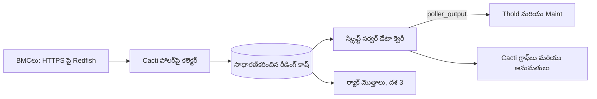

<!-- Source: README.md; SHA256: 7b4e83a58a1adc844cb0615ef30e95476cba2851f96bb454d2a816fb2774724d -->

<!-- translations:start -->
[English](../../../README.md) | [简体中文](../zh-CN/README.md) | [हिन्दी](../hi-IN/README.md) | [Español (España)](../es-ES/README.md) | [Español (Latinoamérica)](../es-419/README.md) | [العربية (السعودية)](../ar-SA/README.md) | [Afrikaans](../af-ZA/README.md) | [አማርኛ](../am-ET/README.md) | [العربية (مصر)](../ar-EG/README.md) | [العربية (المغرب)](../ar-MA/README.md) | [বাংলা](../bn-BD/README.md) | [Bosanski](../bs-BA/README.md) | [Deutsch](../de-DE/README.md) | [فارسی](../fa-IR/README.md) | [Filipino](../fil-PH/README.md) | [Français](../fr-FR/README.md) | [Français (Maroc)](../fr-MA/README.md) | [Français (Sénégal)](../fr-SN/README.md) | [Hausa](../ha-NG/README.md) | [עברית](../he-IL/README.md) | [Hrvatski](../hr-HR/README.md) | [Bahasa Indonesia](../id-ID/README.md) | [Igbo](../ig-NG/README.md) | [Italiano](../it-IT/README.md) | [日本語](../ja-JP/README.md) | [한국어](../ko-KR/README.md) | [Malagasy](../mg-MG/README.md) | [मराठी](../mr-IN/README.md) | [Bahasa Melayu](../ms-MY/README.md) | [Nederlands](../nl-NL/README.md) | [Polski](../pl-PL/README.md) | [Português (Brasil)](../pt-BR/README.md) | [Русский](../ru-RU/README.md) | [Kinyarwanda](../rw-RW/README.md) | [Soomaali](../so-SO/README.md) | [Српски](../sr-RS/README.md) | [Svenska](../sv-SE/README.md) | [Kiswahili](../sw-KE/README.md) | [தமிழ்](../ta-IN/README.md) | [తెలుగు](README.md) | [ไทย](../th-TH/README.md) | [Türkçe](../tr-TR/README.md) | [Українська](../uk-UA/README.md) | [اردو](../ur-PK/README.md) | [Tiếng Việt](../vi-VN/README.md) | [isiXhosa](../xh-ZA/README.md) | [Yorùbá](../yo-NG/README.md) | [繁體中文](../zh-TW/README.md) | [isiZulu](../zu-ZA/README.md)
<!-- translations:end -->

# plugin_redfish

బేస్‌బోర్డ్ మేనేజ్‌మెంట్ కంట్రోలర్‌ల (BMCలు) నుండి సర్వర్ విద్యుత్ వినియోగం, ఇన్‌లెట్ ఉష్ణోగ్రత, ఫ్యాన్ స్థితి మరియు విద్యుత్ సరఫరా ఆరోగ్య స్థితిని Redfish ఉపయోగించి (ఐచ్ఛిక IPMI ఫాల్‌బ్యాక్‌తో) సాధారణ పరికరాలు, డేటా సోర్స్‌లు మరియు గ్రాఫ్‌లుగా Cacti లోకి తీసుకువచ్చే Cacti 1.2 ప్లగిన్. ఆపై Thold మరియు Maint వీటిపై హెచ్చరికలను పంపుతాయి మరియు వాటిని నిరోధిస్తాయి, అలాగే తర్వాతి దశలో ర్యాక్-స్థాయి విద్యుత్ మొత్తాలను జోడిస్తుంది.

> **స్థితి: అభివృద్ధిలో ఉంది, ఇంకా విడుదల లేదు (0.1.0-dev).** మైలురాళ్లు 2 (పునాది) మరియు 3 (Cacti ఆబ్జెక్ట్‌లు మరియు హెచ్చరికలు) `main` లో విలీనం చేయబడ్డాయి. ఈ ప్లగిన్‌కు Cacti ప్రాజెక్ట్‌తో అనుబంధం లేదు. ఇది PHP 8.2 లేదా ఆ తర్వాతి వెర్షన్ కింద Cacti 1.2.31 పై ఇన్‌స్టాల్ అవుతుంది, BMCలు మరియు ఆధారాలను (క్రెడెన్షియల్స్) నమోదు చేస్తుంది, ప్రతి BMC నుండి Redfish ద్వారా విద్యుత్, ఉష్ణోగ్రతలు, ఫ్యాన్‌లు మరియు విద్యుత్ సరఫరా ఆరోగ్య స్థితిని తన స్వంత కాష్‌లోకి చదువుతుంది మరియు సేకరణ ఆరోగ్య స్థితిని చూపుతుంది. ఇది సాధారణ డేటా సోర్స్‌ల ద్వారా Cacti పరికరాలు, ప్రతి-సభ్యుని మరియు సారాంశ గ్రాఫ్‌లు, అలాగే Thold మరియు Maint మద్దతును జోడిస్తుంది. చేతితో రాసిన ఫిక్చర్‌లు మరియు DMTF Redfish మాకప్ సర్వర్ నుండి నిర్మించిన నకిలీ BMC పై CI పరీక్షించబడింది; ఏ అసలు BMC గానీ లేదా పైలట్ ఫ్లీట్ గానీ ఇంకా అర్హత పొందలేదు. రూపకల్పన మరియు పరిశోధన [docs/PLAN.md](../../PLAN.md), [docs/research/](../../research), మరియు [docs/decisions/](../../decisions) లో ఉన్నాయి.

### మైలురాయి 2 అందించేవి

- Cacti ప్లగిన్ API ద్వారా ఇన్‌స్టాల్, అప్‌గ్రేడ్, డిసేబుల్ మరియు అన్‌ఇన్‌స్టాల్ చేయడం; సెట్టింగ్‌ను క్లియర్ చేయకపోతే అన్‌ఇన్‌స్టాల్ చేసినప్పుడు పట్టికలు అలాగే ఉంచబడతాయి. 8.2 కంటే పాత PHP వెర్షన్‌పై ప్లగిన్ ఇన్‌స్టాల్ చేయడానికి లేదా ఎనేబుల్ చేయడానికి నిరాకరిస్తుంది మరియు కారణాన్ని తెలియజేస్తుంది.
- "Redfish View" (ఆరోగ్య పేజీ), "Redfish Operator" (కార్యకలాపాల పేజీ), మరియు "Redfish Admin" (BMCలు మరియు ఆధారాల పేజీలు) అనే రీల్మ్‌లు, అలాగే Configuration > Settings > Redfish కింద సెట్టింగ్‌లు.
- CSV దిగుమతి మరియు JSON ఎగుమతితో కూడిన BMC రిజిస్ట్రీ. దిగుమతి ఫైళ్లలో పాస్‌వర్డ్‌లు ఉండకూడదు; ఆధారాలు పేరు ద్వారా సూచించబడతాయి.
- AES-256-GCM తో ఎన్‌క్రిప్ట్ చేసి నిల్వ చేయబడిన ఆధారాలు. కీ అనేది డేటాబేస్ వెలుపల ఉండే ఒక ఫైల్, అప్రమేయంగా `/etc/cacti/redfish-vault.key`, ఇందులో 64 హెక్సాడెసిమల్ అక్షరాలు (`openssl rand -hex 32`) లేదా ఖచ్చితంగా 32 యాదృచ్ఛిక బైట్‌లు ఉంటాయి, ఇది పోలర్ వినియోగదారు యాజమాన్యంలో ఉంటుంది, ఇతర వినియోగదారులకు చదవడానికి వీలు లేకుండా, కేవలం పోలర్ వినియోగదారు లేదా root మాత్రమే రాయగల డైరెక్టరీలో ఉంటుంది. 32 ప్రింట్ చేయగల అక్షరాల కీ పాస్‌ఫ్రేజ్‌గా తిరస్కరించబడుతుంది. **డేటాబేస్‌తో పాటు కీ ఫైల్‌ను బ్యాకప్ చేయండి**; అది లేకుండా నిల్వ చేసిన ప్రతి పాస్‌వర్డ్‌ను మళ్లీ నమోదు చేయాల్సి ఉంటుంది.
- అప్రమేయంగా TLS ధృవీకరణ ఆన్‌లో ఉంటుంది, ప్రతి-BMC కి CA బండిల్ లేదా SPKI SHA-256 పిన్ ఉంటుంది. లాగ్ చేయబడిన, ప్రతి-BMC ధృవీకరించని ఆప్ట్-అవుట్ ఆరోగ్య పేజీలో హెచ్చరికగా ఉంటుంది.
- చదవడానికి మాత్రమే ఉపయోగపడే Redfish క్లయింట్: `GET` అలాగే సెషన్ లాగిన్ మరియు లాగ్అవుట్ మాత్రమే, ఏదైనా అభ్యర్థన పంపే ముందు అనుమతించబడిన జాబితా (allowlist) తో తనిఖీ చేయబడుతుంది.
- ప్రధాన పోలర్‌పై ఉన్న BMCల కోసం `poller_bottom` నుండి ప్రారంభించబడిన కలెక్టర్, ప్రతి-BMC లీజులు మరియు గడువులు, బ్యాక్‌ఆఫ్, మరియు ప్లగిన్ రికార్డు చేసిన ఒక సెషన్ క్రాష్ అయిన తర్వాత శుభ్రపరచడం వంటి వాటితో ఉంటుంది. రిమోట్ కలెక్టర్‌లకు ఇంకా మద్దతు లేదు; కలెక్టర్ డేటాబేస్ మరియు కీని ఎలా చేరుకుంటుందో స్పష్టమైన ఎంపిక వాటికి అవసరం (దశ 4).
- BMC రికార్డులు మరియు ఆధారాలు Cacti పరికర అనుమతులను అనుసరిస్తాయి: ఒక Redfish Admin తాను చూడగల పరికరాలపై ఉన్న BMCలను మాత్రమే చూస్తాడు, మారుస్తాడు మరియు బంధిస్తాడు, మరియు దాచిన పరికరంపై ఏ BMC ఉపయోగించని ఆధారాలను మాత్రమే చూస్తాడు.

### మైలురాయి 3 జోడించేవి

- `templates/` లో Cacti టెంప్లేట్ XML గా అందించబడిన టెంప్లేట్‌లు మరియు ఇన్‌స్టాల్ మరియు అప్‌గ్రేడ్ సమయంలో Cacti యొక్క స్వంత ఇంపోర్టర్‌తో దిగుమతి చేయబడతాయి, హ్యాష్ ద్వారా సరిపోల్చబడతాయి, కాబట్టి దిగుమతి ప్లగిన్ ఆబ్జెక్ట్‌లను అప్‌డేట్ చేస్తుంది మరియు దేనినీ రెండుసార్లు జోడించదు. మూడు డేటా క్వెరీ ఫైళ్లు రికార్డు చేయబడిన హ్యాష్‌తో `<cacti>/resource/script_server/` కు కాపీ చేయబడతాయి; ప్లగిన్ తాను రాయని ఫైల్‌ను అక్కడ ఎప్పుడూ భర్తీ చేయదు, మరియు టెంప్లేట్‌లు లేదా క్వెరీ ఫైల్ స్థానంలో లేనప్పుడు ఆరోగ్య పేజీ నిర్వాహకులను హెచ్చరిస్తుంది. BMCల పేజీలోని **Reinstall the Redfish Templates** వాటిని మళ్లీ దిగుమతి చేస్తుంది; దీనికి Cacti యొక్క Import Templates అనుమతి అవసరం.
- ప్రతి BMC పై **Create Device** లేదా **Add Graphs** ([ADR 0015](../../decisions/0015-attach-to-the-server-device-or-create-one-per-bmc.md)). సర్వర్ యొక్క ఇప్పటికే ఉన్న పరికరానికి మ్యాప్ చేయబడిన BMC ఆ పరికరంపై దాని డేటా క్వెరీలు మరియు గ్రాఫ్‌లను పొందుతుంది. మ్యాప్ చేయబడని BMC "Redfish BMC" పరికర టెంప్లేట్ నుండి కొత్త పరికరాన్ని పొందుతుంది, లభ్యత తనిఖీలు ఆఫ్‌లో ఉంటాయి మరియు `.invalid` కింద హోస్ట్ పేరు ఉంటుంది, కాబట్టి Cacti ఎప్పుడూ BMCని సంప్రదించదు మరియు దాని చిరునామాను చూపదు. ఏ విధంగానైనా నిర్వాహకుడు ముందుగా ఏమి జోడించబడుతుందో జాబితా చేసే ప్రణాళికను నిర్ధారిస్తారు. రెండింటికీ Redfish Admin తో పాటు Cacti యొక్క పరికర నిర్వహణ అనుమతి అవసరం; సృష్టికర్త చూడలేని కొత్త పరికరం మళ్లీ తీసివేయబడుతుంది.
- BMC యొక్క సభ్యుని కీ ద్వారా సూచిక చేయబడిన మూడు స్క్రిప్ట్ సర్వర్ డేటా క్వెరీలు, "Redfish Fans", "Redfish Temperatures", మరియు "Redfish Power Supplies", ప్రతి సభ్యునికి ఒక గ్రాఫ్‌తో: శాతం లేదా RPM లో ఫ్యాన్ వేగం (BMC ఏ యూనిట్‌ను నివేదిస్తే అది), ఉష్ణోగ్రత, మరియు విద్యుత్ సరఫరా ఇన్‌పుట్ మరియు అవుట్‌పుట్ వాట్‌లు, ప్రతి ఒక్కటి దాని ఆరోగ్య కోడ్‌తో ఉంటాయి.
- విద్యుత్, ఇన్‌లెట్ ఉష్ణోగ్రత, అత్యధిక ఉష్ణోగ్రత, సరిగ్గా లేని ఫ్యాన్‌లు మరియు సరఫరాలు, నోడ్ ఆరోగ్యం మరియు చివరి మంచి రీడింగ్ యొక్క వయస్సుతో కూడిన "Redfish Node Summary" ఇన్‌పుట్, నాలుగు గ్రాఫ్‌లపై గీయబడుతుంది: విద్యుత్, ఉష్ణోగ్రతలు, భాగాల ఆరోగ్యం మరియు డేటా వయస్సు. ఈ డేటా సోర్స్‌లపై Thold పరిమితులు హెచ్చరిస్తాయి మరియు Maint వాటిని నిరోధిస్తుంది, ఏ ప్లగిన్‌లోనూ మార్పు అవసరం లేదు.
- స్క్రిప్ట్ సర్వర్ ప్లగిన్ కాష్ నుండి మాత్రమే సమాధానం ఇస్తుంది మరియు ఎప్పుడూ BMCని సంప్రదించదు. తప్పిపోయిన, పాతదైన, వేరే యూనిట్‌కు చెందిన లేదా వెళ్లిపోయిన సభ్యుని నుండి వచ్చిన విలువ `U` గా ఉంటుంది, కాబట్టి గ్రాఫ్‌లు ఎప్పుడూ సున్నాను చూపకుండా ఖాళీని చూపుతాయి; `age` కు ఎల్లప్పుడూ విలువ ఉంటుంది, కాబట్టి దానిపై ఉన్న పరిమితి సమాధానం ఇవ్వడం ఆపేసిన BMCని పట్టుకుంటుంది.
- ప్రతి Redfish గ్రాఫ్ నుండి పరికరం యొక్క Redfish గ్రాఫ్‌లకు గ్రాఫ్ లింక్, Cacti పరికరాన్ని చూడటానికి అనుమతించే వినియోగదారులకు మాత్రమే చూపబడుతుంది.

**BMC సభ్యులు మారినప్పుడు** (ఫ్యాన్ మార్చినప్పుడు, ఫర్మ్‌వేర్ అప్‌డేట్ సెన్సార్‌ల పేరు మార్చినప్పుడు), మళ్లీ **Add Graphs** ఎంచుకోండి. మీరు అలా చేసే వరకు, ముందు ఉండి ఇప్పుడు లేని లేదా తొలగించబడిన ఫ్యాన్ లేదా విద్యుత్ సరఫరా `fans_bad` లేదా `psus_bad` లో లెక్కించబడుతుంది, కాబట్టి తీసివేసిన ఫ్యాన్ హెచ్చరిక ఇస్తుంది; ఎన్నడూ నింపని స్లాట్ లెక్కించబడదు. Add Graphs ఇప్పుడు BMC నివేదించే సభ్యులను అంగీకరిస్తుంది మరియు Cacti మళ్లీ క్వెరీలను సూచిక చేస్తుంది; వెళ్లిపోయిన సభ్యుడు తన డేటా సోర్స్ మరియు గ్రాఫ్‌ను ఉంచుకుంటాడు, అవి అప్పటి నుండి `U` అని చదువుతాయి, మరియు కొత్త సభ్యుడు కొత్త గ్రాఫ్‌ను పొందుతాడు. వెళ్లిపోయిన సభ్యుల చరిత్ర ఇకపై అవసరం లేనప్పుడు వారి గ్రాఫ్‌లను చేతితో తొలగించండి.

పరికరాన్ని తొలగించడం వల్ల దాని BMC అన్‌మ్యాప్ అవుతుంది మరియు BMC అలాగే దాని కాష్ అలాగే ఉంటాయి. BMCని తొలగించడం లేదా ప్లగిన్‌ను అన్‌ఇన్‌స్టాల్ చేయడం వల్ల దాని పరికరం మరియు గ్రాఫ్‌లు అలాగే ఉంటాయి.

## యాక్సెస్ పాత్రలు

| రీల్మ్ | యాక్సెస్ |
| --- | --- |
| Redfish View | ఇప్పటికే ఉన్న పర్యవేక్షణ పేజీలు. |
| Redfish Operator | పర్యవేక్షణతో పాటు కార్యకలాపాల పేజీ మరియు వ్యక్తిగత ట్రయాజ్ అంగీకారాలు. |
| Redfish Admin | ఆపరేటర్ యాక్సెస్‌తో పాటు ఇప్పటికే ఉన్న కాన్ఫిగరేషన్ మరియు పరిపాలనా చర్యలు. |

అప్‌గ్రేడ్ ఫైళ్లను కాపీ చేసిన తర్వాత, కొత్త రీల్మ్‌ను నమోదు చేయడానికి నిర్వాహకుడిగా Plugins పేజీని తెరవండి. **Configuration > Users** లేదా వినియోగదారు సమూహాల కింద Operator రీల్మ్‌ను స్పష్టంగా కేటాయించండి. అప్‌గ్రేడ్‌లు ఇప్పటికే ఉన్న View మరియు Admin రీల్మ్ IDలు మరియు గ్రాంట్‌లను అలాగే ఉంచుతాయి. ప్రతి అభ్యర్థనపై Admin యాక్సెస్ Operator యాక్సెస్‌ను వారసత్వంగా పొందుతుంది మరియు Operator యాక్సెస్ View యాక్సెస్‌ను వారసత్వంగా పొందుతుంది; ఇది వినియోగదారులకు లేదా సమూహాలకు నిల్వ చేసిన గ్రాంట్‌లను జోడించదు. ప్లగిన్ సెట్టింగ్‌లకు Cacti యొక్క Settings అనుమతితో పాటు Redfish Admin యాక్సెస్ కూడా అవసరం.

Cacti పరికర అనుమతులు ఇప్పటికీ ప్రతి వినియోగదారుకు అందుబాటులో ఉన్న వరుసలు మరియు చర్యలను పరిమితం చేస్తాయి; మ్యాప్ చేయని ఆబ్జెక్ట్‌లకు నిర్వాహకుడు అవసరం. తదుపరి షెడ్యూల్ చేయబడిన రన్ కోసం అనుమతించబడిన BMCపై సేకరణ హోల్డ్‌ను ఆపరేటర్లు విడుదల చేయగలరు. ఆధారాలు, కాన్ఫిగరేషన్, మ్యాపింగ్, తొలగింపు మరియు ఇతర పరిపాలనా మార్పులు పరిపాలనా పేజీలలోనే ఉంటాయి. అంగీకారాలు ప్రస్తుత వినియోగదారు సెషన్‌లో మాత్రమే, గరిష్టంగా ఒక గంట పాటు మరియు అదే పరిశీలన తాజాగా ఉన్నంత వరకు మాత్రమే ఉంటాయి. కొత్త లేదా మారిన పరిశీలనలు వాటిని చెల్లనివిగా చేస్తాయి. అవి ఎప్పుడూ విఫలమైన కొలతను ఆరోగ్యకరమైనదిగా గుర్తించవు లేదా హెచ్చరికలను నిరోధించవు.

## ఎందుకు

ప్రతి సర్వర్‌లోనూ ఆపరేటింగ్ సిస్టమ్‌తో సంబంధం లేకుండా విద్యుత్ మరియు ఉష్ణ స్థితిని నివేదించే BMC ఉంటుంది, కాబట్టి OS ఆగిపోయినప్పుడు కూడా అది సమాధానం ఇస్తూనే ఉంటుంది. ఈ డేటా సామర్థ్యం మరియు ఖర్చు ట్రాకింగ్, విఫలమైన ఫ్యాన్ లేదా విద్యుత్ సరఫరా యొక్క ముందస్తు హెచ్చరిక, మరియు హై-పెర్ఫార్మెన్స్ కంప్యూటింగ్‌లో పవర్-క్యాపింగ్ నిర్ణయాలకు ఉపయోగపడుతుంది. ఈ ప్లగిన్ HPC కి మాత్రమే పరిమితం కాదు.

నేడు Cacti ఇందులో కొంత భాగాన్ని కవర్ చేస్తుంది:

- **వెండర్ SNMP ప్యాకేజీలు.** 1.2.x బ్రాంచ్ SNMP ఏజెంట్ అవసరమయ్యే మరియు వెండర్ నిర్దిష్టమైన Dell iDRAC మరియు HPE iLO టెంప్లేట్‌లను అందిస్తుంది; మైలురాయి 1 పరిశోధనలో ఈ రెండూ వాట్‌లలో విద్యుత్ వినియోగాన్ని నివేదించవని తేలింది ([docs/research/overlap.md](../../research/overlap.md)).
- **కలెక్టర్ లేని ఆధారాల రకం.** plugin_credentials ఒక "IPMI / Redfish (BMC)" ఆధారాన్ని నిర్వచిస్తుంది కానీ ఏ BMCనీ చదవదు.
- **ర్యాక్-స్థాయి వీక్షణ లేదు.** Cacti కోర్‌లో ర్యాక్ ఆబ్జెక్ట్ లేదు; ఒక పరికరానికి ఫ్రీ-టెక్స్ట్ `location` ఫీల్డ్ ఉంటుంది.

ఈ ప్లగిన్ Cacti పోల్ చక్రానికి వెలుపల BMCలను పోల్ చేస్తుంది, సాధారణీకరించిన రీడింగ్‌లను కాష్ చేస్తుంది మరియు స్క్రిప్ట్ సర్వర్ డేటా క్వెరీ మరియు సారాంశ డేటా సోర్స్‌ల ద్వారా వాటిని అందిస్తుంది. ఇది Cacti యొక్క గ్రాఫింగ్, అనుమతులు, Thold మరియు Maint లను తిరిగి ఉపయోగిస్తుంది మరియు BMC స్థితిని మార్చదు. దశ 4 కోసం రిమోట్ డేటా కలెక్టర్ మద్దతు ప్రణాళిక చేయబడింది; ప్రస్తుత సేకరణ ప్రధాన పోలర్‌పై మాత్రమే నడుస్తుంది.

## ప్రణాళికాబద్ధమైన పరిధి

| దశ | పరిధి | మైలురాళ్లు |
|---|---|---|
| 0, పరిశోధన | వెండర్ మాతృక, లైవ్ BMCలపై అప్‌స్ట్రీమ్ ప్రవర్తన నిర్ధారణ, పోలింగ్ ఖర్చు, డేటా క్వెరీ స్పైక్ | [M1](https://github.com/somethingwithproof/plugin_redfish/milestone/1) |
| 1, పరిశీలన | BMC రిజిస్ట్రీ, ఆధారాలు, TLS, Redfish కలెక్టర్, సాధారణీకరించిన రీడింగ్‌లు, పరికరాలు, ప్రతి-సూచిక గ్రాఫ్‌లు, Thold హెచ్చరికలు, Maint నిరోధం, ఆరోగ్య పేజీ | [M2](https://github.com/somethingwithproof/plugin_redfish/milestone/2), [M3](https://github.com/somethingwithproof/plugin_redfish/milestone/3), [M4](https://github.com/somethingwithproof/plugin_redfish/milestone/4) |
| 2, ipmi | ఉపయోగించగల Redfish లేని BMCల కోసం IPMI ఫాల్‌బ్యాక్, అప్రమేయంగా ఆఫ్‌లో ఉంటుంది | [M5](https://github.com/somethingwithproof/plugin_redfish/milestone/5) |
| 3, ర్యాక్‌లు | ర్యాక్ రిజిస్ట్రీ, కవరేజీతో కూడిన ర్యాక్ విద్యుత్ మొత్తాలు, బడ్జెట్ హెడ్‌రూమ్ | [M6](https://github.com/somethingwithproof/plugin_redfish/milestone/6) |
| 4, రిమోట్ | వేరుచేయబడిన BMC నెట్‌వర్క్‌ల కోసం Cacti రిమోట్ డేటా కలెక్టర్‌లు | [M7](https://github.com/somethingwithproof/plugin_redfish/milestone/7) |

పరిధికి వెలుపల ఉన్నవి: పవర్ క్యాప్‌లు లేదా మరే ఇతర BMC కాన్ఫిగరేషన్‌ను సెట్ చేయడం, పవర్ నియంత్రణ, ఫర్మ్‌వేర్ అప్‌డేట్, కన్సోల్ యాక్సెస్, ప్లగిన్ స్వంత హెచ్చరిక ఇంజిన్, మరియు షెడ్యూలర్ ఏకీకరణ.

## అనుకూలత లక్ష్యాలు

| భాగం | లక్ష్యం |
|---|---|
| Cacti | 1.2.31 లేదా ఆ తర్వాతి వెర్షన్, కోర్ ప్యాచ్‌లు లేవు |
| డేటాబేస్ | MariaDB 10.2 లేదా MySQL 5.7 లేదా ఆ తర్వాతి వెర్షన్: జెనరేటెడ్ కాలమ్‌పై ఉన్న ఒక ప్రత్యేక కీ ద్వారా ప్రతి పరికరానికి ఒక BMC ఉంచబడుతుంది |
| PHP | 8.2 లేదా ఆ తర్వాతి వెర్షన్; మద్దతు లేని రన్‌టైమ్‌కు Cacti UI విరిగిపోవడానికి బదులుగా తిరస్కరణ అందేలా `setup.php` 8.0 పై కూడా పార్స్ చేయగల స్థితిలో ఉంటుంది |
| BMCలు | ఫర్మ్‌వేర్ పరిధి ప్రకారం Dell iDRAC, HPE iLO, Lenovo XCC, మరియు OpenBMC; [వెండర్ మాతృక](../../research/vendor-matrix.md) చూడండి |
| Redfish | ముందుగా కొత్త సబ్‌సిస్టమ్ మరియు సెన్సార్ వనరులు, వాడుకలో లేని `Power` మరియు `Thermal` ఫాల్‌బ్యాక్‌గా ఉంటాయి |
| Thold, Maint | మార్పులు అవసరం లేదు |

## రూపకల్పన

- [docs/PLAN.md](../../PLAN.md) పూర్తి ప్రణాళిక: ఆర్కిటెక్చర్, అది ఆధారపడే అప్‌స్ట్రీమ్ వాస్తవాలు (మూలాలు మరియు ఇంకా నిర్ధారించాల్సిన ఊహలతో), కొలత నమూనా, భద్రతా సరిహద్దులు, పనితీరు గణనలు, పరీక్షలు మరియు ప్రమాదాలు.
- [docs/decisions/](../../decisions) ఇప్పటికే తీసుకున్న ఎంపికల కోసం ఆర్కిటెక్చర్ నిర్ణయ రికార్డులను కలిగి ఉంటుంది.
- [docs/REQUIREMENTS.md](../../REQUIREMENTS.md) ప్రతి అవసర IDని దాని ఇష్యూకు మ్యాప్ చేస్తుంది.

## భద్రత

BMC ఆధారాలు సర్వర్‌ల అవుట్-ఆఫ్-బ్యాండ్ నిర్వహణను నియంత్రిస్తాయి. ఈ రూపకల్పన వాటిని కమాండ్ లైన్‌లు, లాగ్‌లు మరియు పేజీలకు దూరంగా ఉంచుతుంది, అప్రమేయంగా TLS ను ధృవీకరిస్తుంది, అనుమతించబడిన సబ్‌కమాండ్‌లతో ఆర్గ్యుమెంట్ శ్రేణి నుండి ఏదైనా బాహ్య కమాండ్‌ను నడుపుతుంది మరియు చదవడానికి మాత్రమే ఉపయోగపడే BMC ఖాతాలను ఉపయోగిస్తుంది. [docs/PLAN.md](../../PLAN.md#security) మరియు [SECURITY.md](../../../SECURITY.md) చూడండి.

## ఆపరేటర్ గైడ్

ఇన్‌స్టాలేషన్ ముందస్తు అవసరాలు, వాల్ట్ మరియు TLS సెటప్, BMC నమోదు, గ్రాఫ్ సృష్టి, హెచ్చరిక విరామాలు, బ్యాకప్ మరియు వైఫల్య నిర్వహణ కోసం [docs/operator-guide.md](../../operator-guide.md) చూడండి. ఆ ఫర్మ్‌వేర్ నుండి రీడాక్ట్ చేయబడిన క్యాప్చర్ సూట్‌లో ఉత్తీర్ణత సాధించే వరకు గైడ్ ఏ నిజమైన వెండర్ ఫర్మ్‌వేర్ శ్రేణికి మద్దతును ప్రకటించదు.

## పని ఎలా ట్రాక్ చేయబడుతుంది

- **మైలురాళ్లు** ప్రణాళిక యొక్క మైలురాళ్లను అనుసరిస్తాయి. ప్రతి ఒక్కటి దాని ఉప-ఇష్యూలు మరియు నిష్క్రమణ సాక్ష్యాలను జాబితా చేసే ఎపిక్ ఇష్యూను కలిగి ఉంటుంది.
- **ఇష్యూలు** లేబుల్ ద్వారా వర్గీకరించబడతాయి: `type: requirement`, `type: research`, `type: decision`, `type: epic`. అవసర ఇష్యూలు సంఖ్యలతో కూడిన, పరీక్షించదగిన అవసరాలను (`REQ-AREA-NNN`) మరియు ఆమోద ప్రమాణాలను పేర్కొంటాయి.
- **లేబుల్స్** `area:`, `phase:`, `priority:`, మరియు `status:` లను కూడా కలిగి ఉంటాయి. [CONTRIBUTING.md](../../../CONTRIBUTING.md#labels) చూడండి.
- [ప్రాజెక్ట్ బోర్డ్](https://github.com/users/somethingwithproof/projects/12) మైలురాళ్లన్నింటిలో ఉన్న అన్ని ఇష్యూలను చూపుతుంది.

## సహకారం

[CONTRIBUTING.md](../../../CONTRIBUTING.md) చదవండి. కమిట్‌లకు DCO సైన్-ఆఫ్ అవసరం. రూపకల్పన చర్చ ఇష్యూలపై జరుగుతుంది; తెరిచి ఉన్న నిర్ణయాలకు `type: decision` లేబుల్ ఉంటుంది. ప్రస్తుతం నిజమైన BMCల నుండి లభించే సాక్ష్యమే అత్యంత ఉపయోగకరమైన సహకారం; ఏదైనా క్యాప్చర్‌ను పోస్ట్ చేసే ముందు చిరునామాలు, సీరియల్ నంబర్లు మరియు ఆధారాలను రీడాక్ట్ చేయండి.

## లైసెన్స్

GNU General Public License v2.0, Cacti మరియు దాని ప్లగిన్‌లకు ఉన్న అదే లైసెన్స్. [LICENSE](../../../LICENSE) చూడండి.
