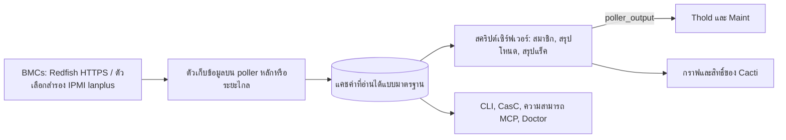

<!-- Source: README.md; SHA256: 6972a6c9ac754cd60e63c5caf971451ea8fe6e279eef757d886e1a168d3eef01 -->

<!-- translations:start -->
[English](../../../README.md) | [简体中文](../zh-CN/README.md) | [हिन्दी](../hi-IN/README.md) | [Español (España)](../es-ES/README.md) | [Español (Latinoamérica)](../es-419/README.md) | [العربية (السعودية)](../ar-SA/README.md) | [Afrikaans](../af-ZA/README.md) | [አማርኛ](../am-ET/README.md) | [العربية (مصر)](../ar-EG/README.md) | [العربية (المغرب)](../ar-MA/README.md) | [বাংলা](../bn-BD/README.md) | [Bosanski](../bs-BA/README.md) | [Deutsch](../de-DE/README.md) | [فارسی](../fa-IR/README.md) | [Filipino](../fil-PH/README.md) | [Français](../fr-FR/README.md) | [Français (Maroc)](../fr-MA/README.md) | [Français (Sénégal)](../fr-SN/README.md) | [Hausa](../ha-NG/README.md) | [עברית](../he-IL/README.md) | [Hrvatski](../hr-HR/README.md) | [Bahasa Indonesia](../id-ID/README.md) | [Igbo](../ig-NG/README.md) | [Italiano](../it-IT/README.md) | [日本語](../ja-JP/README.md) | [한국어](../ko-KR/README.md) | [Malagasy](../mg-MG/README.md) | [मराठी](../mr-IN/README.md) | [Bahasa Melayu](../ms-MY/README.md) | [Nederlands](../nl-NL/README.md) | [Polski](../pl-PL/README.md) | [Português (Brasil)](../pt-BR/README.md) | [Русский](../ru-RU/README.md) | [Kinyarwanda](../rw-RW/README.md) | [Soomaali](../so-SO/README.md) | [Српски](../sr-RS/README.md) | [Svenska](../sv-SE/README.md) | [Kiswahili](../sw-KE/README.md) | [தமிழ்](../ta-IN/README.md) | [తెలుగు](../te-IN/README.md) | [ไทย](README.md) | [Türkçe](../tr-TR/README.md) | [Українська](../uk-UA/README.md) | [اردو](../ur-PK/README.md) | [Tiếng Việt](../vi-VN/README.md) | [isiXhosa](../xh-ZA/README.md) | [Yorùbá](../yo-NG/README.md) | [繁體中文](../zh-TW/README.md) | [isiZulu](../zu-ZA/README.md)
<!-- translations:end -->

# plugin_redfish

ปลั๊กอินของ Cacti 1.2 ที่นำข้อมูลการใช้พลังงานของเซิร์ฟเวอร์ อุณหภูมิขาเข้า สถานะพัดลม และสถานะสุขภาพของพาวเวอร์ซัพพลายจากตัวควบคุมการจัดการเมนบอร์ด (BMCs) เข้าสู่ Cacti ในรูปแบบอุปกรณ์ แหล่งข้อมูล และกราฟทั่วไป โดยใช้ Redfish พร้อมตัวเลือกสำรองแบบอ่านอย่างเดียวผ่าน IPMI และการรวมกำลังไฟฟ้าระดับแร็ค Thold และ Maint จะแจ้งเตือนและระงับการแจ้งเตือนผ่านแหล่งข้อมูลมาตรฐานของ Cacti

> **สถานะ: อยู่ระหว่างการพัฒนา ยังไม่มีรุ่นเผยแพร่ (`0.1.0-dev`)** ปลั๊กอินนี้ไม่มีส่วนเกี่ยวข้องกับโครงการ Cacti ติดตั้งได้บน Cacti 1.2.31 หรือใหม่กว่าภายใต้ PHP 8.2 หรือใหม่กว่า และดำเนินการตัวเก็บข้อมูล Redfish ห้องนิรภัยข้อมูลรับรองที่เข้ารหัส การจัดเตรียมอุปกรณ์และกราฟของ Cacti ตัวเลือกสำรองแบบอ่านอย่างเดียวผ่าน IPMI การรวมพลังงานระดับแร็ค การแสดงหน้าต่าง Cacti Maint การทำสำเนาตัวเก็บข้อมูลระยะไกลและปลายทางเอเจนต์ ผู้ให้บริการ CasC และ CLI สำหรับผู้ปฏิบัติงาน ความสามารถของ MCP และการตรวจสอบวินิจฉัยของ Doctor ระบบ CI ทดสอบชุดข้อมูลตัวอย่าง DMTF Redfish Mockup Server (แบบระบบย่อย แบบดั้งเดิมเท่านั้น และแบบจำลอง HPE iLO Gen11) และ Thold v1.8.2 ร่วมกับ Maint v1.3 แต่ยังไม่มีการรับรอง BMC จริงหรือกลุ่มเครื่องนำร่อง การออกแบบและงานวิจัยอยู่ใน [docs/PLAN.md](../../PLAN.md), [docs/research/](../../research/), และ [docs/decisions/](../../decisions/)

## ความสามารถที่พัฒนาแล้ว

### ตัวเก็บข้อมูลหลัก ห้องนิรภัย และออบเจ็กต์ของ Cacti

- **วงจรชีวิตและสคีมา** ติดตั้ง อัปเกรด ปิดใช้งาน และถอนการติดตั้งผ่าน Plugin API ของ Cacti (`Schema::VERSION = 3`, 12 ตาราง) ตารางจะยังคงอยู่เมื่อถอนการติดตั้ง เว้นแต่จะยกเลิกการเลือก *Keep Plugin Tables on Uninstall* จุดเริ่มต้นทำงานสามารถแยกวิเคราะห์ได้บน PHP 8.0 และปฏิเสธ PHP ที่ต่ำกว่า 8.2 หรือการไม่มี `ext-openssl` พร้อมข้อความแสดงข้อผิดพลาดที่ชัดเจน
- **ทะเบียนและสิทธิ์** ขอบเขตสิทธิ์ *Redfish View* (`redfish_health.php`), *Redfish Operator* (`redfish_operator.php`), และ *Redfish Admin* (`redfish_bmcs.php`, `redfish_credentials.php`) พร้อมการตั้งค่าภายใต้ **Configuration > Settings > Redfish** ทะเบียน BMC รองรับการนำเข้า CSV (อ้างอิงข้อมูลรับรองด้วยชื่อ; ปฏิเสธรหัสผ่านในไฟล์นำเข้า) และการส่งออก JSON ระเบียน BMC และข้อมูลรับรองปฏิบัติตามสิทธิ์อุปกรณ์ของ Cacti
- **ห้องนิรภัยข้อมูลรับรองที่เข้ารหัส** รหัสผ่านถูกเก็บแบบเข้ารหัสด้วย AES-256-GCM ใน `plugin_redfish_secret` คีย์อยู่นอกฐานข้อมูล (ค่าเริ่มต้นคือ `/etc/cacti/redfish-vault.key`) เป็นอักขระฐานสิบหก 64 ตัว (`openssl rand -hex 32`) หรือไบต์ดิบ 32 ไบต์ โดยมีเจ้าของเป็นผู้ใช้ poller ผู้อื่นอ่านไม่ได้ และอยู่ในไดเรกทอรีที่เขียนได้เฉพาะ root หรือผู้ใช้นั้น ระบบจะปฏิเสธวลีรหัสผ่านแบบอักขระที่พิมพ์ได้ 32 ตัว **สำรองไฟล์คีย์ไว้พร้อมกับฐานข้อมูล** หากไม่มีไฟล์นี้จะต้องป้อนรหัสผ่านที่จัดเก็บไว้ใหม่อีกครั้ง
- **TLS และไคลเอนต์ Redfish แบบอ่านอย่างเดียว** การตรวจสอบ TLS เปิดใช้งานเป็นค่าเริ่มต้นโดยใช้ที่เก็บ CA ของระบบ ชุด CA เฉพาะ BMC หรือพิน SPKI SHA-256 การยกเว้นไม่ตรวจสอบเฉพาะ BMC จะยังคงแสดงเป็นคำเตือนด้านสุขภาพและคำเตือนการตรวจสอบของ Doctor ไคลเอนต์อนุญาตเฉพาะ `GET` ร่วมกับการเข้าสู่ระบบเซสชัน Redfish (`POST`) และการออกจากระบบ (`DELETE`) พร้อมตัวเลือกสำรองแบบ Basic เฉพาะ BMC เมื่อเซสชันไม่พร้อมใช้งาน การค้นพบจะเลือกใช้ทรัพยากรระบบย่อยและเซ็นเซอร์ Redfish แบบใหม่ก่อน และถอยกลับไปใช้ทรัพยากร `Power` และ `Thermal` ที่เลิกใช้งานแล้วเมื่อจำเป็น
- **การทำงานของตัวเก็บข้อมูล** `poller_redfish.php` เริ่มต้นจาก `poller_bottom` รันกระบวนการหลักหนึ่งกระบวนการต่อ poller ผ่านทะเบียนกระบวนการของ Cacti พร้อมกระบวนการทำงานที่กำหนดค่าได้ (`redfish_workers`) ขอสิทธิ์การถือครองต่อ BMC บังคับใช้งบประมาณเวลา (`redfish_collector_budget`) ใช้การถอยหลังแบบทวีคูณ และล้างเซสชันก่อนหน้าของปลั๊กอินเองหลังจากเกิดข้อขัดข้อง
- **เทมเพลต อุปกรณ์ และกราฟ** นำเข้า `templates/redfish-templates.xml` ตามแฮช และคัดลอกไฟล์ XML คำสั่งค้นหาข้อมูลสคริปต์เซิร์ฟเวอร์สามไฟล์ (`redfish_fans.xml`, `redfish_temperatures.xml`, `redfish_psus.xml`) ไปยัง `<cacti>/resource/script_server/` โดยไม่เขียนทับไฟล์ที่ผู้ใช้แก้ไข **Create Device** และ **Add Graphs** ต้องมีการยืนยันแผนการจัดเตรียม เชื่อมต่อคำสั่งค้นหากับอุปกรณ์เซิร์ฟเวอร์ที่จับคู่ไว้ หรือสร้างอุปกรณ์ "Redfish BMC" ภายใต้ `.invalid` โดยปิดการตรวจสอบความพร้อมใช้งาน และลิงก์กราฟ Redfish แต่ละกราฟกลับไปยังกราฟ Redfish ของอุปกรณ์ผ่าน `graph_buttons`
- **อินพุตสคริปต์เซิร์ฟเวอร์แบบแคชเท่านั้น** `scripts/ss_redfish_members.php` ให้ค่าพัดลม อุณหภูมิ และ PSU ต่อสมาชิก และ `scripts/ss_redfish_summary.php` ให้เมตริก "Redfish Node Summary" (พลังงาน อุณหภูมิขาเข้าและสูงสุด จำนวนพัดลมและ PSU ที่เสีย สุขภาพโหนด และอายุของการอ่านค่าที่ดีล่าสุด) การเรียกสคริปต์เซิร์ฟเวอร์จะอ่านจากแคชในเครื่องเท่านั้นและไม่ติดต่อ BMC โดยตรง ค่าที่หายไป ล้าสมัย หรือเป็นของสมาชิกที่หายไปจะคืนค่า `U` (ไม่คืนค่า `0` เด็ดขาด) ขณะที่ `age` จะรายงานค่าเสมอเพื่อให้เกณฑ์แจ้งเตือนตรวจจับ BMC ที่เงียบไปได้

**เมื่อสมาชิกของ BMC เปลี่ยนแปลง** (เช่น เปลี่ยนพัดลมหรืออัปเดตเฟิร์มแวร์ที่เปลี่ยนชื่อเซ็นเซอร์) ให้รัน **Add Graphs** อีกครั้ง พัดลมหรือพาวเวอร์ซัพพลายที่เคยมีอยู่แล้วหายไปจะถูกนับใน `fans_bad` หรือ `psus_bad` จนกว่าจะได้รับการยอมรับ แต่ช่องที่ไม่ได้ติดตั้งตั้งแต่แรกจะไม่ถูกนับ สมาชิกที่หายไปจะยังคงมีแหล่งข้อมูลและกราฟเดิมอยู่ ซึ่งจะอ่านค่าเป็น `U` ตลอดไปจนกว่าจะลบด้วยตนเอง การลบอุปกรณ์ Cacti จะยกเลิกการจับคู่ BMC และลบการกำหนดแร็คออกโดยยังคงรักษา BMC และแคชไว้ การลบ BMC หรือถอนการติดตั้งปลั๊กอินจะยังคงรักษาอุปกรณ์และกราฟของ Cacti ไว้

### ตัวเลือกสำรอง IPMI

- **เปิดใช้เฉพาะ BMC** ปิดเป็นค่าเริ่มต้น (`protocols` มีค่าเริ่มต้นเป็น `redfish`; การเปิดใช้ตัวเลือกสำรอง IPMI จะตั้งค่าเป็น `redfish,ipmi`)
- **เงื่อนไขการทริกเกอร์ที่จำกัดขอบเขต** ทำงานเฉพาะเมื่อการเก็บข้อมูล Redfish ล้มเหลวด้วยประเภทความล้มเหลวที่มีสิทธิ์เท่านั้น จะไม่ทริกเกอร์ในกรณี `AuthRejected`, `CredentialUnavailable`, `AddressRefused`, `OperationRefused`, หรือ `Deadline`
- **การทำงานที่ปลอดภัย** เรียก `ipmitool` ผ่าน `-I lanplus` ด้วย `proc_open()` รูปแบบอาร์เรย์โดยไม่ใช้เชลล์ มีการจำกัดเวลาการทำงานและจำกัดผลลัพธ์ที่ 256 KiB รหัสผ่านถูกส่งผ่าน `IPMITOOL_PASSWORD` (`-E`) หรือไฟล์ชั่วคราวโหมด 0600 (`-f`) ที่ถูกลบใน `finally` โดยไม่ส่งผ่านอาร์กิวเมนต์ CLI เด็ดขาด
- **รายการคำสั่งแบบอ่านอย่างเดียวที่อนุญาต** อนุญาตเฉพาะคำสั่งย่อยแบบอ่านอย่างเดียวห้าคำสั่งเท่านั้น: `dcmi power reading`, `sdr type Temperature`, `sdr type Fan`, `sdr type Power Supply`, และ `chassis status` คำสั่งที่เปลี่ยนแปลงค่าจะถูกปฏิเสธ
- **ผลลัพธ์มาตรฐานและคำเตือนด้านความปลอดภัย** `IpmiNormalizer` แปลงค่าที่อ่านได้ให้อยู่ในโมเดล `Observation`/`Member`/`Reading` เดียวกัน โดยส่งออก `U` สำหรับเซ็นเซอร์ที่ขาดหายไปหรือไม่สามารถแยกวิเคราะห์ได้ การเปิดใช้ตัวเลือกสำรอง IPMI จะแสดงคำเตือนบนหน้าสุขภาพและในการตรวจสอบ Doctor ของ `redfish.bmc_security` เพื่อเตือนผู้ดูแลให้จำกัด UDP 623 ไว้เฉพาะ VLAN สำหรับการจัดการ

### การรวมกำลังไฟฟ้าระดับแร็ค

- **ทะเบียนแร็ค** สคีมาเวอร์ชัน 3 เพิ่ม `plugin_redfish_rack` (`(site_id, name)` ที่ไม่ซ้ำกัน, `power_budget_watts` ที่เป็นทางเลือก, `min_coverage_pct` ค่าเริ่มต้น `80`, และหมายเหตุ) และ `plugin_redfish_rack_member` (กำหนดแร็คได้ไม่เกินหนึ่งแร็คต่อ `host_id`, `bmc_id` และ `unit_position` ที่เป็นทางเลือก ซึ่งจะถูกลบอัตโนมัติเมื่อลบอุปกรณ์ Cacti)
- **ผลรวมที่ป้องกันด้วยความครอบคลุม** `RackPowerSummary` รวมค่า `power_watts` ล่าสุดของสมาชิกจากแคชในเครื่องและคำนวณอัตราการใช้งบประมาณและกำลังไฟฟ้าที่เหลือ เมื่อความครอบคลุมของสมาชิกที่รายงานลดลงต่ำกว่า `min_coverage_pct` ค่า `power_watts`, `utilization_pct`, และ `headroom_watts` จะคืนค่า `U` เพื่อไม่ให้ข้อผิดพลาดของตัวเก็บข้อมูลดูเหมือนกำลังไฟฟ้าของแร็คลดลง
- **อินพุตสคริปต์เซิร์ฟเวอร์ที่พร้อมสำหรับ Thold** `scripts/ss_redfish_rack.php` (`ss_redfish_rack(<rack_id>)`) คืนค่า `power_watts`, `power_budget_watts`, `utilization_pct`, `headroom_watts`, `members_total`, `members_reporting`, และ `coverage_pct` จากแคชในเครื่องเท่านั้น

### การผสานรวมกับ Cacti Maint

- เกณฑ์แจ้งเตือนของ Thold บนแหล่งข้อมูล Redfish จะแจ้งเตือนและ Cacti Maint จะระงับการแจ้งเตือนโดยไม่ต้องแก้ไขปลั๊กอินทั้งสอง
- `MaintWindow` ตรวจสอบกำหนดการ Maint ที่ใช้งานอยู่สำหรับโฮสต์ Cacti ที่จับคู่ไว้แต่ละเครื่อง (กำหนดการครั้งเดียว `mtype=1` และแบบเกิดซ้ำ `mtype=2` รวมถึง `plugin_maint_check_cacti_host()` เมื่อโหลด) และทำเครื่องหมายการบำรุงรักษาที่ใช้งานอยู่บนหน้า Redfish Health (`[MAINT]`), ในผลลัพธ์ของ `cli/redfish.php health`, และในความสามารถ `redfish-get-health`

### ตัวเก็บข้อมูลระยะไกล

- `INFO` ประกาศ `remote_collect:1` ตัว BMC ยอมรับ `poller_id >= 1` ใดๆ และ `poller_redfish.php --poller=N` จะเก็บข้อมูลเฉพาะ BMC ที่เปิดใช้งานและกำหนดให้กับ poller นั้นเท่านั้น
- **ฮุก `replicate_out`** ทำสำเนาเฉพาะตารางการกำหนดค่าที่ไม่ใช่ความลับซึ่งจำกัดขอบเขตไว้เฉพาะ poller ระยะไกลเป้าหมายผ่าน `replicate_out_table()`: `plugin_redfish_bmc`, เมตาดาต้าของ `plugin_redfish_credential` (ไม่มีข้อความเข้ารหัส), `plugin_redfish_rack`, และ `plugin_redfish_rack_member` ตาราง `plugin_redfish_secret` จะไม่ถูกทำสำเนา และไฟล์คีย์ห้องนิรภัยจะยังคงอยู่ในเครื่องของแต่ละ poller เท่านั้น
- **ฮุก `remote_agent`** เปิดเผยการทำงานแบบอ่านอย่างเดียว `redfish_health` และ `redfish_discovery` ซึ่งยอมรับเฉพาะพารามิเตอร์ตัวเลข `poller_id` และ `bmc_id` พารามิเตอร์ที่ไม่คาดคิดจะถูกปฏิเสธและไม่มีการส่งคืนข้อมูลรับรองหรือความลับใดๆ

### ฮุกของระบบนิเวศ (CasC, ความสามารถ MCP, และ Doctor)

- **ผู้ให้บริการ CasC (`casc_register_providers`)** ลงทะเบียนผู้ให้บริการ `redfish` (สคีมาเวอร์ชัน `1`) พร้อมการส่งออก YAML และ XML ด้วย PHP ล้วน การแยกวิเคราะห์ (ปฏิเสธ XXE) การตรวจสอบความถูกต้อง การวางแผนความแตกต่าง และการใช้งาน ข้อมูลรับรองจะปรากฏเฉพาะในรูปแบบการอ้างอิงห้องนิรภัย (`vault:redfish:<name>`) เท่านั้น คีย์ความลับดิบ (`pass`, `secret`, `token`, `private_key`, `vault_key`, `auth_token`) จะถูกปฏิเสธ การใช้งานจริงต้องใช้ `PLAN_HASH` แบบ SHA-256 ที่ตรงกันทุกประการ
- **MCP / Abilities API (`abilities_register`)** ลงทะเบียนความสามารถแบบอ่านอย่างเดียวสามรายการที่ควบคุมด้วยขอบเขตสิทธิ์ Redfish View (`redfish_health.php`) และสิทธิ์อุปกรณ์ Cacti โดยไม่ส่งคืนข้อมูลรับรองใดๆ:
  - `redfish-list-bmcs` (`poller_id` ที่เป็นทางเลือก)
  - `redfish-get-rack-power` (`rack_id` ที่เป็นทางเลือก)
  - `redfish-get-health` (`bmc_id` ที่เป็นทางเลือก)
- **การตรวจสอบ Doctor (`doctor_register_checks`)** ลงทะเบียนการตรวจสอบวินิจฉัยแบบอ่านอย่างเดียวในเครื่องห้ารายการที่ไม่ติดต่อ BMC หรือส่งคืนข้อมูลคีย์:
  - `redfish.schema`: ความเป็นปัจจุบันของเวอร์ชันสคีมา
  - `redfish.vault_key`: ความสามารถในการอ่านและสิทธิ์ของคีย์ห้องนิรภัย
  - `redfish.collector_runs`: งบประมาณและความสดใหม่ของตัวเก็บข้อมูล poller
  - `redfish.bmc_security`: BMC ที่เปิดใช้งานพร้อม TLS ที่ไม่ได้ตรวจสอบหรือตัวเลือกสำรอง IPMI
  - `redfish.rack_power`: การปฏิบัติตามงบประมาณพลังงานแร็คและเกณฑ์ความครอบคลุมขั้นต่ำ

## CLI

รันจากไดเรกทอรีรากของ Cacti ด้วย PHP 8.2 หรือใหม่กว่า:

```sh
# Operator and CasC CLI (reads --file=PATH or stdin for validate, plan, and apply)
php plugins/redfish/cli/redfish.php export --format=yaml|xml
php plugins/redfish/cli/redfish.php validate [--file=PATH] [--format=yaml|xml]
php plugins/redfish/cli/redfish.php plan [--file=PATH] [--format=yaml|xml]
php plugins/redfish/cli/redfish.php apply [--file=PATH] [--format=yaml|xml] --confirm=<PLAN_HASH>
php plugins/redfish/cli/redfish.php health --format=text|json

# Collector entry point (normally started by poller_bottom)
php plugins/redfish/poller_redfish.php [--poller=N] [--force] [--debug]

# Rack power summary script server entry point
php plugins/redfish/scripts/ss_redfish_rack.php <rack_id>
```

## บทบาทการเข้าถึง

| ขอบเขตสิทธิ์ | การเข้าถึง |
| --- | --- |
| Redfish View | หน้าการเฝ้าติดตามที่มีอยู่ |
| Redfish Operator | การเฝ้าติดตามพร้อมหน้าการปฏิบัติการและการรับทราบการคัดแยกปัญหาส่วนบุคคล |
| Redfish Admin | การเข้าถึงระดับ Operator พร้อมการกำหนดค่าและการดำเนินการระดับผู้ดูแลระบบที่มีอยู่ |

หลังจากคัดลอกไฟล์อัปเกรดแล้ว ให้เปิดหน้า Plugins ในฐานะผู้ดูแลระบบเพื่อลงทะเบียนขอบเขตสิทธิ์ กำหนดขอบเขตสิทธิ์ Operator อย่างชัดเจนภายใต้ **Configuration > Users** หรือกลุ่มผู้ใช้ การอัปเกรดจะยังคง ID และสิทธิ์ที่มอบให้ของขอบเขตสิทธิ์ View และ Admin ที่มีอยู่ไว้ สิทธิ์ Admin จะสืบทอดสิทธิ์ Operator และสิทธิ์ Operator จะสืบทอดสิทธิ์ View ในแต่ละคำขอ การทำเช่นนี้ไม่ได้เพิ่มสิทธิ์ที่จัดเก็บไว้ให้ผู้ใช้หรือกลุ่ม การตั้งค่าปลั๊กอินยังต้องใช้สิทธิ์ Redfish Admin ร่วมกับสิทธิ์ Settings ของ Cacti ด้วย

สิทธิ์อุปกรณ์ของ Cacti จำกัดแถวและการดำเนินการที่ใช้ได้สำหรับผู้ใช้แต่ละราย ออบเจ็กต์ที่ไม่ได้จับคู่ต้องใช้ผู้ดูแลระบบ ผู้ปฏิบัติงานสามารถปลดล็อกการระงับการเก็บข้อมูลบน BMC ที่ได้รับอนุญาตสำหรับรอบการทำงานตามกำหนดการถัดไปได้ ข้อมูลรับรอง การกำหนดค่า การจับคู่ การลบ และการเปลี่ยนแปลงเชิงบริหารอื่นๆ ยังคงอยู่ในหน้าการจัดการระบบ การรับทราบมีผลเฉพาะในเซสชันปัจจุบันของผู้ใช้ นานสูงสุดหนึ่งชั่วโมง และเฉพาะตราบเท่าที่การสังเกตการณ์เดียวกันยังคงสดใหม่อยู่เท่านั้น การสังเกตการณ์ใหม่หรือที่เปลี่ยนแปลงจะทำให้การรับทราบเป็นโมฆะ และจะไม่ทำเครื่องหมายว่าการวัดที่ล้มเหลวเป็นปกติหรือระงับการแจ้งเตือนเด็ดขาด

## เหตุผล

เซิร์ฟเวอร์ทุกเครื่องมี BMC ที่รายงานสถานะพลังงานและความร้อนโดยอิสระจากระบบปฏิบัติการ จึงยังคงตอบสนองได้แม้เมื่อ OS หยุดทำงาน ข้อมูลนี้ช่วยในการติดตามความจุและต้นทุน การแจ้งเตือนล่วงหน้าเมื่อพัดลมหรือพาวเวอร์ซัพพลายขัดข้อง และในการประมวลผลสมรรถนะสูง ใช้สำหรับการตัดสินใจจำกัดพลังงาน ทั้งนี้ ปลั๊กอินไม่ได้จำกัดเฉพาะงาน HPC เท่านั้น

ปัจจุบัน Cacti ครอบคลุมส่วนหนึ่งของงานนี้แล้ว:

- **แพ็กเกจ SNMP ของผู้จำหน่าย** สาขา 1.2.x มาพร้อมเทมเพลต Dell iDRAC และ HPE iLO ที่ต้องใช้เอเจนต์ SNMP และผูกกับผู้จำหน่ายเฉพาะราย งานวิจัยในไมล์สโตน 1 พบว่าทั้งสองตัวไม่ได้รายงานการใช้พลังงานเป็นวัตต์ ([docs/research/overlap.md](../../research/overlap.md))
- **ประเภทข้อมูลรับรองที่ไม่มีตัวเก็บข้อมูล** `plugin_credentials` กำหนดข้อมูลรับรอง "IPMI / Redfish (BMC)" ไว้ แต่ไม่ได้อ่านค่าจาก BMC ใดๆ
- **ไม่มีมุมมองระดับแร็ค** แกนหลักของ Cacti ไม่มีออบเจ็กต์แร็ค อุปกรณ์มีเพียงฟิลด์ข้อความอิสระ `location`

ปลั๊กอินจะสำรวจ BMC นอกรอบการทำงานปกติของ Cacti บน poller หลักหรือตัวเก็บข้อมูลระยะไกล แคชค่าที่ปรับให้เป็นมาตรฐานแล้ว และเปิดเผยข้อมูลผ่านคำสั่งค้นหาข้อมูลของสคริปต์เซิร์ฟเวอร์ สรุปโหนด และสรุปกำลังไฟฟ้าของแร็ค โดยใช้ระบบกราฟ สิทธิ์ Thold และ Maint ของ Cacti ซ้ำ และไม่เปลี่ยนแปลงสถานะของ BMC

## ขอบเขตและสถานะ

| ระยะ | ขอบเขต | ไมล์สโตน | สถานะ |
|---|---|---|---|
| 0, งานวิจัย | ตารางเปรียบเทียบผู้จำหน่าย การยืนยันพฤติกรรมต้นน้ำบน BMC จริง ต้นทุนการสำรวจ การทดสอบคำสั่งค้นหาข้อมูล | [M1](https://github.com/somethingwithproof/plugin_redfish/milestone/1) | เสร็จสิ้น รอการเก็บข้อมูลเฟิร์มแวร์จาก BMC จริง |
| 1, การสังเกตการณ์ | ทะเบียน BMC, ข้อมูลรับรอง, TLS, ตัวเก็บข้อมูล Redfish, ค่าที่ปรับมาตรฐานแล้ว, อุปกรณ์, กราฟตามดัชนี, การแจ้งเตือน Thold, การผสานรวม Maint, หน้าสุขภาพ | [M2](https://github.com/somethingwithproof/plugin_redfish/milestone/2), [M3](https://github.com/somethingwithproof/plugin_redfish/milestone/3), [M4](https://github.com/somethingwithproof/plugin_redfish/milestone/4) | พัฒนาแล้ว; รอการรับรองกลุ่มเครื่องนำร่อง M4 |
| 2, ipmi | ตัวเลือกสำรอง IPMI (`lanplus`) แบบอ่านอย่างเดียวผ่าน `ipmitool`, ปิดเป็นค่าเริ่มต้น | [M5](https://github.com/somethingwithproof/plugin_redfish/milestone/5) | พัฒนาแล้ว |
| 3, แร็ค | ทะเบียนแร็ค, ผลรวมกำลังไฟฟ้าแร็คพร้อมเกณฑ์ความครอบคลุมขั้นต่ำ, พื้นที่งบประมาณที่เหลือ, `ss_redfish_rack.php` | [M6](https://github.com/somethingwithproof/plugin_redfish/milestone/6) | พัฒนาแล้ว |
| 4, ระยะไกลและระบบนิเวศ | ตัวเก็บข้อมูลระยะไกล (`replicate_out`, `remote_agent`), ผู้ให้บริการ CasC และ CLI, ความสามารถ MCP, การตรวจสอบ Doctor | [M7](https://github.com/somethingwithproof/plugin_redfish/milestone/7) | พัฒนาแล้ว |

นอกขอบเขต: การตั้งค่าเพดานพลังงานหรือการกำหนดค่า BMC อื่นใด การควบคุมพลังงาน การอัปเดตเฟิร์มแวร์ การเข้าถึงคอนโซล กลไกการแจ้งเตือนที่เป็นของปลั๊กอินเอง และการผสานรวมตัวจัดกำหนดการ

## เป้าหมายความเข้ากันได้

| องค์ประกอบ | เป้าหมาย |
|---|---|
| Cacti | 1.2.31 หรือใหม่กว่า โดยไม่แก้ไขโค้ดแกนหลัก |
| ฐานข้อมูล | MariaDB 10.2 หรือ MySQL 5.7 หรือใหม่กว่า: จำกัดหนึ่ง BMC ต่ออุปกรณ์ด้วยคีย์เฉพาะบนคอลัมน์ที่สร้างขึ้น |
| PHP | 8.2 หรือใหม่กว่า; จุดเริ่มต้นยังสามารถแยกวิเคราะห์ได้บน 8.0 เพื่อให้รันไทม์ที่ไม่รองรับได้รับข้อความปฏิเสธแทนที่ UI ของ Cacti จะพัง |
| ส่วนขยาย PHP | `ext-openssl` (จำเป็นสำหรับ Cacti 1.2.31); ไม่ใช้ `ext-curl` และไม่มีไลบรารีรันไทม์ของ Composer |
| เครื่องมือเสริม | `ipmitool` บน poller ที่เก็บข้อมูล BMC ซึ่งเปิดใช้ตัวเลือกสำรอง IPMI |
| BMCs | Dell iDRAC, HPE iLO, Lenovo XCC, และ OpenBMC ตามช่วงเวอร์ชันเฟิร์มแวร์; ดู [ตารางเปรียบเทียบผู้จำหน่าย](../../research/vendor-matrix.md) |
| Redfish | ใช้ทรัพยากรระบบย่อยและเซ็นเซอร์ใหม่ก่อน และใช้ `Power` กับ `Thermal` ที่เลิกใช้งานแล้วเป็นตัวสำรอง |
| Thold, Maint | ไม่ต้องแก้ไขเพิ่มเติม (CI ทดสอบ Thold v1.8.2 และ Maint v1.3) |

## การออกแบบ

- [docs/PLAN.md](../../PLAN.md) คือแผนฉบับเต็ม: สถาปัตยกรรม ข้อเท็จจริงต้นน้ำที่พึ่งพา โมเดลการวัด ขอบเขตความปลอดภัย การคำนวณประสิทธิภาพ การทดสอบ และความเสี่ยง
- [docs/decisions/](../../decisions/) เก็บบันทึกการตัดสินใจเชิงสถาปัตยกรรมสำหรับตัวเลือกที่ได้ตัดสินใจแล้ว
- [docs/REQUIREMENTS.md](../../REQUIREMENTS.md) จับคู่ ID ข้อกำหนดแต่ละรายการกับปัญหาที่เกี่ยวข้อง



## ความปลอดภัย

ข้อมูลรับรอง BMC ควบคุมการจัดการเซิร์ฟเวอร์นอกแบนด์ การออกแบบจึงกันความลับออกจากบรรทัดคำสั่ง บันทึก การส่งออก CasC ข้อมูลเอเจนต์ระยะไกล คำตอบ MCP และหน้าเว็บ เข้ารหัสรหัสผ่านที่จัดเก็บด้วย AES-256-GCM โดยใช้ไฟล์คีย์ห้องนิรภัยในเครื่องสำหรับแต่ละ poller ตรวจสอบ TLS เป็นค่าเริ่มต้น รัน `ipmitool` จากอาร์เรย์อาร์กิวเมนต์ที่ชัดเจนพร้อมคำสั่งย่อยแบบอ่านอย่างเดียวที่อนุญาต และใช้บัญชี BMC แบบอ่านอย่างเดียว ดู [docs/PLAN.md](../../PLAN.md#security) และ [SECURITY.md](../../../SECURITY.md)

## คู่มือผู้ปฏิบัติงาน

ดู [docs/operator-guide.md](../../operator-guide.md) สำหรับข้อกำหนดเบื้องต้นในการติดตั้ง การตั้งค่าห้องนิรภัยและ TLS การลงทะเบียน BMC การสร้างกราฟ ช่วงเวลาการแจ้งเตือน การสำรองข้อมูล และการจัดการความล้มเหลว คู่มือจะไม่ประกาศว่ารองรับเฟิร์มแวร์จริงของผู้จำหน่ายรุ่นใดจนกว่าไฟล์บันทึกที่ปิดบังข้อมูลลับจากเฟิร์มแวร์นั้นจะผ่านชุดการทดสอบ

## การพัฒนาและการทดสอบ

CI ([.github/workflows/plugin-ci-workflow.yml](../../../.github/workflows/plugin-ci-workflow.yml)) ตรวจสอบไวยากรณ์จุดเริ่มต้นบน PHP 8.0 รันชุดทดสอบยูนิตของ Pest (`phpunit.xml`) และการทดสอบการผสานรวมวงจรชีวิต (`phpunit-integration.xml`) รวมถึง PHPStan ระดับ 9 บน PHP 8.2 ถึง 8.5 เทียบกับ Cacti `release/1.2.31` และ `1.2.x` ยืนยันการปฏิเสธบน PHP 8.1 ทดสอบ DMTF Redfish Mockup Server (แบบระบบย่อย แบบดั้งเดิมเท่านั้น และแบบจำลอง HPE iLO Gen11) ร่วมกับ Thold v1.8.2 / Maint v1.3 แบบครบวงจร และตรวจสอบแค็ตตาล็อก gettext เวิร์กโฟลว์ และลิขสิทธิ์ REUSE

การตรวจสอบในเครื่องก่อน push:

```sh
sh tests/lint-workflows.sh
sh locales/build_gettext.sh --check
CACTI_PATH=/path/to/cacti phpstan analyse -c phpstan.neon --no-progress
```

รัน Pest ด้วย `--configuration=phpunit.xml` สำหรับการทดสอบยูนิตและกฎของซอร์สโค้ด หรือ `--configuration=phpunit-integration.xml` พร้อม `CACTI_PATH` และ `REDFISH_TEST_DATABASE=disposable` เทียบกับฐานข้อมูล Cacti แบบใช้แล้วทิ้งสำหรับการทดสอบการผสานรวมวงจรชีวิต

## วิธีการติดตามงาน

- **ไมล์สโตน** เป็นไปตามไมล์สโตนของแผน แต่ละไมล์สโตนมีปัญหาหลัก (epic) ที่ระบุปัญหาย่อยและหลักฐานการปิดงาน
- **ปัญหา (Issues)** ถูกจัดประเภทด้วยป้ายกำกับ: `type: requirement`, `type: research`, `type: decision`, `type: epic` ปัญหาข้อกำหนดระบุข้อกำหนดที่มีหมายเลขและทดสอบได้ (`REQ-AREA-NNN`) พร้อมเกณฑ์การยอมรับ
- **ป้ายกำกับ** ยังระบุ `area:`, `phase:`, `priority:`, และ `status:` ดู [CONTRIBUTING.md](../../../CONTRIBUTING.md#labels)
- [บอร์ดโครงการ](https://github.com/users/somethingwithproof/projects/12) แสดงปัญหาทั้งหมดในทุกไมล์สโตน

## การมีส่วนร่วม

อ่าน [CONTRIBUTING.md](../../../CONTRIBUTING.md) การ commit ต้องมีการลงนาม DCO การหารือด้านการออกแบบเกิดขึ้นในปัญหา (issues) การตัดสินใจที่ยังเปิดอยู่จะมีป้ายกำกับ `type: decision` หลักฐานจาก BMC จริงเป็นความช่วยเหลือที่มีประโยชน์ที่สุดในตอนนี้ โปรดลบที่อยู่ หมายเลขซีเรียล และข้อมูลรับรองออกก่อนโพสต์ไฟล์บันทึกใดๆ

## สัญญาอนุญาต

GNU General Public License v2.0 ซึ่งเป็นสัญญาอนุญาตเดียวกับ Cacti และปลั๊กอินของ Cacti ดู [LICENSE](../../../LICENSE)
