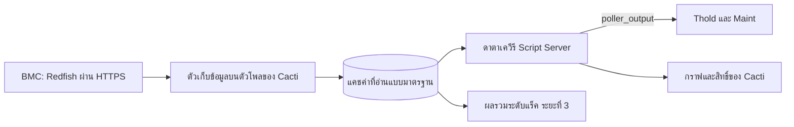

<!-- Source: README.md; SHA256: 7b4e83a58a1adc844cb0615ef30e95476cba2851f96bb454d2a816fb2774724d -->

<!-- translations:start -->
[English](../../../README.md) | [简体中文](../zh-CN/README.md) | [हिन्दी](../hi-IN/README.md) | [Español (España)](../es-ES/README.md) | [Español (Latinoamérica)](../es-419/README.md) | [العربية (السعودية)](../ar-SA/README.md) | [Afrikaans](../af-ZA/README.md) | [አማርኛ](../am-ET/README.md) | [العربية (مصر)](../ar-EG/README.md) | [العربية (المغرب)](../ar-MA/README.md) | [বাংলা](../bn-BD/README.md) | [Bosanski](../bs-BA/README.md) | [Deutsch](../de-DE/README.md) | [فارسی](../fa-IR/README.md) | [Filipino](../fil-PH/README.md) | [Français](../fr-FR/README.md) | [Français (Maroc)](../fr-MA/README.md) | [Français (Sénégal)](../fr-SN/README.md) | [Hausa](../ha-NG/README.md) | [עברית](../he-IL/README.md) | [Hrvatski](../hr-HR/README.md) | [Bahasa Indonesia](../id-ID/README.md) | [Igbo](../ig-NG/README.md) | [Italiano](../it-IT/README.md) | [日本語](../ja-JP/README.md) | [한국어](../ko-KR/README.md) | [Malagasy](../mg-MG/README.md) | [मराठी](../mr-IN/README.md) | [Bahasa Melayu](../ms-MY/README.md) | [Nederlands](../nl-NL/README.md) | [Polski](../pl-PL/README.md) | [Português (Brasil)](../pt-BR/README.md) | [Русский](../ru-RU/README.md) | [Kinyarwanda](../rw-RW/README.md) | [Soomaali](../so-SO/README.md) | [Српски](../sr-RS/README.md) | [Svenska](../sv-SE/README.md) | [Kiswahili](../sw-KE/README.md) | [தமிழ்](../ta-IN/README.md) | [తెలుగు](../te-IN/README.md) | [ไทย](README.md) | [Türkçe](../tr-TR/README.md) | [Українська](../uk-UA/README.md) | [اردو](../ur-PK/README.md) | [Tiếng Việt](../vi-VN/README.md) | [isiXhosa](../xh-ZA/README.md) | [Yorùbá](../yo-NG/README.md) | [繁體中文](../zh-TW/README.md) | [isiZulu](../zu-ZA/README.md)
<!-- translations:end -->

# plugin_redfish

ปลั๊กอินของ Cacti 1.2 ที่นำข้อมูลการใช้พลังงานของเซิร์ฟเวอร์ อุณหภูมิขาเข้า สถานะพัดลม และสถานะสุขภาพของพาวเวอร์ซัพพลายจาก Baseboard Management Controller (BMC) เข้าสู่ Cacti ในรูปแบบอุปกรณ์ แหล่งข้อมูล และกราฟทั่วไป โดยใช้ Redfish พร้อมตัวเลือกสำรองผ่าน IPMI จากนั้น Thold และ Maint จะแจ้งเตือนและระงับการแจ้งเตือนได้ และในระยะถัดไปจะเพิ่มการคำนวณกำลังไฟฟ้ารวมระดับแร็ค

> **สถานะ: อยู่ระหว่างการพัฒนา ยังไม่มีรุ่นเผยแพร่ (0.1.0-dev)** ไมล์สโตน 2 (โครงสร้างพื้นฐาน) และ 3 (ออบเจ็กต์ของ Cacti และการแจ้งเตือน) ได้ผสานเข้าสู่ `main` แล้ว ปลั๊กอินนี้ไม่มีส่วนเกี่ยวข้องกับโครงการ Cacti สามารถติดตั้งบน Cacti 1.2.31 ภายใต้ PHP 8.2 หรือใหม่กว่า ลงทะเบียน BMC และข้อมูลรับรอง อ่านค่าพลังงาน อุณหภูมิ พัดลม และสถานะสุขภาพของพาวเวอร์ซัพพลายจาก BMC แต่ละตัวผ่าน Redfish ลงในแคชของตนเอง และแสดงสถานะสุขภาพของการเก็บข้อมูล เพิ่มอุปกรณ์ใน Cacti กราฟแยกรายสมาชิกและกราฟสรุป รวมถึงรองรับ Thold และ Maint ผ่านแหล่งข้อมูลปกติ ระบบ CI ได้ทดสอบกับ BMC จำลองที่สร้างจากข้อมูลตัวอย่างที่เขียนขึ้นเองและเซิร์ฟเวอร์จำลอง DMTF Redfish mockup แล้ว แต่ยังไม่มีการรับรองกับ BMC จริงหรือกลุ่มเครื่องนำร่อง การออกแบบและงานวิจัยอยู่ใน [docs/PLAN.md](../../PLAN.md), [docs/research/](../../research) และ [docs/decisions/](../../decisions)

### สิ่งที่ไมล์สโตน 2 ส่งมอบ

- ติดตั้ง อัปเกรด ปิดการใช้งาน และถอนการติดตั้งผ่าน Plugin API ของ Cacti โดยยังคงตารางฐานข้อมูลไว้เมื่อถอนการติดตั้ง เว้นแต่จะล้างการตั้งค่าดังกล่าว หากใช้ PHP รุ่นเก่ากว่า 8.2 ปลั๊กอินจะปฏิเสธการติดตั้งหรือเปิดใช้งานพร้อมระบุเหตุผล
- สิทธิ์ (Realm) "Redfish View" (หน้าสถานะสุขภาพ), "Redfish Operator" (หน้าปฏิบัติการ) และ "Redfish Admin" (หน้า BMC และข้อมูลรับรอง) รวมถึงการตั้งค่าภายใต้ Configuration > Settings > Redfish
- ทะเบียน BMC พร้อมการนำเข้า CSV และการส่งออก JSON ไฟล์นำเข้าต้องไม่มีรหัสผ่าน โดยอ้างอิงข้อมูลรับรองด้วยชื่อ
- จัดเก็บข้อมูลรับรองแบบเข้ารหัสด้วย AES-256-GCM คีย์เป็นไฟล์ที่อยู่นอกฐานข้อมูล โดยค่าเริ่มต้นคือ `/etc/cacti/redfish-vault.key` ซึ่งบรรจุอักขระเลขฐานสิบหก 64 ตัว (`openssl rand -hex 32`) หรือไบต์สุ่มจำนวน 32 ไบต์พอดี มีเจ้าของเป็นผู้ใช้งาน poller ผู้อื่นไม่สามารถอ่านได้ และอยู่ในไดเรกทอรีที่เฉพาะผู้ใช้งาน poller หรือ root เท่านั้นที่เขียนได้ คีย์ที่เป็นอักขระที่พิมพ์ได้ 32 ตัวจะถูกปฏิเสธเนื่องจากถือเป็นรหัสผ่าน **ควรสำรองไฟล์คีย์ควบคู่กับฐานข้อมูล** หากไม่มีไฟล์คีย์ จะต้องป้อนรหัสผ่านที่จัดเก็บไว้ทั้งหมดใหม่อีกครั้ง
- เปิดใช้งานการตรวจสอบ TLS เป็นค่าเริ่มต้น พร้อม CA bundle หรือการปักหมุด SPKI SHA-256 แบบราย BMC การเลือกปิดการตรวจสอบแบบราย BMC จะถูกบันทึกไว้และแสดงเป็นคำเตือนบนหน้าสถานะสุขภาพ
- ไคลเอนต์ Redfish แบบอ่านอย่างเดียว: ใช้เฉพาะ `GET` รวมถึงการเข้าสู่ระบบและออกจากระบบของเซสชันเท่านั้น โดยตรวจสอบกับรายการที่อนุญาตก่อนส่งคำขอทุกครั้ง
- ตัวเก็บข้อมูลที่เริ่มต้นจาก `poller_bottom` สำหรับ BMC บน main poller พร้อมระบบ lease และกำหนดเวลาแบบราย BMC การถอยหลัง (backoff) และการล้างเซสชันหนึ่งเดียวที่ปลั๊กอินบันทึกไว้หลังจากเกิดความขัดข้อง ยังไม่รองรับตัวเก็บข้อมูลระยะไกล เนื่องจากต้องมีการตัดสินใจอย่างชัดเจนว่าตัวเก็บข้อมูลจะเข้าถึงฐานข้อมูลและคีย์อย่างไร (ระยะที่ 4)
- ระเบียน BMC และข้อมูลรับรองปฏิบัติตามสิทธิ์อุปกรณ์ของ Cacti: Redfish Admin จะมองเห็น แก้ไข และผูกได้เฉพาะ BMC บนอุปกรณ์ที่ตนมีสิทธิ์มองเห็น และเฉพาะข้อมูลรับรองที่ไม่มี BMC บนอุปกรณ์ที่ถูกซ่อนใช้งานอยู่เท่านั้น

### สิ่งที่ไมล์สโตน 3 เพิ่มเติม

- เทมเพลตที่จัดส่งเป็น XML เทมเพลตของ Cacti ใน `templates/` และนำเข้าด้วยตัวนำเข้าของ Cacti เองเมื่อติดตั้งและอัปเกรด โดยจับคู่ด้วยแฮช ดังนั้นการนำเข้าจะอัปเดตออบเจ็กต์ของปลั๊กอินโดยไม่เพิ่มซ้ำ ไฟล์ดาตาเควีรีทั้งสามไฟล์จะถูกคัดลอกไปยัง `<cacti>/resource/script_server/` พร้อมบันทึกแฮชไว้ ปลั๊กอินจะไม่แทนที่ไฟล์ที่ปลั๊กอินไม่ได้เป็นผู้เขียน และหน้าสถานะสุขภาพจะเตือนผู้ดูแลระบบเมื่อเทมเพลตหรือไฟล์เควีรียังไม่พร้อมใช้งาน ปุ่ม **Reinstall the Redfish Templates** ในหน้า BMCs ใช้สำหรับนำเข้าใหม่อีกครั้ง ซึ่งต้องใช้สิทธิ์ Import Templates ของ Cacti
- **Create Device** หรือ **Add Graphs** บน BMC แต่ละตัว ([ADR 0015](../../decisions/0015-attach-to-the-server-device-or-create-one-per-bmc.md)) BMC ที่จับคู่กับอุปกรณ์เซิร์ฟเวอร์ที่มีอยู่แล้วจะได้รับดาตาเควีรีและกราฟบนอุปกรณ์นั้น ส่วน BMC ที่ยังไม่ได้จับคู่จะได้รับอุปกรณ์ใหม่จากเทมเพลตอุปกรณ์ "Redfish BMC" โดยปิดการตรวจสอบสถานะความพร้อมใช้งานและใช้ชื่อโฮสต์ภายใต้ `.invalid` เพื่อไม่ให้ Cacti ติดต่อไปยัง BMC และไม่แสดงที่อยู่ของ BMC ไม่ว่าจะด้วยวิธีใด ผู้ดูแลระบบจะต้องยืนยันแผนที่แสดงรายการสิ่งที่จะเพิ่มก่อนเสมอ ทั้งสองการดำเนินการต้องใช้สิทธิ์จัดการอุปกรณ์ของ Cacti ร่วมกับ Redfish Admin หากผู้สร้างไม่สามารถมองเห็นอุปกรณ์ที่สร้างขึ้นใหม่ได้ อุปกรณ์นั้นจะถูกลบออกอีกครั้ง
- ดาตาเควีรีแบบ script server สามรายการ ได้แก่ "Redfish Fans", "Redfish Temperatures" และ "Redfish Power Supplies" โดยจัดดัชนีตามคีย์สมาชิกของ BMC พร้อมกราฟแยกรายสมาชิก: ความเร็วพัดลมเป็นเปอร์เซ็นต์หรือ RPM (ตามหน่วยที่ BMC รายงาน), อุณหภูมิ และกำลังไฟฟ้าขาเข้าและขาออกของพาวเวอร์ซัพพลาย โดยแต่ละรายการมีรหัสสถานะสุขภาพกำกับ
- อินพุต "Redfish Node Summary" ที่ประกอบด้วยพลังงาน อุณหภูมิขาเข้า อุณหภูมิสูงสุด พัดลมและพาวเวอร์ซัพพลายที่สถานะไม่ปกติ สถานะสุขภาพของโหนด และอายุของการอ่านค่าที่สำเร็จล่าสุด ซึ่งวาดเป็นกราฟสี่รายการ ได้แก่ พลังงาน อุณหภูมิ สถานะสุขภาพของส่วนประกอบ และอายุข้อมูล เกณฑ์ของ Thold บนแหล่งข้อมูลเหล่านี้สามารถแจ้งเตือนได้ และ Maint สามารถระงับการแจ้งเตือนได้โดยไม่ต้องแก้ไขปลั๊กอินทั้งสอง
- script server จะตอบกลับจากแคชของปลั๊กอินเท่านั้นและไม่ติดต่อไปยัง BMC โดยตรง ค่าที่ขาดหายไป ล้าสมัย มีหน่วยอื่น หรือมาจากสมาชิกที่หายไปจะมีค่าเป็น `U` เพื่อให้กราฟแสดงเป็นช่องว่างและไม่แสดงเป็นศูนย์ ส่วน `age` จะมีค่าเสมอ เพื่อให้เกณฑ์ที่ตั้งไว้ตรวจจับ BMC ที่หยุดตอบสนองได้
- ลิงก์กราฟจากกราฟ Redfish แต่ละอันไปยังกราฟ Redfish ของอุปกรณ์นั้น โดยแสดงเฉพาะผู้ใช้ที่ Cacti อนุญาตให้มองเห็นอุปกรณ์

**เมื่อสมาชิกของ BMC เปลี่ยนแปลง** (เช่น เปลี่ยนพัดลม หรือการอัปเดตเฟิร์มแวร์ที่เปลี่ยนชื่อเซนเซอร์) ให้เลือก **Add Graphs** อีกครั้ง พัดลมหรือพาวเวอร์ซัพพลายที่เคยมีอยู่และตอนนี้หายไปหรือถูกถอดออกจะถูกนับรวมใน `fans_bad` หรือ `psus_bad` จนกว่าคุณจะดำเนินการดังกล่าว เพื่อให้พัดลมที่ถูกดึงออกส่งเสียงแจ้งเตือน ส่วนช่องที่ไม่เคยติดตั้งมาก่อนจะไม่ถูกนับ Add Graphs จะยอมรับสมาชิกที่ BMC รายงานในปัจจุบัน และ Cacti จะจัดทำดัชนีเควีรีใหม่อีกครั้ง สมาชิกที่หายไปจะยังคงมีแหล่งข้อมูลและกราฟเดิมซึ่งจะอ่านค่าเป็น `U` ตั้งแต่นั้นเป็นต้นไป และสมาชิกใหม่จะได้รับกราฟใหม่ ให้ลบกราฟของสมาชิกที่หายไปด้วยตนเองเมื่อไม่ต้องการประวัติย้อนหลังแล้ว

การลบอุปกรณ์จะยกเลิกการจับคู่กับ BMC โดยยังคงข้อมูล BMC และแคชไว้ ส่วนการลบ BMC หรือถอนการติดตั้งปลั๊กอินจะยังคงอุปกรณ์และกราฟไว้เช่นเดิม

## บทบาทการเข้าถึง

| สิทธิ์ (Realm) | การเข้าถึง |
| --- | --- |
| Redfish View | หน้าติดตามสถานะที่มีอยู่ |
| Redfish Operator | การติดตามสถานะ พร้อมหน้า Operations และการรับทราบปัญหาชั่วคราวส่วนบุคคล |
| Redfish Admin | สิทธิ์ของ Operator พร้อมการตั้งค่าที่มีอยู่และการดำเนินการด้านการดูแลระบบ |

หลังจากคัดลอกไฟล์อัปเกรดแล้ว ให้เปิดหน้า Plugins ในฐานะผู้ดูแลระบบเพื่อลงทะเบียนสิทธิ์ใหม่ กำหนดสิทธิ์ Operator อย่างชัดเจนภายใต้ **Configuration > Users** หรือกลุ่มผู้ใช้ การอัปเกรดจะยังคง ID และสิทธิ์เดิมของ View และ Admin ไว้ สิทธิ์ Admin จะสืบทอดสิทธิ์ Operator และสิทธิ์ Operator จะสืบทอดสิทธิ์ View ในทุกคำขอ โดยไม่ได้เพิ่มสิทธิ์ที่บันทึกไว้ให้ผู้ใช้หรือกลุ่มผู้ใช้ การตั้งค่าปลั๊กอินยังต้องใช้สิทธิ์ Redfish Admin ควบคู่กับสิทธิ์ Settings ของ Cacti ด้วย

สิทธิ์อุปกรณ์ของ Cacti ยังคงจำกัดแถวและการดำเนินการที่ผู้ใช้แต่ละคนเข้าถึงได้ ออบเจ็กต์ที่ยังไม่ได้จับคู่ต้องดำเนินการโดยผู้ดูแลระบบ Operator สามารถปลดการระงับการเก็บข้อมูลบน BMC ที่ได้รับอนุญาตสำหรับการทำงานตามกำหนดการรอบถัดไปได้ ข้อมูลรับรอง การตั้งค่า การจับคู่ การลบ และการเปลี่ยนแปลงด้านการดูแลระบบอื่นๆ ยังคงอยู่ในหน้าการดูแลระบบ การรับทราบปัญหาจะมีผลเฉพาะในเซสชันปัจจุบันของผู้ใช้ นานสูงสุดหนึ่งชั่วโมง และเฉพาะขณะที่ค่าสังเกตเดิมยังใหม่เพียงพอเท่านั้น ค่าสังเกตใหม่หรือที่เปลี่ยนแปลงจะทำให้การรับทราบเป็นโมฆะ การรับทราบจะไม่เปลี่ยนค่าที่วัดล้มเหลวให้เป็นปกติและไม่ระงับการแจ้งเตือน

## เหตุผล

เซิร์ฟเวอร์ทุกเครื่องมี BMC ที่รายงานสถานะพลังงานและความร้อนแยกอิสระจากระบบปฏิบัติการ จึงยังคงตอบสนองได้แม้ระบบปฏิบัติการจะหยุดทำงาน ข้อมูลนี้ใช้สำหรับติดตามความจุและต้นทุน การแจ้งเตือนล่วงหน้าเมื่อพัดลมหรือพาวเวอร์ซัพพลายขัดข้อง และในงานประมวลผลสมรรถนะสูง (HPC) ใช้สำหรับตัดสินใจจำกัดพลังงาน (power-capping) อย่างไรก็ตาม ปลั๊กอินนี้ไม่ได้จำกัดเฉพาะงาน HPC

ปัจจุบัน Cacti ครอบคลุมส่วนหนึ่งของความสามารถเหล่านี้แล้ว:

- **แพ็กเกจ SNMP ของผู้จำหน่าย** สาขา 1.2.x มาพร้อมเทมเพลต Dell iDRAC และ HPE iLO ที่ต้องใช้ SNMP agent และผูกกับผู้จำหน่ายแต่ละราย ผลการวิจัยไมล์สโตน 1 พบว่าทั้งสองแบบไม่รายงานการใช้พลังงานเป็นวัตต์ ([docs/research/overlap.md](../../research/overlap.md))
- **ชนิดข้อมูลรับรองที่ไม่มีตัวเก็บข้อมูล** plugin_credentials กำหนดข้อมูลรับรองแบบ "IPMI / Redfish (BMC)" ไว้ แต่ไม่ได้อ่านค่าจาก BMC ใดๆ
- **ไม่มีมุมมองระดับแร็ค** แกนหลักของ Cacti ไม่มีออบเจ็กต์แร็ค อุปกรณ์มีเพียงฟิลด์ข้อความอิสระ `location` เท่านั้น

ปลั๊กอินนี้ทำการโพล BMC นอกแบนด์จากรอบการโพลของ Cacti แคชค่าที่อ่านได้แบบมาตรฐาน และเปิดเผยผ่านดาตาเควีรีของ script server และแหล่งข้อมูลสรุป โดยใช้ระบบกราฟ สิทธิ์ Thold และ Maint ของ Cacti ที่มีอยู่เดิม และไม่เปลี่ยนแปลงสถานะของ BMC การรองรับตัวเก็บข้อมูลระยะไกลวางแผนไว้สำหรับระยะที่ 4 การเก็บข้อมูลปัจจุบันทำงานบน main poller เท่านั้น

## ขอบเขตตามแผน

| ระยะ | ขอบเขต | ไมล์สโตน |
|---|---|---|
| 0, งานวิจัย | ตารางเปรียบเทียบผู้จำหน่าย การยืนยันพฤติกรรมต้นน้ำบน BMC จริง ต้นทุนการโพล การทดสอบความเป็นไปได้ของดาตาเควีรี | [M1](https://github.com/somethingwithproof/plugin_redfish/milestone/1) |
| 1, การสังเกตการณ์ | ทะเบียน BMC, ข้อมูลรับรอง, TLS, ตัวเก็บข้อมูล Redfish, ค่าที่อ่านแบบมาตรฐาน, อุปกรณ์, กราฟรายดัชนี, การแจ้งเตือน Thold, การระงับ Maint, หน้าสถานะสุขภาพ | [M2](https://github.com/somethingwithproof/plugin_redfish/milestone/2), [M3](https://github.com/somethingwithproof/plugin_redfish/milestone/3), [M4](https://github.com/somethingwithproof/plugin_redfish/milestone/4) |
| 2, ipmi | ตัวเลือกสำรอง IPMI สำหรับ BMC ที่ไม่มี Redfish ที่ใช้งานได้ โดยปิดไว้เป็นค่าเริ่มต้น | [M5](https://github.com/somethingwithproof/plugin_redfish/milestone/5) |
| 3, แร็ค | ทะเบียนแร็ค กำลังไฟฟ้ารวมระดับแร็คพร้อมความครอบคลุม พื้นที่ว่างของงบประมาณพลังงาน | [M6](https://github.com/somethingwithproof/plugin_redfish/milestone/6) |
| 4, ระยะไกล | ตัวเก็บข้อมูลระยะไกลของ Cacti สำหรับเครือข่าย BMC ที่แยกส่วน | [M7](https://github.com/somethingwithproof/plugin_redfish/milestone/7) |

นอกเหนือขอบเขต: การตั้งค่าขีดจำกัดพลังงานหรือการกำหนดค่าอื่นใดของ BMC, การควบคุมพลังงาน, การอัปเดตเฟิร์มแวร์, การเข้าถึงคอนโซล, ระบบแจ้งเตือนที่ปลั๊กอินสร้างขึ้นเอง และการผสานรวมกับตัวจัดตารางงาน (scheduler)

## เป้าหมายความเข้ากันได้

| ส่วนประกอบ | เป้าหมาย |
|---|---|
| Cacti | 1.2.31 หรือใหม่กว่า ไม่ต้องแพตช์แกนหลัก |
| ฐานข้อมูล | MariaDB 10.2 หรือ MySQL 5.7 หรือใหม่กว่า: จำกัดหนึ่ง BMC ต่อหนึ่งอุปกรณ์ด้วยคีย์เฉพาะบนคอลัมน์ที่สร้างขึ้น (generated column) |
| PHP | 8.2 หรือใหม่กว่า; `setup.php` ยังคงสามารถอ่านและวิเคราะห์ได้บน 8.0 เพื่อให้สภาพแวดล้อมที่ไม่รองรับได้รับการปฏิเสธแทนที่จะทำให้ UI ของ Cacti เสียหาย |
| BMC | Dell iDRAC, HPE iLO, Lenovo XCC และ OpenBMC ตามช่วงรุ่นเฟิร์มแวร์ ดู [ตารางเปรียบเทียบผู้จำหน่าย](../../research/vendor-matrix.md) |
| Redfish | ใช้ทรัพยากรระบบย่อยและเซนเซอร์แบบใหม่ก่อน โดยมี `Power` และ `Thermal` ที่เลิกใช้งานแล้วเป็นตัวสำรอง |
| Thold, Maint | ไม่จำเป็นต้องแก้ไข |

## การออกแบบ

- [docs/PLAN.md](../../PLAN.md) คือแผนฉบับสมบูรณ์: สถาปัตยกรรม ข้อเท็จจริงต้นน้ำที่อ้างอิง (พร้อมแหล่งที่มาและสมมติฐานที่ยังต้องยืนยัน) แบบจำลองการวัด ขอบเขตความปลอดภัย การคำนวณประสิทธิภาพ การทดสอบ และความเสี่ยง
- [docs/decisions/](../../decisions) เก็บบันทึกการตัดสินใจทางสถาปัตยกรรมสำหรับทางเลือกที่ตัดสินใจแล้ว
- [docs/REQUIREMENTS.md](../../REQUIREMENTS.md) จับคู่รหัสข้อกำหนดแต่ละรายการเข้ากับประเด็น (issue) ที่เกี่ยวข้อง

## ความปลอดภัย

ข้อมูลรับรองของ BMC ใช้ควบคุมการจัดการเซิร์ฟเวอร์นอกแบนด์ การออกแบบจึงกันข้อมูลเหล่านี้ออกจากบรรทัดคำสั่ง บันทึก (log) และหน้าเว็บ ตรวจสอบ TLS เป็นค่าเริ่มต้น รันคำสั่งภายนอกใดๆ ผ่านอาร์เรย์อาร์กิวเมนต์พร้อมคำสั่งย่อยที่อยู่ในรายการอนุญาต และใช้บัญชี BMC แบบอ่านอย่างเดียว ดู [docs/PLAN.md](../../PLAN.md#security) และ [SECURITY.md](../../../SECURITY.md)

## คู่มือผู้ปฏิบัติงาน

ดู [docs/operator-guide.md](../../operator-guide.md) สำหรับข้อกำหนดเบื้องต้นในการติดตั้ง การตั้งค่าห้องนิรภัย (vault) และ TLS การลงทะเบียน BMC การสร้างกราฟ ช่วงเวลาการแจ้งเตือน การสำรองข้อมูล และการจัดการความล้มเหลว คู่มือนี้จะไม่ประกาศรับรองรุ่นเฟิร์มแวร์ของผู้จำหน่ายจริงรายใด จนกว่าข้อมูลที่จับภาพและปกปิดข้อมูลละเอียดอ่อนแล้วจากเฟิร์มแวร์นั้นจะผ่านชุดทดสอบ

## วิธีติดตามงาน

- **ไมล์สโตน** เป็นไปตามไมล์สโตนของแผน แต่ละไมล์สโตนมี epic issue ที่ระบุรายการ issue ย่อยและหลักฐานการปิดงาน
- **Issue** ถูกจัดประเภทด้วยป้ายกำกับ: `type: requirement`, `type: research`, `type: decision`, `type: epic` โดย issue ประเภท requirement จะระบุข้อกำหนดที่มีหมายเลขและทดสอบได้ (`REQ-AREA-NNN`) พร้อมเกณฑ์การยอมรับ
- **ป้ายกำกับ** ยังระบุ `area:`, `phase:`, `priority:` และ `status:` ด้วย ดู [CONTRIBUTING.md](../../../CONTRIBUTING.md#labels)
- [บอร์ดโครงการ](https://github.com/users/somethingwithproof/projects/12) แสดง issue ทั้งหมดในทุกไมล์สโตน

## การมีส่วนร่วม

อ่าน [CONTRIBUTING.md](../../../CONTRIBUTING.md) การคอมมิตต้องมี DCO sign-off การอภิปรายด้านการออกแบบเกิดขึ้นใน issue โดยการตัดสินใจที่ยังเปิดอยู่จะมีป้ายกำกับ `type: decision` หลักฐานจาก BMC จริงคือการมีส่วนร่วมที่มีประโยชน์ที่สุดในขณะนี้ โปรดปกปิดที่อยู่ หมายเลขซีเรียล และข้อมูลรับรองก่อนโพสต์ข้อมูลที่จับภาพมา

## สัญญาอนุญาต

GNU General Public License v2.0 ซึ่งเป็นสัญญาอนุญาตเดียวกับ Cacti และปลั๊กอินของ Cacti ดู [LICENSE](../../../LICENSE)
