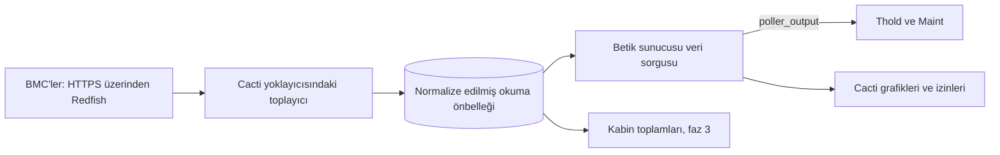

<!-- Source: README.md; SHA256: 7b4e83a58a1adc844cb0615ef30e95476cba2851f96bb454d2a816fb2774724d -->

<!-- translations:start -->
[English](../../../README.md) | [简体中文](../zh-CN/README.md) | [हिन्दी](../hi-IN/README.md) | [Español (España)](../es-ES/README.md) | [Español (Latinoamérica)](../es-419/README.md) | [العربية (السعودية)](../ar-SA/README.md) | [Afrikaans](../af-ZA/README.md) | [አማርኛ](../am-ET/README.md) | [العربية (مصر)](../ar-EG/README.md) | [العربية (المغرب)](../ar-MA/README.md) | [বাংলা](../bn-BD/README.md) | [Bosanski](../bs-BA/README.md) | [Deutsch](../de-DE/README.md) | [فارسی](../fa-IR/README.md) | [Filipino](../fil-PH/README.md) | [Français](../fr-FR/README.md) | [Français (Maroc)](../fr-MA/README.md) | [Français (Sénégal)](../fr-SN/README.md) | [Hausa](../ha-NG/README.md) | [עברית](../he-IL/README.md) | [Hrvatski](../hr-HR/README.md) | [Bahasa Indonesia](../id-ID/README.md) | [Igbo](../ig-NG/README.md) | [Italiano](../it-IT/README.md) | [日本語](../ja-JP/README.md) | [한국어](../ko-KR/README.md) | [Malagasy](../mg-MG/README.md) | [मराठी](../mr-IN/README.md) | [Bahasa Melayu](../ms-MY/README.md) | [Nederlands](../nl-NL/README.md) | [Polski](../pl-PL/README.md) | [Português (Brasil)](../pt-BR/README.md) | [Русский](../ru-RU/README.md) | [Kinyarwanda](../rw-RW/README.md) | [Soomaali](../so-SO/README.md) | [Српски](../sr-RS/README.md) | [Svenska](../sv-SE/README.md) | [Kiswahili](../sw-KE/README.md) | [தமிழ்](../ta-IN/README.md) | [తెలుగు](../te-IN/README.md) | [ไทย](../th-TH/README.md) | [Türkçe](README.md) | [Українська](../uk-UA/README.md) | [اردو](../ur-PK/README.md) | [Tiếng Việt](../vi-VN/README.md) | [isiXhosa](../xh-ZA/README.md) | [Yorùbá](../yo-NG/README.md) | [繁體中文](../zh-TW/README.md) | [isiZulu](../zu-ZA/README.md)
<!-- translations:end -->

# plugin_redfish

Sunucu güç tüketimi, giriş sıcaklığı, fan durumu ve güç kaynağı sağlığı verilerini anakart yönetim denetleyicilerinden (BMC'ler) isteğe bağlı IPMI geri dönüşüyle birlikte Redfish kullanarak sıradan aygıtlar, veri kaynakları ve grafikler olarak Cacti'ye aktaran bir Cacti 1.2 eklentisi. Ardından Thold ve Maint bunlar üzerinde uyarı üretir ve uyarıları bastırır; sonraki bir fazda ise kabin düzeyinde güç toplamları eklenir.

> **Durum: geliştirme aşamasında, henüz sürüm yok (0.1.0-dev).** Aşama 2 (temel yapı) ve Aşama 3 (Cacti nesneleri ve uyarı mekanizması) `main` dalında birleştirilmiştir. Bu eklentinin Cacti projesi ile bir bağlantısı yoktur. PHP 8.2 veya üzeri altında Cacti 1.2.31 üzerine kurulur; BMC'leri ve kimlik bilgilerini kaydeder, her BMC'den güç, sıcaklık, fan ve güç kaynağı sağlığı verilerini Redfish üzerinden kendi önbelleğine okur ve toplama sağlığını gösterir. Sıradan veri kaynakları aracılığıyla Cacti aygıtları, üye başına ve özet grafikler ile Thold ve Maint desteği ekler. CI testleri elle yazılmış fikstürlerden oluşturulan sahte bir BMC ve DMTF Redfish mockup sunucusu üzerinde çalıştırılmıştır; henüz gerçek bir BMC veya pilot filo doğrulanmamıştır. Tasarım ve araştırma belgeleri [docs/PLAN.md](../../PLAN.md), [docs/research/](../../research) ve [docs/decisions/](../../decisions) içinde yer almaktadır.

### Aşama 2 neler sunar

- Cacti eklenti API'si üzerinden kurulum, yükseltme, devre dışı bırakma ve kaldırma; ilgili ayar temizlenmediği sürece kaldırma sırasında tablolar korunur. 8.2'den eski PHP sürümlerinde eklenti kurulmayı veya etkinleştirilmeyi reddeder ve nedenini belirtir.
- "Redfish View" (sağlık sayfası), "Redfish Operator" (işlemler sayfası) ve "Redfish Admin" (BMC'ler ve kimlik bilgileri sayfaları) yetki alanları ile Configuration > Settings > Redfish altındaki ayarlar.
- CSV içe aktarma ve JSON dışa aktarma özellikli BMC kaydı. İçe aktarma dosyaları parola içermemelidir; kimlik bilgileri adlarıyla referans verilir.
- AES-256-GCM ile şifrelenmiş olarak saklanan kimlik bilgileri. Anahtar, veritabanı dışında bulunan ve varsayılan olarak `/etc/cacti/redfish-vault.key` yolundaki bir dosyadır; 64 onaltılık karakter (`openssl rand -hex 32`) veya tam olarak 32 rastgele bayt içerir, sahibi yoklayıcı (poller) kullanıcısıdır, diğer kullanıcılar tarafından okunamaz ve yalnızca yoklayıcı kullanıcısının veya root'un yazabileceği bir dizinde bulunur. 32 yazdırılabilir karakterden oluşan bir anahtar, parola ifadesi olduğu gerekçesiyle reddedilir. **Anahtar dosyasını veritabanıyla birlikte yedekleyin**; o olmadan saklanan tüm parolaların yeniden girilmesi gerekir.
- Varsayılan olarak açık TLS doğrulaması; BMC başına CA paketi veya SPKI SHA-256 sabitlemesi (pin) desteği. Günlüğe kaydedilen BMC başına doğrulamasız çalıştırma seçeneği sağlık sayfasında uyarı olarak görünmeye devam eder.
- Salt okunur bir Redfish istemcisi: herhangi bir istek gönderilmeden önce izin verilenler listesine (allowlist) göre denetlenen yalnızca `GET` ile oturum açma ve kapatma istekleri.
- Ana yoklayıcıdaki BMC'ler için `poller_bottom` üzerinden başlatılan bir toplayıcı; BMC başına kira süreleri (lease) ve zaman sınırları, geri çekilme (backoff) ve bir çökme sonrasında eklentinin kaydettiği tek oturumun temizlenmesi özelliklerine sahiptir. Uzak toplayıcılar henüz desteklenmemektedir; toplayıcının veritabanına ve anahtara nasıl erişeceğine dair açık bir tasarım seçimi gerektirir (faz 4).
- BMC kayıtları ve kimlik bilgileri Cacti aygıt izinlerini izler: bir Redfish Admin yalnızca görme yetkisine sahip olduğu aygıtlardaki BMC'leri ve gizli bir aygıttaki hiçbir BMC tarafından kullanılmayan kimlik bilgilerini görebilir, değiştirebilir ve bağlayabilir.

### Aşama 3 neler ekler

- `templates/` dizininde Cacti şablon XML'i olarak sunulan ve kurulum ile yükseltme sırasında Cacti'nin kendi içe aktarıcısıyla karma (hash) değerine göre eşleştirilerek içe aktarılan şablonlar; böylece bir içe aktarma işlemi eklentinin nesnelerini günceller ve hiçbir şeyi iki kez eklemez. Üç veri sorgusu dosyası, kaydedilmiş bir karma değeriyle `<cacti>/resource/script_server/` dizinine kopyalanır; eklenti orada kendisinin yazmadığı bir dosyanın üzerine asla yazmaz ve şablonlar ya da bir sorgu dosyası yerinde olmadığında sağlık sayfası yöneticileri uyarır. BMC'ler sayfasındaki **Reinstall the Redfish Templates** seçeneği bunları yeniden içe aktarır; bunun için Cacti'nin Import Templates izni gerekir.
- Her BMC üzerinde **Create Device** veya **Add Graphs** ([ADR 0015](../../decisions/0015-attach-to-the-server-device-or-create-one-per-bmc.md)). Bir sunucunun mevcut aygıtıyla eşleştirilmiş bir BMC, veri sorgularını ve grafiklerini o aygıt üzerinde alır. Eşleştirilmemiş bir BMC ise "Redfish BMC" aygıt şablonundan erişilebilirlik denetimleri kapalı ve `.invalid` altında bir ana bilgisayar adıyla yeni bir aygıt edinir; böylece Cacti hiçbir zaman BMC ile doğrudan iletişim kurmaz ve adresini göstermez. Her iki durumda da yönetici önce nelerin ekleneceğini listeleyen bir planı onaylar. Her iki işlem de Redfish Admin yetkisinin yanı sıra Cacti'nin aygıt yönetimi iznini gerektirir; oluşturan kişinin göremediği yeni bir aygıt tekrar kaldırılır.
- BMC'nin üye anahtarıyla dizinlenen üç betik sunucusu veri sorgusu ("Redfish Fans", "Redfish Temperatures" ve "Redfish Power Supplies") ve üye başına birer grafik: yüzde veya RPM cinsinden fan hızı (BMC hangi birimi bildiriyorsa), sıcaklık ve her biri kendi sağlık koduyla birlikte güç kaynağı giriş ve çıkış watt değerleri.
- Güç, giriş sıcaklığı, en yüksek sıcaklık, OK olmayan fan ve güç kaynağı sayısı, düğüm sağlığı ve son başarılı okumanın yaşını içeren bir "Redfish Node Summary" girdisi; dört grafik üzerinde çizilir: güç, sıcaklıklar, bileşen sağlığı ve veri yaşı. Bu veri kaynakları üzerindeki Thold eşikleri uyarı üretir ve Maint bunları her iki eklentide hiçbir değişiklik gerektirmeden bastırır.
- Betik sunucusu yalnızca eklentinin önbelleğinden yanıt verir ve asla bir BMC ile iletişim kurmaz. Eksik, bayat, farklı birimde veya artık mevcut olmayan bir üyeye ait bir değer `U` olarak döner; böylece grafikler sıfır yerine boşluk gösterir; `age` ise her zaman bir değere sahiptir, bu nedenle üzerindeki bir eşik yanıt vermeyi durduran bir BMC'yi yakalar.
- Her Redfish grafiğinden aygıtın Redfish grafiklerine giden ve yalnızca Cacti'nin aygıtı görmesine izin verdiği kullanıcılara gösterilen bir grafik bağlantısı.

**Bir BMC'nin üyeleri değiştiğinde** (örneğin bir fan değiştirildiğinde veya bellenim güncellemesi sensörleri yeniden adlandırdığında) **Add Graphs** seçeneğini yeniden kullanın. Bunu yapana kadar, daha önce mevcut olup şimdi bulunmayan veya çıkarılmış bir fan ya da güç kaynağı `fans_bad` veya `psus_bad` içinde sayılır; böylece çıkarılan bir fan uyarı verir; hiç doldurulmamış bir yuva ise sayılmaz. Add Graphs, BMC'nin şu anda bildirdiği üyeleri kabul eder ve Cacti sorguları yeniden dizinler; artık bulunmayan bir üye veri kaynağını ve grafiğini korur (bundan sonra `U` okur) ve yeni üye bir grafik alır. Artık bulunmayan üyelerin grafiklerini, geçmişlerine ihtiyaç kalmadığında elle silin.

Bir aygıtın silinmesi, bağlı BMC eşlemesini kaldırır; BMC ve önbelleği korunur. Bir BMC'nin silinmesi veya eklentinin kaldırılması durumunda ise aygıtı ve grafikleri korunur.

## Erişim rolleri

| Yetki Alanı | Erişim |
| --- | --- |
| Redfish View | Mevcut izleme sayfaları. |
| Redfish Operator | İzleme yetkisine ek olarak İşlemler (Operations) sayfası ve kişisel triyaj onaylamaları. |
| Redfish Admin | Operator erişimine ek olarak mevcut yapılandırma ve yönetimsel işlemler. |

Yükseltme dosyalarını kopyaladıktan sonra yeni yetki alanını kaydetmek için Plugins sayfasını yönetici olarak açın. Operator yetki alanını **Configuration > Users** veya kullanıcı grupları altından açıkça atayın. Yükseltmeler mevcut View ve Admin yetki alanı kimliklerini ve yetkilerini korur. Admin erişimi her istekte Operator erişimini, Operator erişimi ise View erişimini devralır; bu işlem kullanıcılara veya gruplara kalıcı olarak saklanan yetkiler eklemez. Eklenti ayarları ayrıca Cacti'nin Settings iznine ek olarak Redfish Admin erişimi gerektirir.

Cacti aygıt izinleri her kullanıcının erişebileceği satırları ve işlemleri sınırlamaya devam eder; eşleştirilmemiş nesneler için yönetici gerekir. Operatörler, izin verilen bir BMC üzerindeki toplama duraklatmasını (hold) bir sonraki zamanlanmış çalıştırma için kaldırabilir. Kimlik bilgileri, yapılandırma, eşleştirme, silme ve diğer yönetimsel değişiklikler yönetim sayfalarında kalır. Onaylamalar yalnızca geçerli kullanıcının oturumunda, en fazla bir saat boyunca ve yalnızca aynı gözlem güncel kaldığı sürece geçerlidir. Yeni veya değişmiş gözlemler bunları geçersiz kılar. Başarısız bir ölçümü asla sağlıklı olarak işaretlemez veya uyarıları bastırmazlar.

## Neden

Her sunucu, işletim sisteminden bağımsız olarak güç ve termal durumu bildiren bir BMC'ye sahiptir; bu nedenle işletim sistemi kapalıyken bile yanıt vermeyi sürdürür. Bu veriler kapasite ve maliyet takibi, arızalanan bir fan veya güç kaynağı için erken uyarı ve yüksek başarımlı hesaplamada (HPC) güç sınırlama kararları için kullanılır. Eklenti HPC'ye özgü değildir.

Cacti günümüzde bunun bir kısmını karşılamaktadır:

- **Üretici SNMP paketleri.** 1.2.x dalı, SNMP aracısı gerektiren ve üreticiye özgü Dell iDRAC ve HPE iLO şablonlarıyla gelir; aşama 1 araştırması bunların hiçbirinin güç tüketimini watt cinsinden bildirmediğini ortaya koymuştur ([docs/research/overlap.md](../../research/overlap.md)).
- **Toplayıcısı olmayan bir kimlik bilgisi türü.** plugin_credentials bir "IPMI / Redfish (BMC)" kimlik bilgisi tanımlar ancak hiçbir BMC'den okuma yapmaz.
- **Kabin düzeyinde görünüm yok.** Cacti çekirdeğinde kabin nesnesi yoktur; bir aygıt yalnızca serbest metin `location` alanına sahiptir.

Eklenti, BMC'leri Cacti'nin yoklama döngüsünden bant dışı (out-of-band) olarak yoklar, normalize edilmiş okumaları önbelleğe alır ve bunları bir betik sunucusu veri sorgusu ile özet veri kaynakları üzerinden sunar. Cacti'nin grafikleme, izinler, Thold ve Maint özelliklerini yeniden kullanır ve BMC durumunu değiştirmez. Uzak veri toplayıcı desteği faz 4 için planlanmıştır; mevcut toplama işlemi yalnızca ana yoklayıcıda çalışır.

## Planlanan kapsam

| Faz | Kapsam | Aşamalar |
|---|---|---|
| 0, araştırma | Üretici matrisi, canlı BMC'lerde yukarı akış davranışının doğrulanması, yoklama maliyeti, veri sorgusu ön çalışması (spike) | [M1](https://github.com/somethingwithproof/plugin_redfish/milestone/1) |
| 1, gözlem | BMC kaydı, kimlik bilgileri, TLS, Redfish toplayıcısı, normalize edilmiş okumalar, aygıtlar, dizin başına grafikler, Thold uyarısı, Maint bastırma, sağlık sayfası | [M2](https://github.com/somethingwithproof/plugin_redfish/milestone/2), [M3](https://github.com/somethingwithproof/plugin_redfish/milestone/3), [M4](https://github.com/somethingwithproof/plugin_redfish/milestone/4) |
| 2, ipmi | Kullanılabilir Redfish'i olmayan BMC'ler için varsayılan olarak kapalı IPMI geri dönüşü | [M5](https://github.com/somethingwithproof/plugin_redfish/milestone/5) |
| 3, kabinler | Kabin kaydı, kapsama oranıyla kabin güç toplamları, bütçe payı | [M6](https://github.com/somethingwithproof/plugin_redfish/milestone/6) |
| 4, uzak | Yalıtılmış BMC ağları için Cacti uzak veri toplayıcıları | [M7](https://github.com/somethingwithproof/plugin_redfish/milestone/7) |

Kapsam dışı: güç sınırı ayarlama veya diğer herhangi bir BMC yapılandırması, güç denetimi, bellenim güncellemesi, konsol erişimi, eklentiye özgü bir uyarı motoru ve zamanlayıcı entegrasyonu.

## Uyumluluk hedefleri

| Bileşen | Hedef |
|---|---|
| Cacti | 1.2.31 veya üzeri, çekirdek yaması gerektirmez |
| Veritabanı | MariaDB 10.2 veya MySQL 5.7 ya da üzeri: aygıt başına bir BMC, üretilen bir sütun (generated column) üzerindeki benzersiz anahtarla korunur |
| PHP | 8.2 veya üzeri; desteklenmeyen bir çalışma zamanının bozuk bir Cacti arayüzü yerine reddetme mesajı alması için `setup.php` PHP 8.0'da ayrıştırılabilir kalır |
| BMC'ler | Bellenim aralığına göre Dell iDRAC, HPE iLO, Lenovo XCC ve OpenBMC; bkz. [üretici matrisi](../../research/vendor-matrix.md) |
| Redfish | Önce yeni alt sistem ve sensör kaynakları, geri dönüş olarak kullanımdan kaldırılmış `Power` ve `Thermal` |
| Thold, Maint | Değişiklik gerekmez |

## Tasarım

- [docs/PLAN.md](../../PLAN.md) tam plandır: mimari, dayandığı yukarı akış olguları (kaynaklar ve henüz doğrulanmamış varsayımlarla birlikte), ölçüm modeli, güvenlik sınırları, başarım aritmetiği, testler ve riskler.
- [docs/decisions/](../../decisions) hâlihazırda verilmiş kararlara ilişkin mimari karar kayıtlarını içerir.
- [docs/REQUIREMENTS.md](../../REQUIREMENTS.md) her gereksinim kimliğini ilgili sorunla (issue) eşler.

## Güvenlik

BMC kimlik bilgileri sunucuların bant dışı yönetimini denetler. Tasarım bunları komut satırlarından, günlüklerden ve sayfalardan uzak tutar; varsayılan olarak TLS doğrulaması yapar; herhangi bir haricî komutu izin verilen alt komutların yer aldığı bir argüman dizisiyle çalıştırır ve salt okunur BMC hesapları kullanır. Bkz. [docs/PLAN.md](../../PLAN.md#security) ve [SECURITY.md](../../../SECURITY.md).

## Operatör kılavuzu

Kurulum ön koşulları, kasa (vault) ve TLS kurulumu, BMC kaydı, grafik oluşturma, uyarı aralıkları, yedekleme ve hata yönetimi için bkz. [docs/operator-guide.md](../../operator-guide.md). Kılavuz, ilgili bellenimden alınmış sansürlü bir yakalama test paketinden geçene kadar gerçek bir üretici bellenim serisini desteklenenler arasında ilan etmez.

## Çalışmalar nasıl izlenir

- **Aşamalar (Milestones)** planın aşamalarını izler. Her birinin alt sorunları ve çıkış kanıtlarını listeleyen bir epik sorunu (epic issue) vardır.
- **Sorunlar (Issues)** etiketlerle türlere ayrılır: `type: requirement`, `type: research`, `type: decision`, `type: epic`. Gereksinim sorunları numaralandırılmış, test edilebilir gereksinimleri (`REQ-AREA-NNN`) ve kabul ölçütlerini belirtir.
- **Etiketler (Labels)** ayrıca `area:`, `phase:`, `priority:` ve `status:` ön eklerini taşır. Bkz. [CONTRIBUTING.md](../../../CONTRIBUTING.md#labels).
- [Proje panosu](https://github.com/users/somethingwithproof/projects/12) tüm aşamalardaki tüm sorunları gösterir.

## Katkıda bulunma

[CONTRIBUTING.md](../../../CONTRIBUTING.md) dosyasını okuyun. Commit'ler için DCO imzası (sign-off) gerekir. Tasarım tartışmaları sorunlar (issues) üzerinde yapılır; açık kararlar `type: decision` etiketini taşır. Gerçek BMC'lerden elde edilen kanıtlar şu an en faydalı katkıdır; herhangi bir yakalamayı paylaşmadan önce adresleri, seri numaralarını ve kimlik bilgilerini gizleyin.

## Lisans

Cacti ve eklentileriyle aynı lisans olan GNU General Public License v2.0. Bkz. [LICENSE](../../../LICENSE).
