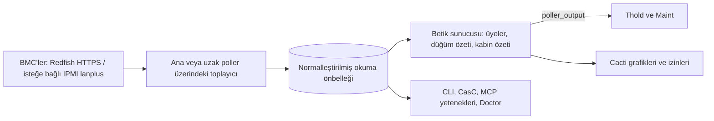

<!-- Source: README.md; SHA256: cf31b9f80d6c00020bbe08e80951d4de1c910793911d040ae7a66b54e8a2eaf0 -->

<!-- translations:start -->
[English](../../../README.md) | [简体中文](../zh-CN/README.md) | [हिन्दी](../hi-IN/README.md) | [Español (España)](../es-ES/README.md) | [Español (Latinoamérica)](../es-419/README.md) | [العربية (السعودية)](../ar-SA/README.md) | [Afrikaans](../af-ZA/README.md) | [አማርኛ](../am-ET/README.md) | [العربية (مصر)](../ar-EG/README.md) | [العربية (المغرب)](../ar-MA/README.md) | [বাংলা](../bn-BD/README.md) | [Bosanski](../bs-BA/README.md) | [Deutsch](../de-DE/README.md) | [فارسی](../fa-IR/README.md) | [Filipino](../fil-PH/README.md) | [Français](../fr-FR/README.md) | [Français (Maroc)](../fr-MA/README.md) | [Français (Sénégal)](../fr-SN/README.md) | [Hausa](../ha-NG/README.md) | [עברית](../he-IL/README.md) | [Hrvatski](../hr-HR/README.md) | [Bahasa Indonesia](../id-ID/README.md) | [Igbo](../ig-NG/README.md) | [Italiano](../it-IT/README.md) | [日本語](../ja-JP/README.md) | [한국어](../ko-KR/README.md) | [Malagasy](../mg-MG/README.md) | [मराठी](../mr-IN/README.md) | [Bahasa Melayu](../ms-MY/README.md) | [Nederlands](../nl-NL/README.md) | [Polski](../pl-PL/README.md) | [Português (Brasil)](../pt-BR/README.md) | [Русский](../ru-RU/README.md) | [Kinyarwanda](../rw-RW/README.md) | [Soomaali](../so-SO/README.md) | [Српски](../sr-RS/README.md) | [Svenska](../sv-SE/README.md) | [Kiswahili](../sw-KE/README.md) | [தமிழ்](../ta-IN/README.md) | [తెలుగు](../te-IN/README.md) | [ไทย](../th-TH/README.md) | [Türkçe](README.md) | [Українська](../uk-UA/README.md) | [اردو](../ur-PK/README.md) | [Tiếng Việt](../vi-VN/README.md) | [isiXhosa](../xh-ZA/README.md) | [Yorùbá](../yo-NG/README.md) | [繁體中文](../zh-TW/README.md) | [isiZulu](../zu-ZA/README.md)
<!-- translations:end -->

# plugin_redfish

Sunucu güç tüketimi, giriş sıcaklığı, fan durumu ve güç kaynağı sağlığı verilerini anakart yönetim denetleyicilerinden (BMC'ler) isteğe bağlı salt okunur IPMI geri dönüşü ve kabin düzeyinde güç toplamlarıyla birlikte Redfish kullanarak sıradan aygıtlar, veri kaynakları ve grafikler olarak Cacti'ye aktaran bir Cacti 1.2 eklentisi. Thold ve Maint, standart Cacti veri kaynakları üzerinden bunlar üzerinde uyarı üretir ve uyarıları bastırır.

> **Durum: geliştirme aşamasında, henüz sürüm yok (`0.1.0-dev`).** Bu eklentinin Cacti projesi ile bir bağlantısı yoktur. PHP 8.2 veya üzeri altında Cacti 1.2.31 veya üzerine kurulur ve Redfish toplayıcısını, şifrelenmiş kimlik bilgisi kasasını, Cacti aygıt ve grafik sağlamayı, isteğe bağlı salt okunur IPMI geri dönüşünü, kabin güç toplamını, Cacti Maint pencere görünümünü, uzak veri toplayıcı çoğaltmasını ve aracı uç noktalarını, CasC sağlayıcısını ve operatör CLI'sını, MCP yeteneklerini ve Doctor tanılama kontrollerini uygular. CI testleri fikstürleri, DMTF Redfish Mockup Server'ı (alt sistem, yalnızca eski ve HPE iLO Gen11 örnekleri) ve Maint v1.3 ile birlikte Thold v1.8.2'yi sınar; henüz gerçek bir fiziksel BMC veya pilot filo doğrulanmamıştır. Tasarım ve araştırma [docs/PLAN.md](../../PLAN.md), [docs/research/](../../research/) ve [docs/decisions/](../../decisions/) içinde yer almaktadır.

## Uygulanan yetenekler

### Çekirdek toplayıcı, kasa ve Cacti nesneleri

- **Yaşam döngüsü ve şema.** Cacti'nin eklenti API'si üzerinden kurulur, yükseltilir, devre dışı bırakılır ve kaldırılır (`Schema::VERSION = 3`, 12 tablo). *Keep Plugin Tables on Uninstall* seçeneğinin işareti kaldırılmadığı sürece kaldırma sırasında tablolar korunur. Giriş noktaları PHP 8.0'da ayrıştırılabilir kalır ve 8.2'nin altındaki PHP'yi veya `ext-openssl` eksikliğini açık bir hata mesajıyla reddeder.
- **Kayıt defteri ve izinler.** *Redfish View* (`redfish_health.php`), *Redfish Operator* (`redfish_operator.php`) ve *Redfish Admin* (`redfish_bmcs.php`, `redfish_credentials.php`) yetki alanları ile **Configuration > Settings > Redfish** altındaki ayarlar. BMC kayıt defteri CSV içe aktarmayı (kimlik bilgileri adla referans verilir; içe aktarma dosyalarındaki parolalar reddedilir) ve JSON dışa aktarmayı destekler. BMC kayıtları ve kimlik bilgileri Cacti aygıt izinlerini izler.
- **Şifrelenmiş kimlik bilgisi kasası.** Parolalar `plugin_redfish_secret` içinde AES-256-GCM ile şifrelenerek saklanır. Anahtar, veritabanının dışında (varsayılan olarak `/etc/cacti/redfish-vault.key`) 64 onaltılık karakter (`openssl rand -hex 32`) veya 32 ham bayt olarak, poller kullanıcısına ait, diğer kullanıcılar tarafından okunamayan ve yalnızca root ya da o kullanıcı tarafından yazılabilen bir dizinde bulunur. 32 karakterlik yazdırılabilir bir parola tümceciği reddedilir. **Anahtar dosyasını veritabanıyla birlikte yedekleyin**; onsuz saklanan parolaların yeniden girilmesi gerekir.
- **TLS ve salt okunur Redfish istemcisi.** TLS doğrulaması sistem CA deposu, BMC başına CA paketi veya SPKI SHA-256 sabitlemesi kullanılarak varsayılan olarak etkindir; BMC başına doğrulamasız devre dışı bırakma tercihi sağlık uyarısı ve Doctor kontrol uyarısı olarak görünür kalır. İstemci yalnızca `GET` ile Redfish oturum açma (`POST`) ve kapatma (`DELETE`) isteklerine izin verir; oturumlar kullanılamadığında isteğe bağlı BMC başına Basic geri dönüşü sunar. Keşif önce yeni Redfish alt sistem ve sensör kaynaklarını tercih eder, ardından kullanımdan kaldırılmış `Power` ve `Thermal` kaynaklarına geri döner.
- **Toplayıcı yürütmesi.** `poller_redfish.php`, `poller_bottom` üzerinden başlatılır, yapılandırılabilir çalışan süreçleriyle (`redfish_workers`) Cacti'nin süreç kayıt defteri aracılığıyla poller başına bir ana süreç çalıştırır, BMC başına kiralamalar alır, zaman bütçesi uygular (`redfish_collector_budget`), üstel geri çekilme uygular ve bir çökme sonrasında eklentinin kendi önceki oturumunu temizler.
- **Şablonlar, aygıtlar ve grafikler.** `templates/redfish-templates.xml` dosyasını karma değeriyle içe aktarır ve kullanıcı tarafından değiştirilmiş dosyaların üzerine yazmadan üç betik sunucusu veri sorgusu XML dosyasını (`redfish_fans.xml`, `redfish_temperatures.xml`, `redfish_psus.xml`) `<cacti>/resource/script_server/` dizinine kopyalar. **Create Device** ve **Add Graphs** sağlama planının onaylanmasını gerektirir, sorguları eşlenmiş bir sunucu aygıtına bağlar veya kullanılabilirlik kontrolleri devre dışı bırakılmış şekilde `.invalid` altında bir "Redfish BMC" aygıtı oluşturur ve her Redfish grafiğini `graph_buttons` üzerinden aygıtın Redfish grafiklerine geri bağlar.
- **Yalnızca önbellekten okuyan betik sunucusu girdileri.** `scripts/ss_redfish_members.php` üye başına fan, sıcaklık ve PSU okumalarını, `scripts/ss_redfish_summary.php` ise "Redfish Node Summary" metriklerini (güç, giriş ve azami sıcaklık, arızalı fan ve PSU sayıları, düğüm sağlığı ve son iyi okumanın yaşı) sunar. Betik sunucusu çağrıları yalnızca yerel önbelleği okur ve hiçbir zaman bir BMC ile iletişim kurmaz. Eksik, bayat veya gitmiş üye okumaları `U` döndürür (asla `0` döndürmez), `age` ise eşiklerin sessiz BMC'leri algılayabilmesi için her zaman bir değer bildirir.

**Bir BMC'nin üyeleri değiştiğinde** (örneğin değiştirilen bir fan veya sensörleri yeniden adlandıran bir ürün yazılımı güncellemesi), **Add Graphs** işlemini yeniden çalıştırın. Önceden mevcut olup sonradan yok olan bir fan veya güç kaynağı onaylanana kadar `fans_bad` veya `psus_bad` içinde sayılır; hiç doldurulmamış bir yuva sayılmaz. Gitmiş üyeler mevcut veri kaynaklarını ve grafiklerini korur ve bunlar elle silinene kadar bundan sonra `U` okur. Bir Cacti aygıtını silmek BMC eşlemesini kaldırır ve kabin atamasını silerken BMC'yi ve önbelleği korur; bir BMC'yi silmek veya eklentiyi kaldırmak Cacti aygıtlarını ve grafiklerini korur.

### İsteğe bağlı IPMI geri dönüşü

- **BMC başına isteğe bağlı katılım.** Varsayılan olarak kapalıdır (`protocols` varsayılan olarak `redfish` değerindedir; IPMI geri dönüşünü etkinleştirmek `redfish,ipmi` olarak ayarlar).
- **Kapsamlı geri dönüş tetikleyicisi.** Yalnızca Redfish toplaması uygun bir başarısızlık sınıfıyla başarısız olduğunda çalışır; `AuthRejected`, `CredentialUnavailable`, `AddressRefused`, `OperationRefused` veya `Deadline` durumlarında asla tetiklenmez.
- **Güvenli yürütme.** Kabuk olmadan dizi biçiminde `proc_open()` aracılığıyla `-I lanplus` üzerinden `ipmitool` çağırır, sınırlı duvar saati zaman aşımına ve 256 KiB çıktı sınırına sahiptir. Parolalar CLI argv üzerinden değil, `IPMITOOL_PASSWORD` (`-E`) veya `finally` bloğunda silinen 0600 kipli geçici bir dosya (`-f`) üzerinden sağlanır.
- **Salt okunur komut izin listesi.** Yalnızca beş salt okunur alt komuta izin verilir: `dcmi power reading`, `sdr type Temperature`, `sdr type Fan`, `sdr type Power Supply` ve `chassis status`. Durum değiştiren komutlar reddedilir.
- **Normalleştirilmiş çıktı ve güvenlik durumu uyarısı.** `IpmiNormalizer` okumaları aynı `Observation`/`Member`/`Reading` modeline eşler ve eksik ya da ayrıştırılamayan sensörler için `U` üretir. IPMI geri dönüşünü etkinleştirmek sağlık sayfasında ve `redfish.bmc_security` Doctor kontrolünde operatörlere UDP 623'ü bir yönetim VLAN'ı ile sınırlandırmalarını hatırlatan bir uyarı çıkarır.

### Kabin güç toplamı

- **Kabin kayıt defteri.** Şema sürüm 3, `plugin_redfish_rack` (benzersiz `(site_id, name)`, isteğe bağlı `power_budget_watts`, varsayılanı `80` olan `min_coverage_pct` ve notlar) ve `plugin_redfish_rack_member` (`host_id` başına en fazla bir kabin ataması, isteğe bağlı `bmc_id` ve `unit_position`, bir Cacti aygıtı silindiğinde otomatik olarak kaldırılır) tablolarını ekler.
- **Kapsam korumalı toplamlar.** `RackPowerSummary` yerel önbellekten güncel üye `power_watts` okumalarını toplar ve bütçe kullanımını ile kalan kapasiteyi hesaplar. Bildirim yapan üye kapsamı `min_coverage_pct` değerinin altına düştüğünde, toplayıcı arızalarının hiçbir zaman kabin gücünde düşüş gibi görünmemesi için `power_watts`, `utilization_pct` ve `headroom_watts` değerleri `U` döndürür.
- **Thold'a hazır betik sunucusu girdisi.** `scripts/ss_redfish_rack.php` (`ss_redfish_rack(<rack_id>)`) yalnızca yerel önbellekten `power_watts`, `power_budget_watts`, `utilization_pct`, `headroom_watts`, `members_total`, `members_reporting` ve `coverage_pct` değerlerini döndürür.

### Cacti Maint entegrasyonu

- Redfish veri kaynaklarındaki Thold eşikleri uyarı üretir ve Cacti Maint her iki eklentide de hiçbir değişiklik gerektirmeden bunları bastırır.
- `MaintWindow` eşlenmiş her Cacti ana bilgisayarı için etkin Maint zamanlamalarını denetler (tek seferlik `mtype=1` ve yinelenen `mtype=2` zamanlamaları ile yüklendiğinde `plugin_maint_check_cacti_host()`) ve etkin bakımı Redfish Health sayfasında (`[MAINT]`), `cli/redfish.php health` çıktısında ve `redfish-get-health` yeteneğinde işaretler.

### Uzak veri toplayıcılar

- `INFO`, `remote_collect:1` bildirir. BMC'ler herhangi bir `poller_id >= 1` değerini kabul eder ve `poller_redfish.php --poller=N` yalnızca o poller'a atanmış etkin BMC'leri toplar.
- **`replicate_out` kancası.** `replicate_out_table()` aracılığıyla yalnızca hedef uzak poller'a kapsamlı gizli olmayan yapılandırma tablolarını çoğaltır: `plugin_redfish_bmc`, `plugin_redfish_credential` üst verileri (şifreli metin olmadan), `plugin_redfish_rack` ve `plugin_redfish_rack_member`. `plugin_redfish_secret` çoğaltılmaz ve kasa anahtar dosyaları her poller üzerinde kesinlikle yerel kalır.
- **`remote_agent` kancası.** Yalnızca sayısal `poller_id` ve `bmc_id` parametrelerini kabul eden salt okunur `redfish_health` ve `redfish_discovery` eylemlerini sunar. Beklenmeyen parametreler reddedilir ve hiçbir kimlik bilgisi veya gizli veri döndürülmez.

### Ekosistem kancaları (CasC, MCP yetenekleri ve Doctor)

- **CasC sağlayıcısı (`casc_register_providers`).** Saf PHP YAML ve XML dışa aktarma, ayrıştırma (XXE reddedilir), doğrulama, fark planlama ve uygulama özellikleriyle `redfish` sağlayıcısını (şema sürümü `1`) kaydeder. Kimlik bilgileri yalnızca kasa referansları olarak görünür (`vault:redfish:<name>`); ham gizli anahtarlar (`pass`, `secret`, `token`, `private_key`, `vault_key`, `auth_token`) reddedilir. Uygulama işlemi tam bir SHA-256 `PLAN_HASH` gerektirir.
- **MCP / Yetenekler API'si (`abilities_register`).** Redfish View yetki alanı (`redfish_health.php`) ve Cacti aygıt izinleriyle denetlenen, hiçbir kimlik bilgisi döndürmeyen üç salt okunur yetenek kaydeder:
  - `redfish-list-bmcs` (isteğe bağlı `poller_id`)
  - `redfish-get-rack-power` (isteğe bağlı `rack_id`)
  - `redfish-get-health` (isteğe bağlı `bmc_id`)
- **Doctor kontrolleri (`doctor_register_checks`).** Hiçbir zaman bir BMC ile iletişim kurmayan veya anahtar materyali döndürmeyen beş yerel, salt okunur tanılama kontrolünü kaydeder:
  - `redfish.schema`: şema sürümü güncelliği
  - `redfish.vault_key`: kasa anahtarı okunabilirliği ve izinleri
  - `redfish.collector_runs`: poller toplayıcı bütçesi ve güncelliği
  - `redfish.bmc_security`: doğrulanmamış TLS veya IPMI geri dönüşü etkinleştirilmiş BMC'ler
  - `redfish.rack_power`: kabin güç bütçesi uyumluluğu ve kapsam tabanı

## CLI

PHP 8.2 veya üzeri ile Cacti kök dizininden çalıştırın:

```sh
# Operator and CasC CLI (reads --file=PATH or stdin for validate, plan, and apply)
php plugins/redfish/cli/redfish.php export --format=yaml|xml
php plugins/redfish/cli/redfish.php validate [--file=PATH] [--format=yaml|xml]
php plugins/redfish/cli/redfish.php plan [--file=PATH] [--format=yaml|xml]
php plugins/redfish/cli/redfish.php apply [--file=PATH] [--format=yaml|xml] --confirm=<PLAN_HASH>
php plugins/redfish/cli/redfish.php health --format=text|json

# Collector entry point (normally started by poller_bottom)
php plugins/redfish/poller_redfish.php [--poller=N] [--force] [--debug]

# Rack power summary script server entry point
php plugins/redfish/scripts/ss_redfish_rack.php <rack_id>
```

## Erişim rolleri

| Yetki Alanı | Erişim |
| --- | --- |
| Redfish View | Mevcut izleme sayfaları. |
| Redfish Operator | İzleme ile birlikte İşlemler sayfası ve kişisel önceliklendirme onayları. |
| Redfish Admin | Operator erişimi ile birlikte mevcut yapılandırma ve yönetimsel eylemler. |

Yükseltme dosyalarını kopyaladıktan sonra yetki alanlarını kaydetmek için Plugins sayfasını yönetici olarak açın. Operator yetki alanını **Configuration > Users** veya kullanıcı grupları altında açıkça atayın. Yükseltmeler mevcut View ve Admin yetki alanı kimliklerini ve izinlerini korur. Admin erişimi her istekte Operator erişimini devralır ve Operator erişimi View erişimini devralır; bu durum kullanıcılara veya gruplara saklanmış izinler eklemez. Eklenti ayarları da Cacti'nin Settings iznine ek olarak Redfish Admin erişimi gerektirir.

Cacti aygıt izinleri her kullanıcıya sunulan satırları ve eylemleri sınırlar; eşlenmemiş nesneler yönetici gerektirir. Operatörler, izin verilen bir BMC üzerindeki toplama bekletmesini bir sonraki zamanlanmış çalıştırma için serbest bırakabilir. Kimlik bilgileri, yapılandırma, eşleme, silme ve diğer yönetimsel değişiklikler yönetim sayfalarında kalır. Onaylar yalnızca geçerli kullanıcının oturumunda, en fazla bir saat boyunca ve yalnızca aynı gözlem güncel kaldığı sürece geçerlidir. Yeni veya değişmiş gözlemler bunları geçersiz kılar. Başarısız bir ölçümü asla sağlıklı olarak işaretlemez veya uyarıları bastırmazlar.

## Neden

Her sunucuda işletim sisteminden bağımsız olarak güç ve sıcaklık durumunu bildiren bir BMC bulunur; bu nedenle işletim sistemi kapalıyken bile yanıt vermeye devam eder. Veriler kapasite ve maliyet takibine, arızalanan bir fan veya güç kaynağı hakkında erken uyarıya ve yüksek başarımlı hesaplamada güç sınırlama kararlarına hizmet eder. Eklenti yalnızca HPC'ye özgü değildir.

Cacti bugün bunun bir bölümünü kapsar:

- **Satıcı SNMP paketleri.** 1.2.x dalı bir SNMP aracısı gerektiren ve satıcıya özgü Dell iDRAC ve HPE iLO şablonlarıyla gelir; aşama 1 araştırması her ikisinin de watt cinsinden güç tüketimini bildirmediğini ortaya koymuştur ([docs/research/overlap.md](../../research/overlap.md)).
- **Toplayıcısı olmayan bir kimlik bilgisi türü.** `plugin_credentials` bir "IPMI / Redfish (BMC)" kimlik bilgisi tanımlar ancak hiçbir BMC'yi okumaz.
- **Kabin düzeyinde görünüm yok.** Cacti çekirdeğinde kabin nesnesi yoktur; bir aygıt yalnızca serbest metin `location` alanına sahiptir.

Eklenti, ana poller veya uzak veri toplayıcılar üzerinde Cacti'nin yoklama döngüsünün dışında BMC'leri sorgular, normalleştirilmiş okumaları önbelleğe alır ve bunları betik sunucusu veri sorguları, düğüm özetleri ve kabin güç özetleri aracılığıyla sunar. Cacti'nin grafik çizimini, izinlerini, Thold'u ve Maint'i yeniden kullanır ve BMC durumunu değiştirmez.

## Kapsam ve durum

| Faz | Kapsam | Aşamalar | Durum |
|---|---|---|---|
| 0, araştırma | Satıcı matrisi, canlı BMC'lerde yukarı akış davranışının doğrulanması, yoklama maliyeti, veri sorgusu denemesi | [M1](https://github.com/somethingwithproof/plugin_redfish/milestone/1) | Tamamlandı, gerçek BMC ürün yazılımı yakalamaları bekleniyor |
| 1, gözlem | BMC kayıt defteri, kimlik bilgileri, TLS, Redfish toplayıcısı, normalleştirilmiş okumalar, aygıtlar, dizin başına grafikler, Thold uyarısı, Maint entegrasyonu, sağlık sayfası | [M2](https://github.com/somethingwithproof/plugin_redfish/milestone/2), [M3](https://github.com/somethingwithproof/plugin_redfish/milestone/3), [M4](https://github.com/somethingwithproof/plugin_redfish/milestone/4) | Uygulandı; M4 pilot filo doğrulaması bekleniyor |
| 2, ipmi | `ipmitool` aracılığıyla salt okunur IPMI (`lanplus`) geri dönüşü, varsayılan olarak kapalı | [M5](https://github.com/somethingwithproof/plugin_redfish/milestone/5) | Uygulandı |
| 3, kabinler | Kabin kayıt defteri, kapsam tabanlı kabin güç toplamları, bütçe kalan kapasitesi, `ss_redfish_rack.php` | [M6](https://github.com/somethingwithproof/plugin_redfish/milestone/6) | Uygulandı |
| 4, uzak ve ekosistem | Uzak veri toplayıcılar (`replicate_out`, `remote_agent`), CasC sağlayıcısı ve CLI, MCP yetenekleri, Doctor kontrolleri | [M7](https://github.com/somethingwithproof/plugin_redfish/milestone/7) | Uygulandı |

Kapsam dışı: güç sınırları veya başka herhangi bir BMC yapılandırması ayarlama, güç kontrolü, ürün yazılımı güncellemesi, konsol erişimi, eklentiye ait bir uyarı motoru ve zamanlayıcı entegrasyonu.

## Uyumluluk hedefleri

| Bileşen | Hedef |
|---|---|
| Cacti | 1.2.31 veya üzeri, çekirdek yaması olmadan |
| Veritabanı | MariaDB 10.2 veya MySQL 5.7 veya üzeri: aygıt başına bir BMC, üretilen sütun üzerindeki benzersiz bir anahtarla korunur |
| PHP | 8.2 veya üzeri; desteklenmeyen bir çalışma zamanının bozuk bir Cacti arayüzü yerine ret mesajı alabilmesi için giriş noktaları 8.0 üzerinde ayrıştırılabilir kalır |
| PHP uzantıları | `ext-openssl` (Cacti 1.2.31 tarafından gerektirilir); `ext-curl` yok ve Composer çalışma zamanı bağımlılığı yok |
| İsteğe bağlı araçlar | IPMI geri dönüşü etkinleştirilmiş BMC'leri toplayan poller'larda `ipmitool` |
| BMC'ler | Ürün yazılımı aralığına göre Dell iDRAC, HPE iLO, Lenovo XCC ve OpenBMC; [satıcı matrisine](../../research/vendor-matrix.md) bakın |
| Redfish | Önce yeni alt sistem ve sensör kaynakları, geri dönüş olarak kullanımdan kaldırılmış `Power` ve `Thermal` |
| Thold, Maint | Değişiklik gerekmez (CI, Thold v1.8.2 ve Maint v1.3'ü sınar) |

## Tasarım

- [docs/PLAN.md](../../PLAN.md) tam plandır: mimari, dayandığı yukarı akış gerçekleri, ölçüm modeli, güvenlik sınırları, başarım hesaplamaları, testler ve riskler.
- [docs/decisions/](../../decisions/) halihazırda alınmış seçimler için mimari karar kayıtlarını içerir.
- [docs/REQUIREMENTS.md](../../REQUIREMENTS.md) her gereksinim kimliğini ilgili sorunuyla eşler.



## Güvenlik

BMC kimlik bilgileri sunucuların bant dışı yönetimini kontrol eder. Tasarım; gizli verileri komut satırlarından, günlüklerden, CasC dışa aktarımlarından, uzak aracı yüklerinden, MCP yanıtlarından ve web sayfalarından uzak tutar; saklanan parolaları poller başına yerel bir kasa anahtar dosyası kullanarak AES-256-GCM ile şifreler; TLS'yi varsayılan olarak doğrular; `ipmitool`'u izin listesine alınmış salt okunur alt komutlarla açık bir argüman dizisinden çalıştırır ve salt okunur BMC hesapları kullanır. [docs/PLAN.md](../../PLAN.md#security) ve [SECURITY.md](../../../SECURITY.md) dosyalarına bakın.

## Operatör kılavuzu

Kurulum önkoşulları, kasa ve TLS kurulumu, BMC kaydı, grafik oluşturma, uyarı aralıkları, yedekleme ve arıza yönetimi için [docs/operator-guide.md](../../operator-guide.md) belgesine bakın. Kılavuz, o ürün yazılımından gizli verileri temizlenmiş bir yakalama test paketini geçene kadar gerçek bir satıcı ürün yazılımı serisini desteklenen olarak ilan etmez.

## Geliştirme ve test

CI (`.github/workflows/plugin-ci-workflow.yml`) giriş noktalarını PHP 8.0 üzerinde sözdizimi denetiminden geçirir, Cacti `release/1.2.31` ve `1.2.x` sürümlerine karşı PHP 8.2 ila 8.5 üzerinde Pest birim (`phpunit.xml`) ve yaşam döngüsü entegrasyon (`phpunit-integration.xml`) paketleri ile PHPStan seviye 9'u çalıştırır, PHP 8.1 üzerindeki reddi doğrular, DMTF Redfish Mockup Server'ı (alt sistem, yalnızca eski ve HPE iLO Gen11 örnekleri) ve Thold v1.8.2 / Maint v1.3'ü uçtan uca sınar ve gettext kataloglarını, iş akışlarını ve REUSE lisanslamasını kontrol eder.

Göndermeden önce yerel kontroller:

```sh
sh tests/lint-workflows.sh
sh locales/build_gettext.sh --check
CACTI_PATH=/path/to/cacti phpstan analyse -c phpstan.neon --no-progress
```

Birim ve kaynak kuralı testleri için `--configuration=phpunit.xml` ile, yaşam döngüsü entegrasyon testleri içinse tek kullanımlık bir Cacti veritabanına karşı `CACTI_PATH` ve `REDFISH_TEST_DATABASE=disposable` ile `--configuration=phpunit-integration.xml` kullanarak Pest'i çalıştırın.

## İşlerin takip edilme şekli

- **Aşamalar** plandaki aşamaları izler. Her birinin alt sorunlarını ve çıkış kanıtlarını listeleyen bir epik sorunu vardır.
- **Sorunlar** etiketle türlendirilir: `type: requirement`, `type: research`, `type: decision`, `type: epic`. Gereksinim sorunları numaralandırılmış, test edilebilir gereksinimleri (`REQ-AREA-NNN`) ve kabul ölçütlerini belirtir.
- **Etiketler** ayrıca `area:`, `phase:`, `priority:` ve `status:` taşır. [CONTRIBUTING.md](../../../CONTRIBUTING.md#labels) belgesine bakın.
- [Proje panosu](https://github.com/users/somethingwithproof/projects/12) tüm aşamalardaki tüm sorunları gösterir.

## Katkıda bulunma

[CONTRIBUTING.md](../../../CONTRIBUTING.md) dosyasını okuyun. Commit'ler DCO imzası gerektirir. Tasarım tartışmaları sorunlar üzerinde yapılır; açık kararlar `type: decision` etiketini taşır. Gerçek BMC'lerden elde edilen kanıtlar şu anda en yararlı katkıdır; herhangi bir yakalamayı göndermeden önce adresleri, seri numaralarını ve kimlik bilgilerini gizleyin.

## Lisans

GNU General Public License v2.0, Cacti ve eklentileriyle aynı lisans. [LICENSE](../../../LICENSE) dosyasına bakın.
