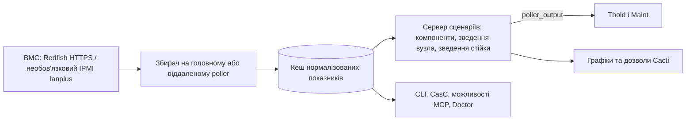

<!-- Source: README.md; SHA256: cf31b9f80d6c00020bbe08e80951d4de1c910793911d040ae7a66b54e8a2eaf0 -->

<!-- translations:start -->
[English](../../../README.md) | [简体中文](../zh-CN/README.md) | [हिन्दी](../hi-IN/README.md) | [Español (España)](../es-ES/README.md) | [Español (Latinoamérica)](../es-419/README.md) | [العربية (السعودية)](../ar-SA/README.md) | [Afrikaans](../af-ZA/README.md) | [አማርኛ](../am-ET/README.md) | [العربية (مصر)](../ar-EG/README.md) | [العربية (المغرب)](../ar-MA/README.md) | [বাংলা](../bn-BD/README.md) | [Bosanski](../bs-BA/README.md) | [Deutsch](../de-DE/README.md) | [فارسی](../fa-IR/README.md) | [Filipino](../fil-PH/README.md) | [Français](../fr-FR/README.md) | [Français (Maroc)](../fr-MA/README.md) | [Français (Sénégal)](../fr-SN/README.md) | [Hausa](../ha-NG/README.md) | [עברית](../he-IL/README.md) | [Hrvatski](../hr-HR/README.md) | [Bahasa Indonesia](../id-ID/README.md) | [Igbo](../ig-NG/README.md) | [Italiano](../it-IT/README.md) | [日本語](../ja-JP/README.md) | [한국어](../ko-KR/README.md) | [Malagasy](../mg-MG/README.md) | [मराठी](../mr-IN/README.md) | [Bahasa Melayu](../ms-MY/README.md) | [Nederlands](../nl-NL/README.md) | [Polski](../pl-PL/README.md) | [Português (Brasil)](../pt-BR/README.md) | [Русский](../ru-RU/README.md) | [Kinyarwanda](../rw-RW/README.md) | [Soomaali](../so-SO/README.md) | [Српски](../sr-RS/README.md) | [Svenska](../sv-SE/README.md) | [Kiswahili](../sw-KE/README.md) | [தமிழ்](../ta-IN/README.md) | [తెలుగు](../te-IN/README.md) | [ไทย](../th-TH/README.md) | [Türkçe](../tr-TR/README.md) | [Українська](README.md) | [اردو](../ur-PK/README.md) | [Tiếng Việt](../vi-VN/README.md) | [isiXhosa](../xh-ZA/README.md) | [Yorùbá](../yo-NG/README.md) | [繁體中文](../zh-TW/README.md) | [isiZulu](../zu-ZA/README.md)
<!-- translations:end -->

# plugin_redfish

Плагін для Cacti 1.2, який передає показники споживаної потужності сервера, температури на вході, стану вентиляторів і працездатності блоків живлення з контролерів керування материнською платою (BMC) до Cacti у вигляді звичайних пристроїв, джерел даних і графіків, використовуючи Redfish із необов'язковим резервним переходом на IPMI у режимі лише для читання та підсумками потужності на рівні стійки. Thold і Maint створюють сповіщення та приглушують їх через стандартні джерела даних Cacti.

> **Статус: у розробці, релізу ще немає (`0.1.0-dev`).** Цей плагін не пов'язаний із проєктом Cacti. Він встановлюється на Cacti 1.2.31 або новішої версії під PHP 8.2 або новішої версії та реалізує збирач даних Redfish, зашифроване сховище облікових даних, надання пристроїв і графіків Cacti, необов'язковий резервний перехід на IPMI лише для читання, підсумок потужності стійки, відображення вікон Cacti Maint, реплікацію віддалених збирачів даних і кінцеві точки агента, провайдер CasC і CLI оператора, можливості MCP та діагностичні перевірки Doctor. CI тестує фікстури, DMTF Redfish Mockup Server (макети підсистем, лише застарілої моделі та HPE iLO Gen11), а також Thold v1.8.2 із Maint v1.3; жоден реальний фізичний BMC чи пілотний парк обладнання ще не пройшов кваліфікацію. Проєктну документацію та дослідження наведено в [docs/PLAN.md](../../PLAN.md), [docs/research/](../../research/) і [docs/decisions/](../../decisions/).

## Реалізовані можливості

### Основний збирач, сховище секретів та об'єкти Cacti

- **Життєвий цикл і схема.** Встановлюється, оновлюється, вимикається та видаляється через API плагінів Cacti (`Schema::VERSION = 3`, 12 таблиць). Таблиці зберігаються під час видалення, якщо не знято прапорець *Keep Plugin Tables on Uninstall*. Точки входу синтаксично розбираються на PHP 8.0 і відхиляють PHP нижче 8.2 або відсутній `ext-openssl` із чітким повідомленням про помилку.
- **Реєстр і дозволи.** Області прав *Redfish View* (`redfish_health.php`), *Redfish Operator* (`redfish_operator.php`) та *Redfish Admin* (`redfish_bmcs.php`, `redfish_credentials.php`), а також налаштування в **Configuration > Settings > Redfish**. Реєстр BMC підтримує імпорт CSV (облікові дані вказуються за назвою; паролі у файлах імпорту відхиляються) та експорт JSON. Записи BMC і облікові дані дотримуються дозволів на пристрої Cacti.
- **Зашифроване сховище облікових даних.** Паролі зберігаються зашифрованими за допомогою AES-256-GCM у `plugin_redfish_secret`. Ключ зберігається поза базою даних (типово `/etc/cacti/redfish-vault.key`) у вигляді 64 шістнадцяткових символів (`openssl rand -hex 32`) або 32 сирих байтів, належить користувачу poller, недоступний для читання іншими користувачами та розміщується в каталозі, доступному для запису лише root або цьому користувачу. Парольна фраза з 32 друкованих символів відхиляється. **Створюйте резервну копію файлу ключа разом із базою даних**; без нього збережені паролі доведеться вводити знову.
- **TLS і клієнт Redfish лише для читання.** Перевірка TLS увімкнена типово з використанням системного сховища CA, пакету CA для окремого BMC або закріплення SPKI SHA-256; вимкнення перевірки для окремого BMC залишається видимим як попередження стану здоров'я та попередження перевірки Doctor. Клієнт дозволяє лише `GET`, а також вхід у сесію Redfish (`POST`) і вихід (`DELETE`), із необов'язковим резервним переходом на Basic для окремого BMC, коли сесії недоступні. Виявлення надає перевагу новим ресурсам підсистем і датчиків Redfish та переходить до застарілих ресурсів `Power` і `Thermal` як резервних.
- **Виконання збирача.** `poller_redfish.php` запускається з `poller_bottom`, виконує один головний процес на один poller через реєстр процесів Cacti з налаштовуваними робочими процесами (`redfish_workers`), отримує оренди на кожен BMC, дотримується бюджету часу (`redfish_collector_budget`), застосовує експоненційну затримку та очищує власну попередню сесію плагіна після збою.
- **Шаблони, пристрої та графіки.** Імпортує `templates/redfish-templates.xml` за хешем і копіює три XML-файли запитів даних сервера сценаріїв (`redfish_fans.xml`, `redfish_temperatures.xml`, `redfish_psus.xml`) до `<cacti>/resource/script_server/` без перезапису файлів, змінених користувачем. **Create Device** і **Add Graphs** потребують підтвердження плану надання ресурсів, приєднують запити до зіставленого серверного пристрою або створюють пристрій "Redfish BMC" у домені `.invalid` із вимкненими перевірками доступності, а також посилаються з кожного графіка Redfish назад на графіки Redfish пристрою через `graph_buttons`.
- **Вхідні дані сервера сценаріїв лише з кешу.** `scripts/ss_redfish_members.php` надає показники вентиляторів, температури та блоків живлення для кожного компонента, а `scripts/ss_redfish_summary.php` надає метрики "Redfish Node Summary" (потужність, температура на вході та максимальна температура, кількість несправних вентиляторів і блоків живлення, стан здоров'я вузла та вік останнього успішного зчитування). Виклики сервера сценаріїв читають лише локальний кеш і ніколи не звертаються до BMC. Відсутні, застарілі показники або показники зниклого компонента повертають `U` (ніколи `0`), тоді як `age` завжди повідомляє значення, щоб пороги виявляли мовчазні BMC.

**Коли компоненти BMC змінюються** (наприклад, заміна вентилятора чи оновлення мікропрограми, яке перейменовує датчики), запустіть **Add Graphs** повторно. Вентилятор або блок живлення, який був присутній раніше та зник, враховується в `fans_bad` або `psus_bad` до підтвердження; слот, який ніколи не був заповнений, не враховується. Зниклі компоненти зберігають свої наявні джерела даних і графіки, які надалі читають `U`, доки їх не видалять вручну. Видалення пристрою Cacti скасовує зіставлення його BMC і видаляє призначення до стійки, зберігаючи BMC і кеш; видалення BMC або видалення плагіна зберігає пристрої та графіки Cacti.

### Необов'язковий резервний перехід на IPMI

- **Опція для кожного BMC.** Типово вимкнено (`protocols` типово має значення `redfish`; увімкнення резервного переходу на IPMI встановлює `redfish,ipmi`).
- **Обмежений тригер резервного переходу.** Запускається лише тоді, коли збір даних Redfish завершується з відповідним класом збою; ніколи не спрацьовує для `AuthRejected`, `CredentialUnavailable`, `AddressRefused`, `OperationRefused` або `Deadline`.
- **Безпечне виконання.** Викликає `ipmitool` через `-I lanplus` за допомогою `proc_open()` у формі масиву без оболонки, з обмеженим тайм-аутом реального часу та лімітом виводу 256 KiB. Паролі передаються через `IPMITOOL_PASSWORD` (`-E`) або тимчасовий файл із правами 0600 (`-f`), який видаляється у `finally`, і ніколи через аргументи CLI.
- **Список дозволених команд лише для читання.** Дозволено лише п'ять підкоманд для читання: `dcmi power reading`, `sdr type Temperature`, `sdr type Fan`, `sdr type Power Supply` та `chassis status`. Команди зміни стану відхиляються.
- **Нормалізований вивід і попередження стану безпеки.** `IpmiNormalizer` відображає показники в ту саму модель `Observation`/`Member`/`Reading`, повертаючи `U` для відсутніх або нерозпізнаних датчиків. Увімкнення резервного переходу на IPMI викликає попередження на сторінці стану здоров'я та в перевірці Doctor `redfish.bmc_security`, нагадуючи операторам обмежити UDP 623 мережею VLAN керування.

### Підсумок потужності стійки

- **Реєстр стійок.** Версія схеми 3 додає `plugin_redfish_rack` (унікальне поєднання `(site_id, name)`, необов'язкове `power_budget_watts`, `min_coverage_pct` зі значенням за замовчуванням `80` та примітки) і `plugin_redfish_rack_member` (щонайбільше одне призначення стійки на `host_id`, необов'язкові `bmc_id` та `unit_position`, автоматично видаляється при видаленні пристрою Cacti).
- **Підсумки із захистом за покриттям.** `RackPowerSummary` підсумовує свіжі показники `power_watts` учасників із локального кешу та обчислює використання бюджету й запас потужності. Коли покриття учасників, що звітують, падає нижче `min_coverage_pct`, значення `power_watts`, `utilization_pct` і `headroom_watts` повертають `U`, щоб збої збирача ніколи не виглядали як падіння потужності стійки.
- **Вхідні дані сервера сценаріїв, готові для Thold.** `scripts/ss_redfish_rack.php` (`ss_redfish_rack(<rack_id>)`) повертає `power_watts`, `power_budget_watts`, `utilization_pct`, `headroom_watts`, `members_total`, `members_reporting` і `coverage_pct` лише з локального кешу.

### Інтеграція з Cacti Maint

- Пороги Thold на джерелах даних Redfish надсилають сповіщення, а Cacti Maint приглушує їх без змін у жодному з цих плагінів.
- `MaintWindow` перевіряє активні розклади Maint для кожного зіставленого хоста Cacti (одноразові `mtype=1` та повторювані `mtype=2` розклади, а також `plugin_maint_check_cacti_host()`, коли завантажено) і позначає активне обслуговування на сторінці Redfish Health (`[MAINT]`), у виводі `cli/redfish.php health` та у можливості `redfish-get-health`.

### Віддалені збирачі даних

- `INFO` оголошує `remote_collect:1`. BMC приймають будь-який `poller_id >= 1`, а `poller_redfish.php --poller=N` збирає дані лише з увімкнених BMC, призначених цьому poller.
- **Хук `replicate_out`.** Реплікує лише несекретні таблиці конфігурації, обмежені цільовим віддаленим poller, через `replicate_out_table()`: `plugin_redfish_bmc`, метадані `plugin_redfish_credential` (без шифротексту), `plugin_redfish_rack` і `plugin_redfish_rack_member`. Таблиця `plugin_redfish_secret` не реплікується, а файли ключів сховища залишаються суто локальними на кожному poller.
- **Хук `remote_agent`.** Надає дії лише для читання `redfish_health` та `redfish_discovery`, які приймають лише числові параметри `poller_id` та `bmc_id`. Неочікувані параметри відхиляються, і жодні облікові дані чи секрети не повертаються.

### Хуки екосистеми (CasC, можливості MCP і Doctor)

- **Провайдер CasC (`casc_register_providers`).** Реєструє провайдер `redfish` (версія схеми `1`) із чистим PHP-експортом YAML та XML, синтаксичним аналізом (із забороною XXE), перевіркою, плануванням різниці та застосуванням. Облікові дані відображаються лише як посилання на сховище (`vault:redfish:<name>`); сирі секретні ключі (`pass`, `secret`, `token`, `private_key`, `vault_key`, `auth_token`) відхиляються. Застосування вимагає точного SHA-256 `PLAN_HASH`.
- **MCP / Abilities API (`abilities_register`).** Реєструє три можливості лише для читання, обмежені областю прав Redfish View (`redfish_health.php`) та дозволами на пристрої Cacti, і не повертає жодних облікових даних:
  - `redfish-list-bmcs` (необов'язковий `poller_id`)
  - `redfish-get-rack-power` (необов'язковий `rack_id`)
  - `redfish-get-health` (необов'язковий `bmc_id`)
- **Перевірки Doctor (`doctor_register_checks`).** Реєструє п'ять локальних діагностичних перевірок лише для читання, які ніколи не звертаються до BMC і не повертають матеріалів ключів:
  - `redfish.schema`: актуальність версії схеми
  - `redfish.vault_key`: можливість читання та права доступу до ключа сховища
  - `redfish.collector_runs`: бюджет часу та свіжість роботи збирача poller
  - `redfish.bmc_security`: увімкнені BMC із неперевіреним TLS або резервним переходом на IPMI
  - `redfish.rack_power`: дотримання бюджету потужності стійки та мінімального рівня покриття

## CLI

Запускайте з кореневого каталогу Cacti з PHP 8.2 або новішої версії:

```sh
# Operator and CasC CLI (reads --file=PATH or stdin for validate, plan, and apply)
php plugins/redfish/cli/redfish.php export --format=yaml|xml
php plugins/redfish/cli/redfish.php validate [--file=PATH] [--format=yaml|xml]
php plugins/redfish/cli/redfish.php plan [--file=PATH] [--format=yaml|xml]
php plugins/redfish/cli/redfish.php apply [--file=PATH] [--format=yaml|xml] --confirm=<PLAN_HASH>
php plugins/redfish/cli/redfish.php health --format=text|json

# Collector entry point (normally started by poller_bottom)
php plugins/redfish/poller_redfish.php [--poller=N] [--force] [--debug]

# Rack power summary script server entry point
php plugins/redfish/scripts/ss_redfish_rack.php <rack_id>
```

## Ролі доступу

| Область прав | Доступ |
| --- | --- |
| Redfish View | Наявні сторінки моніторингу. |
| Redfish Operator | Моніторинг, а також сторінка операцій і персональні підтвердження опрацювання інцидентів. |
| Redfish Admin | Доступ Operator, а також наявні сторінки конфігурації та адміністративні дії. |

Після копіювання файлів оновлення відкрийте сторінку Plugins як адміністратор, щоб зареєструвати області прав. Призначте область прав Operator явно в розділі **Configuration > Users** або для груп користувачів. Оновлення зберігають наявні ідентифікатори та права областей View і Admin. Доступ Admin успадковує доступ Operator, а доступ Operator успадковує доступ View під час кожного запиту; це не додає збережених прав користувачам чи групам. Налаштування плагіна також потребують доступу Redfish Admin на додачу до дозволу Settings у Cacti.

Дозволи на пристрої Cacti обмежують рядки та дії, доступні кожному користувачеві; для незіставлених об'єктів потрібен адміністратор. Оператори можуть зняти затримку збору даних на дозволеному BMC для наступного запланованого запуску. Облікові дані, конфігурація, зіставлення, видалення та інші адміністративні зміни залишаються на адміністративних сторінках. Підтвердження діють лише в поточній сесії користувача, щонайбільше одну годину і лише доти, доки те саме спостереження залишається свіжим. Нові або змінені спостереження роблять їх недійсними. Вони ніколи не позначають невдале вимірювання як справне і не приглушують сповіщення.

## Навіщо

Кожен сервер має BMC, який звітує про стан живлення та температури незалежно від операційної системи, тому він продовжує відповідати навіть коли ОС не працює. Дані використовуються для відстеження потужності та витрат, раннього попередження про вихід з ладу вентилятора чи блока живлення, а у високопродуктивних обчисленнях для рішень щодо обмеження потужності. Плагін не обмежується лише HPC.

Сьогодні Cacti частково охоплює це:

- **Пакети SNMP від виробників.** Гілка 1.2.x постачається з шаблонами Dell iDRAC та HPE iLO, яким потрібен агент SNMP і які прив'язані до конкретних виробників; дослідження етапу 1 виявило, що жоден із них не повідомляє споживану потужність у ватах ([docs/research/overlap.md](../../research/overlap.md)).
- **Тип облікових даних без збирача.** `plugin_credentials` визначає облікові дані "IPMI / Redfish (BMC)", але не зчитує жодного BMC.
- **Відсутність подання на рівні стійки.** У ядрі Cacti немає об'єкта стійки; пристрій має лише довільне текстове поле `location`.

Плагін опитує BMC поза циклом опитування Cacti на головному poller або віддалених збирачах даних, кешує нормалізовані показники та надає їх через запити даних сервера сценаріїв, зведення вузлів і зведення потужності стійок. Він повторно використовує побудову графіків, дозволи, Thold і Maint у Cacti та не змінює стан BMC.

## Обсяг і статус

| Фаза | Обсяг | Етапи | Статус |
|---|---|---|---|
| 0, дослідження | Матриця виробників, підтвердження поведінки базової системи на реальних BMC, вартість опитування, прототип запиту даних | [M1](https://github.com/somethingwithproof/plugin_redfish/milestone/1) | Завершено, очікуються зняті дані реальних мікропрограм BMC |
| 1, спостереження | Реєстр BMC, облікові дані, TLS, збирач Redfish, нормалізовані показники, пристрої, поіндексні графіки, сповіщення Thold, інтеграція Maint, сторінка стану | [M2](https://github.com/somethingwithproof/plugin_redfish/milestone/2), [M3](https://github.com/somethingwithproof/plugin_redfish/milestone/3), [M4](https://github.com/somethingwithproof/plugin_redfish/milestone/4) | Реалізовано; кваліфікація пілотного парку M4 очікується |
| 2, ipmi | Резервний перехід на IPMI (`lanplus`) лише для читання через `ipmitool`, типово вимкнено | [M5](https://github.com/somethingwithproof/plugin_redfish/milestone/5) | Реалізовано |
| 3, стійки | Реєстр стійок, підсумки потужності стійок із порогом покриття, запас бюджету, `ss_redfish_rack.php` | [M6](https://github.com/somethingwithproof/plugin_redfish/milestone/6) | Реалізовано |
| 4, віддалені збирачі та екосистема | Віддалені збирачі даних (`replicate_out`, `remote_agent`), провайдер CasC і CLI, можливості MCP, перевірки Doctor | [M7](https://github.com/somethingwithproof/plugin_redfish/milestone/7) | Реалізовано |

Поза обсягом: встановлення лімітів потужності чи будь-якої іншої конфігурації BMC, керування живленням, оновлення мікропрограми, консольний доступ, власний рушій сповіщень плагіна та інтеграція з планувальником.

## Цільова сумісність

| Компонент | Ціль |
|---|---|
| Cacti | 1.2.31 або новішої версії, без патчів ядра |
| База даних | MariaDB 10.2 або MySQL 5.7 чи новішої версії: обмеження одного BMC на пристрій забезпечується унікальним ключем на генерованому стовпці |
| PHP | 8.2 або новішої версії; точки входу залишаються сумісними для розбору на 8.0, щоб непідтримуване середовище виконання отримувало відмову замість зламаного інтерфейсу Cacti |
| Розширення PHP | `ext-openssl` (вимагається Cacti 1.2.31); без `ext-curl` і без залежностей часу виконання Composer |
| Додаткові інструменти | `ipmitool` на poller, що збирають дані з BMC із увімкненим резервним переходом на IPMI |
| BMC | Dell iDRAC, HPE iLO, Lenovo XCC та OpenBMC за діапазоном мікропрограм; див. [матрицю виробників](../../research/vendor-matrix.md) |
| Redfish | Спершу нові ресурси підсистем і датчиків, застарілі `Power` і `Thermal` як резервний варіант |
| Thold, Maint | Зміни не потрібні (CI тестує Thold v1.8.2 і Maint v1.3) |

## Проєктування

- [docs/PLAN.md](../../PLAN.md) є повним планом: архітектура, факти базової системи, на які вона спирається, модель вимірювання, межі безпеки, розрахунки продуктивності, тестування та ризики.
- [docs/decisions/](../../decisions/) містить записи архітектурних рішень для вже зроблених виборів.
- [docs/REQUIREMENTS.md](../../REQUIREMENTS.md) зіставляє кожен ідентифікатор вимоги з відповідним завданням.



## Безпека

Облікові дані BMC керують позасмуговим управлінням серверами. Конструкція тримає секрети поза командними рядками, журналами, експортом CasC, корисним навантаженням віддаленого агента, відповідями MCP і вебсторінками; шифрує збережені паролі за допомогою AES-256-GCM із локальним файлом ключа сховища на кожному poller; типово перевіряє TLS; запускає `ipmitool` із явного масиву аргументів із дозволеними підкомандами лише для читання; і використовує облікові записи BMC лише для читання. Див. [docs/PLAN.md](../../PLAN.md#security) і [SECURITY.md](../../../SECURITY.md).

## Посібник оператора

Див. [docs/operator-guide.md](../../operator-guide.md) щодо передумов встановлення, налаштування сховища ключів і TLS, реєстрації BMC, створення графіків, інтервалів сповіщень, резервного копіювання та обробки збоїв. Посібник не оголошує підтримуваною жодну реальну лінійку мікропрограм виробника, доки знеособлений дамп із цієї мікропрограми не пройде набір тестів.

## Розробка та тестування

CI (`.github/workflows/plugin-ci-workflow.yml`) перевіряє синтаксис точок входу на PHP 8.0, запускає модульні тести Pest (`phpunit.xml`) і набори інтеграційних тестів життєвого циклу (`phpunit-integration.xml`) та PHPStan рівня 9 на PHP 8.2 до 8.5 проти Cacti `release/1.2.31` і `1.2.x`, перевіряє відмову на PHP 8.1, тестує DMTF Redfish Mockup Server (макети підсистем, лише застарілої моделі та HPE iLO Gen11) і Thold v1.8.2 / Maint v1.3 наскрізно, а також перевіряє каталоги gettext, робочі процеси та ліцензування REUSE.

Локальні перевірки перед надсиланням змін:

```sh
sh tests/lint-workflows.sh
sh locales/build_gettext.sh --check
CACTI_PATH=/path/to/cacti phpstan analyse -c phpstan.neon --no-progress
```

Запускайте Pest із `--configuration=phpunit.xml` для модульних тестів і тестів правил вихідного коду, або з `--configuration=phpunit-integration.xml` разом із `CACTI_PATH` і `REDFISH_TEST_DATABASE=disposable` проти тимчасової бази даних Cacti для інтеграційних тестів життєвого циклу.

## Як відстежується робота

- **Етапи** відповідають етапам плану. Кожен має епік-завдання з переліком підзавдань і доказів завершення.
- **Завдання** класифікуються за мітками: `type: requirement`, `type: research`, `type: decision`, `type: epic`. Завдання вимог формулюють пронумеровані, перевірні вимоги (`REQ-AREA-NNN`) і критерії прийняття.
- **Мітки** також містять `area:`, `phase:`, `priority:` і `status:`. Див. [CONTRIBUTING.md](../../../CONTRIBUTING.md#labels).
- [Дошка проєкту](https://github.com/users/somethingwithproof/projects/12) показує всі завдання в усіх етапах.

## Участь у розробці

Прочитайте [CONTRIBUTING.md](../../../CONTRIBUTING.md). Коміти потребують підпису DCO. Обговорення проєктування відбувається в завданнях; відкриті рішення позначаються міткою `type: decision`. Свідчення з реальних BMC зараз є найкориснішим внеском; перед публікацією будь-яких знятих даних видаліть адреси, серійні номери та облікові дані.

## Ліцензія

GNU General Public License v2.0, та сама ліцензія, що й у Cacti та його плагінів. Див. [LICENSE](../../../LICENSE).
