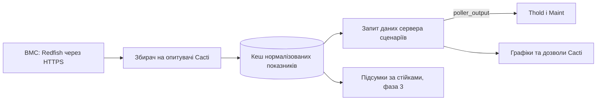

<!-- Source: README.md; SHA256: 7b4e83a58a1adc844cb0615ef30e95476cba2851f96bb454d2a816fb2774724d -->

<!-- translations:start -->
[English](../../../README.md) | [简体中文](../zh-CN/README.md) | [हिन्दी](../hi-IN/README.md) | [Español (España)](../es-ES/README.md) | [Español (Latinoamérica)](../es-419/README.md) | [العربية (السعودية)](../ar-SA/README.md) | [Afrikaans](../af-ZA/README.md) | [አማርኛ](../am-ET/README.md) | [العربية (مصر)](../ar-EG/README.md) | [العربية (المغرب)](../ar-MA/README.md) | [বাংলা](../bn-BD/README.md) | [Deutsch](../de-DE/README.md) | [فارسی](../fa-IR/README.md) | [Filipino](../fil-PH/README.md) | [Français](../fr-FR/README.md) | [Français (Maroc)](../fr-MA/README.md) | [Français (Sénégal)](../fr-SN/README.md) | [Hausa](../ha-NG/README.md) | [עברית](../he-IL/README.md) | [Bahasa Indonesia](../id-ID/README.md) | [Igbo](../ig-NG/README.md) | [Italiano](../it-IT/README.md) | [日本語](../ja-JP/README.md) | [한국어](../ko-KR/README.md) | [Malagasy](../mg-MG/README.md) | [मराठी](../mr-IN/README.md) | [Bahasa Melayu](../ms-MY/README.md) | [Nederlands](../nl-NL/README.md) | [Polski](../pl-PL/README.md) | [Português (Brasil)](../pt-BR/README.md) | [Русский](../ru-RU/README.md) | [Kinyarwanda](../rw-RW/README.md) | [Soomaali](../so-SO/README.md) | [Svenska](../sv-SE/README.md) | [Kiswahili](../sw-KE/README.md) | [தமிழ்](../ta-IN/README.md) | [తెలుగు](../te-IN/README.md) | [ไทย](../th-TH/README.md) | [Türkçe](../tr-TR/README.md) | [Українська](README.md) | [اردو](../ur-PK/README.md) | [Tiếng Việt](../vi-VN/README.md) | [isiXhosa](../xh-ZA/README.md) | [Yorùbá](../yo-NG/README.md) | [繁體中文](../zh-TW/README.md) | [isiZulu](../zu-ZA/README.md)
<!-- translations:end -->

# plugin_redfish

Плагін для Cacti 1.2, який передає показники споживаної потужності сервера, температури на вході, стану вентиляторів і працездатності блоків живлення з контролерів керування материнською платою (BMC) до Cacti у вигляді звичайних пристроїв, джерел даних і графіків, використовуючи Redfish із необов'язковим резервним переходом на IPMI. Далі Thold і Maint створюють сповіщення та приглушують їх, а наступна фаза додає підсумки потужності на рівні стійок.

> **Статус: у розробці, релізу ще немає (0.1.0-dev).** Етапи 2 (базова основа) і 3 (об'єкти Cacti та сповіщення) злито в гілку `main`. Цей плагін не пов'язаний із проєктом Cacti. Він встановлюється на Cacti 1.2.31 під PHP 8.2 або новішої версії, реєструє BMC та облікові дані, зчитує потужність, температури, стан вентиляторів і працездатність блоків живлення з кожного BMC через Redfish до власного кешу та відображає стан збору даних. Він додає пристрої Cacti, графіки для окремих компонентів і зведені графіки, а також підтримку Thold і Maint через звичайні джерела даних. У CI протестовано імітацію BMC, побудовану на рукописних фікстурах, і макет-сервер DMTF Redfish; жоден реальний BMC чи пілотний парк обладнання ще не пройшов кваліфікацію. Проєктну документацію та дослідження наведено в [docs/PLAN.md](../../PLAN.md), [docs/research/](../../research) і [docs/decisions/](../../decisions).

### Що входить до етапу 2

- Встановлення, оновлення, вимкнення та видалення через API плагінів Cacti зі збереженням таблиць під час видалення, якщо відповідний параметр не скинуто. На версіях PHP, старіших за 8.2, плагін відмовляється встановлюватися або вмикатися та повідомляє причину.
- Області доступу «Redfish View» (сторінка стану), «Redfish Operator» (сторінка операцій) і «Redfish Admin» (сторінки BMC та облікових даних), а також налаштування в розділі Configuration > Settings > Redfish.
- Реєстр BMC з імпортом у форматі CSV та експортом у JSON. Файли імпорту не повинні містити паролів; посилання на облікові дані здійснюється за назвою.
- Облікові дані зберігаються зашифрованими за допомогою AES-256-GCM. Ключем слугує файл поза базою даних, типово `/etc/cacti/redfish-vault.key`, що містить 64 шістнадцяткові символи (`openssl rand -hex 32`) або рівно 32 випадкові байти, належить користувачеві опитувача, недоступний для читання іншим користувачам і розміщений у каталозі, куди може записувати лише користувач опитувача або root. Ключ із 32 друкованих символів відхиляється як парольна фраза. **Резервно копіюйте файл ключа разом із базою даних**; без нього кожен збережений пароль доведеться вводити знову.
- Перевірка TLS увімкнена типово з підтримкою окремого для кожного BMC пакета ЦС (CA bundle) або закріплення SPKI SHA-256. Зареєстрована відмова від перевірки для окремого BMC залишається на сторінці стану як попередження.
- Клієнт Redfish лише для читання: тільки `GET`, а також вхід у сеанс і вихід із нього, що перевіряються за списком дозволених запитів перед надсиланням будь-якого запиту.
- Збирач, що запускається з `poller_bottom` для BMC на основному опитувачі, з орендами (leases) та дедлайнами для кожного BMC, експоненційною затримкою (backoff) і очищенням після аварійного завершення єдиного сеансу, зафіксованого плагіном. Віддалені збирачі ще не підтримуються; вони потребують явного вибору способу доступу збирача до бази даних і ключа (фаза 4).
- Записи BMC та облікові дані дотримуються дозволів на пристрої Cacti: користувач із роллю Redfish Admin бачить, змінює та прив'язує лише ті BMC на пристроях, які має право бачити, і лише ті облікові дані, які не використовуються жодним BMC на прихованому пристрої.

### Що додає етап 3

- Шаблони постачаються у вигляді XML-шаблонів Cacti в `templates/` та імпортуються власним імпортером Cacti під час встановлення й оновлення зі зіставленням за хешем, тож імпорт оновлює об'єкти плагіна й не додає нічого двічі. Три файли запитів даних копіюються до `<cacti>/resource/script_server/` із фіксацією хешу; плагін ніколи не замінює там файл, який він не створював, а сторінка стану попереджає адміністраторів, якщо шаблони або файл запиту відсутні на місці. Кнопка **Reinstall the Redfish Templates** на сторінці BMCs імпортує їх повторно; для цього потрібен дозвіл Cacti «Import Templates».
- Дії **Create Device** або **Add Graphs** для кожного BMC ([ADR 0015](../../decisions/0015-attach-to-the-server-device-or-create-one-per-bmc.md)). BMC, зіставлений із наявним пристроєм сервера, отримує свої запити даних і графіки на цьому пристрої. Незіставлений BMC отримує новий пристрій із шаблону пристрою «Redfish BMC» із вимкненими перевірками доступності та ім'ям хоста в домені `.invalid`, завдяки чому Cacti ніколи не звертається до BMC і не показує його адресу. В обох випадках адміністратор спершу підтверджує план із переліком того, що буде додано. Для обох дій потрібен дозвіл Cacti на керування пристроями, а також роль Redfish Admin; новий пристрій, який творець не може бачити, видаляється.
- Три запити даних сервера сценаріїв — «Redfish Fans», «Redfish Temperatures» і «Redfish Power Supplies», проіндексовані за ключем компонента BMC, з окремим графіком для кожного компонента: швидкість вентилятора у відсотках або об/хв (залежно від одиниці вимірювання, яку повідомляє BMC), температура, а також вхідна й вихідна потужність блока живлення у ватах, кожен зі своїм кодом стану.
- Вхідний набір даних «Redfish Node Summary» із потужністю, температурою на вході, найвищою температурою, кількістю несправних вентиляторів і блоків живлення, станом вузла та віком останнього успішного зчитування, що відображається на чотирьох графіках: потужність, температури, стан компонентів і вік даних. Порогові значення Thold для цих джерел даних формують сповіщення, а Maint приглушує їх без жодних змін у кожному з цих плагінів.
- Сервер сценаріїв відповідає лише з кешу плагіна й ніколи не звертається до BMC. Значення, яке відсутнє, застаріле, має іншу одиницю вимірювання або належить компоненту, що зник, дорівнює `U`, тому графіки показують прогалину, а не нуль; поле `age` завжди має значення, тому поріг на ньому виявляє BMC, який перестав відповідати.
- Посилання з кожного графіка Redfish на графіки Redfish відповідного пристрою, що відображається лише користувачам, яким Cacti дозволяє переглядати цей пристрій.

**Коли склад компонентів BMC змінюється** (замінено вентилятор, оновлення мікропрограми перейменувало датчики), оберіть **Add Graphs** повторно. Вентилятор або блок живлення, який був присутній, а тепер відсутній чи зник, враховується в `fans_bad` або `psus_bad`, доки ви цього не зробите, тому вилучений вентилятор спричиняє сповіщення; слот, який ніколи не був зайнятий, не враховується. Add Graphs приймає компоненти, які BMC повідомляє зараз, і Cacti знову індексує запити; зниклий компонент зберігає своє джерело даних і графік, які відтоді зчитують `U`, а новий компонент отримує графік. Графіки зниклих компонентів видаляйте вручну, коли їхня історія більше не потрібна.

Видалення пристрою скасовує зіставлення з його BMC, але зберігає сам BMC і його кеш. Видалення BMC або видалення плагіна зберігає його пристрій і графіки.

## Ролі доступу

| Область | Доступ |
| --- | --- |
| Redfish View | Наявні сторінки моніторингу. |
| Redfish Operator | Моніторинг, сторінка операцій і персональні підтвердження під час первинного розбору. |
| Redfish Admin | Доступ оператора, а також наявні налаштування та адміністративні дії. |

Після копіювання файлів оновлення відкрийте сторінку Plugins з обліковим записом адміністратора,
щоб зареєструвати нову область доступу. Призначте область Operator явно в розділі **Configuration > Users** або в групах користувачів.
Оновлення зберігають наявні ідентифікатори та права областей View і Admin. Доступ Admin
успадковує доступ Operator, а доступ Operator успадковує доступ View під час кожного запиту;
це не додає збережених прав користувачам чи групам. Для налаштувань плагіна також потрібен
доступ Redfish Admin на додачу до дозволу Settings у Cacti.

Дозволи на пристрої Cacti надалі обмежують рядки й дії, доступні кожному користувачеві; для незіставлених об'єктів потрібен адміністратор. Оператори можуть зняти призупинення збору даних на дозволеному BMC для наступного запланованого запуску.
Керування обліковими даними, конфігурація, зіставлення, видалення та інші адміністративні зміни
залишаються на адміністративних сторінках. Підтвердження діють лише в поточному
сеансі користувача, щонайбільше одну годину й лише доти, доки те саме спостереження
залишається актуальним. Нові або змінені спостереження роблять їх недійсними. Вони ніколи
не позначають невдале вимірювання як справне й не приглушують сповіщення.

## Навіщо

Кожен сервер має BMC, який повідомляє про стан живлення та температурний режим незалежно від операційної системи, тому він продовжує відповідати навіть тоді, коли ОС не працює. Ці дані використовуються для обліку потужностей і витрат, раннього попередження про вихід із ладу вентилятора чи блока живлення, а також у високопродуктивних обчисленнях — для ухвалення рішень щодо обмеження споживаної потужності. Плагін не є специфічним для HPC.

На сьогодні Cacti частково покриває ці завдання:

- **Пакетні рішення SNMP від виробників.** Гілка 1.2.x містить шаблони для Dell iDRAC і HPE iLO, які потребують SNMP-агента та прив'язані до конкретного виробника; дослідження етапу 1 показало, що жоден із них не повідомляє споживану потужність у ватах ([docs/research/overlap.md](../../research/overlap.md)).
- **Тип облікових даних без збирача.** plugin_credentials визначає облікові дані «IPMI / Redfish (BMC)», але не зчитує жодного BMC.
- **Відсутній вигляд на рівні стійки.** У ядрі Cacti немає об'єкта стійки; пристрій має лише текстове поле `location` довільного формату.

Плагін опитує BMC поза основним циклом опитування Cacti, кешує нормалізовані показники та надає їх через запит даних сервера сценаріїв і зведені джерела даних. Він повторно використовує графіки, дозволи, Thold і Maint самої системи Cacti та не змінює стан BMC. Підтримку віддалених збирачів даних заплановано на фазу 4; наразі збір виконується лише на основному опитувачі.

## Запланований обсяг

| Фаза | Обсяг робіт | Етапи |
|---|---|---|
| 0, дослідження | Матриця виробників, підтвердження поведінки апстріму на реальних BMC, витрати на опитування, прототип запиту даних | [M1](https://github.com/somethingwithproof/plugin_redfish/milestone/1) |
| 1, спостереження | Реєстр BMC, облікові дані, TLS, збирач Redfish, нормалізовані показники, пристрої, поіндексні графіки, сповіщення Thold, приглушення Maint, сторінка стану | [M2](https://github.com/somethingwithproof/plugin_redfish/milestone/2), [M3](https://github.com/somethingwithproof/plugin_redfish/milestone/3), [M4](https://github.com/somethingwithproof/plugin_redfish/milestone/4) |
| 2, ipmi | Резервний перехід на IPMI для BMC без придатного Redfish, типово вимкнено | [M5](https://github.com/somethingwithproof/plugin_redfish/milestone/5) |
| 3, стійки | Реєстр стійок, підсумкова потужність стійок із покриттям, запас за бюджетом потужності | [M6](https://github.com/somethingwithproof/plugin_redfish/milestone/6) |
| 4, віддалені | Віддалені збирачі даних Cacti для ізольованих мереж BMC | [M7](https://github.com/somethingwithproof/plugin_redfish/milestone/7) |

Поза межами проєкту: встановлення обмежень потужності або будь-якої іншої конфігурації BMC, керування живленням, оновлення мікропрограми, консольний доступ, власний рушій сповіщень плагіна та інтеграція з планувальником.

## Цільова сумісність

| Компонент | Цільові вимоги |
|---|---|
| Cacti | 1.2.31 або новішої версії, без патчів ядра |
| База даних | MariaDB 10.2 або MySQL 5.7 чи новішої версії: обмеження «один BMC на пристрій» забезпечується унікальним ключем на згенерованому стовпці |
| PHP | 8.2 або новішої версії; `setup.php` залишається синтаксично сумісним із 8.0, щоб непідтримуване середовище виконання отримувало відмову замість зламаного інтерфейсу Cacti |
| BMC | Dell iDRAC, HPE iLO, Lenovo XCC та OpenBMC залежно від діапазону версій мікропрограми; див. [матрицю виробників](../../research/vendor-matrix.md) |
| Redfish | Спершу нові ресурси підсистем і датчиків, застарілі `Power` і `Thermal` як резервний варіант |
| Thold, Maint | Зміни не потрібні |

## Архітектура та проєктування

- [docs/PLAN.md](../../PLAN.md) — повний план: архітектура, факти апстріму, на які він спирається (із джерелами та припущеннями, що потребують підтвердження), модель вимірювань, межі безпеки, розрахунки продуктивності, тестування та ризики.
- [docs/decisions/](../../decisions) містить записи про архітектурні рішення для вже ухвалених підходів.
- [docs/REQUIREMENTS.md](../../REQUIREMENTS.md) зіставляє кожен ідентифікатор вимоги з відповідним завданням.

## Безпека

Облікові дані BMC надають доступ до позасмугового керування серверами. Архітектура виключає їх потрапляння до командних рядків, журналів і вебсторінок, типово виконує перевірку TLS, запускає будь-які зовнішні команди через масив аргументів зі списком дозволених підкоманд і використовує облікові записи BMC із правами лише для читання. Див. [docs/PLAN.md](../../PLAN.md#security) і [SECURITY.md](../../../SECURITY.md).

## Посібник оператора

Передумови встановлення, налаштування сховища ключів і TLS, реєстрацію BMC, створення графіків, інтервали сповіщень, резервне копіювання та обробку збоїв описано в [docs/operator-guide.md](../../operator-guide.md). У посібнику жодна реальна лінійка мікропрограми виробника не оголошується підтримуваною, доки знеособлений дамп із цієї мікропрограми не пройде набір тестів.

## Відстеження роботи

- **Етапи** відповідають етапам плану. Кожен із них має епік-завдання з переліком підзавдань і критеріїв завершення.
- **Завдання** типізовано мітками: `type: requirement`, `type: research`, `type: decision`, `type: epic`. Завдання з вимогами містять пронумеровані тестовані вимоги (`REQ-AREA-NNN`) та критерії приймання.
- **Мітки** також містять префікси `area:`, `phase:`, `priority:` і `status:`. Див. [CONTRIBUTING.md](../../../CONTRIBUTING.md#labels).
- [Дошка проєкту](https://github.com/users/somethingwithproof/projects/12) відображає всі завдання в межах усіх етапів.

## Участь у розробці

Прочитайте [CONTRIBUTING.md](../../../CONTRIBUTING.md). Коміти потребують підпису DCO. Обговорення проєктних рішень відбуваються в завданнях; відкриті рішення мають мітку `type: decision`. Найкориснішим внеском наразі є дані з реальних BMC; перед публікацією будь-якого дампа приберіть із нього адреси, серійні номери та облікові дані.

## Ліцензія

GNU General Public License v2.0 — та сама ліцензія, що й у Cacti та його плагінів. Див. [LICENSE](../../../LICENSE).
