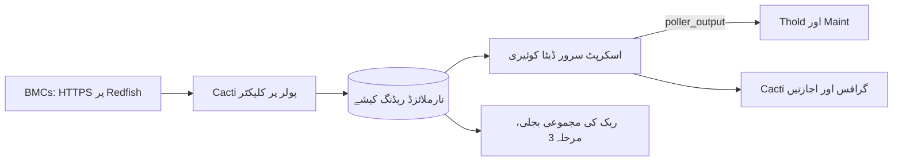

<!-- Source: README.md; SHA256: 7b4e83a58a1adc844cb0615ef30e95476cba2851f96bb454d2a816fb2774724d -->

<!-- translations:start -->
[English](../../../README.md) | [简体中文](../zh-CN/README.md) | [हिन्दी](../hi-IN/README.md) | [Español (España)](../es-ES/README.md) | [Español (Latinoamérica)](../es-419/README.md) | [العربية (السعودية)](../ar-SA/README.md) | [Afrikaans](../af-ZA/README.md) | [አማርኛ](../am-ET/README.md) | [العربية (مصر)](../ar-EG/README.md) | [العربية (المغرب)](../ar-MA/README.md) | [বাংলা](../bn-BD/README.md) | [Deutsch](../de-DE/README.md) | [فارسی](../fa-IR/README.md) | [Filipino](../fil-PH/README.md) | [Français](../fr-FR/README.md) | [Français (Maroc)](../fr-MA/README.md) | [Français (Sénégal)](../fr-SN/README.md) | [Hausa](../ha-NG/README.md) | [עברית](../he-IL/README.md) | [Bahasa Indonesia](../id-ID/README.md) | [Igbo](../ig-NG/README.md) | [Italiano](../it-IT/README.md) | [日本語](../ja-JP/README.md) | [한국어](../ko-KR/README.md) | [Malagasy](../mg-MG/README.md) | [मराठी](../mr-IN/README.md) | [Bahasa Melayu](../ms-MY/README.md) | [Nederlands](../nl-NL/README.md) | [Polski](../pl-PL/README.md) | [Português (Brasil)](../pt-BR/README.md) | [Русский](../ru-RU/README.md) | [Kinyarwanda](../rw-RW/README.md) | [Soomaali](../so-SO/README.md) | [Svenska](../sv-SE/README.md) | [Kiswahili](../sw-KE/README.md) | [தமிழ்](../ta-IN/README.md) | [తెలుగు](../te-IN/README.md) | [ไทย](../th-TH/README.md) | [Türkçe](../tr-TR/README.md) | [Українська](../uk-UA/README.md) | [اردو](README.md) | [Tiếng Việt](../vi-VN/README.md) | [isiXhosa](../xh-ZA/README.md) | [Yorùbá](../yo-NG/README.md) | [繁體中文](../zh-TW/README.md) | [isiZulu](../zu-ZA/README.md)
<!-- translations:end -->

# plugin_redfish

ایک Cacti 1.2 پلگ ان جو بیس بورڈ مینجمنٹ کنٹرولرز (BMCs) سے سرور کی بجلی کی کھپت، ان لیٹ درجہ حرارت، پنکھوں کی حالت، اور پاور سپلائی کی صحت کو Redfish (اور اختیاری IPMI فال بیک) کے ذریعے عام ڈیوائسز، ڈیٹا سورسز، اور گرافس کی صورت میں Cacti میں لاتا ہے۔ اس کے بعد Thold اور Maint ان پر الرٹ جاری کرتے اور انہیں دباتے (suppress کرتے) ہیں، جبکہ اگلے مرحلے میں ریک کی سطح پر مجموعی بجلی کا حساب شامل کیا جائے گا۔

> **حیثیت: زیرِ تعمیر، ابھی کوئی ریلیز نہیں (0.1.0-dev)۔** مائل اسٹون 2 (بنیادی ڈھانچہ) اور مائل اسٹون 3 (Cacti آبجیکٹس اور الرٹنگ) `main` برانچ میں ضم ہو چکے ہیں۔ یہ پلگ ان Cacti پروجیکٹ سے وابستہ نہیں ہے۔ یہ PHP 8.2 یا اس کے بعد کے ورژن کے تحت Cacti 1.2.31 پر انسٹال ہوتا ہے، BMCs اور کریڈینشلز کو رجسٹر کرتا ہے، Redfish کے ذریعے ہر BMC سے بجلی، درجہ حرارت، پنکھوں، اور پاور سپلائی کی صحت کی معلومات اپنے کیشے میں پڑھتا ہے، اور کلیکشن کی صحت دکھاتا ہے۔ یہ عام ڈیٹا سورسز کے ذریعے Cacti ڈیوائسز، فی ممبر اور خلاصہ گرافس، اور Thold و Maint کی سپورٹ شامل کرتا ہے۔ CI نے ہاتھ سے لکھے فکسچرز اور DMTF Redfish موک اپ سرور سے بنائے گئے ایک فرضی BMC پر جانچ کی ہے؛ ابھی تک کسی حقیقی BMC یا پائلٹ فلیٹ کی باقاعدہ تصدیق نہیں کی گئی۔ ڈیزائن اور تحقیق [docs/PLAN.md](../../PLAN.md)، [docs/research/](../../research)، اور [docs/decisions/](../../decisions) میں موجود ہیں۔

### مائل اسٹون 2 میں کیا شامل ہے

- Cacti کی پلگ ان API کے ذریعے انسٹال، اپ گریڈ، غیر فعال، اور ان انسٹال کرنے کی سہولت؛ ان انسٹال کرنے پر ٹیبلز محفوظ رہتے ہیں جب تک سیٹنگ کو صاف نہ کیا جائے۔ 8.2 سے پرانے PHP ورژن پر پلگ ان انسٹال یا فعال ہونے سے انکار کر دیتا ہے اور اس کی وجہ بتاتا ہے۔
- ریمز (Realms) "Redfish View" (صحت کا صفحہ)، "Redfish Operator" (آپریشنز کا صفحہ)، اور "Redfish Admin" (BMCs اور کریڈینشلز کے صفحات)، نیز Configuration > Settings > Redfish کے تحت سیٹنگز۔
- CSV امپورٹ اور JSON ایکسپورٹ کے ساتھ BMC رجسٹری۔ امپورٹ فائلوں میں پاس ورڈ شامل نہیں ہونے چاہئیں؛ کریڈینشلز کا حوالہ نام سے دیا جاتا ہے۔
- AES-256-GCM کے ذریعے انکرپٹڈ حالت میں محفوظ کردہ کریڈینشلز۔ کلید ڈیٹا بیس سے باہر ایک فائل ہوتی ہے، جو طے شدہ طور پر `/etc/cacti/redfish-vault.key` ہے، جس میں 64 ہیکساڈیسیمل حروف (`openssl rand -hex 32`) یا عین 32 بے ترتیب بائٹس ہوتے ہیں؛ اس کا مالک پولر صارف ہوتا ہے، دیگر صارفین اسے پڑھ نہیں سکتے، اور یہ ایسی ڈائریکٹری میں ہوتی ہے جہاں صرف پولر صارف یا root لکھ سکتا ہے۔ 32 قابلِ طباعت حروف پر مشتمل کلید کو پاس فریز سمجھ کر مسترد کر دیا جاتا ہے۔ **ڈیٹا بیس کے ساتھ کلید کی فائل کا بیک اپ ضرور لیں**؛ اس کے بغیر تمام محفوظ شدہ پاس ورڈ دوبارہ درج کرنے ہوں گے۔
- طے شدہ طور پر TLS تصدیق فعال، ہر BMC کے لیے الگ CA بنڈل یا SPKI SHA-256 پن کے ساتھ۔ ہر BMC کے لیے غیر تصدیق شدہ آپٹ آؤٹ لاگ کیا جاتا ہے اور صحت کے صفحے پر انتباہ کے طور پر برقرار رہتا ہے۔
- صرف پڑھنے (read-only) والا Redfish کلائنٹ: صرف `GET` اور سیشن لاگ ان و لاگ آؤٹ، جنہیں کسی بھی درخواست کے بھیجے جانے سے پہلے ایک الاؤ لسٹ (allowlist) کے مقابلے میں جانچا جاتا ہے۔
- مین پولر پر موجود BMCs کے لیے `poller_bottom` سے شروع ہونے والا کلیکٹر، جس میں فی BMC لیز، ڈیڈ لائنز، بیک آف، اور کریش کے بعد پلگ ان کے ریکارڈ کردہ واحد سیشن کی صفائی شامل ہے۔ ریموٹ کلیکٹرز ابھی سپورٹڈ نہیں ہیں؛ ان کے لیے یہ واضح انتخاب درکار ہے کہ کلیکٹر ڈیٹا بیس اور کلید تک کیسے پہنچے گا (مرحلہ 4)۔
- BMC ریکارڈز اور کریڈینشلز Cacti ڈیوائس کی اجازتوں کے تابع ہیں: ایک Redfish Admin صرف ان ڈیوائسز کے BMCs کو دیکھ، تبدیل، اور منسلک کر سکتا ہے جنہیں دیکھنے کی اسے اجازت ہے، اور صرف وہی کریڈینشلز دیکھ سکتا ہے جو کسی پوشیدہ ڈیوائس کے BMC میں استعمال نہ ہو رہے ہوں۔

### مائل اسٹون 3 میں کیا نیا شامل کیا گیا ہے

- ٹیمپلیٹس `templates/` میں Cacti ٹیمپلیٹ XML کے طور پر فراہم کیے جاتے ہیں اور انسٹال و اپ گریڈ کے وقت Cacti کے اپنے امپورٹر سے ہیش کی مطابقت کے ساتھ امپورٹ ہوتے ہیں، تاکہ امپورٹ پلگ ان کے آبجیکٹس کو اپ ڈیٹ کرے اور کوئی چیز دو بار شامل نہ ہو۔ تینوں ڈیٹا کوئیری فائلیں ریکارڈ شدہ ہیش کے ساتھ `<cacti>/resource/script_server/` میں کاپی کی جاتی ہیں؛ پلگ ان وہاں کبھی ایسی فائل کو تبدیل نہیں کرتا جو اس نے خود نہ لکھی ہو، اور جب ٹیمپلیٹس یا کوئیری فائل اپنی جگہ پر نہ ہوں تو صحت کا صفحہ منتظمین کو انتباہ دیتا ہے۔ BMCs کے صفحے پر **Reinstall the Redfish Templates** انہیں دوبارہ امپورٹ کرتا ہے؛ اس کے لیے Cacti کی Import Templates اجازت درکار ہوتی ہے۔
- ہر BMC پر **Create Device** یا **Add Graphs** ([ADR 0015](../../decisions/0015-attach-to-the-server-device-or-create-one-per-bmc.md))۔ سرور کی موجودہ ڈیوائس سے منسلک BMC کو اپنی ڈیٹا کوئیریز اور گرافس اسی ڈیوائس پر ملتے ہیں۔ غیر منسلک (unmapped) BMC کے لیے "Redfish BMC" ڈیوائس ٹیمپلیٹ سے ایک نئی ڈیوائس بنائی جاتی ہے، جس میں دستیابی کی جانچ بند ہوتی ہے اور ہوسٹ نام `.invalid` کے تحت ہوتا ہے، تاکہ Cacti کبھی BMC سے رابطہ نہ کرے اور نہ ہی اس کا پتہ دکھائے۔ دونوں صورتوں میں منتظم پہلے اس منصوبے کی تصدیق کرتا ہے جس میں شامل کی جانے والی چیزوں کی فہرست ہوتی ہے۔ دونوں کے لیے Redfish Admin کے ساتھ Cacti کی ڈیوائس مینجمنٹ کی اجازت بھی درکار ہے؛ اگر تخلیق کار نئی ڈیوائس کو نہ دیکھ سکے تو اسے دوبارہ ہٹا دیا جاتا ہے۔
- تین اسکرپٹ سرور ڈیٹا کوئیریز: "Redfish Fans"، "Redfish Temperatures"، اور "Redfish Power Supplies"، جو BMC کی ممبر کی (member key) کے ذریعے انڈیکس کی جاتی ہیں اور ہر ممبر کے لیے ایک گراف فراہم کرتی ہیں: پنکھے کی رفتار فیصد یا RPM میں (جو بھی اکائی BMC رپورٹ کرے)، درجہ حرارت، اور پاور سپلائی کے ان پٹ اور آؤٹ پٹ واٹس، ہر ایک اپنے ہیلتھ کوڈ کے ساتھ۔
- ایک "Redfish Node Summary" ان پٹ جس میں بجلی، ان لیٹ درجہ حرارت، بلند ترین درجہ حرارت، خراب پنکھے اور پاور سپلائیز، نوڈ کی صحت، اور آخری درست ریڈنگ کی عمر (`age`) شامل ہوتی ہے، جنہیں چار گرافس پر دکھایا جاتا ہے: بجلی، درجہ حرارت، پرزوں کی صحت، اور ڈیٹا کی عمر۔ ان ڈیٹا سورسز پر Thold تھریشولڈز الرٹ جاری کرتے ہیں اور Maint انہیں دباتا ہے، اور اس کے لیے دونوں پلگ انز میں کسی تبدیلی کی ضرورت نہیں ہوتی۔
- اسکرپٹ سرور صرف پلگ ان کے کیشے سے جواب دیتا ہے اور کبھی BMC سے رابطہ نہیں کرتا۔ جو قدر غائب ہو، پرانی ہو، کسی دوسری اکائی میں ہو، یا کسی ایسے ممبر کی ہو جو اب موجود نہیں، وہ `U` ہوتی ہے تاکہ گرافس میں وقفہ نظر آئے، صفر نہیں؛ `age` کی ہمیشہ ایک قدر ہوتی ہے، اس لیے اس پر لگایا گیا تھریشولڈ اس BMC کو پکڑ لیتا ہے جس نے جواب دینا بند کر دیا ہو۔
- ہر Redfish گراف سے ڈیوائس کے Redfish گرافس تک ایک گراف لنک، جو صرف ان صارفین کو دکھایا جاتا ہے جنہیں Cacti اس ڈیوائس کو دیکھنے کی اجازت دیتا ہے۔

**جب کسی BMC کے ممبرز تبدیل ہوں** (مثلاً پنکھا تبدیل کیا جائے، یا فرم ویئر اپ ڈیٹ سے سینسرز کے نام بدل جائیں)، تو دوبارہ **Add Graphs** منتخب کریں۔ جو پنکھا یا پاور سپلائی پہلے موجود تھی اور اب غائب یا ہٹا دی گئی ہے، وہ جب تک آپ ایسا نہ کریں `fans_bad` یا `psus_bad` میں شمار ہوتی رہتی ہے، تاکہ نکالا گیا پنکھا الرٹ دے سکے؛ جبکہ جو سلاٹ کبھی بھری ہی نہ گئی ہو وہ شمار نہیں ہوتی۔ Add Graphs ان ممبرز کو قبول کر لیتا ہے جو BMC اب رپورٹ کرتا ہے، اور Cacti کوئیریز کو دوبارہ انڈیکس کرتا ہے؛ جو ممبر ہٹ چکا ہو اس کا ڈیٹا سورس اور گراف برقرار رہتا ہے جو اس کے بعد سے `U` پڑھتا ہے، اور نئے ممبر کو ایک نیا گراف مل جاتا ہے۔ ہٹے ہوئے ممبرز کے گرافس کی تاریخ جب مزید درکار نہ رہے تو انہیں خود حذف کر دیں۔

کسی ڈیوائس کو حذف کرنے سے اس کا BMC غیر منسلک (unmap) ہو جاتا ہے جبکہ BMC اور اس کا کیشے محفوظ رہتا ہے۔ کسی BMC کو حذف کرنے، یا پلگ ان کو ان انسٹال کرنے سے اس کی ڈیوائس اور گرافس محفوظ رہتے ہیں۔

## رسائی کے کردار

| ریم (Realm) | رسائی |
| --- | --- |
| Redfish View | موجودہ نگرانی (مونیٹرنگ) کے صفحات۔ |
| Redfish Operator | نگرانی کے ساتھ آپریشنز کا صفحہ اور ذاتی ٹرائی ایج (triage) کی توثیقات۔ |
| Redfish Admin | آپریٹر کی رسائی کے ساتھ موجودہ کنفیگریشن اور انتظامی اقدامات۔ |

اپ گریڈ فائلیں کاپی کرنے کے بعد، نئے ریم کو رجسٹر کرنے کے لیے بطور منتظم Plugins کا صفحہ کھولیں۔ **Configuration > Users** یا صارف گروپس کے تحت Operator ریم کو واضح طور پر تفویض کریں۔ اپ گریڈز میں موجودہ View اور Admin ریم IDs اور اجازتیں برقرار رہتی ہیں۔ ہر درخواست پر Admin رسائی خودکار طور پر Operator رسائی کو وراثت میں لیتی ہے، اور Operator رسائی View رسائی کو وراثت میں لیتی ہے؛ اس سے صارفین یا گروپس میں محفوظ شدہ اجازتیں شامل نہیں ہوتیں۔ پلگ ان سیٹنگز کے لیے Cacti کی Settings اجازت کے علاوہ Redfish Admin رسائی بھی درکار ہوتی ہے۔

Cacti ڈیوائس کی اجازتیں اب بھی ہر صارف کے لیے دستیاب قطاروں اور اقدامات کو محدود رکھتی ہیں؛ غیر منسلک آبجیکٹس کے لیے منتظم کا ہونا ضروری ہے۔ آپریٹرز اگلی طے شدہ رن کے لیے مجاز BMC پر کلیکشن ہولڈ کو ہٹا سکتے ہیں۔ کریڈینشلز، کنفیگریشن، میپنگ، حذف کرنے اور دیگر انتظامی تبدیلیاں بدستور انتظامی صفحات میں ہی رہتی ہیں۔ توثیقات (acknowledgments) صرف موجودہ صارف کے سیشن میں، زیادہ سے زیادہ ایک گھنٹے کے لیے اور صرف اس وقت تک برقرار رہتی ہیں جب تک وہی مشاہدہ تازہ رہے۔ نئے یا بدلے ہوئے مشاہدات انہیں کالعدم کر دیتے ہیں۔ یہ کبھی کسی ناکام پیمائش کو صحت مند قرار نہیں دیتیں اور نہ ہی الرٹس کو دباتی ہیں۔

## اس کی ضرورت کیوں ہے

ہر سرور میں ایک BMC ہوتا ہے جو آپریٹنگ سسٹم سے آزادانہ طور پر بجلی اور حرارتی صورتحال کی رپورٹ دیتا ہے، اس لیے OS بند ہونے پر بھی یہ جواب دیتا رہتا ہے۔ یہ ڈیٹا گنجائش اور لاگت کے حساب کتاب، خراب پنکھے یا پاور سپلائی کی بروقت اطلاع، اور ہائی پرفارمنس کمپیوٹنگ میں پاور کیپنگ کے فیصلوں کے لیے کام آتا ہے۔ یہ پلگ ان صرف HPC تک محدود نہیں ہے۔

Cacti آج اس کا کچھ حصہ فراہم کرتا ہے:

- **وینڈر SNMP پیکجز۔** 1.2.x برانچ Dell iDRAC اور HPE iLO کے ٹیمپلیٹس فراہم کرتی ہے جنہیں ایک SNMP ایجنٹ کی ضرورت ہوتی ہے اور جو مخصوص وینڈرز تک محدود ہیں؛ مائل اسٹون 1 کی تحقیق سے معلوم ہوا کہ ان میں سے کوئی بھی واٹس میں بجلی کی کھپت رپورٹ نہیں کرتا ([docs/research/overlap.md](../../research/overlap.md))۔
- **کلیکٹر کے بغیر کریڈینشل کی قسم۔** plugin_credentials ایک "IPMI / Redfish (BMC)" کریڈینشل کی تعریف تو کرتا ہے لیکن کسی BMC کو نہیں پڑھتا۔
- **ریک کی سطح کا کوئی منظر نہیں۔** Cacti کور میں ریک کا کوئی آبجیکٹ نہیں ہے؛ ڈیوائس میں صرف ایک آزاد متن والا `location` فیلڈ ہوتا ہے۔

یہ پلگ ان Cacti کے پول سائیکل سے الگ (out of band) طریقے سے BMCs کو پول کرتا ہے، نارملائزڈ ریڈنگز کو کیشے میں محفوظ کرتا ہے، اور انہیں اسکرپٹ سرور ڈیٹا کوئیری اور خلاصہ ڈیٹا سورسز کے ذریعے پیش کرتا ہے۔ یہ Cacti کے گرافنگ، اجازتوں، Thold، اور Maint کو دوبارہ استعمال کرتا ہے، اور BMC کی حالت میں کوئی تبدیلی نہیں کرتا۔ ریموٹ ڈیٹا کلیکٹر کی سپورٹ مرحلہ 4 کے لیے منصوبہ بند ہے؛ فی الحال کلیکشن صرف مین پولر پر چلتی ہے۔

## منصوبہ بند دائرہ کار

| مرحلہ | دائرہ کار | مائل اسٹونز |
|---|---|---|
| 0، تحقیق | وینڈر میٹرکس، لائیو BMCs پر اپ اسٹریم رویے کی تصدیق، پولنگ لاگت، ڈیٹا کوئیری کا ابتدائی تجربہ | [M1](https://github.com/somethingwithproof/plugin_redfish/milestone/1) |
| 1، مشاہدہ | BMC رجسٹری، کریڈینشلز، TLS، Redfish کلیکٹر، نارملائزڈ ریڈنگز، ڈیوائسز، فی انڈیکس گرافس، Thold الرٹنگ، Maint سپریشن، صحت کا صفحہ | [M2](https://github.com/somethingwithproof/plugin_redfish/milestone/2), [M3](https://github.com/somethingwithproof/plugin_redfish/milestone/3), [M4](https://github.com/somethingwithproof/plugin_redfish/milestone/4) |
| 2، ipmi | ان BMCs کے لیے IPMI فال بیک جن میں قابلِ استعمال Redfish نہ ہو، طے شدہ طور پر بند | [M5](https://github.com/somethingwithproof/plugin_redfish/milestone/5) |
| 3، ریکس | ریک رجسٹری، کوریج کے ساتھ ریک کی مجموعی بجلی، بجٹ کی گنجائش | [M6](https://github.com/somethingwithproof/plugin_redfish/milestone/6) |
| 4، ریموٹ | الگ تھلگ BMC نیٹ ورکس کے لیے Cacti ریموٹ ڈیٹا کلیکٹرز | [M7](https://github.com/somethingwithproof/plugin_redfish/milestone/7) |

دائرہ کار سے باہر: پاور کیپس یا کوئی دوسری BMC کنفیگریشن مقرر کرنا، پاور کنٹرول، فرم ویئر اپ ڈیٹ، کنسول تک رسائی، پلگ ان کا اپنا الرٹنگ انجن، اور شیڈولر انٹیگریشن۔

## مطابقت کے اہداف

| جزو | ہدف |
|---|---|
| Cacti | 1.2.31 یا اس کے بعد، بغیر کسی کور پیچ کے |
| ڈیٹا بیس | MariaDB 10.2 یا MySQL 5.7 یا اس کے بعد: فی ڈیوائس ایک BMC کو جنریٹڈ کالم پر منفرد کلید (unique key) کے ذریعے برقرار رکھا جاتا ہے |
| PHP | 8.2 یا اس کے بعد؛ `setup.php` ورژن 8.0 پر بھی پارس ہونے کے قابل رہتی ہے تاکہ غیر تعاون یافتہ رن ٹائم کو ٹوٹے ہوئے Cacti UI کے بجائے واضح انکار ملے |
| BMCs | Dell iDRAC، HPE iLO، Lenovo XCC، اور OpenBMC، فرم ویئر کی حد کے مطابق؛ دیکھیں [وینڈر میٹرکس](../../research/vendor-matrix.md) |
| Redfish | پہلے نئے سب سسٹم اور سینسر ریسورسز، فال بیک کے طور پر متروک `Power` اور `Thermal` |
| Thold، Maint | کسی تبدیلی کی ضرورت نہیں |

## ڈیزائن

- [docs/PLAN.md](../../PLAN.md) مکمل منصوبہ ہے: آرکیٹیکچر، وہ اپ اسٹریم حقائق جن پر یہ منحصر ہے (مآخذ اور ان مفروضات کے ساتھ جن کی تصدیق ابھی باقی ہے)، پیمائش کا ماڈل، سیکیورٹی حدود، کارکردگی کا حساب، ٹیسٹنگ، اور خطرات۔
- [docs/decisions/](../../decisions) میں پہلے سے کیے گئے فیصلوں کے آرکیٹیکچر ڈیسیژن ریکارڈز (ADRs) موجود ہیں۔
- [docs/REQUIREMENTS.md](../../REQUIREMENTS.md) ہر ریکوائرمنٹ ID کو اس کے متعلقہ ایشو سے جوڑتا ہے۔

## سیکیورٹی

BMC کریڈینشلز سرورز کے آؤٹ آف بینڈ انتظام کو کنٹرول کرتے ہیں۔ ڈیزائن انہیں کمانڈ لائنز، لاگز، اور صفحات سے دور رکھتا ہے، طے شدہ طور پر TLS کی تصدیق کرتا ہے، کسی بھی بیرونی کمانڈ کو الاؤ لسٹڈ ذیلی کمانڈز کے ساتھ آرگیومنٹ اَرے (argument array) سے چلاتا ہے، اور صرف پڑھنے والے (read-only) BMC اکاؤنٹس استعمال کرتا ہے۔ [docs/PLAN.md](../../PLAN.md#security) اور [SECURITY.md](../../../SECURITY.md) دیکھیں۔

## آپریٹر گائیڈ

انسٹالیشن کی پیشگی شرائط، والٹ اور TLS سیٹ اپ، BMC رجسٹریشن، گراف کی تخلیق، الرٹ کے وقفے، بیک اپ، اور خرابی سے نمٹنے کے لیے [docs/operator-guide.md](../../operator-guide.md) دیکھیں۔ یہ گائیڈ کسی حقیقی وینڈر فرم ویئر لائن کو اس وقت تک سپورٹڈ قرار نہیں دیتی جب تک اس فرم ویئر کا ریڈیکٹڈ کیپچر ٹیسٹ سوئٹ میں کامیاب نہ ہو جائے۔

## کام کی نگرانی کا طریقہ

- **مائل اسٹونز** منصوبے کے مائل اسٹونز کی پیروی کرتے ہیں۔ ہر ایک کا ایک ایپک (epic) ایشو ہوتا ہے جس میں اس کے ذیلی ایشوز اور تکمیل کے شواہد درج ہوتے ہیں۔
- **ایشوز** کی درجہ بندی لیبل کے ذریعے کی جاتی ہے: `type: requirement`، `type: research`، `type: decision`، `type: epic`۔ ریکوائرمنٹ ایشوز میں نمبر شدہ، قابلِ جانچ تقاضے (`REQ-AREA-NNN`) اور قبولیت کے معیارات بیان کیے جاتے ہیں۔
- **لیبلز** میں `area:`، `phase:`، `priority:`، اور `status:` بھی شامل ہوتے ہیں۔ [CONTRIBUTING.md](../../../CONTRIBUTING.md#labels) دیکھیں۔
- [پروجیکٹ بورڈ](https://github.com/users/somethingwithproof/projects/12) تمام مائل اسٹونز کے ایشوز دکھاتا ہے۔

## تعاون کریں

[CONTRIBUTING.md](../../../CONTRIBUTING.md) پڑھیں۔ کمٹس کے لیے DCO سائن آف درکار ہوتا ہے۔ ڈیزائن پر بحث ایشوز پر ہوتی ہے؛ زیرِ غور فیصلوں پر `type: decision` لیبل لگا ہوتا ہے۔ اس وقت حقیقی BMCs سے حاصل کردہ شواہد سب سے مفید تعاون ہیں؛ کوئی بھی کیپچر پوسٹ کرنے سے پہلے پتے، سیریل نمبرز، اور کریڈینشلز کو ہٹا (redact) دیں۔

## لائسنس

GNU General Public License v2.0، وہی لائسنس جو Cacti اور اس کے پلگ انز کا ہے۔ [LICENSE](../../../LICENSE) دیکھیں۔
