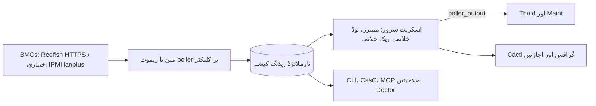

<!-- Source: README.md; SHA256: 6972a6c9ac754cd60e63c5caf971451ea8fe6e279eef757d886e1a168d3eef01 -->

<!-- translations:start -->
[English](../../../README.md) | [简体中文](../zh-CN/README.md) | [हिन्दी](../hi-IN/README.md) | [Español (España)](../es-ES/README.md) | [Español (Latinoamérica)](../es-419/README.md) | [العربية (السعودية)](../ar-SA/README.md) | [Afrikaans](../af-ZA/README.md) | [አማርኛ](../am-ET/README.md) | [العربية (مصر)](../ar-EG/README.md) | [العربية (المغرب)](../ar-MA/README.md) | [বাংলা](../bn-BD/README.md) | [Bosanski](../bs-BA/README.md) | [Deutsch](../de-DE/README.md) | [فارسی](../fa-IR/README.md) | [Filipino](../fil-PH/README.md) | [Français](../fr-FR/README.md) | [Français (Maroc)](../fr-MA/README.md) | [Français (Sénégal)](../fr-SN/README.md) | [Hausa](../ha-NG/README.md) | [עברית](../he-IL/README.md) | [Hrvatski](../hr-HR/README.md) | [Bahasa Indonesia](../id-ID/README.md) | [Igbo](../ig-NG/README.md) | [Italiano](../it-IT/README.md) | [日本語](../ja-JP/README.md) | [한국어](../ko-KR/README.md) | [Malagasy](../mg-MG/README.md) | [मराठी](../mr-IN/README.md) | [Bahasa Melayu](../ms-MY/README.md) | [Nederlands](../nl-NL/README.md) | [Polski](../pl-PL/README.md) | [Português (Brasil)](../pt-BR/README.md) | [Русский](../ru-RU/README.md) | [Kinyarwanda](../rw-RW/README.md) | [Soomaali](../so-SO/README.md) | [Српски](../sr-RS/README.md) | [Svenska](../sv-SE/README.md) | [Kiswahili](../sw-KE/README.md) | [தமிழ்](../ta-IN/README.md) | [తెలుగు](../te-IN/README.md) | [ไทย](../th-TH/README.md) | [Türkçe](../tr-TR/README.md) | [Українська](../uk-UA/README.md) | [اردو](README.md) | [Tiếng Việt](../vi-VN/README.md) | [isiXhosa](../xh-ZA/README.md) | [Yorùbá](../yo-NG/README.md) | [繁體中文](../zh-TW/README.md) | [isiZulu](../zu-ZA/README.md)
<!-- translations:end -->

# plugin_redfish

ایک Cacti 1.2 پلگ ان جو بیس بورڈ مینجمنٹ کنٹرولرز (BMCs) سے سرور کی بجلی کی کھپت، ان لیٹ درجہ حرارت، پنکھوں کی حالت، اور پاور سپلائی کی صحت کو Redfish کے ذریعے اختیاری ریڈ اونلی IPMI فال بیک اور ریک کی سطح پر بجلی کے مجموعے کے ساتھ عام ڈیوائسز، ڈیٹا سورسز، اور گرافس کی صورت میں Cacti میں لاتا ہے۔ Thold اور Maint معیاری Cacti ڈیٹا سورسز کے ذریعے ان پر الرٹ جاری کرتے اور انہیں دباتے (suppress کرتے) ہیں۔

> **حیثیت: زیرِ تعمیر، ابھی کوئی ریلیز نہیں (`0.1.0-dev`)۔** یہ پلگ ان Cacti پروجیکٹ سے وابستہ نہیں ہے۔ یہ PHP 8.2 یا اس کے بعد کے ورژن کے تحت Cacti 1.2.31 یا اس کے بعد کے ورژن پر انسٹال ہوتا ہے اور Redfish کلیکٹر، انکرپٹڈ کریڈینشل والٹ، Cacti ڈیوائس اور گراف پروویژننگ، اختیاری ریڈ اونلی IPMI فال بیک، ریک پاور رول اپ، Cacti Maint ونڈو ڈسپلے، ریموٹ ڈیٹا کلیکٹر ریپلیکیشن اور ایجنٹ اینڈ پوائنٹس، CasC پرووائیڈر اور آپریٹر CLI، MCP صلاحیتیں، اور Doctor تشخیصی چیکس نافذ کرتا ہے۔ CI فکسچرز، DMTF Redfish Mockup Server (سب سسٹم، لیگیسی اونلی، اور HPE iLO Gen11 موک اپس)، اور Maint v1.3 کے ساتھ Thold v1.8.2 کی جانچ کرتا ہے؛ ابھی تک کسی حقیقی فزیکل BMC یا پائلٹ فلیٹ کی تصدیق نہیں کی گئی۔ ڈیزائن اور تحقیق [docs/PLAN.md](../../PLAN.md)، [docs/research/](../../research/)، اور [docs/decisions/](../../decisions/) میں موجود ہیں۔

## نافذ کردہ صلاحیتیں

### بنیادی کلیکٹر، والٹ، اور Cacti آبجیکٹس

- **لائف سائیکل اور اسکیما۔** Cacti کے پلگ ان API کے ذریعے انسٹال، اپ گریڈ، ڈس ایبل، اور ان انسٹال ہوتا ہے (`Schema::VERSION = 3`، 12 جدول)۔ جب تک *Keep Plugin Tables on Uninstall* کو ان چیک نہ کیا جائے، ان انسٹال کرتے وقت جدول محفوظ رہتے ہیں۔ انٹری پوائنٹس PHP 8.0 پر پارس ہوتے ہیں اور 8.2 سے کم PHP یا `ext-openssl` کی عدم موجودگی کو واضح ایرر پیغام کے ساتھ مسترد کرتے ہیں۔
- **رجسٹری اور اجازتیں۔** *Redfish View* (`redfish_health.php`)، *Redfish Operator* (`redfish_operator.php`)، اور *Redfish Admin* (`redfish_bmcs.php`، `redfish_credentials.php`) دائرہ کار (realms)، نیز **Configuration > Settings > Redfish** کے تحت ترتیبات۔ BMC رجسٹری CSV امپورٹ (کریڈینشلز کا حوالہ نام سے دیا جاتا ہے؛ امپورٹ فائلوں میں پاس ورڈز مسترد کیے جاتے ہیں) اور JSON ایکسپورٹ کو سپورٹ کرتی ہے۔ BMC ریکارڈز اور کریڈینشلز Cacti ڈیوائس کی اجازتوں کی پیروی کرتے ہیں۔
- **انکرپٹڈ کریڈینشل والٹ۔** پاس ورڈز `plugin_redfish_secret` میں AES-256-GCM کے ساتھ انکرپٹ کر کے محفوظ کیے جاتے ہیں۔ کلید ڈیٹا بیس سے باہر (بطورِ ڈیفالٹ `/etc/cacti/redfish-vault.key`) 64 ہیکساڈیسیمل حروف (`openssl rand -hex 32`) یا 32 خام بائٹس کے طور پر موجود ہوتی ہے، جو poller صارف کی ملکیت میں ہو، دیگر صارفین کے لیے ناقابلِ مطالعہ ہو، اور ایسی ڈائریکٹری میں ہو جہاں صرف root یا وہ صارف لکھ سکے۔ 32 حروف پر مشتمل پرنٹ ایبل پاس فریز مسترد کر دیا جاتا ہے۔ **ڈیٹا بیس کے ساتھ کلید کی فائل کا بیک اپ بھی لیں**؛ اس کے بغیر، محفوظ شدہ پاس ورڈز دوبارہ درج کرنے ہوں گے۔
- **TLS اور ریڈ اونلی Redfish کلائنٹ۔** سسٹم CA اسٹور، فی BMC CA بنڈل، یا SPKI SHA-256 پن استعمال کرتے ہوئے TLS کی تصدیق بطورِ ڈیفالٹ فعال ہوتی ہے؛ فی BMC غیر تصدیق شدہ آپٹ آؤٹ صحت کی وارننگ اور Doctor چیک وارننگ کے طور پر نمایاں رہتا ہے۔ کلائنٹ صرف `GET` کے ساتھ Redfish سیشن لاگ ان (`POST`) اور لاگ آؤٹ (`DELETE`) کی اجازت دیتا ہے، اور جب سیشن دستیاب نہ ہوں تو فی BMC اختیاری Basic فال بیک فراہم کرتا ہے۔ دریافت (discovery) پہلے نئے Redfish سب سسٹم اور سینسر وسائل کو ترجیح دیتی ہے اور متروک `Power` اور `Thermal` وسائل پر فال بیک کرتی ہے۔
- **کلیکٹر کا نفاذ۔** `poller_redfish.php` کا آغاز `poller_bottom` سے ہوتا ہے، یہ قابلِ ترتیب ورکر پروسیسز (`redfish_workers`) کے ساتھ Cacti کی پروسیس رجسٹری کے ذریعے فی poller ایک ماسٹر پروسیس چلاتا ہے، فی BMC لیز حاصل کرتا ہے، ٹائم بجٹ (`redfish_collector_budget`) نافذ کرتا ہے، ایکسپونینشل بیک آف لاگو کرتا ہے، اور کریش کے بعد پلگ ان کے اپنے پچھلے سیشن کو صاف کرتا ہے۔
- **ٹیمپلیٹس، ڈیوائسز، اور گرافس۔** ہیش کے ذریعے `templates/redfish-templates.xml` امپورٹ کرتا ہے اور صارف کی ترمیم شدہ فائلوں کو اوور رائٹ کیے بغیر تین اسکرپٹ سرور ڈیٹا کوئری XML فائلیں (`redfish_fans.xml`، `redfish_temperatures.xml`، `redfish_psus.xml`) `<cacti>/resource/script_server/` میں کاپی کرتا ہے۔ **Create Device** اور **Add Graphs** کے لیے پروویژننگ پلان کی تصدیق درکار ہوتی ہے، یہ کوئریز کو میپ شدہ سرور ڈیوائس سے منسلک کرتے ہیں یا دستیابی چیکس بند کر کے `.invalid` کے تحت ایک "Redfish BMC" ڈیوائس بناتے ہیں، اور `graph_buttons` کے ذریعے ہر Redfish گراف کو واپس ڈیوائس کے Redfish گرافس سے لنک کرتے ہیں۔
- **صرف کیشے پر مبنی اسکرپٹ سرور ان پٹس۔** `scripts/ss_redfish_members.php` فی ممبر پنکھے، درجہ حرارت، اور PSU کی ریڈنگز فراہم کرتا ہے، اور `scripts/ss_redfish_summary.php` "Redfish Node Summary" میٹرکس (بجلی، ان لیٹ اور زیادہ سے زیادہ درجہ حرارت، خراب پنکھوں اور PSU کی تعداد، نوڈ کی صحت، اور آخری درست ریڈنگ کی عمر) فراہم کرتا ہے۔ اسکرپٹ سرور کالز صرف مقامی کیشے پڑھتی ہیں اور کبھی کسی BMC سے رابطہ نہیں کرتیں۔ گمشدہ، پرانی، یا ختم شدہ ممبر کی ریڈنگز `U` واپس کرتی ہیں (کبھی `0` نہیں)، جبکہ `age` ہمیشہ قدر رپورٹ کرتا ہے تاکہ تھریشولڈز خاموش BMCs کا پتہ لگا سکیں۔

**جب کسی BMC کے ممبرز تبدیل ہوں** (جیسے بدلا ہوا پنکھا یا کوئی فرم ویئر اپ ڈیٹ جو سینسرز کے نام تبدیل کر دے)، تو **Add Graphs** دوبارہ چلائیں۔ پہلے سے موجود کوئی پنکھا یا پاور سپلائی اگر غائب ہو جائے تو قبول کیے جانے تک `fans_bad` یا `psus_bad` میں شمار ہوتا ہے؛ ایسا سلاٹ جو کبھی نصب ہی نہ رہا ہو، شمار نہیں ہوتا۔ ختم شدہ ممبرز اپنے موجودہ ڈیٹا سورسز اور گرافس برقرار رکھتے ہیں، جو ہاتھ سے حذف کیے جانے تک اس کے بعد `U` پڑھتے رہتے ہیں۔ کسی Cacti ڈیوائس کو حذف کرنے سے اس کی BMC میپنگ ختم ہو جاتی ہے اور اس کی ریک تفویض ہٹ جاتی ہے جبکہ BMC اور کیشے برقرار رہتے ہیں؛ کسی BMC کو حذف کرنے یا پلگ ان کو ان انسٹال کرنے سے Cacti ڈیوائسز اور گرافس محفوظ رہتے ہیں۔

### اختیاری IPMI فال بیک

- **فی BMC آپٹ ان۔** بطورِ ڈیفالٹ بند ہوتا ہے (`protocols` بطورِ ڈیفالٹ `redfish` ہوتا ہے؛ IPMI فال بیک فعال کرنے سے یہ `redfish,ipmi` پر سیٹ ہو جاتا ہے)۔
- **محدود فال بیک ٹرگر۔** صرف اس وقت چلتا ہے جب Redfish کلیکشن کسی اہل ناکامی کی قسم کے ساتھ ناکام ہو؛ `AuthRejected`، `CredentialUnavailable`، `AddressRefused`، `OperationRefused`، یا `Deadline` پر کبھی ٹرگر نہیں ہوتا۔
- **محفوظ نفاذ۔** شیل کے بغیر ایرے فارم `proc_open()` کے ذریعے `-I lanplus` پر `ipmitool` کو محدود وال کلاک ٹائم آؤٹ اور 256 KiB آؤٹ پٹ حد کے ساتھ چلاتا ہے۔ پاس ورڈز `IPMITOOL_PASSWORD` (`-E`) یا mode-0600 عارضی فائل (`-f`) کے ذریعے فراہم کیے جاتے ہیں جسے `finally` میں حذف کر دیا جاتا ہے، کبھی CLI argv پر نہیں دیے جاتے۔
- **ریڈ اونلی کمانڈ اجازت نامہ۔** صرف پانچ ریڈ اونلی ذیلی کمانڈز کی اجازت ہے: `dcmi power reading`، `sdr type Temperature`، `sdr type Fan`، `sdr type Power Supply`، اور `chassis status`۔ تبدیلی کرنے والی کمانڈز مسترد کی جاتی ہیں۔
- **نارملائزڈ آؤٹ پٹ اور سیکیورٹی وارننگ۔** `IpmiNormalizer` ریڈنگز کو اسی `Observation`/`Member`/`Reading` ماڈل میں میپ کرتا ہے، اور گمشدہ یا ناقابلِ پارس سینسرز کے لیے `U` جاری کرتا ہے۔ IPMI فال بیک فعال کرنے سے صحت کے صفحے پر اور `redfish.bmc_security` Doctor چیک میں ایک وارننگ ظاہر ہوتی ہے جو آپریٹرز کو UDP 623 کو مینجمنٹ VLAN تک محدود رکھنے کی یاد دلاتی ہے۔

### ریک پاور رول اپ

- **ریک رجسٹری۔** اسکیما ورژن 3 میں `plugin_redfish_rack` (منفرد `(site_id, name)`، اختیاری `power_budget_watts`، بطورِ ڈیفالٹ `80` پر `min_coverage_pct`، اور نوٹس) اور `plugin_redfish_rack_member` (فی `host_id` زیادہ سے زیادہ ایک ریک تفویض، اختیاری `bmc_id` اور `unit_position`، جو Cacti ڈیوائس حذف ہونے پر خودکار طور پر ہٹ جاتا ہے) شامل کیے گئے ہیں۔
- **کوریج سے محفوظ مجموعے۔** `RackPowerSummary` مقامی کیشے سے ممبرز کی تازہ `power_watts` ریڈنگز کو جمع کرتا ہے اور بجٹ کے استعمال اور باقی گنجائش (headroom) کا حساب لگاتا ہے۔ جب رپورٹ کرنے والے ممبرز کی کوریج `min_coverage_pct` سے کم ہو جائے، تو `power_watts`، `utilization_pct`، اور `headroom_watts` `U` واپس کرتے ہیں تاکہ کلیکٹر کی ناکامی کبھی ریک کی بجلی میں کمی کے طور پر ظاہر نہ ہو۔
- **Thold کے لیے تیار اسکرپٹ سرور ان پٹ۔** `scripts/ss_redfish_rack.php` (`ss_redfish_rack(<rack_id>)`) صرف مقامی کیشے سے `power_watts`، `power_budget_watts`، `utilization_pct`، `headroom_watts`، `members_total`، `members_reporting`، اور `coverage_pct` واپس کرتا ہے۔

### Cacti Maint انضمام

- Redfish ڈیٹا سورسز پر Thold تھریشولڈز الرٹ جاری کرتے ہیں اور Cacti Maint کسی بھی پلگ ان میں تبدیلی کے بغیر انہیں دباتا ہے۔
- `MaintWindow` ہر میپ شدہ Cacti ہوسٹ کے لیے فعال Maint شیڈولز چیک کرتا ہے (ایک بار کے `mtype=1` اور بار بار ہونے والے `mtype=2` شیڈولز، نیز لوڈ ہونے پر `plugin_maint_check_cacti_host()`) اور فعال دیکھ بھال کو Redfish Health صفحے (`[MAINT]`)، `cli/redfish.php health` آؤٹ پٹ، اور `redfish-get-health` صلاحیت میں نشان زد کرتا ہے۔

### ریموٹ ڈیٹا کلیکٹرز

- `INFO` میں `remote_collect:1` کا اعلان کیا گیا ہے۔ BMCs کوئی بھی `poller_id >= 1` قبول کرتے ہیں، اور `poller_redfish.php --poller=N` صرف اس poller کو تفویض کردہ فعال BMCs کو جمع کرتا ہے۔
- **`replicate_out` ہک۔** `replicate_out_table()` کے ذریعے صرف ہدف شدہ ریموٹ poller تک محدود غیر خفیہ کنفیگریشن جدول نقل کرتا ہے: `plugin_redfish_bmc`، `plugin_redfish_credential` میٹا ڈیٹا (بغیر سائفر ٹیکسٹ)، `plugin_redfish_rack`، اور `plugin_redfish_rack_member`۔ `plugin_redfish_secret` نقل نہیں کیا جاتا، اور والٹ کلید کی فائلیں ہر poller پر سختی سے مقامی رہتی ہیں۔
- **`remote_agent` ہک۔** ریڈ اونلی `redfish_health` اور `redfish_discovery` ایکشنز فراہم کرتا ہے جو صرف عددی `poller_id` اور `bmc_id` پیرامیٹرز قبول کرتے ہیں۔ غیر متوقع پیرامیٹرز مسترد کر دیے جاتے ہیں اور کوئی کریڈینشل یا راز واپس نہیں کیا جاتا۔

### ایکو سسٹم ہکس (CasC، MCP صلاحیتیں، اور Doctor)

- **CasC پرووائیڈر (`casc_register_providers`)۔** خالص PHP YAML اور XML ایکسپورٹ، پارسنگ (XXE مسترد)، توثیق، ڈف پلاننگ، اور اپلائی کے ساتھ `redfish` پرووائیڈر (اسکیما ورژن `1`) رجسٹر کرتا ہے۔ کریڈینشلز صرف والٹ حوالہ جات کے طور پر ظاہر ہوتے ہیں (`vault:redfish:<name>`)؛ خام خفیہ کلیدیں (`pass`، `secret`، `token`، `private_key`، `vault_key`، `auth_token`) مسترد کر دی جاتی ہیں۔ اپلائی کرنے کے لیے عین SHA-256 `PLAN_HASH` درکار ہوتا ہے۔
- **MCP / Abilities API (`abilities_register`)۔** Redfish View دائرہ کار (`redfish_health.php`) اور Cacti ڈیوائس اجازتوں کے تحت تین ریڈ اونلی صلاحیتیں رجسٹر کرتا ہے، اور کوئی کریڈینشل واپس نہیں کرتا:
  - `redfish-list-bmcs` (اختیاری `poller_id`)
  - `redfish-get-rack-power` (اختیاری `rack_id`)
  - `redfish-get-health` (اختیاری `bmc_id`)
- **Doctor چیکس (`doctor_register_checks`)۔** پانچ مقامی، ریڈ اونلی تشخیصی چیکس رجسٹر کرتا ہے جو کبھی کسی BMC سے رابطہ نہیں کرتے اور نہ ہی کلید کا مواد واپس کرتے ہیں:
  - `redfish.schema`: اسکیما ورژن کی تازگی
  - `redfish.vault_key`: والٹ کلید کی مطالعہ پذیری اور اجازتیں
  - `redfish.collector_runs`: poller کلیکٹر بجٹ اور تازگی
  - `redfish.bmc_security`: غیر تصدیق شدہ TLS یا IPMI فال بیک والے فعال BMCs
  - `redfish.rack_power`: ریک پاور بجٹ کی تعمیل اور کوریج کی کم از کم حد

## CLI

PHP 8.2 یا اس کے بعد کے ورژن کے ساتھ Cacti روٹ ڈائریکٹری سے چلائیں:

```sh
# Operator and CasC CLI (reads --file=PATH or stdin for validate, plan, and apply)
php plugins/redfish/cli/redfish.php export --format=yaml|xml
php plugins/redfish/cli/redfish.php validate [--file=PATH] [--format=yaml|xml]
php plugins/redfish/cli/redfish.php plan [--file=PATH] [--format=yaml|xml]
php plugins/redfish/cli/redfish.php apply [--file=PATH] [--format=yaml|xml] --confirm=<PLAN_HASH>
php plugins/redfish/cli/redfish.php health --format=text|json

# Collector entry point (normally started by poller_bottom)
php plugins/redfish/poller_redfish.php [--poller=N] [--force] [--debug]

# Rack power summary script server entry point
php plugins/redfish/scripts/ss_redfish_rack.php <rack_id>
```

## رسائی کے کردار

| دائرہ کار | رسائی |
| --- | --- |
| Redfish View | موجودہ نگرانی کے صفحات۔ |
| Redfish Operator | نگرانی کے ساتھ آپریشنز صفحہ اور ذاتی ٹریج اعترافات۔ |
| Redfish Admin | Operator رسائی کے ساتھ موجودہ کنفیگریشن اور انتظامی اقدامات۔ |

اپ گریڈ فائلیں کاپی کرنے کے بعد، دائرہ کار رجسٹر کرنے کے لیے بطور ایڈمنسٹریٹر Plugins صفحہ کھولیں۔ **Configuration > Users** یا صارف گروپس کے تحت Operator دائرہ کار واضح طور پر تفویض کریں۔ اپ گریڈز موجودہ View اور Admin دائرہ کار IDs اور اجازتوں کو برقرار رکھتے ہیں۔ ہر درخواست پر Admin رسائی Operator رسائی کو وراثت میں پاتی ہے، اور Operator رسائی View رسائی کو وراثت میں پاتی ہے؛ اس سے صارفین یا گروپس میں محفوظ کردہ اجازتیں شامل نہیں ہوتیں۔ پلگ ان کی ترتیبات کے لیے Cacti کی Settings اجازت کے علاوہ Redfish Admin رسائی بھی درکار ہوتی ہے۔

Cacti ڈیوائس اجازتیں ہر صارف کے لیے دستیاب قطاروں اور اقدامات کو محدود کرتی ہیں؛ غیر میپ شدہ آبجیکٹس کے لیے ایڈمنسٹریٹر درکار ہوتا ہے۔ آپریٹرز اگلے شیڈول شدہ رن کے لیے مجاز BMC پر کلیکشن ہولڈ ریلیز کر سکتے ہیں۔ کریڈینشلز، کنفیگریشن، میپنگ، حذف اور دیگر انتظامی تبدیلیاں انتظامی صفحات میں ہی رہتی ہیں۔ اعترافات صرف موجودہ صارف کے سیشن میں، زیادہ سے زیادہ ایک گھنٹے کے لیے اور صرف اس وقت تک رہتے ہیں جب تک وہی مشاہدہ تازہ رہے۔ نئے یا تبدیل شدہ مشاہدات انہیں باطل کر دیتے ہیں۔ یہ کبھی کسی ناکام پیمائش کو صحت مند قرار نہیں دیتے اور نہ ہی الرٹس کو دباتے ہیں۔

## وجہ

ہر سرور میں ایک BMC ہوتا ہے جو آپریٹنگ سسٹم سے آزادانہ طور پر بجلی اور حرارتی حالت کی اطلاع دیتا ہے، لہذا جب OS بند ہو تب بھی یہ جواب دیتا رہتا ہے۔ یہ ڈیٹا گنجائش اور لاگت کی نگرانی، خراب پنکھے یا پاور سپلائی کی قبل از وقت اطلاع، اور ہائی پرفارمنس کمپیوٹنگ میں پاور کیپنگ کے فیصلوں میں کام آتا ہے۔ یہ پلگ ان صرف HPC کے لیے مخصوص نہیں ہے۔

Cacti آج اس کا کچھ حصہ پورا کرتا ہے:

- **وینڈر SNMP پیکجز۔** 1.2.x برانچ Dell iDRAC اور HPE iLO ٹیمپلیٹس فراہم کرتی ہے جنہیں SNMP ایجنٹ درکار ہوتا ہے اور یہ وینڈر مخصوص ہیں؛ مائل اسٹون 1 کی تحقیق میں پایا گیا کہ ان میں سے کوئی بھی واٹس میں بجلی کی کھپت رپورٹ نہیں کرتا ([docs/research/overlap.md](../../research/overlap.md))۔
- **بغیر کلیکٹر کے کریڈینشل قسم۔** `plugin_credentials` ایک "IPMI / Redfish (BMC)" کریڈینشل کی تعریف کرتا ہے لیکن کسی BMC کو نہیں پڑھتا۔
- **ریک کی سطح کا کوئی نظارہ نہیں۔** Cacti کور میں کوئی ریک آبجیکٹ نہیں ہے؛ ڈیوائس میں صرف آزاد متن `location` فیلڈ ہوتی ہے۔

یہ پلگ ان مین poller یا ریموٹ ڈیٹا کلیکٹرز پر Cacti کے پول سائیکل سے ہٹ کر BMCs کو پول کرتا ہے، نارملائزڈ ریڈنگز کو کیشے کرتا ہے، اور انہیں اسکرپٹ سرور ڈیٹا کوئریز، نوڈ خلاصوں، اور ریک پاور خلاصوں کے ذریعے فراہم کرتا ہے۔ یہ Cacti کی گرافنگ، اجازتوں، Thold، اور Maint کو دوبارہ استعمال کرتا ہے، اور BMC کی حالت تبدیل نہیں کرتا۔

## دائرہ کار اور حیثیت

| مرحلہ | دائرہ کار | سنگِ میل | حیثیت |
|---|---|---|---|
| 0، تحقیق | وینڈر میٹرکس، لائیو BMCs پر اپ اسٹریم رویے کی تصدیق، پولنگ لاگت، ڈیٹا کوئری تجربہ | [M1](https://github.com/somethingwithproof/plugin_redfish/milestone/1) | مکمل، حقیقی BMC فرم ویئر کیپچرز کا انتظار ہے |
| 1، مشاہدہ | BMC رجسٹری، کریڈینشلز، TLS، Redfish کلیکٹر، نارملائزڈ ریڈنگز، ڈیوائسز، فی انڈیکس گرافس، Thold الرٹنگ، Maint انضمام، صحت کا صفحہ | [M2](https://github.com/somethingwithproof/plugin_redfish/milestone/2), [M3](https://github.com/somethingwithproof/plugin_redfish/milestone/3), [M4](https://github.com/somethingwithproof/plugin_redfish/milestone/4) | نافذ شدہ؛ M4 پائلٹ فلیٹ کی تصدیق زیرِ التوا ہے |
| 2، ipmi | `ipmitool` کے ذریعے ریڈ اونلی IPMI (`lanplus`) فال بیک، بطورِ ڈیفالٹ بند | [M5](https://github.com/somethingwithproof/plugin_redfish/milestone/5) | نافذ شدہ |
| 3، ریکس | ریک رجسٹری، کوریج کی کم از کم حد کے ساتھ ریک پاور مجموعے، بجٹ ہیڈ روم، `ss_redfish_rack.php` | [M6](https://github.com/somethingwithproof/plugin_redfish/milestone/6) | نافذ شدہ |
| 4، ریموٹ اور ایکو سسٹم | ریموٹ ڈیٹا کلیکٹرز (`replicate_out`، `remote_agent`)، CasC پرووائیڈر اور CLI، MCP صلاحیتیں، Doctor چیکس | [M7](https://github.com/somethingwithproof/plugin_redfish/milestone/7) | نافذ شدہ |

دائرہ کار سے باہر: پاور کیپس یا کوئی دوسری BMC کنفیگریشن سیٹ کرنا، پاور کنٹرول، فرم ویئر اپ ڈیٹ، کنسول رسائی، پلگ ان کا اپنا الرٹنگ انجن، اور شیڈیولر انضمام۔

## مطابقت کے اہداف

| جزو | ہدف |
|---|---|
| Cacti | 1.2.31 یا اس کے بعد کا ورژن، بغیر کسی کور پیچ کے |
| ڈیٹا بیس | MariaDB 10.2 یا MySQL 5.7 یا اس کے بعد کا ورژن: فی ڈیوائس ایک BMC کی پابندی جنریٹڈ کالم پر منفرد کلید کے ذریعے برقرار رکھی جاتی ہے |
| PHP | 8.2 یا اس کے بعد کا ورژن؛ انٹری پوائنٹس 8.0 پر پارس کے قابل رہتے ہیں تاکہ غیر معاون رن ٹائم کو خراب Cacti UI کے بجائے انکار ملے |
| PHP ایکسٹینشنز | `ext-openssl` (Cacti 1.2.31 کے لیے درکار)؛ کوئی `ext-curl` نہیں اور کوئی Composer رن ٹائم انحصار نہیں |
| اختیاری ٹولز | ان pollers پر `ipmitool` جو IPMI فال بیک فعال BMCs کو جمع کرتے ہیں |
| BMCs | فرم ویئر رینج کے مطابق Dell iDRAC، HPE iLO، Lenovo XCC، اور OpenBMC؛ [وینڈر میٹرکس](../../research/vendor-matrix.md) دیکھیں |
| Redfish | پہلے نئے سب سسٹم اور سینسر وسائل، متروک `Power` اور `Thermal` بطور فال بیک |
| Thold، Maint | کسی تبدیلی کی ضرورت نہیں (CI، Thold v1.8.2 اور Maint v1.3 کی جانچ کرتا ہے) |

## ڈیزائن

- [docs/PLAN.md](../../PLAN.md) مکمل منصوبہ ہے: آرکیٹیکچر، وہ اپ اسٹریم حقائق جن پر یہ منحصر ہے، پیمائش کا ماڈل، سیکیورٹی حدود، کارکردگی کا حساب، ٹیسٹنگ، اور خطرات۔
- [docs/decisions/](../../decisions/) میں پہلے سے کیے گئے انتخاب کے لیے آرکیٹیکچر فیصلوں کے ریکارڈ موجود ہیں۔
- [docs/REQUIREMENTS.md](../../REQUIREMENTS.md) ہر تقاضا ID کو اس کے متعلقہ ایشو سے جوڑتا ہے۔



## سیکیورٹی

BMC کریڈینشلز سرورز کے آؤٹ آف بینڈ انتظام کو کنٹرول کرتے ہیں۔ ڈیزائن رازوں کو کمانڈ لائنز، لاگز، CasC ایکسپورٹس، ریموٹ ایجنٹ پے لوڈز، MCP جوابات، اور ویب صفحات سے باہر رکھتا ہے؛ فی poller مقامی والٹ کلید فائل استعمال کر کے محفوظ کردہ پاس ورڈز کو AES-256-GCM سے انکرپٹ کرتا ہے؛ بطورِ ڈیفالٹ TLS کی تصدیق کرتا ہے؛ اجازت یافتہ ریڈ اونلی ذیلی کمانڈز کے ساتھ واضح آرگیومنٹ ایرے سے `ipmitool` چلاتا ہے؛ اور ریڈ اونلی BMC اکاؤنٹس استعمال کرتا ہے۔ [docs/PLAN.md](../../PLAN.md#security) اور [SECURITY.md](../../../SECURITY.md) دیکھیں۔

## آپریٹر گائیڈ

انسٹالیشن کی پیشگی شرائط، والٹ اور TLS سیٹ اپ، BMC رجسٹریشن، گراف تخلیق، الرٹ کے وقفے، بیک اپ، اور ناکامی سے نمٹنے کے لیے [docs/operator-guide.md](../../operator-guide.md) دیکھیں۔ گائیڈ کسی حقیقی وینڈر فرم ویئر لائن کو اس وقت تک سپورٹ شدہ قرار نہیں دیتی جب تک اس فرم ویئر سے حساس معلومات صاف کیا گیا کیپچر ٹیسٹ سوٹ پاس نہ کر لے۔

## ترقی اور ٹیسٹنگ

CI ([.github/workflows/plugin-ci-workflow.yml](../../../.github/workflows/plugin-ci-workflow.yml)) PHP 8.0 پر انٹری پوائنٹس کی لنٹنگ کرتا ہے، Cacti `release/1.2.31` اور `1.2.x` کے خلاف PHP 8.2 تا 8.5 پر Pest یونٹ (`phpunit.xml`) اور لائف سائیکل انٹیگریشن (`phpunit-integration.xml`) سوٹس نیز PHPStan لیول 9 چلاتا ہے، PHP 8.1 پر انکار کی تصدیق کرتا ہے، DMTF Redfish Mockup Server (سب سسٹم، لیگیسی اونلی، اور HPE iLO Gen11 موک اپس) اور Thold v1.8.2 / Maint v1.3 کی مکمل جانچ کرتا ہے، اور gettext کیٹلاگز، ورک فلوز، اور REUSE لائسنسنگ چیک کرتا ہے۔

پش کرنے سے پہلے مقامی چیکس:

```sh
sh tests/lint-workflows.sh
sh locales/build_gettext.sh --check
CACTI_PATH=/path/to/cacti phpstan analyse -c phpstan.neon --no-progress
```

یونٹ اور سورس رول ٹیسٹس کے لیے `--configuration=phpunit.xml` کے ساتھ، یا لائف سائیکل انٹیگریشن ٹیسٹس کے لیے عارضی Cacti ڈیٹا بیس کے خلاف `CACTI_PATH` اور `REDFISH_TEST_DATABASE=disposable` کے ساتھ `--configuration=phpunit-integration.xml` کے ذریعے Pest چلائیں۔

## کام کی نگرانی کیسے کی جاتی ہے

- **سنگِ میل** منصوبے کے سنگِ میل کی پیروی کرتے ہیں۔ ہر ایک میں ایک ایپک ایشو ہوتا ہے جو اس کے ذیلی ایشوز اور تکمیل کے ثبوت درج کرتا ہے۔
- **ایشوز** کو لیبل کے ذریعے درجہ بند کیا گیا ہے: `type: requirement`، `type: research`، `type: decision`، `type: epic`۔ تقاضا ایشوز میں نمبر شدہ، قابلِ جانچ تقاضے (`REQ-AREA-NNN`) اور قبولیت کے معیارات بیان کیے جاتے ہیں۔
- **لیبلز** میں `area:`، `phase:`، `priority:`، اور `status:` بھی شامل ہوتے ہیں۔ [CONTRIBUTING.md](../../../CONTRIBUTING.md#labels) دیکھیں۔
- [پروجیکٹ بورڈ](https://github.com/users/somethingwithproof/projects/12) تمام سنگِ میل کے تمام ایشوز دکھاتا ہے۔

## تعاون

[CONTRIBUTING.md](../../../CONTRIBUTING.md) پڑھیں۔ کمٹس کے لیے DCO دستخط درکار ہیں۔ ڈیزائن پر گفتگو ایشوز میں ہوتی ہے؛ کھلے فیصلوں پر `type: decision` لیبل ہوتا ہے۔ حقیقی BMCs سے شواہد اس وقت سب سے مفید تعاون ہے؛ کسی بھی کیپچر کو پوسٹ کرنے سے پہلے پتے، سیریل نمبرز، اور کریڈینشلز حذف کر دیں۔

## لائسنس

GNU General Public License v2.0، وہی لائسنس جو Cacti اور اس کے پلگ انز کا ہے۔ [LICENSE](../../../LICENSE) دیکھیں۔
