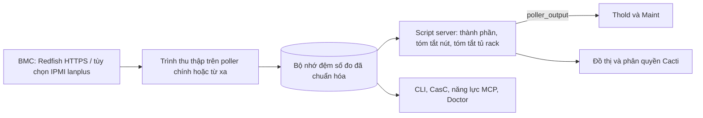

<!-- Source: README.md; SHA256: cf31b9f80d6c00020bbe08e80951d4de1c910793911d040ae7a66b54e8a2eaf0 -->

<!-- translations:start -->
[English](../../../README.md) | [简体中文](../zh-CN/README.md) | [हिन्दी](../hi-IN/README.md) | [Español (España)](../es-ES/README.md) | [Español (Latinoamérica)](../es-419/README.md) | [العربية (السعودية)](../ar-SA/README.md) | [Afrikaans](../af-ZA/README.md) | [አማርኛ](../am-ET/README.md) | [العربية (مصر)](../ar-EG/README.md) | [العربية (المغرب)](../ar-MA/README.md) | [বাংলা](../bn-BD/README.md) | [Bosanski](../bs-BA/README.md) | [Deutsch](../de-DE/README.md) | [فارسی](../fa-IR/README.md) | [Filipino](../fil-PH/README.md) | [Français](../fr-FR/README.md) | [Français (Maroc)](../fr-MA/README.md) | [Français (Sénégal)](../fr-SN/README.md) | [Hausa](../ha-NG/README.md) | [עברית](../he-IL/README.md) | [Hrvatski](../hr-HR/README.md) | [Bahasa Indonesia](../id-ID/README.md) | [Igbo](../ig-NG/README.md) | [Italiano](../it-IT/README.md) | [日本語](../ja-JP/README.md) | [한국어](../ko-KR/README.md) | [Malagasy](../mg-MG/README.md) | [मराठी](../mr-IN/README.md) | [Bahasa Melayu](../ms-MY/README.md) | [Nederlands](../nl-NL/README.md) | [Polski](../pl-PL/README.md) | [Português (Brasil)](../pt-BR/README.md) | [Русский](../ru-RU/README.md) | [Kinyarwanda](../rw-RW/README.md) | [Soomaali](../so-SO/README.md) | [Српски](../sr-RS/README.md) | [Svenska](../sv-SE/README.md) | [Kiswahili](../sw-KE/README.md) | [தமிழ்](../ta-IN/README.md) | [తెలుగు](../te-IN/README.md) | [ไทย](../th-TH/README.md) | [Türkçe](../tr-TR/README.md) | [Українська](../uk-UA/README.md) | [اردو](../ur-PK/README.md) | [Tiếng Việt](README.md) | [isiXhosa](../xh-ZA/README.md) | [Yorùbá](../yo-NG/README.md) | [繁體中文](../zh-TW/README.md) | [isiZulu](../zu-ZA/README.md)
<!-- translations:end -->

# plugin_redfish

Plugin cho Cacti 1.2 giúp đưa mức tiêu thụ điện năng máy chủ, nhiệt độ khí nạp, trạng thái quạt và tình trạng bộ nguồn từ bộ điều khiển quản lý bo mạch chủ (BMC) vào Cacti dưới dạng thiết bị, nguồn dữ liệu và đồ thị thông thường, sử dụng Redfish kèm tùy chọn dự phòng IPMI chỉ đọc và tổng hợp công suất cấp tủ rack. Thold và Maint cảnh báo và tạm ẩn các cảnh báo đó thông qua các nguồn dữ liệu Cacti tiêu chuẩn.

> **Trạng thái: đang phát triển, chưa có bản phát hành (`0.1.0-dev`).** Plugin này không liên kết với dự án Cacti. Plugin cài đặt trên Cacti 1.2.31 trở lên dưới PHP 8.2 trở lên và triển khai trình thu thập Redfish, kho lưu trữ thông tin xác thực được mã hóa, cấp phát thiết bị và đồ thị Cacti, tùy chọn dự phòng IPMI chỉ đọc, tổng hợp công suất tủ rack, hiển thị cửa sổ Cacti Maint, nhân bản trình thu thập dữ liệu từ xa và điểm cuối tác tử, trình cung cấp CasC và CLI vận hành, các năng lực MCP và kiểm tra chẩn đoán Doctor. CI kiểm thử các bộ dữ liệu mẫu, DMTF Redfish Mockup Server (các mô hình hệ thống con, chỉ dùng cấu trúc cũ và HPE iLO Gen11) cùng Thold v1.8.2 với Maint v1.3; chưa có BMC vật lý thực tế hay cụm máy thử nghiệm nào được chứng nhận. Thiết kế và nghiên cứu nằm trong [docs/PLAN.md](../../PLAN.md), [docs/research/](../../research/) và [docs/decisions/](../../decisions/).

## Các tính năng đã triển khai

### Trình thu thập cốt lõi, kho bí mật và các đối tượng Cacti

- **Vòng đời và lược đồ.** Cài đặt, nâng cấp, vô hiệu hóa và gỡ cài đặt thông qua API plugin của Cacti (`Schema::VERSION = 3`, 12 bảng). Các bảng được giữ lại khi gỡ cài đặt trừ khi bỏ chọn *Keep Plugin Tables on Uninstall*. Các điểm đầu vào có thể phân tích cú pháp trên PHP 8.0 và từ chối PHP dưới 8.2 hoặc thiếu `ext-openssl` bằng thông báo lỗi rõ ràng.
- **Sổ đăng ký và phân quyền.** Các vùng quyền *Redfish View* (`redfish_health.php`), *Redfish Operator* (`redfish_operator.php`) và *Redfish Admin* (`redfish_bmcs.php`, `redfish_credentials.php`), cùng các cài đặt trong **Configuration > Settings > Redfish**. Sổ đăng ký BMC hỗ trợ nhập CSV (thông tin xác thực được tham chiếu theo tên; mật khẩu trong tệp nhập bị từ chối) và xuất JSON. Bản ghi BMC và thông tin xác thực tuân theo quyền thiết bị của Cacti.
- **Kho lưu trữ thông tin xác thực được mã hóa.** Mật khẩu được lưu trữ ở dạng mã hóa bằng AES-256-GCM trong `plugin_redfish_secret`. Khóa nằm ngoài cơ sở dữ liệu (mặc định là `/etc/cacti/redfish-vault.key`) dưới dạng 64 ký tự thập lục phân (`openssl rand -hex 32`) hoặc 32 byte thô, thuộc sở hữu của người dùng poller, người dùng khác không thể đọc, nằm trong thư mục chỉ cho phép root hoặc người dùng đó ghi. Cụm mật khẩu 32 ký tự in được sẽ bị từ chối. **Hãy sao lưu tệp khóa cùng với cơ sở dữ liệu**; nếu không có nó, các mật khẩu đã lưu phải được nhập lại.
- **TLS và máy khách Redfish chỉ đọc.** Xác minh TLS được bật mặc định bằng kho CA hệ thống, gói CA riêng cho từng BMC hoặc ghim SPKI SHA-256; việc tắt xác minh cho từng BMC vẫn hiển thị dưới dạng cảnh báo tình trạng và cảnh báo kiểm tra Doctor. Máy khách chỉ cho phép `GET` cùng với đăng nhập phiên Redfish (`POST`) và đăng xuất (`DELETE`), có tùy chọn dự phòng Basic cho từng BMC khi không có phiên. Quá trình khám phá ưu tiên các tài nguyên hệ thống con và cảm biến Redfish mới trước, rồi mới dự phòng sang các tài nguyên `Power` và `Thermal` đã lỗi thời.
- **Thực thi trình thu thập.** `poller_redfish.php` khởi chạy từ `poller_bottom`, chạy một tiến trình chính trên mỗi poller thông qua sổ đăng ký tiến trình của Cacti với các tiến trình con có thể cấu hình (`redfish_workers`), lấy quyền thuê theo từng BMC, áp đặt ngân sách thời gian (`redfish_collector_budget`), áp dụng thời gian chờ lùi theo hàm mũ và dọn dẹp phiên trước đó của chính plugin sau sự cố sập.
- **Mẫu, thiết bị và đồ thị.** Nhập `templates/redfish-templates.xml` theo giá trị băm và sao chép ba tệp XML truy vấn dữ liệu script server (`redfish_fans.xml`, `redfish_temperatures.xml`, `redfish_psus.xml`) vào `<cacti>/resource/script_server/` mà không ghi đè các tệp do người dùng chỉnh sửa. **Create Device** và **Add Graphs** yêu cầu xác nhận kế hoạch cấp phát, gắn truy vấn vào thiết bị máy chủ đã ánh xạ hoặc tạo thiết bị "Redfish BMC" dưới `.invalid` với kiểm tra tính khả dụng bị tắt, đồng thời liên kết từng đồ thị Redfish trở lại các đồ thị Redfish của thiết bị qua `graph_buttons`.
- **Đầu vào script server chỉ dùng bộ nhớ đệm.** `scripts/ss_redfish_members.php` cung cấp số đo quạt, nhiệt độ và PSU theo từng thành phần, còn `scripts/ss_redfish_summary.php` cung cấp các chỉ số "Redfish Node Summary" (công suất, nhiệt độ khí nạp và tối đa, số quạt và PSU lỗi, tình trạng nút và tuổi của lần đọc tốt gần nhất). Các lệnh gọi script server chỉ đọc bộ nhớ đệm cục bộ và không bao giờ liên hệ với BMC. Các số đo bị thiếu, quá hạn hoặc của thành phần đã biến mất trả về `U` (không bao giờ trả về `0`), trong khi `age` luôn báo cáo một giá trị để các ngưỡng phát hiện được BMC im lặng.

**Khi các thành phần của BMC thay đổi** (như thay quạt hoặc cập nhật firmware làm đổi tên cảm biến), hãy chạy lại **Add Graphs**. Một quạt hoặc bộ nguồn từng tồn tại trước đó nhưng trở nên vắng mặt sẽ được tính vào `fans_bad` hoặc `psus_bad` cho đến khi được xác nhận; một khe cắm chưa từng được lắp đặt sẽ không bị tính. Các thành phần đã biến mất vẫn giữ nguồn dữ liệu và đồ thị hiện có, sau đó chúng sẽ đọc giá trị `U` cho đến khi bị xóa thủ công. Xóa thiết bị Cacti sẽ hủy ánh xạ BMC của nó và xóa gán tủ rack trong khi vẫn giữ lại BMC và bộ nhớ đệm; xóa BMC hoặc gỡ cài đặt plugin sẽ vẫn giữ lại các thiết bị và đồ thị Cacti.

### Tùy chọn dự phòng IPMI

- **Bật tùy chọn theo từng BMC.** Tắt theo mặc định (`protocols` mặc định là `redfish`; bật dự phòng IPMI sẽ đặt thành `redfish,ipmi`).
- **Điều kiện kích hoạt dự phòng có giới hạn phạm vi.** Chỉ chạy khi việc thu thập Redfish thất bại với lớp lỗi đủ điều kiện; không bao giờ kích hoạt khi gặp `AuthRejected`, `CredentialUnavailable`, `AddressRefused`, `OperationRefused` hoặc `Deadline`.
- **Thực thi an toàn.** Gọi `ipmitool` qua `-I lanplus` bằng `proc_open()` dạng mảng không qua shell, có giới hạn thời gian thực và giới hạn đầu ra 256 KiB. Mật khẩu được cung cấp qua `IPMITOOL_PASSWORD` (`-E`) hoặc tệp tạm thời có quyền 0600 (`-f`) được xóa trong khối `finally`, không bao giờ truyền qua tham số dòng lệnh CLI.
- **Danh sách lệnh chỉ đọc được phép.** Chỉ năm lệnh con chỉ đọc được phép chạy: `dcmi power reading`, `sdr type Temperature`, `sdr type Fan`, `sdr type Power Supply` và `chassis status`. Các lệnh làm thay đổi trạng thái bị từ chối.
- **Đầu ra chuẩn hóa và cảnh báo trạng thái bảo mật.** `IpmiNormalizer` ánh xạ các số đo vào cùng mô hình `Observation`/`Member`/`Reading`, xuất ra `U` cho các cảm biến bị thiếu hoặc không thể phân tích. Bật dự phòng IPMI sẽ đưa ra cảnh báo trên trang tình trạng và trong kiểm tra Doctor `redfish.bmc_security`, nhắc nhở người vận hành giới hạn UDP 623 trong một VLAN quản trị.

### Tổng hợp công suất tủ rack

- **Sổ đăng ký tủ rack.** Lược đồ phiên bản 3 bổ sung `plugin_redfish_rack` (duy nhất `(site_id, name)`, `power_budget_watts` tùy chọn, `min_coverage_pct` mặc định là `80` và ghi chú) và `plugin_redfish_rack_member` (tối đa một gán tủ rack trên mỗi `host_id`, `bmc_id` và `unit_position` tùy chọn, tự động bị xóa khi thiết bị Cacti bị xóa).
- **Tổng số được bảo vệ theo độ bao phủ.** `RackPowerSummary` cộng các số đo `power_watts` mới của thành viên từ bộ nhớ đệm cục bộ và tính mức sử dụng ngân sách cùng công suất dự phòng còn lại. Khi độ bao phủ thành viên báo cáo giảm xuống dưới `min_coverage_pct`, các giá trị `power_watts`, `utilization_pct` và `headroom_watts` trả về `U` để lỗi trình thu thập không bao giờ hiển thị như sự sụt giảm công suất tủ rack.
- **Đầu vào script server sẵn sàng cho Thold.** `scripts/ss_redfish_rack.php` (`ss_redfish_rack(<rack_id>)`) chỉ trả về `power_watts`, `power_budget_watts`, `utilization_pct`, `headroom_watts`, `members_total`, `members_reporting` và `coverage_pct` từ bộ nhớ đệm cục bộ.

### Tích hợp Cacti Maint

- Các ngưỡng Thold trên nguồn dữ liệu Redfish tạo cảnh báo và Cacti Maint tạm ẩn chúng mà không cần thay đổi bất kỳ plugin nào trong hai plugin đó.
- `MaintWindow` kiểm tra các lịch Maint đang hoạt động cho từng máy chủ Cacti đã ánh xạ (lịch một lần `mtype=1` và lịch định kỳ `mtype=2`, cùng `plugin_maint_check_cacti_host()` khi được nạp) và đánh dấu trạng thái bảo trì đang hoạt động trên trang Redfish Health (`[MAINT]`), trong đầu ra của `cli/redfish.php health` và trong năng lực `redfish-get-health`.

### Trình thu thập dữ liệu từ xa

- `INFO` khai báo `remote_collect:1`. Các BMC chấp nhận bất kỳ `poller_id >= 1` nào, và `poller_redfish.php --poller=N` chỉ thu thập các BMC đang bật được gán cho poller đó.
- **Hook `replicate_out`.** Chỉ nhân bản các bảng cấu hình không chứa bí mật thuộc phạm vi của poller từ xa đích thông qua `replicate_out_table()`: `plugin_redfish_bmc`, siêu dữ liệu `plugin_redfish_credential` (không có bản mã), `plugin_redfish_rack` và `plugin_redfish_rack_member`. `plugin_redfish_secret` không được nhân bản và tệp khóa kho lưu trữ luôn nằm cục bộ trên từng poller.
- **Hook `remote_agent`.** Cung cấp các hành động chỉ đọc `redfish_health` và `redfish_discovery` chỉ chấp nhận các tham số dạng số `poller_id` và `bmc_id`. Các tham số ngoài dự kiến bị từ chối và không có thông tin xác thực hay bí mật nào được trả về.

### Các hook hệ sinh thái (CasC, năng lực MCP và Doctor)

- **Trình cung cấp CasC (`casc_register_providers`).** Đăng ký trình cung cấp `redfish` (lược đồ phiên bản `1`) với tính năng xuất YAML và XML bằng PHP thuần, phân tích cú pháp (từ chối XXE), xác thực, lập kế hoạch khác biệt và áp dụng. Thông tin xác thực chỉ xuất hiện dưới dạng tham chiếu kho lưu trữ (`vault:redfish:<name>`); các khóa bí mật thô (`pass`, `secret`, `token`, `private_key`, `vault_key`, `auth_token`) bị từ chối. Việc áp dụng yêu cầu một `PLAN_HASH` SHA-256 chính xác.
- **MCP / Abilities API (`abilities_register`).** Đăng ký ba năng lực chỉ đọc được kiểm soát bởi vùng quyền Redfish View (`redfish_health.php`) và quyền thiết bị Cacti, không trả về bất kỳ thông tin xác thực nào:
  - `redfish-list-bmcs` (`poller_id` tùy chọn)
  - `redfish-get-rack-power` (`rack_id` tùy chọn)
  - `redfish-get-health` (`bmc_id` tùy chọn)
- **Kiểm tra Doctor (`doctor_register_checks`).** Đăng ký năm kiểm tra chẩn đoán cục bộ, chỉ đọc, không bao giờ liên hệ với BMC hay trả về dữ liệu khóa:
  - `redfish.schema`: tính cập nhật của phiên bản lược đồ
  - `redfish.vault_key`: khả năng đọc và quyền hạn của khóa kho lưu trữ
  - `redfish.collector_runs`: ngân sách và độ mới của trình thu thập poller
  - `redfish.bmc_security`: các BMC đang bật có TLS chưa xác minh hoặc bật dự phòng IPMI
  - `redfish.rack_power`: tuân thủ ngân sách công suất tủ rack và ngưỡng bao phủ tối thiểu

## CLI

Chạy từ thư mục gốc của Cacti với PHP 8.2 trở lên:

```sh
# Operator and CasC CLI (reads --file=PATH or stdin for validate, plan, and apply)
php plugins/redfish/cli/redfish.php export --format=yaml|xml
php plugins/redfish/cli/redfish.php validate [--file=PATH] [--format=yaml|xml]
php plugins/redfish/cli/redfish.php plan [--file=PATH] [--format=yaml|xml]
php plugins/redfish/cli/redfish.php apply [--file=PATH] [--format=yaml|xml] --confirm=<PLAN_HASH>
php plugins/redfish/cli/redfish.php health --format=text|json

# Collector entry point (normally started by poller_bottom)
php plugins/redfish/poller_redfish.php [--poller=N] [--force] [--debug]

# Rack power summary script server entry point
php plugins/redfish/scripts/ss_redfish_rack.php <rack_id>
```

## Vai trò truy cập

| Vùng quyền | Quyền truy cập |
| --- | --- |
| Redfish View | Các trang giám sát hiện có. |
| Redfish Operator | Giám sát cùng trang Vận hành và các xác nhận phân loại sự cố cá nhân. |
| Redfish Admin | Quyền Operator cùng các trang cấu hình và thao tác quản trị hiện có. |

Sau khi sao chép các tệp nâng cấp, hãy mở trang Plugins với quyền quản trị viên để đăng ký các vùng quyền. Gán vùng quyền Operator một cách tường minh trong **Configuration > Users** hoặc nhóm người dùng. Quá trình nâng cấp giữ nguyên ID và quyền đã cấp của vùng quyền View và Admin hiện có. Quyền Admin kế thừa quyền Operator, và quyền Operator kế thừa quyền View trên mỗi yêu cầu; việc này không thêm quyền lưu trữ vào người dùng hay nhóm. Cài đặt plugin cũng yêu cầu quyền Redfish Admin bên cạnh quyền Settings của Cacti.

Quyền thiết bị của Cacti giới hạn các hàng và thao tác khả dụng cho từng người dùng; các đối tượng chưa được ánh xạ yêu cầu quyền quản trị viên. Người vận hành có thể giải phóng trạng thái tạm giữ thu thập trên một BMC được phép cho lần chạy theo lịch tiếp theo. Thông tin xác thực, cấu hình, ánh xạ, xóa và các thay đổi quản trị khác vẫn nằm trong các trang quản trị. Các xác nhận xử lý sự cố chỉ có hiệu lực trong phiên hiện tại của người dùng, tối đa một giờ và chỉ khi cùng quan sát đó vẫn còn mới. Các quan sát mới hoặc thay đổi sẽ làm mất hiệu lực của chúng. Chúng không bao giờ đánh dấu một phép đo lỗi là bình thường hoặc tạm ẩn cảnh báo.

## Lý do

Mỗi máy chủ đều có một BMC báo cáo trạng thái điện năng và nhiệt độ độc lập với hệ điều hành, do đó nó vẫn tiếp tục phản hồi ngay cả khi hệ điều hành ngừng hoạt động. Dữ liệu này phục vụ việc theo dõi công suất và chi phí, cảnh báo sớm quạt hoặc bộ nguồn bị hỏng, và trong điện toán hiệu năng cao, hỗ trợ các quyết định giới hạn công suất. Plugin này không chỉ dành riêng cho HPC.

Cacti hiện đáp ứng được một phần nhu cầu này:

- **Các gói SNMP của nhà cung cấp.** Nhánh 1.2.x đi kèm các mẫu Dell iDRAC và HPE iLO cần có tác tử SNMP và phụ thuộc từng nhà cung cấp; nghiên cứu ở cột mốc 1 cho thấy không mẫu nào báo cáo mức tiêu thụ điện năng theo watt ([docs/research/overlap.md](../../research/overlap.md)).
- **Một loại thông tin xác thực không có trình thu thập.** `plugin_credentials` định nghĩa thông tin xác thực "IPMI / Redfish (BMC)" nhưng không đọc BMC nào.
- **Chưa có góc nhìn cấp tủ rack.** Lõi Cacti không có đối tượng tủ rack; thiết bị chỉ có trường văn bản tự do `location`.

Plugin thăm dò các BMC ngoài băng tần chu kỳ thăm dò của Cacti trên poller chính hoặc các trình thu thập dữ liệu từ xa, lưu đệm các số đo đã chuẩn hóa và cung cấp chúng qua các truy vấn dữ liệu script server, tóm tắt nút và tóm tắt công suất tủ rack. Plugin tái sử dụng khả năng vẽ đồ thị, phân quyền, Thold và Maint của Cacti, và không làm thay đổi trạng thái BMC.

## Phạm vi và trạng thái

| Giai đoạn | Phạm vi | Cột mốc | Trạng thái |
|---|---|---|---|
| 0, nghiên cứu | Ma trận nhà cung cấp, xác nhận hành vi hệ thống gốc trên BMC thực tế, chi phí thăm dò, thử nghiệm truy vấn dữ liệu | [M1](https://github.com/somethingwithproof/plugin_redfish/milestone/1) | Đã xong, đang chờ bản ghi firmware BMC thực tế |
| 1, quan sát | Sổ đăng ký BMC, thông tin xác thực, TLS, trình thu thập Redfish, số đo chuẩn hóa, thiết bị, đồ thị theo chỉ mục, cảnh báo Thold, tích hợp Maint, trang tình trạng | [M2](https://github.com/somethingwithproof/plugin_redfish/milestone/2), [M3](https://github.com/somethingwithproof/plugin_redfish/milestone/3), [M4](https://github.com/somethingwithproof/plugin_redfish/milestone/4) | Đã triển khai; đang chờ chứng nhận cụm máy thử nghiệm M4 |
| 2, ipmi | Dự phòng IPMI (`lanplus`) chỉ đọc qua `ipmitool`, tắt theo mặc định | [M5](https://github.com/somethingwithproof/plugin_redfish/milestone/5) | Đã triển khai |
| 3, tủ rack | Sổ đăng ký tủ rack, tổng công suất tủ rack có ngưỡng bao phủ, công suất dự phòng ngân sách, `ss_redfish_rack.php` | [M6](https://github.com/somethingwithproof/plugin_redfish/milestone/6) | Đã triển khai |
| 4, từ xa và hệ sinh thái | Trình thu thập dữ liệu từ xa (`replicate_out`, `remote_agent`), trình cung cấp CasC và CLI, năng lực MCP, kiểm tra Doctor | [M7](https://github.com/somethingwithproof/plugin_redfish/milestone/7) | Đã triển khai |

Ngoài phạm vi: thiết lập giới hạn công suất hoặc bất kỳ cấu hình BMC nào khác, điều khiển nguồn, cập nhật firmware, truy cập bảng điều khiển, công cụ cảnh báo thuộc sở hữu của plugin và tích hợp trình lập lịch.

## Mục tiêu tương thích

| Thành phần | Mục tiêu |
|---|---|
| Cacti | 1.2.31 trở lên, không cần vá lõi |
| Cơ sở dữ liệu | MariaDB 10.2 hoặc MySQL 5.7 trở lên: giới hạn một BMC cho mỗi thiết bị được giữ bằng khóa duy nhất trên một cột được tạo |
| PHP | 8.2 trở lên; các điểm đầu vào vẫn phân tích cú pháp được trên 8.0 để môi trường chạy không được hỗ trợ nhận thông báo từ chối thay vì giao diện Cacti bị hỏng |
| Tiện ích mở rộng PHP | `ext-openssl` (bắt buộc bởi Cacti 1.2.31); không dùng `ext-curl` và không có phụ thuộc thời gian chạy Composer |
| Công cụ tùy chọn | `ipmitool` trên các poller thu thập các BMC có bật dự phòng IPMI |
| BMC | Dell iDRAC, HPE iLO, Lenovo XCC và OpenBMC, theo dải phiên bản firmware; xem [ma trận nhà cung cấp](../../research/vendor-matrix.md) |
| Redfish | Ưu tiên tài nguyên hệ thống con và cảm biến mới trước, dùng `Power` và `Thermal` đã lỗi thời làm dự phòng |
| Thold, Maint | Không cần thay đổi (CI kiểm thử Thold v1.8.2 và Maint v1.3) |

## Thiết kế

- [docs/PLAN.md](../../PLAN.md) là kế hoạch đầy đủ: kiến trúc, các sự kiện hệ thống gốc mà nó phụ thuộc vào, mô hình đo lường, ranh giới bảo mật, tính toán hiệu năng, kiểm thử và rủi ro.
- [docs/decisions/](../../decisions/) lưu trữ các bản ghi quyết định kiến trúc cho những lựa chọn đã được thống nhất.
- [docs/REQUIREMENTS.md](../../REQUIREMENTS.md) ánh xạ từng mã yêu cầu tới issue tương ứng.



## Bảo mật

Thông tin xác thực BMC kiểm soát việc quản lý ngoài băng tần đối với máy chủ. Thiết kế giữ bí mật tách khỏi dòng lệnh, nhật ký, bản xuất CasC, dữ liệu tải của tác tử từ xa, phản hồi MCP và các trang web; mã hóa mật khẩu lưu trữ bằng AES-256-GCM sử dụng tệp khóa kho bí mật cục bộ trên mỗi poller; xác minh TLS theo mặc định; chạy `ipmitool` từ mảng đối số tường minh với danh sách lệnh con chỉ đọc được phép; và sử dụng tài khoản BMC chỉ đọc. Xem [docs/PLAN.md](../../PLAN.md#security) và [SECURITY.md](../../../SECURITY.md).

## Hướng dẫn vận hành

Xem [docs/operator-guide.md](../../operator-guide.md) để biết các điều kiện tiên quyết khi cài đặt, thiết lập kho bí mật và TLS, đăng ký BMC, tạo đồ thị, chu kỳ cảnh báo, sao lưu và xử lý lỗi. Hướng dẫn này không tuyên bố một dòng firmware thực tế của nhà cung cấp được hỗ trợ cho đến khi bản ghi đã che thông tin nhạy cảm từ firmware đó vượt qua bộ kiểm thử.

## Phát triển và kiểm thử

CI (`.github/workflows/plugin-ci-workflow.yml`) kiểm tra cú pháp các điểm đầu vào trên PHP 8.0, chạy bộ kiểm thử đơn vị Pest (`phpunit.xml`) và bộ kiểm thử tích hợp vòng đời (`phpunit-integration.xml`) cùng PHPStan cấp độ 9 trên PHP 8.2 đến 8.5 đối chiếu với Cacti `release/1.2.31` và `1.2.x`, xác minh việc từ chối trên PHP 8.1, kiểm thử DMTF Redfish Mockup Server (các mô hình hệ thống con, chỉ dùng cấu trúc cũ và HPE iLO Gen11) cùng Thold v1.8.2 / Maint v1.3 từ đầu đến cuối, đồng thời kiểm tra danh mục gettext, quy trình làm việc và giấy phép REUSE.

Kiểm tra cục bộ trước khi đẩy mã:

```sh
sh tests/lint-workflows.sh
sh locales/build_gettext.sh --check
CACTI_PATH=/path/to/cacti phpstan analyse -c phpstan.neon --no-progress
```

Chạy Pest với `--configuration=phpunit.xml` cho các bài kiểm thử đơn vị và quy tắc mã nguồn, hoặc `--configuration=phpunit-integration.xml` kèm `CACTI_PATH` và `REDFISH_TEST_DATABASE=disposable` trên cơ sở dữ liệu Cacti dùng một lần cho các bài kiểm thử tích hợp vòng đời.

## Cách theo dõi công việc

- **Cột mốc** tuân theo các cột mốc trong kế hoạch. Mỗi cột mốc có một epic issue liệt kê các issue con và bằng chứng hoàn thành.
- **Issue** được phân loại bằng nhãn: `type: requirement`, `type: research`, `type: decision`, `type: epic`. Các issue yêu cầu nêu rõ các yêu cầu được đánh số và có thể kiểm thử (`REQ-AREA-NNN`) cùng tiêu chí chấp nhận.
- **Nhãn** cũng mang các tiền tố `area:`, `phase:`, `priority:` và `status:`. Xem [CONTRIBUTING.md](../../../CONTRIBUTING.md#labels).
- [Bảng dự án](https://github.com/users/somethingwithproof/projects/12) hiển thị toàn bộ issue trên tất cả các cột mốc.

## Đóng góp

Đọc [CONTRIBUTING.md](../../../CONTRIBUTING.md). Các commit cần có chữ ký DCO. Thảo luận thiết kế diễn ra trên các issue; các quyết định đang mở mang nhãn `type: decision`. Bằng chứng từ các BMC thực tế là đóng góp hữu ích nhất hiện nay; hãy xóa địa chỉ, số sê-ri và thông tin xác thực trước khi đăng bất kỳ bản ghi nào.

## Giấy phép

GNU General Public License v2.0, cùng giấy phép với Cacti và các plugin của nó. Xem [LICENSE](../../../LICENSE).
