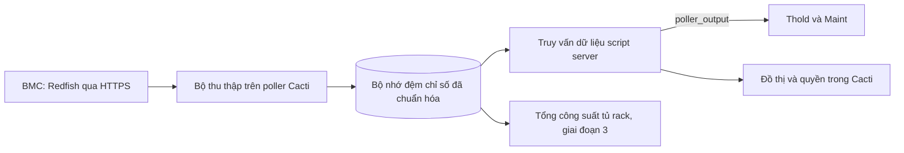

<!-- Source: README.md; SHA256: 7b4e83a58a1adc844cb0615ef30e95476cba2851f96bb454d2a816fb2774724d -->

<!-- translations:start -->
[English](../../../README.md) | [简体中文](../zh-CN/README.md) | [हिन्दी](../hi-IN/README.md) | [Español (España)](../es-ES/README.md) | [Español (Latinoamérica)](../es-419/README.md) | [العربية (السعودية)](../ar-SA/README.md) | [Afrikaans](../af-ZA/README.md) | [አማርኛ](../am-ET/README.md) | [العربية (مصر)](../ar-EG/README.md) | [العربية (المغرب)](../ar-MA/README.md) | [বাংলা](../bn-BD/README.md) | [Deutsch](../de-DE/README.md) | [فارسی](../fa-IR/README.md) | [Filipino](../fil-PH/README.md) | [Français](../fr-FR/README.md) | [Français (Maroc)](../fr-MA/README.md) | [Français (Sénégal)](../fr-SN/README.md) | [Hausa](../ha-NG/README.md) | [עברית](../he-IL/README.md) | [Bahasa Indonesia](../id-ID/README.md) | [Igbo](../ig-NG/README.md) | [Italiano](../it-IT/README.md) | [日本語](../ja-JP/README.md) | [한국어](../ko-KR/README.md) | [Malagasy](../mg-MG/README.md) | [मराठी](../mr-IN/README.md) | [Bahasa Melayu](../ms-MY/README.md) | [Nederlands](../nl-NL/README.md) | [Polski](../pl-PL/README.md) | [Português (Brasil)](../pt-BR/README.md) | [Русский](../ru-RU/README.md) | [Kinyarwanda](../rw-RW/README.md) | [Soomaali](../so-SO/README.md) | [Svenska](../sv-SE/README.md) | [Kiswahili](../sw-KE/README.md) | [தமிழ்](../ta-IN/README.md) | [తెలుగు](../te-IN/README.md) | [ไทย](../th-TH/README.md) | [Türkçe](../tr-TR/README.md) | [Українська](../uk-UA/README.md) | [اردو](../ur-PK/README.md) | [Tiếng Việt](README.md) | [isiXhosa](../xh-ZA/README.md) | [Yorùbá](../yo-NG/README.md) | [繁體中文](../zh-TW/README.md) | [isiZulu](../zu-ZA/README.md)
<!-- translations:end -->

# plugin_redfish

Plugin cho Cacti 1.2 giúp đưa mức tiêu thụ điện năng máy chủ, nhiệt độ khí nạp, trạng thái quạt và tình trạng bộ nguồn từ bộ điều khiển quản lý bo mạch chủ (BMC) vào Cacti dưới dạng thiết bị, nguồn dữ liệu và đồ thị thông thường, sử dụng Redfish với tùy chọn dự phòng IPMI. Thold và Maint sau đó sẽ cảnh báo và tạm ẩn các cảnh báo đó, và một giai đoạn sau sẽ bổ sung tổng công suất ở cấp tủ rack.

> **Trạng thái: đang phát triển, chưa có bản phát hành (0.1.0-dev).** Các cột mốc 2 (nền tảng) và 3 (đối tượng Cacti và cảnh báo) đã được hợp nhất vào `main`. Plugin này không liên kết với dự án Cacti. Plugin cài đặt được trên Cacti 1.2.31 với PHP 8.2 trở lên, đăng ký BMC và thông tin xác thực, đọc công suất, nhiệt độ, quạt và tình trạng bộ nguồn từ từng BMC qua Redfish vào bộ nhớ đệm riêng, đồng thời hiển thị tình trạng thu thập dữ liệu. Plugin thêm các thiết bị Cacti, đồ thị cho từng thành phần và đồ thị tổng hợp, cũng như hỗ trợ Thold và Maint thông qua các nguồn dữ liệu thông thường. CI đã kiểm thử với một BMC giả lập được xây dựng từ các fixture viết tay và máy chủ mô phỏng DMTF Redfish; chưa có BMC thực tế hay cụm máy thử nghiệm nào được chứng nhận. Thiết kế và nghiên cứu nằm trong [docs/PLAN.md](../../PLAN.md), [docs/research/](../../research) và [docs/decisions/](../../decisions).

### Những gì cột mốc 2 cung cấp

- Cài đặt, nâng cấp, vô hiệu hóa và gỡ cài đặt thông qua API plugin của Cacti, giữ lại các bảng dữ liệu khi gỡ cài đặt trừ khi tùy chọn này bị bỏ chọn. Trên PHP cũ hơn 8.2, plugin từ chối cài đặt hoặc kích hoạt và nêu rõ lý do.
- Các quyền (realm) "Redfish View" (trang tình trạng), "Redfish Operator" (trang vận hành) và "Redfish Admin" (các trang BMC và thông tin xác thực), cùng các thiết lập trong mục Configuration > Settings > Redfish.
- Sổ đăng ký BMC hỗ trợ nhập CSV và xuất JSON. Tệp nhập không được chứa mật khẩu; thông tin xác thực được tham chiếu theo tên.
- Thông tin xác thực được lưu trữ mã hóa bằng AES-256-GCM. Khóa là một tệp nằm ngoài cơ sở dữ liệu, mặc định là `/etc/cacti/redfish-vault.key`, chứa 64 ký tự thập lục phân (`openssl rand -hex 32`) hoặc chính xác 32 byte ngẫu nhiên, thuộc sở hữu của người dùng chạy poller, không cho phép người dùng khác đọc, nằm trong thư mục chỉ người dùng chạy poller hoặc root mới có quyền ghi. Khóa gồm 32 ký tự có thể in được sẽ bị từ chối vì bị coi là cụm mật khẩu (passphrase). **Hãy sao lưu tệp khóa cùng với cơ sở dữ liệu**; nếu thiếu tệp này, mọi mật khẩu đã lưu đều phải nhập lại.
- Xác minh TLS được bật mặc định, với gói CA hoặc ghim (pin) SPKI SHA-256 riêng cho từng BMC. Tùy chọn bỏ qua xác minh theo từng BMC được ghi nhật ký và luôn hiển thị dưới dạng cảnh báo trên trang tình trạng.
- Máy khách Redfish chỉ đọc: chỉ dùng `GET` cùng thao tác đăng nhập và đăng xuất phiên, được kiểm tra đối chiếu với danh sách cho phép trước khi gửi bất kỳ yêu cầu nào.
- Bộ thu thập được khởi chạy từ `poller_bottom` cho các BMC trên poller chính, có cơ chế cấp quyền tạm thời (lease) và thời hạn (deadline) theo từng BMC, thời gian chờ tăng dần (backoff) và dọn dẹp sau sự cố đối với phiên duy nhất mà plugin đã ghi nhận. Các bộ thu thập từ xa hiện chưa được hỗ trợ; cần có lựa chọn rõ ràng về cách bộ thu thập truy cập cơ sở dữ liệu và khóa (giai đoạn 4).
- Bản ghi BMC và thông tin xác thực tuân theo quyền thiết bị của Cacti: một Redfish Admin chỉ xem, thay đổi và liên kết các BMC trên những thiết bị mà họ được phép xem, và chỉ thấy những thông tin xác thực không được sử dụng bởi bất kỳ BMC nào trên thiết bị bị ẩn.

### Những gì cột mốc 3 bổ sung

- Các mẫu được đóng gói dưới dạng XML mẫu Cacti trong `templates/` và được nhập bằng trình nhập của chính Cacti khi cài đặt và nâng cấp, đối khớp theo hàm băm (hash), nhờ đó lần nhập sau sẽ cập nhật các đối tượng của plugin và không thêm trùng lặp. Ba tệp truy vấn dữ liệu được sao chép vào `<cacti>/resource/script_server/` kèm mã băm đã ghi nhận; plugin không bao giờ ghi đè tệp tại đó nếu tệp không phải do plugin tạo ra, và trang tình trạng sẽ cảnh báo quản trị viên khi thiếu mẫu hoặc tệp truy vấn. Nút **Reinstall the Redfish Templates** trên trang BMCs cho phép nhập lại các mẫu; thao tác này yêu cầu quyền Import Templates của Cacti.
- **Create Device** hoặc **Add Graphs** trên từng BMC ([ADR 0015](../../decisions/0015-attach-to-the-server-device-or-create-one-per-bmc.md)). Một BMC được ánh xạ tới thiết bị máy chủ hiện có sẽ nhận các truy vấn dữ liệu và đồ thị ngay trên thiết bị đó. Một BMC chưa ánh xạ sẽ được tạo thiết bị mới từ mẫu thiết bị "Redfish BMC", tắt kiểm tra tính khả dụng và dùng tên máy chủ thuộc `.invalid`, nhờ đó Cacti không bao giờ liên hệ trực tiếp với BMC và không bao giờ hiển thị địa chỉ của nó. Trong cả hai trường hợp, quản trị viên cần xác nhận trước kế hoạch liệt kê những gì sẽ được thêm. Cả hai thao tác đều yêu cầu quyền quản lý thiết bị của Cacti cũng như quyền Redfish Admin; thiết bị mới nào mà người tạo không thể xem sẽ bị xóa lại.
- Ba truy vấn dữ liệu script server là "Redfish Fans", "Redfish Temperatures" và "Redfish Power Supplies", được lập chỉ mục theo khóa thành phần của BMC, với một đồ thị cho mỗi thành phần: tốc độ quạt theo phần trăm hoặc RPM (tùy đơn vị BMC báo cáo), nhiệt độ, cùng công suất đầu vào và đầu ra (watt) của bộ nguồn, mỗi thành phần đều kèm mã tình trạng.
- Đầu vào "Redfish Node Summary" gồm công suất, nhiệt độ khí nạp, nhiệt độ cao nhất, số quạt và bộ nguồn không ở trạng thái OK, tình trạng nút (node health) và tuổi dữ liệu của lần đọc hợp lệ gần nhất, được vẽ trên bốn đồ thị: công suất, nhiệt độ, tình trạng thành phần và tuổi dữ liệu. Các ngưỡng Thold trên những nguồn dữ liệu này sẽ phát cảnh báo và Maint sẽ tạm ẩn chúng mà không cần chỉnh sửa bất kỳ plugin nào trong hai plugin đó.
- Script server chỉ trả lời từ bộ nhớ đệm của plugin và không bao giờ liên hệ với BMC. Giá trị bị thiếu, quá hạn (stale), khác đơn vị hoặc thuộc thành phần không còn tồn tại sẽ là `U`, giúp đồ thị hiển thị khoảng trống chứ không bao giờ là số không; `age` luôn có giá trị, vì vậy đặt ngưỡng trên giá trị này sẽ phát hiện được BMC ngừng phản hồi.
- Liên kết đồ thị từ mỗi đồ thị Redfish tới các đồ thị Redfish của thiết bị, chỉ hiển thị cho những người dùng được Cacti cho phép xem thiết bị đó.

**Khi các thành phần của BMC thay đổi** (thay quạt, cập nhật firmware làm đổi tên cảm biến), hãy chọn lại **Add Graphs**. Một quạt hoặc bộ nguồn từng hiện diện nhưng nay vắng mặt hoặc mất đi sẽ được tính vào `fans_bad` hoặc `psus_bad` cho đến khi bạn thực hiện thao tác này, nhờ đó việc rút quạt ra sẽ kích hoạt cảnh báo; khe cắm chưa từng được lắp sẽ không bị tính. Add Graphs chấp nhận các thành phần mà BMC hiện đang báo cáo và Cacti sẽ lập chỉ mục lại các truy vấn; thành phần đã mất vẫn giữ nguồn dữ liệu và đồ thị của nó (đọc giá trị `U` kể từ đó), còn thành phần mới sẽ được tạo đồ thị. Hãy xóa thủ công đồ thị của các thành phần đã mất khi không còn cần dữ liệu lịch sử nữa.

Xóa một thiết bị sẽ hủy ánh xạ BMC của thiết bị đó nhưng vẫn giữ lại BMC và bộ nhớ đệm của nó. Xóa một BMC, hoặc gỡ cài đặt plugin, vẫn giữ lại thiết bị và các đồ thị của nó.

## Vai trò truy cập

| Realm | Quyền truy cập |
| --- | --- |
| Redfish View | Các trang giám sát hiện có. |
| Redfish Operator | Giám sát cùng với trang Operations và xác nhận phân loại sự cố cá nhân. |
| Redfish Admin | Quyền Operator cùng với các thao tác cấu hình và quản trị hiện có. |

Sau khi sao chép các tệp nâng cấp, hãy mở trang Plugins với tư cách quản trị viên để đăng ký
realm mới. Gán quyền Operator một cách tường minh trong **Configuration > Users** hoặc các nhóm người dùng.
Việc nâng cấp vẫn giữ nguyên các ID và quyền cấp (grant) hiện có của View và Admin. Quyền Admin
kế thừa quyền Operator, và quyền Operator kế thừa quyền View trên mỗi yêu cầu;
điều này không ghi thêm quyền lưu trữ vào người dùng hay nhóm. Thiết lập của plugin cũng yêu cầu
quyền Redfish Admin bên cạnh quyền Settings của Cacti.

Quyền thiết bị của Cacti vẫn giới hạn các hàng và thao tác khả dụng đối với từng người dùng; các đối tượng chưa ánh xạ yêu cầu quyền quản trị viên. Người vận hành (Operator) có thể gỡ bỏ trạng thái tạm dừng thu thập trên một BMC được phép cho lần chạy theo lịch tiếp theo.
Thông tin xác thực, cấu hình, ánh xạ, xóa và các thay đổi quản trị khác
vẫn nằm trong các trang quản trị. Các xác nhận (acknowledgment) chỉ có hiệu lực trong phiên làm việc hiện tại
của người dùng, tối đa một giờ và chỉ khi cùng một quan sát đó vẫn còn
mới. Các quan sát mới hoặc đã thay đổi sẽ làm mất hiệu lực của chúng. Chúng không bao giờ đánh dấu một phép đo lỗi
là bình thường hay tạm ẩn cảnh báo.

## Lý do

Mỗi máy chủ đều có một BMC báo cáo trạng thái công suất và nhiệt độ độc lập với hệ điều hành, do đó nó vẫn tiếp tục phản hồi ngay cả khi hệ điều hành ngừng hoạt động. Dữ liệu này phục vụ việc theo dõi năng lực và chi phí, cảnh báo sớm quạt hoặc bộ nguồn hỏng, và trong tính toán hiệu năng cao (HPC), phục vụ các quyết định giới hạn công suất. Plugin này không chỉ giới hạn cho HPC.

Cacti hiện đã đáp ứng một phần nhu cầu này:

- **Các gói SNMP của nhà cung cấp.** Nhánh 1.2.x đi kèm các mẫu Dell iDRAC và HPE iLO yêu cầu SNMP agent và phụ thuộc vào nhà cung cấp; nghiên cứu ở cột mốc 1 cho thấy cả hai đều không báo cáo mức tiêu thụ điện năng theo watt ([docs/research/overlap.md](../../research/overlap.md)).
- **Một loại thông tin xác thực không có bộ thu thập.** plugin_credentials định nghĩa loại thông tin xác thực "IPMI / Redfish (BMC)" nhưng không đọc dữ liệu từ BMC nào.
- **Không có chế độ xem cấp tủ rack.** Lõi Cacti không có đối tượng tủ rack; một thiết bị chỉ có trường văn bản tự do `location`.

Plugin thăm dò các BMC ngoài băng (out of band) tách biệt với chu kỳ thăm dò của Cacti, lưu đệm các chỉ số đã chuẩn hóa và cung cấp chúng qua truy vấn dữ liệu script server cùng các nguồn dữ liệu tổng hợp. Plugin tái sử dụng hệ thống vẽ đồ thị, phân quyền, Thold và Maint của Cacti, và không làm thay đổi trạng thái BMC. Hỗ trợ bộ thu thập dữ liệu từ xa được lên kế hoạch cho giai đoạn 4; việc thu thập hiện tại chỉ chạy trên poller chính.

## Phạm vi dự kiến

| Giai đoạn | Phạm vi | Các cột mốc |
|---|---|---|
| 0, nghiên cứu | Ma trận nhà cung cấp, xác nhận hành vi thượng nguồn trên BMC thực tế, chi phí thăm dò, thử nghiệm truy vấn dữ liệu | [M1](https://github.com/somethingwithproof/plugin_redfish/milestone/1) |
| 1, quan sát | Sổ đăng ký BMC, thông tin xác thực, TLS, bộ thu thập Redfish, chỉ số đã chuẩn hóa, thiết bị, đồ thị theo chỉ mục, cảnh báo Thold, tạm ẩn Maint, trang tình trạng | [M2](https://github.com/somethingwithproof/plugin_redfish/milestone/2), [M3](https://github.com/somethingwithproof/plugin_redfish/milestone/3), [M4](https://github.com/somethingwithproof/plugin_redfish/milestone/4) |
| 2, ipmi | Dự phòng IPMI cho các BMC không có Redfish khả dụng, tắt theo mặc định | [M5](https://github.com/somethingwithproof/plugin_redfish/milestone/5) |
| 3, tủ rack | Sổ đăng ký tủ rack, tổng công suất tủ rack kèm độ phủ, khoảng dự phòng ngân sách | [M6](https://github.com/somethingwithproof/plugin_redfish/milestone/6) |
| 4, từ xa | Bộ thu thập dữ liệu từ xa của Cacti cho các mạng BMC cô lập | [M7](https://github.com/somethingwithproof/plugin_redfish/milestone/7) |

Ngoài phạm vi: thiết lập giới hạn công suất hoặc bất kỳ cấu hình BMC nào khác, điều khiển nguồn, cập nhật firmware, truy cập console, bộ máy cảnh báo riêng của plugin và tích hợp trình lập lịch.

## Mục tiêu tương thích

| Thành phần | Mục tiêu |
|---|---|
| Cacti | 1.2.31 trở lên, không cần vá lõi |
| Cơ sở dữ liệu | MariaDB 10.2 hoặc MySQL 5.7 trở lên: quy tắc một BMC mỗi thiết bị được đảm bảo bằng khóa duy nhất trên cột được tạo (generated column) |
| PHP | 8.2 trở lên; `setup.php` vẫn phân tích cú pháp được trên 8.0 để môi trường chạy không được hỗ trợ nhận thông báo từ chối thay vì làm hỏng giao diện Cacti |
| BMC | Dell iDRAC, HPE iLO, Lenovo XCC và OpenBMC, theo dải phiên bản firmware; xem [ma trận nhà cung cấp](../../research/vendor-matrix.md) |
| Redfish | Ưu tiên tài nguyên hệ thống con và cảm biến mới, dự phòng bằng `Power` và `Thermal` đã lỗi thời |
| Thold, Maint | Không cần thay đổi |

## Thiết kế

- [docs/PLAN.md](../../PLAN.md) là kế hoạch đầy đủ: kiến trúc, các dữ kiện thượng nguồn phụ thuộc (kèm nguồn và các giả định cần xác nhận), mô hình đo lường, ranh giới bảo mật, tính toán hiệu năng, kiểm thử và rủi ro.
- [docs/decisions/](../../decisions) lưu giữ các bản ghi quyết định kiến trúc (ADR) cho những lựa chọn đã được đưa ra.
- [docs/REQUIREMENTS.md](../../REQUIREMENTS.md) ánh xạ từng ID yêu cầu tới issue tương ứng.

## Bảo mật

Thông tin xác thực BMC kiểm soát việc quản lý ngoài băng của máy chủ. Thiết kế giữ chúng tách biệt khỏi dòng lệnh, nhật ký và trang web, xác minh TLS theo mặc định, chạy mọi lệnh bên ngoài từ mảng đối số với các lệnh con nằm trong danh sách cho phép, và sử dụng tài khoản BMC chỉ đọc. Xem [docs/PLAN.md](../../PLAN.md#security) và [SECURITY.md](../../../SECURITY.md).

## Hướng dẫn vận hành

Xem [docs/operator-guide.md](../../operator-guide.md) để biết các điều kiện tiên quyết khi cài đặt, thiết lập kho khóa và TLS, đăng ký BMC, tạo đồ thị, khoảng thời gian cảnh báo, sao lưu và xử lý sự cố. Tài liệu hướng dẫn chưa tuyên bố hỗ trợ một dòng firmware thực tế nào của nhà cung cấp cho đến khi bản ghi thu thập đã được ẩn thông tin nhạy cảm từ firmware đó vượt qua bộ kiểm thử.

## Cách theo dõi công việc

- **Cột mốc (Milestones)** tuân theo các cột mốc của kế hoạch. Mỗi cột mốc có một epic issue liệt kê các issue con và bằng chứng hoàn tất.
- **Issue** được phân loại theo nhãn: `type: requirement`, `type: research`, `type: decision`, `type: epic`. Các issue yêu cầu nêu rõ các yêu cầu được đánh số, có thể kiểm thử (`REQ-AREA-NNN`) và tiêu chí chấp nhận.
- **Nhãn** cũng mang các tiền tố `area:`, `phase:`, `priority:` và `status:`. Xem [CONTRIBUTING.md](../../../CONTRIBUTING.md#labels).
- [Bảng dự án](https://github.com/users/somethingwithproof/projects/12) hiển thị tất cả các issue qua các cột mốc.

## Đóng góp

Hãy đọc [CONTRIBUTING.md](../../../CONTRIBUTING.md). Các commit cần có chữ ký xác nhận DCO (DCO sign-off). Thảo luận thiết kế diễn ra trên các issue; các quyết định đang mở mang nhãn `type: decision`. Bằng chứng từ các BMC thực tế là đóng góp hữu ích nhất hiện nay; hãy xóa hoặc ẩn địa chỉ, số sê-ri và thông tin xác thực trước khi đăng bất kỳ bản ghi thu thập nào.

## Giấy phép

Giấy phép Công cộng GNU phiên bản 2.0 (GNU General Public License v2.0), cùng giấy phép với Cacti và các plugin của nó. Xem [LICENSE](../../../LICENSE).
