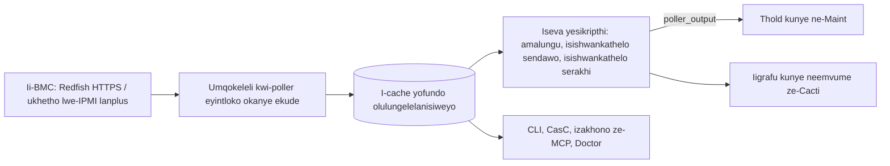

<!-- Source: README.md; SHA256: cf31b9f80d6c00020bbe08e80951d4de1c910793911d040ae7a66b54e8a2eaf0 -->

<!-- translations:start -->
[English](../../../README.md) | [简体中文](../zh-CN/README.md) | [हिन्दी](../hi-IN/README.md) | [Español (España)](../es-ES/README.md) | [Español (Latinoamérica)](../es-419/README.md) | [العربية (السعودية)](../ar-SA/README.md) | [Afrikaans](../af-ZA/README.md) | [አማርኛ](../am-ET/README.md) | [العربية (مصر)](../ar-EG/README.md) | [العربية (المغرب)](../ar-MA/README.md) | [বাংলা](../bn-BD/README.md) | [Bosanski](../bs-BA/README.md) | [Deutsch](../de-DE/README.md) | [فارسی](../fa-IR/README.md) | [Filipino](../fil-PH/README.md) | [Français](../fr-FR/README.md) | [Français (Maroc)](../fr-MA/README.md) | [Français (Sénégal)](../fr-SN/README.md) | [Hausa](../ha-NG/README.md) | [עברית](../he-IL/README.md) | [Hrvatski](../hr-HR/README.md) | [Bahasa Indonesia](../id-ID/README.md) | [Igbo](../ig-NG/README.md) | [Italiano](../it-IT/README.md) | [日本語](../ja-JP/README.md) | [한국어](../ko-KR/README.md) | [Malagasy](../mg-MG/README.md) | [मराठी](../mr-IN/README.md) | [Bahasa Melayu](../ms-MY/README.md) | [Nederlands](../nl-NL/README.md) | [Polski](../pl-PL/README.md) | [Português (Brasil)](../pt-BR/README.md) | [Русский](../ru-RU/README.md) | [Kinyarwanda](../rw-RW/README.md) | [Soomaali](../so-SO/README.md) | [Српски](../sr-RS/README.md) | [Svenska](../sv-SE/README.md) | [Kiswahili](../sw-KE/README.md) | [தமிழ்](../ta-IN/README.md) | [తెలుగు](../te-IN/README.md) | [ไทย](../th-TH/README.md) | [Türkçe](../tr-TR/README.md) | [Українська](../uk-UA/README.md) | [اردو](../ur-PK/README.md) | [Tiếng Việt](../vi-VN/README.md) | [isiXhosa](README.md) | [Yorùbá](../yo-NG/README.md) | [繁體中文](../zh-TW/README.md) | [isiZulu](../zu-ZA/README.md)
<!-- translations:end -->

# plugin_redfish

Iplagin ye-Cacti 1.2 ezisa ukusetyenziswa kombane weseva, ubushushu bokungena, imeko yefeni, kunye nempilo yonikezelo lombane ukusuka kwabalawuli bolawulo lwebhodi esisiseko (ii-BMC) ukuya kwi-Cacti njengezixhobo eziqhelekileyo, imithombo yedatha, kunye neegrafu, isebenzisa i-Redfish enokhetho lokubuyela kwi-IPMI efundwayo kuphela kunye nokuhlanganiswa kombane kwinqanaba lerakhi. I-Thold kunye ne-Maint zilumkisa kwaye zicinezele izilumkiso ngemithombo yedatha eqhelekileyo ye-Cacti.

> **Imeko: isaphuhliswa, akukho kukhutshwa okwangoku (`0.1.0-dev`).** Le plagin ayinxulumananga neprojekthi ye-Cacti. Ifakelwa kwi-Cacti 1.2.31 okanye eyamva phantsi kwe-PHP 8.2 okanye eyamva kwaye iphumeza umqokeleli we-Redfish, indawo yokugcina ebethelelweyo yeziqinisekiso, ukubonelelwa kwezixhobo neegrafu ze-Cacti, ukhetho lokubuyela kwi-IPMI efundwayo kuphela, ukuhlanganiswa kombane werakhi, umboniso wefestile ye-Cacti Maint, uphindaphindo lwabaqokeleli bedatha abakude neendawo zokugqibela zee-arhente, umboneleli we-CasC kunye ne-CLI yomsebenzisi, izakhono ze-MCP, kunye novavanyo loxilongo lwe-Doctor. I-CI ivavanya iifiskhitha, i-DMTF Redfish Mockup Server (iimodeli zenkqubo esezantsi, ezendala kuphela, kunye ne-HPE iLO Gen11), kunye ne-Thold v1.8.2 ne-Maint v1.3; akukho BMC yokwenyani okanye iqela lovavanyo eliqinisekisiweyo okwangoku. Uyilo kunye nophando zikwi-[docs/PLAN.md](../../PLAN.md), [docs/research/](../../research/), kunye ne-[docs/decisions/](../../decisions/).

## Izakhono eziphunyeziweyo

### Umqokeleli osisiseko, indawo yokugcina eyimfihlo, kunye nezinto ze-Cacti

- **Umjikelo wobomi kunye neskima.** Iyafakelwa, ihlaziywe, ikhubazwe, kwaye ikhutshwe nge-API yeplagin ye-Cacti (`Schema::VERSION = 3`, iitheyibhile ezi-12). Iitheyibhile zigcinwa xa ikhutshwa ngaphandle kokuba i-*Keep Plugin Tables on Uninstall* icinyiwe. Iindawo zokungena zicazululeka kwi-PHP 8.0 kwaye ziyayikhaba i-PHP engaphantsi kwe-8.2 okanye ukungabikho kwe-`ext-openssl` ngomyalezo wempazamo ocacileyo.
- **Ubhaliso kunye neemvume.** Imimandla ye-*Redfish View* (`redfish_health.php`), *Redfish Operator* (`redfish_operator.php`), kunye ne-*Redfish Admin* (`redfish_bmcs.php`, `redfish_credentials.php`), kunye nezicwangciso phantsi kwe-**Configuration > Settings > Redfish**. Ubhaliso lwe-BMC luxhasa ukungeniswa kwe-CSV (iziqinisekiso zikhankanywa ngegama; amagama okugqitha kwiifayile zokungenisa ayaliwa) kunye nokukhutshwa kwe-JSON. Iirekhodi ze-BMC kunye neziqinisekiso zilandela iimvume zezixhobo ze-Cacti.
- **Indawo yokugcina ebethelelweyo yeziqinisekiso.** Amagama okugqitha agcinwa ebethelelwe nge-AES-256-GCM kwi-`plugin_redfish_secret`. Isitshixo sihlala ngaphandle kwesiseko sedatha (ngokwendalo `/etc/cacti/redfish-vault.key`) njengeempawu ze-hexadecimal ezingama-64 (`openssl rand -hex 32`) okanye iibhayithi ezingama-32 ezingahluzwanga, singumnikazi womsebenzisi we-poller, singafundeki kwabanye abasebenzisi, kwaye sikwifolda enokubhalwa yi-root okanye loo msebenzisi kuphela. Ibinzana lokugqitha eliprintahayo leempawu ezingama-32 liyaliwa. **Gcina ikopi yefayile yesitshixo kunye nesiseko sedatha**; ngaphandle kwayo, amagama okugqitha agciniweyo kufuneka afakwe kwakhona.
- **I-TLS kunye nomxhasi we-Redfish ofundwayo kuphela.** Ukuqinisekiswa kwe-TLS kuvulwe ngokwendalo kusetyenziswa indawo yokugcina ye-CA yesixokelelwano, iphakheji ye-CA ye-BMC nganye, okanye ipini ye-SPKI SHA-256; ukukhetha ukungaqinisekisi kwi-BMC nganye kuhlala kubonakala njengesilumkiso sempilo kunye nesilumkiso sovavanyo lwe-Doctor. Umxhasi uvumela kuphela i-`GET` kunye nokungena kwiseshoni ye-Redfish (`POST`) kunye nokuphuma (`DELETE`), kunye nokhetho lokubuyela kwi-Basic kwi-BMC nganye xa iiseshoni zingafumaneki. Ukufumanisa kukhetha izixhobo ezintsha zenkqubo esezantsi kunye neenzwa ze-Redfish kuqala kwaye kubuyele kwizixhobo ezidala ze-`Power` kunye ne-`Thermal`.
- **Ukwenziwa komqokeleli.** I-`poller_redfish.php` iqala kwi-`poller_bottom`, iqhuba inkqubo eyintloko enye nge-poller ngokusebenzisa ubhaliso lweenkqubo ze-Cacti ezineenkqubo zabasebenzi ezinokuqwalaselwa (`redfish_workers`), ifumana izivumelwano zengqesho kwi-BMC nganye, inyanzelisa uhlahlo lwabiwo-mali lwexesha (`redfish_collector_budget`), isebenzisa ukuhlehla okukhulayo ngamandla, kwaye icoca iseshoni yangaphambili yeplagin emva kokuphahlazeka.
- **Iitempleyiti, izixhobo, kunye neegrafu.** Ingenisa i-`templates/redfish-templates.xml` nge-hash kwaye ikopela iifayile ezintathu ze-XML zemibuzo yedatha yeseva yesikripthi (`redfish_fans.xml`, `redfish_temperatures.xml`, `redfish_psus.xml`) kwi-`<cacti>/resource/script_server/` ngaphandle kokubhala ngaphezulu kwiifayile ezilungiswe ngumsebenzisi. I-**Create Device** kunye ne-**Add Graphs** zifuna ukuqinisekiswa kwesicwangciso sonikezelo, ziqhoboshela imibuzo kwisixhobo seseva esimaphiweyo okanye zidale isixhobo se-"Redfish BMC" phantsi kwe-`.invalid` ngovavanyo lokufumaneka luvaliwe, kwaye zidibanise igrafu nganye ye-Redfish emva kwiigrafu ze-Redfish zesixhobo nge-`graph_buttons`.
- **Igalelo leseva yesikripthi elikwi-cache kuphela.** I-`scripts/ss_redfish_members.php` ibonelela ngofundo lwefeni, ubushushu, kunye ne-PSU yelungu ngalinye, kwaye i-`scripts/ss_redfish_summary.php` ibonelela ngeemetrikhi ze-"Redfish Node Summary" (umbane, ubushushu bokungena nobona buphezulu, inani leefeni nee-PSU ezonakeleyo, impilo yendawo, kunye nobudala bofundo olulungileyo lokugqibela). Iminxeba yeseva yesikripthi ifunda i-cache yendawo kuphela kwaye ayize iqhagamshelane ne-BMC. Ufundo olungekhoyo, oludala, okanye lwelungu elihambileyo lubuyisela i-`U` (akaze ibe ngu-`0`), ngelixa i-`age` ihlala inika ixabiso ukuze imida ibhaqe ii-BMC ezithuleyo.

**Xa amalungu e-BMC etshintsha** (njengefeni etshintshiweyo okanye uhlaziyo lwe-firmware olutshintsha amagama eenzwa), phinda uqhube i-**Add Graphs**. Ifeni okanye unikezelo lombane olwalukho ngaphambili oluthe lwanyamalala lubalwa kwi-`fans_bad` okanye kwi-`psus_bad` de lwamkelwe; islot esingazange sifakwe nto asibalwa. Amalungu ahambileyo agcina imithombo yawo yedatha neegrafu ezikhoyo, ezifunda u-`U` emva koko de zicinywe ngesandla. Ukucima isixhobo se-Cacti kucima unxulumano lwaso lwe-BMC kwaye kususe ukabelwa kwaso kwirakhi ngelixa kugcina i-BMC ne-cache; ukucima i-BMC okanye ukukhupha iplagin kugcina izixhobo neegrafu ze-Cacti.

### Ukhetho lokubuyela kwi-IPMI

- **Ukuzikhethela nge-BMC nganye.** Ivaliwe ngokwendalo (`protocols` ngokwendalo ngu-`redfish`; ukuvula ukubuyela kwi-IPMI kuseta `redfish,ipmi`).
- **Isixhokonxi sokubuyela esinomda.** Isebenza kuphela xa uqokelelo lwe-Redfish lusilela ngohlobo lokusilela olufanelekileyo; ayize ixhokonxwe kwi-`AuthRejected`, `CredentialUnavailable`, `AddressRefused`, `OperationRefused`, okanye kwi-`Deadline`.
- **Ukwenziwa okukhuselekileyo.** Ibiza i-`ipmitool` nge-`-I lanplus` ngoluhlu lwe-`proc_open()` ngaphandle kwe-shell, inexesha elibekiweyo lokuphelelwa lixesha kunye nomda wemveliso oyi-256 KiB. Amagama okugqitha anikwa nge-`IPMITOOL_PASSWORD` (`-E`) okanye ngefayile yethutyana ye-mode-0600 (`-f`) ecinywa kwi-`finally`, hayi kwi-CLI argv.
- **Uluhlu lwemiyalelo efundwayo kuphela evumelekileyo.** Imiyalelo esezantsi emihlanu efundwayo kuphela evumelekileyo: `dcmi power reading`, `sdr type Temperature`, `sdr type Fan`, `sdr type Power Supply`, kunye ne-`chassis status`. Imiyalelo etshintsha imeko iyaliwa.
- **Imveliso elungelelanisiweyo kunye nesilumkiso sokhuseleko.** I-`IpmiNormalizer` imapha ufundo kwimodeli efanayo ye-`Observation`/`Member`/`Reading`, ikhupha i-`U` kwiinzwa ezingekhoyo okanye ezingacazululekiyo. Ukuvula ukubuyela kwi-IPMI kuphakamisa isilumkiso kwiphepha lempilo nakuvavanyo lwe-Doctor lwe-`redfish.bmc_security` esikhumbuza abasebenzisi ukuba bathintele i-UDP 623 kwi-VLAN yolawulo.

### Ukuhlanganiswa kombane werakhi

- **Ubhaliso lwerakhi.** Inguqulelo yeskima yesi-3 yongeza i-`plugin_redfish_rack` (eyodwa `(site_id, name)`, okukhethwayo `power_budget_watts`, i-`min_coverage_pct` ngokwendalo ngu-`80`, kunye namanqaku) kunye ne-`plugin_redfish_rack_member` (ubuninzi bokwabelwa irakhi enye nge-`host_id` nganye, okukhethwayo `bmc_id` kunye ne-`unit_position`, isuswa ngokuzenzekelayo xa isixhobo se-Cacti sicinyiwe).
- **Izixa ezikhuselwe lukhuselo lobukho.** I-`RackPowerSummary` idibanisa ufundo olutsha lwe-`power_watts` lwamalungu ukusuka kwi-cache yendawo kwaye ibala ukusetyenziswa kohlahlo lwabiwo-mali kunye nesithuba esiseleyo. Xa ubukho bamalungu anika ingxelo buwela ngaphantsi kwe-`min_coverage_pct`, i-`power_watts`, `utilization_pct`, kunye ne-`headroom_watts` zibuyisela i-`U` ukuze ukusilela komqokeleli kungaze kubonakale njengokuhla kombane werakhi.
- **Igalelo leseva yesikripthi elilungele i-Thold.** I-`scripts/ss_redfish_rack.php` (`ss_redfish_rack(<rack_id>)`) ibuyisela i-`power_watts`, `power_budget_watts`, `utilization_pct`, `headroom_watts`, `members_total`, `members_reporting`, kunye ne-`coverage_pct` ukusuka kwi-cache yendawo kuphela.

### Unxibelelwano lwe-Cacti Maint

- Imida ye-Thold kwimithombo yedatha ye-Redfish ilumkisa kwaye i-Cacti Maint iyayicinezela ngaphandle kotshintsho kuyo nayiphi na iplagin.
- I-`MaintWindow` ihlola iishedyuli ze-Maint ezisebenzayo kumamkeli ngamnye we-Cacti omaphiweyo (iishedyuli zexesha elinye `mtype=1` neziphindaphindayo `mtype=2`, kunye ne-`plugin_maint_check_cacti_host()` xa ilayishiwe) kwaye iphawula ulondolozo olusebenzayo kwiphepha le-Redfish Health (`[MAINT]`), kwimveliso ye-`cli/redfish.php health`, nakwisakhono se-`redfish-get-health`.

### Abaqokeleli bedatha abakude

- I-`INFO` ibhengeza i-`remote_collect:1`. Ii-BMC zamkela nayiphi na i-`poller_id >= 1`, kwaye i-`poller_redfish.php --poller=N` iqokelela kuphela ii-BMC ezivuliweyo ezabelwe loo poller.
- **I-hook ye-`replicate_out`.** Iphindaphinda kuphela iitheyibhile zoqwalaselo ezingeyomfihlo ezinomda kwi-poller ekude ekujoliswe kuyo nge-`replicate_out_table()`: `plugin_redfish_bmc`, imethadatha ye-`plugin_redfish_credential` (akukho mbhalo obethelelweyo), `plugin_redfish_rack`, kunye ne-`plugin_redfish_rack_member`. I-`plugin_redfish_secret` ayiphindaphindwa, kwaye iifayile zezitshixo zendawo yokugcina eyimfihlo zihlala zikwindawo yazo kwi-poller nganye.
- **I-hook ye-`remote_agent`.** Ibonisa iintshukumo ezifundwayo kuphela ze-`redfish_health` kunye ne-`redfish_discovery` ezamkela kuphela iiparamitha zamanani ze-`poller_id` kunye ne-`bmc_id`. Iiparamitha ezingalindelekanga ziyaliwa kwaye akukho ziqinisekiso okanye iimfihlo ezibuyiselwayo.

### Ii-hook zenkqubo yendalo (CasC, izakhono ze-MCP, kunye ne-Doctor)

- **Umboneleli we-CasC (`casc_register_providers`).** Ubhalisa umboneleli we-`redfish` (inguqulelo yeskima `1`) ngokukhutshwa kwe-YAML kunye ne-XML ye-PHP engaxutywanga, ukucazulula (i-XXE iyaliwa), ukuqinisekisa, ukucwangcisa umahluko, kunye nokusetyenziswa. Iziqinisekiso zivela kuphela njengezalathiso zendawo yokugcina (`vault:redfish:<name>`); izitshixo zemfihlo ezingahluzwanga (`pass`, `secret`, `token`, `private_key`, `vault_key`, `auth_token`) ziyaliwa. Ukusetyenziswa kufuna i-`PLAN_HASH` ye-SHA-256 echanekileyo.
- **I-MCP / Abilities API (`abilities_register`).** Ibhalisa izakhono ezithathu ezifundwayo kuphela ezilawulwa ngummandla we-Redfish View (`redfish_health.php`) kunye neemvume zezixhobo ze-Cacti, ingabuyiseli ziqinisekiso:
  - `redfish-list-bmcs` (okukhethwayo `poller_id`)
  - `redfish-get-rack-power` (okukhethwayo `rack_id`)
  - `redfish-get-health` (okukhethwayo `bmc_id`)
- **Uvavanyo lwe-Doctor (`doctor_register_checks`).** Lubhalisa uvavanyo loxilongo lwendawo olufundwayo kuphela oluhlanu olungaze luqhagamshelane ne-BMC okanye lubuyisele izinto zezitshixo:
  - `redfish.schema`: ukuhlaziyeka kwenguqulelo yeskima
  - `redfish.vault_key`: ukufundeka kunye neemvume zesitshixo sendawo yokugcina
  - `redfish.collector_runs`: uhlahlo lwabiwo-mali lomqokeleli we-poller kunye nobutsha
  - `redfish.bmc_security`: ii-BMC ezivuliweyo ezine-TLS engaqinisekiswanga okanye ukubuyela kwi-IPMI
  - `redfish.rack_power`: ukuthotyelwa kohlahlo lwabiwo-mali lombane werakhi kunye nomda wobukho

## CLI

Qhuba ukusuka kulawulo oluyingcambu lwe-Cacti nge-PHP 8.2 okanye eyamva:

```sh
# Operator and CasC CLI (reads --file=PATH or stdin for validate, plan, and apply)
php plugins/redfish/cli/redfish.php export --format=yaml|xml
php plugins/redfish/cli/redfish.php validate [--file=PATH] [--format=yaml|xml]
php plugins/redfish/cli/redfish.php plan [--file=PATH] [--format=yaml|xml]
php plugins/redfish/cli/redfish.php apply [--file=PATH] [--format=yaml|xml] --confirm=<PLAN_HASH>
php plugins/redfish/cli/redfish.php health --format=text|json

# Collector entry point (normally started by poller_bottom)
php plugins/redfish/poller_redfish.php [--poller=N] [--force] [--debug]

# Rack power summary script server entry point
php plugins/redfish/scripts/ss_redfish_rack.php <rack_id>
```

## Iindima zokufikelela

| Ummandla | Ufikelelo |
| --- | --- |
| Redfish View | Amaphepha okubeka iliso akhoyo. |
| Redfish Operator | Ukubeka iliso kunye nephepha leMisebenzi kunye nezivumo zokuhlela iziganeko zobuqu. |
| Redfish Admin | Ufikelelo lwe-Operator kunye noqwalaselo olukhoyo kunye neentshukumo zolawulo. |

Emva kokukopa iifayile zohlaziyo, vula iphepha le-Plugins njengomlawuli ukuze ubhalise imimandla. Yabela ummandla we-Operator ngokucacileyo phantsi kwe-**Configuration > Users** okanye amaqela abasebenzisi. Uhlaziyo lugcina ii-ID kunye nezibonelelo zemimandla ye-View ne-Admin ezikhoyo. Ufikelelo lwe-Admin lufumana ufikelelo lwe-Operator njengelifa, kwaye ufikelelo lwe-Operator lufumana ufikelelo lwe-View njengelifa kwisicelo ngasinye; oku akongezi izibonelelo ezigciniweyo kubasebenzisi okanye kumaqela. Izicwangciso zeplagin zikwafuna ufikelelo lwe-Redfish Admin ukongeza kwimvume ye-Settings ye-Cacti.

Iimvume zezixhobo ze-Cacti zithintela imiqolo kunye neentshukumo ezifumanekayo kumsebenzisi ngamnye; izinto ezingamaphiwanga zifuna umlawuli. Abasebenzisi banokukhulula ukubanjwa koqokelelo kwi-BMC evumelekileyo kuqhutywa olulandelayo olucwangcisiweyo. Iziqinisekiso, uqwalaselo, ukumapha, ukucima, kunye nolunye utshintsho lolawulo zihlala kumaphepha olawulo. Izivumo zihlala kwiseshoni yomsebenzisi yangoku kuphela, ubuninzi beyure enye kwaye kuphela ngelixa uqwalaselo olufanayo luhlala lutsha. Uqwalaselo olutsha okanye olutshintshileyo luyazitshitshisa. Azize ziphawule umlinganiselo osileleyo njengosempilweni okanye zicinezele izilumkiso.

## Kutheni

Iseva nganye ine-BMC enika ingxelo ngemeko yombane nobushushu ngokuzimeleyo kwisixokelelwano sokusebenza, ngoko iqhubeka iphendula xa i-OS iphantsi. Idatha isetyenziselwa ukulandelela umthamo neendleko, isilumkiso sangaphambili sefeni okanye unikezelo lombane olusileleyo, kwaye, kwiikhompyutha ezisebenza kakhulu, izigqibo zokunqumla umbane. Le plagin ayenzelwanga i-HPC kuphela.

I-Cacti igubungela inxalenye yoku namhlanje:

- **Iipakheji ze-SNMP zabathengisi.** Isebe le-1.2.x liza neetempleyti ze-Dell iDRAC kunye ne-HPE iLO ezifuna iarhente ye-SNMP kwaye zikhethekile kumthengisi; uphando lwenqaku lokuqala lufumanise ukuba akukho nanye kuzo enika ingxelo ngokusetyenziswa kombane ngee-watt ([docs/research/overlap.md](../../research/overlap.md)).
- **Uhlobo lwesiqinisekiso esingenamqokeleli.** I-`plugin_credentials` ichaza isiqinisekiso se-"IPMI / Redfish (BMC)" kodwa ayifundi nayiphi na i-BMC.
- **Akukho mbono wenqanaba lerakhi.** Umongo we-Cacti awunayo into yerakhi; isixhobo sinendawo yombhalo okhululekileyo ye-`location`.

Iplagin iphonononga ii-BMC ngaphandle komjikelo wophando we-Cacti kwi-poller eyintloko okanye abaqokeleli bedatha abakude, igcina ufundo olulungelelanisiweyo kwi-cache, kwaye iluveze ngemibuzo yedatha yeseva yesikripthi, izishwankathelo zeendawo, kunye nezishwankathelo zombane werakhi. Iphinda isebenzise ukuzoba iigrafu, iimvume, i-Thold, kunye ne-Maint ze-Cacti, kwaye ayitshintshi imeko ye-BMC.

## Umda kunye nemeko

| Isigaba | Umda | Amanqaku abalulekileyo | Imeko |
|---|---|---|---|
| 0, uphando | Imetrikhi yabathengisi, ukuqinisekiswa kokuziphatha kwenkqubo ephezulu kwii-BMC eziphilayo, iindleko zophando, uvavanyo lwemibuzo yedatha | [M1](https://github.com/somethingwithproof/plugin_redfish/milestone/1) | Igqityiwe, ilinde ukubanjwa kwe-firmware ye-BMC yokwenyani |
| 1, ukujonga | Ubhaliso lwe-BMC, iziqinisekiso, i-TLS, umqokeleli we-Redfish, ufundo olulungelelanisiweyo, izixhobo, iigrafu ngokwesalathisi, izilumkiso ze-Thold, unxibelelwano lwe-Maint, iphepha lempilo | [M2](https://github.com/somethingwithproof/plugin_redfish/milestone/2), [M3](https://github.com/somethingwithproof/plugin_redfish/milestone/3), [M4](https://github.com/somethingwithproof/plugin_redfish/milestone/4) | Iphunyeziwe; ukuqinisekiswa kweqela lovavanyo le-M4 kusalindelwe |
| 2, ipmi | Ukubuyela kwi-IPMI (`lanplus`) efundwayo kuphela nge-`ipmitool`, ivaliwe ngokwendalo | [M5](https://github.com/somethingwithproof/plugin_redfish/milestone/5) | Iphunyeziwe |
| 3, iirakhi | Ubhaliso lwerakhi, izixa zombane werakhi ezinomda wobukho, isithuba sohlahlo lwabiwo-mali, `ss_redfish_rack.php` | [M6](https://github.com/somethingwithproof/plugin_redfish/milestone/6) | Iphunyeziwe |
| 4, kude nenkqubo yendalo | Abaqokeleli bedatha abakude (`replicate_out`, `remote_agent`), umboneleli we-CasC kunye ne-CLI, izakhono ze-MCP, uvavanyo lwe-Doctor | [M7](https://github.com/somethingwithproof/plugin_redfish/milestone/7) | Iphunyeziwe |

Ngaphandle komda: ukuseta imida yombane okanye naluphi na olunye uqwalaselo lwe-BMC, ulawulo lombane, uhlaziyo lwe-firmware, ufikelelo lwe-console, injini yezilumkiso yeplagin ngokwayo, kunye nokudityaniswa nomcwangcisi.

## Iithagethi zokuhambelana

| Ilungu | Ithagethi |
|---|---|
| Cacti | 1.2.31 okanye eyamva, akukho ziphetshi zomongo |
| Isiseko sedatha | MariaDB 10.2 okanye MySQL 5.7 okanye eyamva: i-BMC enye kwisixhobo ngasinye igcinwa sisitshixo esisodwa kwikholamu evelisiweyo |
| PHP | 8.2 okanye eyamva; iindawo zokungena zihlala zicazululeka kwi-8.0 ukuze ixesha lokuqhuba elingaxhaswayo lifumane ukwaliwa endaweni ye-UI ye-Cacti eyaphukileyo |
| Izandiso ze-PHP | `ext-openssl` (efunwa yi-Cacti 1.2.31); akukho `ext-curl` kwaye akukho zixhomekeko zexesha lokuqhuba ze-Composer |
| Izixhobo zokuzikhethela | `ipmitool` kwii-poller eziqokelela ii-BMC ezine-IPMI yokubuyela evuliweyo |
| Ii-BMC | Dell iDRAC, HPE iLO, Lenovo XCC, kunye ne-OpenBMC, ngoluhlu lwe-firmware; jonga [imetrikhi yabathengisi](../../research/vendor-matrix.md) |
| Redfish | Izixhobo ezitsha zenkqubo esezantsi kunye neenzwa kuqala, ezingasetyenziswayo ze-`Power` kunye ne-`Thermal` njengokubuyela |
| Thold, Maint | Akukho lutshintsho lufunekayo (i-CI ivavanya i-Thold v1.8.2 kunye ne-Maint v1.3) |

## Uyilo

- [docs/PLAN.md](../../PLAN.md) sisicwangciso esipheleleyo: uyilo lwenkqubo, iinyaniso zenkqubo ephezulu ezixhomekeke kuzo, imodeli yomlinganiselo, imida yokhuseleko, izibalo zokusebenza, uvavanyo, kunye nemingcipheko.
- [docs/decisions/](../../decisions/) igcina iirekhodi zezigqibo zoyilo lwenkqubo kukhetho osele lwenziwe.
- [docs/REQUIREMENTS.md](../../REQUIREMENTS.md) imapha i-ID yemfuneko nganye kumba wayo.



## Ukhuseleko

Iziqinisekiso ze-BMC zilawula ulawulo lwangaphandle kwebhendi lweeseva. Uyilo lugcina iimfihlo ngaphandle kwemigca yemiyalelo, iilogi, ukukhutshwa kwe-CasC, iipheylodi zearhente ekude, iimpendulo ze-MCP, kunye namaphepha ewebhu; lubethelela amagama okugqitha agciniweyo nge-AES-256-GCM kusetyenziswa ifayile yesitshixo sendawo yokugcina eyimfihlo kwi-poller nganye; luqinisekisa i-TLS ngokwendalo; luqhuba i-`ipmitool` ukusuka kuluhlu olucacileyo lweempikiswano ezinemiyalelo esezantsi efundwayo kuphela evumelekileyo; kwaye lusebenzisa ii-akhawunti ze-BMC ezifundwayo kuphela. Jonga i-[docs/PLAN.md](../../PLAN.md#security) kunye ne-[SECURITY.md](../../../SECURITY.md).

## Isikhokelo somsebenzisi

Jonga i-[docs/operator-guide.md](../../operator-guide.md) ngeemfuno zangaphambi kokufakela, ukusetwa kwendawo yokugcina eyimfihlo ne-TLS, ubhaliso lwe-BMC, ukudalwa kweegrafu, izithuba zezilumkiso, ukugcinwa kweekopi, kunye nokuphatha ukusilela. Isikhokelo asibhengezi mveliso yokwenyani ye-firmware yomthengisi njengexhaswayo de ukubanjwa okucociweyo okusuka kuloo firmware kuphumelele uvavanyo.

## Uphuhliso kunye novavanyo

I-CI (`.github/workflows/plugin-ci-workflow.yml`) ihlola iindawo zokungena kwi-PHP 8.0, iqhuba iisuti zovavanyo lweyunithi ye-Pest (`phpunit.xml`) kunye noludibaniso lomjikelo wobomi (`phpunit-integration.xml`) kunye ne-PHPStan inqanaba le-9 kwi-PHP 8.2 ukuya kwi-8.5 ngokuchasene ne-Cacti `release/1.2.31` kunye ne-`1.2.x`, iqinisekisa ukwaliwa kwi-PHP 8.1, ivavanya i-DMTF Redfish Mockup Server (iimodeli zenkqubo esezantsi, ezendala kuphela, kunye ne-HPE iLO Gen11) kunye ne-Thold v1.8.2 / Maint v1.3 ukusuka ekuqaleni ukuya ekugqibeleni, kwaye ihlola iikhathalogi ze-gettext, iinkqubo zokusebenza, kunye nelayisensi ye-REUSE.

Uvavanyo lwendawo phambi kokutyhala:

```sh
sh tests/lint-workflows.sh
sh locales/build_gettext.sh --check
CACTI_PATH=/path/to/cacti phpstan analyse -c phpstan.neon --no-progress
```

Qhuba i-Pest nge-`--configuration=phpunit.xml` kuvavanyo lweyunithi nolwemithetho yekhowudi yomthombo, okanye nge-`--configuration=phpunit-integration.xml` kunye ne-`CACTI_PATH` ne-`REDFISH_TEST_DATABASE=disposable` ngokuchasene nesiseko sedatha se-Cacti esinokulahlwa kuvavanyo lodibaniso lomjikelo wobomi.

## Indlela umsebenzi olandelwa ngayo

- **Amanqaku abalulekileyo** alandela amanqaku abalulekileyo esicwangciso. Elinye nelinye linomba omkhulu (epic) odwelisa imiba yawo esezantsi kunye nobungqina bokugqiba.
- **Imiba** ihlelwe ngeeleyibhile: `type: requirement`, `type: research`, `type: decision`, `type: epic`. Imiba yeemfuno ichaza iimfuno ezinamanani, ezivavanyekayo (`REQ-AREA-NNN`) kunye neendlela zokwamkela.
- **Iileyibhile** zikwaphethe `area:`, `phase:`, `priority:`, kunye ne-`status:`. Jonga i-[CONTRIBUTING.md](../../../CONTRIBUTING.md#labels).
- I-[bhodi yeprojekthi](https://github.com/users/somethingwithproof/projects/12) ibonisa yonke imiba kuwo onke amanqaku abalulekileyo.

## Ukufaka isandla

Funda i-[CONTRIBUTING.md](../../../CONTRIBUTING.md). Ii-commit zifuna utyikityo lwe-DCO. Ingxoxo yoyilo yenzeka kwimiba; izigqibo ezivulekileyo ziphethe ileyibhile ye-`type: decision`. Ubungqina obusuka kwii-BMC zokwenyani lelona galelo liluncedo ngoku; cima iidilesi, iinombolo zothotho, kunye neziqinisekiso phambi kokuthumela nakuphi na ukubanjwa.

## Ilayisensi

GNU General Public License v2.0, ilayisensi efanayo neye-Cacti kunye neeplagin zayo. Jonga i-[LICENSE](../../../LICENSE).
