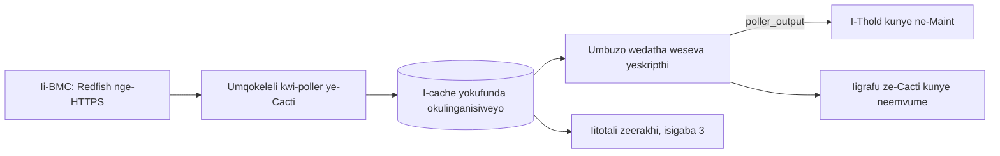

<!-- Source: README.md; SHA256: 7b4e83a58a1adc844cb0615ef30e95476cba2851f96bb454d2a816fb2774724d -->

<!-- translations:start -->
[English](../../../README.md) | [简体中文](../zh-CN/README.md) | [हिन्दी](../hi-IN/README.md) | [Español (España)](../es-ES/README.md) | [Español (Latinoamérica)](../es-419/README.md) | [العربية (السعودية)](../ar-SA/README.md) | [Afrikaans](../af-ZA/README.md) | [አማርኛ](../am-ET/README.md) | [العربية (مصر)](../ar-EG/README.md) | [العربية (المغرب)](../ar-MA/README.md) | [বাংলা](../bn-BD/README.md) | [Deutsch](../de-DE/README.md) | [فارسی](../fa-IR/README.md) | [Filipino](../fil-PH/README.md) | [Français](../fr-FR/README.md) | [Français (Maroc)](../fr-MA/README.md) | [Français (Sénégal)](../fr-SN/README.md) | [Hausa](../ha-NG/README.md) | [עברית](../he-IL/README.md) | [Bahasa Indonesia](../id-ID/README.md) | [Igbo](../ig-NG/README.md) | [Italiano](../it-IT/README.md) | [日本語](../ja-JP/README.md) | [한국어](../ko-KR/README.md) | [Malagasy](../mg-MG/README.md) | [मराठी](../mr-IN/README.md) | [Bahasa Melayu](../ms-MY/README.md) | [Nederlands](../nl-NL/README.md) | [Polski](../pl-PL/README.md) | [Português (Brasil)](../pt-BR/README.md) | [Русский](../ru-RU/README.md) | [Kinyarwanda](../rw-RW/README.md) | [Soomaali](../so-SO/README.md) | [Svenska](../sv-SE/README.md) | [Kiswahili](../sw-KE/README.md) | [தமிழ்](../ta-IN/README.md) | [తెలుగు](../te-IN/README.md) | [ไทย](../th-TH/README.md) | [Türkçe](../tr-TR/README.md) | [Українська](../uk-UA/README.md) | [اردو](../ur-PK/README.md) | [Tiếng Việt](../vi-VN/README.md) | [isiXhosa](README.md) | [Yorùbá](../yo-NG/README.md) | [繁體中文](../zh-TW/README.md) | [isiZulu](../zu-ZA/README.md)
<!-- translations:end -->

# plugin_redfish

Iplagin ye-Cacti 1.2 ezisa ukusetyenziswa kombane weseva, ubushushu bokungena, imeko yefeni, kunye nempilo yonikezelo lombane ukusuka kwabalawuli bolawulo lwebhodi esisiseko (ii-BMC) ukuya kwi-Cacti njengezixhobo eziqhelekileyo, imithombo yedatha, kunye neegrafu, isebenzisa i-Redfish enokhetho lokubuyela kwi-IPMI. I-Thold kunye ne-Maint ziya kuthi ke zilumkise kwaye zicinezele ezo zilumkiso, kwaye isigaba esilandelayo songeza izixa ezipheleleyo zombane kwinqanaba lerakhi.

> **Imeko: isaphuhliswa, akukho kukhutshwa okwangoku (0.1.0-dev).** Amanqaku abalulekileyo 2 (isiseko) kunye ne-3 (izinto ze-Cacti kunye nokulumkisa) adityanisiwe kwi-`main`. Le plagin ayinxulumananga neprojekthi ye-Cacti. Ifakelwa kwi-Cacti 1.2.31 phantsi kwe-PHP 8.2 okanye eyamva, ibhalisa ii-BMC kunye neziqinisekiso, ifunda umbane, amaqondo obushushu, iifeni, kunye nempilo yonikezelo lombane kwi-BMC nganye nge-Redfish ukuya kwi-cache yayo, kwaye ibonisa impilo yokuqokelela. Yongeza izixhobo ze-Cacti, iigrafu zelungiselelo ngalinye kunye nezesishwankathelo, kunye nenkxaso ye-Thold ne-Maint ngemithombo yedatha eqhelekileyo. I-CI ivavanye i-BMC eyenziweyo eyakhiwe kwizixhobo ezibhalwe ngesandla kunye neseva yomfanekiso ye-DMTF Redfish; akukho BMC yokwenyani okanye iqela lovavanyo eliqinisekisiweyo. Uyilo kunye nophando zikwi-[docs/PLAN.md](../../PLAN.md), [docs/research/](../../research), kunye ne-[docs/decisions/](../../decisions).

### Oko kuziswa yi-milestone 2

- Ukufaka, ukuhlaziya, ukukhubaza, kunye nokususa nge-API yeplagin ye-Cacti, iitheyibhile zigcinwe xa kususiwe ngaphandle kokuba useto lucinyiwe. Kwi-PHP endala kune-8.2 iplagin iyala ukufakwa okanye ukuvunywa kwaye ichaza isizathu.
- Iindawo zolawulo "Redfish View" (iphepha lempilo), "Redfish Operator" (iphepha lemisebenzi), kunye ne-"Redfish Admin" (amaphepha ee-BMC kunye neziqinisekiso), kunye noseto phantsi ko-Configuration > Settings > Redfish.
- Uvimba obhalisiweyo we-BMC onokungeniswa kwe-CSV nokukhutshwa kwe-JSON. Iifayile ezingeniswayo akufuneki zibe neephasiwedi; iziqinisekiso zikhankanywa ngegama.
- Iziqinisekiso zigcinwa zifihliwe nge-AES-256-GCM. Isitshixo yifayile engaphandle kwedathabheyisi, `/etc/cacti/redfish-vault.key` ngokungagqibekanga, ephethe oonobumba be-hexadecimal abangama-64 (`openssl rand -hex 32`) okanye kanye iibhayithi ezingama-32 ezingaqhelekanga, engumnini wayo ngumsebenzisi we-poller, engafundekiyo kwabanye abasebenzisi, kwisikhombisi apho kuphela umsebenzisi we-poller okanye i-root enokubhala khona. Isitshixo esinoonobumba abangama-32 abashicilelekayo siyaliwa njengebinzana lokugqitha. **Yenza ikopi yokhuseleko yefayile yesitshixo kunye nedathabheyisi**; ngaphandle kwayo yonke iphasiwedi egciniweyo kufuneka ingeniswe kwakhona.
- Ukuqinisekiswa kwe-TLS kuvuliwe ngokungagqibekanga, kunye nepakethe ye-CA ye-BMC nganye okanye i-pin ye-SPKI SHA-256. Ukukhetha ukuphuma okungaqinisekiswanga okubhalisiweyo kwe-BMC nganye kuhlala kwiphepha lempilo njengesilumkiso.
- Umxumi we-Redfish wokufunda kuphela: i-`GET` kunye nokungena nokuphuma kwiseshoni kuphela, ihlolwa kuluhlu oluvumelekileyo ngaphambi kokuba kuthunyelwe nasiphi na isicelo.
- Umqokeleli oqaliswe ukusuka kwi-`poller_bottom` kwii-BMC ezikwi-poller engundoqo, enezivumelwano zexeshana kunye nemida yexesha ye-BMC nganye, ukulibaziseka kwakhona, kunye nokucocwa emva kokuwa kweseshoni enye ebhalwe yiplagin. Abaqokeleli abakude abaxhaswa okwangoku; badinga ukhetho olucacileyo lwendlela umqokeleli afikelela ngayo kwidathabheyisi kunye nesitshixo (isigaba 4).
- Iirekhodi ze-BMC kunye neziqinisekiso zilandela iimvume zezixhobo ze-Cacti: i-Redfish Admin ibona, itshintshe, kwaye ibophelela kuphela ii-BMC ezikwizixhobo enokuzibona, kunye neziqinisekiso kuphela ezingasetyenziswa yiyo nayiphi na i-BMC ekwisixhobo esifihliweyo.

### Oko kongezwa yi-milestone 3

- Iitempleyithi zithunyelwa njenge-XML yetempleyithi ye-Cacti kwi-`templates/` kwaye zingeniswa ngesixhobo sokungenisa se-Cacti ngokwaso xa kufakwa kwaye kuhlaziywa, zihambelaniswa nge-hash, ukuze ukungeniswa kuhlaziye izinto zeplagin kwaye kungongezi nto kabini. Iifayile ezintathu zemibuzo yedatha zikopelwa kwi-`<cacti>/resource/script_server/` zine-hash ebhalisiweyo; iplagin ayize ithathe indawo yefayile apho engayibhalanga, kwaye iphepha lempilo lilumkisa abalawuli xa iitempleyithi okanye ifayile yemibuzo ingekho endaweni yayo. **Reinstall the Redfish Templates** kwiphepha lee-BMC iyazingenisa kwakhona; idinga imvume ye-Cacti ye-Import Templates.
- **Create Device** okanye **Add Graphs** kwi-BMC nganye ([ADR 0015](../../decisions/0015-attach-to-the-server-device-or-create-one-per-bmc.md)). I-BMC ematshiswe kwisixhobo esele sikho seseva ifumana imibuzo yedatha kunye neegrafu zayo kweso sixhobo. I-BMC engamatshiswanga ifumana isixhobo esitsha ukusuka kwitempleyithi yesixhobo se-"Redfish BMC", ihlolo lokufumaneka licinyiwe kwaye inegama lomamkeli eliphantsi kwe-`.invalid`, ukuze i-Cacti ingaze iqhagamshelane ne-BMC kwaye ingaze ibonise idilesi yayo. Nakuphi na ukhetho, umlawuli uqala aqinisekise isicwangciso esidwelisa oko kuya kongezwa. Zombini zidinga imvume yolawulo lwezixhobo ze-Cacti kunye ne-Redfish Admin; isixhobo esitsha umyili angakhange akwazi ukusibona sisuswa kwakhona.
- Imibuzo yedatha emithathu yeseva yeskripthi, "Redfish Fans", "Redfish Temperatures", kunye ne-"Redfish Power Supplies", eyalathwa ngesitshixo selungu le-BMC, enegrafu ngokwelungu ngalinye: isantya sefeni ngeepesenti okanye nge-RPM (nayiphi na iyunithi exelwa yi-BMC), ubushushu, kunye neewatts zokungena nokuphuma zonikezelo lombane, nganye inekhowudi yayo yempilo.
- Igalelo le-"Redfish Node Summary" elinombane, ubushushu bokungena, obona bushushu buphezulu, iifeni nezixhobo zonikezelo ezingekho OK, impilo yendawo yokusebenza (node), kunye nobudala bokufunda okulungileyo kokugqibela, ezotywe kwiigrafu ezine: umbane, amaqondo obushushu, impilo yamalungu, kunye nobudala bedatha. Imida ye-Thold kule mithombo yedatha iyalumkisa, kwaye i-Maint iyayicinezela, ngaphandle kotshintsho kuyo nayiphi na iplagin.
- Iseva yeskripthi iphendula kuphela ukusuka kwi-cache yeplagin kwaye ayize iqhagamshelane ne-BMC. Ixabiso elilahlekileyo, elidala, leyunithi eyahlukileyo, okanye elisuka kwilungu elingasekhoyo ngu-`U`, ngoko iigrafu zibonisa isithuba, akukho nanye into engu-zero; u-`age` uhlala enexabiso, ngoko umda osemgangathweni kuwo ubamba i-BMC eyekileyo ukuphendula.
- Ikhonkco legrafu ukusuka kwigrafu nganye ye-Redfish ukuya kwiigrafu ze-Redfish zesixhobo, eliboniswa kuphela kubasebenzisi i-Cacti ebavumela ukuba basibone isixhobo.

**Xa amalungu e-BMC etshintsha** (ifeni itshintshiwe, uhlaziyo lwe-firmware luthiya kwakhona izinzwa), khetha **Add Graphs** kwakhona. Ifeni okanye unikezelo lombane obelukhona kwaye ngoku lungekho okanye luhambile lubalwa kwi-`fans_bad` okanye `psus_bad` de ukwenze oko, ngoko ifeni ekhutshiweyo iyalumkisa; isithuba esingazange sizaliswe asibali. I-Add Graphs yamkela amalungu axelwa yi-BMC ngoku, kwaye i-Cacti ihlaziya isalathisi semibuzo kwakhona; ilungu elingasekhoyo ligcina umthombo wedatha negrafu yalo, ezifunda u-`U` ukususela ngoko, kwaye ilungu elitsha lifumana igrafu. Cima iigrafu zamalungu angasekhoyo ngesandla wakuba ungafuni mbali yawo.

Ukucima isixhobo kususa ukumatshiswa kwe-BMC yaso kwaye kugcina i-BMC ne-cache yayo. Ukucima i-BMC, okanye ukususa iplagin, kugcina isixhobo kunye neegrafu zayo.

## Iindima zofikelelo

| Indawo yolawulo (Realm) | Ufikelelo |
| --- | --- |
| Redfish View | Amaphepha okubeka iliso asele ekho. |
| Redfish Operator | Ukubeka iliso kunye nephepha leMisebenzi kunye neziqinisekiso zobuqu zokwahlula imiba. |
| Redfish Admin | Ufikelelo loMqhubi kunye noqwalaselo olusele lukho nezenzo zolawulo. |

Emva kokukopa iifayile zohlaziyo, vula iphepha le-Plugins njengomlawuli ukubhalisa
indawo entsha yolawulo. Nika indawo ye-Operator ngokucacileyo phantsi ko-**Configuration > Users** okanye amaqela abasebenzisi.
Uhlaziyo lugcina ii-ID zeendawo ze-View ne-Admin ezisele zikho kunye neemvume zazo. Ufikelelo lwe-Admin
lufumana ilifa lofikelelo lwe-Operator, kwaye ufikelelo lwe-Operator lufumana ilifa lofikelelo lwe-View kwisicelo ngasinye;
oku akongezi izibonelelo ezigciniweyo kubasebenzisi okanye kumaqela. Useto lweplagin lukwafuna
ufikelelo lwe-Redfish Admin ukongeza kwimvume ye-Settings ye-Cacti.

Iimvume zezixhobo ze-Cacti zisayilinganisa imiqolo nezenzo ezifumanekayo kumsebenzisi ngamnye; izinto ezingamatshiswanga zidinga umlawuli. Abaqhubi bangakhulula ukubanjwa kokuqokelela kwi-BMC evunyelweyo ukuze kuqhutywe kwixesha elizayo elicwangcisiweyo.
Iziqinisekiso, uqwalaselo, ukumatshisa, ukucima kunye nolunye utshintsho lolawulo
zihlala kumaphepha olawulo. Iziqinisekiso zokuqaphela zihlala kuphela kwiseshoni
yomsebenzisi wangoku, ubuninzi iyure enye kwaye kuphela ngelixa loo mbono uhlala
umtsha. Iimbono ezintsha okanye ezitshintshileyo ziyaziphelisa. Azize ziphawule umlinganiselo
ongaphumelelanga njengosempilweni okanye zicinezele izilumkiso.

## Kutheni

Yonke iseva ine-BMC exela imeko yombane nobushushu ngokuzimeleyo kwisixokelelwano sokusebenza (OS), ngoko iqhubeka iphendula xa i-OS iphantsi. Idatha isetyenziselwa ukulandela umthamo neendleko, isilumkiso sangethuba sefeni okanye unikezelo lombane olungaphumelelanga, kwaye, kwiikhompyutha ezisebenza kakhulu, izigqibo zokumisela umda wombane. Iplagin ayijoliswanga kwi-HPC kuphela.

I-Cacti igubungela inxalenye yoku namhlanje:

- **Iipakethe ze-SNMP zabathengisi.** Isebe le-1.2.x lithumela iitempleyithi ze-Dell iDRAC kunye ne-HPE iLO ezidinga i-ajenti ye-SNMP kwaye ezijoliswe kumthengisi ngamnye; uphando lwe-milestone 1 lufumanise ukuba akukho nanye kuzo exela ukusetyenziswa kombane ngeewatts ([docs/research/overlap.md](../../research/overlap.md)).
- **Uhlobo lwesiqinisekiso olungenamqokeleli.** plugin_credentials ichaza isiqinisekiso se-"IPMI / Redfish (BMC)" kodwa ayifundi nayiphi na i-BMC.
- **Akukho mbono wenqanaba lerakhi.** Umongo we-Cacti awunayo into yerakhi; isixhobo sinomhlaba we-`location` obhalwa ngokukhululekileyo.

Iplagin ivavanya ii-BMC ngaphandle kwebhendi kumjikelo wovavanyo we-Cacti, igcina ukufunda okulinganisiweyo kwi-cache, kwaye ikuveza ngombuzo wedatha weseva yeskripthi kunye nemithombo yedatha yesishwankathelo. Isebenzisa kwakhona ukuzoba iigrafu kwe-Cacti, iimvume, i-Thold, kunye ne-Maint, kwaye ayitshintshi imeko ye-BMC. Inkxaso yomqokeleli wedatha okude icwangciselwe isigaba sesi-4; ukuqokelela kwangoku kuqhutywa kwi-poller engundoqo kuphela.

## Umda ocwangcisiweyo

| Isigaba | Umda | Amanqaku abalulekileyo |
|---|---|---|
| 0, uphando | Imatriksi yabathengisi, ukuqinisekiswa kokuziphatha okungasentla kwii-BMC eziphilayo, iindleko zovavanyo, uvavanyo lombuzo wedatha | [M1](https://github.com/somethingwithproof/plugin_redfish/milestone/1) |
| 1, ukujonga | Uvimba we-BMC, iziqinisekiso, i-TLS, umqokeleli we-Redfish, ukufunda okulinganisiweyo, izixhobo, iigrafu ngokwesalathisi, ukulumkisa kwe-Thold, ukucinezelwa kwe-Maint, iphepha lempilo | [M2](https://github.com/somethingwithproof/plugin_redfish/milestone/2), [M3](https://github.com/somethingwithproof/plugin_redfish/milestone/3), [M4](https://github.com/somethingwithproof/plugin_redfish/milestone/4) |
| 2, ipmi | Ukubuyela kwi-IPMI kwii-BMC ezingenayo i-Redfish esebenzisekayo, icinyiwe ngokungagqibekanga | [M5](https://github.com/somethingwithproof/plugin_redfish/milestone/5) |
| 3, iirakhi | Uvimba weerakhi, iitotali zombane weerakhi kunye nokugubungela, isithuba sohlahlo lwabiwo-mali | [M6](https://github.com/somethingwithproof/plugin_redfish/milestone/6) |
| 4, kude | Abaqokeleli bedatha abakude be-Cacti beenethiwekhi zee-BMC ezizodwa | [M7](https://github.com/somethingwithproof/plugin_redfish/milestone/7) |

Ngaphandle komda: ukumisela imida yombane okanye naluphi na olunye uqwalaselo lwe-BMC, ulawulo lombane, uhlaziyo lwe-firmware, ufikelelo lwe-console, injini yokulumkisa ephethwe yiplagin, kunye nokudityaniswa nomcwangcisi.

## Izinto ekujoliswe kuzo zokuhambelana

| Ilungu | Ekujoliswe kuko |
|---|---|
| Cacti | 1.2.31 okanye eyamva, akukho ziphatshi zomongo |
| Idathabheyisi | MariaDB 10.2 okanye MySQL 5.7 okanye eyamva: i-BMC enye ngesixhobo igcinwa ngesitshixo esisodwa kwikholamu evelisiweyo |
| PHP | 8.2 okanye eyamva; i-`setup.php` ihlala icazululeka kwi-8.0 ukuze ixesha lokusebenza elingaxhaswanga lifumane ukwaliwa endaweni ye-UI ye-Cacti eyaphukileyo |
| Ii-BMC | Dell iDRAC, HPE iLO, Lenovo XCC, kunye ne-OpenBMC, ngoluhlu lwe-firmware; jonga [imatriksi yabathengisi](../../research/vendor-matrix.md) |
| Redfish | Izixhobo ezitsha zenkqubo engaphantsi kunye nezinzwa kuqala, i-`Power` kunye ne-`Thermal` ezingasakhuthazwayo njengokubuyela emva |
| Thold, Maint | Akukho tshintsho lufunekayo |

## Uyilo

- [docs/PLAN.md](../../PLAN.md) sisicwangciso esipheleleyo: uyilo lwenkqubo, iinyani zangaphambili ezixhomekeke kuzo (kunye nemithombo kunye neengqikelelo ekusafuneka ziqinisekisiwe), imodeli yokulinganisa, imida yokhuseleko, ukubala kokusebenza, uvavanyo, kunye neengozi.
- [docs/decisions/](../../decisions) igcina iirekhodi zezigqibo zoyilo zokhetho olusele lwenziwe.
- [docs/REQUIREMENTS.md](../../REQUIREMENTS.md) ibonisa ukuhambelana kwe-ID nganye yemfuneko kumbandela wayo.

## Ukhuseleko

Iziqinisekiso ze-BMC zilawula ulawulo lwangaphandle kwebhendi lweeseva. Uyilo luzigcina zikude kwimigca yemiyalelo, iilog, kunye namaphepha, luqinisekisa i-TLS ngokungagqibekanga, luqhuba nawuphi na umyalelo wangaphandle ukusuka kuluhlu lweengxoxo olunemiyalelo engaphantsi evunyelweyo, kwaye lusebenzisa ii-akhawunti ze-BMC zokufunda kuphela. Jonga [docs/PLAN.md](../../PLAN.md#security) kunye ne-[SECURITY.md](../../../SECURITY.md).

## Isikhokelo somqhubi

Jonga [docs/operator-guide.md](../../operator-guide.md) ukuze ufumane iimfuno zokufaka, ukusetwa kwe-vault ne-TLS, ubhaliso lwe-BMC, ukudalwa kwegrafu, amaxesha ezilumkiso, ikopi yokhuseleko, kunye nokuphathwa kokusilela. Isikhokelo asibhengezi ukuba umgca we-firmware womthengisi wokwenyani uyaxhaswa de ukufotwa okucocwe iinkcukacha ezibuthathaka ukusuka kuloo firmware kuphumelele uluhlu lovavanyo.

## Indlela umsebenzi olandelelwa ngayo

- **Amanqaku abalulekileyo** alandela amanqaku abalulekileyo esicwangciso. Elinye nelinye linomba omkhulu odwelisa imiba yawo engaphantsi kunye nobungqina bokuphuma.
- **Imiba** ichazwa ngelebheli: `type: requirement`, `type: research`, `type: decision`, `type: epic`. Imiba yeemfuno ichaza iimfuno ezinamanani ezivavanyekayo (`REQ-AREA-NNN`) kunye nemigaqo yokwamkelwa.
- **Iilebheli** zikwaphatha u-`area:`, `phase:`, `priority:`, kunye no-`status:`. Jonga [CONTRIBUTING.md](../../../CONTRIBUTING.md#labels).
- [Ibhodi yeprojekthi](https://github.com/users/somethingwithproof/projects/12) ibonisa yonke imiba kuwo onke amanqaku abalulekileyo.

## Ukufaka isandla

Funda [CONTRIBUTING.md](../../../CONTRIBUTING.md). Iikhomithi zidinga usayino lwe-DCO. Ingxoxo yoyilo yenzeka kwimiba; izigqibo ezivulekileyo ziphethe ilebheli ethi `type: decision`. Ubungqina obuvela kwii-BMC zokwenyani lelona galelo liluncedo ngoku; susa iinkcukacha ezibuthathaka ezifana needilesi, amanani othotho, kunye neziqinisekiso ngaphambi kokuthumela naluphi na ugcino lwedatha.

## Ilayisenisi

I-GNU General Public License v2.0, ilayisenisi efanayo neye-Cacti kunye neeplagin zayo. Jonga [LICENSE](../../../LICENSE).
