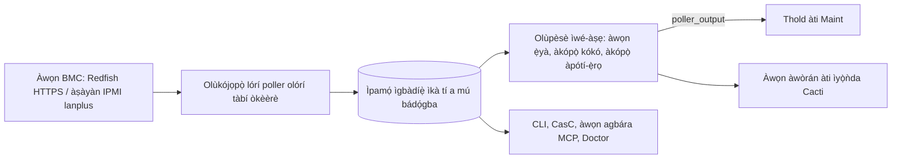

<!-- Source: README.md; SHA256: cf31b9f80d6c00020bbe08e80951d4de1c910793911d040ae7a66b54e8a2eaf0 -->

<!-- translations:start -->
[English](../../../README.md) | [简体中文](../zh-CN/README.md) | [हिन्दी](../hi-IN/README.md) | [Español (España)](../es-ES/README.md) | [Español (Latinoamérica)](../es-419/README.md) | [العربية (السعودية)](../ar-SA/README.md) | [Afrikaans](../af-ZA/README.md) | [አማርኛ](../am-ET/README.md) | [العربية (مصر)](../ar-EG/README.md) | [العربية (المغرب)](../ar-MA/README.md) | [বাংলা](../bn-BD/README.md) | [Bosanski](../bs-BA/README.md) | [Deutsch](../de-DE/README.md) | [فارسی](../fa-IR/README.md) | [Filipino](../fil-PH/README.md) | [Français](../fr-FR/README.md) | [Français (Maroc)](../fr-MA/README.md) | [Français (Sénégal)](../fr-SN/README.md) | [Hausa](../ha-NG/README.md) | [עברית](../he-IL/README.md) | [Hrvatski](../hr-HR/README.md) | [Bahasa Indonesia](../id-ID/README.md) | [Igbo](../ig-NG/README.md) | [Italiano](../it-IT/README.md) | [日本語](../ja-JP/README.md) | [한국어](../ko-KR/README.md) | [Malagasy](../mg-MG/README.md) | [मराठी](../mr-IN/README.md) | [Bahasa Melayu](../ms-MY/README.md) | [Nederlands](../nl-NL/README.md) | [Polski](../pl-PL/README.md) | [Português (Brasil)](../pt-BR/README.md) | [Русский](../ru-RU/README.md) | [Kinyarwanda](../rw-RW/README.md) | [Soomaali](../so-SO/README.md) | [Српски](../sr-RS/README.md) | [Svenska](../sv-SE/README.md) | [Kiswahili](../sw-KE/README.md) | [தமிழ்](../ta-IN/README.md) | [తెలుగు](../te-IN/README.md) | [ไทย](../th-TH/README.md) | [Türkçe](../tr-TR/README.md) | [Українська](../uk-UA/README.md) | [اردو](../ur-PK/README.md) | [Tiếng Việt](../vi-VN/README.md) | [isiXhosa](../xh-ZA/README.md) | [Yorùbá](README.md) | [繁體中文](../zh-TW/README.md) | [isiZulu](../zu-ZA/README.md)
<!-- translations:end -->

# plugin_redfish

Àfikún Cacti 1.2 tí ó ń mú lílo iná mànàmáná olùpèsè-ẹ̀rọ, ìgbóná ibi àtẹ̀gùn wíwọlé, ipò afẹ́fẹ́ ìtutù, àti ìlera ohun èlò agbára iná láti inú àwọn olùdarí ìṣàkóso pátákó ìpìlẹ̀ (BMCs) wọ inú Cacti gẹ́gẹ́ bí àwọn ẹ̀rọ lásán, àwọn orísun dátà, àti àwọn àwòrán ìṣirò, nípa lílo Redfish pẹ̀lú àṣàyàn IPMI kíkà-nìkan bí ìpadàsẹ́yìn àti àpapọ̀ agbára iná ní ìwọ̀n àpótí-ẹ̀rọ. Thold àti Maint ń fi ìkìlọ̀ ránṣẹ́ wọ́n sì ń dákẹ́ wọn nípasẹ̀ àwọn orísun dátà Cacti déédéé.

> **Ipò: ìdàgbàsókè ń lọ lọ́wọ́, kò tíì sí ìtẹ̀jáde kankan (`0.1.0-dev`).** Àfikún yìí kò ní àjọṣepọ̀ kankan pẹ̀lú iṣẹ́ àkànṣe Cacti. Ó ń fi sórí Cacti 1.2.31 tàbí èyí tó tuntun jù lọ lábẹ́ PHP 8.2 tàbí èyí tó tuntun jù lọ, ó sì ń ṣe àgbékalẹ̀ olùkójọpọ̀ Redfish, àpótí ìpamọ́ ìwé-ẹ̀rí tí a fi àṣírí pamọ́, ìpèsè ẹ̀rọ àti àwòrán Cacti, àṣàyàn ìpadàsẹ́yìn IPMI kíkà-nìkan, àpapọ̀ agbára àpótí-ẹ̀rọ, ìfihàn fèrèsé Cacti Maint, ìṣàdàkọ olùkójọpọ̀ dátà òkèèrè àti àwọn ibi ìparí aṣojú, olùpèsè CasC àti CLI olùṣiṣẹ́, àwọn agbára MCP, àti àwọn àyẹ̀wò ìwádìí Doctor. CI ń dán àwọn àpẹẹrẹ ìdánwò, DMTF Redfish Mockup Server (àwọn àfarawé ètò abẹ́lẹ̀, ti àtijọ́ nìkan, àti HPE iLO Gen11), àti Thold v1.8.2 pẹ̀lú Maint v1.3 wò; kò sí BMC gidi tàbí àkójọ ẹ̀rọ ìdánwò kankan tí a tíì fọwọ́ sí. Àgbékalẹ̀ àti ìwádìí wà nínú [docs/PLAN.md](../../PLAN.md), [docs/research/](../../research/), àti [docs/decisions/](../../decisions/).

## Àwọn agbára tí a ti gbé kalẹ̀

### Olùkójọpọ̀ pàtàkì, àpótí ìpamọ́ àṣírí, àti àwọn ohun Cacti

- **Ìyípo ìgbésí-ayé àti ìtòlẹ́sẹẹsẹ tábìlì.** Ó ń fi sílẹ̀, ó ń sọ di tuntun, ó ń pa á, ó sì ń yọ ọ́ kúrò nípasẹ̀ API àfikún Cacti (`Schema::VERSION = 3`, tábìlì 12). Àwọn tábìlì á wà níbẹ̀ nígbà yíyọ kúrò àyàfi tí a bá yọ àmì kúrò ní *Keep Plugin Tables on Uninstall*. Àwọn ibi ìwọlé ṣeé kà lórí PHP 8.0 wọ́n sì ń kọ̀ PHP tí kò tó 8.2 tàbí àìsí `ext-openssl` pẹ̀lú ìfiránṣẹ́ àṣìṣe tí ó ṣe kedere.
- **Ìwé àkọsílẹ̀ àti àwọn ìyọ̀ǹda.** Àwọn àgbègbè *Redfish View* (`redfish_health.php`), *Redfish Operator* (`redfish_operator.php`), àti *Redfish Admin* (`redfish_bmcs.php`, `redfish_credentials.php`), pẹ̀lú àwọn ìtòlẹ́sẹẹsẹ lábẹ́ **Configuration > Settings > Redfish**. Ìwé àkọsílẹ̀ BMC ń ṣe àtìlẹ́yìn fún gbígba wọlé CSV (a ń tọ́ka sí àwọn ìwé-ẹ̀rí nípa orúkọ; a ń kọ̀ ọ̀rọ̀ aṣínà nínú àwọn fáìlì ìgbáwọlé) àti gbígbé jáde JSON. Àwọn àkọsílẹ̀ BMC àti àwọn ìwé-ẹ̀rí ń tẹ̀lé àwọn ìyọ̀ǹda ẹ̀rọ Cacti.
- **Àpótí ìpamọ́ ìwé-ẹ̀rí tí a fi àṣírí pamọ́.** A ń fi àwọn ọ̀rọ̀ aṣínà pamọ́ pẹ̀lú ìpamọ́ àṣírí AES-256-GCM nínú `plugin_redfish_secret`. Kọ́kọ́rọ́ náà ń gbé níta ibi ìpamọ́ dátà (`/etc/cacti/redfish-vault.key` gẹ́gẹ́ bí àiyípadà) gẹ́gẹ́ bí lẹ́tà hex 64 (`openssl rand -hex 32`) tàbí báìtì aláìṣẹ̀dá 32, tí olùlò poller jẹ́ oní rẹ̀, tí àwọn olùlò mìíràn kò lè kà, nínú àpò-ìwé tí root tàbí olùlò yẹn nìkan lè kọ sí i. A ń kọ̀ gbólóhùn aṣínà tó ṣeé tẹ̀ jáde tó ní lẹ́tà 32. **Ṣe àtìlẹ́yìn ẹ̀dà fáìlì kọ́kọ́rọ́ náà pẹ̀lú ibi ìpamọ́ dátà**; láìsí rẹ̀, a gbọ́dọ̀ tún àwọn ọ̀rọ̀ aṣínà tí a fi pamọ́ tẹ̀ wọlé.
- **TLS àti oníbàárà Redfish kíkà-nìkan.** Ìfìdí múlẹ̀ TLS wà ní títàn gẹ́gẹ́ bí àiyípadà nípa lílo ibi ìpamọ́ CA ètò, àkójọ CA fún BMC kọ̀ọ̀kan, tàbí ìsopọ̀ SPKI SHA-256; yíyọ kúrò ní àìfìdí múlẹ̀ fún BMC kọ̀ọ̀kan ń hàn gẹ́gẹ́ bí ìkìlọ̀ ìlera àti ìkìlọ̀ àyẹ̀wò Doctor. Oníbàárà ń gba `GET` nìkan pẹ̀lú ìwọlé ìgbà Redfish (`POST`) àti ìjáde (`DELETE`), pẹ̀lú àṣàyàn ìpadàsẹ́yìn Basic fún BMC kọ̀ọ̀kan nígbà tí àwọn ìgbà kò bá sí. Ìwádìí ń fẹ́ àwọn ohun èlò ètò abẹ́lẹ̀ àti sensọ Redfish tuntun ní àkọ́kọ́ ó sì ń padà sẹ́yìn sí àwọn ohun èlò `Power` àti `Thermal` tí a ti fi sílẹ̀.
- **Ìṣiṣẹ́ olùkójọpọ̀.** `poller_redfish.php` ń bẹ̀rẹ̀ láti `poller_bottom`, ó ń ṣiṣẹ́ ìlànà olórí kan fún poller kọ̀ọ̀kan nípasẹ̀ ìwé àkọsílẹ̀ ìlànà Cacti pẹ̀lú àwọn ìlànà òṣìṣẹ́ tí a lè ṣètò (`redfish_workers`), ó ń gba ìyáwò fún BMC kọ̀ọ̀kan, ó ń fi ààlà àkókò (`redfish_collector_budget`) sílẹ̀, ó ń lo ìdádúró onígbà-púpọ̀, ó sì ń nu ìgbà tẹ́lẹ̀ ti àfikún fúnra rẹ̀ lẹ́yìn ìkọsẹ̀.
- **Àwọn àdàkọ, ẹ̀rọ, àti àwọn àwòrán ìṣirò.** Ó ń gba `templates/redfish-templates.xml` wọlé nípa hash ó sì ń ṣe ẹ̀dà àwọn fáìlì XML ìbéèrè dátà olùpèsè ìwé-àṣẹ mẹ́ta (`redfish_fans.xml`, `redfish_temperatures.xml`, `redfish_psus.xml`) sínú `<cacti>/resource/script_server/` láìpa àwọn fáìlì tí olùlò ṣàtúnṣe rẹ́. **Create Device** àti **Add Graphs** nílò ìfìdí múlẹ̀ ètò ìpèsè, wọ́n ń so àwọn ìbéèrè mọ́ ẹ̀rọ olùpèsè tí a yàwòrán tàbí ṣẹ̀dá ẹ̀rọ "Redfish BMC" kan lábẹ́ `.invalid` pẹ̀lú àwọn àyẹ̀wò wíwà ní ìpapamọ́, wọ́n sì ń so àwòrán Redfish kọ̀ọ̀kan padà mọ́ àwọn àwòrán Redfish ti ẹ̀rọ náà nípasẹ̀ `graph_buttons`.
- **Àwọn àbáwọlé olùpèsè ìwé-àṣẹ ti ìpamọ́ ìgbàdíẹ̀ nìkan.** `scripts/ss_redfish_members.php` ń pèsè àwọn ìkà afẹ́fẹ́ ìtutù, ìgbóná, àti PSU fún ẹ̀yà kọ̀ọ̀kan, `scripts/ss_redfish_summary.php` sì ń pèsè àwọn ìwọ̀n "Redfish Node Summary" (agbára iná, ìgbóná wíwọlé àti tó ga jù lọ, iye afẹ́fẹ́ ìtutù àti PSU tó bàjẹ́, ìlera kókó, àti ọjọ́-orí ìkà tó dára kẹ́yìn). Àwọn ìpè olùpèsè ìwé-àṣẹ ń ka ìpamọ́ ìgbàdíẹ̀ abẹ́lé nìkan wọn kì í sì í kan sí BMC kankan láéláé. Àwọn ìkà tó sọnù, tó ti gbó, tàbí ti ẹ̀yà tó ti lọ ń dá `U` padà (kì í ṣe `0` láéláé), nígbà tí `age` ń ròyìn ìwọ̀n nígbà gbogbo kí àwọn ààlà lè ṣàwárí àwọn BMC tó dákẹ́.

**Nígbà tí àwọn ẹ̀yà BMC bá yípadà** (gẹ́gẹ́ bí afẹ́fẹ́ ìtutù tí a pààrọ̀ tàbí ìmúdójúìwọ̀n firmware tí ó yí orúkọ àwọn sensọ padà), tún **Add Graphs** ṣiṣẹ́. Afẹ́fẹ́ ìtutù tàbí ohun èlò agbára iná tó ti wà tẹ́lẹ̀ tí kò sí mọ́ á jẹ́ kíkà sínú `fans_bad` tàbí `psus_bad` títí a ó fi gbà á; ààyè tí kò tíì sí nǹkan kan níbẹ̀ rí kì í jẹ́ kíkà. Àwọn ẹ̀yà tó ti lọ ń pa àwọn orísun dátà àti àwọn àwòrán ìṣirò wọn tó wà tẹ́lẹ̀ mọ́, èyí tí yóò máa ka `U` lẹ́yìn náà títí a ó fi pa wọ́n rẹ́ lọ́wọ́. Pípa ẹ̀rọ Cacti kan rẹ́ ń yọ ìyàwòrán BMC rẹ̀ kúrò ó sì ń yọ ìpín àpótí-ẹ̀rọ rẹ̀ kúrò nígbà tí ó ń pa BMC àti ìpamọ́ ìgbàdíẹ̀ mọ́; pípa BMC kan rẹ́ tàbí yíyọ àfikún náà kúrò ń pa àwọn ẹ̀rọ àti àwọn àwòrán ìṣirò Cacti mọ́.

### Àṣàyàn IPMI bí ìpadàsẹ́yìn

- **Ìyàn fún BMC kọ̀ọ̀kan.** Ó wà ní pípa gẹ́gẹ́ bí àiyípadà (`protocols` jẹ́ `redfish` gẹ́gẹ́ bí àiyípadà; títàn ìpadàsẹ́yìn IPMI ń ṣètò `redfish,ipmi`).
- **Ìtọ́ka ìpadàsẹ́yìn oníwọ̀n.** Ó ń ṣiṣẹ́ nìkan nígbà tí ìkójọpọ̀ Redfish bá kùnà pẹ̀lú ìsọ̀rí ìkùnà tó yẹ; kì í ṣiṣẹ́ láéláé lórí `AuthRejected`, `CredentialUnavailable`, `AddressRefused`, `OperationRefused`, tàbí `Deadline`.
- **Ìṣiṣẹ́ aláàbò.** Ó ń pe `ipmitool` lórí `-I lanplus` nípasẹ̀ `proc_open()` oní-array láìsí shell, pẹ̀lú ààlà àkókò gidi àti ààlà ìjáde 256 KiB. A ń pèsè ọ̀rọ̀ aṣínà nípasẹ̀ `IPMITOOL_PASSWORD` (`-E`) tàbí fáìlì ìgbàdíẹ̀ mode-0600 (`-f`) tí a pa rẹ́ nínú `finally`, kì í ṣe lórí CLI argv láéláé.
- **Àtòjọ àṣẹ kíkà-nìkan tí a gbà láyè.** Àwọn àṣẹ abẹ́lé kíkà-nìkan márùn-ún nìkan ni a gbà láyè: `dcmi power reading`, `sdr type Temperature`, `sdr type Fan`, `sdr type Power Supply`, àti `chassis status`. A ń kọ̀ àwọn àṣẹ tí ń yí ipò padà.
- **Ìjáde tí a mú bádọ́gba àti ìkìlọ̀ ipò ààbò.** `IpmiNormalizer` ń ya àwọn ìkà sínú àpẹẹrẹ `Observation`/`Member`/`Reading` kan náà, ó sì ń tú `U` jáde fún àwọn sensọ tó sọnù tàbí tí kò ṣeé túmọ̀. Títàn ìpadàsẹ́yìn IPMI ń gbé ìkìlọ̀ dìde lórí ojú-ewé ìlera àti nínú àyẹ̀wò Doctor `redfish.bmc_security` láti rán àwọn olùṣiṣẹ́ létí pé kí wọ́n dín UDP 623 kù sí VLAN ìṣàkóso kan.

### Àpapọ̀ agbára iná àpótí-ẹ̀rọ

- **Ìwé àkọsílẹ̀ àpótí-ẹ̀rọ.** Ẹ̀yà ìtòlẹ́sẹẹsẹ 3 ń fi `plugin_redfish_rack` (`(site_id, name)` àrà ọ̀tọ̀, `power_budget_watts` àṣàyàn, `min_coverage_pct` tó jẹ́ `80` gẹ́gẹ́ bí àiyípadà, àti àwọn àkíyèsí) àti `plugin_redfish_rack_member` (ìpín àpótí-ẹ̀rọ kan péré fún `host_id` kọ̀ọ̀kan, `bmc_id` àti `unit_position` àṣàyàn, tí a ń yọ kúrò fúnra rẹ̀ nígbà tí a bá pa ẹ̀rọ Cacti rẹ́) kún un.
- **Àpapọ̀ tí a dáàbò bo pẹ̀lú ìwọ̀n ìbòrí.** `RackPowerSummary` ń ṣàropọ̀ àwọn ìkà `power_watts` tuntun ti àwọn ẹ̀yà láti inú ìpamọ́ ìgbàdíẹ̀ abẹ́lé ó sì ń ṣírò lílo ìnáwó àti ààyè tó kù. Nígbà tí ìbòrí àwọn ẹ̀yà tí ń ròyìn bá lọ sílẹ̀ ju `min_coverage_pct`, `power_watts`, `utilization_pct`, àti `headroom_watts` ń dá `U` padà kí ìkùnà olùkójọpọ̀ má ṣe hàn gẹ́gẹ́ bí ìdínkù nínú agbára àpótí-ẹ̀rọ láéláé.
- **Àbáwọlé olùpèsè ìwé-àṣẹ tó ṣetán fún Thold.** `scripts/ss_redfish_rack.php` (`ss_redfish_rack(<rack_id>)`) ń dá `power_watts`, `power_budget_watts`, `utilization_pct`, `headroom_watts`, `members_total`, `members_reporting`, àti `coverage_pct` padà láti inú ìpamọ́ ìgbàdíẹ̀ abẹ́lé nìkan.

### Ìsopọ̀ Cacti Maint

- Àwọn ààlà Thold lórí àwọn orísun dátà Redfish ń kìlọ̀, Cacti Maint sì ń dákẹ́ wọn láìsí àtúnṣe kankan sí èyíkéyìí nínú àwọn àfikún méjèèjì.
- `MaintWindow` ń ṣàyẹ̀wò àwọn ìtòlẹ́sẹẹsẹ àkókò Maint tó ń ṣiṣẹ́ fún olùgbàlejò Cacti kọ̀ọ̀kan tí a yàwòrán (àwọn ìtòlẹ́sẹẹsẹ ẹ̀ẹ̀kan `mtype=1` àti àwọn tó ń túnṣe `mtype=2`, pẹ̀lú `plugin_maint_check_cacti_host()` nígbà tí a bá kó o wọlé) ó sì ń sàmì sí ìtọ́jú tó ń lọ lọ́wọ́ lórí ojú-ewé Redfish Health (`[MAINT]`), nínú àbájáde `cli/redfish.php health`, àti nínú agbára `redfish-get-health`.

### Àwọn olùkójọpọ̀ dátà òkèèrè

- `INFO` ń kéde `remote_collect:1`. Àwọn BMC ń gba èyíkéyìí `poller_id >= 1`, `poller_redfish.php --poller=N` sì ń kó àwọn BMC tí a tàn tí a yàn fún poller yẹn nìkan jọ.
- **Ìkọ́ `replicate_out`.** Ó ń ṣàdàkọ àwọn tábìlì ìṣètò tí kì í ṣe àṣírí nìkan tí a pààlà sí poller òkèèrè àfojúsùn nípasẹ̀ `replicate_out_table()`: `plugin_redfish_bmc`, metadata `plugin_redfish_credential` (láìsí ọ̀rọ̀ àṣírí), `plugin_redfish_rack`, àti `plugin_redfish_rack_member`. A kì í ṣàdàkọ `plugin_redfish_secret`, àwọn fáìlì kọ́kọ́rọ́ àpótí ìpamọ́ sì ń wà ní abẹ́lé pátápátá lórí poller kọ̀ọ̀kan.
- **Ìkọ́ `remote_agent`.** Ó ń ṣí àwọn ìṣe kíkà-nìkan `redfish_health` àti `redfish_discovery` sílẹ̀ tí wọ́n ń gba àwọn àmì nọ́ńbà `poller_id` àti `bmc_id` nìkan. A ń kọ̀ àwọn àmì tí a kò retí, kò sì sí ìwé-ẹ̀rí tàbí àṣírí kankan tí a ń dá padà.

### Àwọn ìkọ́ ètò àyíká (CasC, àwọn agbára MCP, àti Doctor)

- **Olùpèsè CasC (`casc_register_providers`).** Ó ń forúkọsílẹ̀ olùpèsè `redfish` (ẹ̀yà ìtòlẹ́sẹẹsẹ `1`) pẹ̀lú ìgbéjáde YAML àti XML ti PHP mímọ́, ìtumọ̀ (pẹ̀lú kíkọ̀ XXE), ìfìdí múlẹ̀, ìṣètò ìyàtọ̀, àti ìmúlò. Àwọn ìwé-ẹ̀rí ń hàn gẹ́gẹ́ bí ìtọ́kasí àpótí ìpamọ́ nìkan (`vault:redfish:<name>`); a ń kọ̀ àwọn kọ́kọ́rọ́ àṣírí aláìṣẹ̀dá (`pass`, `secret`, `token`, `private_key`, `vault_key`, `auth_token`). Ìmúlò nílò SHA-256 `PLAN_HASH` pàtó.
- **MCP / Abilities API (`abilities_register`).** Ó ń forúkọsílẹ̀ àwọn agbára kíkà-nìkan mẹ́ta tí a dè mọ́ àgbègbè Redfish View (`redfish_health.php`) àti àwọn ìyọ̀ǹda ẹ̀rọ Cacti, láìdá ìwé-ẹ̀rí kankan padà:
  - `redfish-list-bmcs` (`poller_id` àṣàyàn)
  - `redfish-get-rack-power` (`rack_id` àṣàyàn)
  - `redfish-get-health` (`bmc_id` àṣàyàn)
- **Àwọn àyẹ̀wò Doctor (`doctor_register_checks`).** Ó ń forúkọsílẹ̀ àwọn àyẹ̀wò ìwádìí abẹ́lé kíkà-nìkan márùn-ún tí kì í kan sí BMC tàbí dá ohun èlò kọ́kọ́rọ́ padà láéláé:
  - `redfish.schema`: ìbátan àkókò ẹ̀yà ìtòlẹ́sẹẹsẹ
  - `redfish.vault_key`: kíkà àti àwọn ìyọ̀ǹda kọ́kọ́rọ́ àpótí ìpamọ́
  - `redfish.collector_runs`: ìnáwó àkókò àti tútù olùkójọpọ̀ poller
  - `redfish.bmc_security`: àwọn BMC tí a tàn pẹ̀lú TLS tí kò fìdí múlẹ̀ tàbí ìpadàsẹ́yìn IPMI
  - `redfish.rack_power`: ìbámu ìnáwó agbára àpótí-ẹ̀rọ àti ìwọ̀n ìbòrí tó kéré jù

## CLI

Ṣiṣẹ́ láti inú àpò-ìwé gbòǹgbò Cacti pẹ̀lú PHP 8.2 tàbí èyí tó tuntun jù lọ:

```sh
# Operator and CasC CLI (reads --file=PATH or stdin for validate, plan, and apply)
php plugins/redfish/cli/redfish.php export --format=yaml|xml
php plugins/redfish/cli/redfish.php validate [--file=PATH] [--format=yaml|xml]
php plugins/redfish/cli/redfish.php plan [--file=PATH] [--format=yaml|xml]
php plugins/redfish/cli/redfish.php apply [--file=PATH] [--format=yaml|xml] --confirm=<PLAN_HASH>
php plugins/redfish/cli/redfish.php health --format=text|json

# Collector entry point (normally started by poller_bottom)
php plugins/redfish/poller_redfish.php [--poller=N] [--force] [--debug]

# Rack power summary script server entry point
php plugins/redfish/scripts/ss_redfish_rack.php <rack_id>
```

## Àwọn ipa ìwọlé

| Àgbègbè | Ìwọlé |
| --- | --- |
| Redfish View | Àwọn ojú-ewé àbójútó tó wà tẹ́lẹ̀. |
| Redfish Operator | Àbójútó pẹ̀lú ojú-ewé Ìṣiṣẹ́ àti àwọn ìjẹ́wọ́ ìtọ́pinpin ti ara ẹni. |
| Redfish Admin | Ìwọlé Operator pẹ̀lú ìṣètò tó wà tẹ́lẹ̀ àti àwọn ìṣe ìṣàkóso. |

Lẹ́yìn ṣíṣe ẹ̀dà àwọn fáìlì ìmúdójúìwọ̀n, ṣí ojú-ewé Plugins gẹ́gẹ́ bí alámòójútó láti forúkọsílẹ̀ àwọn àgbègbè. Yàn àgbègbè Operator ní gbangba lábẹ́ **Configuration > Users** tàbí àwọn àwùjọ olùlò. Àwọn ìmúdójúìwọ̀n ń pa àwọn ID àti ìfúnni àgbègbè View àti Admin tó wà tẹ́lẹ̀ mọ́. Ìwọlé Admin ń jogún ìwọlé Operator, ìwọlé Operator sì ń jogún ìwọlé View lórí ìbéèrè kọ̀ọ̀kan; èyí kì í fi àwọn ìfúnni tí a fipamọ́ kún fún àwọn olùlò tàbí àwọn àwùjọ. Àwọn ìtòlẹ́sẹẹsẹ àfikún tún nílò ìwọlé Redfish Admin ní àfikún sí ìyọ̀ǹda Settings ti Cacti.

Àwọn ìyọ̀ǹda ẹ̀rọ Cacti ń dín àwọn ìlà àti àwọn ìṣe tí ó wà fún olùlò kọ̀ọ̀kan kù; àwọn ohun tí a kò yàwòrán nílò alámòójútó. Àwọn olùṣiṣẹ́ lè tú ìdádúró ìkójọpọ̀ sílẹ̀ lórí BMC tí a gbà láyè fún ìṣiṣẹ́ tí a ṣètò tó ń bọ̀. Àwọn ìwé-ẹ̀rí, ìṣètò, ìyàwòrán, pípa rẹ́, àti àwọn àyípadà ìṣàkóso mìíràn wà nínú àwọn ojú-ewé ìṣàkóso. Àwọn ìjẹ́wọ́ ń wà nínú ìgbà olùlò lọ́wọ́lọ́wọ́ nìkan, fún wákàtí kan péré ní àpọ̀jù àti nígbà tí àkíyèsí kan náà bá ṣì jẹ́ tuntun nìkan. Àwọn àkíyèsí tuntun tàbí tí ó yípadà ń sọ wọ́n di asán. Wọn kì í sàmì sí ìwọ̀n tó kùnà gẹ́gẹ́ bí èyí tó ní ìlera tàbí dákẹ́ àwọn ìkìlọ̀ láéláé.

## Ìdí rẹ̀

Olùpèsè-ẹ̀rọ kọ̀ọ̀kan ní BMC tí ń ròyìn ipò agbára iná àti ìgbóná ní òmìnira kúrò lọ́wọ́ ètò ìṣiṣẹ́, nítorí náà ó ń tẹ̀síwájú láti dáhùn nígbà tí OS bá wà ní ìsàlẹ̀. Dátà náà ń ṣiṣẹ́ fún títọ́pa agbára àti iye owó, ìkìlọ̀ kùtùkùtù ti afẹ́fẹ́ ìtutù tàbí ohun èlò agbára iná tó bàjẹ́, àti, nínú ìṣirò agbára gíga, àwọn ìpinnu dídín agbára kù. Àfikún náà kì í ṣe fún HPC nìkan.

Cacti bo apá kan èyí lónìí:

- **Àwọn àkójọ SNMP olùtajà.** Ẹ̀ka 1.2.x ń gbé àwọn àdàkọ Dell iDRAC àti HPE iLO wá tí wọ́n nílò aṣojú SNMP tí wọ́n sì jẹ́ ti olùtajà pàtó; ìwádìí ibi-àfojúsùn 1 rí i pé kò sí èyíkéyìí nínú wọn tí ń ròyìn lílo agbára iná ní watts ([docs/research/overlap.md](../../research/overlap.md)).
- **Irú ìwé-ẹ̀rí láìsí olùkójọpọ̀.** `plugin_credentials` ń ṣàlàyé ìwé-ẹ̀rí "IPMI / Redfish (BMC)" ṣùgbọ́n kò ka BMC kankan.
- **Kò sí ìwòran ní ìwọ̀n àpótí-ẹ̀rọ.** Kókó Cacti kò ní ohun àpótí-ẹ̀rọ; ẹ̀rọ kan ní ààyè ọ̀rọ̀ ọ̀fẹ́ `location`.

Àfikún náà ń ṣe ìwádìí àwọn BMC ní ìta ìyípo ìwádìí Cacti lórí poller olórí tàbí àwọn olùkójọpọ̀ dátà òkèèrè, ó ń fi àwọn ìkà tí a mú bádọ́gba pamọ́ sí ìpamọ́ ìgbàdíẹ̀, ó sì ń ṣí wọn sílẹ̀ nípasẹ̀ àwọn ìbéèrè dátà olùpèsè ìwé-àṣẹ, àwọn àkópọ̀ kókó, àti àwọn àkópọ̀ agbára àpótí-ẹ̀rọ. Ó ń tún ìyàwòrán Cacti, àwọn ìyọ̀ǹda, Thold, àti Maint lò, kò sì yí ipò BMC padà.

## Ààlà àti ipò

| Ìpele | Ààlà | Àwọn ibi-àfojúsùn | Ipò |
|---|---|---|---|
| 0, ìwádìí | Tábìlì olùtajà, ìfìdí múlẹ̀ ìhùwàsí ètò òkè lórí àwọn BMC gidi, iye owó ìwádìí, ìdánwò ìbéèrè dátà | [M1](https://github.com/somethingwithproof/plugin_redfish/milestone/1) | Ti parí, ó ń dúró de àwọn àkọsílẹ̀ firmware BMC gidi |
| 1, àkíyèsí | Ìwé àkọsílẹ̀ BMC, àwọn ìwé-ẹ̀rí, TLS, olùkójọpọ̀ Redfish, àwọn ìkà tí a mú bádọ́gba, àwọn ẹ̀rọ, àwọn àwòrán fún àtọ́ka kọ̀ọ̀kan, ìkìlọ̀ Thold, ìsopọ̀ Maint, ojú-ewé ìlera | [M2](https://github.com/somethingwithproof/plugin_redfish/milestone/2), [M3](https://github.com/somethingwithproof/plugin_redfish/milestone/3), [M4](https://github.com/somethingwithproof/plugin_redfish/milestone/4) | Ti gbé kalẹ̀; ìfọwọ́sí àkójọ ẹ̀rọ ìdánwò M4 ṣì kù |
| 2, ipmi | Ìpadàsẹ́yìn IPMI kíkà-nìkan (`lanplus`) nípasẹ̀ `ipmitool`, pípa gẹ́gẹ́ bí àiyípadà | [M5](https://github.com/somethingwithproof/plugin_redfish/milestone/5) | Ti gbé kalẹ̀ |
| 3, àwọn àpótí-ẹ̀rọ | Ìwé àkọsílẹ̀ àpótí-ẹ̀rọ, àpapọ̀ agbára àpótí-ẹ̀rọ pẹ̀lú ìwọ̀n ìbòrí tó kéré jù, ààyè ìnáwó, `ss_redfish_rack.php` | [M6](https://github.com/somethingwithproof/plugin_redfish/milestone/6) | Ti gbé kalẹ̀ |
| 4, òkèèrè àti ètò àyíká | Àwọn olùkójọpọ̀ dátà òkèèrè (`replicate_out`, `remote_agent`), olùpèsè CasC àti CLI, àwọn agbára MCP, àwọn àyẹ̀wò Doctor | [M7](https://github.com/somethingwithproof/plugin_redfish/milestone/7) | Ti gbé kalẹ̀ |

Líta ààlà: ṣíṣètò ààlà agbára tàbí ìṣètò BMC mìíràn kankan, ìṣàkóso agbára, ìmúdójúìwọ̀n firmware, ìwọlé kọ́ńsólù, ẹ̀rọ ìkìlọ̀ tí àfikún ni, àti ìsopọ̀ olùṣètò àkókò.

## Àwọn àfojúsùn ìbámu

| Ẹ̀yà | Àfojúsùn |
|---|---|
| Cacti | 1.2.31 tàbí èyí tó tuntun jù lọ, láìsí àtúnṣe kókó |
| Ibi ìpamọ́ dátà | MariaDB 10.2 tàbí MySQL 5.7 tàbí èyí tó tuntun jù lọ: BMC kan fún ẹ̀rọ kọ̀ọ̀kan jẹ́ dídámú nípasẹ̀ kọ́kọ́rọ́ àrà ọ̀tọ̀ lórí ọ̀wọ̀n tí a ṣẹ̀dá |
| PHP | 8.2 tàbí èyí tó tuntun jù lọ; àwọn ibi ìwọlé wà ní ṣíṣeé kà lórí 8.0 kí àyíká ìṣiṣẹ́ tí a kò ṣe àtìlẹ́yìn fún lè gba ìkọ̀sílẹ̀ dípò UI Cacti tó bàjẹ́ |
| Àwọn àfikún PHP | `ext-openssl` (tí Cacti 1.2.31 nílò); kò sí `ext-curl` kò sì sí ìgbẹ́kẹ̀lé àkókò ìṣiṣẹ́ Composer |
| Àwọn irinṣẹ́ àṣàyàn | `ipmitool` lórí àwọn poller tí ń kó àwọn BMC tí ó ní ìpadàsẹ́yìn IPMI ní títàn jọ |
| Àwọn BMC | Dell iDRAC, HPE iLO, Lenovo XCC, àti OpenBMC, nípa ìlà firmware; wo [tábìlì olùtajà](../../research/vendor-matrix.md) |
| Redfish | Àwọn ohun èlò ètò abẹ́lẹ̀ àti sensọ tuntun ní àkọ́kọ́, `Power` àti `Thermal` tí a ti fi sílẹ̀ bí ìpadàsẹ́yìn |
| Thold, Maint | Kò sí àyípadà tí a nílò (CI ń dán Thold v1.8.2 àti Maint v1.3 wò) |

## Àgbékalẹ̀

- [docs/PLAN.md](../../PLAN.md) ni ètò kíkún: ìṣètò ilé, àwọn òtítọ́ ètò òkè tí ó gbẹ́kẹ̀ lé, àpẹẹrẹ ìwọ̀n, àwọn ààlà ààbò, ìṣirò ìṣiṣẹ́, ìdánwò, àti àwọn ewu.
- [docs/decisions/](../../decisions/) ń gbé àwọn àkọsílẹ̀ ìpinnu ìṣètò ilé fún àwọn àṣàyàn tí a ti ṣe tẹ́lẹ̀.
- [docs/REQUIREMENTS.md](../../REQUIREMENTS.md) ń ya ID ìbéèrè kọ̀ọ̀kan sí ọ̀ràn rẹ̀.



## Ààbò

Àwọn ìwé-ẹ̀rí BMC ń darí ìṣàkóso òde-bándì ti àwọn olùpèsè-ẹ̀rọ. Àgbékalẹ̀ náà ń pa àwọn àṣírí mọ́ níta àwọn ìlà àṣẹ, àwọn àkọsílẹ̀ ìṣẹ̀lẹ̀, àwọn ìgbéjáde CasC, àwọn ẹrù aṣojú òkèèrè, àwọn ìdáhùn MCP, àti àwọn ojú-ewé wẹ́ẹ̀bù; ó ń fi àṣírí pamọ́ àwọn ọ̀rọ̀ aṣínà tí a tọ́jú pẹ̀lú AES-256-GCM nípa lílo fáìlì kọ́kọ́rọ́ àpótí ìpamọ́ abẹ́lé fún poller kọ̀ọ̀kan; ó ń fìdí TLS múlẹ̀ gẹ́gẹ́ bí àiyípadà; ó ń ṣiṣẹ́ `ipmitool` láti inú àtòjọ àríyànjiyàn gbangba pẹ̀lú àwọn àṣẹ abẹ́lé kíkà-nìkan tí a gbà láyè; ó sì ń lo àwọn àkọọ́lẹ̀ BMC kíkà-nìkan. Wo [docs/PLAN.md](../../PLAN.md#security) àti [SECURITY.md](../../../SECURITY.md).

## Ìtọ́sọ́nà olùṣiṣẹ́

Wo [docs/operator-guide.md](../../operator-guide.md) fún àwọn àìṣeéṣe ṣáájú ìfisílẹ̀, ìṣètò àpótí ìpamọ́ àṣírí àti TLS, ìforúkọsílẹ̀ BMC, ìṣẹ̀dá àwòrán, àwọn àkókò ìkìlọ̀, àtìlẹ́yìn ẹ̀dà, àti ìtọ́jú ìkùnà. Ìtọ́sọ́nà náà kì í kéde pé a ṣe àtìlẹ́yìn fún ìlà firmware olùtajà gidi kan títí àkọsílẹ̀ tí a ti nu àṣírí kúrò láti inú firmware yẹn yóò fi kọjá ìdánwò.

## Ìdàgbàsókè àti ìdánwò

CI (`.github/workflows/plugin-ci-workflow.yml`) ń yẹ ìtòlẹ́sẹẹsẹ àwọn ibi ìwọlé wò lórí PHP 8.0, ó ń ṣiṣẹ́ àwọn ìdánwò ẹyọ Pest (`phpunit.xml`) àti ìṣọ̀kan ìyípo ìgbésí-ayé (`phpunit-integration.xml`) pẹ̀lú PHPStan ìpele 9 káàkiri PHP 8.2 sí 8.5 lòdì sí Cacti `release/1.2.31` àti `1.2.x`, ó ń fìdí ìkọ̀sílẹ̀ múlẹ̀ lórí PHP 8.1, ó ń dán DMTF Redfish Mockup Server (àwọn àfarawé ètò abẹ́lẹ̀, ti àtijọ́ nìkan, àti HPE iLO Gen11) àti Thold v1.8.2 / Maint v1.3 wò láti ìbẹ̀rẹ̀ dé òpin, ó sì ń yẹ àwọn àkójọ gettext, àwọn ìṣàn iṣẹ́, àti ìwé-àṣẹ REUSE wò.

Àwọn àyẹ̀wò abẹ́lé ṣáájú títì sókè:

```sh
sh tests/lint-workflows.sh
sh locales/build_gettext.sh --check
CACTI_PATH=/path/to/cacti phpstan analyse -c phpstan.neon --no-progress
```

Ṣiṣẹ́ Pest pẹ̀lú `--configuration=phpunit.xml` fún àwọn ìdánwò ẹyọ àti òfin kóòdù orísun, tàbí `--configuration=phpunit-integration.xml` pẹ̀lú `CACTI_PATH` àti `REDFISH_TEST_DATABASE=disposable` lòdì sí ibi ìpamọ́ dátà Cacti tí a lè sọ nù fún àwọn ìdánwò ìṣọ̀kan ìyípo ìgbésí-ayé.

## Báwo ni a ṣe ń tọ́pa iṣẹ́

- **Àwọn ibi-àfojúsùn** ń tẹ̀lé àwọn ibi-àfojúsùn ètò. Ọ̀kọ̀ọ̀kan ní ọ̀ràn epic tí ó ṣàtòjọ àwọn ọ̀ràn abẹ́lẹ̀ rẹ̀ àti ẹ̀rí ìparí.
- **Àwọn ọ̀ràn** jẹ́ pípín nípa àmì: `type: requirement`, `type: research`, `type: decision`, `type: epic`. Àwọn ọ̀ràn ìbéèrè ń sọ àwọn ìbéèrè onínọ́ńbà tí ó ṣeé dán wò (`REQ-AREA-NNN`) àti àwọn ìlànà ìtẹ́wọ́gbà.
- **Àwọn àmì** tún ń gbé `area:`, `phase:`, `priority:`, àti `status:`. Wo [CONTRIBUTING.md](../../../CONTRIBUTING.md#labels).
- [Pátákó iṣẹ́ àkànṣe](https://github.com/users/somethingwithproof/projects/12) ń fi gbogbo ọ̀ràn hàn káàkiri gbogbo ibi-àfojúsùn.

## Ìkópa

Ka [CONTRIBUTING.md](../../../CONTRIBUTING.md). Àwọn commit nílò ìfọwọ́sowọ́pọ̀ DCO. Ìjíròrò àgbékalẹ̀ ń ṣẹlẹ̀ lórí àwọn ọ̀ràn; àwọn ìpinnu tó ṣí sílẹ̀ ń gbé àmì `type: decision`. Ẹ̀rí láti inú àwọn BMC gidi ni ìkópa tó wúlò jù lọ báyìí; yọ àwọn àdírẹ́sì, nọ́ńbà ìtẹ̀léra, àti àwọn ìwé-ẹ̀rí kúrò kí o tó fi àkọsílẹ̀ kankan sórí ayélujara.

## Ìwé-àṣẹ

GNU General Public License v2.0, ìwé-àṣẹ kan náà pẹ̀lú Cacti àti àwọn àfikún rẹ̀. Wo [LICENSE](../../../LICENSE).
