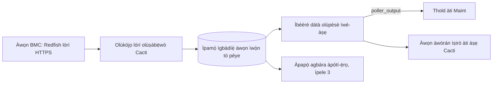

<!-- Source: README.md; SHA256: 7b4e83a58a1adc844cb0615ef30e95476cba2851f96bb454d2a816fb2774724d -->

<!-- translations:start -->
[English](../../../README.md) | [简体中文](../zh-CN/README.md) | [हिन्दी](../hi-IN/README.md) | [Español (España)](../es-ES/README.md) | [Español (Latinoamérica)](../es-419/README.md) | [العربية (السعودية)](../ar-SA/README.md) | [Afrikaans](../af-ZA/README.md) | [አማርኛ](../am-ET/README.md) | [العربية (مصر)](../ar-EG/README.md) | [العربية (المغرب)](../ar-MA/README.md) | [বাংলা](../bn-BD/README.md) | [Deutsch](../de-DE/README.md) | [فارسی](../fa-IR/README.md) | [Filipino](../fil-PH/README.md) | [Français](../fr-FR/README.md) | [Français (Maroc)](../fr-MA/README.md) | [Français (Sénégal)](../fr-SN/README.md) | [Hausa](../ha-NG/README.md) | [עברית](../he-IL/README.md) | [Bahasa Indonesia](../id-ID/README.md) | [Igbo](../ig-NG/README.md) | [Italiano](../it-IT/README.md) | [日本語](../ja-JP/README.md) | [한국어](../ko-KR/README.md) | [Malagasy](../mg-MG/README.md) | [मराठी](../mr-IN/README.md) | [Bahasa Melayu](../ms-MY/README.md) | [Nederlands](../nl-NL/README.md) | [Polski](../pl-PL/README.md) | [Português (Brasil)](../pt-BR/README.md) | [Русский](../ru-RU/README.md) | [Kinyarwanda](../rw-RW/README.md) | [Soomaali](../so-SO/README.md) | [Svenska](../sv-SE/README.md) | [Kiswahili](../sw-KE/README.md) | [தமிழ்](../ta-IN/README.md) | [తెలుగు](../te-IN/README.md) | [ไทย](../th-TH/README.md) | [Türkçe](../tr-TR/README.md) | [Українська](../uk-UA/README.md) | [اردو](../ur-PK/README.md) | [Tiếng Việt](../vi-VN/README.md) | [isiXhosa](../xh-ZA/README.md) | [Yorùbá](README.md) | [繁體中文](../zh-TW/README.md) | [isiZulu](../zu-ZA/README.md)
<!-- translations:end -->

# plugin_redfish

Àfikún Cacti 1.2 tí ó ń mú lílo iná mànàmáná olùpèsè-ẹ̀rọ, ìgbóná ibi àtẹ̀gùn wíwọlé, ipò afẹ́fẹ́ ìtutù, àti ìlera ohun èlò agbára iná láti inú àwọn olùdarí ìṣàkóso pátákó ìpìlẹ̀ (BMCs) wọ inú Cacti gẹ́gẹ́ bí àwọn ẹ̀rọ lásán, àwọn orísun dátà, àti àwọn àwòrán ìṣirò, nípa lílo Redfish pẹ̀lú àṣàyàn IPMI bí ìpadàsẹ́yìn. Lẹ́yìn náà, Thold àti Maint yóò máa fi ìkìlọ̀ ránṣẹ́ tí wọn yóò sì máa dákẹ́ wọn, ìpele tó ń bọ̀ yóò sì fi àpapọ̀ agbára iná ní ìwọ̀n àpótí-ẹ̀rọ kún un.

> **Ipò: ìdàgbàsókè ń lọ lọ́wọ́, kò tíì sí ìtẹ̀jáde kankan (0.1.0-dev).** Àwọn ibi-àfojúsùn 2 (ìpìlẹ̀) àti 3 (àwọn ohun Cacti àti ìkìlọ̀) ti di dídàpọ̀ lórí `main`. Àfikún yìí kò ní àjọṣepọ̀ kankan pẹ̀lú iṣẹ́ àkànṣe Cacti. Ó ń fi sórí Cacti 1.2.31 lábẹ́ PHP 8.2 tàbí èyí tó ga jù bẹ́ẹ̀ lọ, ó ń forúkọsílẹ̀ àwọn BMC àti àwọn ìwé-ẹ̀rí ìwọlé, ó ń ka agbára iná, ìgbóná, àwọn afẹ́fẹ́ ìtutù, àti ìlera ohun èlò agbára iná láti inú BMC kọ̀ọ̀kan lórí Redfish sínú ìpamọ́ ìgbàdíẹ̀ tirẹ̀, ó sì ń fi ìlera ìkójọpọ̀ hàn. Ó ń fi àwọn ẹ̀rọ Cacti, àwọn àwòrán ìṣirò fún ẹ̀yà kọ̀ọ̀kan àti àkópọ̀, àti àtìlẹ́yìn Thold àti Maint kún un nípasẹ̀ àwọn orísun dátà lásán. CI ti dán BMC ayédèrú tí a kọ́ láti inú àwọn àpẹẹrẹ tí a kọ lọ́wọ́ àti olùpèsè àfarawé DMTF Redfish wò; kò sí BMC gidi tàbí àkójọ ẹ̀rọ ìdánwò kankan tí a tíì fọwọ́ sí. Àgbékalẹ̀ àti ìwádìí wà nínú [docs/PLAN.md](../../PLAN.md), [docs/research/](../../research), àti [docs/decisions/](../../decisions).

### Ohun tí ibi-àfojúsùn 2 mú wá

- Fífi sí orí ẹ̀rọ, ìgbésókè, pípa, àti yíyọ kúrò nípasẹ̀ API àfikún ti Cacti, pẹ̀lú pípa àwọn tábìlì mọ́ nígbà tí a bá yọ ọ́ kúrò àyàfi bí a bá pa ètò náà rẹ́. Lórí PHP tó kéré sí 8.2, àfikún náà máa ń kọ̀ láti wọlé tàbí ṣiṣẹ́, yóò sì ṣàlàyé ìdí rẹ̀.
- Àwọn àgbègbè àṣẹ "Redfish View" (ojú-ewé ìlera), "Redfish Operator" (ojú-ewé iṣẹ́ ṣíṣe), àti "Redfish Admin" (àwọn ojú-ewé BMCs àti àwọn ìwé-ẹ̀rí ìwọlé), àti àwọn ètò lábẹ́ Configuration > Settings > Redfish.
- Àkọsílẹ̀ BMC pẹ̀lú gbígbé CSV wọlé àti gbígbé JSON jáde. Àwọn fáìlì ìgbéwọlé kò gbọdọ̀ ní ọ̀rọ̀ aṣínà nínú; a máa ń tọ́ka sí àwọn ìwé-ẹ̀rí ìwọlé nípa orúkọ wọn.
- Àwọn ìwé-ẹ̀rí ìwọlé tí a fi AES-256-GCM pamọ́ lọ́nà ìdáàbòbò. Kọ́kọ́rọ́ náà jẹ́ fáìlì kan níta ibi-ìpamọ́ dátà, `/etc/cacti/redfish-vault.key` ní àkọ́kọ́ṣe, tó ní lẹ́tà hexadecimal 64 (`openssl rand -hex 32`) tàbí báìtì aláìlétò 32 gan-an, tí olùlò poller ni í ṣe tirẹ̀, tí àwọn olùlò mìíràn kò lè kà, nínú àpò-ìwé kan tí olùlò poller tàbí root nìkan lè kọ sí. Kọ́kọ́rọ́ tí ó ní lẹ́tà 32 tí a lè tẹ̀ jáde ni a ó kọ̀ bí ọ̀rọ̀ ìṣínà gígùn. **Ṣe àtìlẹ́yìn ìpamọ́ fáìlì kọ́kọ́rọ́ náà pẹ̀lú ibi-ìpamọ́ dátà**; láìsí rẹ̀, gbogbo ọ̀rọ̀ aṣínà tí a fi pamọ́ ni a gbọdọ̀ tún tẹ̀ sínú.
- Ìjẹ́rìísí TLS wà ní ṣíṣiṣẹ́ ní àkọ́kọ́ṣe, pẹ̀lú àkójọ CA fún BMC kọ̀ọ̀kan tàbí ìdìpọ̀ SPKI SHA-256. Ìyọkúrò láìjẹ́rìí fún BMC kọ̀ọ̀kan tí a kọ sílẹ̀ máa ń wà lórí ojú-ewé ìlera gẹ́gẹ́ bí ìkìlọ̀.
- Olùbáṣepọ̀ Redfish tí ó jẹ́ ti kíkà nìkan: `GET` pẹ̀lú ìwọlé àti ìjáde ìgbà-ìṣẹ́ nìkan, tí a máa ń yẹ̀wò pẹ̀lú àtòjọ àṣẹ kí a tó fi ìbéèrè kankan ránṣẹ́.
- Olùkójọ kan tí a bẹ̀rẹ̀ láti `poller_bottom` fún àwọn BMC lórí olùṣàbẹ̀wò pàtàkì, pẹ̀lú àwọn àkókò ìyáwò àti ààlà àkókò fún BMC kọ̀ọ̀kan, ìdádúró díẹ̀díẹ̀, àti ìtúnṣe lẹ́yìn ìkọ̀sẹ̀ ìgbà-ìṣẹ́ kan ṣoṣo tí àfikún náà kọ sílẹ̀. A kò tíì ṣe àtìlẹ́yìn fún àwọn olùkójọ jíjìnnà; wọ́n nílò ìpinnu tó ṣe kedere lórí bí olùkójọ ṣe ń dé ibi-ìpamọ́ dátà àti kọ́kọ́rọ́ náà (ìpele 4).
- Àwọn àkọsílẹ̀ BMC àti àwọn ìwé-ẹ̀rí ìwọlé ń tẹ̀lé àwọn àṣẹ ẹ̀rọ Cacti: Redfish Admin máa ń rí, yípadà, tí ó sì máa ń so àwọn BMC nìkan lórí àwọn ẹ̀rọ tí wọ́n lè rí, àti àwọn ìwé-ẹ̀rí ìwọlé tí kò sí BMC kankan lórí ẹ̀rọ tó farapamọ́ tó ń lò nìkan.

### Ohun tí ibi-àfojúsùn 3 fi kún un

- Àwọn àwòkọ́ṣe tí a fi ránṣẹ́ gẹ́gẹ́ bí XML àwòkọ́ṣe Cacti nínú `templates/` tí a sì kó wọlé pẹ̀lú ohun èlò ìgbéwọlé ti Cacti fúnra rẹ̀ nígbà ìfiwọlé àti ìgbésókè, tí a ṣàpèjúwe nípasẹ̀ hash, kí ìgbéwọlé lè ṣe àtúnṣe àwọn ohun àfikún náà láìfi nǹkan kan kún un lẹ́ẹ̀mejì. Àwọn fáìlì ìbéèrè dátà mẹ́ta ni a ṣe àdàkọ sí `<cacti>/resource/script_server/` pẹ̀lú hash tí a kọ sílẹ̀; àfikún náà kò ní rọ́pò fáìlì kankan níbẹ̀ tí òun kò kọ, ojú-ewé ìlera sì máa ń kìlọ̀ fún àwọn olùṣàkóso nígbà tí àwọn àwòkọ́ṣe tàbí fáìlì ìbéèrè kan kò bá sí ní ààyè wọn. **Reinstall the Redfish Templates** lórí ojú-ewé BMCs máa ń tún wọn kó wọlé; ó nílò àṣẹ Import Templates ti Cacti.
- **Create Device** tàbí **Add Graphs** lórí BMC kọ̀ọ̀kan ([ADR 0015](../../decisions/0015-attach-to-the-server-device-or-create-one-per-bmc.md)). BMC tí a ti so mọ́ ẹ̀rọ olùpèsè-ẹ̀rọ tó wà tẹ́lẹ̀ máa ń gba àwọn ìbéèrè dátà rẹ̀ àti àwọn àwòrán ìṣirò rẹ̀ lórí ẹ̀rọ náà. BMC tí a kò so mọ́ ẹ̀rọ kankan máa ń gba ẹ̀rọ tuntun láti inú àwòkọ́ṣe ẹ̀rọ "Redfish BMC", pẹ̀lú ìyẹ̀wò wíwà-nílẹ̀ ní pípa àti orúkọ olùgbàlejò lábẹ́ `.invalid`, kí Cacti má ṣe bá BMC náà sọ̀rọ̀ rárá, kí ó má sì fi àdírẹ́sì rẹ̀ hàn rárá. Ní ọ̀nà èyíkéyìí, olùṣàkóso máa ń kọ́kọ́ fọwọ́ sí ètò kan tí ó ṣe àtòjọ ohun tí a óò fi kún un. Àwọn méjèèjì nílò àṣẹ ìṣàkóso ẹ̀rọ Cacti àti Redfish Admin; ẹ̀rọ tuntun tí olùṣẹ̀dá kò lè rí ni a óò tún yọ kúrò.
- Àwọn ìbéèrè dátà olùpèsè ìwé-àṣẹ mẹ́ta, "Redfish Fans", "Redfish Temperatures", àti "Redfish Power Supplies", tí a tọ́ka nípasẹ̀ kọ́kọ́rọ́ ẹ̀yà BMC, pẹ̀lú àwòrán ìṣirò kan fún ẹ̀yà kọ̀ọ̀kan: iyàrá afẹ́fẹ́ ní ìdá-ọgọ́rùn-ún tàbí RPM (ẹ̀ka ìwọ̀n èyíkéyìí tí BMC bá ròyìn), ìgbóná, àti wọ́ọ̀tì ìwọlé àti ìjáde ohun èlò agbára iná, kọ̀ọ̀kan pẹ̀lú kóòdù ìlera rẹ̀.
- Ohun ìgbéwọlé "Redfish Node Summary" kan pẹ̀lú agbára iná, ìgbóná ibi àtẹ̀gùn wíwọlé, ìgbóná tó ga jù lọ, àwọn afẹ́fẹ́ àti ohun èlò agbára tí kò dára, ìlera nóòdù, àti ọjọ́-orí ìkàwé tó dára kẹ́yìn, tí a yà sórí àwọn àwòrán ìṣirò mẹ́rin: agbára iná, àwọn ìgbóná, ìlera àwọn ẹ̀yà ara, àti ọjọ́-orí dátà. Àwọn ààlà Thold lórí àwọn orísun dátà wọ̀nyí máa ń fi ìkìlọ̀ ránṣẹ́, Maint sì máa ń dákẹ́ wọn, láìsí àyípadà kankan sí èyíkéyìí nínú àwọn àfikún méjèèjì.
- Olùpèsè ìwé-àṣẹ máa ń dáhùn láti inú ìpamọ́ ìgbàdíẹ̀ àfikún nìkan, kì í sì í kàn sí BMC rárá. Iye tí ó sọnù, tí ó ti pẹ́ jù, tí ó jẹ́ ti ẹ̀ka ìwọ̀n mìíràn, tàbí láti ọ̀dọ̀ ẹ̀yà tí kò sí mọ́ jẹ́ `U`, nítorí náà àwọn àwòrán ìṣirò máa ń fi àlàfo hàn, kì í ṣe òdo rárá; `age` máa ń ní iye nígbà gbogbo, nítorí náà ààlà kan lórí rẹ̀ máa ń mú BMC tí ó ti dáwọ́ ìdáhùn dúró.
- Ìjápọ̀ àwòrán ìṣirò láti orí àwòrán ìṣirò Redfish kọ̀ọ̀kan sí àwọn àwòrán ìṣirò Redfish ti ẹ̀rọ náà, tí a fi hàn sí àwọn olùlò tí Cacti gbà láyè láti rí ẹ̀rọ náà nìkan.

**Nígbà tí àwọn ẹ̀yà BMC bá yípadà** (afẹ́fẹ́ tí a pààrọ̀, àtúnṣe firmware tó tún àwọn sẹ́ńsọ̀ sọ orúkọ), tún yan **Add Graphs** lẹ́ẹ̀kan sí i. Afẹ́fẹ́ tàbí ohun èlò agbára iná tó wà tẹ́lẹ̀ tí kò sí níbẹ̀ mọ́ tàbí tó ti lọ máa ń kà nínú `fans_bad` tàbí `psus_bad` títí tí ìwọ yóò fi ṣe bẹ́ẹ̀, nítorí náà afẹ́fẹ́ tí a yọ kúrò máa ń fi ìkìlọ̀ ránṣẹ́; ààyè tí a kò fi nǹkan kún rí kò ní ṣe bẹ́ẹ̀. Add Graphs máa ń gba àwọn ẹ̀yà tí BMC ń ròyìn báyìí, Cacti yóò sì tún àwọn ìbéèrè náà tọ́ka; ẹ̀yà tí kò sí mọ́ máa ń pa orísun dátà rẹ̀ àti àwòrán ìṣirò rẹ̀ mọ́, èyí tí yóò máa ka `U` láti ìgbà náà lọ, ẹ̀yà tuntun yóò sì gba àwòrán ìṣirò. Pa àwọn àwòrán ìṣirò ti àwọn ẹ̀yà tí kò sí mọ́ rẹ́ lọ́wọ́ nígbà tí a kò bá nílò ìtàn wọn mọ́.

Pípa ẹ̀rọ rẹ́ máa ń yọ ìsopọ̀ BMC rẹ̀ kúrò, ó sì máa ń pa BMC náà àti ìpamọ́ ìgbàdíẹ̀ rẹ̀ mọ́. Pípa BMC rẹ́, tàbí yíyọ àfikún kúrò, máa ń pa ẹ̀rọ rẹ̀ àti àwọn àwòrán ìṣirò rẹ̀ mọ́.

## Àwọn ipa ìwọlé

| Àgbègbè àṣẹ | Ìwọlé |
| --- | --- |
| Redfish View | Àwọn ojú-ewé àbójútó tó wà tẹ́lẹ̀. |
| Redfish Operator | Àbójútó pẹ̀lú ojú-ewé Operations àti àwọn ìdájẹ́wọ́ ìtọ́jú àkànṣe ti ara ẹni. |
| Redfish Admin | Ìwọlé Operator pẹ̀lú ètò tó wà tẹ́lẹ̀ àti àwọn ìgbésẹ̀ ìṣàkóso. |

Lẹ́yìn ṣíṣe àdàkọ àwọn fáìlì ìgbésókè, ṣí ojú-ewé Plugins gẹ́gẹ́ bí olùṣàkóso láti forúkọsílẹ̀ àgbègbè àṣẹ tuntun náà. Fi àgbègbè àṣẹ Operator léni lọ́wọ́ ní pàtó lábẹ́ **Configuration > Users** tàbí àwọn ẹgbẹ́ olùlò. Àwọn ìgbésókè máa ń pa ID àti àwọn àṣẹ àgbègbè àṣẹ View àti Admin tó wà tẹ́lẹ̀ mọ́. Ìwọlé Admin máa ń jogún ìwọlé Operator, ìwọlé Operator sì máa ń jogún ìwọlé View lórí ìbéèrè kọ̀ọ̀kan; èyí kì í fi àwọn àṣẹ tí a fi pamọ́ kún fún àwọn olùlò tàbí àwọn ẹgbẹ́. Àwọn ètò àfikún náà tún nílò ìwọlé Redfish Admin ní àfikún sí àṣẹ Settings ti Cacti.

Àwọn àṣẹ ẹ̀rọ Cacti ṣì ń ṣe ààlà sí àwọn ìlà àti àwọn ìgbésẹ̀ tó wà fún olùlò kọ̀ọ̀kan; àwọn ohun tí a kò so mọ́ ẹ̀rọ nílò olùṣàkóso. Àwọn Operator lè tú ìdádúró ìkójọpọ̀ sílẹ̀ lórí BMC tí a fún ní àṣẹ fún ìṣiṣẹ́ tó tẹ̀lé e tí a ti là sílẹ̀. Àwọn ìwé-ẹ̀rí ìwọlé, ètò, ìsopọ̀mọ́ra, píparẹ́ àti àwọn àyípadà ìṣàkóso mìíràn wà ní àwọn ojú-ewé ìṣàkóso. Àwọn ìdájẹ́wọ́ wà ní ìgbà-ìṣẹ́ olùlò lọ́wọ́lọ́wọ́ nìkan, fún wákàtí kan ní púpọ̀ jù lọ àti níwọ̀n ìgbà tí àkíyèsí kan náà ṣì jẹ́ tuntun nìkan. Àwọn àkíyèsí tuntun tàbí èyí tó yípadà máa ń sọ wọ́n di aláìlágbára. Wọn kì í sàmì sí ìwọ̀n tó kùnà gẹ́gẹ́ bí èyí tó ní ìlera tàbí kí wọ́n dákẹ́ àwọn ìkìlọ̀ rárá.

## Ìdí rẹ̀

Olùpèsè-ẹ̀rọ kọ̀ọ̀kan ní BMC kan tó ń ròyìn ipò agbára iná àti ìgbóná lọ́tọ̀ láìsinmi lórí ètò ìṣiṣẹ́ ẹ̀rọ, nítorí náà ó máa ń bá a lọ láti dáhùn nígbà tí OS bá wó lulẹ̀. Dátà náà wúlò fún títọpa agbára àti iye owó, ìkìlọ̀ ìṣáájú ti afẹ́fẹ́ tàbí ohun èlò agbára iná tó kùnà, àti, nínú ìṣirò gíga (high-performance computing), àwọn ìpinnu ìdínà agbára iná. Àfikún náà kì í ṣe ti HPC nìkan.

Cacti ṣe àkóso apá kan nínú èyí lónìí:

- **Àwọn àpò SNMP ti olùpèsè.** Ẹ̀ka 1.2.x máa ń kó àwọn àwòkọ́ṣe Dell iDRAC àti HPE iLO wá tí ó nílò aṣojú SNMP tí ó sì jẹ́ ti olùpèsè pàtó; ìwádìí ibi-àfojúsùn 1 rí i pé kò sí èyíkéyìí nínú wọn tí ó ń ròyìn lílo agbára iná ní wọ́ọ̀tì ([docs/research/overlap.md](../../research/overlap.md)).
- **Irú ìwé-ẹ̀rí ìwọlé kan láìsí olùkójọ.** plugin_credentials ṣàlàyé ìwé-ẹ̀rí ìwọlé "IPMI / Redfish (BMC)" ṣùgbọ́n kò ka BMC kankan.
- **Kò sí ìwòye ní ìwọ̀n àpótí-ẹ̀rọ.** Cacti pàtàkì kò ní ohun àpótí-ẹ̀rọ; ẹ̀rọ kan ní ààyè ọ̀rọ̀ `location` tí ó ṣí sílẹ̀.

Àfikún náà máa ń ṣèbẹ̀wò sí àwọn BMC ní ọ̀nà ìta láti inú ìyípo ìbẹ̀wò Cacti, ó máa ń fi àwọn ìwọ̀n tó péye pamọ́ sí ìpamọ́ ìgbàdíẹ̀, ó sì máa ń fi wọ́n hàn nípasẹ̀ ìbéèrè dátà olùpèsè ìwé-àṣẹ àti àwọn orísun dátà àkópọ̀. Ó ń tún lílo àwọn àwòrán ìṣirò Cacti, àwọn àṣẹ, Thold, àti Maint ṣe, kò sì yí ipò BMC padà. A ti ṣe ètò àtìlẹ́yìn olùkójọ dátà jíjìnnà fún ìpele 4; ìkójọpọ̀ lọ́wọ́lọ́wọ́ ń ṣiṣẹ́ lórí olùṣàbẹ̀wò pàtàkì nìkan.

## Ààlà iṣẹ́ tí a gbèrò

| Ìpele | Ààlà | Àwọn ibi-àfojúsùn |
|---|---|---|
| 0, ìwádìí | Àtẹ àwọn olùpèsè, ìjẹ́rìísí ìhùwàsí òkè-ọ̀dọ̀ lórí àwọn BMC gidi, iye owó ìbẹ̀wò, ìdánwò ìbéèrè dátà | [M1](https://github.com/somethingwithproof/plugin_redfish/milestone/1) |
| 1, àkíyèsí | Àkọsílẹ̀ BMC, àwọn ìwé-ẹ̀rí ìwọlé, TLS, olùkójọ Redfish, àwọn ìwọ̀n tó péye, àwọn ẹ̀rọ, àwọn àwòrán ìṣirò fún àtọ́ka kọ̀ọ̀kan, ìkìlọ̀ Thold, ìdákẹ́ Maint, ojú-ewé ìlera | [M2](https://github.com/somethingwithproof/plugin_redfish/milestone/2), [M3](https://github.com/somethingwithproof/plugin_redfish/milestone/3), [M4](https://github.com/somethingwithproof/plugin_redfish/milestone/4) |
| 2, ipmi | Ìpadàsẹ́yìn IPMI fún àwọn BMC tí kò ní Redfish tó ṣeé lò, wà ní pípa ní àkọ́kọ́ṣe | [M5](https://github.com/somethingwithproof/plugin_redfish/milestone/5) |
| 3, àwọn àpótí-ẹ̀rọ | Àkọsílẹ̀ àpótí-ẹ̀rọ, àpapọ̀ agbára iná àpótí-ẹ̀rọ pẹ̀lú àkóso, ààyè ìṣúná | [M6](https://github.com/somethingwithproof/plugin_redfish/milestone/6) |
| 4, jíjìnnà | Àwọn olùkójọ dátà jíjìnnà Cacti fún àwọn nẹ́tíwọ́ọ̀kì BMC tí a yà sọ́tọ̀ | [M7](https://github.com/somethingwithproof/plugin_redfish/milestone/7) |

Kò sí nínú ààlà: ṣíṣètò ààlà agbára iná tàbí ètò BMC mìíràn kankan, ìṣàkóso agbára iná, àtúnṣe firmware, ìwọlé kọ́nsóòlù, ẹ̀rọ ìkìlọ̀ tí àfikún ni tirẹ̀, àti ìsopọ̀mọ́ra olùṣètò àkókò.

## Àwọn ibi-àfojúsùn ìbámu

| Ẹ̀yà | Ibi-àfojúsùn |
|---|---|
| Cacti | 1.2.31 tàbí èyí tó ga jù bẹ́ẹ̀ lọ, láìsí àtúnṣe kankan sí pàtàkì rẹ̀ |
| Ibi-ìpamọ́ dátà | MariaDB 10.2 tàbí MySQL 5.7 tàbí èyí tó ga jù bẹ́ẹ̀ lọ: BMC kan fún ẹ̀rọ kan ni a fi kọ́kọ́rọ́ àrà ọ̀tọ̀ mú lórí ọ̀wọ̀n tí a ṣẹ̀dá |
| PHP | 8.2 tàbí èyí tó ga jù bẹ́ẹ̀ lọ; `setup.php` wà ní èyí tó ṣeé túmọ̀ lórí 8.0 kí àkókò ìṣiṣẹ́ tí kò ní àtìlẹ́yìn lè gba ìkọ̀sílẹ̀ dípò ìwòye Cacti tó bà jẹ́ |
| BMCs | Dell iDRAC, HPE iLO, Lenovo XCC, àti OpenBMC, nípa ìwọ̀n firmware; wo [àtẹ àwọn olùpèsè](../../research/vendor-matrix.md) |
| Redfish | Àwọn orísun ètò-abẹ́ àti sẹ́ńsọ̀ tuntun lákọ̀ọ́kọ́, `Power` àti `Thermal` tí a kò tẹ́wọ́ gbà mọ́ bí ìpadàsẹ́yìn |
| Thold, Maint | Kò nílò àyípadà kankan |

## Àgbékalẹ̀

- [docs/PLAN.md](../../PLAN.md) ni ètò kíkún náà: ìgbékalẹ̀, àwọn òtítọ́ òkè-ọ̀dọ̀ tó sinmi lé (pẹ̀lú àwọn orísun àti àwọn àbá tí a ṣì ní láti fìdí múlẹ̀), àwòkọ́ṣe ìwọ̀n, àwọn ààlà ààbò, ìṣirò iṣẹ́, ìdánwò, àti àwọn ewu.
- [docs/decisions/](../../decisions) ní àwọn àkọsílẹ̀ ìpinnu ìgbékalẹ̀ fún àwọn yíyàn tí a ti ṣe tẹ́lẹ̀.
- [docs/REQUIREMENTS.md](../../REQUIREMENTS.md) ń ṣàpèjúwe ID ìbéèrè kọ̀ọ̀kan sí ìṣòro rẹ̀.

## Ààbò

Àwọn ìwé-ẹ̀rí ìwọlé BMC ń ṣàkóso ìṣàkóso ìta ti àwọn olùpèsè-ẹ̀rọ. Àgbékalẹ̀ náà pa wọ́n mọ́ níta àwọn ìlà àṣẹ, àwọn àkọsílẹ̀ ìṣẹ̀lẹ̀, àti àwọn ojú-ewé, ó ń jẹ́rìí TLS ní àkọ́kọ́ṣe, ó ń ṣiṣẹ́ àṣẹ ìta èyíkéyìí láti inú àtòjọ àríyànjiyàn pẹ̀lú àwọn àṣẹ abẹ́ tí ó wà nínú àtòjọ àṣẹ, ó sì ń lo àwọn àkọọ́lẹ̀ BMC tí ó jẹ́ ti kíkà nìkan. Wo [docs/PLAN.md](../../PLAN.md#security) àti [SECURITY.md](../../../SECURITY.md).

## Ìtọ́sọ́nà olùṣiṣẹ́

Wo [docs/operator-guide.md](../../operator-guide.md) fún àwọn ohun ìṣáájú fífi sí orí ẹ̀rọ, ètò ibi-ìpamọ́ àṣírí àti TLS, ìforúkọsílẹ̀ BMC, ìṣẹ̀dá àwòrán ìṣirò, àwọn àkókò ìkìlọ̀, àtìlẹ́yìn ìpamọ́, àti ìṣàkóso ìkùnà. Ìtọ́sọ́nà náà kì í kéde ìlà firmware olùpèsè gidi kan gẹ́gẹ́ bí èyí tó ní àtìlẹ́yìn títí tí àkọsílẹ̀ tí a ti pa àṣírí rẹ́ láti inú firmware náà yóò fi yege nínú àkójọ ìdánwò.

## Bí a ṣe ń tọpa iṣẹ́

- **Àwọn ibi-àfojúsùn** ń tẹ̀lé àwọn ibi-àfojúsùn ètò náà. Kọ̀ọ̀kan ní ìṣòro ńlá kan tó ṣe àtòjọ àwọn ìṣòro abẹ́ rẹ̀ àti ẹ̀rí ìparí.
- **Àwọn ìṣòro** ni a pín sí oríṣiríṣi nípa àmì: `type: requirement`, `type: research`, `type: decision`, `type: epic`. Àwọn ìṣòro ìbéèrè máa ń sọ àwọn ìbéèrè tí a fún ní nọ́ńbà, tí ó ṣeé dán wò (`REQ-AREA-NNN`) àti àwọn ìlànà ìtẹ́wọ́gbà.
- **Àwọn àmì** náà tún ní `area:`, `phase:`, `priority:`, àti `status:`. Wo [CONTRIBUTING.md](../../../CONTRIBUTING.md#labels).
- [Pátákó iṣẹ́ àkànṣe](https://github.com/users/somethingwithproof/projects/12) ń fi gbogbo àwọn ìṣòro hàn káàkiri àwọn ibi-àfojúsùn.

## Ìkópa

Ka [CONTRIBUTING.md](../../../CONTRIBUTING.md). Àwọn ìfọwọ́sowọ́pọ̀ ìkọ̀wé kòòdù nílò ìfọwọ́sí DCO. Ìjíròrò àgbékalẹ̀ ń wáyé lórí àwọn ìṣòro; àwọn ìpinnu tó ṣí sílẹ̀ ń ru àmì `type: decision`. Ẹ̀rí láti ọ̀dọ̀ àwọn BMC gidi ni ìkópa tó wúlò jù lọ báyìí; pa àwọn àdírẹ́sì, nọ́ńbà ìtẹ̀léra, àti àwọn ìwé-ẹ̀rí ìwọlé rẹ́ kí o tó fi àkọsílẹ̀ kankan sórí ayélujára.

## Ìwé-àṣẹ

GNU General Public License v2.0, ìwé-àṣẹ kan náà pẹ̀lú Cacti àti àwọn àfikún rẹ̀. Wo [LICENSE](../../../LICENSE).
