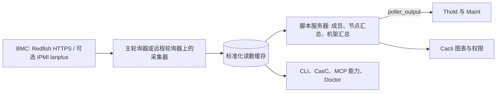

<!-- Source: README.md; SHA256: 6972a6c9ac754cd60e63c5caf971451ea8fe6e279eef757d886e1a168d3eef01 -->

<!-- translations:start -->
[English](../../../README.md) | [简体中文](README.md) | [हिन्दी](../hi-IN/README.md) | [Español (España)](../es-ES/README.md) | [Español (Latinoamérica)](../es-419/README.md) | [العربية (السعودية)](../ar-SA/README.md) | [Afrikaans](../af-ZA/README.md) | [አማርኛ](../am-ET/README.md) | [العربية (مصر)](../ar-EG/README.md) | [العربية (المغرب)](../ar-MA/README.md) | [বাংলা](../bn-BD/README.md) | [Bosanski](../bs-BA/README.md) | [Deutsch](../de-DE/README.md) | [فارسی](../fa-IR/README.md) | [Filipino](../fil-PH/README.md) | [Français](../fr-FR/README.md) | [Français (Maroc)](../fr-MA/README.md) | [Français (Sénégal)](../fr-SN/README.md) | [Hausa](../ha-NG/README.md) | [עברית](../he-IL/README.md) | [Hrvatski](../hr-HR/README.md) | [Bahasa Indonesia](../id-ID/README.md) | [Igbo](../ig-NG/README.md) | [Italiano](../it-IT/README.md) | [日本語](../ja-JP/README.md) | [한국어](../ko-KR/README.md) | [Malagasy](../mg-MG/README.md) | [मराठी](../mr-IN/README.md) | [Bahasa Melayu](../ms-MY/README.md) | [Nederlands](../nl-NL/README.md) | [Polski](../pl-PL/README.md) | [Português (Brasil)](../pt-BR/README.md) | [Русский](../ru-RU/README.md) | [Kinyarwanda](../rw-RW/README.md) | [Soomaali](../so-SO/README.md) | [Српски](../sr-RS/README.md) | [Svenska](../sv-SE/README.md) | [Kiswahili](../sw-KE/README.md) | [தமிழ்](../ta-IN/README.md) | [తెలుగు](../te-IN/README.md) | [ไทย](../th-TH/README.md) | [Türkçe](../tr-TR/README.md) | [Українська](../uk-UA/README.md) | [اردو](../ur-PK/README.md) | [Tiếng Việt](../vi-VN/README.md) | [isiXhosa](../xh-ZA/README.md) | [Yorùbá](../yo-NG/README.md) | [繁體中文](../zh-TW/README.md) | [isiZulu](../zu-ZA/README.md)
<!-- translations:end -->

# plugin_redfish

这是一个 Cacti 1.2 插件，使用 Redfish（以及可选的只读 IPMI 回退和机架级功率汇总）将基板管理控制器（BMC）报告的服务器功耗、进风温度、风扇状态和电源健康状况作为普通设备、数据源和图表引入 Cacti。Thold 和 Maint 通过标准的 Cacti 数据源对其进行告警和抑制。

> **状态：开发中，尚未发布（`0.1.0-dev`）。** 此插件不隶属于 Cacti 项目。它安装在 PHP 8.2 及以上版本的 Cacti 1.2.31 或更高版本上，实现了 Redfish 采集器、加密凭据保管库、Cacti 设备与图表置备、可选的只读 IPMI 回退、机架功率汇总、Cacti Maint 维护窗口显示、远程数据采集器复制与代理端点、CasC 提供程序与运维 CLI、MCP 能力以及 Doctor 诊断检查。CI 测试了测试夹具、DMTF Redfish Mockup Server（子系统、仅旧版和 HPE iLO Gen11 模拟）以及 Thold v1.8.2 与 Maint v1.3；尚未在真实物理 BMC 或试点集群上完成认证。设计与研究资料位于 [docs/PLAN.md](../../PLAN.md)、[docs/research/](../../research/) 和 [docs/decisions/](../../decisions/)。

## 已实现的能力

### 核心采集器、保管库与 Cacti 对象

- **生命周期与模式。** 通过 Cacti 的插件 API 安装、升级、禁用和卸载（`Schema::VERSION = 3`，12 张表）。除非取消勾选“卸载时保留插件表”（*Keep Plugin Tables on Uninstall*），否则卸载时会保留数据表。入口文件可在 PHP 8.0 上解析，并在 PHP 低于 8.2 或缺少 `ext-openssl` 时给出明确的拒绝错误信息。
- **注册表与权限。** 包含 *Redfish View*（`redfish_health.php`）、*Redfish Operator*（`redfish_operator.php`）和 *Redfish Admin*（`redfish_bmcs.php`、`redfish_credentials.php`）权限域，以及 **Configuration > Settings > Redfish** 下的设置。BMC 注册表支持 CSV 导入（按名称引用凭据；拒绝包含密码的导入文件）和 JSON 导出。BMC 记录和凭据遵循 Cacti 设备权限。
- **加密凭据保管库。** 密码使用 AES-256-GCM 加密存储在 `plugin_redfish_secret` 中。密钥保存在数据库之外（默认为 `/etc/cacti/redfish-vault.key`），格式为 64 个十六进制字符（`openssl rand -hex 32`）或 32 个原始字节，归轮询器用户所有，其他用户不可读，且所在目录仅对 root 或该用户可写。拒绝使用 32 个字符的可打印口令。**请将密钥文件与数据库一起备份**；否则必须重新输入已保存的密码。
- **TLS 与只读 Redfish 客户端。** 默认启用 TLS 验证，使用系统 CA 存储、按 BMC 配置的 CA 证书包或 SPKI SHA-256 指纹固定；按 BMC 关闭验证会作为健康警告和 Doctor 检查警告持续显示。客户端仅允许 `GET` 以及 Redfish 会话登录（`POST`）和注销（`DELETE`），在会话不可用时支持按 BMC 配置 Basic 认证回退。发现流程优先使用新的 Redfish 子系统和传感器资源，并回退到已弃用的 `Power` 和 `Thermal` 资源。
- **采集器执行。** `poller_redfish.php` 从 `poller_bottom` 启动，通过 Cacti 的进程注册表为每个轮询器运行一个主进程，支持可配置的工作进程数（`redfish_workers`），获取按 BMC 划分的租约，强制执行时间预算（`redfish_collector_budget`），应用指数退避，并在崩溃后清理插件自身的遗留会话。
- **模板、设备与图表。** 按哈希导入 `templates/redfish-templates.xml`，并将三个脚本服务器数据查询 XML 文件（`redfish_fans.xml`、`redfish_temperatures.xml`、`redfish_psus.xml`）复制到 `<cacti>/resource/script_server/`，同时不覆盖用户修改过的文件。**Create Device** 和 **Add Graphs** 需要确认置备计划，将查询附加到已映射的服务器设备或在 `.invalid` 下创建禁用可用性检查的“Redfish BMC”设备，并通过 `graph_buttons` 将每个 Redfish 图表链接回该设备的 Redfish 图表。
- **仅限缓存的脚本服务器输入。** `scripts/ss_redfish_members.php` 提供按成员划分的风扇、温度和 PSU 读数，`scripts/ss_redfish_summary.php` 提供“Redfish Node Summary”指标（功率、进风口与最高温度、故障风扇和 PSU 计数、节点健康度以及上次成功读取的时长）。脚本服务器调用仅读取本地缓存，绝不直接联系 BMC。缺失、过期或已移除成员的读数返回 `U`（绝不返回 `0`），而 `age` 始终报告一个数值，以便阈值检测静默的 BMC。

**当 BMC 的成员发生变化时**（例如更换了风扇或固件更新重命名了传感器），请再次运行 **Add Graphs**。先前存在但变为缺席的风扇或电源在被确认接受之前会计入 `fans_bad` 或 `psus_bad`；从未安装过设备的槽位不会计入。已移除的成员会保留其现有的数据源和图表，此后其读数一直为 `U`，直到手动删除。删除 Cacti 设备会解除其 BMC 映射并移除其机架分配，同时保留 BMC 和缓存；删除 BMC 或卸载插件会保留 Cacti 设备和图表。

### 可选 IPMI 回退

- **按 BMC 启用。** 默认关闭（`protocols` 默认为 `redfish`；启用 IPMI 回退会设置为 `redfish,ipmi`）。
- **限定范围的回退触发条件。** 仅当 Redfish 采集因符合条件的失败类别失败时才运行；对于 `AuthRejected`、`CredentialUnavailable`、`AddressRefused`、`OperationRefused` 或 `Deadline` 绝不触发。
- **安全执行。** 通过数组形式的 `proc_open()`（不使用 shell）经 `-I lanplus` 调用 `ipmitool`，具有受限的挂钟超时和 256 KiB 输出限制。密码通过 `IPMITOOL_PASSWORD`（`-E`）或模式为 0600 并在 `finally` 中删除的临时文件（`-f`）提供，绝不出现在 CLI 参数中。
- **只读命令白名单。** 仅允许五个只读子命令：`dcmi power reading`、`sdr type Temperature`、`sdr type Fan`、`sdr type Power Supply` 和 `chassis status`。拒绝变更类命令。
- **标准化输出与安全态势警告。** `IpmiNormalizer` 将读数映射到相同的 `Observation`/`Member`/`Reading` 模型，对缺失或无法解析的传感器输出 `U`。启用 IPMI 回退会在健康页面和 `redfish.bmc_security` Doctor 检查中产生警告，提醒运维人员将 UDP 623 限制在管理 VLAN 内。

### 机架功率汇总

- **机架注册表。** 模式版本 3 新增了 `plugin_redfish_rack`（唯一的 `(site_id, name)`、可选的 `power_budget_watts`、默认为 `80` 的 `min_coverage_pct` 以及备注）和 `plugin_redfish_rack_member`（每个 `host_id` 最多对应一个机架分配，可选 `bmc_id` 和 `unit_position`，在删除 Cacti 设备时自动移除）。
- **受覆盖率保护的汇总值。** `RackPowerSummary` 对本地缓存中成员的新鲜 `power_watts` 读数求和，并计算预算利用率和余量。当报告成员的覆盖率低于 `min_coverage_pct` 时，`power_watts`、`utilization_pct` 和 `headroom_watts` 返回 `U`，以确保采集器故障绝不会表现为机架功率下降。
- **适配 Thold 的脚本服务器输入。** `scripts/ss_redfish_rack.php`（`ss_redfish_rack(<rack_id>)`）仅从本地缓存返回 `power_watts`、`power_budget_watts`、`utilization_pct`、`headroom_watts`、`members_total`、`members_reporting` 和 `coverage_pct`。

### Cacti Maint 集成

- Redfish 数据源上的 Thold 阈值触发告警，Cacti Maint 抑制告警，两个插件均无需任何修改。
- `MaintWindow` 检查每个已映射 Cacti 主机的活动 Maint 计划（一次性 `mtype=1` 和周期性 `mtype=2` 计划，并在已加载时调用 `plugin_maint_check_cacti_host()`），在 Redfish 健康页面（`[MAINT]`）、`cli/redfish.php health` 输出以及 `redfish-get-health` 能力中标记活动维护状态。

### 远程数据采集器

- `INFO` 声明了 `remote_collect:1`。BMC 接受任意 `poller_id >= 1`，`poller_redfish.php --poller=N` 仅采集分配给该轮询器的已启用 BMC。
- **`replicate_out` 钩子。** 通过 `replicate_out_table()` 仅将作用域限定到目标远程轮询器的非机密配置表进行复制：`plugin_redfish_bmc`、`plugin_redfish_credential` 元数据（不含密文）、`plugin_redfish_rack` 和 `plugin_redfish_rack_member`。不复制 `plugin_redfish_secret`，保管库密钥文件严格保留在各自轮询器本地。
- **`remote_agent` 钩子。** 暴露只读的 `redfish_health` 和 `redfish_discovery` 操作，仅接受数字型的 `poller_id` 和 `bmc_id` 参数。拒绝意外参数，且不返回任何凭据或机密。

### 生态钩子（CasC、MCP 能力与 Doctor）

- **CasC 提供程序（`casc_register_providers`）。** 注册 `redfish` 提供程序（模式版本 `1`），支持纯 PHP 的 YAML 和 XML 导出、解析（拒绝 XXE）、验证、差异规划和应用。凭据仅以保管库引用（`vault:redfish:<name>`）形式出现；拒绝原始机密键（`pass`、`secret`、`token`、`private_key`、`vault_key`、`auth_token`）。应用更改需要精确匹配的 SHA-256 `PLAN_HASH`。
- **MCP / Abilities API（`abilities_register`）。** 注册三个受 Redfish View 权限域（`redfish_health.php`）和 Cacti 设备权限控制的只读能力，不返回任何凭据：
  - `redfish-list-bmcs`（可选 `poller_id`）
  - `redfish-get-rack-power`（可选 `rack_id`）
  - `redfish-get-health`（可选 `bmc_id`）
- **Doctor 检查（`doctor_register_checks`）。** 注册五个本地只读诊断检查，绝不联系 BMC 或返回密钥材料：
  - `redfish.schema`：模式版本是否为最新
  - `redfish.vault_key`：保管库密钥的可读性与权限
  - `redfish.collector_runs`：轮询器采集时间预算与数据新鲜度
  - `redfish.bmc_security`：启用了未验证 TLS 或 IPMI 回退的已启用 BMC
  - `redfish.rack_power`：机架功率预算合规性与覆盖率下限

## CLI

在 Cacti 根目录中使用 PHP 8.2 或更高版本运行：

```sh
# Operator and CasC CLI (reads --file=PATH or stdin for validate, plan, and apply)
php plugins/redfish/cli/redfish.php export --format=yaml|xml
php plugins/redfish/cli/redfish.php validate [--file=PATH] [--format=yaml|xml]
php plugins/redfish/cli/redfish.php plan [--file=PATH] [--format=yaml|xml]
php plugins/redfish/cli/redfish.php apply [--file=PATH] [--format=yaml|xml] --confirm=<PLAN_HASH>
php plugins/redfish/cli/redfish.php health --format=text|json

# Collector entry point (normally started by poller_bottom)
php plugins/redfish/poller_redfish.php [--poller=N] [--force] [--debug]

# Rack power summary script server entry point
php plugins/redfish/scripts/ss_redfish_rack.php <rack_id>
```

## 访问角色

| 权限域 | 访问权限 |
| --- | --- |
| Redfish View | 现有监控页面。 |
| Redfish Operator | 监控权限，外加操作页面和个人分诊确认。 |
| Redfish Admin | 操作员权限，外加现有的配置和管理操作。 |

复制升级文件后，以管理员身份打开 Plugins 页面以注册权限域。在 **Configuration > Users** 或用户组下显式分配 Operator 权限域。升级会保留现有的 View 和 Admin 权限域 ID 及授权。每次请求时，Admin 访问权限会继承 Operator 访问权限，Operator 访问权限会继承 View 访问权限；这不会向用户或用户组添加持久化的授权记录。除了 Cacti 的 Settings 权限之外，插件设置还需要 Redfish Admin 访问权限。

Cacti 设备权限限制了每位用户可用的行和操作；未映射的对象需要管理员权限。操作员可以解除有权限 BMC 的采集暂停状态，使其在下一次计划运行时恢复采集。凭据、配置、映射、删除和其他管理更改仍保留在管理页面中。确认仅在当前用户的会话期间有效，最长不超过一小时，且仅在同一观测结果保持新鲜时有效。新的或变更的观测结果会使其失效。它们绝不会将失败的测量标记为健康，也不会抑制告警。

## 为什么开发此插件

每台服务器都有一个独立于操作系统报告功耗和温度状态的 BMC，因此即使操作系统宕机也能继续响应。这些数据可用于容量和成本核算、风扇或电源故障的早期预警，以及高性能计算中的功耗封顶决策。该插件并非专用于 HPC。

Cacti 目前覆盖了其中一部分：

- **厂商 SNMP 包。** 1.2.x 分支附带了 Dell iDRAC 和 HPE iLO 模板，它们需要 SNMP 代理且与特定厂商绑定；里程碑 1 的研究发现这两者均未以瓦特为单位报告功耗（[docs/research/overlap.md](../../research/overlap.md)）。
- **有凭据类型但无采集器。** plugin_credentials 定义了“IPMI / Redfish (BMC)”凭据，但不读取任何 BMC。
- **缺少机架级视图。** Cacti 核心没有机架对象；设备只有一个自由文本的 `location` 字段。

该插件在主轮询器或远程数据采集器上以带外方式按照 Cacti 轮询周期轮询 BMC，缓存标准化读数，并通过脚本服务器数据查询、节点汇总和机架功率汇总公开这些数据。它复用 Cacti 的图表、权限、Thold 和 Maint，且不会改变 BMC 状态。

## 范围与状态

| 阶段 | 范围 | 里程碑 | 状态 |
|---|---|---|---|
| 0，研究 | 厂商矩阵、真实 BMC 上游行为确认、轮询开销、数据查询技术验证 | [M1](https://github.com/somethingwithproof/plugin_redfish/milestone/1) | 已完成，待补充真实 BMC 固件抓取数据 |
| 1，观测 | BMC 注册表、凭据、TLS、Redfish 采集器、标准化读数、设备、按索引图表、Thold 告警、Maint 集成、健康页面 | [M2](https://github.com/somethingwithproof/plugin_redfish/milestone/2)、[M3](https://github.com/somethingwithproof/plugin_redfish/milestone/3)、[M4](https://github.com/somethingwithproof/plugin_redfish/milestone/4) | 已实现；M4 试点集群认证待完成 |
| 2，ipmi | 通过 `ipmitool` 提供只读 IPMI（`lanplus`）回退，默认关闭 | [M5](https://github.com/somethingwithproof/plugin_redfish/milestone/5) | 已实现 |
| 3，机架 | 机架注册表、带覆盖率下限的机架功率汇总、预算余量、`ss_redfish_rack.php` | [M6](https://github.com/somethingwithproof/plugin_redfish/milestone/6) | 已实现 |
| 4，远程与生态 | 远程数据采集器（`replicate_out`、`remote_agent`）、CasC 提供程序与 CLI、MCP 能力、Doctor 检查 | [M7](https://github.com/somethingwithproof/plugin_redfish/milestone/7) | 已实现 |

超出范围的功能：设置功耗上限或任何其他 BMC 配置、电源控制、固件更新、控制台访问、插件自建告警引擎以及调度器集成。

## 兼容性目标

| 组件 | 目标 |
|---|---|
| Cacti | 1.2.31 或更高版本，无需修改核心代码 |
| 数据库 | MariaDB 10.2 或 MySQL 5.7 或更高版本：通过生成列上的唯一键确保每台设备对应一个 BMC |
| PHP | 8.2 或更高版本；入口文件在 8.0 上保持可解析，使不受支持的运行时收到拒绝提示而非破坏 Cacti 界面 |
| PHP 扩展 | `ext-openssl`（Cacti 1.2.31 必需）；无需 `ext-curl`，无 Composer 运行时依赖 |
| 可选工具 | 在采集启用了 IPMI 回退的 BMC 的轮询器上需要 `ipmitool` |
| BMC | Dell iDRAC、HPE iLO、Lenovo XCC 和 OpenBMC（按固件版本范围）；参见[厂商矩阵](../../research/vendor-matrix.md) |
| Redfish | 优先使用新的子系统和传感器资源，以已弃用的 `Power` 和 `Thermal` 作为回退 |
| Thold、Maint | 无需任何修改（CI 测试涵盖 Thold v1.8.2 和 Maint v1.3） |

## 设计

- [docs/PLAN.md](../../PLAN.md) 为完整设计方案：架构、所依赖的上游事实、测量模型、安全边界、性能测算、测试与风险。
- [docs/decisions/](../../decisions/) 存放已做选择的架构决策记录。
- [docs/REQUIREMENTS.md](../../REQUIREMENTS.md) 将每个需求 ID 映射到对应议题。



## 安全性

BMC 凭据控制着服务器的带外管理。该设计将机密信息排除在命令行、日志、CasC 导出、远程代理载荷、MCP 响应和 Web 页面之外；使用每个轮询器本地的保管库密钥文件以 AES-256-GCM 加密存储密码；默认验证 TLS；使用带白名单只读子命令的显式参数数组运行 `ipmitool`；并使用只读 BMC 账户。详见 [docs/PLAN.md](../../PLAN.md#security) 和 [SECURITY.md](../../../SECURITY.md)。

## 运维指南

安装先决条件、保管库与 TLS 配置、BMC 注册、图表创建、告警间隔、备份与故障处理，请参见 [docs/operator-guide.md](../../operator-guide.md)。在来自真实厂商固件系列的脱敏抓取数据通过测试套件之前，本指南不宣布任何真实厂商固件系列已获支持。

## 开发与测试

CI（[.github/workflows/plugin-ci-workflow.yml](../../../.github/workflows/plugin-ci-workflow.yml)）在 PHP 8.0 上对入口文件进行语法检查，在 PHP 8.2 至 8.5 上针对 Cacti `release/1.2.31` 和 `1.2.x` 运行 Pest 单元测试（`phpunit.xml`）和生命周期集成测试（`phpunit-integration.xml`）套件以及 PHPStan level 9，验证 PHP 8.1 上的拒绝行为，端到端演练 DMTF Redfish Mockup Server（子系统、仅旧版和 HPE iLO Gen11 模拟）以及 Thold v1.8.2 / Maint v1.3，并检查 gettext 目录、工作流和 REUSE 许可合规性。

推送前的本地检查：

```sh
sh tests/lint-workflows.sh
sh locales/build_gettext.sh --check
CACTI_PATH=/path/to/cacti phpstan analyse -c phpstan.neon --no-progress
```

使用 `--configuration=phpunit.xml` 运行 Pest 以执行单元测试和源码规则测试，或使用 `--configuration=phpunit-integration.xml` 配合 `CACTI_PATH` 和 `REDFISH_TEST_DATABASE=disposable` 针对一次性 Cacti 数据库运行生命周期集成测试。

## 工作追踪方式

- **里程碑**遵循设计方案中的里程碑划分。每个里程碑都有一个史诗级议题列出其子议题和退出证据。
- **议题**按标签分类：`type: requirement`、`type: research`、`type: decision`、`type: epic`。需求议题陈述带编号的可测试需求（`REQ-AREA-NNN`）及验收标准。
- **标签**还包含 `area:`、`phase:`、`priority:` 和 `status:`。参见 [CONTRIBUTING.md](../../../CONTRIBUTING.md#labels)。
- [项目看板](https://github.com/users/somethingwithproof/projects/12)展示了各个里程碑下的所有议题。

## 参与贡献

请阅读 [CONTRIBUTING.md](../../../CONTRIBUTING.md)。提交需要附带 DCO 签署（sign-off）。设计讨论在议题中进行；未决决策带有 `type: decision` 标签。来自真实 BMC 的数据证据是目前最有价值的贡献；发布任何抓取数据前请脱敏处理地址、序列号和凭据。

## 许可证

GNU 通用公共许可证 v2.0，与 Cacti 及其插件采用相同许可证。参见 [LICENSE](../../../LICENSE)。
