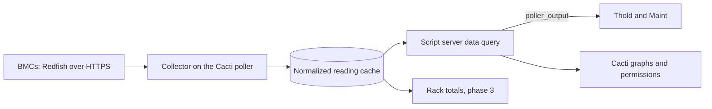

<!-- Source: README.md; SHA256: 7b4e83a58a1adc844cb0615ef30e95476cba2851f96bb454d2a816fb2774724d -->

<!-- translations:start -->
[English](../../../README.md) | [简体中文](README.md) | [हिन्दी](../hi-IN/README.md) | [Español (España)](../es-ES/README.md) | [Español (Latinoamérica)](../es-419/README.md) | [العربية](../ar-SA/README.md)
<!-- translations:end -->

# plugin_redfish

这是一个 Cacti 1.2 插件，通过 Redfish（并计划提供可选的 IPMI 回退）将基板管理控制器（BMC）报告的服务器功耗、进风温度、风扇状态和电源健康状况纳入 Cacti，作为普通设备、数据源和图表。Thold 和 Maint 可据此告警和抑制通知；后续阶段将添加机架级功率汇总。

> **状态：开发中，尚未发布（0.1.0-dev）。** 里程碑 2（基础）和 3（Cacti 对象及告警）已合并至 `main`。此插件不隶属于 Cacti 项目。它可在 PHP 8.2 或更高版本的 Cacti 1.2.31 上安装，注册 BMC 和凭据，通过 Redfish 将每个 BMC 的功率、温度、风扇及电源健康数据读入插件缓存，并显示采集健康状态。它添加 Cacti 设备、成员图表和汇总图表，通过普通数据源支持 Thold 和 Maint。CI 已使用手写测试数据构建的模拟 BMC 和 DMTF Redfish 模拟服务器进行测试；尚未验证真实 BMC 或试点集群。设计与研究见 [docs/PLAN.md](../../PLAN.md)、[docs/research/](../../research) 和 [docs/decisions/](../../decisions)。

### 里程碑 2 提供的功能

- 通过 Cacti 插件 API 安装、升级、禁用和卸载；除非取消相应设置，否则卸载时保留表。PHP 低于 8.2 时，插件拒绝安装或启用并说明原因。
- 提供“Redfish View”（健康页面）、“Redfish Operator”（运维页面）和“Redfish Admin”（BMC 与凭据页面）权限域，并在 Configuration > Settings > Redfish 下提供设置。
- BMC 注册表支持 CSV 导入和 JSON 导出。导入文件不得含密码；凭据按名称引用。
- 凭据以 AES-256-GCM 加密存储。密钥保存在数据库之外的文件中，默认路径为 `/etc/cacti/redfish-vault.key`，内容为 64 个十六进制字符（`openssl rand -hex 32`）或恰好 32 个随机字节。文件由轮询用户所有，其他用户不可读取，所在目录仅允许轮询用户或 root 写入。由 32 个可打印字符组成的密钥会被视为口令而拒绝。**请将密钥文件与数据库一起备份**；缺少密钥时必须重新输入所有已存储密码。
- 默认启用 TLS 验证，可为每个 BMC 指定 CA 证书包或固定 SPKI SHA-256。针对单个 BMC 关闭验证会被记录，并持续显示为健康页面警告。
- 只读 Redfish 客户端：只允许 `GET` 及会话登录和注销；发送任何请求前都检查允许列表。
- 从主轮询器的 `poller_bottom` 启动采集器，提供每个 BMC 的租约、截止时间、退避，以及崩溃后清理插件记录的那一个会话。暂不支持远程采集器；需要明确设计采集器访问数据库和密钥的方式（阶段 4）。
- BMC 记录和凭据遵循 Cacti 设备权限：Redfish Admin 只能查看、更改和绑定其可见设备的 BMC，且只能操作没有被隐藏设备的 BMC 使用的凭据。

### 里程碑 3 新增的功能

- 模板以 Cacti 模板 XML 存放在 `templates/`，安装及升级时使用 Cacti 导入器按哈希匹配导入，因此会更新插件对象而不会重复添加。三个数据查询文件复制到 `<cacti>/resource/script_server/` 并记录哈希；插件绝不覆盖并非自身写入的文件。模板或查询文件缺失时，健康页面会向管理员告警。BMC 页面上的 **Reinstall the Redfish Templates** 可重新导入，需要 Cacti 的 Import Templates 权限。
- 每个 BMC 提供 **Create Device** 或 **Add Graphs**（[ADR 0015](../../decisions/0015-attach-to-the-server-device-or-create-one-per-bmc.md)）。已映射到服务器现有设备的 BMC 会将查询和图表添加到该设备。未映射的 BMC 会基于“Redfish BMC”设备模板创建新设备，关闭可用性检查，并使用 `.invalid` 域下的主机名，因此 Cacti 不会连接 BMC，也不会显示其地址。两种操作都要求管理员先确认新增内容清单，且同时需要 Redfish Admin 和 Cacti 设备管理权限；创建者无权查看的新设备会再次移除。
- 三个脚本服务器数据查询：“Redfish Fans”、“Redfish Temperatures”和“Redfish Power Supplies”，以 BMC 成员键为索引，为每个成员提供图表：风扇速度为百分比或 RPM（取决于 BMC 报告的单位）、温度、电源输入和输出瓦数，并包含各自健康码。
- “Redfish Node Summary”输入包含功率、进风温度、最高温度、异常风扇和电源数、节点健康及上次成功读数的年龄，绘制成功率、温度、组件健康和数据年龄四类图表。Thold 可对这些数据源设置阈值告警，Maint 可抑制通知，无须更改任一插件。
- 脚本服务器仅从插件缓存返回数据，绝不连接 BMC。缺失、过期、单位不符或来自已消失成员的值返回 `U`，图表因此显示空缺而非零值；`age` 始终有值，对其设置阈值可检测停止响应的 BMC。
- 每个 Redfish 图表提供指向该设备所有 Redfish 图表的链接，仅向 Cacti 允许查看该设备的用户显示。

**BMC 成员发生变化时**（例如更换风扇或固件更新重命名传感器），请再次选择 **Add Graphs**。此前存在而现在缺失或消失的风扇、电源在此之前计入 `fans_bad` 或 `psus_bad`，因此拔掉风扇会告警；从未安装组件的空槽不会。Add Graphs 会接纳 BMC 当前报告的成员，Cacti 重新索引查询；消失的成员保留数据源和图表，之后读数为 `U`，新成员获得新图表。只有在不再需要历史记录时，才手动删除消失成员的图表。

删除设备会解除其 BMC 映射，并保留 BMC 和缓存。删除 BMC 或卸载插件会保留设备和图表。

## 访问角色

| 权限域 | 访问范围 |
| --- | --- |
| Redfish View | 现有监控页面。 |
| Redfish Operator | 监控页面、运维页面及个人排查确认。 |
| Redfish Admin | Operator 权限以及现有配置和管理操作。 |

复制升级文件后，以管理员身份打开 Plugins 页面注册新权限域。在 **Configuration > Users** 或用户组中明确分配 Operator 权限域。升级保留现有 View 和 Admin 权限域 ID 及授权。每次请求中 Admin 继承 Operator，Operator 继承 View；不会向用户或组新增持久化授权。插件设置除 Cacti Settings 权限之外，还要求 Redfish Admin 权限。

Cacti 设备权限仍限制各用户可见的数据行和可执行操作；未映射对象需要管理员处理。操作员可以为其有权访问的 BMC 解除采集暂停，以便下次计划运行继续。凭据、配置、映射、删除及其他管理变更仍位于管理页面。确认仅在当前用户会话内有效，最长一小时，且要求同一观测结果仍然新鲜。新增或变化的观测结果会使确认失效。确认从不将失败测量标记为健康，也不抑制告警。

## 为什么需要此插件

每台服务器的 BMC 都可独立于操作系统报告功率和散热状态，因此操作系统停止运行时仍能响应。这些数据用于容量和成本跟踪、风扇或电源故障的早期告警，以及高性能计算中的功率上限决策。本插件并不只适用于 HPC。

Cacti 目前已覆盖其中部分需求：

- **厂商 SNMP 包。** 1.2.x 分支提供 Dell iDRAC 和 HPE iLO 模板，需要 SNMP 代理且针对特定厂商；里程碑 1 的研究发现两者均不报告以瓦为单位的功耗（[docs/research/overlap.md](../../research/overlap.md)）。
- **有凭据类型但无采集器。** plugin_credentials 定义了“IPMI / Redfish (BMC)”凭据，但不读取 BMC。
- **缺少机架视图。** Cacti 核心没有机架对象；设备只有自由文本 `location` 字段。

插件独立于 Cacti 轮询周期带外轮询 BMC，缓存规范化读数，并通过脚本服务器数据查询及汇总数据源提供这些数据。它复用 Cacti 图表、权限、Thold 和 Maint，不更改 BMC 状态。远程数据采集器支持计划在阶段 4 实现；当前仅在主轮询器上采集。

## 计划范围

| 阶段 | 范围 | 里程碑 |
|---|---|---|
| 0，研究 | 厂商矩阵、在真实 BMC 上确认上游行为、轮询成本、数据查询试验 | [M1](https://github.com/somethingwithproof/plugin_redfish/milestone/1) |
| 1，观测 | BMC 注册表、凭据、TLS、Redfish 采集器、规范化读数、设备、按索引图表、Thold 告警、Maint 抑制、健康页面 | [M2](https://github.com/somethingwithproof/plugin_redfish/milestone/2)、[M3](https://github.com/somethingwithproof/plugin_redfish/milestone/3)、[M4](https://github.com/somethingwithproof/plugin_redfish/milestone/4) |
| 2，IPMI | 为没有可用 Redfish 的 BMC 提供 IPMI 回退，默认关闭 | [M5](https://github.com/somethingwithproof/plugin_redfish/milestone/5) |
| 3，机架 | 机架注册表、含覆盖率的机架功率汇总、预算余量 | [M6](https://github.com/somethingwithproof/plugin_redfish/milestone/6) |
| 4，远程 | 使用 Cacti 远程数据采集器访问隔离的 BMC 网络 | [M7](https://github.com/somethingwithproof/plugin_redfish/milestone/7) |

不在范围内：设置功率上限或其他 BMC 配置、电源控制、固件更新、控制台访问、插件自有告警引擎和调度器集成。

## 兼容性目标

| 组件 | 目标 |
|---|---|
| Cacti | 1.2.31 或更高版本，无须核心补丁 |
| 数据库 | MariaDB 10.2、MySQL 5.7 或更高版本：通过生成列上的唯一键保证每个设备只有一个 BMC |
| PHP | 8.2 或更高版本；`setup.php` 保持可在 8.0 解析，使不支持的运行时收到拒绝提示而非破坏 Cacti 界面 |
| BMC | Dell iDRAC、HPE iLO、Lenovo XCC 和 OpenBMC，按固件范围划分；参阅[厂商矩阵](../../research/vendor-matrix.md) |
| Redfish | 优先使用新的子系统和传感器资源，以已弃用的 `Power` 和 `Thermal` 作为回退 |
| Thold、Maint | 无须更改 |

## 设计

- [docs/PLAN.md](../../PLAN.md) 是完整计划：架构、所依赖的上游事实（含来源和仍待确认的假设）、测量模型、安全边界、性能计算、测试和风险。
- [docs/decisions/](../../decisions) 保存已作决策的架构记录。
- [docs/REQUIREMENTS.md](../../REQUIREMENTS.md) 将各需求 ID 对应到其议题。

## 安全

BMC 凭据控制服务器带外管理。设计使凭据不出现在命令行、日志或页面中，默认验证 TLS，通过参数数组执行具有子命令允许列表的外部命令，并使用只读 BMC 账户。参阅 [docs/PLAN.md](../../PLAN.md#security) 和 [SECURITY.md](../../../SECURITY.md)。

## 操作指南

安装前提、保险库和 TLS 设置、BMC 注册、图表创建、告警间隔、备份和故障处理见 [docs/operator-guide.md](docs/operator-guide.md)。只有来自真实固件的脱敏采集数据通过测试套件后，指南才会声明支持该厂商固件系列。

## 工作跟踪方式

- **里程碑**遵循计划，每个里程碑有一个史诗议题列出子议题和完成证据。
- **议题**通过标签分类：`type: requirement`、`type: research`、`type: decision`、`type: epic`。需求议题列出带编号、可测试的需求（`REQ-AREA-NNN`）和验收标准。
- **标签**还包括 `area:`、`phase:`、`priority:` 和 `status:`。参阅 [CONTRIBUTING.md](../../../CONTRIBUTING.md#labels)。
- [项目看板](https://github.com/users/somethingwithproof/projects/12)展示所有里程碑的议题。

## 贡献

阅读 [CONTRIBUTING.md](../../../CONTRIBUTING.md)。提交需要 DCO 签署。设计讨论在议题中进行；待决事项使用 `type: decision` 标签。目前来自真实 BMC 的证据最有帮助；发布采集数据前请隐藏地址、序列号和凭据。

## 许可证

GNU 通用公共许可证 v2.0，与 Cacti 及其插件相同。参阅 [LICENSE](../../../LICENSE)。
