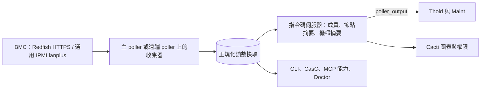

<!-- Source: README.md; SHA256: cf31b9f80d6c00020bbe08e80951d4de1c910793911d040ae7a66b54e8a2eaf0 -->

<!-- translations:start -->
[English](../../../README.md) | [简体中文](../zh-CN/README.md) | [हिन्दी](../hi-IN/README.md) | [Español (España)](../es-ES/README.md) | [Español (Latinoamérica)](../es-419/README.md) | [العربية (السعودية)](../ar-SA/README.md) | [Afrikaans](../af-ZA/README.md) | [አማርኛ](../am-ET/README.md) | [العربية (مصر)](../ar-EG/README.md) | [العربية (المغرب)](../ar-MA/README.md) | [বাংলা](../bn-BD/README.md) | [Bosanski](../bs-BA/README.md) | [Deutsch](../de-DE/README.md) | [فارسی](../fa-IR/README.md) | [Filipino](../fil-PH/README.md) | [Français](../fr-FR/README.md) | [Français (Maroc)](../fr-MA/README.md) | [Français (Sénégal)](../fr-SN/README.md) | [Hausa](../ha-NG/README.md) | [עברית](../he-IL/README.md) | [Hrvatski](../hr-HR/README.md) | [Bahasa Indonesia](../id-ID/README.md) | [Igbo](../ig-NG/README.md) | [Italiano](../it-IT/README.md) | [日本語](../ja-JP/README.md) | [한국어](../ko-KR/README.md) | [Malagasy](../mg-MG/README.md) | [मराठी](../mr-IN/README.md) | [Bahasa Melayu](../ms-MY/README.md) | [Nederlands](../nl-NL/README.md) | [Polski](../pl-PL/README.md) | [Português (Brasil)](../pt-BR/README.md) | [Русский](../ru-RU/README.md) | [Kinyarwanda](../rw-RW/README.md) | [Soomaali](../so-SO/README.md) | [Српски](../sr-RS/README.md) | [Svenska](../sv-SE/README.md) | [Kiswahili](../sw-KE/README.md) | [தமிழ்](../ta-IN/README.md) | [తెలుగు](../te-IN/README.md) | [ไทย](../th-TH/README.md) | [Türkçe](../tr-TR/README.md) | [Українська](../uk-UA/README.md) | [اردو](../ur-PK/README.md) | [Tiếng Việt](../vi-VN/README.md) | [isiXhosa](../xh-ZA/README.md) | [Yorùbá](../yo-NG/README.md) | [繁體中文](README.md) | [isiZulu](../zu-ZA/README.md)
<!-- translations:end -->

# plugin_redfish

一款適用於 Cacti 1.2 的外掛程式，透過 Redfish（並提供選用的唯讀 IPMI 備援與機櫃層級耗電量總計），將伺服器耗電量、進氣溫度、風扇狀態與電源供應器健康狀態從基板管理控制器（BMC）匯入 Cacti，作為一般的裝置、資料來源與圖表使用。Thold 與 Maint 會透過標準 Cacti 資料來源對其發出警示並抑制通知。

> **狀態：開發中，尚未發布正式版本（`0.1.0-dev`）。** 本外掛程式與 Cacti 專案無關聯。它可安裝於 PHP 8.2 或更新版本環境下的 Cacti 1.2.31 或更新版本，實作了 Redfish 收集器、加密憑證保險箱、Cacti 裝置與圖表佈建、選用的唯讀 IPMI 備援、機櫃電力總計、Cacti Maint 維護視窗顯示、遠端資料收集器複寫與代理端點、CasC 提供者與操作員 CLI、MCP 能力以及 Doctor 診斷檢查。CI 已測試測試固定資料、DMTF Redfish Mockup Server（子系統、僅限舊版架構以及 HPE iLO Gen11 模擬環境）以及搭配 Maint v1.3 的 Thold v1.8.2；目前尚未對實體 BMC 或試點機群進行驗證。設計與研究文件位於 [docs/PLAN.md](../../PLAN.md)、[docs/research/](../../research/) 與 [docs/decisions/](../../decisions/)。

## 已實作功能

### 核心收集器、保險箱與 Cacti 物件

- **生命週期與資料表結構。** 透過 Cacti 的外掛 API 進行安裝、升級、停用與解除安裝（`Schema::VERSION = 3`，共 12 張資料表）。除非取消勾選 *Keep Plugin Tables on Uninstall*，否則解除安裝時會保留資料表。進入點檔案可在 PHP 8.0 上解析，並在偵測到低於 8.2 的 PHP 或缺少 `ext-openssl` 時以明確的錯誤訊息拒絕執行。
- **登錄表與權限。** 包含 *Redfish View*（`redfish_health.php`）、*Redfish Operator*（`redfish_operator.php`）與 *Redfish Admin*（`redfish_bmcs.php`、`redfish_credentials.php`）權限領域，以及位於 **Configuration > Settings > Redfish** 的設定。BMC 登錄表支援 CSV 匯入（憑證以名稱參照；匯入檔案中的密碼會被拒絕）與 JSON 匯出。BMC 記錄與憑證皆遵循 Cacti 裝置權限。
- **加密憑證保險箱。** 密碼使用 AES-256-GCM 加密後儲存於 `plugin_redfish_secret`。金鑰存放於資料庫之外（預設為 `/etc/cacti/redfish-vault.key`），格式為 64 個十六進位字元（`openssl rand -hex 32`）或 32 個原始位元組，擁有者必須為 poller 使用者，其他使用者不可讀取，且所在目錄僅允許 root 或該使用者寫入。系統會拒絕 32 個可列印字元組成的密碼片語。**請務必將金鑰檔案與資料庫一同備份**；缺少金鑰時，已儲存的密碼必須重新輸入。
- **TLS 與唯讀 Redfish 用戶端。** 預設啟用 TLS 驗證，使用系統 CA 存放區、個別 BMC 的 CA 憑證套件或 SPKI SHA-256 釘選；個別 BMC 選擇停用驗證時，會在健康頁面與 Doctor 檢查中顯示警告。用戶端僅允許 `GET` 以及 Redfish 工作階段登入（`POST`）與登出（`DELETE`），並在工作階段無法使用時提供選用的個別 BMC Basic 驗證備援。探索流程優先使用新的 Redfish 子系統與感測器資源，必要時才退回使用已棄用的 `Power` 與 `Thermal` 資源。
- **收集器執行方式。** `poller_redfish.php` 由 `poller_bottom` 啟動，透過 Cacti 的處理程序登錄機制在每個 poller 上執行一個主處理程序與可設定的工作處理程序（`redfish_workers`），取得每個 BMC 的租約，執行時間預算限制（`redfish_collector_budget`），套用指數退避，並在當機後清理外掛程式自身先前的工作階段。
- **範本、裝置與圖表。** 依雜湊值匯入 `templates/redfish-templates.xml`，並將三個指令碼伺服器資料查詢 XML 檔案（`redfish_fans.xml`、`redfish_temperatures.xml`、`redfish_psus.xml`）複製到 `<cacti>/resource/script_server/`，不會覆寫使用者修改過的檔案。**Create Device** 與 **Add Graphs** 需要確認佈建計畫，將查詢附加至已對應的伺服器裝置，或在 `.invalid` 下建立停用可用性檢查的「Redfish BMC」裝置，並透過 `graph_buttons` 將每張 Redfish 圖表連結回該裝置的 Redfish 圖表。
- **僅讀取快取的指令碼伺服器輸入。** `scripts/ss_redfish_members.php` 提供各成員的風扇、溫度與 PSU 讀數，`scripts/ss_redfish_summary.php` 則提供「Redfish Node Summary」指標（耗電量、進氣與最高溫度、異常風扇與 PSU 數量、節點健康狀態及上次良好讀數的經過時間）。指令碼伺服器呼叫僅讀取本地快取，絕不連線至 BMC。遺失、過時或已移除成員的讀數會回傳 `U`（絕不回傳 `0`），而 `age` 則一律回報數值，以便閾值偵測無回應的 BMC。

**當 BMC 的成員發生變更時**（例如更換風扇或韌體更新更改了感測器名稱），請再次執行 **Add Graphs**。先前存在但後來消失的風扇或電源供應器，在確認接受前會計入 `fans_bad` 或 `psus_bad`；從未安裝元件的插槽則不計入。已消失的成員會保留其現有的資料來源與圖表，之後將持續讀出 `U`，直到手動刪除為止。刪除 Cacti 裝置會解除其 BMC 對應並移除其機櫃指派，但保留 BMC 與快取；刪除 BMC 或解除安裝外掛程式則會保留 Cacti 裝置與圖表。

### 選用 IPMI 備援

- **依 BMC 選擇啟用。** 預設關閉（`protocols` 預設為 `redfish`；啟用 IPMI 備援會設為 `redfish,ipmi`）。
- **受限的備援觸發條件。** 僅在 Redfish 收集因符合條件的失敗類別而失敗時執行；遇到 `AuthRejected`、`CredentialUnavailable`、`AddressRefused`、`OperationRefused` 或 `Deadline` 時絕不觸發。
- **安全執行。** 透過陣列形式的 `proc_open()`（不使用 shell）以 `-I lanplus` 呼叫 `ipmitool`，具備明確的實際經過時間逾時與 256 KiB 輸出上限。密碼透過 `IPMITOOL_PASSWORD`（`-E`）或在 `finally` 區塊中刪除的 0600 權限暫存檔（`-f`）提供，絕不出現在 CLI 參數列中。
- **唯讀指令允許清單。** 僅允許五個唯讀子指令：`dcmi power reading`、`sdr type Temperature`、`sdr type Fan`、`sdr type Power Supply` 與 `chassis status`。任何修改狀態的指令都會被拒絕。
- **正規化輸出與安全態勢警告。** `IpmiNormalizer` 將讀數對應至相同的 `Observation`/`Member`/`Reading` 模型，對於遺失或無法解析的感測器輸出 `U`。啟用 IPMI 備援會在健康頁面與 `redfish.bmc_security` Doctor 檢查中產生警告，提醒操作員將 UDP 623 限制於管理 VLAN 內。

### 機櫃耗電量總計

- **機櫃登錄表。** 結構版本 3 新增 `plugin_redfish_rack`（唯一的 `(site_id, name)`、選用的 `power_budget_watts`、預設為 `80` 的 `min_coverage_pct` 以及備註）與 `plugin_redfish_rack_member`（每個 `host_id` 最多對應一個機櫃指派、選用的 `bmc_id` 與 `unit_position`，當 Cacti 裝置被刪除時自動移除）。
- **受覆蓋率保護的總計。** `RackPowerSummary` 加總本地快取中成員的最新 `power_watts` 讀數，並計算預算使用率與剩餘餘裕。當回報成員的覆蓋率低於 `min_coverage_pct` 時，`power_watts`、`utilization_pct` 與 `headroom_watts` 會回傳 `U`，使收集器故障絕不會被誤判為機櫃耗電下降。
- **支援 Thold 的指令碼伺服器輸入。** `scripts/ss_redfish_rack.php`（`ss_redfish_rack(<rack_id>)`）僅從本地快取回傳 `power_watts`、`power_budget_watts`、`utilization_pct`、`headroom_watts`、`members_total`、`members_reporting` 與 `coverage_pct`。

### Cacti Maint 整合

- Redfish 資料來源上的 Thold 閾值會發出警示，而 Cacti Maint 會予以抑制，無須對任一外掛程式進行修改。
- `MaintWindow` 會檢查每個已對應 Cacti 主機的啟用中 Maint 排程（單次 `mtype=1` 與週期性 `mtype=2` 排程，並在載入時呼叫 `plugin_maint_check_cacti_host()`），並於 Redfish Health 頁面（`[MAINT]`）、`cli/redfish.php health` 輸出及 `redfish-get-health` 能力中標示維護中狀態。

### 遠端資料收集器

- `INFO` 宣告 `remote_collect:1`。BMC 接受任何 `poller_id >= 1`，而 `poller_redfish.php --poller=N` 僅收集指派給該 poller 的已啟用 BMC。
- **`replicate_out` 掛鉤。** 透過 `replicate_out_table()` 僅複寫範圍限定於目標遠端 poller 的非機密設定資料表：`plugin_redfish_bmc`、`plugin_redfish_credential` 中繼資料（不含密文）、`plugin_redfish_rack` 與 `plugin_redfish_rack_member`。`plugin_redfish_secret` 不會被複寫，且保險箱金鑰檔案嚴格保留在各 poller 本地端。
- **`remote_agent` 掛鉤。** 公開唯讀的 `redfish_health` 與 `redfish_discovery` 動作，僅接受數值型的 `poller_id` 與 `bmc_id` 參數。未預期的參數會被拒絕，且不會回傳任何憑證或機密。

### 生態系掛鉤（CasC、MCP 能力與 Doctor）

- **CasC 提供者（`casc_register_providers`）。** 註冊 `redfish` 提供者（結構版本 `1`），支援純 PHP 實作的 YAML 與 XML 匯出、解析（拒絕 XXE）、驗證、差異規劃與套用。憑證僅以保險箱參照呈現（`vault:redfish:<name>`）；原始機密鍵名（`pass`、`secret`、`token`、`private_key`、`vault_key`、`auth_token`）會被拒絕。套用需要精確符合的 SHA-256 `PLAN_HASH`。
- **MCP / Abilities API（`abilities_register`）。** 註冊三個受 Redfish View 權限領域（`redfish_health.php`）與 Cacti 裝置權限控管的唯讀能力，不回傳任何憑證：
  - `redfish-list-bmcs`（選用 `poller_id`）
  - `redfish-get-rack-power`（選用 `rack_id`）
  - `redfish-get-health`（選用 `bmc_id`）
- **Doctor 檢查（`doctor_register_checks`）。** 註冊五項本地唯讀診斷檢查，絕不連線至 BMC 或回傳金鑰內容：
  - `redfish.schema`：資料表結構版本是否為最新
  - `redfish.vault_key`：保險箱金鑰可讀性與權限
  - `redfish.collector_runs`：poller 收集器預算與資料新鮮度
  - `redfish.bmc_security`：啟用未驗證 TLS 或 IPMI 備援的已啟用 BMC
  - `redfish.rack_power`：機櫃電力預算合規性與覆蓋率下限

## CLI

使用 PHP 8.2 或更新版本從 Cacti 根目錄執行：

```sh
# Operator and CasC CLI (reads --file=PATH or stdin for validate, plan, and apply)
php plugins/redfish/cli/redfish.php export --format=yaml|xml
php plugins/redfish/cli/redfish.php validate [--file=PATH] [--format=yaml|xml]
php plugins/redfish/cli/redfish.php plan [--file=PATH] [--format=yaml|xml]
php plugins/redfish/cli/redfish.php apply [--file=PATH] [--format=yaml|xml] --confirm=<PLAN_HASH>
php plugins/redfish/cli/redfish.php health --format=text|json

# Collector entry point (normally started by poller_bottom)
php plugins/redfish/poller_redfish.php [--poller=N] [--force] [--debug]

# Rack power summary script server entry point
php plugins/redfish/scripts/ss_redfish_rack.php <rack_id>
```

## 存取角色

| 權限領域 | 存取權限 |
| --- | --- |
| Redfish View | 現有的監控頁面。 |
| Redfish Operator | 監控權限加上操作頁面與個人分流確認（acknowledgment）。 |
| Redfish Admin | Operator 權限加上現有的設定與管理操作。 |

複製升級檔案後，請以管理員身分開啟 Plugins 頁面以註冊權限領域。請在 **Configuration > Users** 或使用者群組中明確指派 Operator 權限領域。升級會保留現有的 View 與 Admin 權限領域 ID 與授權。在每次請求中，Admin 權限會繼承 Operator 權限，而 Operator 權限會繼承 View 權限；這不會在使用者或群組中新增已儲存的授權。外掛程式設定除需要 Cacti 的 Settings 權限外，還需要 Redfish Admin 權限。

Cacti 裝置權限會限制每位使用者可存取的資料列與動作；未對應的物件需要管理員權限。操作員可以解除已授權 BMC 上的收集暫停狀態，以便在下次排程執行時進行收集。憑證、設定、對應、刪除與其他管理變更仍保留在管理頁面中。確認僅在目前使用者的工作階段中有效，最長一小時，且僅在相同的觀測結果仍保持最新時有效。新的或已變更的觀測結果會使確認失效。確認絕不會將失敗的量測標記為健康或抑制警示。

## 設計緣由

每台伺服器都配有獨立於作業系統之外回報電源與溫度狀態的 BMC，因此即使作業系統停機仍能持續回應。這些資料可用於容量與成本追蹤、風扇或電源供應器故障的早期預警，以及在高效能運算中作為功率上限決策依據。本外掛程式並非專為 HPC 設計。

目前 Cacti 已涵蓋部分功能：

- **廠商 SNMP 套件。** 1.2.x 分支內建 Dell iDRAC 與 HPE iLO 範本，但需要 SNMP 代理程式且綁定特定廠商；里程碑 1 的研究發現兩者皆未以瓦特回報耗電量（[docs/research/overlap.md](../../research/overlap.md)）。
- **缺少收集器的憑證類型。** `plugin_credentials` 定義了「IPMI / Redfish (BMC)」憑證，但並未讀取任何 BMC。
- **缺乏機櫃層級檢視。** Cacti 核心沒有機櫃物件；裝置僅提供自由格式的 `location` 欄位。

本外掛程式在主 poller 或遠端資料收集器上於 Cacti 輪詢週期之外輪詢 BMC，快取正規化後的讀數，並透過指令碼伺服器資料查詢、節點摘要與機櫃電力摘要公開資料。它重複使用 Cacti 的繪圖、權限、Thold 與 Maint 機制，且不會變更 BMC 狀態。

## 範圍與狀態

| 階段 | 範圍 | 里程碑 | 狀態 |
|---|---|---|---|
| 0，研究 | 廠商矩陣、實機 BMC 上游行為確認、輪詢成本、資料查詢概念驗證 | [M1](https://github.com/somethingwithproof/plugin_redfish/milestone/1) | 已完成，待補齊實體 BMC 韌體擷取資料 |
| 1，觀測 | BMC 登錄表、憑證、TLS、Redfish 收集器、正規化讀數、裝置、逐項索引圖表、Thold 警示、Maint 整合、健康頁面 | [M2](https://github.com/somethingwithproof/plugin_redfish/milestone/2)、[M3](https://github.com/somethingwithproof/plugin_redfish/milestone/3)、[M4](https://github.com/somethingwithproof/plugin_redfish/milestone/4) | 已實作；M4 試點機群驗證待進行 |
| 2，ipmi | 透過 `ipmitool` 進行唯讀 IPMI（`lanplus`）備援，預設關閉 | [M5](https://github.com/somethingwithproof/plugin_redfish/milestone/5) | 已實作 |
| 3，機櫃 | 機櫃登錄表、具覆蓋率下限的機櫃電力總計、預算餘裕、`ss_redfish_rack.php` | [M6](https://github.com/somethingwithproof/plugin_redfish/milestone/6) | 已實作 |
| 4，遠端與生態系 | 遠端資料收集器（`replicate_out`、`remote_agent`）、CasC 提供者與 CLI、MCP 能力、Doctor 檢查 | [M7](https://github.com/somethingwithproof/plugin_redfish/milestone/7) | 已實作 |

範圍之外：設定功率上限或任何其他 BMC 組態、電源控制、韌體更新、主控台存取、外掛程式自有的警示引擎以及排程器整合。

## 相容性目標

| 元件 | 目標 |
|---|---|
| Cacti | 1.2.31 或更新版本，無須修改核心 |
| 資料庫 | MariaDB 10.2 或 MySQL 5.7 或更新版本：透過產生欄位上的唯一索引鍵確保每個裝置僅對應一個 BMC |
| PHP | 8.2 或更新版本；進入點在 8.0 上仍可解析，使不支援的執行環境收到拒絕訊息而非導致 Cacti UI 損毀 |
| PHP 擴充功能 | `ext-openssl`（Cacti 1.2.31 所需）；無須 `ext-curl`，無 Composer 執行期相依套件 |
| 選用工具 | 在收集啟用 IPMI 備援之 BMC 的 poller 上需有 `ipmitool` |
| BMC | 依韌體版本範圍支援 Dell iDRAC、HPE iLO、Lenovo XCC 與 OpenBMC；參閱[廠商矩陣](../../research/vendor-matrix.md) |
| Redfish | 優先使用新的子系統與感測器資源，並以已棄用的 `Power` 與 `Thermal` 作為備援 |
| Thold, Maint | 無須修改（CI 測試 Thold v1.8.2 與 Maint v1.3） |

## 設計

- [docs/PLAN.md](../../PLAN.md) 為完整計畫：系統架構、其所依賴的上游事實、量測模型、安全邊界、效能算術、測試與風險。
- [docs/decisions/](../../decisions/) 保存已定案選項的架構決策記錄。
- [docs/REQUIREMENTS.md](../../REQUIREMENTS.md) 將每個需求 ID 對應至其議題。



## 安全性

BMC 憑證控管伺服器的頻外管理。設計上將機密隔離於命令列、記錄檔、CasC 匯出檔、遠端代理承載、MCP 回應與網頁之外；使用各 poller 本地的保險箱金鑰檔案以 AES-256-GCM 加密儲存的密碼；預設驗證 TLS；從明確的引數陣列搭配允許清單中的唯讀子指令執行 `ipmitool`；並使用唯讀 BMC 帳號。請參閱 [docs/PLAN.md](../../PLAN.md#security) 與 [SECURITY.md](../../../SECURITY.md)。

## 操作員指南

有關安裝先決條件、保險箱與 TLS 設定、BMC 登錄、圖表建立、警示間隔、備份與故障處理，請參閱 [docs/operator-guide.md](../../operator-guide.md)。在來自實際廠商韌體系列的去識別化擷取資料通過測試套件之前，本指南不會宣告支援該韌體系列。

## 開發與測試

CI（`.github/workflows/plugin-ci-workflow.yml`）在 PHP 8.0 上進行進入點語法檢查，針對 Cacti `release/1.2.31` 與 `1.2.x` 在 PHP 8.2 至 8.5 上執行 Pest 單元測試（`phpunit.xml`）與生命週期整合測試（`phpunit-integration.xml`）套件及 PHPStan 等級 9，驗證在 PHP 8.1 上的拒絕行為，對 DMTF Redfish Mockup Server（子系統、僅限舊版架構以及 HPE iLO Gen11 模擬環境）與 Thold v1.8.2 / Maint v1.3 進行端對端測試，並檢查 gettext 目錄、工作流程與 REUSE 授權。

推送前的本地檢查：

```sh
sh tests/lint-workflows.sh
sh locales/build_gettext.sh --check
CACTI_PATH=/path/to/cacti phpstan analyse -c phpstan.neon --no-progress
```

執行 Pest 時，單元與原始碼規則測試請使用 `--configuration=phpunit.xml`，生命週期整合測試請使用 `--configuration=phpunit-integration.xml` 搭配 `CACTI_PATH` 與 `REDFISH_TEST_DATABASE=disposable` 針對可拋棄式 Cacti 資料庫執行。

## 工作追蹤方式

- **里程碑**遵循計畫中的里程碑。每個里程碑都有一個史詩議題，列出其子議題與完成證據。
- **議題**依標籤分類：`type: requirement`、`type: research`、`type: decision`、`type: epic`。需求議題會陳述編號且可測試的需求（`REQ-AREA-NNN`）與驗收標準。
- **標籤**亦包含 `area:`、`phase:`、`priority:` 與 `status:`。請參閱 [CONTRIBUTING.md](../../../CONTRIBUTING.md#labels)。
- [專案看板](https://github.com/users/somethingwithproof/projects/12)顯示所有里程碑中的所有議題。

## 參與貢獻

請閱讀 [CONTRIBUTING.md](../../../CONTRIBUTING.md)。提交需要 DCO 簽署。設計討論在議題上進行；尚未定案的決策帶有 `type: decision` 標籤。來自真實 BMC 的證據是目前最有價值的貢獻；張貼任何擷取資料前，請先移除位址、序號與憑證。

## 授權條款

GNU General Public License v2.0，與 Cacti 及其外掛程式採用相同的授權條款。請參閱 [LICENSE](../../../LICENSE)。
