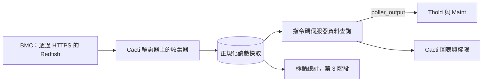

<!-- Source: README.md; SHA256: 7b4e83a58a1adc844cb0615ef30e95476cba2851f96bb454d2a816fb2774724d -->

<!-- translations:start -->
[English](../../../README.md) | [简体中文](../zh-CN/README.md) | [हिन्दी](../hi-IN/README.md) | [Español (España)](../es-ES/README.md) | [Español (Latinoamérica)](../es-419/README.md) | [العربية (السعودية)](../ar-SA/README.md) | [Afrikaans](../af-ZA/README.md) | [አማርኛ](../am-ET/README.md) | [العربية (مصر)](../ar-EG/README.md) | [العربية (المغرب)](../ar-MA/README.md) | [বাংলা](../bn-BD/README.md) | [Bosanski](../bs-BA/README.md) | [Deutsch](../de-DE/README.md) | [فارسی](../fa-IR/README.md) | [Filipino](../fil-PH/README.md) | [Français](../fr-FR/README.md) | [Français (Maroc)](../fr-MA/README.md) | [Français (Sénégal)](../fr-SN/README.md) | [Hausa](../ha-NG/README.md) | [עברית](../he-IL/README.md) | [Hrvatski](../hr-HR/README.md) | [Bahasa Indonesia](../id-ID/README.md) | [Igbo](../ig-NG/README.md) | [Italiano](../it-IT/README.md) | [日本語](../ja-JP/README.md) | [한국어](../ko-KR/README.md) | [Malagasy](../mg-MG/README.md) | [मराठी](../mr-IN/README.md) | [Bahasa Melayu](../ms-MY/README.md) | [Nederlands](../nl-NL/README.md) | [Polski](../pl-PL/README.md) | [Português (Brasil)](../pt-BR/README.md) | [Русский](../ru-RU/README.md) | [Kinyarwanda](../rw-RW/README.md) | [Soomaali](../so-SO/README.md) | [Српски](../sr-RS/README.md) | [Svenska](../sv-SE/README.md) | [Kiswahili](../sw-KE/README.md) | [தமிழ்](../ta-IN/README.md) | [తెలుగు](../te-IN/README.md) | [ไทย](../th-TH/README.md) | [Türkçe](../tr-TR/README.md) | [Українська](../uk-UA/README.md) | [اردو](../ur-PK/README.md) | [Tiếng Việt](../vi-VN/README.md) | [isiXhosa](../xh-ZA/README.md) | [Yorùbá](../yo-NG/README.md) | [繁體中文](README.md) | [isiZulu](../zu-ZA/README.md)
<!-- translations:end -->

# plugin_redfish

一款適用於 Cacti 1.2 的外掛程式，透過 Redfish（並提供選用的 IPMI 備援機制），將伺服器耗電量、進氣溫度、風扇狀態與電源供應器健康狀態從基板管理控制器（BMC）匯入 Cacti，作為一般的裝置、資料來源與圖表使用。隨後可透過 Thold 發出警示並由 Maint 進行抑制，後續階段也將新增機櫃層級的耗電量總計。

> **狀態：開發中，尚未發布正式版本（0.1.0-dev）。** 里程碑 2（基礎架構）與里程碑 3（Cacti 物件與警示功能）已合併至 `main`。本外掛程式與 Cacti 專案無關聯。它可安裝於 PHP 8.2 或更新版本環境下的 Cacti 1.2.31，支援註冊 BMC 與憑證、透過 Redfish 從各 BMC 讀取耗電量、溫度、風扇與電源供應器健康狀態至專屬快取中，並顯示收集作業的健康狀態。它能建立 Cacti 裝置、各成員與摘要圖表，並透過一般資料來源支援 Thold 與 Maint。CI 已使用手寫測試固定資料（fixtures）建構的模擬 BMC 以及 DMTF Redfish 模擬伺服器進行測試；目前尚未對實體 BMC 或試點機群進行驗證。設計與研究資料位於 [docs/PLAN.md](../../PLAN.md)、[docs/research/](../../research) 與 [docs/decisions/](../../decisions)。

### 里程碑 2 提供的功能

- 透過 Cacti 的外掛程式 API 進行安裝、升級、停用與解除安裝；解除安裝時預設保留資料表，除非清除該設定。在低於 PHP 8.2 的環境中，本外掛程式會拒絕安裝或啟用並說明原因。
- 權限領域「Redfish View」（健康狀態頁面）、「Redfish Operator」（作業頁面）與「Redfish Admin」（BMC 與憑證頁面），以及位於 Configuration > Settings > Redfish 下的設定項目。
- 具備 CSV 匯入與 JSON 匯出功能的 BMC 登錄檔。匯入檔案不得包含密碼；憑證以名稱參照。
- 憑證採用 AES-256-GCM 加密儲存。金鑰為儲存於資料庫外部的檔案，預設路徑為 `/etc/cacti/redfish-vault.key`，內容包含 64 個十六進位字元（`openssl rand -hex 32`）或剛好 32 個隨機位元組，擁有者須為輪詢器使用者，其他使用者不可讀取，且所在目錄僅限輪詢器使用者或 root 可寫入。由 32 個可列印字元組成的金鑰會被視為密碼片語而遭拒絕。**請務必將金鑰檔案連同資料庫一併備份**；若遺失金鑰檔案，所有已儲存的密碼都必須重新輸入。
- 預設啟用 TLS 驗證，支援為個別 BMC 指定 CA 憑證套件或 SPKI SHA-256 釘選（pin）。針對個別 BMC 選擇停用驗證的操作會寫入日誌，並在健康狀態頁面上持續顯示為警告。
- 唯讀 Redfish 用戶端：僅支援 `GET` 以及工作階段的登入與登出操作，且在發送任何請求前皆會比對允許清單。
- 由 `poller_bottom` 啟動的收集器，負責處理主輪詢器上的 BMC，具備個別 BMC 的租約、截止時間、退避機制，以及在當機後清理外掛程式所記錄的單一工作階段。目前尚未支援遠端收集器；遠端收集器需要明確選定如何存取資料庫與金鑰（第 4 階段）。
- BMC 記錄與憑證遵循 Cacti 裝置權限：Redfish Admin 僅能檢視、修改及繫結其有權檢視之裝置上的 BMC，且僅能存取未被任何隱藏裝置上之 BMC 使用的憑證。

### 里程碑 3 新增的功能

- 範本以 Cacti 範本 XML 格式隨附於 `templates/` 目錄中，並在安裝與升級時使用 Cacti 內建的匯入工具進行匯入，透過雜湊值比對以確保匯入僅更新外掛程式的物件而不會重複新增。三個資料查詢檔案會複製到 `<cacti>/resource/script_server/` 並記錄其雜湊值；外掛程式絕不會覆蓋非由其寫入的檔案，且當範本或查詢檔案尚未就位時，健康狀態頁面會向管理員發出警告。在 BMC 頁面上執行 **Reinstall the Redfish Templates** 可重新匯入範本；此操作需要 Cacti 的 Import Templates 權限。
- 可針對各 BMC 執行 **Create Device** 或 **Add Graphs**（[ADR 0015](../../decisions/0015-attach-to-the-server-device-or-create-one-per-bmc.md)）。對應至現有伺服器裝置的 BMC，會將其資料查詢與圖表附加於該裝置上。未對應的 BMC 則會依據「Redfish BMC」裝置範本建立新裝置，並關閉可用性檢查且主機名稱位於 `.invalid` 網域下，使 Cacti 絕不會主動連線至該 BMC，也不會顯示其位址。無論哪種方式，管理員都必須先確認列出待新增項目的計畫。兩項操作皆需具備 Cacti 的裝置管理權限以及 Redfish Admin 權限；若建立者無法檢視新建的裝置，該裝置將會被移除。
- 三個指令碼伺服器資料查詢：「Redfish Fans」、「Redfish Temperatures」與「Redfish Power Supplies」，以 BMC 的成員索引鍵編製索引，每個成員對應一張圖表：風扇轉速（以百分比或 RPM 顯示，依 BMC 回報單位為準）、溫度，以及電源供應器的輸入與輸出瓦數，每項皆附帶其健康狀態代碼。
- 「Redfish Node Summary」輸入項目，包含耗電量、進氣溫度、最高溫度、異常的風扇與電源供應器數量、節點健康狀態，以及上次成功讀取至今的經過時間，並繪製於四張圖表：耗電量、溫度、元件健康狀態與資料時效。設定於這些資料來源上的 Thold 臨界值可觸發警示，且 Maint 可加以抑制，兩款外掛程式皆無需任何修改。
- 指令碼伺服器僅從外掛程式的快取回應，絕不直接連線至 BMC。若數值缺失、過期、單位不符，或來自已不存在的成員，則回傳 `U`，使圖表顯示斷點而非零值；`age` 永遠會有數值，因此對其設定臨界值可偵測停止回應的 BMC。
- 每個 Redfish 圖表皆提供連結至該裝置的 Redfish 圖表集，僅對 Cacti 允許檢視該裝置的使用者顯示。

**當 BMC 的成員發生變更時**（例如更換風扇、韌體更新導致感測器重新命名），請再次選擇 **Add Graphs**。先前存在但現已缺席或移除的風扇或電源供應器，在重新執行該操作前仍會計入 `fans_bad` 或 `psus_bad`，因此拔除風扇會觸發警示；從未安裝元件的插槽則不會計入。Add Graphs 會採納 BMC 目前回報的成員，並讓 Cacti 重新編製查詢索引；已不存在的成員會保留其資料來源與圖表（此後讀取皆為 `U`），新成員則會建立新的圖表。當已移除成員的歷史資料不再需要時，請手動刪除其圖表。

刪除裝置會解除其 BMC 的對應關係，並保留該 BMC 及其快取。刪除 BMC 或解除安裝外掛程式時，會保留其裝置與圖表。

## 存取角色

| 權限領域 | 存取權限 |
| --- | --- |
| Redfish View | 現有監控頁面。 |
| Redfish Operator | 監控頁面，外加作業頁面與個人異常排查確認功能。 |
| Redfish Admin | Operator 權限，外加現有的設定與管理操作。 |

複製升級檔案後，請以管理員身分開啟 Plugins 頁面以註冊新的權限領域。接著於 **Configuration > Users** 或使用者群組中明確指派 Operator 權限領域。升級過程會保留現有的 View 與 Admin 權限領域 ID 及授權。每次請求時，Admin 權限會自動繼承 Operator 權限，而 Operator 權限會自動繼承 View 權限；此機制不會在使用者或群組中新增持久儲存的授權記錄。此外，外掛程式設定除了需要 Cacti 的 Settings 權限外，還需要具備 Redfish Admin 權限。

Cacti 裝置權限仍會限制每位使用者可檢視的資料列與可執行的操作；未對應的物件則必須由管理員處理。Operator 可針對具有權限的 BMC 解除收集暫停狀態，使其於下次排程執行時恢復收集。憑證、設定、對應關係、刪除及其他管理變更仍僅限於管理頁面中操作。異常排查確認僅在目前使用者的工作階段中有效，最長維持一小時，且僅在該同一筆觀測資料仍屬最新狀態時有效；一旦出現新的或變動的觀測資料，確認狀態即告失效。這些確認絕不會將失敗的量測標記為健康，也不會抑制警示。

## 為何需要本外掛程式

每台伺服器皆配備獨立於作業系統之外回報耗電與散熱狀態的 BMC，因此即使在作業系統當機時仍能持續回應。這些資料可用於容量與成本追蹤、風扇或電源供應器故障的早期預警，以及在高效能運算環境中進行功耗上限決策。不過本外掛程式並非專為 HPC 設計。

Cacti 目前已涵蓋其中部分功能：

- **廠商 SNMP 套件。** 1.2.x 分支內建 Dell iDRAC 與 HPE iLO 範本，但需要依賴 SNMP 代理程式且受限於特定廠商；里程碑 1 的研究發現，這兩者皆未回報以瓦特為單位的耗電量（[docs/research/overlap.md](../../research/overlap.md)）。
- **缺乏收集器的憑證類型。** plugin_credentials 定義了「IPMI / Redfish (BMC)」憑證類型，但並未實際讀取任何 BMC。
- **缺乏機櫃層級檢視。** Cacti 核心沒有機櫃物件，裝置僅提供自由文字的 `location` 欄位。

本外掛程式在 Cacti 輪詢週期之外以頻外方式輪詢 BMC、快取正規化後的讀數，並透過指令碼伺服器資料查詢與摘要資料來源將其公開。它重複使用 Cacti 既有的圖表繪製、權限、Thold 與 Maint 機制，且不會變更 BMC 狀態。遠端資料收集器支援預計於第 4 階段實作；目前的收集作業僅於主輪詢器上執行。

## 規劃範圍

| 階段 | 範圍 | 里程碑 |
|---|---|---|
| 0，研究 | 廠商矩陣、確認實體 BMC 上的上游行為、輪詢成本、資料查詢概念驗證 | [M1](https://github.com/somethingwithproof/plugin_redfish/milestone/1) |
| 1，觀測 | BMC 登錄檔、憑證、TLS、Redfish 收集器、正規化讀數、裝置、各索引圖表、Thold 警示、Maint 抑制、健康狀態頁面 | [M2](https://github.com/somethingwithproof/plugin_redfish/milestone/2), [M3](https://github.com/somethingwithproof/plugin_redfish/milestone/3), [M4](https://github.com/somethingwithproof/plugin_redfish/milestone/4) |
| 2，IPMI | 針對不支援可用 Redfish 之 BMC 的 IPMI 備援機制，預設停用 | [M5](https://github.com/somethingwithproof/plugin_redfish/milestone/5) |
| 3，機櫃 | 機櫃登錄檔、含覆蓋率的機櫃耗電量總計、電力預算餘裕 | [M6](https://github.com/somethingwithproof/plugin_redfish/milestone/6) |
| 4，遠端 | 適用於隔離式 BMC 網路的 Cacti 遠端資料收集器 | [M7](https://github.com/somethingwithproof/plugin_redfish/milestone/7) |

不在範圍內的項目：設定功耗上限或任何其他 BMC 設定、電源控制、韌體更新、主控台存取、外掛程式自建警示引擎，以及排程器整合。

## 相容性目標

| 元件 | 目標 |
|---|---|
| Cacti | 1.2.31 或更新版本，無需修改核心程式 |
| 資料庫 | MariaDB 10.2 或 MySQL 5.7 或更新版本：透過產生欄位上的唯一索引鍵確保每個裝置最多對應一個 BMC |
| PHP | 8.2 或更新版本；`setup.php` 維持與 8.0 相容的語法解析，使不支援的執行環境能明確拒絕安裝，而非導致 Cacti UI 損毀 |
| BMC | Dell iDRAC、HPE iLO、Lenovo XCC 與 OpenBMC，依韌體版本範圍而定；請參閱[廠商矩陣](../../research/vendor-matrix.md) |
| Redfish | 優先使用新版子系統與感測器資源，並以已棄用的 `Power` 與 `Thermal` 作為備援 |
| Thold、Maint | 無需修改 |

## 設計

- [docs/PLAN.md](../../PLAN.md) 為完整計畫書：包含架構、所依賴的上游事實（附來源與仍待確認的假設）、量測模型、安全性邊界、效能計算、測試與風險。
- [docs/decisions/](../../decisions) 存放已定案的架構決策記錄。
- [docs/REQUIREMENTS.md](../../REQUIREMENTS.md) 將每個需求 ID 對應至其議題。

## 安全性

BMC 憑證控制伺服器的頻外管理權限。本設計確保憑證不會出現在命令列、日誌與網頁中，預設驗證 TLS，透過僅允許白名單子命令的引數陣列執行任何外部命令，並使用唯讀 BMC 帳號。請參閱 [docs/PLAN.md](../../PLAN.md#security) 與 [SECURITY.md](../../../SECURITY.md)。

## 操作指南

有關安裝先決條件、金鑰保存庫與 TLS 設定、BMC 註冊、圖表建立、警示間隔、備份與故障處理，請參閱 [docs/operator-guide.md](../../operator-guide.md)。在來自實際廠商韌體系列且經過敏感資訊遮罩的擷取資料通過測試套件前，該指南不會宣告支援該韌體系列。

## 工作追蹤方式

- **里程碑**遵循計畫書中的里程碑。每個里程碑皆設有一個史詩議題（epic issue），列出其子議題與完成佐證。
- **議題**依標籤分類：`type: requirement`、`type: research`、`type: decision`、`type: epic`。需求議題會載明具備編號且可測試的需求（`REQ-AREA-NNN`）與驗收條件。
- **標籤**亦包含 `area:`、`phase:`、`priority:` 與 `status:`。請參閱 [CONTRIBUTING.md](../../../CONTRIBUTING.md#labels)。
- [專案看板](https://github.com/users/somethingwithproof/projects/12)顯示跨所有里程碑的全部議題。

## 貢獻指南

請閱讀 [CONTRIBUTING.md](../../../CONTRIBUTING.md)。提交（commit）須附上 DCO 簽署。設計討論於議題中進行；尚未定案的決策會標記 `type: decision` 標籤。來自實體 BMC 的實測佐證是目前最有價值的貢獻；在張貼任何擷取資料前，請務必遮罩位址、序號與憑證。

## 授權條款

GNU General Public License v2.0，與 Cacti 及其外掛程式採用相同的授權條款。請參閱 [LICENSE](../../../LICENSE)。
