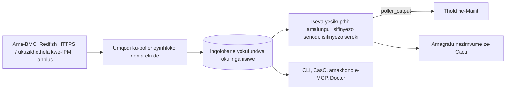

<!-- Source: README.md; SHA256: 6972a6c9ac754cd60e63c5caf971451ea8fe6e279eef757d886e1a168d3eef01 -->

<!-- translations:start -->
[English](../../../README.md) | [简体中文](../zh-CN/README.md) | [हिन्दी](../hi-IN/README.md) | [Español (España)](../es-ES/README.md) | [Español (Latinoamérica)](../es-419/README.md) | [العربية (السعودية)](../ar-SA/README.md) | [Afrikaans](../af-ZA/README.md) | [አማርኛ](../am-ET/README.md) | [العربية (مصر)](../ar-EG/README.md) | [العربية (المغرب)](../ar-MA/README.md) | [বাংলা](../bn-BD/README.md) | [Bosanski](../bs-BA/README.md) | [Deutsch](../de-DE/README.md) | [فارسی](../fa-IR/README.md) | [Filipino](../fil-PH/README.md) | [Français](../fr-FR/README.md) | [Français (Maroc)](../fr-MA/README.md) | [Français (Sénégal)](../fr-SN/README.md) | [Hausa](../ha-NG/README.md) | [עברית](../he-IL/README.md) | [Hrvatski](../hr-HR/README.md) | [Bahasa Indonesia](../id-ID/README.md) | [Igbo](../ig-NG/README.md) | [Italiano](../it-IT/README.md) | [日本語](../ja-JP/README.md) | [한국어](../ko-KR/README.md) | [Malagasy](../mg-MG/README.md) | [मराठी](../mr-IN/README.md) | [Bahasa Melayu](../ms-MY/README.md) | [Nederlands](../nl-NL/README.md) | [Polski](../pl-PL/README.md) | [Português (Brasil)](../pt-BR/README.md) | [Русский](../ru-RU/README.md) | [Kinyarwanda](../rw-RW/README.md) | [Soomaali](../so-SO/README.md) | [Српски](../sr-RS/README.md) | [Svenska](../sv-SE/README.md) | [Kiswahili](../sw-KE/README.md) | [தமிழ்](../ta-IN/README.md) | [తెలుగు](../te-IN/README.md) | [ไทย](../th-TH/README.md) | [Türkçe](../tr-TR/README.md) | [Українська](../uk-UA/README.md) | [اردو](../ur-PK/README.md) | [Tiếng Việt](../vi-VN/README.md) | [isiXhosa](../xh-ZA/README.md) | [Yorùbá](../yo-NG/README.md) | [繁體中文](../zh-TW/README.md) | [isiZulu](README.md)
<!-- translations:end -->

# plugin_redfish

I-plugin ye-Cacti 1.2 eletha ukudonsa kwamandla kweseva, izinga lokushisa elingenayo, isimo sefeni, kanye nempilo yokunikezwa kwamandla kusuka kubalawuli bokuphatha ibhodi eliyisisekelo (ama-BMC) ku-Cacti njengamadivayisi ajwayelekile, imithombo yedatha, namagrafu, isebenzisa i-Redfish kanye nokuzikhethela kokubuyela ku-IPMI efundwayo kuphela nokuhlanganiswa kwamandla ezingeni lereki. I-Thold ne-Maint zixwayisa futhi zicindezele izexwayiso ngemithombo yedatha ejwayelekile ye-Cacti.

> **Isimo: isathuthukiswa, akukho ukukhishwa okwamanje (`0.1.0-dev`).** Le plugin ayihlangene nephrojekthi ye-Cacti. Ifakwa ku-Cacti 1.2.31 noma eyakamuva ngaphansi kwe-PHP 8.2 noma eyakamuva futhi isebenzisa umqoqi we-Redfish, indawo yokugcina ebethelwe yezifakazelo, ukuhlinzekwa kwamadivayisi namagrafu e-Cacti, ukuzikhethela kokubuyela ku-IPMI efundwayo kuphela, ukuhlanganiswa kwamandla ereki, ukuboniswa kwewindi le-Cacti Maint, ukuphindaphindwa kwabaqoqi bedatha abakude namaphuzu okugcina ama-ejenti, umhlinzeki we-CasC ne-CLI yomsebenzisi, amakhono e-MCP, nokuhlolwa kokuxilonga kwe-Doctor. I-CI ihlola ama-fixture, i-DMTF Redfish Mockup Server (izinhlelo ezingaphansi, ezendala kuphela, kanye ne-HPE iLO Gen11), kanye ne-Thold v1.8.2 ne-Maint v1.3; ayikho i-BMC yangempela noma iqoqo lokuhlola eliqinisekisiwe okwamanje. Umklamo nocwaningo kuse-[docs/PLAN.md](../../PLAN.md), [docs/research/](../../research/), naku-[docs/decisions/](../../decisions/).

## Amakhono asetshenzisiwe

### Umqoqi oyisisekelo, indawo yokugcina eyimfihlo, nezinto ze-Cacti

- **Umjikelezo wempilo nesikima.** Iyafakwa, ithuthukiswe, ikhutshazwe, futhi ikhishwe nge-API ye-plugin ye-Cacti (`Schema::VERSION = 3`, amathebula ayi-12). Amathebula ayagcinwa lapho ikhishwa ngaphandle uma i-*Keep Plugin Tables on Uninstall* ingamakiwe. Amaphuzu okungena ayahlaziyeka ku-PHP 8.0 futhi enqaba i-PHP engaphansi kuka-8.2 noma ukuntuleka kwe-`ext-openssl` ngomyalezo wephutha ocacile.
- **Irekhodi nezimvume.** Izindawo ze-*Redfish View* (`redfish_health.php`), *Redfish Operator* (`redfish_operator.php`), ne-*Redfish Admin* (`redfish_bmcs.php`, `redfish_credentials.php`), kanye nezilungiselelo ngaphansi kwe-**Configuration > Settings > Redfish**. Irekhodi le-BMC lisekela ukungeniswa kwe-CSV (izifakazelo zikhonjwa ngegama; amaphasiwedi asemibhalweni yokungenisa ayanqatshwa) nokukhishwa kwe-JSON. Amarekhodi e-BMC nezifakazelo alandela izimvume zamadivayisi e-Cacti.
- **Indawo yokugcina ebethelwe yezifakazelo.** Amaphasiwedi agcinwa ebethelwe nge-AES-256-GCM ku-`plugin_redfish_secret`. Ukhiye uhlala ngaphandle kwedathabheyisi (ngokuzenzakalelayo `/etc/cacti/redfish-vault.key`) njengezinhlamvu ze-hexadecimal ezingama-64 (`openssl rand -hex 32`) noma amabhayithi angama-32 angahluziwe, uphathwa umsebenzisi we-poller, awufundeki kwabanye abasebenzisi, futhi usekholweni olubhalwa i-root noma lowo msebenzisi kuphela. Umusho wokungena ophrintahayo wezinhlamvu ezingama-32 uyanqatshwa. **Yenza ikhophi yasenqolobaneni yefayela lokhiye kanye nedathabheyisi**; ngaphandle kwayo, amaphasiwedi agciniwe kufanele afakwe futhi.
- **I-TLS neklayenti le-Redfish elifundwayo kuphela.** Ukuqinisekiswa kwe-TLS kuvulwe ngokuzenzakalelayo kusetshenziswa isitolo se-CA sesistimu, iphakheji ye-CA ye-BMC ngayinye, noma iphini ye-SPKI SHA-256; ukukhetha ukungaqinisekisi ku-BMC ngayinye kuhlala kubonakala njengesixwayiso sempilo nesixwayiso sokuhlola kwe-Doctor. Iklayenti livumela kuphela i-`GET` kanye nokungena kweseshini ye-Redfish (`POST`) nokuphuma (`DELETE`), nokuzikhethela kokubuyela ku-Basic ku-BMC ngayinye uma amaseshini engatholakali. Ukuthola kukhetha izinsiza ezintsha zezinhlelo ezingaphansi nezinzwa ze-Redfish kuqala bese kubuyela ezinsizeni ezindala ze-`Power` ne-`Thermal`.
- **Ukusebenza komqoqi.** I-`poller_redfish.php` iqala ku-`poller_bottom`, isebenzisa inqubo eyodwa eyinhloko nge-poller ngokusebenzisa irekhodi lezinqubo ze-Cacti elinezinqubo zabasebenzi ezihlelekayo (`redfish_workers`), ithola izinkontileka zokuqasha ze-BMC ngayinye, iphoqelela isabelomali sesikhathi (`redfish_collector_budget`), isebenzisa ukuhlehla okukhulayo ngokuphindaphindiwe, futhi ihlanze iseshini yangaphambilini ye-plugin ngemva kokuphahlazeka.
- **Amathempulethi, amadivayisi, namagrafu.** Ingenisa i-`templates/redfish-templates.xml` nge-hash futhi ikopishele amafayela amathathu e-XML emibuzo yedatha yeseva yesikripthi (`redfish_fans.xml`, `redfish_temperatures.xml`, `redfish_psus.xml`) ku-`<cacti>/resource/script_server/` ngaphandle kokubhala phezu kwamafayela alungiswe umsebenzisi. I-**Create Device** ne-**Add Graphs** zidinga ukuqinisekiswa kohlelo lokuhlinzeka, zinamathisela imibuzo kudivayisi yeseva emaphiwe noma zakhe idivayisi ye-"Redfish BMC" ngaphansi kwe-`.invalid` ngokuhlola ukutholakala kuvaliwe, futhi zixhumanise igrafu ngayinye ye-Redfish emuva kumagrafu e-Redfish edivayisi nge-`graph_buttons`.
- **Okokufaka kweseva yesikripthi okwenqolobane kuphela.** I-`scripts/ss_redfish_members.php` ihlinzeka ngokufundwa kwefeni, izinga lokushisa, ne-PSU yelungu ngalinye, kanti i-`scripts/ss_redfish_summary.php` ihlinzeka ngamamethrikhi e-"Redfish Node Summary" (amandla, izinga lokushisa elingenayo neliphezulu kunawo wonke, inani lamafeni nama-PSU amabi, impilo yenodi, nobudala bokufunda okuhle kokugcina). Izingcingo zeseva yesikripthi zifunda inqolobane yendawo kuphela futhi azilokothi zithintane ne-BMC. Ukufunda okungekho, okudala, noma kwelungu elingasekho kubuyisela u-`U` (akukaze kube u-`0`), ngenkathi i-`age` ihlala ibika inani ukuze imingcele ithole ama-BMC athule.

**Uma amalungu e-BMC eshintsha** (njengefeni eshintshiwe noma isibuyekezo se-firmware esiqamba kabusha izinzwa), sebenzisa i-**Add Graphs** futhi. Ifeni noma ukunikezwa kwamandla obekukhona ngaphambilini okunyamalale kubalwa ku-`fans_bad` noma ku-`psus_bad` kuze kube kwamukelwa; indawo engakaze igcwaliswe ayibalwa. Amalungu angasekho agcina imithombo yawo yedatha namagrafu akhona, afunda u-`U` ngemva kwalokho aze asuswe ngesandla. Ukususa idivayisi ye-Cacti kususa ukumaphwa kwayo kwe-BMC nokwabelwa kwayo kwereki ngenkathi kugcinwa i-BMC nenqolobane; ukususa i-BMC noma ukukhipha i-plugin kugcina amadivayisi namagrafu e-Cacti.

### Ukuzikhethela kokubuyela ku-IPMI

- **Ukuzikhethela nge-BMC ngayinye.** Kuvaliwe ngokuzenzakalelayo (`protocols` izenzakalela ku-`redfish`; ukuvula ukubuyela ku-IPMI kusetha u-`redfish,ipmi`).
- **Isihlahleli sokubuyela esinokulinganiselwa.** Isebenza kuphela uma ukuqoqwa kwe-Redfish kwehluleka ngesigaba sokuhluleka esifanelekile; ayilokothi isebenze ku-`AuthRejected`, `CredentialUnavailable`, `AddressRefused`, `OperationRefused`, noma ku-`Deadline`.
- **Ukusebenza okuphephile.** Ibiza i-`ipmitool` nge-`-I lanplus` ngohlu lwe-`proc_open()` ngaphandle kwe-shell, nesikhathi esibekiwe sokuphelelwa yisikhathi nomkhawulo wokukhiphayo ongu-256 KiB. Amaphasiwedi anikezwa nge-`IPMITOOL_PASSWORD` (`-E`) noma ngefayela lesikhashana le-mode-0600 (`-f`) elisuswa ku-`finally`, hhayi ku-CLI argv.
- **Uhlu lwemiyalo efundwayo kuphela evumelekile.** Imiyalo engaphansi emihlanu efundwayo kuphela evumelekile: `dcmi power reading`, `sdr type Temperature`, `sdr type Fan`, `sdr type Power Supply`, ne-`chassis status`. Imiyalo eshintsha isimo iyanqatshwa.
- **Okukhiphayo okulinganisiwe nesixwayiso sokuphepha.** I-`IpmiNormalizer` imapha ukufunda kumodeli efanayo ye-`Observation`/`Member`/`Reading`, ikhiphe u-`U` kuzinzwa ezingekho noma ezingahlaziyeki. Ukuvula ukubuyela ku-IPMI kuphakamisa isixwayiso ekhasini lempilo nasekuhloleni kwe-Doctor kwe-`redfish.bmc_security` okukhumbuza abasebenzisi ukuthi bakhawulele i-UDP 623 ku-VLAN yokuphatha.

### Ukuhlanganiswa kwamandla ereki

- **Irekhodi lereki.** Inguqulo yesikima yesi-3 yengeza i-`plugin_redfish_rack` (eyingqayizivele `(site_id, name)`, okokuzikhethela `power_budget_watts`, i-`min_coverage_pct` ezenzakalela ku-`80`, namanothi) ne-`plugin_redfish_rack_member` (okungenani ukwabelwa okukodwa kwereki nge-`host_id` ngayinye, okokuzikhethela `bmc_id` ne-`unit_position`, kusushwa ngokuzenzakalelayo uma idivayisi ye-Cacti isuswa).
- **Isamba esivikelwe ukumbozwa.** I-`RackPowerSummary` ihlanganisa ukufundwa okusha kwe-`power_watts` kwamalungu kusuka kunqolobane yendawo futhi ibale ukusetshenziswa kwesabelomali nesikhala esisele. Uma ukumbozwa kwamalungu abikayo kwehla ngaphansi kwe-`min_coverage_pct`, i-`power_watts`, `utilization_pct`, ne-`headroom_watts` zibuyisela u-`U` ukuze ukuhluleka komqoqi kungaze kubonakale njengokwehla kwamandla ereki.
- **Okokufaka kweseva yesikripthi okulungele i-Thold.** I-`scripts/ss_redfish_rack.php` (`ss_redfish_rack(<rack_id>)`) ibuyisela i-`power_watts`, `power_budget_watts`, `utilization_pct`, `headroom_watts`, `members_total`, `members_reporting`, ne-`coverage_pct` kusuka kunqolobane yendawo kuphela.

### Ukuhlanganiswa kwe-Cacti Maint

- Imingcele ye-Thold emithonjeni yedatha ye-Redfish iyaxwayisa futhi i-Cacti Maint iyayicindezela ngaphandle kwezinguquko kunoma iyiphi i-plugin.
- I-`MaintWindow` ihlola amasheduli e-Maint asebenzayo kumsingathi ngamunye we-Cacti omaphiwe (amasheduli esikhathi esisodwa `mtype=1` naphindaphindayo `mtype=2`, kanye ne-`plugin_maint_check_cacti_host()` uma ilayishiwe) futhi imaka ukunakekelwa okusebenzayo ekhasini le-Redfish Health (`[MAINT]`), kokukhiphayo kwe-`cli/redfish.php health`, nasekhonweni le-`redfish-get-health`.

### Abaqoqi bedatha abakude

- I-`INFO` imemezela u-`remote_collect:1`. Ama-BMC amukela noma iyiphi i-`poller_id >= 1`, futhi i-`poller_redfish.php --poller=N` iqoqa kuphela ama-BMC avuliwe abelwe leyo poller.
- **I-hook ye-`replicate_out`.** Iphindaphinda kuphela amathebula okucushwa angeyona imfihlo akhawulelwe ku-poller ekude eqondiwe nge-`replicate_out_table()`: `plugin_redfish_bmc`, imethadatha ye-`plugin_redfish_credential` (akukho mbhalo obethelwe), `plugin_redfish_rack`, ne-`plugin_redfish_rack_member`. I-`plugin_redfish_secret` ayiphindaphindwa, futhi amafayela okhiye bendawo yokugcina eyimfihlo ahlala esendaweni yakwa-poller ngayinye ngokuphelele.
- **I-hook ye-`remote_agent`.** Iveza izenzo ezifundwayo kuphela ze-`redfish_health` ne-`redfish_discovery` ezamukela kuphela amapharamitha ezinombolo ze-`poller_id` ne-`bmc_id`. Amapharamitha angalindelekile ayanqatshwa futhi azikho izifakazelo noma izimfihlo ezibuyiselwayo.

### Ama-hook ohlelo lwezemvelo (CasC, amakhono e-MCP, ne-Doctor)

- **Umhlinzeki we-CasC (`casc_register_providers`).** Ibhalisa umhlinzeki we-`redfish` (inguqulo yesikima `1`) ngokukhipha kwe-YAML ne-XML kwe-PHP emsulwa, ukuhlaziya (i-XXE iyanqatshwa), ukuqinisekisa, ukuhlela umehluko, nokusebenzisa. Izifakazelo zivela kuphela njengezinkomba zendawo yokugcina (`vault:redfish:<name>`); okhiye bemfihlo abangahluziwe (`pass`, `secret`, `token`, `private_key`, `vault_key`, `auth_token`) bayanqatshwa. Ukusebenzisa kudinga i-`PLAN_HASH` ye-SHA-256 eqondile.
- **I-MCP / Abilities API (`abilities_register`).** Ibhalisa amakhono amathathu afundwayo kuphela alawulwa indawo ye-Redfish View (`redfish_health.php`) nezimvume zamadivayisi e-Cacti, engabuyiseli izifakazelo:
  - `redfish-list-bmcs` (okokuzikhethela `poller_id`)
  - `redfish-get-rack-power` (okokuzikhethela `rack_id`)
  - `redfish-get-health` (okokuzikhethela `bmc_id`)
- **Ukuhlola kwe-Doctor (`doctor_register_checks`).** Kubhalisa ukuhlolwa kokuxilonga kwendawo okufundwayo kuphela okuhlanu okungalokothi kuthintane ne-BMC noma kubuyisele izinto zokhiye:
  - `redfish.schema`: ukuhambisana kwesikhathi kwenguqulo yesikima
  - `redfish.vault_key`: ukufundeka nezimvume zokhiye wendawo yokugcina
  - `redfish.collector_runs`: isabelomali somqoqi we-poller nobusha
  - `redfish.bmc_security`: ama-BMC avuliwe ane-TLS engaqinisekisiwe noma ukubuyela ku-IPMI
  - `redfish.rack_power`: ukuthotyelwa kwesabelomali samandla ereki nomkhawulo wokumbozwa

## CLI

Sebenzisa kusuka ohlwini lwempande lwe-Cacti nge-PHP 8.2 noma eyakamuva:

```sh
# Operator and CasC CLI (reads --file=PATH or stdin for validate, plan, and apply)
php plugins/redfish/cli/redfish.php export --format=yaml|xml
php plugins/redfish/cli/redfish.php validate [--file=PATH] [--format=yaml|xml]
php plugins/redfish/cli/redfish.php plan [--file=PATH] [--format=yaml|xml]
php plugins/redfish/cli/redfish.php apply [--file=PATH] [--format=yaml|xml] --confirm=<PLAN_HASH>
php plugins/redfish/cli/redfish.php health --format=text|json

# Collector entry point (normally started by poller_bottom)
php plugins/redfish/poller_redfish.php [--poller=N] [--force] [--debug]

# Rack power summary script server entry point
php plugins/redfish/scripts/ss_redfish_rack.php <rack_id>
```

## Izindima zokufinyelela

| Indawo | Ukufinyelela |
| --- | --- |
| Redfish View | Amakhasi okubheka akhona. |
| Redfish Operator | Ukubheka kanye nekhasi leMisebenzi nezivumo zokuhlela izinkinga zomuntu siqu. |
| Redfish Admin | Ukufinyelela kwe-Operator kanye nokucushwa okukhona nezenzo zokuphatha. |

Ngemva kokukopisha amafayela okuthuthukisa, vula ikhasi le-Plugins njengomlawuli ukuze ubhalise izindawo. Yabela indawo ye-Operator ngokusobala ngaphansi kwe-**Configuration > Users** noma amaqembu abasebenzisi. Ukuthuthukisa kugcina ama-ID nezimvume zezindawo ze-View ne-Admin ezikhona. Ukufinyelela kwe-Admin kudla ifa lokufinyelela kwe-Operator, futhi ukufinyelela kwe-Operator kudla ifa lokufinyelela kwe-View esicelweni ngasinye; lokhu akwengezi izimvume ezigciniwe kubasebenzisi noma emaqenjini. Izilungiselelo ze-plugin zidinga futhi ukufinyelela kwe-Redfish Admin ngaphezu kwemvume ye-Settings ye-Cacti.

Izimvume zamadivayisi e-Cacti zikhawulela imigqa nezenzo ezitholakalayo kumsebenzisi ngamunye; izinto ezingamaphiwe zidinga umlawuli. Abasebenzisi bangakhulula ukubanjwa kokuqoqwa ku-BMC evunyelwe ekusebenzeni okulandelayo okuhleliwe. Izifakazelo, ukucushwa, ukumaphwa, ukususwa, nezinye izinguquko zokuphatha kuhlala emakhasini okuphatha. Izivumo zihlala kuphela eseshinini yomsebenzisi yamanje, okungenani ihora elilodwa futhi kuphela uma okufanayo okubukiwe kuhlala kukusha. Ukubuka okusha noma okushintshiwe kuyazenza zingasebenzi. Azilokothi zimake isilinganiso esehlulekile njengesisempilweni noma zicindezele izexwayiso.

## Kungani

Iseva ngayinye ine-BMC ebika isimo samandla nokushisa ngokuzimele kusistimu yokusebenza, ngakho iyaqhubeka nokuphendula uma i-OS ingasebenzi. Idatha isebenzela ukulandelela umthamo nezindleko, isixwayiso sangaphambi kwesikhathi sefeni noma ukunikezwa kwamandla okwehlulekile, futhi, ekukhompyutheni esebenza kakhulu, izinqumo zokubeka umkhawulo wamandla. Le plugin ayenzelwe i-HPC kuphela.

I-Cacti ihlanganisa ingxenye yalokhu namuhla:

- **Amaphakheji e-SNMP abathengisi.** Igatsha le-1.2.x liza namathempulethi e-Dell iDRAC ne-HPE iLO adinga i-ejenti ye-SNMP futhi aqondene nomthengisi; ucwaningo lwesigaba sokuqala luthole ukuthi akukho nelilodwa elibika ukudonsa kwamandla ngama-watt ([docs/research/overlap.md](../../research/overlap.md)).
- **Uhlobo lwesifakazelo olungenamqoqi.** I-`plugin_credentials` ichaza isifakazelo se-"IPMI / Redfish (BMC)" kodwa ayifundi noma iyiphi i-BMC.
- **Akukho ukubuka kwezinga lereki.** Umongo we-Cacti awunayo into yereki; idivayisi inenkambu yombhalo okhululekile ye-`location`.

I-plugin iphenya ama-BMC ngaphandle komjikelezo wokuphenya we-Cacti ku-poller eyinhloko noma kubaqoqi bedatha abakude, igcine ukufundwa okulinganisiwe kunqolobane, futhi ikuveze ngemibuzo yedatha yeseva yesikripthi, izifinyezo zenodi, nezifinyezo zamandla ereki. Iphinda isebenzise ukudweba amagrafu, izimvume, i-Thold, ne-Maint ye-Cacti, futhi ayishintshi isimo se-BMC.

## Ububanzi nesimo

| Isigaba | Ububanzi | Izigaba ezinkulu | Isimo |
|---|---|---|---|
| 0, ucwaningo | Imetrikhi yabathengisi, ukuqinisekiswa kokuziphatha kohlelo oluphezulu kuma-BMC aphilayo, izindleko zokuphenya, ukuhlolwa kombuzo wedatha | [M1](https://github.com/somethingwithproof/plugin_redfish/milestone/1) | Kuqediwe, kulindwe ukubanjwa kwe-firmware ye-BMC yangempela |
| 1, ukubheka | Irekhodi le-BMC, izifakazelo, i-TLS, umqoqi we-Redfish, ukufundwa okulinganisiwe, amadivayisi, amagrafu ngesikhombo, izexwayiso ze-Thold, ukuhlanganiswa kwe-Maint, ikhasi lempilo | [M2](https://github.com/somethingwithproof/plugin_redfish/milestone/2), [M3](https://github.com/somethingwithproof/plugin_redfish/milestone/3), [M4](https://github.com/somethingwithproof/plugin_redfish/milestone/4) | Kusetshenzisiwe; ukuqinisekiswa kweqoqo lokuhlola le-M4 kulindile |
| 2, ipmi | Ukubuyela ku-IPMI (`lanplus`) efundwayo kuphela nge-`ipmitool`, kuvaliwe ngokuzenzakalelayo | [M5](https://github.com/somethingwithproof/plugin_redfish/milestone/5) | Kusetshenzisiwe |
| 3, amareki | Irekhodi lereki, isamba samandla ereki esinomkhawulo wokumbozwa, isikhala sesabelomali, `ss_redfish_rack.php` | [M6](https://github.com/somethingwithproof/plugin_redfish/milestone/6) | Kusetshenzisiwe |
| 4, kude nohlelo lwezemvelo | Abaqoqi bedatha abakude (`replicate_out`, `remote_agent`), umhlinzeki we-CasC ne-CLI, amakhono e-MCP, ukuhlola kwe-Doctor | [M7](https://github.com/somethingwithproof/plugin_redfish/milestone/7) | Kusetshenzisiwe |

Okungaphandle kobubanzi: ukusetha imikhawulo yamandla noma okunye ukucushwa kwe-BMC, ukulawula amandla, ukubuyekeza i-firmware, ukufinyelela kwe-console, injini yezexwayiso ye-plugin uqobo, nokuhlanganiswa nomhleli.

## Izinhloso zokuhambisana

| Ilungu | Inhloso |
|---|---|
| Cacti | 1.2.31 noma eyakamuva, akukho ukulungiswa komongo |
| Idathabheyisi | MariaDB 10.2 noma MySQL 5.7 noma eyakamuva: i-BMC eyodwa ngedivayisi ngayinye igcinwa ukhiye oyingqayizivele kukholamu ekhiqiziwe |
| PHP | 8.2 noma eyakamuva; amaphuzu okungena ahlala ehlaziyeka ku-8.0 ukuze isikhathi sokusebenza esingasekelwe sithole ukwenqatshwa esikhundleni se-UI ye-Cacti ephukile |
| Izandiso ze-PHP | `ext-openssl` (edingwa yi-Cacti 1.2.31); akukho `ext-curl` futhi akukho okuncike kwesikhathi sokusebenza kwe-Composer |
| Amathuluzi okuzikhethela | `ipmitool` kuma-poller aqoqa ama-BMC anokubuyela ku-IPMI okuvuliwe |
| Ama-BMC | Dell iDRAC, HPE iLO, Lenovo XCC, ne-OpenBMC, ngobubanzi be-firmware; bheka [imetrikhi yabathengisi](../../research/vendor-matrix.md) |
| Redfish | Izinsiza ezintsha zezinhlelo ezingaphansi nezinzwa kuqala, ezingasasetshenziswa ze-`Power` ne-`Thermal` njengokubuyela |
| Thold, Maint | Akukho zinguquko ezidingekayo (i-CI ihlola i-Thold v1.8.2 ne-Maint v1.3) |

## Umklamo

- [docs/PLAN.md](../../PLAN.md) uhlelo oluphelele: ukwakheka, amaqiniso ohlelo oluphezulu elincike kuwo, imodeli yokulinganisa, imingcele yokuphepha, izibalo zokusebenza, ukuhlola, nezingozi.
- [docs/decisions/](../../decisions/) igcina amarekhodi ezinqumo zokwakheka ezinkethweni esezivele zenziwe.
- [docs/REQUIREMENTS.md](../../REQUIREMENTS.md) imapha i-ID yemfuneko ngayinye enkingeni yayo.



## Ukuphepha

Izifakazelo ze-BMC zilawula ukuphathwa kwangaphandle kwebhendi kwamaseva. Umklamo ugcina izimfihlo ngaphandle kwemigqa yemiyalo, amalogi, ukukhipha kwe-CasC, ama-payload e-ejenti ekude, izimpendulo ze-MCP, namakhasi ewebhu; ubethela amaphasiwedi agciniwe nge-AES-256-GCM usebenzisa ifayela lokhiye wendawo yokugcina eyimfihlo ku-poller ngayinye; uqinisekisa i-TLS ngokuzenzakalelayo; usebenzisa i-`ipmitool` kusuka kuhlu lwezimpikiswano olucacile olunemiyalo engaphansi efundwayo kuphela evumelekile; futhi usebenzisa ama-akhawunti e-BMC afundwayo kuphela. Bheka i-[docs/PLAN.md](../../PLAN.md#security) ne-[SECURITY.md](../../../SECURITY.md).

## Umhlahlandlela womsebenzisi

Bheka i-[docs/operator-guide.md](../../operator-guide.md) ngezidingo zangaphambi kokufaka, ukusethwa kwendawo yokugcina eyimfihlo ne-TLS, ukubhaliswa kwe-BMC, ukudalwa kwamagrafu, izikhathi zezexwayiso, ikhophi yasenqolobaneni, nokuphathwa kokwehluleka. Umhlahlandlela awumemezeli ukuthi umugqa wangempela we-firmware yomthengisi uyasekelwa kuze kube ukubanjwa okuhlanzwe izimfihlo okuvela kuleyo firmware kuphumelela ukuhlola.

## Ukuthuthukiswa nokuhlolwa

I-CI ([.github/workflows/plugin-ci-workflow.yml](../../../.github/workflows/plugin-ci-workflow.yml)) ihlola amaphuzu okungena ku-PHP 8.0, isebenzisa izinhlelo zokuhlola ze-Pest zeyunithi (`phpunit.xml`) nezokuhlanganiswa komjikelezo wempilo (`phpunit-integration.xml`) kanye ne-PHPStan ezingeni lesi-9 ku-PHP 8.2 kuya ku-8.5 ngokumelene ne-Cacti `release/1.2.31` ne-`1.2.x`, iqinisekisa ukwenqatshwa ku-PHP 8.1, ihlola i-DMTF Redfish Mockup Server (izinhlelo ezingaphansi, ezendala kuphela, ne-HPE iLO Gen11) ne-Thold v1.8.2 / Maint v1.3 kusukela ekuqaleni kuze kube sekugcineni, futhi ihlola amakhathalogi e-gettext, ukugeleza komsebenzi, nelayisense ye-REUSE.

Ukuhlola kwendawo ngaphambi kokuphusha:

```sh
sh tests/lint-workflows.sh
sh locales/build_gettext.sh --check
CACTI_PATH=/path/to/cacti phpstan analyse -c phpstan.neon --no-progress
```

Sebenzisa i-Pest nge-`--configuration=phpunit.xml` ekuhloleni kweyunithi nomthetho womthombo, noma nge-`--configuration=phpunit-integration.xml` kanye ne-`CACTI_PATH` ne-`REDFISH_TEST_DATABASE=disposable` ngokumelene nedathabheyisi ye-Cacti elahlekayo ekuhloleni kokuhlanganiswa komjikelezo wempilo.

## Indlela umsebenzi olandelelwa ngayo

- **Izigaba ezinkulu** zilandelela izigaba ezinkulu zohlelo. Ngasinye sinenkinga ye-epic ehlela izinkinga zaso ezingaphansi nobufakazi bokuqeda.
- **Izinkinga** zihlukaniswe ngelebula: `type: requirement`, `type: research`, `type: decision`, `type: epic`. Izinkinga zezimfuneko zisho izimfuneko ezinezinombolo, ezihlolekayo (`REQ-AREA-NNN`) nemibandela yokwamukela.
- **Amalebula** aphatha futhi `area:`, `phase:`, `priority:`, ne-`status:`. Bheka i-[CONTRIBUTING.md](../../../CONTRIBUTING.md#labels).
- I-[bhodi lephrojekthi](https://github.com/users/somethingwithproof/projects/12) ibonisa zonke izinkinga kuzo zonke izigaba ezinkulu.

## Ukufaka isandla

Funda i-[CONTRIBUTING.md](../../../CONTRIBUTING.md). Ama-commit adinga isignesha ye-DCO. Ingxoxo yomklamo yenzeka ezinkingeni; izinqumo ezivulekile zithwala ilebula ye-`type: decision`. Ubufakazi obuvela kuma-BMC angempela bungumnikelo owusizo kakhulu manje; susa amakheli, izinombolo zochungechunge, nezifakazelo ngaphambi kokuthumela noma yikuphi ukubanjwa.

## Ilayisensi

GNU General Public License v2.0, ilayisensi efanayo neye-Cacti nama-plugin ayo. Bheka i-[LICENSE](../../../LICENSE).
