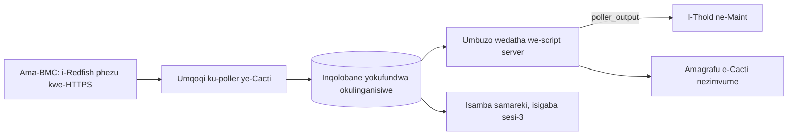

<!-- Source: README.md; SHA256: 7b4e83a58a1adc844cb0615ef30e95476cba2851f96bb454d2a816fb2774724d -->

<!-- translations:start -->
[English](../../../README.md) | [简体中文](../zh-CN/README.md) | [हिन्दी](../hi-IN/README.md) | [Español (España)](../es-ES/README.md) | [Español (Latinoamérica)](../es-419/README.md) | [العربية (السعودية)](../ar-SA/README.md) | [Afrikaans](../af-ZA/README.md) | [አማርኛ](../am-ET/README.md) | [العربية (مصر)](../ar-EG/README.md) | [العربية (المغرب)](../ar-MA/README.md) | [বাংলা](../bn-BD/README.md) | [Bosanski](../bs-BA/README.md) | [Deutsch](../de-DE/README.md) | [فارسی](../fa-IR/README.md) | [Filipino](../fil-PH/README.md) | [Français](../fr-FR/README.md) | [Français (Maroc)](../fr-MA/README.md) | [Français (Sénégal)](../fr-SN/README.md) | [Hausa](../ha-NG/README.md) | [עברית](../he-IL/README.md) | [Hrvatski](../hr-HR/README.md) | [Bahasa Indonesia](../id-ID/README.md) | [Igbo](../ig-NG/README.md) | [Italiano](../it-IT/README.md) | [日本語](../ja-JP/README.md) | [한국어](../ko-KR/README.md) | [Malagasy](../mg-MG/README.md) | [मराठी](../mr-IN/README.md) | [Bahasa Melayu](../ms-MY/README.md) | [Nederlands](../nl-NL/README.md) | [Polski](../pl-PL/README.md) | [Português (Brasil)](../pt-BR/README.md) | [Русский](../ru-RU/README.md) | [Kinyarwanda](../rw-RW/README.md) | [Soomaali](../so-SO/README.md) | [Српски](../sr-RS/README.md) | [Svenska](../sv-SE/README.md) | [Kiswahili](../sw-KE/README.md) | [தமிழ்](../ta-IN/README.md) | [తెలుగు](../te-IN/README.md) | [ไทย](../th-TH/README.md) | [Türkçe](../tr-TR/README.md) | [Українська](../uk-UA/README.md) | [اردو](../ur-PK/README.md) | [Tiếng Việt](../vi-VN/README.md) | [isiXhosa](../xh-ZA/README.md) | [Yorùbá](../yo-NG/README.md) | [繁體中文](../zh-TW/README.md) | [isiZulu](README.md)
<!-- translations:end -->

# plugin_redfish

I-plugin ye-Cacti 1.2 eletha ukudonsa kwamandla kweseva, izinga lokushisa elingenayo, isimo sefeni, kanye nempilo yokunikezwa kwamandla kusuka kuma-baseboard management controller (ama-BMC) ku-Cacti njengamadivayisi ajwayelekile, imithombo yedatha, namagrafu, isebenzisa i-Redfish kanye ne-IPMI yokuzikhethela uma i-Redfish ingasebenzi. I-Thold ne-Maint zibe sezixwayisa futhi zicindezele izexwayiso kuyo, bese isigaba sakamuva sengeza isamba samandla esezingeni lereki.

> **Isimo: isathuthukiswa, akukho ukukhishwa okwamanje (0.1.0-dev).** Izigaba ezinkulu zesi-2 (isisekelo) neyesi-3 (izinto ze-Cacti nokuxwayisa) zihlanganiswe ku-`main`. Le plugin ayihlangene nephrojekthi ye-Cacti. Ifakwa ku-Cacti 1.2.31 ngaphansi kwe-PHP 8.2 noma eyakamuva, ibhalisa ama-BMC nezifakazelo, ifunde amandla, amazinga okushisa, amafeni, nempilo yokunikezwa kwamandla kusuka ku-BMC ngayinye nge-Redfish iye enqolobaneni yayo, futhi ibonise impilo yokuqoqwa kwedatha. Yengeza amadivayisi e-Cacti, amagrafu elungu ngalinye nawesifinyezo, kanye nokusekelwa kwe-Thold ne-Maint ngemithombo yedatha ejwayelekile. I-CI ihlole i-BMC engelona iqiniso eyakhiwe ngama-fixture abhalwe ngesandla kanye neseva yokulingisa ye-DMTF Redfish; ayikho i-BMC yangempela noma iqoqo lokuhlola eliqinisekisiwe okwamanje. Umklamo nocwaningo kuse-[docs/PLAN.md](../../PLAN.md), [docs/research/](../../research), naku-[docs/decisions/](../../decisions).

### Okulethwa yisigaba esikhulu sesi-2

- Ukufaka, ukuthuthukisa, ukukhubaza, nokukhipha nge-plugin API ye-Cacti, lapho amathebula egcinwa uma kukhishwa ngaphandle uma isilungiselelo sisuliwe. Ku-PHP endala kuno-8.2 le plugin iyenqaba ukufakwa noma ukunikwa amandla futhi isho isizathu.
- Izindawo zokufinyelela ezithi "Redfish View" (ikhasi lempilo), "Redfish Operator" (ikhasi lokusebenza), kanye ne-"Redfish Admin" (amakhasi ama-BMC nezifakazelo), kanye nezilungiselelo ngaphansi kwe-Configuration > Settings > Redfish.
- Irejista yama-BMC enokungenisa kwe-CSV nokuthekelisa kwe-JSON. Amafayela okungenisa akumele aqukathe amaphasiwedi; izifakazelo zikhonjwa ngegama.
- Izifakazelo zigcinwa zibethelwe nge-AES-256-GCM. Ukhiye yifayela elingaphandle kwedathabheyisi, eliyi-`/etc/cacti/redfish-vault.key` ngokuzenzakalelayo, eliqukethe izinhlamvu ezingama-64 ze-hexadecimal (`openssl rand -hex 32`) noma amabhayithi angahleliwe angama-32 ngqo, elingumnikazi walo umsebenzisi we-poller, elingafundeki kwabanye abasebenzisi, lisekhombeni elingabhalwa umsebenzisi we-poller noma i-root kuphela. Ukhiye onezinhlamvu ezingama-32 ezikwazi ukuphrinteka uyenqatshwa njenge-passphrase. **Yenza ikhophi yasenqolobaneni yefayela lokhiye kanye nedathabheyisi**; ngaphandle kwalo lonke iphasiwedi eligciniwe kuzomele lifakwe futhi.
- Ukuqinisekiswa kwe-TLS kuvuliwe ngokuzenzakalelayo, nge-CA bundle ye-BMC ngayinye noma i-SPKI SHA-256 pin. Ukuzikhethela okungaqinisekisiwe kwe-BMC ngayinye okubhalwe phansi kuhlala ekhasini lempilo njengesexwayiso.
- Iklayenti le-Redfish elifundeka kuphela: i-`GET` kanye nokungena nokuphuma kweseshini kuphela, kuhlolwa ohlwini oluvunyelwe ngaphambi kokuba kuthunyelwe noma yisiphi isicelo.
- Umqoqi oqalwa kusuka ku-`poller_bottom` wama-BMC aku-poller eyinhloko, onezikhathi zokuqasha nemikhawulo yesikhathi ye-BMC ngayinye, ukuhlehla, kanye nokuhlanza ngemva kokuphahlazeka kweseshini eyodwa eqoshwe yi-plugin. Abaqoqi abakude abakasekelwa okwamanje; badinga ukukhethwa okucacile kokuthi umqoqi ufinyelela kanjani kudathabheyisi nakukhiye (isigaba sesi-4).
- Amarekhodi ama-BMC nezifakazelo kulandela izimvume zedivayisi ye-Cacti: i-Redfish Admin ibona, iguqula, futhi ibophe kuphela ama-BMC kumadivayisi evunyelwe ukuwabona, kanye nezifakazelo kuphela ezingasetshenziswa yinoma iyiphi i-BMC ekudivayisi efihliwe.

### Okwengezwa yisigaba esikhulu sesi-3

- Izifanekiso zithunyelwa njenge-XML yesifanekiso se-Cacti ku-`templates/` futhi zingeniswa ngesingenisi se-Cacti uqobo ngesikhathi sokufaka nokuthuthukisa, ziqondaniswa nge-hash, ukuze ukungenisa kuvuselele izinto ze-plugin futhi kungangezi lutho kabili. Amafayela amathathu emibuzo yedatha akopishelwa ku-`<cacti>/resource/script_server/` ene-hash eqoshiwe; i-plugin ayilokothi ithathe indawo yefayela elikhona lapho elingabhalwanga yiyo, futhi ikhasi lempilo lixwayisa abaphathi uma izifanekiso noma ifayela lombuzo lingekho endaweni yalo. **Reinstall the Redfish Templates** ekhasini lama-BMC iphinda iwingenise futhi; idinga imvume ye-Cacti yokuthi Import Templates.
- **Create Device** noma **Add Graphs** ku-BMC ngayinye ([ADR 0015](../../decisions/0015-attach-to-the-server-device-or-create-one-per-bmc.md)). I-BMC ehlanganiswe nedivayisi ekhona yeseva ithola imibuzo yayo yedatha namagrafu kuleyo divayisi. I-BMC engahlanganisiwe ithola idivayisi entsha kusukela kusifanekiso sedivayisi se-"Redfish BMC", ukuhlolwa kokutholakala kuvaliwe kanye negama le-host ngaphansi kwe-`.invalid`, ukuze i-Cacti ingalokothi ixhumane ne-BMC futhi ingalokothi ibonise ikheli layo. Noma yikuphi, umphathi uqale aqinisekise uhlelo olubala okuzokwengezwa. Zombili zidinga imvume yokuphatha idivayisi ye-Cacti kanye ne-Redfish Admin; idivayisi entsha umdali abengakwazi ukuyibona iyakhishwa futhi.
- Imibuzo yedatha ye-script server emithathu, "Redfish Fans", "Redfish Temperatures", kanye ne-"Redfish Power Supplies", ekhonjwe ngokhiye welungu le-BMC, enegrafu yelungu ngalinye: isivinini sefeni ngephesenti noma i-RPM (noma iyiphi iyunithi ebikwa yi-BMC), izinga lokushisa, kanye nokungena nokuphuma kwamandla kwe-watts yokunikezwa kwamandla, ngakunye kunekhodi yayo yempilo.
- Okokufaka kwe-"Redfish Node Summary" okunamandla, izinga lokushisa elingenayo, izinga lokushisa eliphezulu kakhulu, amafeni nezinto zokunikeza amandla ezingekho ku-OK, impilo ye-node, kanye nobudala bokufundwa okuhle kokugcina, kudwetshwe kumagrafu amane: amandla, amazinga okushisa, impilo yezingxenye, kanye nobudala bedatha. Imikhawulo ye-Thold kule mithombo yedatha iyaxwayisa, futhi i-Maint iyayicindezela, ngaphandle koshintsho ku-plugin ngayinye.
- I-script server iphendula kuphela kusuka enqolobaneni ye-plugin futhi ayilokothi ixhumane ne-BMC. Inani elingekho, eliphelelwe yisikhathi, elikwenye iyunithi, noma elisuka elungwini elingasekho ngu-`U`, ukuze amagrafu abonise isikhala, hhayi uziro; i-`age` ihlala inenani, ukuze umkhawulo kuyo ubambe i-BMC eyekile ukuphendula.
- Isixhumanisi segrafu esisuka kugrafu ngayinye ye-Redfish siya kumagrafu e-Redfish wedivayisi, siboniswa kuphela kubasebenzisi i-Cacti ebavumela ukubona idivayisi.

**Uma amalungu e-BMC eshintsha** (ifeni ishintshiwe, ukubuyekezwa kwe-firmware kuqamba kabusha izinzwa), khetha **Add Graphs** futhi. Ifeni noma ukunikezwa kwamandla ebekukhona futhi manje sekungekho noma kungasekho kubalwa ku-`fans_bad` noma ku-`psus_bad` kuze kube yilapho wenza kanjalo, ukuze ifeni ekhishiwe ixwayise; indawo engakaze igcwaliswe ayibali. I-Add Graphs yamukela amalungu i-BMC ewabika manje, futhi i-Cacti iphinde ikhombe imibuzo futhi; ilungu elingasekho ligcina umthombo walo wedatha negrafu, ezifunda u-`U` kusukela lapho, futhi ilungu elisha lithola igrafu. Susa amagrafu amalungu angasekho ngesandla uma umlando wawo ungasadingeki.

Ukususa idivayisi kuqaqa ukuhlanganiswa kwe-BMC yayo futhi kugcine i-BMC nenqolobane yayo. Ukususa i-BMC, noma ukukhipha i-plugin, kugcina idivayisi yayo namagrafu.

## Izindima zokufinyelela

| Indawo yokufinyelela | Ukufinyelela |
| --- | --- |
| Redfish View | Amakhasi okuqapha akhona. |
| Redfish Operator | Ukuqapha kanye nekhasi le-Operations kanye nokuvuma kokuhlola komuntu siqu. |
| Redfish Admin | Ukufinyelela kwe-Operator kanye nokulungiselela okukhona nezenzo zokuphatha. |

Ngemva kokukopisha amafayela okuthuthukisa, vula ikhasi le-Plugins njengomphathi ukuze ubhalise indawo yokufinyelela entsha. Yabela indawo yokufinyelela ye-Operator ngokucacile ngaphansi kwe-**Configuration > Users** noma amaqembu abasebenzisi.
Ukuthuthukiswa kugcina ama-ID endawo yokufinyelela akhona we-View ne-Admin kanye nezimvume ezinikeziwe. Ukufinyelela kwe-Admin kudla ifa lokufinyelela kwe-Operator, futhi ukufinyelela kwe-Operator kudla ifa lokufinyelela kwe-View esicelweni ngasinye; lokhu akungezi izimvume ezigciniwe kubasebenzisi noma emaqenjini. Izilungiselelo ze-plugin zidinga futhi ukufinyelela kwe-Redfish Admin ngaphezu kwemvume ye-Settings ye-Cacti.

Izimvume zedivayisi ye-Cacti zisakhawulela imigqa nezenzo ezitholakalayo kumsebenzisi ngamunye; izinto ezingahlanganisiwe zidinga umphathi. Ama-Operator angakhulula ukubanjwa kokuqoqwa ku-BMC evunyelwe ekugijimeni okulandelayo okuhleliwe.
Izifakazelo, ukulungiselela, ukuhlanganisa, ukususa kanye nezinye izinguquko zokuphatha kuhlala emakhasini okuphatha. Ukuvuma kuhlala kuphela eseshinini yomsebenzisi yamanje, isikhathi esingeqile ehorini elilodwa futhi kuphela uma ukubhekwa okufanayo kuhlala kusha. Ukubhekwa okusha noma okushintshile kuyakuqeda ukusebenza kwako. Akulokothi kuphawule isilinganiso esehlulekile njengesinempilo noma kucindezele izexwayiso.

## Kungani

Yonke iseva ine-BMC ebika isimo samandla nokushisa ngokuzimela ohlelweni lokusebenza, ngakho iyaqhubeka nokuphendula uma i-OS iphansi. Idatha isebenzela ukulandelela umthamo nezindleko, isexwayiso sangaphambi kwesikhathi sefeni ehlulekile noma yokunikezwa kwamandla, futhi, ekusebenziseni ikhompyutha okusezingeni eliphezulu, izinqumo zokukhawulela amandla. Le plugin ayiqondene ne-HPC kuphela.

I-Cacti ihlanganisa ingxenye yalokhu namuhla:

- **Amaphakheji e-SNMP omthengisi.** Igatsha le-1.2.x lithumela izifanekiso ze-Dell iDRAC ne-HPE iLO ezidinga umenzeli we-SNMP futhi eziqondene nomthengisi; ucwaningo lwesigaba esikhulu soku-1 lwathola ukuthi akukho neyodwa ebika ukudonswa kwamandla nge-watts ([docs/research/overlap.md](../../research/overlap.md)).
- **Uhlobo lwesifakazelo olungenamqoqi.** I-plugin_credentials ichaza isifakazelo se-"IPMI / Redfish (BMC)" kodwa ayifundi i-BMC.
- **Akukho ukubuka kwezinga lereki.** Ingqikithi ye-Cacti ayinayo into yereki; idivayisi inenkambu yombhalo okhululekile ye-`location`.

Le plugin ibuza ama-BMC ngaphandle kwebhande kusuka emjikelezweni wokubuza we-Cacti, igcina ukufundwa okulinganisiwe enqolobaneni, futhi ikuveze ngombuzo wedatha we-script server nemithombo yedatha yesifinyezo. Isebenzisa kabusha ukudweba amagrafu, izimvume, i-Thold, ne-Maint ye-Cacti, futhi ayishintshi isimo se-BMC. Ukusekelwa komqoqi wedatha okude kuhlelelwe isigaba sesi-4; ukuqoqwa kwamanje kusebenza ku-poller eyinhloko kuphela.

## Ububanzi obuhleliwe

| Isigaba | Ububanzi | Izigaba ezinkulu |
|---|---|---|
| 0, ucwaningo | Imatriksi yabathengisi, ukuqinisekiswa kokuziphatha okungaphezulu kuma-BMC aphilayo, izindleko zokubuza, isivivinyo sombuzo wedatha | [M1](https://github.com/somethingwithproof/plugin_redfish/milestone/1) |
| 1, ukubheka | Irejista ye-BMC, izifakazelo, i-TLS, umqoqi we-Redfish, ukufundwa okulinganisiwe, amadivayisi, amagrafu nge-index ngayinye, ukuxwayisa kwe-Thold, ukucindezela kwe-Maint, ikhasi lempilo | [M2](https://github.com/somethingwithproof/plugin_redfish/milestone/2), [M3](https://github.com/somethingwithproof/plugin_redfish/milestone/3), [M4](https://github.com/somethingwithproof/plugin_redfish/milestone/4) |
| 2, ipmi | I-IPMI yokungena esikhundleni yama-BMC angenayo i-Redfish esebenzisekayo, ivaliwe ngokuzenzakalelayo | [M5](https://github.com/somethingwithproof/plugin_redfish/milestone/5) |
| 3, amareki | Irejista yamareki, isamba samandla emareki nokufinyelela, isikhala sebhajethi | [M6](https://github.com/somethingwithproof/plugin_redfish/milestone/6) |
| 4, kude | Abaqoqi bedatha bakude be-Cacti bamanethiwekhi ama-BMC ahlukanisiwe | [M7](https://github.com/somethingwithproof/plugin_redfish/milestone/7) |

Okungaphandle kobubanzi: ukusetha imikhawulo yamandla noma yikuphi okunye ukulungiselelwa kwe-BMC, ukulawula amandla, ukubuyekeza i-firmware, ukufinyelela kwikhonsoli, injini yokuxwayisa ephethwe yi-plugin, kanye nokuhlanganiswa kwesihleli.

## Izinhloso zokuhambisana

| Ingxenye | Inhloso |
|---|---|
| Cacti | 1.2.31 noma eyakamuva, azikho izichibi zengqikithi |
| Idathabheyisi | MariaDB 10.2 noma MySQL 5.7 noma eyakamuva: i-BMC eyodwa ngedivayisi ngayinye ibanjwa ukhiye oyingqayizivele kukholamu ekhiqiziwe |
| PHP | 8.2 noma eyakamuva; i-`setup.php` ihlala ifundeka ku-8.0 ukuze indawo yokusebenza engasekelwe ithole ukwenqatshwa esikhundleni se-UI ye-Cacti ephukile |
| Ama-BMC | Dell iDRAC, HPE iLO, Lenovo XCC, kanye ne-OpenBMC, ngobubanzi be-firmware; bheka [imatriksi yabathengisi](../../research/vendor-matrix.md) |
| Redfish | Izinsiza ezintsha ze-subsystem nezinzwa kuqala, i-`Power` ne-`Thermal` ephelelwe yisikhathi njengesipele |
| Thold, Maint | Azikho izinguquko ezidingekayo |

## Umklamo

- I-[docs/PLAN.md](../../PLAN.md) iyinhlelo ephelele: ukwakheka, amaqiniso angaphezulu encike kuwo (enemithombo kanye nemibono okusamele iqinisekiswe), imodeli yokulinganisa, imingcele yokuphepha, izibalo zokusebenza, ukuhlola, kanye nezingozi.
- I-[docs/decisions/](../../decisions) igcina amarekhodi ezinqumo zokwakha zezinqumo esezivele zenziwe.
- I-[docs/REQUIREMENTS.md](../../REQUIREMENTS.md) ibeka i-ID yemfuneko ngayinye emsebenzini wayo.

## Ukuphepha

Izifakazelo ze-BMC zilawula ukuphathwa kwamaseva ngaphandle kwebhande. Umklamo uzigcina zingekho emigqeni yemiyalo, emalogi, nasemakhasini, uqinisekisa i-TLS ngokuzenzakalelayo, ugijima noma yimuphi umyalo wangaphandle kusuka ohlwini lwama-argument onemiyalo emincane evunyelwe, futhi usebenzisa ama-akhawunti e-BMC afundeka kuphela. Bheka [docs/PLAN.md](../../PLAN.md#security) kanye no-[SECURITY.md](../../../SECURITY.md).

## Umhlahlandlela womsebenzisi

Bheka [docs/operator-guide.md](../../operator-guide.md) ngezimfuneko zokufaka, ukusetwa kwe-vault ne-TLS, ukubhaliswa kwe-BMC, ukudalwa kwamagrafu, izikhawu zokuxwayisa, ikhophi yasenqolobaneni, nokuphatha ukwehluleka. Umhlahlandlela awumemezeli ulayini we-firmware womthengisi wangempela njengosekelwayo kuze kube yilapho ukuthwetshulwa okusulwe imininingwane eyimfihlo okuvela kuleyo firmware kuphumelela ochungechungeni lokuhlola.

## Indlela umsebenzi olandelelwa ngayo

- **Izigaba ezinkulu** zilandela izigaba ezinkulu zohlelo. Ngasinye sinomsebenzi omkhulu obala imisebenzi yaso emincane nobufakazi bokuphuma.
- **Imisebenzi** ihlukaniswa ngelebula: `type: requirement`, `type: research`, `type: decision`, `type: epic`. Imisebenzi yemfuneko isho izimfuneko ezinenombolo, ezihlolekayo (`REQ-AREA-NNN`) kanye nemibandela yokwamukelwa.
- **Amalebula** aphinde aphathe `area:`, `phase:`, `priority:`, kanye ne-`status:`. Bheka [CONTRIBUTING.md](../../../CONTRIBUTING.md#labels).
- I-[bhodi lephrojekthi](https://github.com/users/somethingwithproof/projects/12) libonisa yonke imisebenzi kuzo zonke izigaba ezinkulu.

## Ukunikela

Funda [CONTRIBUTING.md](../../../CONTRIBUTING.md). Ama-commit adinga isiginesha ye-DCO. Ingxoxo yomklamo yenzeka emisebenzini; izinqumo ezivuliwe ziphethe ilebula ye-`type: decision`. Ubufakazi obuvela kuma-BMC wangempela bungumnikelo owusizo kakhulu manje; susa amakheli, izinombolo ze-serial, kanye nezifakazelo ngaphambi kokuthumela noma yikuphi ukuthwetshulwa.

## Ilayisense

I-GNU General Public License v2.0, ilayisense efanayo neye-Cacti nama-plugin ayo. Bheka [LICENSE](../../../LICENSE).
